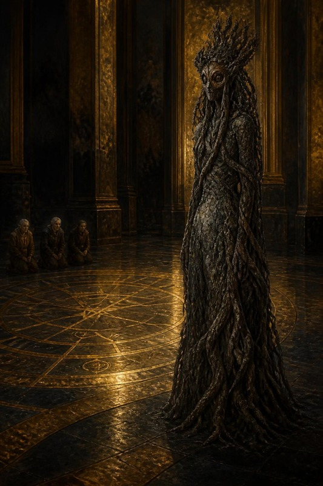
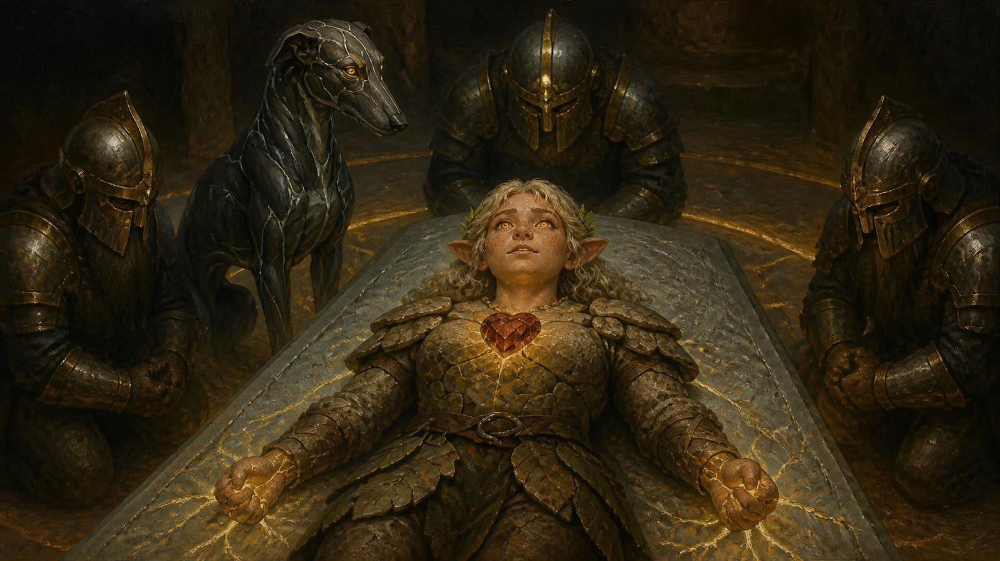
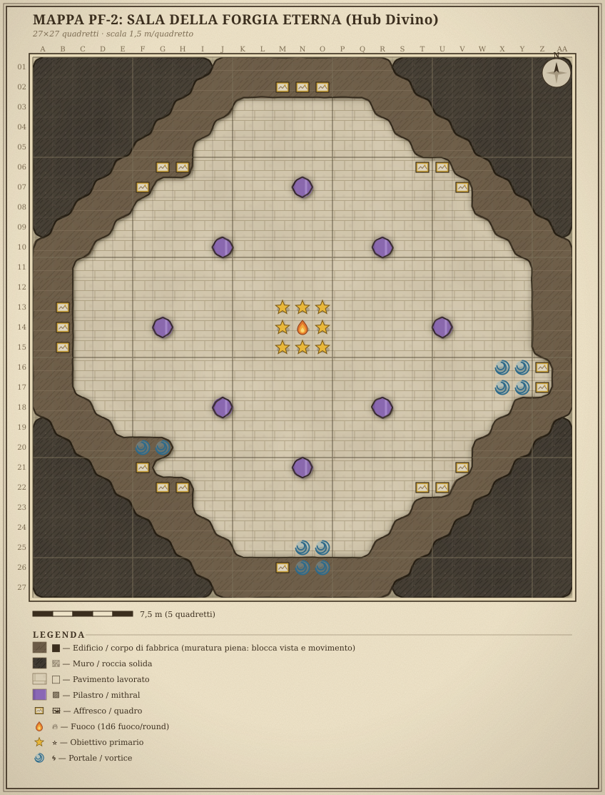

<!-- module-type: hub -->
# ARC-07 · DEFINITIVO #3 — LA RESURREZIONE DI HELLA
## Il Portale della Forgia Eterna — il Cuore di Moradin, i Doni, il Debito della Radice

<!-- apparato -->
> ⭐ **MASTER DEFINITIVO — beat HUB rituale (il cuore emotivo dell'arco).**
> È la scena per cui esiste l'intero ARC-07 (G0). Non è un combattimento: è
> un **rito corale**, tre sacrifici che sono scelte, un risveglio, e un
> **prezzo che il mondo esige** (il filo grigio). Le sezioni solo-combattimento
> non si applicano; tutto il resto dello standard AP sì.
> **Sostituisce e fonde**: `_ARCHIVIO/PortaleForgia-P3B-ResurrezioneHella-COMPLETO.md`
> (master eletto B2 — rito, sacrifici, ramo del rifiuto, risveglio, Collana,
> Treant), i risultati canonici del viaggio dello spirito
> (`...IL-VIAGGIO-NELL'INCUDINE-DEL-MONDO-risultati.md`, D12) e la scheda
> `PG/Artefatti/Artefatti-Pg/Hella/01_Collana_dei_Semi_Eterni.md`.
> Deprecato: `...-RICALIBRATO-alternative.md`.
>
> **Sistema: D&D 3.5 SRD** (max PF1e), MAI 5e. Italiano, **CD** non DC.
> Faerûn 1372 DR. Scala mappe **1,5 m/quadretto**.
> Ordine di gioco D2, nonostante la sigla storica "3B".
<!-- /apparato -->

> **Il cuore emotivo dell'arco.** Non è un combattimento: è un **rito corale**,
> tre sacrifici che sono scelte, un risveglio, e un **prezzo che il mondo
> esige** (il filo grigio).
>
> **Quando si gioca**: **dopo** il Ritorno e gli Affreschi (`DEF-2`) e
> **prima** del Viaggio a 1.000 anni fa (`DEF-4`). **Com'è il mondo a quel
> punto**: lo spirito di Hella **ha già
> compiuto il viaggio nell'Incudine del Mondo**, con tutte le prove superate:
> verità piena, ferita aperta, Via della Radice. I PG **non lo sanno ancora**:
> lo scopriranno qui, dalla sua voce (§8).
>
> **L'orologio di Hammerfist.** Si arriva a **~3g 16h**
> `[CANONE GIOCATO 2026-07-31]`; il registro dei riposi è in `DEF-2` §0-bis,
> che possiede l'orologio. Il rito dura circa un'ora e porta l'orologio a
> **~3g 15h** `[CANONE — DM 2026-10-12, D81]`; un'altra ora se c'è l'indagine
> del Sud (§9) `[CANONE — DM 2026-10-12, D83]`. Da lì il tempo si conta tutto
> `[CANONE — DM 2026-10-18]`: **10 minuti** per ogni tentativo fallito degli
> Step 1-3, **un'ora** per la prima ora dopo il rito (§8-bis). Senza tentativi
> falliti né indagine, alla soglia segna **3g 14h**. La scaletta non prevede
> riposo prima della soglia; se il gruppo lo chiede, si dorme e costa otto ore
> (§9): dopo il rito la Sala conta il sonno per intero
> `[CANONE — DM 2026-10-18, G2-01]`. L'orologio conta quanto manca alla breccia di Hammerfist, e i PG lo
> leggono sull'affresco A7, che cambia a ogni riposo. Sotto i **2 giorni** la
> breccia è aperta e l'ARC-08 parte in Fase 0 dura (`DEF-2` §0-bis e §8).
>
> **Come arrivano.** Riposati, perché hanno dormito nella Sala, e col sogno di
> `DEF-2` §7-bis addosso: Hella, dall'altro lato, **ha già sentito Tordek dire
> il suo nome nel sonno**<!-- storico --> `[CANONE GIOCATO 2026-09-25]`: la voce del foglio 06 di Hella<!-- /storico -->.
>
> <!-- storico -->
> 🧭 **Riordinato il 2026-09-25, su richiesta del DM.** Il corpo si legge in
> avanti, nell'ordine in cui la serata accade: la Sala, le gemme, il Cuore, gli
> step del rito, i Doni dentro lo Step 5, il richiamo, la Custode, lo Step 6 che
> apre il risveglio, il racconto, la prima ora, la soglia. Prima lo Step 6 stava
> **prima** dei Doni e della Custode, che però succedono durante lo Step 5, e la
> soglia stava dopo contingenze, echi e PX. La scheda completa di Hella e lo
> statblocco dei Treant sono in **Appendice A**, le mappe in **Appendice B**.
> Dove i giocatori ricevono un foglio c'è la riga **✉ Si consegna qui**; la
> tabella in §0 le mette in fila. I numeri di sezione da §0 a §12 non sono
> cambiati.
> <!-- /storico -->

---

## INDICE DEL MODULO

| § | Sezione | Contenuto |
|---|---|---|
| §0 | **Quickstart DM** | dove siete, cosa fa questo beat, la serata scena per scena, se lo divinano, cosa stampare, **cosa si consegna e quando** |
| §0-bis | **Quick-Reference** | CD del rito, tabella dei Doni, box PF1e |
| §1 | **Highlight per PG** | il sacrificio come beat di ciascuno; il risveglio di Hella |
| §2 | **La scena** | la Sala che trattiene il fiato: sensi, sei porte |
| §2-bis | **Le due gemme accese** | la terza che manca, e la riga che nessuno ha detto a Thorik |
| §3 | **Il Cuore di Moradin** | il reliquiario che si apre |
| §4 | **Il rito corale, Step 1-4** | la regia degli step, le prove, l'apertura dello Step 5 |
| §5 | **Step 5 · i Tre Doni, poi il richiamo** | Moradin chiede; chi dona; il rifiuto; la Volontà dei tre |
| §6 | **Step 5 · il Debito della Radice** | la Custode entra dal Sud, tre risposte |
| §7 | **Step 6 e il risveglio** | Moradin manifesto, Hella respira, Durik si lega, la Collana nasce |
| §8 | **Il racconto delle prove** | l'asimmetria si scioglie |
| §8-bis | **La prima ora dopo il rito** | Hella prova il corpo nuovo; le Benedizioni; Hella e Tordek |
| §8-ter | **La soglia** | l'affresco del Tempo, la scelta, Therysol |
| §9 | **Contingenze & fallimento** | «se i PG fanno X»; i modi di fallimento dello Step 5 |
| §10 | **Echo Ledger** | conseguenze a lungo termine |
| §11 | **Avanzamento** | PX, artefatti, il corredo di Hella |
| §12 | **Ponte + Handout & Asset** | verso il viaggio a mille anni fa (`DEF-4`); handout, immagini, musica |
| App. A | **Statistiche** | la scheda completa di Hella risorta, il Treant di Adamantio |
| App. B | **Mappe** | la Sala della Forgia a pergamena, il cerchio del rito |

---

## §0 — QUICKSTART DM

> 🧭 **La serata in tre frasi.** Stasera non combatte nessuno: i tre Custodi
> riportano in vita Hella con un rito in sei step all'Altare del Cuore di
> Moradin, e ciascuno sceglie se donarle un potere del proprio artefatto. Si
> oppongono la morte, l'**orologio di A7** e **la Custode delle Radici**, che
> non combatte e vuole che qualcuno porti il debito. Prima di cominciare si
> danno **gli echi privati** del volume *Il Cuore e la Porta*, e la serata
> finisce davanti al portale del Tempo.

**Dove siete.** Nella **Sala della Forgia Eterna**, davanti all'Altare del Cuore
di Moradin. La Corona porta due gemme; gli affreschi hanno registrato la vittoria
della Terra (`DEF-2`); il corpo di Hella riposa, vegliato da Therysol. Resta
un solo atto prima di lasciare la Forgia: **riportarla indietro.**

**Cosa fa questo beat.** È **il momento per cui l'arco esiste**. (1) Moradin
rivela il **Cuore di Moradin** (§3), reliquia single-use che sola può
resuscitarla; (2) il **rito corale** chiede a ogni PG una **prova e un
sacrificio** — e ognuno deve *volerlo* (§4-5); (3) strappare un'anima al Sogno
della Terra lascia un **debito** che il mondo verrà a riscuotere (§6, il filo
grigio); (4) Hella si risveglia **Ibrido Treant**, Durik si lega a lei, nasce la
**Collana dei Semi Eterni** (§7); (5) per la prima volta i PG **odono** cosa ha
attraversato il suo spirito (§8). Poi il party è di **4**, pronto per il #4.

**Chi c'è.** Thorik, Tordek, Artemis (officianti); **Therysol** (veglia, testimone);
**Moradin** (divino, manifesto per 3 secondi allo Step 6); **Hella** (morta →
viva); **Durik**, il suo cane, che non si è mai allontanato dal corpo e si fa
avanti al risveglio (§7); e — al momento del richiamo — **la Custode delle Radici** (§6<!-- storico -->, CANONE
DM 2026-07-23<!-- /storico -->; il ramo A/B/C si gioca).

**Quanto dura.** Al tavolo, circa **novanta minuti** dal §2 al §8-bis, e un
quarto d'ora per la soglia del §8-ter, dopo una pausa.

**Se hai un'ora per prepararti**, leggi il §0, il §0-bis, la tabella dello
Step 5 in fondo al §5 e il §9: sono le pagine che servono quando un tiro va
male. Il resto si legge al tavolo, in avanti.

**Cosa stampare.** Il volume dei giocatori *Il Cuore e la Porta*, con i fogli
della tabella qui sotto: **gli echi privati si danno prima di cominciare**. Poi
la **Quick-Reference §0-bis** (rito + sacrifici); le mappe dell'**Appendice B**
(la Sala a pergamena e il cerchio R-1); la scheda completa di Hella
(**Appendice A**); il PDF Benedizioni.

**Come si chiude.** Hella viva, i Doni tessuti (o i debiti aperti), il Debito
della Radice registrato, la Collana al collo, Durik al fianco. La Corona può ora
aprire il **portale del Tempo** (Topazio + Smeraldo). → **il Viaggio a 1.000 anni fa
(`DEF-4`)** (Hella è il 4° PG, APL 13 pieno).

### La serata, scena per scena

Una riga per scena: che cosa succede, chi agisce, quando si passa oltre, e dove
andare se i PG fanno quello che il master non ha previsto.

| Scena | Cosa succede | Chi agisce | Si passa oltre quando | Se i PG fanno altro |
|---|---|---|---|---|
| **1 · L'Altare** (§2, §2-bis) | la Sala trattiene il fiato; sei porte facoltative; la Corona con l'incasso vuoto | i PG; Therysol si scosta dalla veglia | qualcuno tocca l'Altare o chiede del rito | vogliono dormire prima → §9; chiedono a Therysol del corpo → §9, «Il nodo del Sud» |
| **2 · Il Cuore** (§3) | Moradin rivela il reliquiario e il Cuore | Moradin, dalla Corona; Thorik ha le mani sul mithral | il Cuore è posato sul petto di Hella | provano a incastonarlo nella Corona, o a non spenderlo → §9 |
| **3 · Il rito, Step 1-4** (§4) | tre prove, una a testa, in ordine fisso | Thorik, poi Tordek, poi Artemis; lo Step 4 è di Moradin | lo Step 4 è riuscito, ed è automatico | uno step fallisce tre volte → riesce lo stesso e paga il prezzo (§4) |
| **4 · I Doni e il richiamo** (§5) | Moradin chiede; ciascuno dona o rifiuta; poi i tre tirano Volontà | Thorik, Tordek, Artemis | i tiri di Volontà sono fatti | rifiuto totale → §5; un PG offre la propria vita → §9; richiamo sotto soglia → §9 |
| **5 · La Custode** (§6) | entra dal Sud e chiede chi porta il debito | la Custode; poi Hella, dalla soglia | Hella dice la sua frase, o tace, e vale B | la attaccano o la cacciano → §9, ramo B |
| **6 · Il risveglio** (§7) | Step 6; Hella respira; Durik si fa avanti; nasce la Collana | Moradin, poi la giocatrice di Hella | la Collana è al collo | Hella non sa ancora niente del rito: chi glielo racconta per primo conta (§8) |
| **7 · Il racconto** (§8, §8-bis) | Hella racconta le tre prove; la prima ora nel corpo nuovo | la giocatrice di Hella; poi Tordek | le tre prove sono dette e Tordek ha avuto il suo momento | il tavolo vuole andare subito → si salta il §8-bis, non il §8 |
| **8 · La soglia** (§8-ter) | l'affresco A6, due gemme su tre, la scelta | Moradin, Therysol, tutti | il tavolo risponde a «Che fate?» | dormire prima → §9; mandare avanti uno solo → Moradin rifiuta |

**Chi si oppone.** Nessun nemico. Si oppongono **la morte**, che non molla la
presa (Volontà CD 18 allo Step 5); **il tempo**, che scende dall'orologio di
Hammerfist a ogni tentativo fallito; e **la Custode delle Radici**, che non
combatte e non se ne va senza una risposta.

**Se il tempo stringe.** Si tagliano, in quest'ordine: le sei porte del §2
(restano la riga di Therysol e la ghianda); il box della Corona del §2-bis; le
prove di Hella nel corpo nuovo del §8-bis. Non si tagliano mai i Doni (§5), la
Custode (§6) e il racconto (§8): sono la serata.

**Se manca un giocatore, o ce n'è uno in più.** `[CANONE — DM 2026-10-18, G2-07]`
Se manca il giocatore di un officiante, il PG è nel cerchio lo stesso, e il suo
step e la sua Volontà li tira un giocatore presente. Le scelte di canone
restano del giocatore assente: il Dono, il finisher, una risposta alla Custode.
Se servono, gliele si chiede prima della serata. Se non ha risposto, il Dono non
lo decide nessuno al suo posto: il seme resta dormiente, e il giocatore lo potrà
colmare quando torna, col riempimento del §5. Con un quinto PG al tavolo, i
punti del cerchio restano tre, come i semi: il quinto non officia, e può tenere
il Sud con la regola del Sud occupato (§9) `[CANONE — DM 2026-10-18, G2-20]`.

**Se manca la giocatrice di Hella**, la serata si rinvia: è la sua. Se il
tavolo non può aspettare, il DM le chiede prima quale delle tre risposte del §6
sceglie, e con quale frase `[CANONE — DM 2026-10-18, G2-11]`.

### Se lo divinano

Una riga per segreto: con che cosa si rompe, che cosa ottiene chi lancia, e come
va avanti il modulo. `[CANONE — DM 2026-10-18, G2-18]`

| Segreto | Lo rompe | Chi lancia ottiene | Il modulo va avanti così |
|---|---|---|---|
| la presenza verde del Piano della Terra era Hella (§8) | *divinazione*, *comunione* | una frase sola: *«Una radice ti ha tenuto in piedi.»* Nessun nome | il §8 resta uguale, e la rivelazione di Hella diventa una conferma invece di una sorpresa |
| la risposta del rito che fallisce è il Sud (§9) | *divinazione*, durante l'ora; *augurio* su «occupiamo il Sud» risponde solo «bene» | *«Guardate dove nessuno sta.»* | vale come il Sud trovato: qualcuno lo occupa e lo Step 5 si ritira |
| il Rubino è di là, a mille anni fa (§8-ter) | *divinazione* | *«La terza pietra è dove il varco porta.»* | niente cambia: Moradin lo dice lo stesso alla soglia |
| chi è la Custode delle Radici (§6) | *individuazione del male*, *comunione* | non è malvagia, e non è una creatura da combattere: è l'ordine del Sogno della Terra | le tre risposte del §6 restano tutte aperte |
| che cosa c'è nell'Altare (§2) | *individuazione del magico* | una presenza divina, forte, e nessun nome | niente cambia |
| la forma dei Doni (§5) | *divinazione*, prima del sì | niente sulla forma: un Dono si conosce solo dopo il sì di chi dona | il §5 resta uguale |
| che cosa sa Hella (§8) | *parlare con i morti* sul corpo | quello che Hella sapeva alla morte, fino alla Stanza: l'incantesimo dell'SRD legge il corpo, non l'anima, e del Sogno della Terra non sa niente | il racconto del §8 resta di Hella |


### ✉ Cosa si consegna, e quando

Il DM ha sul tavolo i fogli per i giocatori, in sette consegne. Si danno **in quest'ordine**, e
mai prima del momento scritto: ognuno risponde a una domanda che il tavolo si
deve essere già fatto.

| Quando | Cosa | A chi | Nel volume dei giocatori |
|---|---|---|---|
| prima di cominciare la serata, piegati<!-- apparato --> (regia, `homebrew/sessione-resurrezione-mille-anni/01-REGIA-SERATA.md`, Atto 0)<!-- /apparato --> | gli **echi privati** | Thorik, Tordek, Artemis, uno a testa | «Echi», una pagina per PG |
| quando il gruppo si sveglia nella Sala dopo il riposo (`DEF-2` §7-bis), prima del rito: non è il risveglio di Hella del §7 | l'**eco privato di Hella** | alla giocatrice di Hella, che legge ad alta voce la prima metà, «Mentre gli altri dormono», senza la riga «Solo per te», che resta sua; la seconda è il suo promemoria per il §8 | «Echi — Hella» |
| §3, subito dopo il box del reliquiario | **Il Cuore di Moradin**, l'immagine | a tutti | «Il Cuore di Moradin» |
| §4, Step 1 | **la preghiera della resurrezione** | al giocatore di Thorik | «La preghiera della resurrezione» |
| §5, **dopo il sì** di chi dona | **la carta del Dono** | solo a chi ha donato | «La carta del Dono», una per chi dona |
| §7, dopo il box di Durik | **Hella, tornata** e **Durik** | alla giocatrice di Hella | «Hella, tornata» · «Durik, il guardiano di pietra» |
| §8-ter, mentre la Corona apre il varco | **Le Cronache dei Quattro Eroi** | a tutti | «Le Cronache dei Quattro Eroi» |

**Che cosa dicono i fogli, per il DM.** Sono nel volume dei giocatori; qui una
riga ciascuno, per sapere a che cosa reagirà il tavolo.

| Foglio | Che cosa dice |
|---|---|
| eco di Thorik | due mani piccole e fredde reggevano il Peso con lui; la riga privata gli promette che stanotte saprà di chi erano |
| eco di Tordek | una fiera straniera e un uomo che cataloga il suo zaino; la riga privata gli dice che nello zaino c'è una cosa messa da Artemis |
| eco di Artemis | l'affresco del Tempo è una porta socchiusa che qualcuno ha già usato; la riga privata gli dice di cercare chi si muove come lui |
| eco di Hella | prima metà: tre respiri, Durik che aspetta, la voce di un nano che dice il suo nome. Seconda metà: le tre prove, e le sue mani sotto quelle di Thorik |
| la preghiera | il nanico e quattro strofe in italiano; la terza chiude su *«Quello che manca, chiedilo adesso, e lo paghiamo»*, che è la porta dei Doni |
| le carte del Dono | che cosa germoglia in Hella, una carta per chi ha donato (§5) |
| le Cronache | Thorgrim Barbadiferro racconta i Quattro Eroi che salvarono Hammerfist dal drago nero e poi svanirono; Moradin, nella mente di Thorik: *«Siete voi.»* |

⚠️ **Il prezzo dei Doni si dice, la carta no.** Moradin dice a voce cosa costa
(§5); la carta, con quello che germoglia in Hella, arriva dopo il sì. Se la
carta arrivasse prima, il tavolo farebbe i conti invece di scegliere.

---

## §0-bis — QUICK-REFERENCE DM (una pagina)

### Il Rito, in sei passi (CD esplicite) `[CANONE — DM 2026-10-12, D35]`
| Step | Chi | Prova | CD | Fallimento |
|---|---|---|---|---|
| 1 — Invocazione | Thorik | Conoscenze (religioni) · senza gradi SAG −4 | 15 | riprova, −2 cumulativo · max 3 tentativi, poi riesce (§4) |
| 2 — Canalizzazione | Tordek | Concentrazione | 20 | 2d6 non letali, riprova · max 3 tentativi, poi riesce (§4) |
| 3 — Stabilizzazione | Artemis | Utilizzare Oggetti Magici · senza gradi CAR −4 | 18 | corpo rifiuta, riprova · max 3 tentativi, poi riesce (§4) |
| 4 — Germinazione semi | (Moradin) | automatico | — | — |
| 5 — Richiamo dello spirito | **tutti e 3** | Volontà | 18 | ≥2 successi su 3 (3 su 3 se i Doni versati sono uno o nessuno, §5) `[CANONE — DM 2026-10-12, D36]` · sotto la soglia vale una riga del §9 (la tabella in fondo al §5), anche con un successo solo · +1 senza tipo a chi ha toccato l'incisione della Stanza, `DEF-2` §6 `[CANONE — DM 2026-10-18, G2-05]` |
| 6 — Fusione | (Moradin manifesto) | automatico | — | — |

**Niente 10 e niente aiuti** `[CANONE — DM 2026-10-18, G2-21]`. Sulle prove
degli Step 1-3 e sulla Volontà dello Step 5 non si prende 10 e non si aiuta:
il rito è una distrazione, e ogni officiante tira da solo. Valgono gli
incantesimi lanciati prima del rito. ⚠ Non SRD solo in parte: l'SRD lascia al
DM decidere che cosa distrae.

### I Tre Doni — il trapianto (§5)
| PG | Dona, **per sempre** | 🌱 Hella riceve |
|---|---|---|
| 🛡️ **Thorik** | **metà del +2 di deflessione** della Corona, che scende a +1: **−1 CA permanente** | **Lo Scudo del Custode** — 1/g, immediata: prende il danno di un alleato entro 9 m, **dimezzato**. 🔄 E Thorik è **accelerato 3 round, verso chi è stato protetto** |
| ⚒️ **Tordek** | **Ancoraggio della Montagna** (2/g), che lascia i Bracieri | **Pelle di Adamantio — RD 3/adamantino** (la sua **unica** RD) |
| 🔮 **Artemis** | **1d6 di Eldritch Blast**, per sempre (7d6 → 6d6) | **Il Rovo Eldritch** — **a volontà**, contatto a distanza 18 m, **2d6** |

> **Un Dono è un trapianto, non una tassa**: il potere **esce dall'artefatto del
> donatore** e **germoglia in un seme della Collana**. Il party non perde la
> capacità — cambia mano e forma.
> 🔗 **I tre si moltiplicano**: colpo da 40 → dimezzato (20) → meno la RD (17) →
> Thorik scatta → e Hella ha il Rovo a volontà, quindi non perde il turno.
> **Chi rifiuta** lascia il **seme dormiente**, e il suo **artefatto reagisce**
> (§5, tabella delle reazioni). La resurrezione NON è in ostaggio: il Cuore
> basta da solo — i doni comprano la **qualità** del ritorno, non la vita.

### 🐾 Supporto Pathfinder 1e (dove il 3.5 è vago) — opzionale, dichiarato
> - **Il costo della resurrezione**: nel 3.5 *rianimare morti* fa **perdere un
>   livello** al risorto; in PF1e dà **due livelli negativi permanenti**, che si
>   tolgono con *ristorare*. Qui il Cuore di Moradin **assorbe** il costo
>   (miracolo divino), salvo la riga «1 su 3» del §9.
>   Il default di questo master è nessun livello negativo: paga il Cuore.
> - **Il Debito della Radice** (§6): trattalo come un **patto/geas PF1e** non
>   coercitivo (nessun TS, nessun danno finché non violato): è un obbligo
>   narrativo con effetti solo se onorato o tradito.


---

## §1 — HIGHLIGHT ASIMMETRICI PER PG

> Qui l'asimmetria si **scioglie**: i tre che hanno agito nel mondo e Hella che
> ha viaggiato nell'aldilà si ritrovano. Ma fino al risveglio (§7), ognuno sa
> solo la sua metà.

### 🛡️ THORIK — l'unto che paga il prezzo del re (Casa di Davide lead)
- Porta il peso della Corona **e** dona la protezione che la Corona dà a lui:
  il DM lo dica chiaro — Thorik **non le regala un potere, le passa il suo
  mestiere**, e resta con **−1 alla CA** per il resto della campagna. È la sua
  natura di leader-che-si-sacrifica, non un'ingiustizia.
- 🔄 **E il suo dono gli torna addosso**: ogni volta che Hella scuda qualcuno,
  lui **scatta verso quella persona**. Il DM lo narri come un riflesso, non come
  un bonus — *«ti muovi prima di decidere di muoverti»*.
- **Non sa** che la «presenza verde» che gli alleviò le spalle al Piano della
  Terra (`DEF-1` §9) era lei. Lo scoprirà al §8, e sarà uno dei momenti più
  forti della campagna: *ha già portato peso per Hella, senza saperlo.*

### ⚒️ TORDEK — il faro nel buio (Mercer lead qui)
- È **il suo** beat emotivo: è la voce che Hella ha sentito nel buio, il legame
  che l'ha tenuta ancorata. Al richiamo (Step 5) **dà al giocatore la scena**:
  lascialo chiamare Hella con parole sue.
- Dona **l'Ancoraggio della Montagna**: il potere che lo tiene piantato passa a
  lei. È coerente con quel che è stato per Hella nel buio — **l'ancora** — e i
  Bracieri lo dicono in una riga sola e poi tacciono: questo è un momento suo,
  non loro.

### 🔮 ARTEMIS — la scintilla, non il serbatoio (Andor support)
- Il suo Dono **non è il più leggero, ed è il DM a doverlo dire**: cede **un
  dado dell'*Eldritch Blast*, per sempre**, cioè un pezzo di quel che fa a ogni
  singolo turno per il resto della campagna. Un warlock non è forte perché
  colpisce duro: è forte perché **può farlo tutto il giorno** — e quella è
  esattamente la cosa che regala.
- 🌱 Al tavolo la nota da far cadere una volta sola: Hella ha **vulnerabilità al
  fuoco ×1,5**, prezzo della Via della Radice, e adesso **porta il fuoco**.
- Se porta il **Marchio di Varis** (`DEF-1` §6-bis; al tavolo non lo porta,
  perché il Seme è nello zaino di Tordek e nessuno l'ha toccato): l'Anello, durante la
  stabilizzazione (Step 3), «pizzica» — il caos vitale e il marchio del mercato
  risuonano. Gancio muto, conseguenza canonica del Marchio<!-- storico --> (DM 2026-07-23)<!-- /storico -->.

### 🌙 HELLA — il ritorno (da qui, PG a pieno titolo)
- Fino al risveglio: **nessuna coscienza** (solo le sensazioni del viaggio,
  ormai concluse), tranne la soglia del §6: lì, per una frase sola, la
  giocatrice lascia Durik e parla da Hella.
- 🐾 **Fino al risveglio la giocatrice di Hella gioca Durik** `[CANONE — DM 2026-10-18]`, dalla
  Scena 1. Durik non parla e non abbaia: gira attorno al corpo, si sdraia ai
  piedi dell'Altare, fa il click quando qualcosa si muove sotto i piedi, e il DM
  le dice che cosa sente entro 18 m. Non sa niente che Durik non sappia, e non
  entra nel cerchio del rito. Al §7, quando appoggia la testa sul petto di
  Hella, la giocatrice torna a giocare lei. Al risveglio: **torna con i doni PIENI vinti da sola**
  (§INTEGRAZIONE, sotto) + i Doni del party. È **Dream Dwarf Ranger 1 / Druida
  12**, Ibrido Treant.
- **Il Racconto delle Prove** (§8) è il suo grande momento-spotlight: racconta
  ai compagni cosa ha attraversato — la Verità, la Ferita, il Voto. Da' alla
  giocatrice la scena.

**INTEGRAZIONE — i doni PIENI del viaggio (canone giocato, sovrascrivono i base):**
Resist. Freddo **15** + guarigione rapida 1 (terra) `[CANONE — DM 2026-10-18]`; **Marchio della Veritade**
(+4 Diplomazia coi nani di Moradin; 1/g verità→Volontà CD 17 o scosso); **Radice
Silenziosa** (+2 Percepire Intenzioni; 1/g empatia); **Radici del Mondo**
(la guarigione rapida vale anche su suolo sacro/druidico; 1/g Radicamento 5 round, +1 morale TS
alleati entro 9 m); **costo**: Vulnerabilità al fuoco (+50%). Bonus fissi:
Ibrido Treant, Empatia vegetale +4, Fotosintesi, Earth Dream amplificato (1/g
*Divination* CL 12), Scurovisione 27 m.


---

## §2 — LA SCENA: L'ALTARE DEL CUORE (Atlante)

### SCENA 1 — L'Altare del Cuore

**In scena** — Dove: l'Altare — Chi: Therysol

> Il beat vive in un solo luogo — l'Altare al centro della Sala — ma è il luogo
> più sacro dell'arco. Trattalo come un tempio, non come una stanza.

> **Read-aloud (LotR lead) — l'Altare.** *La Sala della Forgia si è fatta
> silenziosa in un modo nuovo. Non il silenzio del vuoto: il silenzio di una
> sala che trattiene il fiato. Gli otto affreschi guardano dalle pareti —
> Moradin che forgia, i Quattro Eroi che prendono contorno, Hammerfist che
> brucia nel suo riquadro. Al centro, l'Altare arde di una fiamma dorata che
> non consuma. E lì, sulla pietra di mithral, giace il corpo di Hella: le mani
> incrociate sul petto, la pelle color cera, i tre semi di treant posati, uno
> su ciascuna mano e uno sulla fronte, che pulsano piano come se già
> sapessero. Therysol si scosta dalla veglia. Per la prima volta in giorni non
> ha più bisogno di montare la guardia, e non sa dove mettere le mani.*

**Terreno (callout):** l'Altare 2×2 m al centro dell'ottagono (MAPPA S-1 del
`DEF-2`; la pianta a pergamena dell'Appendice B è la stessa Sala); attorno, un **cerchio rituale di 3 m di raggio** — Thorik a Nord,
Tordek a Est, Artemis a Ovest, il Sud lasciato **vuoto** (da lì fluisce
l'energia). I tre semi sul corpo formano un **triangolo** inscritto nel cerchio
dei tre officianti. Vedi le mappe dell'**Appendice B**. Zona **sacra e sicura** — ma non
«comoda»: chi partecipa al rito non può fare altro (nessuna azione esterna
durante gli step).

**Scheda d'entrata — Therysol, la veglia**

| | |
|---|---|
| **Vuole** | non vegliare un altro corpo. Ha perso il fratello nel Piano del Fuoco e ne porta il secondo respiro nel petto: sei giorni accanto a Hella le hanno riaperto quella notte |
| **Suona** | frasi corte e complete. Non chiede mai niente. Quando parla di Hella usa il presente |
| **Sa** | ogni respiro che il corpo non ha fatto: ha contato fino a undicimila. Che il corpo **si gira verso sud**: l'ha rimesso dritto undici volte |
| **Non sa** | cosa ha attraversato lo spirito di Hella. Niente del viaggio a −1000 |
| **Eco che porta** | la sua scheda: il cristallo di Theron fuso nel petto. Quando Hella inspira, Therysol si tocca lo sterno, e nessuno le chiede perché |
| **Eco che arma** | alla soglia (§8-ter) non vuole che vadano. Se nessuno glielo chiede, **se ne ricorda**: in ARC-08 aiuta con meno calore chi non l'ha guardata |

**THERYSOL (piano, senza voltarsi):** *«Undicimila. Poi ho smesso di contare.
Non perché fosse troppo. Perché avevo paura del numero dopo.»*

### La Sala per sensi, e cosa non dire<!-- apparato --> (ADR-0057)<!-- /apparato -->

| 👁 Occhi | 👂 Orecchie | ✋ Pelle e naso | 🚫 **Cosa NON dire** |
|---|---|---|---|
| l'oro dell'Altare non proietta ombre: le cose vicine sembrano **ritagliate** | il silenzio ha un **fondo basso**, come una nota tenuta troppo a lungo da qualcuno che non respira | il pavimento è **tiepido sotto le suole**, più caldo dell'aria | ❌ che il fondo basso **è il Cuore che batte dentro l'Altare**: è la rivelazione di §3, e detta qui §3 diventa una conferma |
| i semi sul corpo hanno una **venatura che si muove**, lenta, come linfa in un tronco tagliato | quando qualcuno parla, la voce **non ha eco**: la sala se la prende | odore di **ferro caldo e di terra piovuta**, due cose che non stanno insieme | ❌ che la terra piovuta **è Hella**: che il corpo stia già cambiando è ciò che i PG devono **notare da soli** |
| la Corona sulla fronte di Thorik ha **due gemme accese e un incasso vuoto** | | il metallo dell'Altare **non è freddo**, e un nano lo trova sbagliato | ❌ che l'incasso vuoto **è il Rubino e si apre col viaggio**: vedi §2-bis, si guadagna |

### Le sei porte — interagire con la Sala *(prove grezze, ADR-0022)*

Nessuna richiede un grado speso. Sono **opzionali**: chi non le tocca non perde
niente, chi le tocca entra nel rito già dentro la scena.

| Prova | CD | Cosa dà |
|---|---:|---|
| **SAG** grezza — ascoltare il fondo basso | 14 | il ritmo è **sessanta al minuto**: un cuore a riposo. Non dice di chi |
| **INT** grezza — leggere l'affresco A6 | 16 | la scena del portale ha **tre punti di luce**, non due: qualcuno, mille anni fa, aveva tutte e tre le gemme |
| **COS** grezza — restare a mani nude sul mithral | 12 | il metallo **restituisce** calore invece di prenderlo: +1 al primo tiro del rito di chi l'ha superata, e la sensazione che la pietra sia d'accordo |
| **CAR** grezza — parlare a Therysol mentre si scosta | 13 | dice a bassa voce la cosa che non ha detto in sei giorni: *«Sei giorni mi hanno riportato a quella notte, col fuoco. Non ditelo a lei, quando si sveglia.»* → eco, la notte del fratello |
| **FOR** grezza — spostare l'Altare per allineare il Sud | 18 | non si muove di un dito. **Il fallimento è l'informazione**: l'Altare è ancorato alla montagna, non appoggiato |
| **DES** grezza — posare i semi in un triangolo perfetto | 15 | il triangolo tiene: allo Step 4 le radici dei tre semi entrano nello stesso istante, e Therysol lo vede. Nessun bonus, perché lo Step 4 è automatico. ⚠️ **Thorik ha DES −4** per il prezzo delle gemme (Corona e Smeraldo), cioè **−2 alla prova**: se prova lui, è la statistica che ha venduto |

**Sul corpo di Hella**, a chi lo guarda da vicino: con Osservare CD 20 si vede la
**ghianda annerita** stretta nel pugno (cosa diventa, §11 C).

**Se la giocatrice usa la percezione di Durik sull'Altare**, il DM le dice il
vero: sotto i piedi qualcosa batte, sessanta al minuto, e non si sposta. Non
le dice dove né che cosa sia: è il ritmo che dà anche la porta di SAG, più la
fermezza, e il §3 resta la rivelazione di *che cosa* batte, e dentro che cosa.


---

## §2-bis — LE DUE GEMME ACCESE, E LA TERZA CHE MANCA

> **Perché sta qui.** I PG hanno speso due archi a cercare quelle pietre. Se il
> rito le ignora, quelle sessioni diventano un corridoio verso questa. Questa
> sezione è **breve apposta**: non è una scena, è la riga che fa pesare il
> passato dentro il presente.

| Gemma | Come è entrata nella Corona | Cosa si vede **adesso**, nel rito |
|---|---|---|
| **Topazio** | recuperato nel **Piano del Fuoco** (P3) | quando l'Altare arde allo Step 1, il topazio **arde insieme** e prende lo stesso ritmo. È l'unica gemma che *risponde* al fuoco della forgia |
| **Smeraldo della Forza** | forgiato dopo Terros l'Antico, al rito in cui **Thorik ha versato un pezzo di sé** | allo Step 5 lo smeraldo **si raffredda**, e Thorik lo sente. La Terra riconosce chi le ha già pagato una volta |
| **Rubino** | ❌ **manca** | l'incasso vuoto sulla Corona, per tutta la scena, **non riflette la luce dorata**. È un buco nero piccolo come un'unghia in mezzo all'oro |

**Scheda d'entrata — Aegis Fang e la Corona, le due voci di metallo**

| | Aegis Fang | Corona di Adamantio |
|---|---|---|
| **Vuole** | servire il popolo nanico, **prima** del portatore | la montagna. Non sta dalla parte di Thorik |
| **Suona** | nomina il sangue, mai la persona: *«il sangue riconosce il sangue»* | stasera **non parla**: calore sulla fronte, immagini. La voce arriva col Rituale 4 |
| **Eco che porta** | Thorgrim Barbadiferro, mille anni fa; lo dice davanti ad A7 | l'incasso vuoto che non riflette la luce (§2-bis) |
| **Eco che arma** | se Thorik rifiuta il dono, **lo giudica** nelle scene che riguardano Hella o nani da proteggere | se Thorik rifiuta, al Rituale 4 arriva **fredda**. Se dona, si scalda ogni volta che l'Eco del Custode lo fa scattare |

### La riga che nessuno ha ancora detto a Thorik

Il registro degli echi la tiene<!-- apparato --> (**E-07c**)<!-- /apparato -->: al rito dello Smeraldo gli è
stato chiesto *«un pezzo di te stesso»*, e non l'ha delegato. Ha pagato
**−2 DES e +2 COS**, che sommati ai −2 DES della Corona fanno **−4 al
punteggio**, cioè **−2 al modificatore** di CA, Riflessi e iniziativa. Al
tavolo, rispetto a prima dello Smeraldo, è un punto solo in più.

> 🎭 **Grigio politico — il Want di Thorik che non riguarda i PG.** Nessuno al
> tavolo se n'è accorto, e lui **non corregge nessuno**. Lo elogiano per quanto
> sa incassare, cioè per il +2 COS: per la metà che si vede. Fra un attimo
> §5 gli chiederà di pagare **di nuovo**, e il DM che conosce questa riga sa
> perché Thorik si muove per primo — non per generosità, ma perché adesso
> conosce il cambio e non si fida a lasciarlo accettare a un altro.

> **Read-aloud (Casa di Davide lead) — solo se un PG guarda la Corona.** *La
> Corona sulla fronte di Thorik ha due pietre vive e un vuoto. Il topazio è caldo
> come la sala, lo smeraldo è freddo, e in mezzo l'incasso scoperto resta
> nero: la luce gli arriva addosso e non ne torna indietro niente. È un
> difetto di un'unghia su un oggetto che ha attraversato due ere, e chi lo
> fissa abbastanza a lungo finisce per non vedere altro.*

⚠️ **Non dire** che l'incasso si riempie col viaggio a −1.000: **è la posta
della soglia, §8-ter**. Qui è un difetto che si nota, non una promessa che si annuncia.

> **Assorbi e rilancia.** Se un giocatore inventa una spiegazione per il vuoto
> — «l'ha persa qualcuno», «è stata rubata», «non è mai esistita» — **prendila
> nel canone** e dalle un prezzo: quella diventa la versione che i nani di
> Hammerfist raccontano, e sarà **sbagliata** in un modo che a −1.000 costerà
> mezz'ora di diffidenza a chi la ripete.


---

## §3 — IL CUORE DI MORADIN (rivelazione del reliquiario)

### SCENA 2 — Il Cuore di Moradin

**In scena** — Dove: l'Altare — Chi: Moradin

La voce arriva dalla Corona e dall'ascia insieme, dentro la testa di tutti e
tre. Non alza mai il tono, e la Corona si scalda sulla fronte di Thorik.

**MORADIN (dalla Corona, lento):** *«L'Altare è un reliquiario. Dentro, da millenni, riposa il Cuore di Moradin: un frammento della mia essenza, diventato pietra. Si usa per le emergenze supreme. Riportare una druida dalla morte… si qualifica.»*

> **Read-aloud (Salvatore lead) — l'Altare, il reliquiario.** *Sotto le mani di Thorik il
> mithral si apre lentamente, lungo cuciture che un istante fa non c'erano.
> Una camera si schiude come un fiore di metallo, un petalo dopo l'altro.
> Dentro, sospeso nella luce, c'è un rubino sanguigno grande come un pugno,
> trasparente, con la forma di un cuore nanico: le quattro camere, i vasi
> visibili. Pulsa sessanta volte al minuto, il ritmo di un cuore a riposo, e da
> vicino è caldo. Una cosa così si spende una
> volta sola.*

**Scheda d'entrata — Moradin, tre secondi di voce vera**

| | |
|---|---|
| **Vuole** | che il focolare regga. Hella gli serve viva per la guerra che viene, e lo dice senza vergogna |
| **Suona** | tramite la Corona e l'ascia, sempre. Parla **una sola volta** con voce fisica, allo Step 6, e fa tremare la Sala. Non spiega, non consola, non ripete |
| **Sa** | tutto quello che la Forgia ha visto. Non dice mai di più di quello che serve al passo dopo |
| **Eco che arma** | le sue reazioni ai Doni (§5): *«La Forgia piega il metallo che riceve»* al dono, *«la paura del prezzo è già il prezzo»* al rifiuto. Sono le frasi che i giocatori si ripeteranno |

> **⚠️ Canone:** il Cuore di Moradin è **single-use**. Dopo il
> rito è **SPESO** — NON torna nell'Altare. Se un file/engine lo «riusa» dopo
> l'arco, è una violazione da segnalare.<!-- storico --> La vecchia riga
> «Cuore ritornato nell'Altare» è superata.<!-- /storico -->


**✉ Si consegna qui: *Il Cuore di Moradin*.** Subito dopo il box, mostra a tutti
la pagina con l'immagine. Il Cuore sta **dentro** l'Altare, che si apre come un
fiore di metallo; al rito si posa sul petto di Hella.

---

## §4 — IL RITO CORALE (Step 1-4, e l'apertura dello Step 5)

### SCENA 3 — Il rito corale

**In scena** — Dove: il cerchio — Chi: Moradin · Therysol

> **Setup.** Corpo di Hella al centro, il Cuore di Moradin posato **sopra** il
> suo cuore (allineamento preciso). I tre semi (mani + fronte). I tre officianti
> ai punti cardinali, il Sud vuoto. Moradin guida telepaticamente.

### ⚙️ Come si gioca questo rito: la regia<!-- apparato --> (ADR-0014)<!-- /apparato -->

> **Il difetto che questa sezione chiude.** Sei step con sei CD sono una lista
> di tiri. Un rito è una **scena a turni**: ha un'apertura, un giro in cui
> ciascuno fa la sua cosa, un esito detto per la riuscita **e** uno per il
> fallimento, e una chiusura. Senza, il tavolo tira dadi e aspetta.

**Ordine di gioco fisso**: Thorik → Tordek → Artemis → Moradin. Non è
iniziativa: è **liturgia**, e l'ordine è parte del rito. Chi salta il turno lo
salta davanti agli altri tre.

**Apertura di round**, una per step — una riga, non di più:

| Step | Apertura di round da leggere |
|---|---|
| 1 | *L'oro dell'Altare si alza di un dito.* |
| 2 | *Il battito rallenta, e chiede a qualcuno di seguirlo.* |
| 3 | *La pelle di Hella ha ancora il colore della cera.* |
| 4 | *I semi smettono di pulsare. Stanno decidendo.* |
| 5 | *Il Sud del cerchio è vuoto, e qualcosa lo sta guardando da lì.* Se il Sud è già tenuto: *Dietro chi tiene il Sud l'aria si fa fredda, e qualcosa guarda da lì.* |
| 6 | *La sala prende fiato al posto vostro.* |

**Esito, in due righe già scritte.** Una per la riuscita, una per il fallimento.
Il DM le legge senza inventare, e la scena non si spegne mai sul numero:

| Step | ✅ Riuscita | ❌ Fallimento *(mai «non succede niente»)* |
|---|---|---|
| **1** | l'oro sale fino alla volta e **gli otto affreschi si illuminano in fila**, da Moradin fino a Hammerfist | la preghiera esce **storta** — una sillaba antica sbagliata. Therysol alza la testa: lo ha sentito. Ritenta, ma adesso c'è un testimone |
| **2** | i due battiti si sovrappongono e per un istante **non si distingue quale sia di chi** | Tordek prende **2d6 non letali** e la cosa peggiore: per un secondo ha sentito il buio in cui lei era, e adesso lo sa |
| **3** | le ferite si chiudono **al contrario**, dall'interno, e il colore torna dal petto alle dita | l'Anello sputa **un colore solo**. Il corpo si stabilizza a metà: ha colore ma non calore |
| **4** | le radici entrano **senza sangue**, e il corpo le accetta come se le avesse sempre avute | nessuno: lo Step 4 è automatico e non fallisce. Le radici entrano sempre; un seme resta dormiente, senza niente che germogli sopra, solo se il suo donatore rifiuta allo Step 5 (§5) |
| **5** | tre voci diventano **una voce**, e la sala la restituisce più forte di come è entrata | il richiamo torna indietro **vuoto**, come una corda che non ha preso. Quando l'esito è la riga «0 su 3» (0 successi, o 1 solo se i Doni versati sono uno o nessuno: tabella in fondo al §5) si ritenta **una volta sola**, dopo che qualcuno ha occupato il Sud (§9) `[CANONE — DM 2026-10-12, D67]` |
| **6** | → §7 | nessuno: lo Step 6 è automatico e non fallisce |

> **Chiusura di round, ogni volta.** Il DM chiude lo step guardando i giocatori
> e chiedendo: **«Che fate?»** — anche quando la risposta giusta è «il prossimo
> tira». Un rito in cui non si può scegliere niente è un filmato.

**Se uno step fallisce, Step 1-3** `[CANONE — DM 2026-10-12, D35]`. Ogni step
si tenta **al massimo tre volte**, e ogni tentativo costa **10 minuti**. Restano
i costi del fallimento scritti sotto (il −2 cumulativo dello Step 1, i 2d6 non
letali dello Step 2). Al **terzo fallimento lo step riesce lo stesso**, e il suo
esito ❌ della tabella qui sopra resta come prezzo: il testimone dello Step 1,
il buio sentito dello Step 2, il corpo con colore ma senza calore dello Step 3.
Chi non ha gradi usa la **prova grezza** della caratteristica con **−4**: **SAG**
per l'Invocazione, **CAR** per la Stabilizzazione. La Concentrazione dello
Step 2 si tira anche senza gradi.


**STEP 1 — Invocazione (Thorik · Conoscenze religioni CD 15).** La preghiera
nanica antica: *«Vorrak Moradin, hragn tul-vesh! Hella
drenn-okh hald: torn, torn-vrath!»* (*Padre Moradin, ferro sotto la montagna!
Hella, figlia della pietra: torna, la strada non è finita!*). Poi la preghiera
per intero, in italiano, dall'handout.
**✉ Si consegna qui: *la preghiera della resurrezione*** al giocatore di
Thorik, che la legge ad alta voce, in piedi a nord del cerchio, con la mano
sull'Altare. La legge dal foglio, come si legge un contratto davanti a chi lo
deve firmare.
Successo: l'Altare arde d'oro, il Cuore accelera a 90 bpm.

> <!-- storico -->
> ✏️ *Sostituita il 2026-09-24 su decisione del DM: la riga di prima riprendeva
> parola per parola il grido di guerra dei nani di Tolkien, e la skill dello
> stile lo vieta (non-negoziabile 4). Il nanico qui sopra è scritto per questa
> campagna: si pronuncia **VÒR-rak mo-RA-din, HRAGN tul-VESH**, con la erre
> battuta e le vocali brevi.*
> <!-- /storico -->

**Pronuncia della preghiera**: **VÒR-rak mo-RA-din, HRAGN tul-VESH**, con la
erre battuta e le vocali brevi.

**STEP 2 — Canalizzazione (Tordek · Concentrazione CD 20).**
> **Read-aloud (Mercer lead) — il cerchio, lo Step 2.** *Il respiro di Tordek rallenta da
> sé. Nel silenzio c'è un battito, quello del Cuore di Moradin, e il suo ki lo
> prende come misura. La vita passa dal Cuore, attraverso di lui, verso Hella. Dall'altra
> parte qualcosa tira: lo spirito vuole tornare, e la morte non molla la presa.
> La corda è tesa fra le due.*
Fallimento: 2d6 non letali, riprova (al massimo tre tentativi, sopra).

**STEP 3 — Stabilizzazione (Artemis · Utilizzare Oggetti Magici CD 18).** L'Anello
esplode in **due colori insieme**, oro per la vita e argento per la
transizione. È la sua dualità *riforgiata*, che viene dal reforging alla Forgia
e non da una visione divina. Il box si legge quando la prova riesce.

> **Read-aloud (Andor support) — lo Step 3.** *Nell'Anello di Artemis c'è una luce d'oro e
> una d'argento, accese insieme. Le ferite del corpo si richiudono dall'interno, e
> il colore torna alla pelle dal petto verso le dita. Il respiro, non ancora.
> Ma quasi.*

**STEP 4 — Germinazione (automatico, Moradin).** I semi **germogliano
istantaneamente**: radici dorate penetrano la pelle senza dolore, avvolgono
cuore, polmoni, mente. Il DNA treant si fonde col nano: Hella diventa **Ibrido**.


**STEP 5 — Il Richiamo (tutti e 3).** Lo Step 5 è tre scene in una, e il master
le mette in fila: prima **Moradin chiede i Doni** (§5), poi **i tre chiamano**
e tirano Volontà (in fondo al §5), infine **la Custode delle Radici** entra dal
Sud vuoto (§6). Lo **Step 6** apre il §7. Leggi l'apertura di round dello
Step 5 (*«Il Sud del cerchio è vuoto…»*) e passa al §5.

---

## §5 — I TRE DONI (il trapianto) `[CANONE — DM 2026-09-12]`

### SCENA 4 — I tre Doni

**In scena** — Dove: il cerchio — Chi: Moradin

> **La regola d'oro.** La resurrezione **non è in ostaggio**: col Cuore, Hella
> torna comunque. I doni comprano la **qualità del ritorno**. Moradin **chiede,
> non impone**, e prima di chiedere dice **perché** e **a cosa serve**: il
> discorso è qui sotto.

### 🔨 Come lo chiede Moradin: il perché, lo scopo, il prezzo<!-- storico --> `[riscritto 2026-09-25 su richiesta del DM]`<!-- /storico -->

> <!-- storico -->
> ✏️ **Perché è cambiato.** Prima c'era una riga sola: *«Chi dona cosa? Nessuno
> è obbligato. Ma ogni dono mancato, la carne lo ricorderà.»* Il DM ha fatto
> notare che con quella i giocatori possono dire sì o no, ma non sanno **a che
> cosa**: un dio che chiede un sacrificio deve dire perché lo chiede e che cosa
> ne farà. Adesso sono quattro battute, e la voce è quella del **Cuore**: la
> forma visibile di Moradin arriva solo allo Step 6.
> <!-- /storico -->

**Battuta 1 · il perché.** Si legge appena i tre sono in cerchio per lo Step 5,
**prima** dei tiri di Volontà. La voce di Moradin è lenta e bassa, e non
alza mai il tono: il peso ce l'hanno le parole.

> **Read-aloud (Casa di Davide lead) — il cerchio, battuta 1 di 4.** *Sul petto di Hella il
> Cuore batte una volta, più forte degli altri. La voce che segue non passa
> dall'aria: arriva nello sterno e lo fa vibrare, come il colpo di un maglio dall'altra parte
> della montagna.*

**MORADIN (lento, basso):** *«Voi tre, che l'avete portata fin qui. Io sono il fuoco. Il fuoco scalda e fonde, e da solo non ha mai forgiato niente: alla forgia serve il metallo. Hella torna, e questo lo do io, senza chiedere niente in cambio. Ma la morte l'ha svuotata, e nel petto ha tre semi che la mia mano non apre.»*

**Battuta 2 · a cosa serve.**

> *Il battito torna al suo passo. La voce resta.*

**MORADIN:** *«Un seme così germoglia soltanto da quello che un compagno dà di sé. Chi dà, lo perde per sempre. Ma non va sprecato: mette radice in lei, prende la sua forma, e da domani combatte accanto a voi con le sue mani. Io non lo prendo. Il ferro lavorato a freddo si crepa alla prima tempra, e un dono strappato è ferro freddo. Chi non dà non perde niente: il suo seme resta chiuso, e Hella torna senza quella parte.»*

**Battuta 3 · il prezzo, a ciascuno.** La voce si posa su un giocatore alla
volta, e il DM lo guarda. Dopo la frase di Moradin, **fuori dalla voce**, il DM
dice il numero: un sacrificio fatto senza sapere quanto costa è una trappola.

| A chi | Moradin | Poi il DM, a voce normale |
|---|---|---|
| 🛡️ Thorik | *«Thorik. La Corona ti fa da scudo. Metà di quello scudo passerà a lei, e non tornerà.»* | la deflessione della Corona scende da **+2** a **+1**: **−1 alla CA, per sempre** |
| ⚒️ Tordek | *«Tordek. Quando il mondo ti spinge, i Bracieri ti piantano nella pietra. Quella radice passerà a lei. Da domani, chi ti spinge ti sposta.»* | **Ancoraggio della Montagna** lascia i Bracieri **per sempre** |
| 🔮 Artemis | *«Artemis. Un pezzo del tuo fuoco passerà a lei. Colpirai meno forte, a ogni colpo, finché vivi.»* | ***Eldritch Blast*** da **7d6** a **6d6**, **per sempre** |

**Battuta 4 · la domanda.**

> *Il Cuore rallenta. Sotto l'Altare, il battito aspetta.*

**MORADIN:** *«Non vi chiedo se le volete bene: l'avete portata fin qui. Vi chiedo che cosa di voi siete disposti a lasciare nella sua carne. Nessuno è obbligato, e io non giudicherò nessuno. Chi di voi dà?»*

Poi **si tace**, e si gioca di ruolo: chi dona lo dice e lo fa, come nei tre box
qui sotto. **La Carta del Dono si consegna dopo il sì**, e solo a chi ha donato.

**Cosa sanno i giocatori quando scelgono, e cosa no.** Il perché, lo scopo e il
prezzo si dicono; la **forma** del dono resta una scoperta, perché se il tavolo
la conosce si mette a fare i conti e la scena diventa un confronto fra numeri.

| Moradin lo dice | Resta da scoprire |
|---|---|
| il Cuore riporta Hella in ogni caso; i semi no | che cosa germoglia: lo Scudo, la Pelle, il Rovo |
| quello che date diventa suo, e combatte con voi | che i tre doni fanno catena |
| il prezzo di ciascuno, col numero | che la Collana può **restituire** il dono, una volta |
| chi rifiuta lascia il suo seme chiuso | come reagisce l'**artefatto** di chi rifiuta |
| | che il seme chiuso si può riempire più avanti, in ARC-09 |

⚠️ *«Io non giudicherò nessuno»* è vero alla lettera: Moradin non giudica. Gli
artefatti sì (tabella delle reazioni, più sotto). Se un giocatore lo nota dopo,
la frase ha fatto il suo lavoro.

> **🌱 Che cos'è un Dono, in questo rito.** Non è una tassa: è un **trapianto**.
> Il donatore dà **un potere del proprio artefatto**. Quel potere **lascia il suo
> artefatto per sempre** e **germoglia in un seme della Collana dei Semi Eterni**,
> dove diventa druidico. **Il party non perde la capacità: cambia mano e cambia
> forma.** È il potere **#6** della Collana che si accende: i tre semi, dice la
> scheda, *«custodiscono i sacrifici che i compagni offrirono al rituale»*, e da
> oggi si sa **quali**.

### I tre doni, in una tabella

| Chi | Dona — **esce dal suo artefatto per sempre** | 🌱 Nel seme germoglia | Seme |
|---|---|---|---|
| 🛡️ **Thorik** | **Metà del +2 di deflessione** della Corona di Adamantio, che scende a +1 | **Lo Scudo del Custode** | I |
| ⚒️ **Tordek** | **Ancoraggio della Montagna** (2/giorno) dei Bracieri | **Pelle di Adamantio** | II |
| 🔮 **Artemis** | **1d6 di Eldritch Blast**, per sempre (7d6 → 6d6) | **Il Rovo Eldritch** | III |

---

### DONO 1 — THORIK: «La Forza» → **Lo Scudo del Custode**

> **Read-aloud (Casa di Davide lead) — il primo Dono.** *Thorik si toglie la
> corona, la seconda volta da quando la porta, e la posa sul petto freddo
> della druida. Non prega. Dice soltanto:* **«Io so come si sta davanti. Adesso lo
> sai anche tu.»**

**Cosa dona.** **Metà del +2 di deflessione alla CA** che la Corona dà **a lui**: la deflessione scende a **+1**.
**Thorik non le dà un potere: le dà il suo mestiere.**

**Costo permanente**: **−1 alla CA**. La Corona non lo protegge più come prima.

🌱 **Hella riceve — Lo Scudo del Custode.**
**1/giorno**, azione immediata: quando un alleato entro **9 m** sta per subire
danno, Hella lo prende **su di sé, dimezzato**.

🔄 **L'Eco del Custode** *(si attiva ogni volta che lei usa lo Scudo)*
Nel momento in cui Hella incassa per qualcun altro, **qualcosa in Thorik
scatta**: è **accelerato** (*haste*) per **3 round**, e in quei round **si muove
verso chi lei ha appena protetto** — almeno un'azione di movimento per round che
riduca la distanza, o l'accelerazione si spegne. Il passo di 1,5 m non è
un'azione di movimento (SRD, *Azioni in combattimento*) e non conta. Quando
Thorik è adiacente al protetto, il vincolo è soddisfatto: resta al suo fianco,
e da lì può fare un attacco completo.

> 🎲 **Al tavolo si gioca in una frase**: *«Sei accelerato. E vai da lui.»*
> Nient'altro da ricordare: la direzione è già sul tavolo.
> ⚠️ **Si taglia il costo da sola**: in 3.5 non si fa attacco completo dopo un
> movimento, e l'attacco extra di *velocità* esiste solo nell'attacco completo
> (SRD, *velocità*). Nei round in cui Thorik deve ancora avvicinarsi l'attacco
> extra **non scatta**, e restano la velocità (+9 m, ma al massimo il doppio:
> per Thorik, nano a 6 m, sono +6 m), +1 CA, +1 Riflessi, +1 al colpire. Scatta solo nei round in cui è già accanto al protetto.
> ⚠️ **I 3 round sono una taratura, non un dogma**: se domina la scena, **1
> round**; se non si nota, **1 round ogni 10 danni assorbiti** (massimo 3).

---

### DONO 2 — TORDEK: «Il Respiro» → **Pelle di Adamantio**

> **Read-aloud (Mercer lead) — il secondo Dono.** *Tordek non parla. Preme i
> palmi sulla pietra ai due lati del corpo, e i bracieri si spengono di un
> tono. Quando li rialza, il calore è passato in lei, e la pelle della druida
> è tiepida.*

**Cosa dona.** **Ancoraggio della Montagna** (2/giorno, azione immediata: nega
lo spostamento forzato), **che lascia i Bracieri per sempre**.

**Costo permanente**: nel P5 e nell'ARC-08, dove i giganti spingono e i draghi
afferrano, quel bottone **non c'è più**.

🌱 **Hella riceve la Pelle di Adamantio: RD 3/adamantino.**
🔎 **Non si somma a niente**, ed è verificato: l'Ibrido Treant le dà Resistenza
al Freddo 15, guarigione rapida e Radicamento, **nessuna riduzione del danno**; e la
**Via della Guardia**, l'unica strada del Viaggio che le avrebbe dato RD 2/−,
**non è quella che ha scelto**. Questa è la **sua unica RD**.

> 🎲 **Perché «/adamantino» e non «/−»**: *solo l'adamantio taglia l'adamantio*.
> È il motivo del nome, ed è quel che la rende una riduzione **inferiore** a
> quella che Tordek aveva addosso.

---

### DONO 3 — ARTEMIS: «La Scintilla» → **Il Rovo Eldritch**

> **Read-aloud (Andor lead) — il terzo Dono.** *Artemis apre la mano sopra il
> cuore fermo e lascia andare una scheggia della sua fiamma, un pezzo di quello che è.
> L'Anello, per la prima volta da quando lo porta, non commenta.*

**Cosa dona.** **1d6 di Eldritch Blast, per sempre**: da **7d6** a **6d6**.

**Costo permanente**: l'*Eldritch Blast* è quel che Artemis fa **a ogni turno**.
È ~11% del suo colpo, sentito **ogni round della campagna**.

🌱 **Hella riceve — Il Rovo Eldritch.**
**A volontà**, azione standard, **contatto a distanza**, gittata 18 m:
**2d6 danni**, metà da rovi che si avvitano fuori dal terreno, metà **fuoco**.
Non si prepara, non si consuma, **non finisce mai**.

> 🎲 **Perché pochi danni sono la cosa giusta.** 2d6 al 13° livello non spostano
> uno scontro, e non devono: il valore è che **c'è sempre**, anche a slot finiti,
> anche in forma selvatica. È la cosa più warlock che esista — un warlock non è
> forte perché colpisce duro, è forte perché **può farlo tutto il giorno** — ed è
> l'unica casella che né Thorik né Tordek potevano riempire.
> 🌱 **E l'ironia va detta al tavolo, una volta sola**: Hella ha **vulnerabilità
> al fuoco ×1,5** — è il prezzo della Via della Radice — e adesso **porta il
> fuoco**.

---

### 🔗 I tre doni sono una catena, non tre regali

Un colpo da **40** che arriverebbe su Artemis:

| | Di chi | Cosa succede |
|---|---|---|
| **1** | 🛡️ Thorik | Hella se lo prende addosso, **dimezzato** → **20** |
| **2** | ⚒️ Tordek | passa attraverso la sua **RD 3/adamantino** → **17** |
| **3** | 🔄 l'Eco | **Thorik scatta verso Artemis**, accelerato: arriva dove il pericolo si è appena manifestato |
| **4** | 🔮 Artemis | e Hella, che ha speso l'azione immediata, **non resta ferma nel suo turno**: il **Rovo** è a volontà |

**Quaranta danni diventano diciassette, il bersaglio è ancora in piedi, il
guardiano è arrivato e la druida non ha perso il turno.** Nessuno dei tre doni,
da solo, fa questo.

⚠️ **Contro l'energia la catena si accorcia.** La riduzione del danno vale solo
contro i danni fisici (SRD, *Riduzione del danno*): contro fuoco, acido,
elettricità o un soffio, la RD 3 di Hella non toglie niente. Il fuoco le arriva
**×1,5** per la vulnerabilità: un soffio di fuoco da 40 destinato ad Artemis
diventa 20 con lo Scudo, poi **30** su Hella, prima della resistenza al fuoco
delle Benedizioni (§8-bis). Pelle di Pietra (10) e Mantello della Fiamma (20) non
si sommano: vale la più alta. Se lo stesso effetto ad area
prende anche lei, Hella subisce il suo danno **e**, sopra, la metà di quello del
protetto.

---

### ⚒️ Le reazioni degli artefatti — al dono e al rifiuto

Non serve inventare premi né punizioni: **tutti e quattro gli artefatti hanno
già una personalità in scheda**, e reagiscono da soli. Il DM le gioca come
personaggi, non come effetti.

| Artefatto | 🟢 **Se il portatore dona** | 🔴 **Se rifiuta** |
|---|---|---|
| **Corona di Adamantio** *(Thorik)* | La Corona **non protesta**: la pietra accetta di essere spesa, è quello che fa la pietra. E da qui in poi, quando Thorik scatta per l'Eco, **la Corona si scalda** — l'unico segno che dà. Al **Rituale 4** la sua Senzienza si sveglierà avendo **già una cosa da dire su di lui** | La Corona **tace**, ma il **−2 DES** che gli ha preso resta: si è pagata la gemma e non si è pagato lei. ⚠️ Al Rituale 4 la Senzienza arriva **fredda** — i poteri sì, il tono no |
| **Aegis Fang** *(Thorik)* | L'ascia è **senziente, Ego 14**, *«serve il popolo nanico prima del portatore»*, e ha visto. 🟢 **Non chiede più prove di opposizione a Thorik per un arco intero**: ha smesso di dubitare di lui | 🔴 **Lo giudica.** Quando Thorik le chiede qualcosa in una scena che riguarda **Hella o dei nani da proteggere**, c'è un conflitto di personalità: **Thorik tira Volontà CD 14**, l'Ego dell'ascia. Se fallisce, comanda l'ascia per un giorno, o finché non arriva una situazione critica (SRD, *Oggetti intelligenti*, «Oggetti contro personaggi»; la scheda lo prevede già: *«in disaccordo grave l'arma può opporsi»*). 🔓 **Finisce** la prima volta che Thorik rischia qualcosa di suo per lei |
| **Bracieri Gemelli** *(Tordek)* | La **Voce nella Forgia** commenta una volta sola, e poi non ci torna più: *«Bene. Un'ancora serve a chi affonda, non a chi sta a riva.»* 🟢 E da lì in avanti **avvertono Tordek un round prima** quando lui sta per essere spostato con la forza — non lo impediscono più, ma lo **vedono arrivare** | 🔴 **Tacciono una settimana.** Niente avvertimenti, niente commenti, niente battute. Al settimo giorno riparlano, e **la prima frase è sul rifiuto** |
| **Anello dell'Illuminazione Caotica** *(Artemis)* | L'Anello **non commenta** — e per un oggetto nato dal *caos ordinato* della Forgia il silenzio è assenso. 🟢 Poi, la prima volta che Hella usa il **Rovo** davanti ad Artemis, **l'Anello si illumina di riflesso**: riconosce la propria fiamma | 🔴 **Si spegne 24 ore**, tutto compreso — Ali d'Ombra, Passo d'Ombra, i quattro 1/giorno, la Doppia Fiamma. Non è Moradin: è l'Anello, **nato dalla Colonna di Mithral della Forgia**, che ha visto il portatore dire di no **alla Forgia**. Dopo, tutto come prima. ⚠️ E il DM segna in privato che **«ciò che dorme nell'Anello» ha visto** |

⚠️ **Le reazioni al rifiuto sono relazionali e reversibili, per costruzione**:
l'ascia smette di giudicare, i Bracieri riparlano, l'Anello si riaccende.
Nessuna è un malus permanente, e **nessuna tocca il seme**: quello ha la sua
conseguenza qui sotto.

---

### 🚪 Il rifiuto — e cosa succede alla Collana

**Il Cuore basta**: Hella torna comunque, ma **senza i doni mancanti**. La
Collana nasce lo stesso; il **seme resta dormiente** — evoca il suo guardiano
come da scheda, ma **non germoglia niente sopra**.

| Chi rifiuta | 🌱 Conseguenza sul seme e su Hella |
|---|---|
| 🛡️ **Thorik** | Seme I dormiente: **niente Scudo del Custode**, e 🔗 **la catena non esiste** — senza il dimezzamento, la RD di Tordek lavora su danno pieno. Nessun Eco: Thorik non scatterà mai |
| ⚒️ **Tordek** | Seme II dormiente: **Hella resta senza nessuna RD**, e non ne ha di base. Si sente la prima volta che un commando drow le arriva addosso di lama |
| 🔮 **Artemis** | Seme III dormiente: **niente Rovo**. A slot finiti, o in forma selvatica, Hella **non ha un'opzione a distanza** |

**Il riempimento retroattivo resta** *(canone v1, invariato)*: ciascun PG può
colmare il proprio slot **in gioco** più avanti — quest personali ARC-09 — e
quando uno slot si riempie con un atto di sacrificio, **il Dono si attiva
all'indietro**. *Il rifiuto è una quest, non una punizione.*

🌱 **E la Collana restituisce — il potere #6, finalmente definito.**
*Una volta sola, per sempre, per ciascun seme germogliato*: nel momento del
bisogno **Hella decide**, azione immediata, e il seme **rende al donatore ciò
che aveva dato, per una scena intera** — la Corona torna a proteggere Thorik,
l'Ancoraggio torna nei Bracieri, l'*Eldritch Blast* di Artemis torna a 7d6. Il
seme resta germogliato, ma **non restituirà mai più**.
> È la riga che rende il dono un **deposito** invece che una perdita — e chi lo
> rende è **la resuscitata**.

### Reazioni di Moradin (senza giudizio)

Al dono: *«La Forgia piega il metallo che riceve.»* — Al rifiuto: *«Lo ricorderò.
E lo ricorderà anche lei. Ma la paura del prezzo è già il prezzo.»* — Al rifiuto
totale: *«Allora la riporto io. Ma torna come la morte la lasciò, e ciò che non
le avete dato oggi, glielo dovrete domani.»*

**Al risveglio (§7):** Hella nomina **solo chi ha donato** (*«Il tuo scudo,
Thorik. La tua ancora, Tordek. La tua fiamma, Artemis.»*). Per chi ha rifiutato:
lo guarda un istante più a lungo del necessario, e non dice nulla. *Lo sente.*


---

### Il richiamo — lo Step 5 si tira adesso

Quando i Doni sono versati, o rifiutati, i tre chiamano insieme:
**«Hella Oakenshield! Ritorna! La tua strada non è finita!»** Se Tordek vuole
la scena, è sua: le parole possono essere le sue.

- **Volontà CD 18**, tutti e tre. Servono **2 successi su 3**; ne servono **3 su
  3** se i Doni versati sono **uno o nessuno**. Gli esiti, riuscita e
  fallimento, sono nella tabella di regia del §4; i modi di fallimento, uno per
  numero di successi, nel §9.
- Chi ha toccato l'incisione della druida nella Stanza della Corona (`DEF-2`
  §6) ha **+1** a questa Volontà. Il +1 non ha tipo, e si somma a tutto, anche
  al +1 sacro di A1 `[CANONE — DM 2026-10-18, G2-05]`. ⚠ Non SRD: un dono
  divino senza tipo è raro, e qui è un'eccezione voluta.

**Lo Step 5 in una tabella** `[CANONE — DM 2026-10-12, D36, D67, D72, D81, D83]`.
Si legge la riga dei Doni versati, poi la colonna dei successi: la cella è la
riga del §9 che si gioca.

| Doni versati | Soglia | 3 successi | 2 successi | 1 successo | 0 successi |
|---|---|---|---|---|---|
| due o tre | 2 su 3 | «3 su 3» | «2 su 3» | «1 su 3» | «0 su 3», poi il Sud e il ritiro |
| uno o nessuno | 3 su 3 | «3 su 3» | «1 su 3» | «0 su 3», poi il Sud e il ritiro | «0 su 3», poi il Sud e il ritiro |
| **il ritiro**, col Sud occupato | 2 su 3 | «1 su 3» | «1 su 3» | «1 su 3» | «1 su 3» |

Il ritiro finisce sempre sulla riga «1 su 3», qualunque sia il tiro: riuscito
paga quella riga, e anche a zero il rito riesce con quel prezzo. Se il Sud era
già occupato prima del primo Step 5, il ritiro parte subito, senza l'ora
d'indagine. La Custode entra una volta sola, dopo il richiamo che riesce o dopo
il ritiro.

> **`[HDYWTDT]`** Allo **Step 5**, se il richiamo riesce, il colpo finale della
> scena **non lo descrive il DM**: si chiede al giocatore di Tordek — o a chi ha
> tirato meglio — *«Hella torna. Com'è la tua voce, l'ultima volta che la
> chiami?»* La frase che dice diventa canone, e Hella la ricorderà al risveglio:
> al §7 la ripete lei, al posto di «Chiamavi».

Se il richiamo riesce, lo spirito di Hella attraversa la soglia, e in quel
momento entra la Custode: §6.

---

## §6 — IL DEBITO DELLA RADICE (il filo grigio del piano spirituale) `[CANONE — DM 2026-07-23; il ramo (A/B/C) si gioca]`

### SCENA 5 — La Custode delle Radici

**In scena** — Dove: la Sala — Chi: la Custode delle Radici

> **Cosa fa questo filo (richiesta DM).** Riportare Hella è giusto, e costa
> qualcosa **al mondo**. Nel viaggio, Hella scelse la **Via della Radice** e
> fece il Voto *«io li tengo ancorati»*: la sua anima affondò radici nel **Sogno
> della Terra**. Quando Moradin la richiama, la Radice **non lascia la presa
> pulita**: un capo del filo resta piantato di là, e il vuoto che lei lascia
> dev'essere colmato. Lo esige **l'ordine naturale**, né un dio né un demone:
> implacabile come la pietra, né buono né cattivo. È il tuo
> «stile Andor / non bianco né nero».

**La manifestazione (allo Step 5, quando lo spirito attraversa la soglia).**
> **Read-aloud (GoT lead) — la Sala, la soglia fra i mondi.** *Lo spirito di Hella varca la
> soglia, e la luce dorata dell'altare vacilla come la fiamma di una lucerna
> quando qualcuno apre la porta. Al sud del cerchio, dove non
> stava nessuno, adesso c'è qualcuno. Ha la forma di una donna di radici e di
> pietra, alta come Therysol, e gli occhi sono due nodi di legno antico. Non ha
> fretta. È come la montagna: c'è, e aspetta. Quando parla, la voce è il rumore
> di una faglia che si assesta.*

Se qualcuno tiene già il Sud (§9), la seconda frase del box diventa: *Alle
spalle di chi tiene il Sud, dove un attimo fa c'era solo aria, adesso c'è
qualcuno.*

**LA CUSTODE DELLE RADICI (senza guardare nessuno):** *«Una radice strappata lascia un vuoto. Il vuoto va colmato: è legge, non capriccio. Non oggi, e non con lei. Il Forgiatore la protegge, e io con il Forgiatore non discuto. Ma il debito resta. Chi lo porta?»*

**Scheda d'entrata — La Custode delle Radici, la creditrice**

| | |
|---|---|
| **Vuole** | che il vuoto lasciato dalla radice strappata si colmi. Non odia nessuno e non ha fretta |
| **Suona** | come una faglia che si assesta: lenta, bassa, **senza pronomi di cortesia**. Il DM la gioca come un funzionario, cortese e inflessibile. Non guarda mai chi parla, guarda Hella |
| **Sa** | il Voto della Radice, parola per parola. Che il Forgiatore protegge Hella, e che con lui non si discute |
| **Non sa** | chi sono gli altri tre, e non le interessa |
| **Eco che arma** | il **Debito della Radice**, A/B/C (§6). Paga in ARC-09, al Cerchio Sacro. Qualunque risposta scelgano, **Hella al risveglio sa che è suo**: la battuta è nel §8 |
| **Tavola** | qui sotto. Solo per il DM fino allo Step 5: mostrata prima, toglie la sorpresa della presenza |



**Chi/cosa è.** La Custode delle Radici è un **psicopompo neutrale** del Sogno
della Terra, e **si aggancia al Cerchio Sacro di ARC-09**, la quest della
druida Hella<!-- storico --> (CANONE DM 2026-07-23)<!-- /storico --><!-- apparato -->, `09_.../Quest 1 – Druida Hellas: Il Cerchio Sacro
della Foresta.md`<!-- /apparato -->. **Contratta**, senza combattere e senza minacciare. Il DM la
gioca come un funzionario dell'ordine naturale, cortese, inflessibile, senza
malizia (Andor: la macchina non odia, esegue).

**Le tre risposte del party (tutte grigie — nessuna pulita):**

| Risposta | Cosa comporta subito | Eco a lungo termine |
|---|---|---|
| **A. Accettare il pegno** (Hella, dalla soglia, si impegna a un servizio futuro verso il Sogno) | La Custode si inchina e svanisce; Hella torna con un **legame più forte** col Sogno della Terra (**Earth Dream** utilizzabile **2/giorno**). | Il Debito diventa una **quest ARC-09**: custodire un luogo del Sogno, o un servizio al Cerchio Sacro / al Ghostlord. Onorato = alleanza druidica rafforzata; ignorato → si degrada in «B». |
| **B. Rifiutare / sfidare** (Hella, dalla soglia, nega il debito; o i PG cacciano la Custode, o nessuno risponde) | La Custode **non combatte**: china il capo e si ritira. *«Come volete. Ma il vuoto si colma da sé — e la natura non è delicata.»* | Sessioni dopo, **qualcosa risale** dal Sogno per riempire il vuoto: un aggancio a un nemico ARC-09 (un non-morto della terra nel dominio del Ghostlord, o una **crepa** che la corruzione fungina di Sonjak sfrutta). Il rifiuto non è punito da un dio: è la natura che riempie i vuoti. |
| **C. Offrire Durik** (il collaterale vivente) | Durik — riforgiato **dal** Sogno della Terra — è già «metà di là». Offrirlo come **pegno vivente**: resta il **ponte** tra Hella e il Sogno. Il Debito è saldato con qualcosa che si ama. | Durik non è del tutto «suo»: **1 volta per sessione** può rispondere al Sogno prima che a Hella (il DM lo muove per un round secondo il Sogno — gancio RP doloroso, mai letale). In cambio il Debito è **saldato subito**: niente quest del Sogno in ARC-09, a differenza di A, e nessun vuoto che risale, a differenza di B `[CANONE — DM 2026-10-12, D81]`. |

**Chi risponde** `[CANONE — DM 2026-10-18]`. L'ultima parola è di Hella. Il gruppo può parlare
prima, e lo spirito sulla soglia lo sente; poi la giocatrice dice **una frase
sola**, dalla soglia, e quella frase sceglie A, B o C. Se il gruppo propone
Durik, la sua frase può solo accettare o rifiutare, e al §8 Hella ricorda chi
l'ha proposto. Se nemmeno lei risponde, la Custode prende il silenzio per un
rifiuto: vale B.

La frase si sente nella Sala con la voce di Hella, bassa, come se venisse dal
Cuore sul suo petto; nessuno la vede. Se un PG si offre («lo porto io»), la
Custode non lo guarda: il debito è della radice, e la radice è di Hella.
L'offerta resta detta e lo spirito la sente, ma la frase che sceglie resta a
Hella. Al §8 lei ricorda chi si è offerto.
<!-- storico -->
Al tavolo del 2026-09-25 è andata così, ed è canone di quel gruppo
`[CANONE GIOCATO 2026-09-25]`: Thorik ha detto che il prezzo lo paga lui,
senza sapere quale sia, e la Custode ha preso nota del suo nome. È un quarto
ramo, fuori da A, B e C: il debito lo porta Thorik, e il prezzo è ancora da
decidere (eco E-07g). Il quarto ramo è canone di quel gruppo, non un'opzione
per gli altri: per un gruppo nuovo vale «Chi risponde», qui sopra
`[CANONE — DM 2026-10-18, G2-58]`. Il prezzo di Thorik si registra sul ramo di
gruppo, non qui.
<!-- /storico -->

> **Registrazione (obbligatoria).** Segna la scelta nel registro di fine serata
> (il filo «[DEBITO DELLA RADICE]») e nell'Echo Ledger (§10). È un filo
> **a lungo termine**: paga in ARC-09, non subito. **Nessuna meccanica coercitiva
> ora** (PF1e: patto non-coercitivo): è un obbligo che il mondo ricorda.

> **Perché non è «cattivo» (nota di tono).** La Custode ha ragione: strappare un
> morto all'ordine *è* uno strappo. I PG hanno ragione: Hella merita di tornare.
> Due ragioni che non si annullano — il cuore di ogni buona scena grigia. Non
> c'è una risposta giusta; c'è la risposta che i **tuoi** giocatori scelgono, e
> che li segue.


---

## §7 — STEP 6 E IL RISVEGLIO (Hella torna, Durik si lega, la Collana nasce)

### SCENA 6 — Il risveglio

**In scena** — Dove: l'Altare — Chi: Moradin · Durik

**STEP 6 — La Fusione (Moradin manifesto, 3 secondi).**
> **Read-aloud (Casa di Davide lead) — l'Altare, lo Step 6.** *La luce esplode
> dall'altare. Per tre secondi, sopra il corpo, c'è Moradin: traslucido, più
> alto di chiunque. Stavolta la voce passa dall'aria, e la sala trema.*

**MORADIN (voce vera, l'unica volta):** *«Hella Oakenshield. Druida antica. Ti richiamo per il servizio reso, per il sacrificio compiuto, per l'amicizia che vi lega. Ritorna. Vivi. Cresci. Combatti. In nome di Moradin, Forgiatore di Anime: resurrezione!»*

> **Read-aloud (Salvatore lead) — il ritorno.** *Cinque secondi. Dieci. Il
> Cuore di Moradin, sul petto di Hella, rallenta, novanta battiti, sessanta, e
> si ferma. Poi lei inspira, di colpo e a fondo, come chi riemerge dall'acqua un istante prima di
> annegare. Il petto si alza e ricade. Gli occhi si aprono alla luce. Erano
> marroni; adesso sono color ambra. La pelle ha un sottotono di muschio pallido,
> fra i capelli biondi corre una venatura di corteccia, e l'aria sa di terra
> bagnata e di linfa. Hella respira.*

**Aspetto (Ibrido Treant):** pelle verdastra sottile, occhi ambra-dorati,
capelli biondi mossi con una venatura di corteccia fine, orecchie appuntite come
foglie giovani, com'è nei ritratti<!-- storico --> (decisione DM 2026-09-24)<!-- /storico -->, dita un po' più lunghe (unghie come corteccia,
funzionali). Stessa personalità, stessi ricordi, stesse abilità druidiche — più
i doni del viaggio (§1) e i Doni del party (§5).



> **Read-aloud (Mercer lead) — le prime parole, con la voce rauca.** *«Io…
> dove… respirare è difficile.» Gli occhi ambra cercano, e si fermano su
> Tordek. «Tordek? Sei vero, o sto ancora sognando? Ero sotto terra. Buio.
> Freddo. Ma sentivo te. La tua voce. Chiamavi. E sono tornata.» Si porta una mano al petto,
> sente il battito sotto le dita, e la voce le si spezza. «Viva? Come?»*

Se allo Step 5 il giocatore di Tordek ha detto la sua frase (§5, `[HDYWTDT]`),
Hella la ripete qui al posto di «Chiamavi». Da questa riga in poi le parole di
Hella sono della sua giocatrice: il box le dà l'attacco, non la scena.

**Durik si lega.**
> **Read-aloud (Salvatore lead) — il ritorno del fedele.** *Un rumore di pietra
> su pietra. Il grande cane di mithral e roccia scura, che non si è mai
> allontanato dal corpo, si fa avanti. Non abbaia: non sa più farlo. Appoggia la
> testa massiccia sul petto di Hella, gli occhi di topazio socchiusi, e resta
> così. Lei alza una mano che trema e la posa fra le orecchie di granito. «Durik?» Il cane
> risponde con il click lontano di una faglia che si assesta. Quel suono,
> lo conosce solo lei.*

**Scheda d'entrata — Durik, il fedele**

| | |
|---|---|
| **Vuole** | stare fra Hella e il pericolo. Ha orbitato il corpo da quando è nato dalla polvere di Terros |
| **Suona** | **non parla, non abbaia.** Suoni di pietra: un click, uno strofinio, il rumore lontano di una faglia |
| **Sa** | dove si muove qualcosa sotto i piedi, entro 18 metri |
| **Eco che porta** | la lastra del ricordo caduta nella Prova II del viaggio, l'Impronta nel terzo seme. E la zampa col topazio sul margine dell'affresco A5 |
| **Eco che arma** | il primo scontro accanto a Hella, contro Zog'tar in `DEF-4`. Il giorno in cui viene distrutto per la prima volta, e torna polvere nel seme, è una scena: la scheda della Collana la chiede con un read-aloud<!-- apparato --> (`01_Collana` cap. 3)<!-- /apparato --> |

Da questo momento Durik è il suo **compagno animale** a pieno titolo, sempre al
suo fianco. Se viene distrutto, lo richiama il **terzo seme** della Collana.

**La Collana dei Semi Eterni nasce.** I tre semi assorbono i sacrifici e si
fondono in un **torc vivente** di legno e metallo (la giocatrice la trova nel
foglio *Hella, tornata*):
- **Saggezza della Terra** (+4 SAG), **Corteccia del Guardiano** (+3 CA naturale);
- **Avatar della Radice** (1/g: Ibrido Treant/Nano Enorme 10 round, +8 FOR,
  portata 4,5 m, due schianti da Treant; profilo completo in Appendice A.3);
- **Evocazione dei Guardiani** (3/g, un seme per volta): i semi I e II
  evocano ciascuno un **Treant di Adamantio** per 1 ora (statblocco in
  Appendice A), quindi al massimo due Treant. Il seme III richiama **Durik**
  solo se è stato distrutto: torna subito, per un'ora, e all'alba è di nuovo
  intero. I semi usati tornano all'alba. Chiamare i due Treant nello stesso
  momento spegne l'Evocazione per un mese: niente Treant, e se in quel mese
  Durik cade non torna subito, ma all'alba;
- la Collana **funziona anche in forma selvatica**;
- **I Doni dei Semi** (3 slot): custodiscono i sacrifici del party — se un PG ha
  rifiutato (§5), il suo slot è **vuoto** e si potrà colmare in gioco.


Lo statblocco del **Treant di Adamantio** è in **Appendice A**.

**✉ Si consegna qui, alla giocatrice di Hella**: **Hella, tornata** (le righe da
aggiungere alla sua scheda, che per il resto resta la sua), **Durik** nel
momento in cui appoggia la testa sul petto di Hella. Il suo **eco privato**
ce l'ha già dal risveglio del gruppo (tabella del §0): la seconda metà, «Quello che hai attraversato», le
serve adesso, per il racconto del §8.
Le caselle dei Doni sul foglio di Hella le segni tu, dopo il rito. La scheda
completa per il DM è in Appendice A.

---

## §8 — IL RACCONTO DELLE PROVE (l'asimmetria si scioglie) — spotlight di Hella

### SCENA 7 — Il racconto delle prove

**In scena** — Dove: la Sala — Chi: nessuno

> Il momento in cui i due mondi si toccano: i PG hanno agito nel Piano della
> Terra **senza sapere** cosa attraversava lei; lei ha viaggiato **senza sapere**
> cosa facevano loro. Ora si raccontano. **Da' la scena alla giocatrice di Hella.**

Quando è pronta a parlare, Hella racconta le **tre prove** dell'Incudine del Mondo
(canone giocato):
- **Il Fuoco della Verità** — ha dichiarato ad alta voce una verità scomoda
  (verità piena): *«Ho dovuto dire una cosa che non avevo mai detto. E bruciava
  più del fuoco.»*
- **La Pietra che Ricorda** — ha scelto di tenere il dolore **come ferita aperta**,
  non di razionalizzarlo: *«Mi hanno chiesto di dimenticare per non soffrire. Ho
  detto no. Certe ferite vanno tenute aperte, o si dimentica perché fanno male.»*
- **Il Martello e il Voto**: ha scelto la **Via della Radice**. *«Io vi tengo
  ancorati. Non un muro davanti a voi: una radice sotto di voi. Ho giurato.»*

**Le rivelazioni incrociate (i momenti forti):**
- **Thorik scopre** che la presenza verde che gli alleviò il peso al Piano della
  Terra (`DEF-1` §9) **era lei**: *ha già portato peso per lui, dall'aldilà.*
> **Read-aloud (Casa di Davide lead) — la Sala, il debito che si scioglie.** *Hella si volta verso Thorik, e c'è qualcosa nei suoi occhi ambra che lui
> non sa ancora leggere. «Quando eri nel Piano della Terra, sotto la montagna
> che ti schiacciava le spalle — ti sei sentito una mano fredda, una luce
> verde, che ti alleggeriva il peso. Ricordi?» Thorik ricorda: l'aveva
> scambiata per una benedizione senza nome. «Ero io, Thorik. Non potevo fare
> altro, da dove ero, che starti vicina. Hai portato peso per me senza
> saperlo, e io ho portato il tuo. Anche da morta. Siamo pari, tu e io — e non
> lo eravamo mai stati.»*

Le battute qui sotto sono l'attacco, per la giocatrice che le vuole; se ha
parole sue, valgono le sue.

- **Durik**: Hella capisce che l'Impronta caduta nel Sogno (Prova II) è tornata a
  riempirsi — *è* Durik. *«Non l'ho perso davvero. È andato dove serviva.»*
- Se il party ha vissuto **il Debito della Radice** (§6): Hella **lo sa** — il
  Voto della Radice è la ragione del debito. Il suo commento cambia la scena:
  *«Il prezzo… lo pago io, non voi. La radice è mia.»* (o, se hanno offerto Durik:
  *«Avete dato lui. Lo capisco. Ma una parte di me non ve lo perdonerà mai del
  tutto — e una parte vi ringrazierà per sempre.»*). Se un PG si è offerto di
  portarlo (§6), Hella lo guarda: *«Ti sei offerto. Non era tuo da portare, e lo
  sapevi.»*<!-- storico --> Con Thorik che il debito se l'è già preso, come al tavolo del
  2026-09-25 `[CANONE GIOCATO 2026-09-25]`, il suo «lo pago io, non voi» apre una
  discussione fra loro due e non chiude la scena.<!-- /storico -->

**Sviluppi.** Questo racconto **incide** l'affresco A3 (`DEF-2`): dopo il rito,
A3 aggiunge la scena di Hella viva che posa una mano sulla spalla di Thorik. Il
cerchio del lutto si chiude.


---

## §8-bis — LA PRIMA ORA DOPO IL RITO

Hella torna come con *resurrezione* dell'SRD: pf pieni, e gli incantesimi e
gli usi del giorno che aveva preparato prima di morire. Le prove di quest'ora
spendono slot e usi veri `[CANONE — DM 2026-10-18, G2-12]`.

Hella cammina, prova il corpo nuovo (*«la pietra mi parla: antica, forte,
protettiva»*), prega, ripassa gli incantesimi che aveva preparato. Prova *Produce Flame*: la fiamma
verde-oro funziona **ma la sente ostile** (vulnerabilità). Evoca un orso: appare
mezzo-corteccia, cambiato dalla sua nuova affinità.

> **Read-aloud (Salvatore support) — la fiamma.** *Hella apre la mano, e la
> fiamma viene, verde e oro. Arde come deve. Ma è calda sul palmo più del giusto,
> e lei la tiene lontana dal viso, come si tiene un cane che non la conosce
> ancora.*

**Le Benedizioni di Moradin su Hella** (Moradin: *«Combatterai i miei figli.
Proteggili. Proteggi il focolare.»*) — le tre del PDF, che hanno tutti
(`DEF-2` §7: **Pelle di Pietra**, resistenza al fuoco 10 e al freddo 5 per
24 ore; **Cuore Incrollabile**, immunità al caldo e al freddo ambientali e +2 ai
TS su Tempra contro gli effetti ambientali; **Vigore della Forgia**, 3 cariche
che tornano dopo un sonno di otto ore: azione standard, cura 3d8+5 a sé o
2d8+2 a contatto a un alleato) **+**:
- **Mantello della Fiamma** (Resist Fuoco **20**) — **cruciale**: mitiga la sua
  vulnerabilità per 24 ore vissute dalla preghiera, come le altre, e non si somma
  alla Pelle di Pietra: vale la più alta `[CANONE — DM 2026-10-18, G2-06]`.
  Conta se è ancora accesa agli scontri di `DEF-4`.
- **Benedizione di Moradin Incarnato**: +2 sacro att/danni, +4 vs paura/charme,
  **1 ri-tiro**; attiva per 24 ore vissute dalla preghiera, come le altre
  `[CANONE — DM 2026-10-18, G2-06]`. Quante volte si accende, con che azione e
  per quanto dura ogni volta `[INFERRED — needs DM confirmation]`.

> **Momento privato Hella + Tordek** (5 min di RP, lasciar improvvisare): la
> gratitudine, la paura della morte perduta, le promesse di un dopo. È il
> pagamento emotivo del legame che ha tenuto Hella ancorata nel buio. Se al §5
> Tordek ha rifiutato il Dono, Hella non ne parla per prima: lascia che sia lui
> a cominciare, e se lui non comincia resta seduta accanto a lui senza dire
> niente. Lo sa dal momento del risveglio (§5, «Al risveglio»).


---

## §8-ter — LA SOGLIA

### SCENA 8 — La soglia

**In scena** — Dove: l'affresco A6 — Chi: Moradin · Therysol

> Riformato il cerchio, resta l'ultima soglia dell'arco: la Corona,
> con Topazio e Smeraldo, può aprire il **portale del Tempo** (affresco A6).

> **Il difetto che questa sezione chiude.** Scrivere «poi si apre il portale» è
> una didascalia. L'ultima scena di un arco è il posto dove **la scelta costa**, e
> qui ce n'è una vera: la Corona può aprire il portale **con due gemme su tre**,
> e nessuno sa cosa vuol dire attraversare un varco tenuto aperto da un oggetto
> incompleto.

> **Read-aloud (Andor lead, la tensione che non alza la voce) — l'affresco A6.** *L'affresco
> A6 non è cambiato in mille anni, ma adesso ha tre punti di luce e due sono
> accesi. Il terzo resta un cerchio inciso e vuoto, alto sulla parete, alla
> stessa altezza dell'incasso scoperto sulla Corona. Nel silenzio nessuno lo ha
> fatto notare. Quel cerchio, lo hanno visto tutti.*

**Il fatto da mettere sul tavolo, con parole da DM e non da manuale**: Moradin
non promette. Dice quello che sa, e non di più.

**MORADIN (piano, senza enfasi):** *«Con due pietre il varco si apre. Con due pietre si richiude quando decide lui, non quando decidete voi. La terza non ve la posso dare: è di là.»*

| La scelta | Cosa costa | Cosa apre |
|---|---|---|
| **Attraversare adesso** | il ritorno non è garantito dal lato di qua: si torna **solo** trovando il Rubino a −1.000 | il viaggio a mille anni fa (`DEF-4`) parte con una posta reale invece che con un viaggio turistico |
| **Riposare e prepararsi prima** | otto ore di sonno: l'orologio di Hammerfist scende di otto ore oltre a quello che segna adesso (il conto è nel §0), e i PG lo sanno `[CANONE — DM 2026-10-18]` | incantesimi e capacità al giorno recuperati, e un arrivo a Hammerfist con meno tempo |
| **Uscire per un'altra via** | non c'è: finché il ciclo non è compiuto, dalla Forgia si esce solo dai portali dei Piani e da quello del Tempo `[CANONE — DM 2026-10-18, G2-04]` | niente: la Sala non ha altre porte |
| **Mandare avanti uno solo** | Moradin rifiuta: *«Il varco conta quattro. Ne ha contati quattro anche mille anni fa.»* | niente — ma la battuta dice al tavolo **che di là li aspettano in quattro** |

> 🎭 **Grigio politico.** Therysol non vuole che vadano. Il suo *Want* non
> riguarda i PG: ha vegliato un corpo per sei giorni e non ha nessuna
> intenzione di rifarlo. Se qualcuno glielo chiede, lo dice. Se nessuno glielo
> chiede, **resta zitta e se ne ricorda**.

Se glielo chiedono, ecco come lo dice:

**THERYSOL (senza alzare la voce):** *«Ho vegliato un corpo per sei giorni. Non chiedetemi di vegliarne quattro.»*

La chiusura della scena, e dell'arco, si legge quando i giocatori hanno sentito
Moradin e hanno davanti le tre scelte.

> **Read-aloud (Andor lead) — la chiusura.** *Il portale è chiuso. La Corona è
> pronta, e due pietre su tre brillano nel silenzio. Quattro persone stanno in piedi davanti a un affresco, e una di loro
> respira da un'ora. Che fate?*

⚠️ **Non dire** che il Rubino sta *dentro* la battaglia di −1.000 e si spende
lì: è la posta del viaggio (`DEF-4`), e lo stato della campagna la registra come
**spesa nella battaglia antica**. Qui il tavolo deve solo sapere che di là c'è una
pietra, non cosa le succederà.

**✉ Si consegna qui, a tutti: *Le Cronache dei Quattro Eroi***, mentre la Corona
apre il varco. È il momento in cui i giocatori scoprono di essere la profezia.

---

## §9 — CONTINGENZE & FALLIMENTO

| Mossa | Risposta del modulo |
|---|---|
| **Vogliono resuscitarla PRIMA (Parte 2, appena ritrovata)** | Impossibile: i semi di treant e il viaggio dello spirito non sono ancora avvenuti. Moradin: *«Non ancora. Deve prima attraversare la Terra dentro di sé.»* |
| **Non vogliono spendere il Cuore** (temono la perdita) | Legittimo, ma è l'unico modo. Moradin non forza. Se rimandano, Hella resta morta e **il varco non si apre**: conta quattro, e non apre per meno `[CANONE — DM 2026-10-18]`. Il rito si può fare quando vogliono, ma ogni ora che passa scende dall'orologio di Hammerfist, e Tordek la passa accanto al corpo. |
| **Chiedono a Moradin di resuscitarla senza costi** | *«La magia non basta. Serve la vita. Io do il Cuore; voi date il resto — o lei torna monca di ciò che potevate donarle.»* (rifiuto totale, §5). |
| **Vogliono dormire prima della soglia** | Prima del rito vale la tariffa della Sala di `DEF-2` §0-bis, che possiede l'orologio; dopo il rito la Sala conta il sonno per intero `[CANONE — DM 2026-10-18, G2-01]`. Prima della soglia si dorme `[CANONE — DM 2026-10-18]`. Otto ore di sonno: l'orologio di Hammerfist scende di otto ore, e si recuperano incantesimi, capacità al giorno e 1 pf per livello (SRD). L'Anello di Artemis, se si è spento al rifiuto, resta spento fino alle 24 ore. |
| **Provano a incastonare il Cuore nella Corona** (è un rubino, e l'incasso è vuoto) | Non entra: il Cuore è grande come un pugno, l'incasso come un'unghia, e non è una gemma della Corona. Se insistono, Moradin: *«Quello è un cuore, non una pietra. Si spende, non si porta.»* Non dire altro sull'incasso (§2-bis) |
| **Attaccano/scacciano la Custode delle Radici** (§6) | Non combatte: si ritira (ramo B). Nessun scontro — ma il vuoto si colmerà da sé, peggio. |
| **Un PG vuole sacrificare la PROPRIA vita** (oltre il richiesto) | Moradin **rifiuta**: *«Non chiedo una morte per una vita. Chiedo un dono, non un baratto di anime. Rimetti via quel coraggio: ti servirà domani.»* (evita il martirio gratuito). |
| **Se i PG chiedono a Therysol del corpo, prima del rito** | Risponde, perché lo sa e nessuno gliel'aveva chiesto: *«Si gira verso sud. L'ho rimesso dritto undici volte.»* Se qualcuno occupa il Sud prima dello Step 5, vale la regola del Sud occupato, sotto. Il Sud lo può tenere solo chi non officia: Therysol, Durik o un quinto PG `[CANONE — DM 2026-10-18, G2-20]`. |
| **Esaminano o toccano il Cuore prima di posarlo** | Scalda la mano e batte sotto le dita, sessanta al minuto. Nient'altro: è la reliquia di un dio, e non si lascia studiare. Moradin: *«Si spende, non si porta.»* `[CANONE — DM 2026-10-18, G2-22]` |
| **FALLIMENTO — lo Step 5 va male** (meno di 2 successi; **3 successi su 3** se i doni versati sono **uno o nessuno**) | Il rito non finisce in un «game over»: cosa succede dipende da **quanti** successi ci sono stati, ed è la tabella qui sotto.<!-- storico --> *(Prima questa riga dava un esito solo, il livello negativo, e la tabella sotto ne dava quattro: vale la tabella.)*<!-- /storico --> |

---

### I modi di fallimento — zero successi apre gioco, non lo chiude

> **Il principio.** Un rito che può solo riuscire non è una prova. Un rito che
> può solo fallire è una punizione. Qui **ogni esito produce una scena
> successiva**, e la peggiore è anche la più giocabile.

Con uno o nessun Dono la soglia è 3 su 3, e la riga si sceglie da quanto manca: 2 successi valgono la riga «1 su 3», 1 successo la riga «0 su 3» `[CANONE — DM 2026-10-12, D81]`, e 0 successi anche, perché una riga peggiore non c'è. La tabella in fondo al §5 mette tutti i casi in fila.

Quattro regole valgono per tutte le righe `[CANONE — DM 2026-10-12, D83]`:
- **Il ritiro riuscito paga sempre la riga «1 su 3»**: l'indagine del Sud salva
  Hella, ma non la fa tornare meglio di chi ha tirato 2.
- **Se Hella torna, in qualunque riga, si giocano la Custode (§6) e lo Step 6.**
  Col richiamo a zero, dopo il ritiro.
- **Il Sud occupato prima del primo Step 5** conta come la risposta trovata in
  anticipo: se lo Step 5 va a zero, il ritiro parte subito, senza l'ora d'indagine.
  Se il richiamo riesce, non cambia niente. Allo Step 5 tirano sempre i tre
  officianti; chi tiene il Sud non tira allo Step 5.
- **Il livello negativo** della riga «1 su 3» segue l'SRD tranne in una cosa,
  che è regola di questo rito: dopo 24 ore non chiede il TS su Tempra e non
  diventa mai perdita di livello. Si toglie con *ristorare* (il gruppo ne ha le
  pergamene).

| Successi allo Step 5 | Cosa torna | Cosa apre |
|---:|---|---|
| **3 su 3** | Hella intera, i tre doni attecchiscono | la soglia (§8-ter) parte pulita |
| **2 su 3** | Hella intera, un dono **attecchisce a metà** | il PG che ha fallito lo scopre **a −1.000**, nel momento peggiore: il primo uso del suo dono non funziona, e si consuma. Se chi ha fallito aveva rifiutato, attecchisce a metà il dono di un altro `[CANONE — DM 2026-10-18, G2-19]`. ⚠ Non SRD |
| **1 su 3** | Hella torna con **1 livello negativo** e non ricorda i nomi per 1d4 minuti | una scena vera al risveglio: **chi le dice il proprio nome per primo** conta, e Hella lo ricorderà per tutto l'arco |
| **0 su 3** | Hella **non torna adesso** | 🔎 **Questo non è un game over.** Il Cuore regge per **un'ora**, e Moradin lo dice: *«Il canale è aperto. Non è lei a non voler tornare.»* La sala diventa un'indagine di un'ora — cosa manca al cerchio? Il Sud vuoto. Il seme dormiente, se qualcuno ha rifiutato. La gemma mancante. La risposta esiste ed è nei §2, §2-bis e §6, e il tavolo la ricompone da sé. **La risposta è il Sud** `[CANONE — DM 2026-10-12, D35]`: qualcuno che non officia occupa il punto vuoto del cerchio: Therysol, Durik o un quinto PG `[CANONE — DM 2026-10-18, G2-20]`. Fatto questo, lo Step 5 **si ritira una volta**, e servono **2 successi su 3**. Tirano i tre officianti, agli altri punti. Se il ritiro dà di nuovo 0, il rito riesce lo stesso e paga il prezzo della riga «1 su 3» `[CANONE — DM 2026-10-12, D67, D72]`. La **Custode delle Radici** entra lo stesso, una volta sola, dopo il ritiro riuscito, come nel rito che va bene (§6) `[CANONE — DM 2026-10-12, D73]` |

⚠️ **Il vicolo cieco ha una porta**: se l'ora scade senza che il tavolo trovi
niente, **Therysol** parla — e dice la cosa che ha visto in sei giorni di
veglia, non una soluzione ma un fatto: *«Il corpo si gira verso sud. L'ho
rimesso dritto undici volte.»* Da lì si riparte: il rito non è perso, e il
Cuore regge finché il tavolo lavora sul Sud. L'ora dice solo quando parla
Therysol `[CANONE — DM 2026-10-12, D81]`.

### Il nodo del Sud, per l'ora d'indagine

Tre indizi portano alla stessa risposta, e ne basta uno. Il DM li ha già messi
sul tavolo nelle scene di prima: qui li ritrova.

| Indizio | Il fatto | La lettura | Il nome |
|---|---|---|---|
| il cerchio (§2, Terreno) | tre officianti, e il Sud lasciato vuoto, da cui fluisce l'energia | il cerchio è aperto da un lato | il Sud |
| il corpo (§2, scheda di Therysol) | si gira verso sud, e Therysol l'ha rimesso dritto undici volte | qualcosa, di là, la tira da quella parte | il Sud |
| la voce di Moradin (§9, riga «0 su 3») | *«Il canale è aperto. Non è lei a non voler tornare.»* | manca qualcosa al cerchio, non a Hella | chi tiene il punto vuoto |

**Le risposte sbagliate portano comunque da qualche parte.**
- **La gemma mancante**: il Cuore non entra nella Corona (riga sopra), e la
  Corona resta fredda. Il tavolo ha escluso una pista, e ha speso tempo.
- **Il seme dormiente**, se qualcuno ha rifiutato: Moradin risponde *«Quello
  che non hai dato lo darai più avanti. Non è questo che manca.»* Il dono non
  si recupera adesso: il seme resta chiuso fino ad ARC-09, col riempimento del §5.
  `[CANONE — DM 2026-10-18, G2-23]`
- **Nessuna idea**: allo scadere dell'ora parla Therysol, come sopra.


---

## §10 — ECHO LEDGER (conseguenze a lungo termine)

| Evento (qui) | Eco | Quando riemerge | Dove si gestisce |
|---|---|---|---|
| 🛡️ **Thorik dona metà della deflessione** (da +2 a +1) | −1 CA permanente; e ogni volta che lei scuda qualcuno **lui scatta** (Eco del Custode). Hella gli deve un debito morale | **ogni scontro** in cui lo Scudo si accende | registro di fine serata |
| ⚒️ **Tordek dona l'Ancoraggio** | i Bracieri non lo hanno più; in cambio **avvertono un round prima** dello spostamento forzato | P5, ARC-08 (giganti, draghi che afferrano) | scheda dei Bracieri<!-- apparato --> (`PG/Artefatti/.../Tordek/`)<!-- /apparato --> |
| 🔮 **Artemis dona 1d6 di EB** | l'*Eldritch Blast* resta a **6d6** per il resto della campagna | **ogni round in cui spara** | scheda dell'Anello<!-- apparato --> (`PG/Artefatti/.../ringOfChaoticIllumination/`)<!-- /apparato --> |
| **Chi rifiuta un Dono** (§5) | **seme dormiente** (niente Scudo / niente RD / niente Rovo) **e l'artefatto reagisce**: Aegis Fang giudica, i Bracieri tacciono 7 giorni, l'Anello si spegne 24 h | ARC-08 (1ª ferita critica / 0 pf / lame drow) | registro delle perdite di ARC-08, ganci di ARC-09 |
| 🌱 **La Collana restituisce** (potere #6) | **una volta sola per seme**: Hella rende al donatore ciò che aveva dato, per una scena | quando lei decide | scheda della Collana<!-- apparato --> (`PG/Artefatti/.../Hella/01_Collana…`)<!-- /apparato --> |
| **Rifiuto totale** | 3 slot-dono vuoti sulla Collana | quest personali ARC-09 (un atto di sacrificio per slot) | registro dei ganci di campagna<!-- apparato --> (HOOKS-INTEGRATION-MASTER)<!-- /apparato --> |
| **Il Debito della Radice** (§6) | pegno al Sogno della Terra (A: quest / B: vuoto che risale / C: Durik ponte) | ARC-09 (Cerchio Sacro / Ghostlord / corruzione fungina) | registro di fine serata, §6 |
| **Thorik scopre «la presenza verde»** (§8) | il legame Thorik-Hella si approfondisce (fama/anointing) | ARC-08/09 (bond, Cerimonia 100 Asce) | registro degli echi |
| **Cuore di Moradin SPESO** | catalizzatore consumato per sempre | tutto l'arco a valle | stato degli artefatti |
| **Aegis Fang, se Thorik ha donato** | l'arma **smette di dubitare di lui**: nessuna prova di opposizione per un arco intero | ARC-08 | scheda di Aegis Fang<!-- apparato --> (`PG/Artefatti/.../Aegis Fang/`)<!-- /apparato --> |


---

## §11 — AVANZAMENTO (budget PX + artefatti)

### A. Budget PX del beat (party 3→4 PG, APL eff. 12-13 · PG di 13°)
> Beat **hub** rituale: PX di storia, sacrificio e roleplay.

| Scena | Tipo | PX/PG `[verif. ✓ ERRATA/TESORO-WBL 2026-07-23]` |
|---|---|---|
| Il rito corale completato (Step 1-6) | rito corale | 800 |
| La scelta-costo di ogni PG (§5, qualunque strada) | roleplay/sacrificio | 400 |
| Il Debito della Radice affrontato (§6, qualunque risposta) | roleplay grigio | 400 |
| Il Racconto delle Prove (§8) | roleplay/spotlight | 300 |
| **TOTALE beat** | | **~1.900/PG** |

> I PX del beat li prende anche Hella, tutti, come gli altri tre: è morta fino allo
> Step 6, ma risponde alla Custode e fa il racconto<!-- storico --> `[CANONE GIOCATO 2026-09-25]`: al tavolo sono andati a tutti e quattro<!-- /storico -->.

> Interludio come il ritorno nella Sala (`DEF-2`): piccolo in PX, enorme in campagna. Somma alla
> Terra (~11.600) e all'Affreschi (~1.900) → il 14° matura a Hammerfist.

### B. Artefatti & tesoro (ricchezza speciale, conteggio separato)
| Oggetto | Chi | Stato dopo il rito | Valore di riferimento |
|---|---|---|---|
| **Collana dei Semi Eterni** | Hella | **nasce ora** (Radicata): +4 SAG, +3 CA nat, Avatar della Radice, Evocazione dei Guardiani (Treant/Durik), 3 slot-dono | artefatto minore (non-WBL) |
| **Durik Riforgiato** (12 DV) | Hella | compagno a pieno titolo, sempre presente; il 3° seme lo richiama se è distrutto | — |
| **Cuore di Moradin** | (altare) | **SPESO** (single-use) — non torna | — |
| **Corona di Adamantio** | Thorik | invariata (2/3 gemme); pronta ad aprire il portale del Tempo | già contata (`DEF-1`) |

### C. Tesoro PREGENERATO — il ritorno del corredo di Hella
> Un rito non è una stanza-tesoro, ma questo beat ha il suo loot naturale: alla
> resurrezione, **l'equipaggiamento che Hella portava alla morte** (recuperato
> dal suo corpo nell'ARC-06 e custodito con lei nella Sala) **torna a lei** —
> ricchezza ordinaria che rientra nel WBL del party, itemizzata:

| Oggetto (corredo di Hella, restituito) | Valore |
|---|---|
| **Cuoio borchiato +2** (ora venato di corteccia, adattato all'Ibrido; le borchie sono nodi di legno di ferro, non metallo `[CANONE — DM 2026-10-18]`. ⚠ Non SRD: il druido SRD non porta il cuoio borchiato, che ha borchie di metallo) | ~4.000 mo |
| **Mantello della Resistenza +2** | ~4.000 mo |
| **Periapto di Saggezza +2** (⚠️ **non si somma** al +4 della Collana: due bonus di potenziamento alla stessa caratteristica non si sommano, vale il più alto; resta utile se la Collana è soppressa o perduta) | ~4.000 mo |
| **Scudo leggero di legno +1** | ~1.000 mo |
| **Scimitarra +1** | ~2.300 mo |
| **Bacchetta di Cura Ferite Moderate** (25 cariche; da chierico, 2° livello, LI 3: SRD 750 × 2 × 3 = 4.500 mo a 50 cariche) | ~2.250 mo |
| **LORDO restituito** | **~17.550 mo** |

> **Sorpresa nascosta (Osservare CD 20, sul corpo di Hella prima del rito):**
> la **ghianda annerita** stretta nel pugno da quando è morta — l'ultima che
> raccolse in vita (è la stessa **«Ghianda di Speranza»** che l'affresco A8
> mostra, `DEF-2`). Al risveglio Hella la pianta nel primo suolo sacro che
> tocca<!-- storico --> (CANONE DM 2026-07-23)<!-- /storico -->: diventa un piccolo **àncora druidico** (+1 sacro
> 1/giorno al Radicamento) **o** va nel 1° seme-dono vuoto della Collana — scelta
> della giocatrice. Se tutti e tre hanno donato non ci sono semi vuoti, e la
> ghianda diventa l'àncora. 0 mo commerciali, peso emotivo enorme.

> **Cuore di Moradin — dopo la spesa:** non lascia loot (si dissolve), ma sulla
> superficie dell'Altare resta un'**impronta a forma di cuore**, tiepida per
> sempre: la Sala ricorda anche questo (pannello-Cronaca, `DEF-2`).

Le Benedizioni si rinnovano all'Altare (`DEF-2` §7), pregando dieci minuti,
una volta ogni 24 ore vissute. Nessun altro loot
ordinario (è un rito).


---

## §12 — PONTE verso il viaggio a mille anni fa + HANDOUT & ASSET

**Ponte.** Hella è viva, il party è di **quattro**, e la soglia (§8-ter) è
stata attraversata. Al di là c'è Hammerfist come era **mille anni fa**, e una
battaglia che deciderà, nel passato, le sorti del presente. → **il Viaggio a 1.000 anni fa
(`DEF-4`)** (Hella è il 4° PG).

### Handout giocatore

Sono i fogli della tabella di §0, «Cosa si consegna, e quando»: gli echi, il
Cuore, la preghiera, le carte dei Doni, Hella tornata con Durik, le Cronache.
Sono nel volume dei giocatori, *Il Cuore e la Porta*, un foglio ciascuno<!-- apparato -->
(sorgenti in `homebrew/sessione-resurrezione-mille-anni/`, file da `03` a `11`;
le Cronache in `homebrew/HANDOUT-1-cronache-quattro-eroi.hb.md`)<!-- /apparato -->.

### Immagini (atlante C1 — momenti d'uso)
| Momento | Immagine |
|---|---|
| Il Cuore di Moradin, dopo il §3 | la tavola del reliquiario aperto, fedele al box<!-- apparato --> (`Immagini/tavola-cuore-di-moradin.jpg`; `ilCuoreDiMoradin` lo mostrava appoggiato sopra l'Altare, e resta per la copertina e per `DEF-2` e `DEF-5`)<!-- /apparato --> |
| La Custode delle Radici, allo Step 5 | la tavola della Custode, in §6<!-- apparato --> (`Immagini/tavola-custode-delle-radici.jpg`)<!-- /apparato --> |
| Il risveglio di Hella | la tavola del risveglio, in §7 dopo il box<!-- apparato --> (`Immagini/tavola-risveglio-di-hella.jpg`; `Hella_elementale` resta per l'Avatar della Radice)<!-- /apparato --> |
| Durik e Hella, dopo il risveglio | la tavola di Durik e Hella, copertina della scheda di Durik<!-- apparato --> (`Immagini/tavola-durik-e-hella.jpg`, `08-SCHEDA-DURIK`)<!-- /apparato --> |
| La Sala durante il rito | la **pianta a pergamena** dell'Appendice B. ⚠️ La vecchia mappa del rituale è un grafico, non un'illustrazione<!-- apparato --> (`Mappa della Sala della Forgia Eterna durante il Rituale del Cuore di Moradin.webp`, verificato il 2026-09-24)<!-- /apparato --> |

### Musica
- **La Canzone delle Pietre**<!-- apparato --> (`Musica/LaCanzoneDellePietre.mp3`)<!-- /apparato -->. **Qui è il suo momento pieno**: falla
  partire al richiamo dello spirito (Step 5) e lasciala salire fino
  all'inspirazione del risveglio (§7). È il tema pietra/forgia dell'arco: la
  resurrezione è la sua nota più alta.

---

<!-- apparato -->
### FILE-FONTE ASSORBITI DA QUESTO MASTER (→ `_ARCHIVIO/` a consolidamento chiuso)
`_ARCHIVIO/PortaleForgia-P3B-ResurrezioneHella-COMPLETO.md` (master B2: rito, sacrifici,
ramo del rifiuto, risveglio, Collana, Treant) · `...-RICALIBRATO-alternative.md`
(deprecato) · risultati del viaggio (`...-MONDO-risultati.md`, canone integrato).
*(Le schede Collana/Durik restano vive in `PG/Artefatti/`.)*
<!-- /apparato -->

<!-- pagina: una-colonna -->

## APPENDICE A — STATISTICHE

> Una pagina A4 a una colonna. La giocatrice di Hella ha la sua versione, le
> righe da aggiungere alla scheda (*Hella, tornata*, nel volume dei giocatori); questa è la
> scheda completa per il DM, e i numeri stanno qui una volta sola.

### A.1 · Hella Oakenshield, risorta (§7)

```
============================================================
   HELLA OAKENSHIELD — Dream Dwarf · Ranger 1 / Druida 12
   Ibrido Treant (risorta) · Neutrale Buono · Media
============================================================
PF: ~110 (13 DV) · CA 20 (+5 cuoio borchiato +2 a borchie vegetali, +2 scudo
  leggero di legno +1, +3 naturale della Collana) [CANONE — DM 2026-10-18] · contatto 10 · colta alla sprovvista 20 · Iniz +0
BAB/Lotta: +10/+11 · Velocità 6 m (nana: l'armatura non la riduce)
FOR 12 · DES 10 · COS 18 · INT 13 · SAG 20(+5), con il +4 della Collana
  [CANONE — DM 2026-10-18] · CAR 12
TS: Tempra +16 · Riflessi +8 · Volontà +15 (base Ranger 1 + Druida 12
  +10/+6/+8, COS +4, SAG +5, Mantello della Resistenza +2; tabelle SRD)
Scurovisione 27 m (Dream Dwarf)
------------------------------------------------------------
CAPACITÀ IBRIDO TREANT (dal viaggio + rito)
• Doppio tipo Umanoide(Nano)/Vegetale · VULNERABILITÀ AL FUOCO ×1,5
• Resistenza al Freddo 15 · Guarigione rapida 1 (a contatto con terra o pietra;
  sospesa nel round dopo un danno da fuoco) [CANONE — DM 2026-10-18]. È la
  guarigione rapida SRD: Hella muore come chiunque altro
• Empatia Vegetale +4 · Fotosintesi (1/g: 2d8 pf a 1h di sole)
• Radicamento (1/g, 5 round: immune a spinta/travolgere/sbilanciare; immobile)
• Marchio della Veritade (Prova I): +4 Diplomazia coi nani di Moradin; 1/g
  verità→Volontà CD 17 o scosso
• Radice Silenziosa (Prova II): +2 Percepire Intenzioni; 1/g empatia immediata
• Radici del Mondo (Prova III): guarigione rapida 1 anche su suolo sacro o
  druidico; 1/g
  Radicamento corale (+1 morale TS agli alleati entro 9 m, 5 round, lei immobile)
DONI DEL PARTY (§5, solo se donati — segna quelli veri dopo il rito):
  [ ] Scudo del Custode (Thorik) - 1/g immediata, prende il danno di un alleato
      entro 9 m DIMEZZATO; Thorik accelerato 3 round verso il protetto
  [ ] Pelle di Adamantio (Tordek) - RD 3/adamantino (la sua UNICA RD)
  [ ] Rovo Eldritch (Artemis) - A VOLONTA', standard, contatto a distanza 18 m,
      2d6 (meta' rovi, meta' fuoco)
  RESTITUZIONE (Collana #6): 1 volta sola per seme, immediata, Hella rende al
  donatore cio' che aveva dato per una scena intera. Poi mai piu'.
------------------------------------------------------------
INCANTESIMI DRUIDA (CL 12) — slot dal 0 al 6°: 6/5+2/4+1/4+1/3+1/3+1/2
  (base SRD del druido di 12°, più i bonus di SAG 20)
Preparati tipici pre-battaglia, per livello: 1° Entangle, Faerie Fire, Produce
Flame · 2° Barkskin, Bull's Strength, Flaming Sphere, Heat Metal · 3° Call
Lightning, Cure Moderate, SNA III · 4° Cure Serious, Spike Stones, Freedom of
Movement, Ice Storm, SNA IV · 5° Cure Critical, Call Lightning Storm, Wall of
Thorns, SNA V · 6° Mass Cure Light, Transport via Plants, SNA VI
TALENTI: Augment Summoning, Spell Focus (Conjuration), Natural Spell, Extend
Spell, Combat Casting, Extra Wild Shape, Power of Nature (SNA +2 CL, custom)
------------------------------------------------------------
COMPAGNO — DURIK RIFORGIATO (12 DV, 102 pf) · CA 21 (contatto 12, sprovvisto 19)
  · morso +15 (2d6+6), attacco completo morso +15 e 2 artigli +13 (1d4+3)
  · Temp +11 Rifl +10 Vol +6 · RD 5/adamantio · percezione tellurica 18 m · legame
  telepatico entro 18 m · senza ordini si frappone tra Hella e il pericolo.
  Scheda completa: il foglio "Durik, il guardiano di pietra".
Sempre presente; il 3° seme della Collana lo richiama se è distrutto. (Il rinoceronte visto in gioco è la FORMA
SELVATICA di Hella, non un compagno.)
EQUIP (recuperato dal corpo, §11 C): Cuoio Borchiato +2 a borchie vegetali,
Scudo leggero di Legno +1,
Scimitarra +1, Periapto di Saggezza +2 (non si somma alla Collana: vale il +4), Mantello della Resistenza +2, Bacchetta
di Cura Ferite Moderate (25 cariche).
ARTEFATTO: Collana dei Semi Eterni (§7).
============================================================
```

<!-- storico -->
⚠️ *L'equipaggiamento della scheda (cuoio borchiato, scudo di legno, scimitarra)
e quello del §11 C (cuoio, falcetto o scudo leggero) non coincidevano. Il DM ha
deciso il 2026-09-25: vale la scheda della giocatrice, e il §11 C è allineato.*
<!-- /storico -->

### A.2 · Treant di Adamantio, evocato dalla Collana (§7)

Il Treant dell'SRD 3.5, tenuto **Grande** come nel canone, con i numeri del
canone dove sono più alti `[CANONE — DM 2026-10-18]`. *«Corteccia di ferro freddo, foglie di
mithral affilato, un cuore di energia terrestre.»*

```
============================================================
   TREANT DI ADAMANTIO (evocato dalla Collana) · GS ~10
   Vegetale Grande · Neutrale Buono
============================================================
DV 10d8+50 · PF 90 (fissi, dal canone) · Iniz +0 · Vel 9 m
CA 24 (-1 taglia, +15 naturale) · contatto 9 · colto alla sprovvista 24
BAB/Lotta: +7/+20 (+7 BAB, +4 taglia, +9 FOR)
Attacco: schianto +18 mischia (2d8+9)
Attacco completo: 2 schianti +18 mischia (2d8+9)
Spazio/portata: 3 m / 3 m
Attacchi speciali: Travolgere 2d8+13 (Riflessi CD 24 dimezza);
  danni doppi a oggetti e strutture, ignora Durezza sotto 20
Qualità speciali: RD 10/adamantio · i colpi contano come adamantio ·
  visione crepuscolare · tratti dei vegetali · VULNERABILITÀ AL FUOCO
TS: Tempra +12 · Riflessi +3 · Volontà +8
FOR 29 · DES 10 · COS 21 · INT 12 · SAG 16 · CAR 12
Abilità: Ascoltare +8 · Osservare +8 · Percepire Intenzioni +8
Talenti: Attacco Poderoso, Arma Focalizzata (schianto), Spezzare
  Migliorato, Volontà di Ferro
Durata: 1 ora, al massimo due Treant, uno per seme (§7)
Legami: Tordek donatore entro 9 m, resistenza al fuoco 10.
  Artemis donatrice entro 9 m, quando usa Luce di Lathander (il potere
  1/giorno dell'Anello): Rigenerazione 1 per tutta la durata.
============================================================
```

**I conti.** Base: il Treant SRD (Vegetale Enorme, 7 DV, FOR 29, DES 8,
COS 21, INT 12, SAG 16, CAR 12, Ascoltare/Osservare/Percepire Intenzioni +8,
Attacco Poderoso, Spezzare Migliorato, Volontà di Ferro). Avanzato a **10 DV**
(SRD, *Avanzamento*: il Treant avanza per DV), che porta il quarto talento,
Arma Focalizzata. Tenuto Grande: DES 10, come vuole la tabella SRD dei cambi
di taglia, e taglia −1. DV 10d8 più COS +5 per dado danno 95 di media: vale il
90 del canone. TS da vegetale con 10 DV: Tempra 7 + 5 = **+12**, Riflessi 3 + 0
= **+3**, Volontà 3 + 3 + 2 (Volontà di Ferro) = **+8**. Lotta 7 + 4 + 9 = **+20**.
CA 10 − 1 + 0 + 15 = **24**. Travolgere (SRD): danno dello schianto più 1,5 × FOR
= 2d8+13, CD 10 + ½ DV + FOR = 10 + 5 + 9 = **24**.

⚠ **Non SRD**, e vale il canone: FOR 29, COS 21, armatura naturale +15 e RD
10/adamantio restano quelle del canone anche da Grande (l'SRD, scendendo di
taglia, darebbe FOR 21, COS 17 e +10); lo schianto fa **2d8** invece dell'1d8 di una creatura Grande; e
il colpire è **+18** invece del +16 dei conti (+7 BAB, +9 FOR, −1 taglia, +1
Arma Focalizzata): i due punti in più sono i colpi d'adamantio. Il Treant non
anima gli alberi, come invece fa quello dell'SRD.

**Tattica.** Obbedisce a Hella, che gli dà ordini a voce o col gesto. Senza
ordini si mette fra lei e il nemico più vicino, e colpisce chi le arriva entro
3 m. Contro chi vola fuori portata non può niente: si pianta accanto a Hella e
la copre. Se c'è una porta, un muro o una macchina d'assedio, ci va contro
prima che contro le persone. Non fugge e non si arrende: allo scadere dell'ora,
o a 0 pf, torna seme.

<!-- apparato -->
Boost log: 2026-10-18 — Treant SRD (GS 8) avanzato a 10 DV e tenuto Grande coi numeri del canone — GS 8 → ~10 — alleato evocato da Hella: il tetto EL ≤ APL+4 riguarda i nemici e non si applica; il benchmark PF1e per GS 10 (pf ~125, CA ~24, colpire +18) lo colloca sotto la media per pf e in linea per CA e colpire.
<!-- /apparato -->

### A.3 · L'Avatar della Radice (§7)

Hella diventa un Ibrido Treant/Nano **Enorme** per 10 round, 1 volta al
giorno, con un'azione standard. Prende gli schianti e la portata del Treant
SRD, più il +8 FOR del canone `[CANONE — DM 2026-10-18]`.

```
============================================================
   HELLA, AVATAR DELLA RADICE · Ibrido Treant/Nano Enorme
============================================================
PF: quelli di Hella · CA 21 (-2 taglia, +13 naturale) · contatto 8 ·
  colta alla sprovvista 21 · Vel 9 m
BAB/Lotta: +10/+23 (+10 BAB, +8 taglia, +5 FOR)
Attacco: schianto +13 mischia (2d6+5)
Attacco completo: 2 schianti +13 mischia (2d6+5)
Spazio/portata: 4,5 m / 4,5 m
Attacchi speciali: Travolgere 2d6+7 (Riflessi CD 21 dimezza);
  danni doppi a oggetti e strutture
FOR 20 (12 + 8) · le altre caratteristiche restano quelle di Hella
Restano: vulnerabilità al fuoco, guarigione rapida, i Doni del party
Equipaggiamento: si fonde nella forma e smette di funzionare, come nella
  forma selvatica; la Collana continua a funzionare
Incantesimi: con Incantesimi Naturali, come nella forma selvatica
============================================================
```

**I conti.** Schianti, portata e armatura naturale +13 vengono dal Treant SRD;
quell'armatura naturale non si somma al +3 della Collana, e vale la più alta.
Colpire 10 + 5 − 2 = **+13**, Lotta 10 + 8 + 5 = **+23**, CA 10 − 2 + 0 + 13 =
**21**. Travolgere (SRD): 2d6 + 1,5 × 5 = 2d6+7, CD 10 + 6 (½ di 13 DV) + 5 =
**21**. La velocità è quella del Treant SRD, 9 m.

⚠ **Non SRD**: la taglia sale di due categorie con il solo +8 FOR del canone
(l'SRD ne darebbe +16 e cambierebbe COS e DES), e Incantesimi Naturali vale
qui anche se l'Avatar non è forma selvatica.

<!-- apparato -->
Boost log: 2026-10-18 — forma d'Avatar costruita sul Treant SRD — nessun cambio di GS di Hella (PG) — potere della Collana, il tetto EL non si applica.
<!-- /apparato -->

<!-- nuova-pagina -->

## APPENDICE B — MAPPE

### La Sala della Forgia Eterna, a pergamena

La pianta tattica della Sala, con l'Altare al centro. Il cerchio del rito sta
attorno all'Altare: Thorik a nord, Tordek a est, Artemis a ovest, il Sud vuoto.



<!-- nuova-pagina -->

### Il cerchio del rito, in griglia (scala 1,5 m/quadretto)

> 📗 **Versione a piena scheda tattica** (posizioni PG/PNG/villain, terreno &
> altitudini, tattiche di villain/mostri, evoluzione) nell'**Atlante Mappe
> Definitivo**<!-- apparato --> (`Mappe/ARC07-MAPPE-DEFINITIVO.md`)<!-- /apparato -->. Le griglie qui sotto sono
> identiche; là hanno gli add-on DM. La pianta a pergamena della Sala è
> all'inizio di questa appendice.

#### MAPPA R-1 — IL CERCHIO DEL RITO (Altare del Cuore di Moradin)

```
════════════════════════════════════════════════════════════════════════
 IL CERCHIO DEL RITO — al centro della Sala della Forgia (l'ottagono degli affreschi)
 Cerchio rituale Ø 6 m (raggio 3 m) attorno all'Altare · Sud lasciato VUOTO
════════════════════════════════════════════════════════════════════════
                          NORD  ▼
                        🛡️ THORIK
                    (Corona + Aegis Fang)
                   Conoscenze relig. CD 15
                           │ 3 m
                   ╔═══════╧═══════╗
   🔮 ARTEMIS      ║   🟡 ALTARE   ║      🥋 TORDEK
   (Ring, UMD 18)  ║  († Hella,    ║   (ki, Concentr. 20)
   OVEST ── 3 m ───╢   3 semi:     ╟─── 3 m ── EST
                   ║  🌰 fronte    ║
                   ║ 🌰 sx  dx 🌰  ║
                   ╚═══════╤═══════╝
                           │
                    (SUD = VUOTO)
                  ← da qui fluisce l'energia →
                  ← e QUI, allo Step 5, appare
                    ✦ LA CUSTODE DELLE RADICI (§6)
                          SUD  ▲
────────────────────────────────────────────────────────────────────────
LEGENDA · 🟡 Altare 2×2 m + Cuore di Moradin (posato sul cuore di Hella) ·
† corpo di Hella (supino) · 🌰 3 semi (mano sx / mano dx / fronte: triangolo
inscritto nel cerchio) · 🛡️ Thorik (N) · 🥋 Tordek (E) · 🔮 Artemis (O), tutti
a 3 m dal centro: con il SUD vuoto (energia + soglia della Custode) fanno una
croce. Chi officia NON può fare altro durante gli step. Therysol veglia ai
margini (testimone, non officiante).
DISPOSIZIONE SACRA: 3 semi (triangolo) inscritti nel cerchio dei 3 officianti.
════════════════════════════════════════════════════════════════════════
```

<!-- /pagina -->
