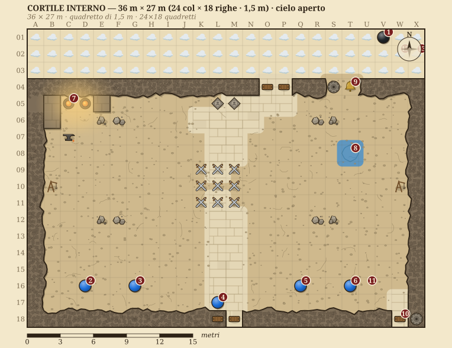
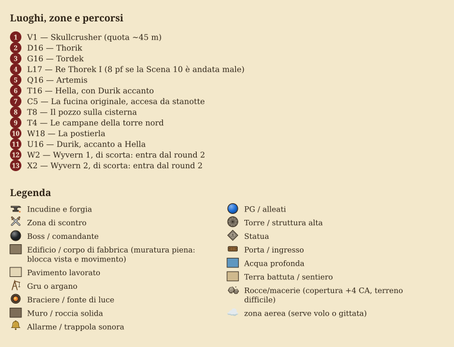
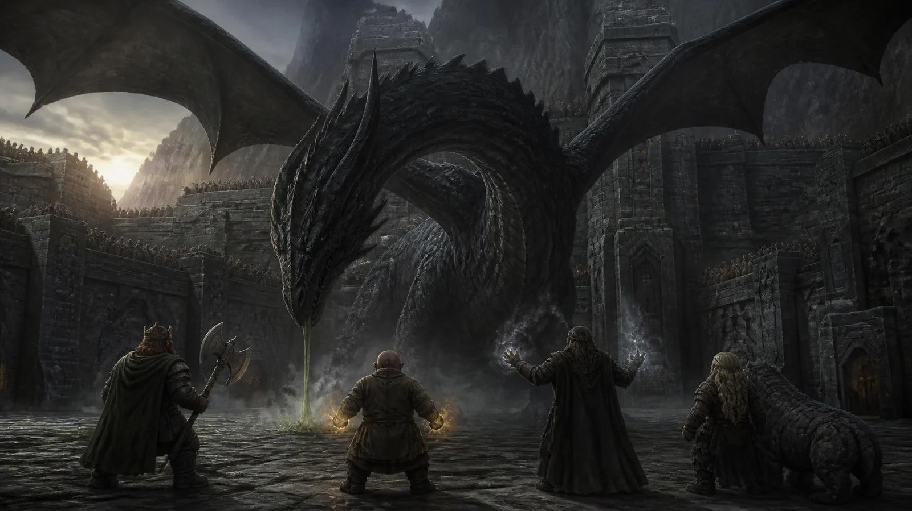

<!-- GENERATO da scripts/build_booklet_html.py --format hb (ADR-0013).
     Manifest: ARC07-DUELLO-E-RUBINO-SERATA.manifest.json — i capitoli CITANO i master (ADR-0003).
     Le immagini restano riferimenti relativi al repo: per la resa con
     immagini incorporate usa la via HTML (--format html). -->

{{frontCover}}

{{logo }}

# RUMBLING STONE
## Il Duello e il Rubino
___

### Hammerfist mille anni fa · il drago sopra le mura · il Rituale della Forgia Eterna · lo strappo fra le ere

{{banner BOOKLET DELLA SERATA}}

{{footnote
  Sessione D&D 3.5 di circa tre ore per 4 personaggi di 13° livello · Faerûn, ≈372 DR · Campagna privata RumblingStone · regia della serata, cast e voci, la mappa del cortile, il duello con Skullcrusher ripreso a metà, il Rituale, il Rubino, lo strappo, la tabella delle ferite
}}

\page

# Dove siamo — il drago sopra le mura

> **Read-aloud — da leggere ai giocatori, per ripartire.**
> *L'aria sa di ferro e di pece. Sul camminamento la pietra è viscida, e non di
> pioggia; fra un merlo e l'altro le scale battono contro il muro a ogni
> hobgoblin che sale. Sotto, l'ariete prende il portone con un colpo sempre
> uguale, come un fabbro che non ha fretta, e a ogni colpo il corpo del
> generale, appeso fuori dalle mura, gira di un palmo. Un nome solo, i nani lo
> gridano verso l'alto: Thorik.*
>
> *Lassù il drago gira largo, nero contro il cielo del mattino, con due bestie
> più piccole alle ali. Dal camminamento parte un colpo, una riga scura che
> sale ancora quando dovrebbe essersi spenta, e lo prende sotto l'ala.*
>
> *L'ala si chiude a metà. Poi si riapre.*

**Questa serata riprende dal colpo di Artemis**.
La deflagrazione con *Eldritch Spear*, da 72 m, ha colpito Skullcrusher; i
danni non sono stati tirati. Si tirano adesso, subito dopo il box, e poi si
va avanti con il duello (cap. I §2). Poi, nell'ordine: il
Rituale della Forgia Eterna, il Rubino, lo strappo fra le ere. La serata si
chiude sul filo rosso di cap. VII Scena 1.

**Lo stato da segnare, prima del primo tiro**, dal log della sessione 6:

- **Nella notte**: Zog'tar, Balvar, Grask e tre guardie sono morti. Il corpo di
  Zog'tar è appeso alle mura; quello di Balvar è nel buco portatile di Artemis,
  con l'Occhio di Ossidiana. Grask ha suonato il corno prima di morire, e il
  corno è rimasto al campo. I PG hanno dormito.
- **All'alba**: tentacoli e deflagrazioni di Artemis, circa 120 morti
  nell'orda (stima del DM). Gli hobgoblin salgono con le scale e battono il
  portone con l'ariete. Si combatte sul camminamento, e i nani hanno
  riconosciuto Thorik.
- **Dove sono**: i PG sul camminamento, vicino al torrione di sinistra, a
  circa 20 m da quello di destra. Skullcrusher e le due viverne a circa 50 m
  d'altezza sopra il camminamento.
- **Il drago**: il Vecchio dell'Appendice A.1-bis, con anello, mantello,
  bacchetta e pergamene. *Immagine speculare* non l'ha ancora lanciata.
- **Le rune di Zeth**: quella da +2 al colpire contro i draghi, per un colpo
  solo, è sulla balestra nascosta nel torrione ovest. Una runa d'acido è
  attiva su Durik; l'altra è ancora da attivare.
- **Hella** ha addosso *protezione dall'energia* (acido).
- **Il torque di Thorek I** è ancora al collo del re: lo dà lui alla Scena 12.
- **Le mura**: vale la versione con Zog'tar morto della Scena 10. Il boato del
  barile conta comunque come allarme.

Il resto, con le domande da fare al tavolo, è nella tabella della regia, §1.

**Come usare questa cartella.**

| File | Per chi | Quando |
|---|---|---|
| «Il foglio della serata» | ⚠ DM | accanto allo schermo, per tutta la serata |
| cap. I | ⚠ DM | da leggere prima, da tenere aperto durante |
| capp. IV e VI, Scene 11-13, §6-8, Appendici A.1-bis, A.6 e C.3 | ⚠ DM | il master: le regole e i box stanno lì |
| cap. VII, §3, Scena 1 | ⚠ DM | l'ultimo box della serata |
| cap. VIII | ⚠ DM | aperto durante il duello, per segnare le ferite |

\page

# Il foglio della serata

{{note
##### ⚠ SOLO DM
Questo capitolo è materiale del DM: non mostrarlo ai giocatori.
}}

# Il foglio della serata

Una pagina sola, da tenere aperta accanto allo schermo. Non aggiunge niente al master: dice dove guardare. cap. IV è cap. IV, cap. VII è cap. VII.

**Si comincia così.** Leggi il box di «Dove siamo», in testa al volume. Poi tira i danni della deflagrazione di Artemis su Skullcrusher: prima la resistenza agli incantesimi, 22, se al tavolo non è stata tirata; niente immagini, perché *immagine speculare* non c'è ancora (cap. I §2). Descrivi il colpo, poi fissa con il tavolo dove sta ognuno: i PG sul camminamento vicino al torrione di sinistra, il torrione di destra a circa 20 m, il drago e le due viverne a circa 50 m d'altezza, gli hobgoblin sulle scale e sul camminamento, l'ariete al portone, il re nel cortile. Poi iniziativa.

**Le scene possibili, nell'ordine**

- **Il duello, ripreso a metà** (cap. IV Scena 11; A.1-bis, A.6; mappa M7-B in cap. III): Skullcrusher il Vecchio e due viverne, EL 17. Balvar è morto: il drago combatte a −2 e fugge a metà dei pf.
- **Il Rituale della Forgia Eterna** (cap. V Scena 12): il Rubino sull'incudine, Aegis Fang che parla, l'Aura, il torque del re.
- **Il Rubino** (cap. VI Scena 13): tre box di fila, senza tiri.
- **Lo strappo** («Il Ritorno a Hammerfist» §3, Scena 1): un box, la Volontà CD 15, la Tempra CD 20 di Artemis.
- **Il salto verso l'ARC-08**: non ancora scritto. La serata si chiude sullo strappo (cap. I §6).

**Segreti e indizi**, da far uscire dove capita

1. Il drago combatte per l'orda per la Catena, la runa che Balvar gli ha inciso sotto una scaglia del petto. Leggerla è un'azione di movimento entro 9 m.
2. Il drago teme che l'orda veda il guinzaglio: chi dice la Catena ad alta voce diventa il suo bersaglio.
3. Il nome che grida prima di mordere è quello che ha sentito; stamattina i nani hanno gridato «Thorik».
4. La runa da +2 contro i draghi è nata dal martello di Balvar, l'uomo che ha legato il drago.
5. Hald, il nipote di Balvar, è sul camminamento est con Hrodgar. I PG hanno letto il suo nome sulla lastra.
6. Ogni ferita al drago la Forgia la ricorda contro Fauci di Palude, nel 1372 (B4).
7. Il Rubino non lo porta nessuno: compare sull'incudine.

**Chi c'è**: Skullcrusher il Nero e due viverne; Re Thorek I, nel cortile davanti alla porta; Hrodgar, il capitano delle mura, e Hald; Thorgrim, che chiama gli avi se il duello crolla; Durik, accanto a Hella; Aegis Fang, che urla dentro il cranio di Thorik. Le voci sono in cap. IV Scena 11, «Comparse» e «Scheda d'entrata».

**Il tesoro**: la scaglia del Primo Nero (circa 1.500 mo), solo se il drago muore; il torque del re alla Scena 12 («Il Viaggio a 1.000 Anni fa» §8 B).

**Se il tempo stringe**: il duello in tre scambi (cap. IV Appendice C.3); le ferite si segnano lo stesso, N = scambi vinti. La Scena 12 non si taglia: se salta, il torque finisce murato nell'incudine.

**Cosa stampare**: la scheda da tavolo della Scena 11; le schede A.1-bis (il Vecchio) e A.6 (le viverne); la mappa M7-B; la tabella della Forgia ricorda (cap. VIII); i box delle Scene 12 e 13 e di cap. VII Scena 1; la pagina «I PX e il livello» della regia (§7).

\page

# Il riferimento rapido

{{note
##### ⚠ SOLO DM
Questo capitolo è materiale del DM: non mostrarlo ai giocatori.
}}

## §0-bis — QUICK-REFERENCE DM (una pagina)

### Le prove di gruppo delle scene a montaggio (party 4, ≥2 successi)
| Scena | Prova | CD |
|---|---|---|
| 3 — la targa | non è una prova di gruppo: è il nodo d'indizio della Scena 3. Il Fatto è gratis, la Lettura vuole una porta, il Nome due | 12-18, secondo la porta |
| 4 — il consiglio | Diplomazia/Intimidire | 20 (16 se hanno il Nome) |
| 6 — il campo | una prova di gruppo per blocco, cinque blocchi: Muoversi Silenziosamente, poi Nascondersi quando l'invisibilità finisce | 20 · 22; con gli aiuti dimezzati, −2 alle prove (la CD non cambia) |
| 9 — Vatore | Percepire Intenzioni o Diplomazia · Rapidità di Mano (a seconda dell'approccio) | 18 · 22 |
| 10 — le mura | Forza / Diplomazia-Guarire / Disattivare (scelta collettiva) | 18 / 18 / 20 |

### Le Benedizioni della Sala, a mille anni fa
Pelle di Pietra, Cuore Incrollabile e *Vigore della Forgia* durano 24 ore
vissute dalla preghiera all'Altare, e a −1000 non si rinnovano. Allo scadere
si spengono, e con loro le cariche di *Vigore* rimaste. Da lì le cure sono
quelle del re e del banco della fucina (Scena 5). Finché sono attive, ogni
sonno di otto ore ricarica il *Vigore*, anche a mille anni fa. Finché durano danno questo
 («Il Ritorno e gli Affreschi» §7): Pelle di Pietra, resistenza al fuoco 10 e al freddo 5; Cuore
Incrollabile, immunità al caldo e al freddo ambientali non letali e +2 ai TS su Tempra
contro gli effetti ambientali; *Vigore della Forgia*, 3 cariche per PG, che
con un'azione standard curano 3d8+5 a sé o 2d8+2 a un alleato toccato.
Quando il gruppo ha pregato l'ultima volta lo si chiede al tavolo prima
dell'Atto I. Se ha pregato all'ingresso nella Sala, di solito all'alba le
Benedizioni ci sono ancora.

### Il giro di Skullcrusher (boss, Scena 11) — 3.5, niente 5e
- **Quale drago.** Con il gruppo di stasera si usa il **Vecchio** (Appendice
  A.1-bis) con le 2 wyvern: EL 17, il tetto esatto di APL+4.
  L'**Adulto** (Appendice A.1) resta per un gruppo di 13° più debole, per tre
  PG, o se il DM non conferma il Vecchio. Qui sotto, fra parentesi, i suoi numeri.
- **Soffio acido** in **linea** di 30 m, 16d4 (14d4), Riflessi CD 31 (30) ½, **ricarica 1/1d4 round**;
  se lo vuole **aderente**, chi ne prende danno ne riprende metà al round dopo, e la ricarica sale di 1 round (Appendice A.1).
- **Full-attack** (se a terra/quota bassa): morso +34 (+30), 2 artigli +29
  (+25), 2 ali +29 (+25), coda +29 (+25).
- **La passata e il nome.** Non si ferma mai in aria, finché non ha paura.
  Con Attacco in Volo attraversa il cortile e a metà della passata soffia, o
  morde, o grida il nome di un PG (*colpo accurato*); con *Virare* torna
  indietro sulla stessa linea. Il PG nominato lo morde al round dopo, a +54
  (+50), e l'occultamento non lo salva. Il nome non lo chiede: lo ha sentito
  di notte attraverso il corno, o usa un epiteto.
  Fra un turno e l'altro sta a circa 15 m (Scena 11, «La passata, il nome,
  la prima paura»).
- ***Fluttuare*** **una volta sola**, a ⅓ dei pf: è la prima paura.
  ***Oscurità*** **una volta sola**, per coprire la fuga verso le paludi.
- **Dal round 2, due wyvern** (Appendice A.6) su chi tiene la corda e su chi
  vola. Fuggono quando il drago fugge o muore. Il duello è EL 17 col Vecchio,
  EL 14 con l'Adulto.
- **La Catena**: la runa sotto la scaglia si colpisce contro **CA 44** (41), e il
  primo colpo a segno la spezza: il drago se ne va (Scena 11).
- **Aegis Fang**: il Bane contro Fauci qui **non vale**; la *Dragondoom* sì.
- **Presenza Terrificante** CD 26 (25) all'ingresso (Volontà o scossi), raggio 72 m (63).
- **Le campane e le balestre**: chi le usa prende la coda in passata, e il
  soffio resta per i PG.
- **Danno massiccio** (regola SRD, attiva nelle regole della casa): un
  colpo o un soffio da 50 danni o più, Tempra CD 15 o si muore.
- **«La Forgia ricorda»**: CONTA i colpi a segno (ferite ancestrali, N≤3) e
  l'esito → tabella B4 (§7). La Cintura di Tordek **rifiuta** di attivarsi qui.

### 🐾 Supporto Pathfinder 1e (dove il 3.5 è vago) — opzionale, dichiarato
> - **Viaggio nel tempo & paradosso**: il 3.5 non ha regole. Usa il principio
>   **«timeline auto-consistente»** (Novikov): tutto ciò che i PG fanno è già
>   accaduto, e non possono cambiare che vincono, solo COME. Nessun
>   TS/meccanica: è una **cornice**, non un puzzle da rompere.
> - **Sincronizzazione di Vatore** (Scena 9): danno/marchio inflitto a Vatore a −1000
>   → si manifesta su **Sal nel 1372** (ARC-09). Trattalo come un **legame
>   simpatico** permanente (stile *sympathy/antipathy* narrativo): nessun TS,
>   è un eco garantito. Registra il tipo di segno.

---

\page

# I · Regia della serata

{{note
##### ⚠ SOLO DM
Questo capitolo è materiale del DM: non mostrarlo ai giocatori.
}}

# Regia della serata — il duello e il Rubino

> **Cos'è.** La scaletta della serata, in ordine di gioco. Non riscrive il
> master: dice **quale paragrafo aprire, quando, per quanto**, e cosa
> annotare. Per l'ordine della serata vale questa regia; per le regole vince il
> master, e prima ancora vince lo stato della campagna. cap. IV è
> cap. IV, cap. VII è
> cap. VII.
>
> **Stasera**. Si riparte nel mezzo
> dell'assedio, dal colpo di Artemis che ha preso il drago a 72 m. Si gioca il
> resto del duello, poi il Rituale della Forgia Eterna e il Rubino, e ci si
> ferma sul filo dello strappo, la Scena 1 di cap. VII.
>
> **Pilastri della serata**: Salvatore guida il duello, la Casa di Davide
> guida l'incudine (la pietra che entra, il torque che passa da un re a un
> erede), Mercer sotto tutto: il nome gridato, il finisher, la prima frase
> dell'ascia, che la dice il giocatore.
>
> **Chi si oppone**: **Skullcrusher il Nero**, il Vecchio dell'Appendice
> A.1-bis, con due viverne. Combatte per l'orda perché Balvar gli ha inciso un
> contratto sotto una scaglia, e Balvar stanotte è morto nel fuoco.

---

## §0 · La serata in una tabella

| Atto | Cosa | Master | Tre ore | Intera |
|---|---|---|---:|---:|
| **0** | Il box di ripartenza, i danni della deflagrazione, chi sta dove | «Dove siamo»; §1 qui | 10 | 15 |
| **I** | Il duello, dal round in corso all'esito | cap. IV Scena 11, A.1-bis, A.6, B4 | 75 | 90 |
| — | Pausa | | 10 | 15 |
| **II** | Il Rituale della Forgia Eterna, i cinque momenti | cap. V Scena 12 | 20 | 30 |
| **III** | Il Rubino, tre box di fila | cap. VI Scena 13 | 5 | 10 |
| **IV** | Lo strappo, e lo stop | «Il Ritorno a Hammerfist» §3, Scena 1 | 5 | 5 |
| — | Il registro di fine serata, i PX | §5 e §7 qui | 10 | 15 |

**Totale**: circa **2 ore e 15** nella colonna «tre ore», **3 ore** in quella
intera. Il margine serve al duello, che con gli hobgoblin ancora sul
camminamento può durare più dei 60-75 minuti del master. Per stare nelle tre
ore si taglia una cosa sola: il duello in tre scambi (cap. IV Appendice C.3).
**La Scena 12 non si taglia**: se salta, il torque del re finisce murato
nell'incudine, ed è un'eco più debole del gesto (cap. V Scena 12, Momento 5).

**Le immagini e la musica**: la tavola di Skullcrusher nel cortile (cap. IV
Scena 11), se il drago scende; la mappa M7-B
(cap. III), quando qualcuno scende nel
cortile; per il camminamento una striscia larga un quadretto, come nella
regia della notte (questo capitolo, «Gli scontri
senza griglia»). Musica e immagini dell'incudine: «Il Viaggio a 1.000 Anni fa» §9.

---

## §1 · Atto 0 — Lo stato di partenza

**Cosa leggere prima, in quaranta minuti.**

| Minuti | Cosa |
|---:|---|
| 10 | questa regia, per intero |
| 10 | cap. IV Scena 11: la scheda da tavolo, le tattiche round per round, «Dove sono i PG all'alba», «Chi non vola», l'esito |
| 5 | cap. IV Appendice A.1-bis e A.1-ter: il Vecchio con gli oggetti, e i numeri che contano al tavolo |
| 5 | capp. V e VI Scene 12 e 13: i cinque momenti e i tre box |
| 5 | cap. IV §6 (l'ultima riga, il vinto sporco) e §7 (il tono del Rubino) |
| 5 | «Il Ritorno a Hammerfist» §3, Scena 1, e il §0 «Prima di aprire, segna da cap. IV» |

**Lo stato, dal log della sessione 6**. L'ultima colonna dice
cosa chiedere al tavolo, dove il log tace.

| | Com'è | Da chiedere o da fissare |
|---|---|---|
| **I PG** | sul camminamento, vicino al torrione di sinistra; il torrione di destra è a circa 20 m | chi vola e chi no, chi è invisibile. Quale dei due torrioni è l'ovest `[INFERRED — Il torrione di destra è quello ovest, dove sta la balestra con la runa?; base: la porta è sul fronte sud («Il Viaggio a 1.000 Anni fa» Scena 10, «Dove sale l'assalto») e chi guarda la piana dal fronte sud ha l'ovest a destra; la distanza di 20 m data al tavolo]` |
| **Skullcrusher** | a circa 50 m d'altezza sopra il camminamento; il Vecchio di A.1-bis, 337 pf, CA 39, 43 con *armatura magica*, contatto 13 | se *armatura magica* è già addosso (A.1-bis la dà «come al duello») |
| **Le viverne** | due, con lui, alla stessa quota | se hanno già attaccato: il master le fa entrare dal round 2 |
| **Gli hobgoblin** | sulle scale e sul camminamento; una parte è passata | quanti ne restano accanto ai PG: il log non lo dice, è un numero tuo |
| **L'ariete** | batte il portone | — |
| **Re Thorek I** | nel cortile, alle spalle dei PG, davanti alla porta (cap. IV Scena 11) | i suoi pf, se la prova delle mura è già stata tirata (Scena 10, «Successi su 4») |
| **Hrodgar e Hald** | sul camminamento est («Il Viaggio a 1.000 Anni fa» Scena 10) | — |
| **Il round** | la deflagrazione è a segno, i danni no | il round in corso e chi deve ancora agire. `[INFERRED — Il drago ha già fatto il suo primo turno, la Presenza e il soffio, o la deflagrazione è arrivata prima?; base: il log chiude con il drago a 50 m e il colpo a segno, e la runa di Durik e la protezione di Hella sono state attivate «alla vista del drago»]` |
| **La Presenza** | raggio 72 m, Volontà CD 26; Thorik non tira | se è già stata tirata `[INFERRED — La Presenza è già scattata?; base: SRD, *Frightful Presence*: si attiva quando la creatura attacca, carica o vola sopra; a 50 m sopra il camminamento il drago è nel raggio]` |
| **La prova delle mura** | vale il ramo con Zog'tar morto: nessuna riga «Zog'tar vivo»; il boato del barile resta un successo in meno (Scena 10, «Dalla notte») | se il combattimento sul camminamento ha preso il posto della prova collettiva. `[INFERRED — La prova delle mura si tira ancora, o il combattimento sul camminamento giocato il 20/11 la sostituisce?; base: il log racconta un combattimento sul camminamento e non nomina la via scelta né i successi]` |

**Le risorse note.**

| Cosa | Com'è | Quando conta |
|---|---|---|
| **La runa contro i draghi** | +2 al tiro per colpire contro i draghi, **per un colpo solo**, sulla balestra nascosta nel torrione ovest. Regola della casa, non SRD («Il Viaggio a 1.000 Anni fa» Scena 5) | chi la va a prendere: sono 20 m di camminamento con gli hobgoblin in mezzo, o un volo. `[INFERRED — Il dardo della balestra runica supera la RD 10/magia del drago?; base: A.1-ter, «le balestre delle mura, no»; la runa di Zeth è magia, ma il log non dice se rende magico il dardo]` |
| **La runa d'acido rimasta** | *resistere all'energia*, acido 20, azione standard per attivarla, dura 70 minuti (cap. IV, la tabella delle risorse) | vale di più su chi non ha già l'acido coperto. Su Hella è sprecata finché dura la sua protezione: *protezione dall'energia* non si somma con *resistere all'energia*, e assorbe per prima finché non è esaurita `[SRD: Protection from Energy]` |
| **Durik** | la prima runa d'acido è attiva su di lui. Prende +50% dall'acido: con la runa prima il +50%, poi −20 («Il Viaggio a 1.000 Anni fa» §1, Hella) | il soffio: la riga 4-bis della regia dei primi round, Scena 11 |
| **Hella** | *protezione dall'energia* (acido) addosso: assorbe 12 punti per livello d'incantatore, fino a 120, e poi si scarica `[SRD: Protection from Energy]` | il soffio, 16d4 (in media 40) con Riflessi CD 31, e l'acido impregnante del round dopo |
| **Gli usi del giorno** | i PG hanno dormito: gli usi giornalieri sono pieni. *Dragondoom* di Aegis Fang 3 al giorno; lo *Scudo del Custode* di Hella 1 al giorno; il Salto Fiammeggiante di Tordek 3 al giorno | cap. IV Scena 11, «Artefatti» e «Chi non vola». La Cintura di Tordek rifiuta; i Bracieri no |
| **Il livello** | il sonno del 372 **non** dà il 14°: si prende al primo riposo dopo la battaglia di Hammerfist («Il Ritorno a Hammerfist» §8, D90) | §7 |
| **La benedizione dei chierici e le Benedizioni della Sala** | +2 morale al colpire e ai danni per 12 ore dal consiglio; le Benedizioni per 24 ore vissute dalla preghiera («Il riferimento rapido» §0-bis, Scena 4) | `[INFERRED — Dopo la notte di sonno la benedizione dei chierici e le Benedizioni della Sala sono ancora attive?; base: 12 e 24 ore dichiarate dal master, e il log non dice quando è finita la notte]` |
| **Il resto dell'inventario** | pozioni, pergamene, bacchette: la tabella della regia della notte, §1 | quello che hanno bevuto o letto il 20/11 lo sanno loro |

**Cosa è stato speso**: il martello runico di
Balvar, regalato a Mastro Zeth; una runa d'acido, su Durik; la *protezione
dall'energia* di Hella; i *tentacoli neri di Evard* e le deflagrazioni di
Artemis all'alba; le pozioni di *volare* del ritorno dal campo. Il corno di
Grask è rimasto al campo.

---

## §2 · Atto I — Il duello, dal round in corso

**0 · I danni della deflagrazione.** Dopo il box di «Dove siamo»,
in quest'ordine:

1. **La resistenza agli incantesimi**, se non è stata tirata: RI 22, e le
   invocazioni di Artemis la subiscono come gli incantesimi (A.1-ter). Si
   supera con d20 + livello d'incantatore di Artemis contro 22.
2. **Le immagini**: non ci sono. *Immagine speculare* non è stata lanciata,
   e il colpo va sul drago vero.
3. **I danni**: i dadi della deflagrazione di Artemis, 6d6 dopo il dado
   andato a Hella al rito (regia della notte, §1). La RD 10/magia non ferma
   la deflagrazione, che è una capacità magica («Il Piano della Terra & Terros l'Antico», la tabella dei danni contro Terros e §8c-1).
   *Eldritch Spear* è *Complete Arcane*, fuori SRD, e il colpo a 72 m era
   legale: gittata 75 m.
4. **Segna i pf** sulla scheda e sulla tabella della Forgia. Il colpo a segno
   conta fra le ferite ancestrali (N, al massimo 3; B4 §1).

Descrivi il colpo in una frase tua, sul corpo del drago e non sui numeri, poi
fissa le posizioni (§1) e tira l'iniziativa. Se il tavolo ha già un ordine
d'iniziativa per il combattimento sul camminamento, tienilo: il drago e le
viverne entrano dove sono. Il −2 alla prima iniziativa del duello vale solo
se il gruppo ha tenuto la breccia (Scena 10).

**1 · Le soglie, con Balvar morto.** È la riga che cambia di più stasera.
Balvar è morto nel fuoco: la Catena regge,
perché le rune sopravvivono al runaio, ma il drago combatte a **−2** e fugge
a **metà dei pf**, circa **168** su 337, invece che a un terzo (cap. IV Scena
11, «La soglia»). E se fugge a metà, l'esito è **FERITO GRAVE** (Scena 11,
«Le soglie»). `[INFERRED — Con Balvar morto, alla soglia di metà vale ancora la prima paura, il drago fermo in aria per un round e la clausola dei due colpi che lo trattiene un round in più?; base: cap. IV Scena 11, «La soglia», che mette le due regole nella stessa riga senza dire se la seconda sposta anche la prima]`

**2 · Il camminamento.** I PG sono sulle mura, non nel cortile: vale la riga
«Sulle mura» di «Dove sono i PG all'alba» (Scena 11). La prima passata il
drago la fa lungo il camminamento, se i PG ci stanno in fila: è largo un
quadretto, e la linea di 30 m del soffio li prende tutti. Poi va alla porta,
dove c'è il re. I PG scelgono se restare in alto, con la gittata e le gru (le
corde partono dal camminamento), o scendere nel cortile per la scala di
4,5 m: da lì vale M7-B.

Gli hobgoblin sul camminamento restano un problema dei PG. Il master non ne
dà i numeri: sono quelli che hai usato il 20/11. Chi tira con le balestre o
suona le campane, il drago lo fa tacere con la coda solo nei round in cui
nessun PG lo chiama (Scena 11, «Chi sceglie»).

**3 · Il nome.** Il drago grida il nome di chi morderà al turno dopo, ed è il
nome che ha sentito. Stamattina i nani hanno gridato «Thorik» verso l'alto.
`[INFERRED — Il drago usa il nome che i nani hanno gridato dalle mura, oltre a quelli sentiti di notte attraverso il corno?; base: cap. IV Scena 11, «Suona» e «Chi sceglie»: il nome è quello sentito; Ascoltare +31 in A.1-bis; la chiamata del nome è nel log del 20/11]`
Se sì, è un'eco della sessione 6: il nome che i nani hanno gridato per
rincuorarsi è quello che il drago grida per primo. La sua battuta d'ingresso
è in «Scheda d'entrata», se al tavolo non l'ha ancora detta.

**4 · Il giro.** Dal round in corso valgono le tattiche round per round
(Scena 11) e la tabella «Il giro di Skullcrusher» (§0-bis). Le cose da tenere
davanti:

- **la passata**: Attacco in Volo e Virare; a metà passata soffia, grida un
  nome o morde chi ha nominato. Chiude ogni passata a più di 18 m da tutti i
  PG: in mischia lo si prende solo con un'azione preparata (A.1-bis);
- **gli oggetti**: la bacchetta di *paura* mentre il soffio ricarica, sul
  gruppo più fitto; le pergamene di *dominare persone* solo da fermo, dopo la
  prima paura, mai su Thorik; la *suggestione di massa* sui nani delle corde
  (A.1-bis, «Tattiche»);
- ***immagine speculare***: il master la dava al corno, prima di partire, e
  al tavolo non c'è stata. `[INFERRED — Il drago la lancia durante il duello, con un'azione standard al posto di un morso o di un soffio, o la serata va avanti senza?; base: A.1-bis, conosciuti di 2°, 7 al giorno; il log del 20/11 dice solo che non l'ha ancora lanciata]`;
- **le viverne**: su chi tiene la corda e su chi vola; il veleno è Tempra CD
  17 (A.6). Fuggono quando fugge o muore il drago;
- **la Catena**: leggerla è un'azione di movimento entro 9 m; il primo colpo a
  segno la spezza e il drago se ne va. Con gli oggetti la Catena è a **CA 47**
  e il gancio delle corde va contro il contatto **13** (cap. IV Scena 11);
- **le ferite**: segnale nella tabella della Forgia **quando succedono**, e
  segna se Aegis Fang ha colpito in volo.

**5 · Gli echi da far riemergere**, uno o due, non tutti:

- la **runa contro i draghi** è nata dal martello di Balvar: il colpo della
  balestra, se arriva, è l'ultimo lavoro del runaio contro il drago che aveva
  legato;
- **Hald** è sul camminamento est, e i PG hanno letto il suo nome sulla lastra.
  Non sa che lo zio è morto, né che era nel campo (Scena 10, «Comparse»);
- il **corpo del generale** appeso alle mura: il master non gli dà una
  meccanica. È colore, o una tua decisione sull'orda;
- se Thorik tiene Aegis Fang in mano, la **visione della Corona** e l'ascia che
  urla (Scena 11, il secondo box, solo per lui).

Il finisher, se il drago muore, **va al giocatore** (`[HDYWTDT]`, Scena 11,
«Esito del duello»): *«Com'è che lo fai?»*, e aspetta.

---

## §3 · I rami dell'esito, e cosa cambiano

L'esito si segna con le etichette del master (Scena 11, «Esito del duello», e
§6). La tabella dice dove pesa, stasera e dopo.

| Esito | Quando | Scena 12, la voce del rito | Il Rubino (§7) | cap. VII | Fauci nel 1372 (B4) |
|---|---|---|---|---|---|
| **UCCISO** | 0 pf | trionfo, e un imbarazzo | «nessuna pietà» | ramo luminoso | −10% pf e Presenza ridotta contro i portatori |
| **FERITO GRAVE** | fugge alla soglia: stasera **a metà dei pf**, perché Balvar è morto | mestiere: si conta chi manca | «dovere» | ramo luminoso | perde un uso del soffio |
| **FUGGITO** | i PG scelgono di salvarsi o non lo intaccano; la Catena spezzata è una vittoria | sollievo con un'ombra | «vigile» | **meno luminoso** se i PG si sono ritirati o non l'hanno intaccato; luminoso se hanno spezzato la Catena | +2 iniziativa, ma fugge prima |
| **VINTO SPORCO** | due PG a terra nello stesso round, o il gruppo si ritira dal cortile: Thorgrim chiama gli avi (§6) | misericordia e dovere | «misericordia/dovere»; nessuna ferita ancestrale | **meno luminoso** | nessun carry-over: Fauci a piena forza |

Le righe di cap. VII vengono da «Il Ritorno a Hammerfist» §0-bis, «I due rami dell'arrivo»;
quelle di Fauci da cap. VIII §2. Se i
segni non concordano, vince l'esito del duello (cap. IX §7).

Cosa cambia in tutti i rami: con il drago via l'orda perde lo sprone e si
sfalda (Scena 13, primo box); il sangue di Skullcrusher sopravvive comunque,
perché aveva già figli. Con il vinto sporco cambia una frase sola del re, alla
Scena 12, Momento 5: *«Si dà a chi è rimasto, anche quando non bastava.»*

---

## §4 · Atti II-IV — L'incudine, il Rubino, lo strappo

**Scena 12, il Rituale** (cap. V Scena 12). Il rito non si fallisce: si
gioca nella voce che l'esito ha scelto (§3). Prima di cominciare, una cosa da
sapere dal tavolo: se al rito di «La Resurrezione di Hella» Thorik **ha donato** la deflessione o
l'ha rifiutata, perché la prima frase di Aegis Fang cambia.

1. Il box dell'incudine: il Rubino compare sul ferro, e nessuno l'ha portato.
2. La pietra entra nell'incasso, la Corona tace: resta a +2 finché il Rubino
   non è speso.
3. Aegis Fang si sveglia. La prima frase dell'ascia allo Stage 1 la dice il
   giocatore (`[HDYWTDT]`), davanti a ottocento nani: scrivila.
4. L'Aura della Forgia Eterna: la tabella di chi riceve cosa, e il box. Dura
   fino all'alba del giorno dopo, e l'alba è quella del 1372 («Il Ritorno a Hammerfist» §0-bis).
5. Il torque: il re lo toglie con le sue mani e lo chiude al collo di Thorik.
   Il box, poi la battuta del re.

**Scena 13, il Rubino** (cap. VI Scena 13). Tre box di fila, senza fermarsi
per i tiri. Nel secondo box i lampi si adattano al giocato: il generale cade
nella tenda, ed è vero; gli alberi in marcia valgono solo se i Treant di
Hella hanno caricato. `[INFERRED — I Treant di Hella sono stati chiamati all'alba, e hanno caricato?; base: cap. VI Scena 13, nota sotto i box; il log del 20/11 non li nomina]` Se no, il lampo è un'altra
scelta di Hella: la sua forma d'aquila sopra il campo, per esempio, o la
*protezione* lanciata alla vista del drago.

**cap. VII Scena 1, lo strappo.** Si legge subito dopo il terzo box della Scena
13. Poi i tiri:

- **Volontà CD 15**, tutti tranne Thorik, che è immune: chi fallisce arriva
  frastornato per 1 round, e lo paga alla Scena 2, la serata dopo;
- **Tempra CD 20 per Artemis**, il pegno di carne: fallita, un livello
  negativo fino all'alba successiva e affaticato; superata, solo affaticato.
  

Segna i risultati. Il tempo nel filo non passa: la Scena 2 riparte da qui.

**Lo stop.** Dopo i tiri ci si ferma. L'ultima riga detta è quella del box
dello strappo: *«Siete tornati, e siete tornati nel momento peggiore.»* Non
aggiungere niente.

---

## §5 · Il registro di fine serata

Si trascrive **sul ramo del gruppo**.
È anche quello che chiede «Il Ritorno a Hammerfist» §0, «Prima di aprire, segna da cap. IV».

| | Cosa | Esito |
|---|---|---|
| ☐ | I danni della deflagrazione d'apertura, e se la RI è stata superata | |
| ☐ | Duello: ucciso · ferito grave · fuggito (e perché) · vinto sporco | |
| ☐ | Ferite ancestrali segnate (N ≤ 3), e se Aegis Fang ha colpito in volo | |
| ☐ | La Catena: letta, detta ad alta voce, spezzata? | |
| ☐ | La balestra runica: chi l'ha usata, e se ha colpito | |
| ☐ | La runa d'acido rimasta: su chi, o ancora da usare | |
| ☐ | Durik: ha preso il soffio? È in piedi? Hella ha usato lo Scudo del Custode, e su chi? | |
| ☐ | Re Thorek: è caduto? (il Rubino lo ricorda come il giorno in cui il re è caduto) | |
| ☐ | I nani caduti con un nome, per il pannello della Sala | |
| ☐ | La frase del finisher, se c'è | |
| ☐ | La prima frase di Aegis Fang allo Stage 1 | |
| ☐ | Il torque: al collo di Thorik, o murato nell'incudine | |
| ☐ | Il tono del Rubino | |
| ☐ | La Volontà dello strappo: chi è frastornato | |
| ☐ | La Tempra di Artemis: livello negativo sì o no | |
| ☐ | Cosa resta di incantesimi, usi e cariche: è la tabella di «Il Ritorno a Hammerfist» §0 | |
| ☐ | I PX di Hella (§7) | |

**Echi da armare**, se il tavolo li ha prodotti (proposte: il DM decide quali
e con che sigla): la frase del finisher; la prima frase dell'ascia, che a
Hammerfist qualcuno ripeterà storta (cap. IX §7); Hald sulle mura, se i PG gli
hanno parlato dello zio; la runa nata dal martello di Balvar, se ha colpito.

---

## §6 · Il salto verso l'ARC-08

La prosa del salto (le sei gemme, la scelta al tavolo, il corpo nuovo)
arriva dal lavoro sul ponte ARC-07→ARC-08, dopo il voto alla cieca del DM.
Finché non c'è, si legge cap. VII Scena 1 e la serata si chiude lì.

---

## §7 · I PX e il livello

**Chi conta i PX stasera.** Thorik, Tordek e Artemis sono fermi a **104.999**: un PX sotto la soglia del 15°. I PX
della serata, per loro, non contano. Hella è a **91.066** dopo la sessione 6:
ha già i PX del 14°, che comincia a
91.000.

**Quando si prende il livello.** Il 14° si prende al **primo riposo dopo la
battaglia di Hammerfist**. Se dormono nel
Cuore della Montagna, quello è il primo riposo e il livello si prende lì, al
prezzo della breccia («Il Ritorno a Hammerfist» §8 e §6). La notte
dormita nel 372 non conta: stasera si combatte al 13°. Vale la regola 3.5 di
un livello alla volta: chi supera anche la soglia del 15° si ferma a un PX
sotto, cioè a 104.999.

**I PX della serata, per Hella**, dal master («Il Viaggio a 1.000 Anni fa» §8 A):

| Voce | PX a testa | Quando |
|---|---:|---|
| Il duello: Skullcrusher Vecchio (GS 17) e le due viverne, EL 17 | **≈ 4.060** | se il duello ha un esito; il master non divide i PX per esito. `[INFERRED — Il vinto sporco vale i PX pieni del duello, o meno?; base: «Il Viaggio a 1.000 Anni fa» §8 A dà ≈ 4.060 senza distinguere l'esito; §6 dice solo che col vinto sporco non si segnano ferite ancestrali]` |
| Le Scene 12-13: il Rituale e il Rubino, premio di storia maggiore | **800** | quando si giocano |
| Le mura, Scena 10 | 600 | `[INFERRED — Il premio delle mura si dà stasera?; base: «Il Viaggio a 1.000 Anni fa» §8 A lo mette fra le scene del beat, e il log della sessione 6 non lo assegna]` |

Il conto: 91.066 + 4.060 + 800 = **95.926**, e con le mura **96.526**. Tutti e
due stanno sotto i 104.999: per Hella stasera non c'è un tetto da applicare.
I numeri esatti li dà la tabella dei PX della DMG sul giocato, come nel log
della sessione 6; i «≈» del master valgono per un gruppo di quattro di 13°.

I PX di cap. VII (1.000 per il ritorno e la Manifestazione, 2.000 per il
completamento dell'arco) non si danno stasera: la Manifestazione è la Scena
2, la serata dopo. `[INFERRED — I 1.000 del ritorno si danno tutti alla Scena 2, o una parte va alla Scena 1 giocata stasera?; base: «Il Ritorno a Hammerfist» §8 A li mette in una riga sola, «Ritorno + Manifestazione»]`

Il registro dei PX lo aggiorna il DM.

\page

# II · Il cast: chi c'è, come si pronuncia, che suoni

{{note
##### ⚠ SOLO DM
Questo capitolo è materiale del DM: non mostrarlo ai giocatori.
}}

# ARC-07 — La cassetta del DM

> **A cosa serve.** L'arco ha cinque master e quasi tredicimila righe. Sono
> scritti bene e sono profondi, ma **al tavolo non si consultano**: nessuno cerca
> un PNG in mezzo a milleseicento righe mentre quattro persone aspettano.
>

⚠️ **Cosa questo file NON fa.** Non riscrive niente, non aggiunge fatti e non
decide nulla: **rimanda**. Dove i master tacciono — ed è il caso di qualche tic
vocale — la voce è stata scelta qui ed è canone, e il DM la cambia senza
chiedere il permesso a nessuno. I master restano la fonte di verità.

| § | Cosa |
|---|---|
| 1 | Il foglio del cast — chi parla, cosa vuole, come suona |
| 2 | Come si pronunciano |
| 3 | Indice dei read-aloud — **260 blocchi**, dove sono |
| 4 | I suoni dell'arco |
| 5 | Il momento da fotografare, uno per master |
| 6 | Accessibilità |

---

## §1 · Il foglio del cast

Una riga a testa. **Il tic vocale è la colonna che conta**: è ciò che rende un
PNG riconoscibile senza fare accenti, ed è la cosa che al tavolo si dimentica per
prima.

### Chi sta dall'altra parte

| Chi | Cosa vuole | Il tic | Dove |
|---|---|---|---|
| **Terros l'Antico** — guardiano del Nodo di Terra, GS 15 | che nessuno tocchi lo Smeraldo. Non odia: **custodisce** | parla **lentissimo**, come chi non ha mai avuto fretta in diecimila anni. Non alza mai la voce, nemmeno quando colpisce | «Il Piano della Terra & Terros l'Antico» §8 |
| **La Sentinella di Mithral** — l'anticamera | verificare chi entra. Non uccide chi supera la prova | **non parla**: risponde battendo. Un colpo = no, due = passa. | «Il Piano della Terra & Terros l'Antico» §7b |
| **Skullcrusher il Nero** — il duello a −1000 | vincere davanti all'orda, perché il potere è ciò che gli altri hanno visto | dice **il nome** dell'avversario prima di colpire, ogni volta | cap. IV Scena 11 |
| **Zog'tar** — il generale dell'orda | prendere Hammerfist. Sa uccidere diecimila uomini | parla ai suoi **contando**: «due file», «tre ore», «cento» | «Il Viaggio a 1.000 Anni fa» Scena 8 |
| **Balvar Fuocospento** — il runaio esiliato, consigliere | incidere di nuovo, per chi glielo lascia fare | **non smette di lavorare mentre ti parla**. La punta sull'ardesia continua sotto le sue frasi | «Il Viaggio a 1.000 Anni fa» Scena 7 |
| **Grask** — l'araldo col corno, fuori dalla tenda | non perdere più il corno | **non parla: soffia** | «Il Viaggio a 1.000 Anni fa» Scene 6-8 |
| **Vatore** (Sal a −1000) | la stessa cosa che vuole Sal oggi, mille anni prima | il tono del **collega**, non del nemico. Riconosce una firma, non un debito | «Il Viaggio a 1.000 Anni fa» Scena 9 |

### Chi sta dalla vostra

| Chi | Cosa vuole | Il tic | Dove |
|---|---|---|---|
| **Durik** — il cane di pietra di Hella, nato dalla polvere di Terros al rito dello Smeraldo | stare fra Hella e il pericolo («Protegge Hella», la risposta data a Moradin nel viaggio) | **non parla e non abbaia**: suoni di pietra, un click, uno strofinio, una faglia lontana. Il click vuol dire che qualcosa si muove sotto i piedi | «Il Piano della Terra & Terros l'Antico» §9 fase 3 · «La Resurrezione di Hella» §7 |
| **Therysol** — veglia il corpo di Hella | che qualcuno resti col morto. Non scende: veglia | frasi **corte e complete**. Non chiede mai niente | «Il Ritorno e gli Affreschi», «La Resurrezione di Hella» |
| **Re Thorek I** — Hammerfist ≈372 DR | reggere le mura fino all'alba | parla **al plurale** anche quando parla di sé: «la fortezza pensa» | «Il Viaggio a 1.000 Anni fa» Scena 4 |
| **Durin** — la pattuglia, di notte | portare a casa i suoi | ride **prima** di dire una cosa seria | «Il Viaggio a 1.000 Anni fa» Scena 2, Appendice A |
| **Thorgrim Barbadiferro** — l'antenato | che l'ascia torni in una mano che sa perché | nomina **il sangue**, mai la persona: «il sangue riconosce il sangue» | «Il Viaggio a 1.000 Anni fa» Scena 4 |
| **Sorella Brynja** — la cappella della fortezza | che all'alba ci siano incantesimi per le mura | **conta ad alta voce**, sempre; fa ogni domanda due volte, la seconda più piano | «Il Viaggio a 1.000 Anni fa» Scena 5 |
| **Kettra** — l'alchimista del re | finire le fiasche per le mura prima dell'alba | **ride** quando qualcosa sta quasi per andare storto, e solo allora | «Il Viaggio a 1.000 Anni fa» Scena 5 |
| **Gunnvor** — la maestra armaiola | che i duecento vecchi e ragazzi vadano sulle mura con un'arma vera | conta tutto in **braccia**: una pozione «vale un braccio» | «Il Viaggio a 1.000 Anni fa» Scena 5 |
| **Hrodgar** — il capitano delle mura | tenere il tratto est finché il re non gli dice di lasciarlo | dà gli ordini con **una parola sola** | «Il Viaggio a 1.000 Anni fa» Scena 10 |
| **Hald** — il nipote di Balvar, di guardia | il master non lo dice: è una recluta di diciannove anni, e non sa che lo zio esiliato è vivo, né che è nel campo | poco e **a bassa voce**; si drizza quando passa il capitano | «Il Viaggio a 1.000 Anni fa» Scena 10 |
| **Il Custode** (ruolo, non persona) | leggere i pannelli e ricordare un fatto vero | — (è una funzione: la assume un PG) | «Il Ritorno e gli Affreschi» §3-4 |

⚠️ **Fauci** e **Skullcrusher** arrivano da prima di quest'arco e tornano dopo:
la loro voce sta dove è nata, nella Battaglia di Hammerfist.
Non rifarla qui — **due versioni di una stessa voce sono peggio di nessuna**.

---

## §2 · Come si pronunciano

Un nome su cui il DM esita è un nome che sparisce dal gioco: si sente una volta,
non torna, e il PNG resta senza etichetta.

| Si scrive | Si dice | Nota |
|---|---|---|
| **Terros** | *TÈR-ros*, accento sulla prima | non «terròs» |
| **Zog'tar** | *ZOG-tar*, l'apostrofo è uno stacco netto, non una vocale | |
| **Balvar Fuocospento** | *BAL-var*, e il cognome **si traduce sempre**: è un soprannome, non un casato | |
| **Thorgrim** | *TÒR-grim*, la *h* non si sente | come Thorik |
| **Thorek** | *TÒ-rek* | ⚠️ si confonde con **Thorik** (il PG) a voce: dì sempre «**Re** Thorek» |
| **Therysol** | *te-RÌ-sol* | |
| **Durik** | *DÙ-rik* | ⚠️ e si confonde con **Durin**: uno emerge dal rituale, l'altro è la pattuglia di mille anni fa. Se li usi nella stessa serata, chiama il secondo «Durin della pattuglia» |
| **Vatore** | *va-TÓ-re* | è **Sal** a −1000: al tavolo non dirlo mai per primo |
| **Kettra** | *KÈT-tra* | |
| **Brynja** | *BRÌN-ia* | la *j* si legge *i* |
| **Gunnvor** | *GÙNN-vor* | |
| **Grask** | *GRASK*, una sillaba | |
| **Hrodgar** | *RÒD-gar*, la *h* non si sente | |
| **Hald** | *HALD*, una sillaba, la *h* aspirata | ⚠️ non confonderlo con **Hella**: chiamalo «il ragazzo di Hrodgar» se serve |
| **Hammerfist** | all'inglese, *HÀMMER-fist* | è così che lo dicono i giocatori da nove archi: non correggerli |

---

## §4 · I suoni dell'arco

**Descrizioni, mai titoli di brani**: ognuno usa quello che ha, e il file non
invecchia con le piattaforme.

> **La regola di quest'arco**, e non è quella dell'ARC-08. Là il fragore era lo
> stato di riposo e i suoni si spegnevano per fare spazio. **Qui il silenzio è lo
> stato di riposo**: il Piano della Terra non ha vento, non ha uccelli, non ha
> acqua. Ogni suono che metti dentro **pesa il doppio**, e va tolto appena ha
> fatto il suo lavoro.

| Momento | Che suono |
|---|---|
| **L'ingresso nel Piano** («Il Piano della Terra & Terros l'Antico» §2) | il **cambio di gravità si sente**: un tonfo sordo sotto lo sterno, una volta sola. Poi niente, e il niente dura |
| **Il viaggio, zone 1-4** («Il Piano della Terra & Terros l'Antico» §4) | il passo sul cristallo, che cambia timbro a ogni zona: vetro, poi legno, poi pietra bagnata. **È l'unico cue del viaggio** |
| **Il campo dei Cristalli Viventi** («Il Piano della Terra & Terros l'Antico» §6) | un accordo lunghissimo, appena udibile, che **c'era già da prima** che entrassero. Se il tavolo se ne accorge tardi, è perfetto |
| **La Sentinella** («Il Piano della Terra & Terros l'Antico» §7b) | metallo su metallo, **due colpi**, e poi il silenzio che aspetta una risposta |
| **Terros — l'arrivo** («Il Piano della Terra & Terros l'Antico» §8a) | ⚠️ **taglia tutto.** Il boss entra nel vuoto: nessuna musica sotto i primi sei secondi. La roccia che si muove è l'unico suono, e arriva **da sotto** |
| **Il Rituale dello Smeraldo** («Il Piano della Terra & Terros l'Antico» §9) | qui, e **solo qui**, un tono che cresce per tre round e si chiude di colpo sull'incastonatura |
| **La Sala e gli Affreschi** («Il Ritorno e gli Affreschi») | eco lunga di stanza vuota. Le voci dei PG tornano indietro: falle tornare anche quando parlano piano |
| **Il Cuore di Moradin** («La Resurrezione di Hella» §3-4) | **un battito.** Uno solo, lento, che si sente col corpo più che con l'orecchio. Smette quando Hella apre gli occhi |
| **Hammerfist ≈372 DR, di notte** (cap. IV zona 2) | diecimila tende: cuoio, ferro, e voci in una lingua che non si capisce. **Mai grida**: è un accampamento che dorme |
| **Le mura all'alba** («Il Viaggio a 1.000 Anni fa» Scena 10) | tamburi, e sotto i tamburi **il drago che non si vede ancora** |
| **Il duello con Skullcrusher** (cap. IV Scena 11) | il pubblico. Non i colpi: **la folla che reagisce ai colpi** |
| **Il ritorno e la manifestazione** («Il Ritorno a Hammerfist» §4) | silenzio pieno, poi **una voce sola** che riconosce chi è arrivato |

---

## §5 · Il momento da fotografare

Uno per master: il picco che il DM sa in anticipo, e che non manda di fretta.

| Master | Il momento | Perché è quello |
|---|---|---|
| «Il Piano della Terra & Terros l'Antico» | **Il Distacco** — l'Altare si centra sul guardiano (§8b) | è il round in cui il tavolo capisce che la stanza combatte con loro, non contro |
| «Il Ritorno e gli Affreschi» | **La Visione Condivisa** dei Quattro Eroi (§5) | l'unico momento dell'arco in cui i quattro vedono **la stessa cosa** |
| «La Resurrezione di Hella» | **Hella apre gli occhi** (§7) | tre sessioni di lutto si chiudono in una riga. Non aggiungere niente dopo |
| cap. IV | **Il colpo finale del duello** (Scena 11): chi abbatte Skullcrusher, e *«com'è che lo fai?»* | il drago di mille anni fa cade per mano loro, o fugge ferito. Il gesto di Thorgrim con l'ascia di Thorik (Scena 4) è già stato giocato |
| cap. VII | **La manifestazione** (§4) | la disfatta che si ribalta davanti a chi l'aveva già data per persa |

⚠️ **La regola**: un beat che non sa qual è il suo picco lo brucia correndo. Se la
serata è in ritardo, **si taglia altro** — non questo.

---

## §6 · Accessibilità

- **Daltonismo**: nelle mappe dell'arco il colore non porta mai da solo
  un'informazione — le zone hanno anche un simbolo e un numero. Se descrivi a
  voce, di' *«la piattaforma tre»*, non *«quella verde»*.
- **Dislessia e carico di lettura**: nessun giocatore deve leggere handout in
  silenzio al tavolo. Gli affreschi («Il Ritorno e gli Affreschi» §4) **si raccontano**, non si passano.
- **Carico cognitivo**: la gravità 2× («Il Piano della Terra & Terros l'Antico» §3) è la regola che affatica di più.
  Tienila su **un foglietto solo**, e ripetila a voce ogni volta che qualcuno
  dichiara un movimento invece di aspettare che se la ricordino.
- **Sicurezza emotiva**: quest'arco contiene una **resurrezione** e il lutto che
  la precede. È il tipo di scena che tocca cose vere: se qualcuno al tavolo ha
  perso qualcuno di recente, si chiede prima, in privato, e si è pronti a
  giocarla più corta.
- **Ritmo**: il master «Il Piano della Terra & Terros l'Antico» è lungo il doppio degli altri. Se la sessione è di
  tre ore, **arriva fino alla Sentinella e fermati lì**: è una soglia naturale.

---

\page

# III · La mappa del duello: M7-B

{{note
##### ⚠ SOLO DM
Questo capitolo è materiale del DM: non mostrarlo ai giocatori.
}}

# M7-B · Il cortile del duello

La pianta del cortile dove Skullcrusher cala all'alba (Scena 11), con la legenda nella pagina dopo.

<!-- nuova-pagina -->

\page

# IV · Il duello con Skullcrusher

{{note
##### ⚠ SOLO DM
Questo capitolo è materiale del DM: non mostrarlo ai giocatori.
}}

<!-- pagina: una-colonna -->
### C.3 · Il duello in tre scambi (Scena 11)

> **🎚️ [FAST-PLAY] del duello** (se vuoi chiudere veloce): 3 scambi narrati a
> prova di gruppo (un attacco contro **CA 40**, 37 con l'Adulto, o Saltare/Equilibrio **CD 22** per chi lo affronta dalle mura), poi si sceglie l'esito tra i tre
> della Scena 11 in base a quanti scambi i PG hanno «vinto» (0-1 = fuggito, 2 = ferito
> grave, 3 = ucciso). Uno scambio è vinto se metà del gruppo supera la prova.
> Registra comunque le ferite per B4: N = scambi vinti. **[COMBATTIMENTO
> COMPLETO]** = la regia round-per-round della Scena 11, su M7-B.

<!-- nuova-pagina -->

<!-- /pagina -->

<!-- nuova-pagina -->

### SCENA 11 — Il duello con Skullcrusher

<!-- scheda-da-tavolo -->
<!-- tabella: larga -->

| Scena 11 · EL 17 | **La scheda da tavolo**: che cosa succede, chi c'è, cosa vuole e come si conduce; il testo intero segue |
|---|---|
| **Succede** | Skullcrusher cala sul cortile con due wyvern e combatte in passate, gridando i nomi che ha sentito di notte attraverso la Catena |
| **Dove** | Il cortile |
| **Chi c'è** | Skullcrusher il **Vecchio** (GS 17): 337 pf, CA 36 (40 con *armatura magica*), contatto 10. Dal round 2 due wyvern, su chi tiene la corda e su chi vola; fuggono quando fugge lui. **EL 17**. Re Thorek è nel cortile, alle spalle dei PG, a difendere la porta principale |
| **Chi vuole cosa** | Il drago vuole vincere davanti all'orda: per lui il potere è quello che gli altri hanno visto |
| **Si comincia** | Dopo il barile il drago guarda in alto: chi lo aspetta in volo non ha la sorpresa. Dalle mura arrivano: −2 alla prima iniziativa se hanno tenuto la breccia; duello fuori dalle mura, senza fucina né campane, se hanno sabotato gli arieti |
| **Round 1** | Cala dall'alto: Presenza, Volontà **CD 26** (Thorik non tira), poi il soffio aderente sul gruppo più fitto, 16d4, Riflessi **CD 31**. Non atterra. In picchiata, con un round di sorpresa, se Zog'tar è morto in modo spettacolare: Ascoltare CD 20 per agire, e le campane glielo tolgono |
| **Dal round 2** | Una passata a round, a circa 15 m fra un turno e l'altro. A metà del movimento una cosa sola: **grida un nome**, **morde** chi ha nominato il turno prima (+54: il +34 del morso, più il nome), oppure **soffia**, se il soffio è tornato |
| **Chi sceglie** | Nell'ordine: chi ha detto la Catena ad alta voce; chi colpisce l'orda o gli arieti dall'alto; chi tiene la corda dell'ala; chi lo ha ferito di più. Se in un round nessuno lo chiama, va sul re: due colpi lo mettono a terra, uno solo se è a 8 pf. Il re non muore |
| **Le corde** | Azione preparata su «quando picchia». Chi lancia il gancio: contatto a distanza contro **CA 10**, incremento 3 m, entro 15 m da una gru. Chi tira: Forza **CD 25**, +2 per chi aiuta, al massimo tre per corda. Il drago resta a terra un round, e chi aveva preparato un attacco lo porta |
| **La Catena** | Leggerla: azione di movimento entro 9 m. Colpirla: **CA 44**; un attacco di contatto non la raggiunge. Il primo colpo a segno la spezza, e il drago se ne va |
| **Il cortile** | La fucina: 4d6, e niente olfatto per 1d4 round. Le campane tolgono la sorpresa, e chi le suona si fa bersagliare. Chiamare i nani: arrivano, e muoiono |
| **Artefatti** | *Dragondoom* di Aegis Fang funziona, tre volte al giorno. Il Bane contro Fauci qui non vale. La Cintura di Tordek rifiuta di attivarsi |
| **La soglia** | A un terzo dei pf (circa 112) si ferma in aria, una volta sola, ed esita: in quel round non attacca. Al suo turno fugge nell'oscurità, a meno che nel round prima abbia preso almeno due colpi: allora resta un round, e lì si può uccidere. Se Balvar è morto combatte a −2 e fugge a metà dei pf |
| **Se va male** | Due PG a terra nello stesso round, o il gruppo si ritira dal cortile: intervengono gli avi, ed è «vinto sporco» |
| **Sviluppo** | **Conta i colpi a segno** (ferite ancestrali, al massimo 3) e segna se Aegis Fang ha colpito in volo. Esito: ucciso, ferito grave o fuggito. Il colpo finale lo racconta il giocatore. Poi la serata si ferma |
| **Tesoro** | La scaglia del Primo Nero (circa 1.500 mo), solo se il drago è ucciso |
| **Come finisce** | Drago ucciso, ferito grave, fuggito, o vinto sporco |
| **Dove guardare** | Le schede di Skullcrusher Vecchio e delle wyvern; la mappa M7-B; «Chi non vola — cosa fa nei round in quota»; «Esito del duello» |

<!-- /scheda-da-tavolo -->

**Dopo il barile**. Attraverso la
gemella sul corno il drago ha sentito i gridi della notte, «Dall'alto. Hanno
ali.» compreso: all'alba sa che i nani volano e **guarda in alto**. Chi lo
aspetta in volo sopra il cortile non ha la sorpresa. La Catena regge anche se
Balvar è morto nel fuoco: le rune incise sopravvivono al runaio. Se il corno
ha suonato di notte vale «Se il corno suona di notte» (Scena 6): il drago parte
già in quota e conosce il loro odore. Se nessuno l'ha suonato, perché Grask è
morto e nessuno ha aperto la custodia, il drago arriva a metà mattina,
furioso (Scena 6, «Se rubano o rompono il corno»).

**Comparse**

| Chi | Com'è | Come parla |
|---|---|---|
| Aegis Fang | l'ascia di Thorik, che qui riconosce il sangue degli avi | non canta: urla dentro il cranio di chi lo impugna, a frasi brevi in maiuscolo; la sua voce è nella sua pagina fra gli artefatti dei PG |

**Scheda d'entrata — Skullcrusher il Nero, il capostipite** *(statistiche:
Appendice A)*

<!-- blocco: skullcrusher-chi -->
| | |
|---|---|
| **Aspetto** | drago nero vecchio (adulto maturo, se si usa l'Appendice A.1), snello e arrogante: collo lungo, cranio stretto e cornuto, scaglie nere opache con un riflesso verde d'olio. L'acido gli cola dalle fauci chiuse |
| **Vuole** | vincere **davanti all'orda**, perché per lui il potere è quello che gli altri hanno visto |
| **Teme** | che l'orda veda il guinzaglio. Chi dice la Catena ad alta voce se lo tira addosso (Scena 7, «Che cosa muove Skullcrusher») |
| **Suona** | dice **il nome** dell'avversario prima di colpire, ogni volta. Il nome è l'incantesimo, *colpo accurato*: il morso arriva al round dopo. Non lo chiede: lo sa dal corno, o mette un epiteto al suo posto (Scena 7, «Che cosa muove Skullcrusher»). Per il resto provoca e commenta, e se il tavolo ci sta ci si parla |
| **Eco** | la tabella B4 (§7): ogni ferita che gli fate, la Forgia la ricorderà contro **Fauci di Palude** nel 1372 |
| **Ritratto** | la tavola qui sotto. Solo per il DM fino al duello |
<!-- /blocco -->

**SKULLCRUSHER (lento, divertito, forte perché lo sentano le mura):** *«Un re
l'ho già mangiato, qui. Thorik. I tuoi amici lo dicono troppo forte, il tuo
nome, quando credono che il campo dorma.»*

Thorik è un esempio: il drago dice il primo nome che ha sentito alla tenda.
Se non ne ha sentito nessuno, la battuta cambia:

**SKULLCRUSHER (lento, divertito):** *«Un re l'ho già mangiato, qui. Voi, i
nomi ve li siete tenuti. Non importa: comincio dal nano con la Corona.»*

**SKULLCRUSHER (basso, quando sente dire la Catena):** *«Chi te l'ha
insegnata, quella? No. Non importa. Tocca a te.»*

> **Mappa M7-B.** Il drago entra dall'alto (quota ~45 m) e picchia sul cortile
> interno. È il capostipite della stirpe di **Fauci di Palude**: ogni ferita che
> gli infliggete qui, la Forgia la ricorderà mille anni dopo (§7, carry-over B4).

**Quale drago si usa, e quando**.
Stasera il **Vecchio** dell'Appendice A.1-bis, con le 2 wyvern dell'Appendice
A.6 dal round 2: EL 17, il tetto esatto di APL+4 per un gruppo di 13°, e lo
stesso per un gruppo di 14° o per cinque PG. L'**Adulto** dell'Appendice A.1,
con le stesse wyvern, è l'alternativa: per un gruppo di 13° logorato o senza
tutti gli artefatti, per tre PG, e per il DM che non conferma il Vecchio. Le
tattiche qui sotto valgono per tutti e due; dove i numeri cambiano, il primo
è del Vecchio e il secondo dell'Adulto.

**Se il duello comincia fuori dalle mura** (arieti sabotati, alba colta fuori
dal campo).
M7-B non serve: si gioca sulla spianata davanti alla porta, aperta e senza
copertura, con le carcasse degli arieti come unico riparo. I nani sono sulle
mura, a 18 m e 24,5 m più in alto (i 20 m del gradone e i 4,5 delle mura), e
le balestre tirano da lì. La fucina, la cisterna e le campane
della tabella del cortile qui sotto non ci sono; le corde sì, quelle degli arieti
rovesciati, con la stessa prova.

> **Read-aloud — il cortile.** *Prima arriva il freddo: passa
> un'ombra, e l'aria del cortile perde dieci gradi in un respiro, e la pelle
> lo sa prima di voi. Poi il rumore, un risucchio come quello del mare che si
> tira indietro, e le braci della forgia si piegano tutte nella stessa
> direzione. Un nano vicino a voi lascia
> cadere lo scudo e non si china a raccoglierlo.*
>
> *Dove il drago passa basso, la pietra fuma. L'acido gli cola dalle fauci chiuse e si mangia il selciato come acqua
> nella neve.*
>
> **Che fate?**

🎚️ **Se e solo se Thorik tiene Aegis Fang in mano**, un secondo box, corto, e
a lui soltanto.

**AEGIS FANG (non canta: urla, dentro il cranio):** *«SANGUE ANTICO. ARTEFICE
DI LACRIME.»*

> **Read-aloud — la visione, solo per Thorik.** *Per un istante
> la Corona ti mostra due immagini sovrapposte: questo drago adesso, e un altro
> drago sopra mura che bruciano, mura che non hai mai visto.*

#### 🎬 La regia dei primi due round — una battuta per attore

>
> **Non sono numeri nuovi.** CD e danni restano quelli dell'Appendice A. Qui c'è solo
> **cosa leggere, quando**, e sono sei secondi a testa.

**Apertura di round — cosa è cambiato nel mondo.** Prima di ogni giro, una riga
sola: *dove* è il drago (in cielo, in picchiata, a terra) e *cosa* ha lasciato
il round prima (una crepa, un nano che non si rialza, il fumo dell'acido).

**Il giro, in quattro battute** *(ordine di gioco dichiarato: chi ha vinto
l'iniziativa parla per primo, ma la descrizione segue sempre questo ordine)*:

| | Attore | Riuscita — **una riga** | Fallimento — **una riga, e non è «manchi»** |
|---|---|---|---|
| 1 | **THORIK** — regge | l'ascia entra fra due scaglie e ci resta un istante di troppo: il drago **si gira verso di lui**, ed è quello che serviva | il colpo scivola sulla scaglia bagnata d'acido. Thorik resta in piedi, ma adesso ha le mani che bruciano |
| 2 | **TORDEK** — colpisce | il pugno prende l'ala dove l'osso è sottile: un suono secco, e la picchiata si sbilancia | il drago si alza di un metro e il colpo passa sotto. Tordek finisce in avanti e per un momento **non vede dov'è** |
| 3 | **ARTEMIS** — sceglie il bersaglio | il blast arriva **all'occhio**, e per un round il drago tiene la testa girata di tre quarti | l'ombra si apre troppo presto. Il drago la vede arrivare e **ricorda da dove è partita** |
| 4 | **HELLA** — cambia il campo | le radici salgono dal cortile e chiudono una via di fuga: il drago **deve** restare | la pietra non risponde — qui la terra è giovane e non la conosce. Hella sente l'assenza, e le costa |
| 4-bis | **DURIK** — si mette in mezzo | il drago deve scavalcarlo per arrivare a Hella, e scavalcarlo gli costa il turno di picchiata | il soffio lo prende in pieno: la pietra **fuma**, e l'acido gli fa il 50% in più. Durik non arretra. Senza runa il soffio gli fa in media più di 50 danni: danno massiccio, Tempra CD 15 (lui +11) o torna polvere, e la carica rimasta dopo i Treant dell'alba lo riporta per un'ora (Scena 5) |

**Chiusura di round — l'avanzamento visibile.** Una riga che dica cosa è
**cambiato**, non quanti pf restano: la prima scaglia che manca, il fiato che si
accorcia, il primo passo indietro che il drago fa senza volerlo.

> **Round 1 — apertura da leggere.** *L'ombra passa sul cortile prima del
> rumore. Quando il rumore arriva, è il vostro stesso nome gridato da ottocento
> nani che hanno smesso di combattere per guardare in alto.*
>
> **Che fate?**

⚠️ **Dal round 3 si smette.** La regia serve a far **atterrare** l'inizio; se la
tieni per otto round diventa una lettura e il combattimento si ferma.

Dal terzo round si torna alle tattiche del drago, più sopra, e si descrive solo
quello che cambia davvero.

#### Tattiche di Skullcrusher — regia round per round (stile RHoD, aggancio M7-B)
> Scritte dal punto di vista del drago. Skullcrusher è **giovane nella sua
> arroganza**: non ha mai perso, non sa ancora aver paura. È questo che i PG gli
> insegnano — ed è questo che il suo sangue ricorderà.

- **Round 1 — la Presenza.** Cala dall'alto (Presenza Terrificante CD 26 o 25:
  chi fallisce è scosso; Thorik non tira, perché la *mente vuota* della
  Corona lo rende immune agli effetti di paura, Scena 8). Se Zog'tar è morto in modo «spettacolare» (Scena 8), arriva **già
  in picchiata**: ha un round di sorpresa (SRD), e i PG sono colti alla
  sprovvista fino al loro primo turno. La picchiata vince anche sul «senza
  sorpresa» del drago che li ha già visti di notte; agisce nel round di
  sorpresa chi supera Ascoltare CD 20, e con le campane suonate vale la loro
  riga nella tabella delle difese. Apre col **Soffio acido** sul
  gruppo più fitto (Riflessi CD 31 o 30), **aderente**: l'acido resta addosso e al round dopo morde ancora (Appendice A.1). *Non atterra, perché vuole restare in cielo, dove
  si sente un dio.* Chi ha la runa di Zeth (*resistere all'energia*, acido 20)
  e non l'ha attivata al corno dell'alba (Scena 5) la attiva adesso, con
  un'azione standard: prima del soffio, se ha l'iniziativa.
- **Round 2-3 — la passata.** Non si ferma. Ogni turno attraversa il
  cortile con Attacco in Volo, e a metà del movimento fa una cosa sola: il
  soffio, se è tornato, lungo la linea più lunga che trova; il morso su chi
  ha nominato il turno prima; oppure il nome di un altro. Poi va oltre e
  risale. Punisce chi non ha gittata o volo. Bersaglio: «Chi sceglie», qui
  sotto. Fra un turno e l'altro resta a circa 15 m sopra il cortile: Aegis Fang
  scagliata, cinque incrementi da 3 m, ci arriva al limite, e il blast di
  Artemis sempre. *Corrompere l'acqua* sulle
  pozioni: un uso prende le pozioni
  di un solo PG, perché l'SRD guasta 10 piedi cubi, poco più di un quarto di
  metro cubo, entro il raggio della Presenza. Ognuna tira a parte Volontà
  CD 25, e quelle nel buco portatile non le tocca.
- **La passata, il nome, la prima paura**.
  Il drago giovane combatte in movimento e davanti a un pubblico: non si
  ferma mai finché non ha paura, e prima di colpire dice chi colpirà.
  - ***Attacco in Volo*** (SRD, *Flyby Attack*). In volo fa un'azione di
    movimento e un'azione standard in un punto qualsiasi del movimento. Il
    soffio è un'azione standard: lo usa a metà della passata e continua a
    volare. Il morso in passata è un attacco solo.
  - ***Virare*** (SRD, *Wingover*). Una volta per round, con un'azione
    gratuita, gira fino a 180° nonostante la manovrabilità scarsa. La virata
    costa 3 m di volo, e nel round in cui vira non sale: resta in quota o
    scende. È il talento che gli fa girare un drago Enorme dentro un cortile
    di 36 m: entra, soffia, e torna indietro sulla stessa linea quando il
    gruppo pensava di averlo alle spalle. Riscontrato sull'SRD 3.5
    («Monster Feats», *Wingover*): prerequisito velocità di volare.
  - ***Colpo accurato*** (SRD, *true strike*, stregone di 1°). Azione
    standard: +20 di intuizione al prossimo tiro per colpire, entro la fine
    del round dopo, e niente probabilità di mancare per occultamento. La
    componente verbale è il nome: lo grida a metà della passata, forte perché
    lo sentano le mura, e al round dopo morde quel PG a +54 (+50). Il nome
    non lo chiede: è quello sentito di notte attraverso il corno, oppure un
    epiteto preso da quello che vede, *la morta tornata*, e basta una parola
    (Scena 7, «Che cosa muove Skullcrusher»). Il tavolo
    sente il nome un round prima: chi è nominato sa che sarà colpito, e gli
    altri sanno su chi preparare la corda. Oltre all'*armatura magica* ha sei
    slot di 1°. ⚠ Non SRD: l'incantesimo vuole anche un fuoco, un piccolo
    bersaglio di legno, e il drago non lo porta.
  - ***Fluttuare*** (SRD, *Hover*), **una volta sola**: alla prima paura, a
    ⅓ dei pf (la soglia qui sotto). Con un'azione di movimento si ferma in
    aria, e da fermo si sposta in ogni direzione, anche in verticale, a metà
    velocità, nonostante la manovrabilità scarsa. La regola gli darebbe,
    se comincia il turno fermo in aria, un'azione di round completo (morso,
    artigli e coda); alla prima paura **non la usa**: esita, guarda, e in quel
    round non attacca, né soffia, né lancia. Sotto i 6 m dal suolo, sopra le macerie e la cenere del
    cortile, alza una nube di 18 m di raggio: dentro si vede a 3 m, chi è a
    4,5-6 m ha occultamento (20%), chi è a 7,5 m o più occultamento totale
    (50%), e per lanciare un incantesimo nella nube serve Concentrazione
    **CD 21**. La nube spegne le fiamme piccole non magiche.
  - ***Oscurità*** **una volta sola**, alla fuga. Finché l'orda guarda vuole
    essere visto, e non la usa. Quando scappa verso le paludi se la porta
    dietro: è la vergogna, e non deve vederla nessuno.
  - **La sequenza.** Al round 1 il soffio d'apertura. Poi una passata a
    round: il nome di un PG, il morso su chi ha nominato, o il soffio quando
    torna. Scende sotto i 6 m solo per l'attacco completo contro chi lo ha
    inchiodato con le corde: in quel round è a terra e non fluttua, quindi la
    nube non c'è. Si ferma in aria una volta sola, alla prima paura, e lì la
    nube c'è.
  *Momento Artemis*: in volo (Ali d'Ombra) è l'unico che lo raggiunge alla pari.
  *Momento Aegis Fang*: Thorik la **scaglia** — se colpisce in volo, incide la
  **Cicatrice a forma di martello** su un'ala (§7: −2 alla Volare di Fauci nel 1372).
  È un'ascia da guerra nanica +2 *da ritorno*: scagliata, è
  un'arma da mischia lanciata, −4 al tiro e incremento 3 m, e torna in mano a
  Thorik prima del suo turno successivo (SRD, *da ritorno*). «Colpisce in
  volo» vuol dire un tiro a distanza a segno mentre il drago è in quota.
- **La Catena, in ogni round.** Se i PG sanno della runa (Scena 7), leggerla
  sulla scaglia è un'azione di movimento entro 9 m, e colpirla è un attacco
  contro **CA 44** col Vecchio e **41** con l'Adulto: la CA con l'armatura magica, 40 o 37, più 4 perché il bersaglio è piccolo; la runa è sotto la scaglia, e un attacco di contatto non la raggiunge: il primo colpo a segno la spezza, e il drago se ne va. Se
  Balvar è morto prima dell'alba, il drago combatte a **−2** e fugge a metà pf.

**Quando qualcuno la legge**, la prima volta:

> **Read-aloud — la runa sotto la scaglia.** *Sotto la scaglia
> calda del petto, più pallida delle altre, corrono righe di rune naniche
> incise a punta, fitte come i conti di un mercante. L'ultima riga è più piccola e
> più fonda delle altre, ed è quella che il drago non ha mai letto.*

- **La Catena detta ad alta voce**. Chi
  la legge forte, dove l'orda sente, diventa il suo bersaglio dal turno dopo,
  anche se deve scendere. Il perché è in Scena 7, «Che cosa muove Skullcrusher».
- **Chi sceglie, se più cose lo chiamano**. Colpisce
  solo chi prima ha nominato, forte, ogni volta. Il nome non lo
  chiede: o l'ha sentito al corno, o mette al suo posto un epiteto preso da
  quello che vede, che vale lo stesso. Fra
  quelli che lo chiamano, nell'ordine: chi ha detto la Catena ad alta voce;
  chi colpisce l'orda o gli arieti dall'alto, perché gli toglie il tesoro
  davanti a tutti; chi tiene la corda dell'ala;
  chi lo ha ferito di più. A parità decide
  l'arroganza: sceglie quello la cui caduta fa più orrore agli altri, la
  druida appena tornata dalla morte o chi porta la Corona, e lo nomina in modo
  che lo sentano tutti.
  **Quando valgono le altre righe.** Questo ordine viene prima di tutte, con
  tre eccezioni. Il soffio d'apertura del round 1 va sul gruppo più fitto,
  perché non ha ancora nominato nessuno. I nani chiamati dal tavolo prendono
  l'attacco pieno nel round in cui arrivano, come dice la tabella del
  cortile, e dal round dopo l'ordine torna questo. Chi tira con le balestre o
  suona le campane lo chiama solo nei round in cui nessun PG lo chiama: in
  quei round le fa tacere con la coda, in passata (2d6+16 o 2d6+15), e viene
  prima del re. Il soffio lo tiene per i PG.
- **Il re**. Re Thorek sta nel cortile alle spalle
  dei PG, davanti alla porta principale che gli arieti battono: è per la porta
  e per lui che il drago cala lì, e non sulle mura. Se in un round nessun PG ha chiamato il drago (la Catena detta, l'orda
  colpita dall'alto, la corda, le ferite) e nessuno ha tirato con le balestre o
  suonato le campane, Skullcrusher va su di lui: è il secondo re
  che vuole mangiare davanti all'orda. Chi sta sulla linea del soffio o
  accanto al re prende il colpo al posto suo. ⚠ Non SRD: in 3.5 non c'è
  un'azione per prendere un colpo al posto di un altro; qui basta essere lì.
  Hella invece ce l'ha: lo *Scudo del Custode* della Collana (1 al giorno,
  azione immediata) prende su di lei, dimezzato, il danno di un alleato entro
  9 m, e Thorik è accelerato per 3 round verso chi è stato protetto (stato
  della campagna, §7, «I tre Doni»).
  Il re non muore, perché alla Scena 12 è vivo. Per colpirlo non si tira: due
  colpi del drago lo mettono a terra, stabile, e uno solo se è già a 8 pf
  (Scena 10). Il Rubino lo ricorda come il
  giorno in cui il re è caduto.
- **Soglia: quando gli resta un terzo dei pf, ~112 col Vecchio e ~100 con l'Adulto — la prima paura.** Per la prima volta nella sua vita,
  Skullcrusher **esita**, e **si ferma in aria** (*Fluttuare*): è l'unica
  volta nel duello, e in quel round **non attacca**. È il momento dei tre esiti (sotto). Al suo turno
  fugge nelle paludi sotto la sua *oscurità*, a meno che nel round prima abbia preso **almeno due
  colpi**: allora resta fermo lì un round ancora, e lì si può uccidere (le soglie,
  più sotto). *«Qualcosa in lui — nel
  sangue — capisce che questi quattro non sarebbero dovuti esistere.»*
- **«La Forgia ricorda» (meccanica cardine).** **CONTA i colpi a segno** su
  Skullcrusher (ferite ancestrali, N≤3) — è il dato per il carry-over B4 (§7).
  Moradin, nella mente di Thorik: *«Ogni ferita che infliggi ora all'antenato,
  la mia Forgia la ricorderà quando affronterai il discendente.»*
- ***Dragondoom* di Aegis Fang funziona**:
  3 volte al giorno, come contro ogni drago Grande o più (+1d6 per
  la taglia sopra la Media). La Catena non la blocca, e la Cintura qui sotto
  non c'entra.
- **Il Bane contro Fauci qui non vale**.
  Aegis Fang lo ha imparato all'affresco A7 contro Fauci di Palude, e contro
  il suo capostipite tace. Contro Skullcrusher l'ascia ha la *Dragondoom* e
  basta: il +2, i 3d6, il critico ×4 e lo *Scosso* tornano contro Fauci, nel
  1372.
- **La Cintura di Tordek RIFIUTA di attivarsi** qui (*«il vero scontro appartiene
  al futuro»*): coerenza col 1372, non nerf. È voluto — Tordek vince senza.
- **Sviluppi.** Comunque finisca (ucciso/ferito/fuggito), il sangue di
  Skullcrusher **sopravvive**: se ferito o fuggito, si ritira nelle paludi a
  leccarsi le ferite e a generare la stirpe che, mille anni dopo, culminerà in
  **Fauci di Palude**. Se **ucciso**, la stirpe nasce comunque (aveva già figli):
  la profezia non spezza il sangue, lo **segna** (carry-over B4). In ogni caso,
  con il drago via, l'orda perde lo sprone e si sfalda entro poche ore (→ Scena
  13). Se Skullcrusher ha **visto** Aegis Fang scagliata, il terrore di
  quell'arma entra nel sangue: Fauci, mille anni dopo, la riconoscerà (gancio
  inverso B4).

#### 🧭 Dove sono i PG all'alba — dove cala il drago, e come

> **Perché c'è.** Le tattiche qui sopra danno per scontato che i PG siano nel
> cortile, accanto al re. Il tavolo può essere altrove: sulle mura dopo la
> Scena 10, fuori, in volo, invisibile, o nemmeno lì. Il drago non li cerca per
> nome: il nome è la componente di *colpo accurato*, non un motivo. Cala sul suo
> obiettivo, e i PG diventano bersaglio quando ci stanno in mezzo o quando lo
> chiamano («Chi sceglie», qui sopra). Tutto quello che usa è nella sua scheda
> (Appendice A.1-bis): niente numeri nuovi.

**Perché va sui PG, e non solo sul re.** Tre motivi, e nessuno è il nome:

- **La Corona.** Il drago ha già mangiato un re in questa valle. Un nano con
  una corona in testa, per lui, è un re: Thorik è un bersaglio come Re Thorek.
- **Il barile.** Dai gridi della notte, attraverso il corno, sa che i nani
  volanti hanno bruciato la tenda del generale (B21). Se l'assalto fallisce,
  il tesoro che il patto gli promette non arriva mai.
- **La strada.** Chi sta fra lui e il suo obiettivo, lo sta fermando.

**Il round 1.** Il soffio d'apertura va sul gruppo più fitto **attorno al suo
obiettivo**, cioè al re o alla porta. I PG lontani da lì non li cerca finché
non lo chiamano.

**Prima di partire, al corno.** Dopo il barile sa che i nani volano: lancia
*vedere invisibilità* prima di lasciare le colline. Col Vecchio dura 70
minuti (incantatore di 7°), quindi copre il volo di 70 round e tutto il
duello. Le wyvern no: non vedono gli invisibili, li fiutano entro 9 m.

<!-- tabella: larga -->

| Dove sono i PG | Dove cala | Come combatte |
|---|---|---|
| **Nel cortile, col re** | il cortile, M7-B | come scritto qui sopra |
| **Sulle mura**, dopo la Scena 10 | dietro la porta principale, sul cortile: è lì che apre la strada agli arieti, ed è lì che il re la difende | la prima passata la fa lungo il camminamento sud, se i PG ci stanno in fila: è largo un quadretto, e la linea di 30 m del soffio li prende tutti. Poi va alla porta. I PG scelgono: restare in alto, con la gittata e le gru (le corde partono dal camminamento), o scendere nel cortile (4,5 m di scala). Da lì vale M7-B |
| **Fuori dalle mura** | la spianata davanti alla porta | come «Se il duello comincia fuori dalle mura», più sopra |
| **In volo, visibili** | dove sono loro, se lo intercettano prima della fortezza; altrimenti la porta | **La quota è sua.** Vola a 45 m, loro a 18 (12 in armatura media o pesante): decide lui quando ingaggiare, e sta sempre più in alto. **Il soffio** in linea sui volanti allineati. ***Dissolvi magie* ad area**, solo su chi in aria lo minaccia: chi lancia incantesimi o deflagra, chi porta un barile. I nani in volo che non lo raggiungono li lascia stare, perché a terra tornerebbero utili. Raggio 6 m, gittata 51 m, prova d20+7: contro il *volare* della pozione (CD 16) riesce 6 volte su 10, contro l'invisibilità comprata (CD 14) 7 su 10, contro quella del re (incantatore di 12°, CD 23) 1 su 4. La forma selvatica di Hella è soprannaturale e non si dissolve; per le Ali d'Ombra dell'Anello di Artemis decide il DM, perché la scheda dell'Anello non lo dice. **Chi perde il volo** scende di 18 m a round per 1d6 round e atterra illeso se tocca terra in tempo; altrimenti cade per il resto, 1d6 ogni 3 m (SRD, *volare*). Sopra la piana scende in mezzo all'orda. ***Lentezza*** (Volontà CD 17, gittata 12 m) su chi lo insegue. ***Virare*** per tornare sulla stessa linea. Le **wyvern** su chi vola, come scritto. Non si ferma in aria: *Fluttuare* resta per la prima paura |
| **In volo, invisibili** | come sopra | con *vedere invisibilità* già addosso li vede come visibili, e vale la riga sopra. Il nome gridato li trova comunque: *colpo accurato* ignora l'occultamento |
| **Con il corno rubato** | dov'è il corno | come «Se suonano loro il corno rubato» (Scena 6): va prima su chi lo tiene |
| **Non ci sono**: ancora nel campo, dispersi, colti fuori dall'alba | dietro la porta | fa il suo lavoro. Due colpi mettono a terra il re, stabile (il re non muore). La porta cede: su M7-B vale la riga «0 successi» della Scena 10, sei quadretti di terreno difficile e due nani a terra. Quando i PG arrivano il duello comincia dove sono, e il drago non è sorpreso |

#### 🧠 Quando il tavolo fa una cosa che qui non è scritta — come ragiona il drago

> **Perché c'è.** Il barile sulla tenda non era previsto da nessuna pagina, e il
> modulo ha dovuto inseguirlo con un supplemento intero. Il prossimo colpo di
> genio del tavolo arriverà all'alba, contro il drago. Qui non ci sono le
> risposte: c'è **come pensa**, così il DM risponde in un minuto e sempre allo
> stesso modo. Vale il §0-ter: assorbi, poi rilancia.

**Le sue quattro domande, nell'ordine.** Davanti a una cosa nuova Skullcrusher
non si chiede «che cos'è», ma:

1. **Mi fa perdere davanti all'orda?** È la cosa che teme di più dopo il
   guinzaglio. Quello che lo umilia in pubblico lo fa tornare su chi l'ha
   fatto, subito, anche contro il suo interesse.
2. **Mi toglie il tesoro?** Il patto paga solo se la fortezza cade. Quello
   che ferma l'assalto (gli arieti, la porta, l'orda colpita) è un bersaglio
   anche se a lui non fa niente.
3. **Mi tira giù?** Tutto quello che lo porta a terra o lo inchioda (le corde,
   la perdita di quota) per lui è la morte: sale. È arrogante, non stupido.
4. **Mi tocca la Catena?** Chi la nomina o la sfiora diventa il suo bersaglio
   (Scena 7).

**Come legge una sorpresa.** INT 18, SAG 19, Sapienza Magica +29,
*individuazione del magico* fra i trucchetti. La **prima** volta una trovata
funziona per intero: è il premio del tavolo, e il DM non la attenua. Al suo
turno dopo il drago sale fuori portata, guarda e capisce che cos'era. La
**seconda** volta la stessa trovata non lo prende più alla sprovvista: la
evita, o la punisce su chi l'ha fatta. È lo stesso principio di «Il nemico
impara» del supplemento del barile, applicato a lui. Una trovata nuova, invece,
vale di nuovo per intero.

**Cosa non fa mai.** Non tratta davanti all'orda (Scena 7). Non si ferma in
aria prima della prima paura. Non insegue nessuno lontano dalla fortezza
finché l'assalto è aperto: il tesoro è lì.

**Gli esempi, a partire dal barile**

| La trovata | Come la legge | Che cosa fa |
|---|---|---|
| **Un barile, o un altro oggetto pesante, lasciato cadere sul drago** | domanda 3: lo vuole tirare giù | Finché vola non lo si prende: da 48 m l'oggetto cade in circa 3 secondi, e in quel tempo lui si sposta di una ventina di metri. Funziona solo quando è fermo: inchiodato dalle corde o fermo in aria alla prima paura. Allora vale l'oggetto in caduta del supplemento (15d6 da 48 m, senza TS), e le fiale della fenice gli bruciano addosso, perché è immune all'acido, non al fuoco. Dopo il primo, sale sopra chi tiene i barili e lo morde dall'alto |
| **Un barile sull'orda o sugli arieti, all'alba** | domanda 2, e anche la 1: è il colpo che ferma l'assalto, davanti a tutti | chi l'ha sganciato entra in «Chi sceglie», subito dopo chi ha detto la Catena: il drago gli va addosso in quota, con il soffio in linea e il *dissolvi magie* della tabella qui sopra, sopra la piana |
| **Un'illusione** (un drago finto, un re finto, un esercito sulle mura) | nessuna delle quattro, finché non la tocca | interagendoci tira Volontà (+20) per non crederci; la prima volta ci casca se fallisce, poi la riconosce. Il *suono fantasma* lo conosce anche lui |
| **Attirarlo lontano dagli occhi dell'orda** (il corno rubato, una trappola fuori vista) | domanda 1 al contrario: lì nessuno lo guarda | ci viene, furioso (Scena 6). Lontano dall'orda è l'unico posto dove ascolterebbe un'offerta sulla Catena (Scena 7): se il tavolo ci arriva, la scena è del DM |
| **Colpire il re, la porta o gli arieti invece di lui** | domande 2 e 1 | non cambia obiettivo: va dove il suo tesoro è in pericolo, e la scelta del tavolo diventa una corsa |
| **Una cosa che non è in nessuna riga** | le quattro domande, nell'ordine | la prima risposta «sì» dice che cosa fa. Se sono tutti «no», la ignora e continua la passata |

#### 🏟️ IL CORTILE — cosa c'è, e cosa ci si può fare che qui non è scritto

> **Perché questa tabella esiste.** Il duello aveva la regia, le tattiche del
> drago e la scalatura, ma **niente sull'arena**: un tavolo che volesse essere
> furbo non trovava appigli, e restava l'iniziativa. Qui non ci sono soluzioni
> pronte — ci sono **cose**, e una riga su cosa succede se qualcuno le usa.
> Per tutto il resto vale il §0-ter: **assorbi, poi rilancia**.

| Nel cortile c'è | Se qualcuno lo usa |
|---|---|
| **Le corde delle gru sulle mura**, tese e bagnate | tirarle mentre è basso: prova di **Forza CD 25**, e chi aiuta dà **+2** a testa (aiutare, SRD: Forza CD 10), al massimo tre per corda; i nani possono essere fra loro, e il soffio li prende come nella riga dei nani. Non lo atterra: gli **inchioda un'ala a terra per un round**, ed è tutto quello che serve |
| **La fucina originale**, accesa da stanotte | ci si può spingere dentro qualcosa. Il drago è **immune all'acido, non al calore della forgia**: 4d6 e — più utile — il fumo gli toglie l'olfatto per 1d4 round |
| **La cisterna sotto il pozzo** | l'acido colpisce l'acqua e **ribolle**: nuvola che oscura, −4 agli attacchi di tutti. Danneggia i PG quanto lui. È una **scelta**, non un trucco |
| **Le campane della torre nord** | il suono nell'aria fredda copre il battito d'ali: con le campane suonate il drago **perde il round di sorpresa** della picchiata: Ascoltare CD 20 per sentirlo arrivare (e chi le suona si fa **bersagliare**) |
| **Ottocento nani che guardano** | chiamarli è gratis. Arrivano, **e muoiono**: il DM ne annota i nomi fra i caduti del 372. Il drago fa un attacco pieno su di loro invece che sui PG. Nessuno lo dice al tavolo prima |

#### 🪂 Chi non vola — cosa fa nei round in quota

Il drago resta in cielo dai round 2-3, e la domanda del tavolo arriverà: *«e io
che non volo?»*. La risposta non è «aspetti». Per Tordek, prima di tutto:

- **Tordek e i Bracieri.** Contro il drago rifiuta la Cintura, non i
  Bracieri, che sono un altro oggetto: Castigo del Drago (+2 al potenziamento
  e +2d6 contro i draghi), Salto Fiammeggiante 3 volte al giorno, e la
  Collina, che la prima volta scatta da sola quando uno scontro con una
  creatura Enorme lo porta sotto metà pf (scheda dei Bracieri in
  `PG/Artefatti/Artefatti-Pg/Tordek/`). Skullcrusher è Enorme.
  L'Ancoraggio della Montagna non c'è più: al rito è diventato il Dono di
  Hella (log del 25).

Per tutti, tre cose SRD:

- **Preparare un'azione, sul momento giusto.** Il morso ha portata 4,5 m: in
  volo Skullcrusher morde da lì e risale, e non entra mai nel metro e mezzo di
  un nano. Un'azione preparata su *«quando scende»* non scatta. Scatta su
  *«quando le corde lo inchiodano»*: nel round a terra chi l'ha preparata
  colpisce per primo, poi è attacco completo. È il round di Thorik e di Tordek,
  e il colpo preparato di Tordek può essere il suo Pugno Stordente.
- **Le corde delle gru** (la tabella qui sopra). Si fa **tutto
  nello stesso momento**, con azioni preparate sullo stesso innesco: *«quando
  il drago picchia sotto i 9 m»*, cioè ogni volta che scende a mordere qualcuno
  nel cortile. I ruoli:
  - **chi lancia il gancio** (sul camminamento, accanto alla gru): attacco di
    contatto a distanza, incremento 3 m, contro la CA di contatto del drago (**10**).
    È un'arma da lancio, quindi arriva a cinque incrementi, 15 m, con −2 al
    tiro per ogni incremento intero di distanza (SRD, gittata): dalle gru in
    B10 e W10 il gancio prende il drago quando picchia entro 15 m da una
    delle due, contando anche la quota;
  - **chi tira** (a terra, alla corda): se il gancio prende, **Forza CD 25**
    subito, nella stessa azione preparata; chi tira insieme aiuta, +2 a testa
    (aiutare, Forza CD 10);
  - **chi colpisce**: con l'ala inchiodata il drago resta a terra **un round**,
    e chi aveva preparato un attacco lo porta adesso.
  Così Thorik e Tordek hanno sempre un'azione mentre il drago è in quota:
  preparano la corda. Se il gancio manca, l'azione preparata va persa, come
  dice l'SRD. È il momento in cui il drago smette di essere in cielo per tutti.
- **Le balestre delle mura.** Sul camminamento ci sono le balestre pesanti dei
  difensori: 1d10, incremento 36 m, un
  round intero per ricaricarle. Contro la sua RD 10/magia un dardo normale non
  fa danni. Serve ad altro: un colpo a segno, per il suo orgoglio, è un insulto,
  e il drago si gira su chi l'ha fatto.
  Chi tira, attira, e lascia respirare chi sta sotto.

Il DM non deve inventare niente di più. Se il giocatore trova una quarta via, è
§0-ter.

🚫 **Cosa NON dire.** Che la fucina funziona contro di lui. Se lo dici, la
tabella diventa un elenco di mosse; se aspetti, resta un cortile. Il DM **non
legge questa tabella ai giocatori**: la tiene sotto gli occhi e risponde.

⚠️ **E se hanno un'idea che non è in tabella**, la risposta è già scritta in
§0-ter: sì, e adesso c'è un problema nuovo. **Questa tabella è un esempio di
tono, non l'elenco delle cose permesse.**

#### ► ESITO DEL DUELLO (aperto — MAI fisso) → carry-over B4 (§7)

`[HDYWTDT — il finisher a chi mette a terra il drago. «Com'è che lo fai?», e
aspetta. È il momento più grosso della campagna finora: non riempirlo tu.]`

1. **UCCISO** (0 pf): impresa immensa, la profezia in pieno. → Fauci nel 1372
   parte con **−10% PF** e Presenza ridotta contro i portatori (B4).
2. **FERITO GRAVE** (fugge quando gli resta un terzo dei pf, ~112 su 337 o ~100 su 297): esito «medio», il più probabile. →
   Fauci perde **un uso del soffio** (B4).
3. **FUGGITO** (i PG scelgono la sopravvivenza / non lo intaccano): quasi illeso,
   ma **vi ha visti e riconosciuti**. → Fauci **+2 iniziativa** ma morale
   fragile (fugge sotto 75 pf invece di 50) (B4).
**Le soglie**: a ⅓ dei pf fugge al suo turno, a meno che nel round
prima abbia subito almeno due colpi (allora resta un round ancora). Se Balvar è
morto e il drago fugge a **metà** pf, l'esito è **FERITO GRAVE**.
*Registra esito + N ferite + se Aegis Fang colpì in volo.*

#### Sidebar — Scalare lo scontro (stile RHoD)
| Situazione | Aggiustamento |
|---|---|
| Il gruppo di stasera, e ogni party **straripante** (4 PG di 13° con la fiducia piena del consiglio, tutti gli artefatti e il banco della fucina speso, o 4 PG di 14°) | Skullcrusher **Vecchio e Avanzato** (GS 17): **337 pf**, CA 36 (40 con *armatura magica*), soffio 16d4 CD 31, Presenza CD 26, morso +34; statistiche in Appendice A.1-bis. Con lui, dal round 2, le 2 **wyvern** (SRD, *Wyvern*: GS 6, 59 pf, CA 18, volare 18 m, pungiglione +10 con veleno Tempra CD 17, 2d6 COS, morso +8 2d8+4; Appendice A.6). Per un gruppo di 13° fanno EL 17, il tetto esatto di APL+4; per uno di 14°, APL+3. Le wyvern vanno su chi tiene la corda dell'ala e su chi vola; quando il drago fugge o muore, fuggono anche loro. Il gruppo di 13° straripante ha le wyvern |
| Un gruppo di 13° che non è straripante, o il DM non conferma il Vecchio | l'**Adulto** dell'Appendice A.1, con le 2 wyvern: EL 14 sulla carta, 15 al tavolo |
| Party **logorato** (il campo e le mura andati male, risorse spese, Hella ancora fragile) | Skullcrusher NON usa il soffio 2 volte di fila; quando gli restano ~100 pf **fugge subito**, senza il round in più (esito FERITO GRAVE garantito) |
| **Hella appena risorta** — vuoi proteggerla | Riga da scegliere, non di base: il drago la ignora finché non lo ferisce (predatore: va per la minaccia, non per la novità). Senza questa scelta vale «Chi sceglie», che la mette fra i preferiti — dà alla giocatrice spazio per il suo primo scontro |
| **Tre PG** (APL 12, tetto 16), o un gruppo di quattro a cui manca qualcuno | lo stesso drago di A.1, che resta sotto il tetto. Nella regia si salta la riga di chi manca; se manca Hella, manca anche Durik. Alle corde la terza mano la dà un nano, che il soffio prende come nella riga dei nani del cortile |
| **Cinque PG** (APL 13, tetto 17) | il Vecchio della prima riga con le 2 **wyvern** dal round 2, con la stessa tattica: EL 17, il tetto |
| **Con le wyvern**, quanto vale | due GS 6 fanno EL 8, molti punti sotto il drago, e aggiungono meno di mezzo punto. Col Vecchio il duello è **EL 17**; PX per un gruppo di 13°: 16.250 in tutto, cioè **≈ 4.060 a testa** con quattro PG e **3.250** con cinque. Con l'Adulto resta **EL 14** sulla carta, 15 al tavolo: 6.500 in tutto, **1.625 a testa** con quattro PG e **1.300** con cinque (§8 A) |
| Un PG **abbattuto** | Skullcrusher lo ignora (caccia chi è in piedi e lo minaccia): finestra per stabilizzarlo |

## §6 — CONTINGENZE & SCONFITTA

| Mossa | Risposta del modulo |
|---|---|
| **Vogliono cambiare il passato** (salvare qualcuno destinato a morire, avvisare i nani di eventi futuri) | Timeline auto-consistente: ci **provano**, ma «va sempre come doveva». Il nano che vogliono salvare muore comunque, in un altro modo. Non è fato crudele: è che **è già successo**. Ottimo pathos, zero paradossi. |
| **Cercano tesori/conoscenze da riportare nel futuro** | Possono. Torna ciò che **portano addosso** quando il Rubino si accende, anche se l'hanno comprato alla fucina (Scena 5); le conoscenze tornano con chi le sa. Vale per tutto, pozioni, pergamene, bacchette e rune comprese, per la stessa ragione dell'ascia e dello scudo. Resta qui ciò che consumano, vendono o lasciano, e ritorna come reliquia (§7). Il **Sigillo di Ossidiana** rubato a Vatore (Appendice B) torna come il resto, e con lui il Cronolito che lo lega a Vatore: è il gancio ARC-09. |
| **Attaccano la pattuglia di Durin** (Scena 2) | Durin è un Guerriero 6 con sei veterani: contro PG di 13° livello non regge un round, e lo sa. Alla prima ferita grave getta l'ascia e grida *«Se siete dei nostri, dimostratelo!»*. I PG arrivano alla porta lo stesso, con Durin ferito, e al consiglio (Scena 4) la CD della prova sale di **+4**. Se Durin muore, un veterano senza nome prende il suo posto, e il DM annota Durin fra i caduti del 372 |
| **Vogliono reclutare Thorgrim / portarlo nel futuro** | Impossibile (non è «loro»): Thorgrim resta, e la sua eco è l'affresco A3 della Sala della Forgia. Commovente: si separano da un fratello che è già polvere da mille anni. |
| **Vogliono attaccare il drago di notte, sulle colline** | Si può. Le colline sono a qualche chilometro, e il drago vede al buio e sente chi è invisibile entro 18 m. Di notte non combatte per l'orda: combatte due round per orgoglio, poi vola via, perché la Catena lo lega al campo e non alle colline. Il danno che ha preso **resta** all'alba, ma il duello comincia **senza sorpresa**: li conosce. Costa **2 tacche**, e la Scena 7 resta da fare |
| **Evitano del tutto il duello con Skullcrusher** | Difficile ma possibile (montaggio): allora il Rubino si accende comunque (la fortezza regge), ma **senza ferite ancestrali** → nessun carry-over B4 (Fauci al 1372 a piena forza). La scelta ha un prezzo futuro. |
| **FALLIMENTO — il duello va malissimo / un PG cade / fuggono sconfitti** | Non c'è TPK: la timeline **esige** che vincano (la profezia È incisa). Se il combattimento crolla (**due PG a terra nello stesso round**, o il gruppo che **si ritira dal cortile**), gli antenati, chiamati da Thorgrim che dà l'ordine, **intervengono** e ricacciano il drago (a caro prezzo: molti nani antichi muoiono — pathos, e il DM ne annota i nomi fra i caduti del 372). I PG vincono «sporco»: **nessuna ferita ancestrale** registrata, il Rubino si accende col tono «misericordia/dovere», e portano il peso di essere stati salvati dagli avi che erano venuti a salvare. |

---

<!-- pagina: una-colonna -->
### A.1-bis · Skullcrusher Vecchio, il drago di stasera

La riga di prima usava il drago **Vecchio** dell'SRD senza template, e ne veniva
fuori un drago **più debole** di quello di base (287 pf e CD 27/24 contro 297 e
28/25). Questo è il Vecchio dell'SRD (d20srd.org, *Dragon, True*) con lo stesso
template Avanzato di A.1. Si usa con il gruppo di stasera, insieme alle 2
wyvern di A.6: per un gruppo di 13° fanno EL 17, il tetto esatto di APL+4.
Con un
gruppo di 14° è APL+3. L'Adulto di A.1 resta per i gruppi più deboli (Scena
11, «Quale drago si usa, e quando»).

<!-- blocco: skullcrusher-vecchio-scheda -->
{{monster,frame
## Skullcrusher Vecchio
*Drago Enorme (acqua), caotico malvagio · drago nero Vecchio dell'SRD, Avanzato* · GS 17 (Vecchio GS 16, +1 Avanzato)
___
**Taglia** Enorme · **Spazio** 4,5 m (3×3 quadretti) · **Portata** 3 m (2 quadretti); 4,5 m (3 quadretti) con il morso
**Iniziativa** +6 · **Sensi** percezione cieca 18 m, scurovisione 36 m, visione crepuscolare ×4; Ascoltare +31, Osservare +31 (Allerta, +2: SRD)

**DIFESA**
___
**CA 39** (−2 taglia, +2 DES, +26 nat, +3 deflessione), contatto 13, impreparato 37; **43 con *armatura magica***, come al duello · **pf 337** (25d12+175) · TS Temp +24, Rifl +21, Vol +23 (con il mantello; senza oggetti CA 36, contatto 10, TS +21/+18/+20) · RD 10/magia · RI 22 · immune acido, sonno, paralisi  

**ATTACCO**
___
Vel 18 m, volare 45 m (scarsa), nuotare 18 m · **Mischia** morso +34 (2d8+11), 2 artigli +29 (2d6+5), 2 ali +29 (1d8+5), colpo di coda +29 (2d6+16) · **Schiacciare** 2d8+16, Riflessi CD 29 (solo creature Piccole o minori) · **Soffio acido** (Sop) linea di 30 m, 16d4, Riflessi CD 31 dimezza, di nuovo dopo 1d4 round (1d4+1 se impregnante, sotto) · **Capacità magiche** (incantatore di 7°) 3/giorno *oscurità* (raggio 24 m); 1/giorno *corrompere l'acqua* (gittata 72 m, quella della Presenza; CD 26, la CD della sua Presenza Terrificante, come nell'SRD: rovina anche le pozioni che un PG ha addosso, se falliscono il TS); 1/giorno *crescita vegetale* (gittata 204 m) · **Incantesimi da stregone** (incantatore di 7°, CD 14 + livello; gittata vicina 12 m, media 51 m, lunga 204 m): 0 (6/giorno) *individuazione del magico, lettura del magico, mano magica, messaggio, resistenza, suono fantasma, frastornare*; 1° (7/giorno) *armatura magica, causare paura* (CD 15), *colpo accurato, dardo incantato, scudo*; 2° (7/giorno) *immagine speculare, spaventare* (CD 16), *vedere invisibilità*; 3° (5/giorno) *dissolvi magie, lentezza* (CD 17). Conosciuti 7/5/3/2, come lo stregone di 7° dell'SRD: ai conosciuti dell'Adulto più i due di 3° (D64, scelta di Jfs del 19/11) mancavano tre posti, e il DM li ha riempiti con *messaggio*, *causare paura* e *spaventare*  

**STATISTICHE**
___
For 33 Des 14 Cos 25 Int 18 Sag 19 Car 18  
}}

**Oggetti al duello** Dal suo tesoro triplo (SRD: 36.000 mo al GS 17, × 3 = 108.000), circa 51.900 mo a prezzo SRD: **anello di protezione +3** (18.000), **mantello della resistenza +3** (9.000), **bacchetta di *paura*** (incantatore di 7°, 21.000: cono di 9 m, Volontà CD 16, panico per 7 round, scosso per 1 round chi riesce), **2 pergamene di *dominare persone*** (incantatore di 9°, 1.125 l'una: 13,5 m, Volontà CD 17) e **1 pergamena di *suggestione di massa*** (incantatore di 11°, 1.650: gittata media, 63 m, fino a 11 creature entro 9 m l'una dall'altra, Volontà CD 19). Bacchetta e pergamene sono tutte sulla lista dello stregone: la bacchetta non chiede prove, le pergamene una prova d'incantatore, d20+7 contro CD 10 e 12 (SRD, *Pergamene*). Bacchetta e *suggestione di massa* costano un'azione standard, presa con l'artiglio: quel round non morde e non soffia. *Dominare persone* ha tempo di lancio 1 round (SRD), quindi in passata non si legge: solo da fermo o fluttuando, e l'effetto arriva all'inizio del suo turno dopo. *Dominare persone* prende solo gli umanoidi: Thorik è immune per la Mente Vuota, Hella in forma animale non è una persona

**Tattiche** Il duello della Scena 11: combatte in passata, dice il nome prima di colpire e fugge a ⅓ dei pf, circa **112 pf**. Al corno, prima di partire, lancia *vedere invisibilità* e *immagine speculare* (1d4+2 immagini, 7 minuti). In passata chiude ogni turno a più di 18 m da tutti i PG, fuori dalle cariche: in mischia lo si prende solo con un'azione preparata quando passa. Mentre il soffio ricarica usa la bacchetta sul gruppo più fitto; la prima pergamena di *dominare* (un round fermo o fluttuando, quindi dopo la prima paura) va sul PG che fa più danno e non è Thorik, la *suggestione di massa* sui nani delle corde («lasciate le corde e salvatevi»). In A.1-ter, «Cosa cambia al tavolo», i numeri che contano nel duello.

**Statistiche** For 33, Des 14, Cos 25, Int 18, Sag 19, Car 18 · BAB +25; Lotta +44 · **Talenti** Attacco in Volo, Capacità Focalizzata (soffio), Fluttuare, Iniziativa Migliorata, Riflessi Fulminei, Soffio Impregnante, Virare (non Ghermire), Volontà di Ferro, più Allerta · **Abilità** Ascoltare +31, Cercare +29, Concentrazione +32, Intimidire +29, Muoversi Silenziosamente +27, Nascondersi +19, Osservare +31, Sapienza Magica +29, Nuotare +18: come l'Adulto più Allerta (il blocco non spende i gradi dei tre DV in più)

**Capacità speciali**
- **Presenza Terrificante**: raggio 72 m, Volontà CD 26 (meno di 25 DV).
- **Soffio impregnante**, quando lo sceglie: chi ne prende danno ne riprende metà al round dopo; toglierselo è un'azione di round completo con Riflessi CD 31 (+2 rotolando a terra, e si resta proni); la ricarica sale di 1 round.
- **Respirare sott'acqua** (Str).
<!-- /blocco -->

I tiri salvezza, i bonus d'attacco e le CD sono quelli dell'SRD rifatti con il
template: +2 di COS ai DV per i pf, la FOR per l'attacco, ½ DV + COS per il
soffio e lo schiacciare (+2 al soffio per Capacità Focalizzata), ½ DV + CAR per la Presenza. I talenti sono quelli di
A.1, Riflessi Fulminei e Volontà di Ferro compresi; il nono, che il Vecchio ha
in più, è Allerta, che non cambia i numeri del combattimento. Fugge a ⅓ dei pf come in A.1:
circa **112 pf**. Gli incantesimi conosciuti
in più rispetto all'adulto maturo (due di 3° livello) li sceglie il DM dalla
lista dello stregone: *dissolvi magie* e *lentezza*.
PX alla tabella DMG: circa 15.600 per un gruppo di 13°, cioè **≈ 3.900 a
testa**, e 12.600 per un gruppo di 14°, cioè **≈ 3.150 a testa**. Le wyvern
si sommano a parte (§8 A).

- Boost log: drago nero **Vecchio** dell'SRD invece dell'adulto maturo, con il template Avanzato PF1e completo — GS 16 → 17 — solo per il party straripante di 14°, dove EL 17 = APL+3; il DM vuole che la riga renda il duello più duro, non più facile.
- Boost log: usato anche con il gruppo di 13°, con le 2 wyvern, e *Ghermire* → **Virare** come in A.1 — GS 17 → 17; EL 17 = APL+4, il tetto esatto — la simulazione del duello lo dà come l'unica versione che regge contro tutti e tre i modi di giocarlo senza una morte probabile, purché senza la presa in bocca.
- Boost log: oggetti dal suo tesoro (anello di protezione +3, mantello della resistenza +3, bacchetta di *paura*, 2 pergamene di *dominare persone*, 1 di *suggestione di massa*: circa 51.900 mo di 108.000), i tre incantesimi che mancavano ai conosciuti (*messaggio*, *causare paura*, *spaventare*), *immagine speculare* al corno e passate lunghe — GS 17 → 17: gli oggetti vengono dal suo tesoro e la DMG non alza il GS per l'equipaggiamento che il mostro possiede; i conosciuti sono quelli che lo stregone di 7° dell'SRD già doveva avere. EL 17 = APL+4 resta il tetto. Il prezzo al tavolo: CA di contatto 13 invece di 10, e con l'anello Tordek (+21) lo colpisce solo col 20 naturale.

<!-- /pagina -->

\page

# V · Il Rituale della Forgia Eterna

{{note
##### ⚠ SOLO DM
Questo capitolo è materiale del DM: non mostrarlo ai giocatori.
}}

### SCENA 12 — Il Rituale della Forgia Eterna

> **Cos'è.** Questo viaggio **è** il
> **Rituale Legacy 4**, che la matrice degli artefatti chiama *«Siege of the
> Eternal Forge»*: **qui si sblocca il Rubino**; la **Corona +3** e la **Senzienza** arrivano **dopo che il Rubino è stato speso**, cioè all'arrivo nel 1372 («Il Ritorno a Hammerfist» §3). Fino a oggi il master consegnava il duello e basta: il DM
> tornava dal tavolo a segnare un avanzamento che nel modulo non era successo.
>
> ⏱️ **Quando**: **dopo il combattimento**, sull'esito
> dell'incontro. Non è una prova sotto pressione ed è **senza ulteriori costi** —
> il prezzo di questo arco Thorik lo ha già versato altrove.

#### Il rito si fa comunque. Cambia il tono, non l'esito

Il canone di §6 è esplicito: la fortezza regge perché **la profezia è incisa**.
Anche un duello andato malissimo finisce con gli antenati che ricacciano il
drago. Quindi il Rituale **non si fallisce**: si gioca in una delle quattro voci
che l'incontro ha appena scelto.

| Esito del duello | La voce del rito | La riga che il DM dice |
|---|---|---|
| **UCCISO** | trionfo, e un imbarazzo | i nani antichi non sanno se inginocchiarsi o abbracciarli, e provano tutti e due |
| **FERITO GRAVE** *(il più probabile)* | mestiere | nessuno canta. Si conta chi manca, poi si accende la pietra |
| **FUGGITO** | sollievo con un'ombra | il drago vi ha visti. Il rito si fa lo stesso, e qualcuno guarda il cielo mentre si fa |
| **VINTO SPORCO** *(§6, gli avi intervengono)* | misericordia e dovere | siete venuti a salvarli, e vi hanno salvati loro. La pietra si accende uguale, e pesa di più |

**In scena** — Dove: l'incudine — Chi: Thorgrim · Re Thorek I

#### La scena, i primi tre momenti

> ✏️ *Da dove viene il Rubino: **nessuno lo porta**. Appare
> sull'incudine nel momento della vittoria, come se la Forgia l'avesse battuto da
> sola. Nessun nano del 372 sa spiegarlo, e nessuno ci prova: Thorgrim e Re
> Thorek guardano come tutti gli altri. Se il tavolo chiede «chi l'ha messo lì?»,
> la risposta vera è «nessuno», e il silenzio del cortile la conferma.*

> **Read-aloud — l'incudine, e l'incasso che si chiude.** *L'altare
> è un'incudine, e si vede: il piano è segnato da mille anni di martelli.
> Intorno, il cortile è pieno di feriti. Nessuno l'ha toccata, eppure sul ferro,
> dove un attimo fa non c'era niente, adesso c'è una pietra rossa grande come
> una noce, calda come se uscisse in quel momento dal fuoco. I nani più vicini
> fanno un passo indietro, e nessuno spiega niente.
> Tutti guardano la corona, e l'incasso vuoto si riempie. La pietra nuova non
> si mescola alla luce delle altre due: batte da sola, come un secondo cuore, e
> tira verso un punto che nessuno nel cortile vede. Il metallo si scalda
> contro la fronte, e non si raffredda.*

**Momento 1 — la pietra entra.** Il Rubino trova il suo incasso, quello che per
tutto l'arco non rifletteva la luce. Il tiro non serve: **la Corona lo prende da
sé**, come una serratura che riconosce la chiave. Ma **la Corona non cambia
ancora**: il Rubino si usa **una volta sola**, e quella volta
è il viaggio di casa. Finché non è speso resta un motore acceso nell'incasso, e
la Corona resta a **+2**, muta come prima. Si completa **dopo l'uso**: il +3 e la
Senzienza sono in «Il Ritorno a Hammerfist» §3, all'arrivo.

**Momento 2 — la Corona tace.** Se Thorik le parla, non risponde, e non è
freddezza: non è ancora intera. Se il tavolo insiste, basta una riga del DM:
*«la pietra nuova ha un lavoro da fare, prima»*. La promessa di «La Resurrezione di Hella» §5
(la Senzienza calda o fredda) si incassa in «Il Ritorno a Hammerfist» §3, quando il Rubino ha
finito di bruciare.

**Momento 3 — Aegis Fang si sveglia**. È una scena, non una riga di scheda: l'ascia resta com'è finché l'Assedio non
è vinto, e poi si risveglia del tutto. L'Assedio è questo, ed è appena stato vinto.

> **Read-aloud — l'ascia prende la parola.** *L'ascia si scalda
> nella mano di Thorik, e non è il calore della forgia. Per la prima volta in tre
> anni si fa sentire senza che nessuno l'abbia interrogata. Nel cortile nessuno
> guarda le armi.*

- **AEGIS FANG (Ego 14, servo del popolo nanico prima che del portatore):**
  *«Ho visto. Non chiedo più.»* — se al rito di «La Resurrezione di Hella» Thorik **ha donato**.
- **AEGIS FANG:** *«Ho visto anche cosa non hai dato.»* — se **ha rifiutato**.
  L'ascia non lo abbandona: lo **guarda**, e il giudizio finisce la prima volta
  che lui rischia qualcosa di suo per Hella.

> **`[HDYWTDT]`** Il primo uso dello Stage 1 non lo descrive il DM. Si chiede al
> giocatore di Thorik: *«L'ascia parla, e per la prima volta non risponde a una
> domanda. Cosa ti dice, e tu cosa fai con quella frase davanti a ottocento nani
> che ti stanno guardando?»*

> **Chiusura.** Due pietre accese e una che aspetta, un'ascia che ha appena parlato, e un cortile
> che non sa ancora di essere una leggenda. **«Che fate?»**

#### ⚠️ Due cose per il DM

- **Il Rubino si usa una volta sola, e la Corona si completa dopo l'uso**
 («Il Ritorno a Hammerfist» §3). Come **motore del viaggio** riporta i PG al
  1372, e quel fuoco non torna. Speso, resta nell'incasso come **terza pietra**:
  da lì la Corona è intera, a **+3** e con la **Senzienza**. Non è un potere
  nuovo in tasca, e non è un buco che si riapre.
- **Non ci sono altri costi qui** — né TS, né pegni, né punti caratteristica.

#### Momento 4 — l'Aura della Forgia Eterna

**Il quarto potere, quello che la Corona non aveva mai avuto.** La matrice
degli artefatti lo chiama *Aura of the Eternal Forge* e lo dà al **Rituale 4,
alla vittoria nella battaglia antica**. È adesso.

| Chi | Cosa riceve |
|---|---|
| **I quattro** | *Possenza Divina* e *Protezione dal Male* |
| **Ogni nano entro 30 metri** | *Possenza Divina*, *Protezione dal Male*, *Benedizione*, e un uso di *Scolpire Pietra* |
| **Thorik** | irradia **+4 di morale** ad attacchi e tiri salvezza per ogni nano che lo veda |
| **I nemici dei nani** | **Volontà CD 20** o **scossi** per 1 minuto |

⏱️ **Durata e cadenza**: dura **fino all'alba del giorno dopo** la prima volta, quindi i PG arrivano a cap. VII con *Possenza Divina* e *Protezione dal Male* ancora addosso; e da allora
resta alla Corona come potere **1/settimana**. È la cosa che la Corona sa fare
da quando ha preso la terza pietra, e non una ricarica. L'Aura viene dal rito,
non dal ritorno, e non aspetta che la Corona sia completa.

> **Read-aloud — l'aura.** *Il vecchio accanto all'incudine alza la
> testa e guarda la luce dietro Thorik. In tutto il cortile i feriti smettono di essere feriti:
> un fabbro con una gamba sola si tira su contro il muro, il muro gli si apre
> sotto la mano come argilla, e lui ci infila la gamba e resta in piedi.
> Nessuno grida. Ottocento nani guardano un nano con una corona, e per un
> lungo momento, nel cortile, c'è solo il respiro della forgia.*

⚠️ **Tre cose per il DM, e la prima è di bilancio.**

- **L'Aura arriva DOPO il duello, non prima.** L'innesco è *«vittoria nella
  battaglia antica»*, non l'arrivo: il duello (Scena 11) resta tarato come è scritto, e nessun
  numero di Skullcrusher va toccato. 🔎 Una fonte d'artefatto più vecchia la
  dava *«automatica all'arrivo»*, ed è una mappatura superata — quella
  descriveva un Rituale 4 di una scena sola.
- **Metà dell'Aura la giocate già**, sotto un altro nome. La **Guarigione del
  passaggio** della Scena 1 — pf pieni, usi ricaricati, niente tiri — è la
  metà curativa di questo stesso potere, attribuita al portale. Resta lì e non
  si somma: qui arriva **solo la metà che potenzia**.
- **Il Manto di Pietra e Spirito NON è di questo rituale**, e il giocatore lo
  sa: è sulla sua scheda dal **Rituale 3**, riga «Rit. 3», *Mente Vuota*
  permanente e RD 5/epico. La riga della matrice che lo dava qui era una
  mappatura vecchia, ed è stata corretta.

#### Momento 5 — il torque del re

Al consiglio i doni li ha portati il sergente. Il torque no: è l'oro che il re
porta al collo, e un re nanico se lo toglie solo con le sue mani, davanti a
tutti. Quella sera i PG erano forestieri con la corona di suo nonno; adesso il
re ha visto la pietra entrare. È l'ultima cosa prima della Scena 13.

> **Read-aloud — il torque.** *Il re si fa avanti, e per
> la prima volta da ieri sera non ha l'ascia in pugno. Porta le mani al collo e
> apre il fermaglio: oro vecchio, ritorto come una corda, consumato liscio dove
> la barba lo sfrega da cent'anni. Non chiama il sergente. Lo chiude lui attorno
> al collo di Thorik, e il metallo è ancora caldo del re.*

Thorik con la *mente vuota* è già immune alla paura, e il +1 sacro su di lui
non conta. Il torque è suo, e può passarlo a chi vuole: per lui resta una
reliquia.

**RE THOREK I:** *«Ieri sera eravate forestieri con la corona di mio nonno. Un
torque non si dà a chi arriva. Si dà a chi resta in piedi.»*

✏️ *Se il duello è finito «vinto sporco» (§6), cambia solo l'ultima frase: «Si
dà a chi è rimasto, anche quando non bastava.» Poi subito la Scena 13: il nano
che si toglie l'elmo nella prima battuta è l'eco di questo gesto.*

- **Meccanica**: §8 B, invariata.
- **Se la Scena 12 salta** e la luce li prende prima, il re fa murare il torque
  nell'incudine con una riga incisa, *«a chi resta in piedi»*, e i nani del 1372
  lo tirano fuori quando riconoscono la Corona. Funziona, ma è un'eco più
  debole del gesto.

\page

# VI · Il Rubino e il ritorno

{{note
##### ⚠ SOLO DM
Questo capitolo è materiale del DM: non mostrarlo ai giocatori.
}}

### SCENA 13 — Il Rubino e il ritorno

**In scena** — Dove: l'incudine — Chi: nessuno

L'accensione si legge in tre battute, di fila, senza fermarsi per i tiri.

> **Read-aloud — l'incudine, 1 di 3: la profezia compiuta.** *L'orda,
> senza generale e senza drago a spronarla, si sfalda come sabbia, e
> Hammerfist regge. All'incudine il Rubino ha preso la luce; adesso, sulla
> fronte di Thorik, la dà: calda come sangue, e non si abbassa. Un nano
> vicino alla forgia si toglie l'elmo e non sa perché.*

> **Read-aloud (Salvatore) — l'incudine, 2 di 3: il canto.** *Poi la pietra
> prende fuoco. È un fuoco rosso e oro che non brucia: canta, una nota sola,
> lunga, che vi risuona nel cranio. Thorik sente nelle ossa una forza che non
> è sua, e davanti agli occhi gli passano dei lampi: il generale che cade
> nella tenda, due alberi in marcia che travolgono una fila di nemici, il
> momento in cui ognuno di voi ha scelto. La pietra li tiene tutti, uno per
> uno, come si tiene una cosa che servirà.*

> **Read-aloud — l'incudine, 3 di 3: la voce.** *Poi una voce, come
> una campana che batte una volta sola: «Ben fatto, figli miei. Avete salvato
> la fortezza come doveva accadere. Avete chiuso il cerchio.» Nessuno ha visto muoversi una bocca:
> la voce è nei denti, e ci resta. La luce comincia a tirare e vi porta via, verso
> casa, verso una fortezza che brucia mille anni più in là.*

✏️ *I lampi della battuta 2 si adattano a quello che il tavolo ha fatto davvero:
gli alberi in marcia sono i Treant di Hella, e se non hanno caricato il lampo è
un'altra scelta sua. Se Zog'tar è uscito vivo dalla tenda, il generale non cade:
si inginocchia. Il resto non si tocca.*

- **Attivazione gemme**: portale aperto da Topazio+Smeraldo; il **Rubino
  si accende SOLO ORA** e diventa il motore del ritorno al 1372.
- **Raccordo**: → riemersione al **Cuore della Montagna**, Giorno 3
  dell'assedio del 1372. La **cucitura** è il **cap. VII**.
- ► **Esito**: il **tono del Rubino** dipende da come è finito il duello (§7).
  Corona ora a **3 gemme accese**.

---

\page

# VII · Lo strappo fra le ere

{{note
##### ⚠ SOLO DM
Questo capitolo è materiale del DM: non mostrarlo ai giocatori.
}}

### SCENA 1 — Lo strappo fra le ere

**In scena** — Dove: lo strappo — Chi: nessuno

Si legge subito dopo l'ultimo box di cap. IV, quello in cui la luce comincia a
tirare: l'accensione del Rubino e la voce di Moradin stanno là, nelle tre
battute della Scena 13. Qui c'è solo il filo, e nessuna azione.

> **Read-aloud — lo strappo, il filo.** *Il rosso vi stringe in
> un filo tirato attraverso mille anni, e non fa male: è una vertigine calda, in
> cui le cose accadono al contrario. Il drago risale in cielo, il generale si
> rialza dalla polvere, le mura anneriscono di secoli in pochi battiti, e un re
> torna polvere mentre la sua stirpe arriva fino a un altro re, steso su una
> pietra. Poi fumo, e il rombo di una battaglia. Siete tornati, e siete tornati
> nel momento peggiore.*

All'arrivo, **Volontà CD 15** o frastornati 1 round (§2, Zona 1). Chi la
fallisce arriva con gli altri, ma resta frastornato mentre gli altri fanno il
loro primo gesto (Scena 2). Thorik non tira: la *Mente Vuota* della Corona lo
rende immune agli effetti mentali, e la pagina a tre gemme che il giocatore ha
in mano lo dice. Il suo primo ordine da portatore della Corona arriva sempre
col primo gesto della Scena 2, nel giro dei gesti.

**Il pegno di carne**. All'arrivo
Artemis, l'unico dei quattro che non è un nano, tira anche **Tempra CD 20**.
Se la fallisce prende **un livello negativo** fino all'alba successiva, ed è
**affaticato**; se la supera è solo affaticato. L'alba successiva è la prima
dopo l'arrivo: i quattro arrivano il Giorno 3 dell'assedio (`ARC08-11`), ed è
quella del giorno dopo. Tutto quello che si gioca il giorno dell'arrivo,
Artemis lo gioca col pegno addosso.

- *Il livello negativo* `[SRD: Energy Drained]`: −1 ai tiri per colpire, ai
  tiri salvezza, alle prove di abilità e alle prove di caratteristica; 5
  punti ferita in meno; −1 al livello effettivo, per la potenza, la durata e
  la CD di incantesimi e capacità speciali; un incantatore perde anche un
  incantesimo o uno slot del livello più alto che può lanciare. Qui **non
  diventa permanente**: all'alba successiva se ne va da solo, senza il tiro
  di Tempra che l'SRD chiede dopo 24 ore.
- *Affaticato* `[SRD: Fatigued]`: −2 a Forza e Destrezza, e non può correre
  né caricare; passa con otto ore di riposo completo. Affaticato su
  affaticato dà **esausto**: se Artemis fa o subisce qualcosa che affatica,
  passa a metà velocità e a −6 a Forza e Destrezza, e dopo un'ora di riposo
  completo torna affaticato `[SRD: Exhausted]`.
- *Che cosa li toglie.* *Ristorare inferiore* toglie l'affaticato e non il
  livello negativo `[SRD: Lesser Restoration]`: lo lancia Hella, se le resta.
  *Ristorare* toglie tutti e due `[SRD: Restoration]`, in tre round, e nel
  gruppo viene solo dalle pergamene comprate da Brynja (cap. IV, «Cosa hanno
  comprato»), lette da Artemis con Usare Oggetti Magici CD 27. Sono le
  stesse che rialzano Re Thorek (Scena 3): quella letta per Artemis al re
  non resta.

Thorik, Tordek e Hella non pagano niente: per loro il Rubino paga, ed è
speso.

**Che cosa torna con loro.** Tutto quello che portano addosso, comprato al
banco della fucina compreso: pozioni, pergamene, bacchette, rune, come l'ascia
e lo scudo del capo fabbro (cap. IV §6).
La ricchezza si riconta nell'ARC-08.

---

\page

# VIII · La Forgia ricorda le ferite: il ponte verso Fauci di Palude

{{note
##### ⚠ SOLO DM
Questo capitolo è materiale del DM: non mostrarlo ai giocatori.
}}

# B4 — "LA FORGIA RICORDA LE FERITE" (tabella di carry-over)
## Ponte meccanico P5 (duello con Skullcrusher, ≈372 DR) → ARC-08 (Fauci di Palude, 1372 DR)

> **Stato (B4)**: ⭐ deliverable cross-arc più importante dell'arco. Traduce
> l'**esito del duello con Skullcrusher** (oggi cap. IV, Scena 11; nel vecchio P5 fast-play era la Scena 5) in un
> **effetto quantificato** sullo statblock di **Fauci di Palude** nell'ARC-08
> (GS 15, 337 PF).
>
> **Fonte narrativa**: Moradin, *«Ogni ferita che
> infliggi ora all'antenato, la mia Forgia la ricorderà quando affronterai il
> discendente.»*, e Aegis Fang (*"sangue Skullcrusher chiama"*).
>
> ✅ **Canone di carry-over.** Sistema
> **D&D 3.5** — solo bonus tipizzati (competenza/circostanza/morale), **niente
> vantaggio/svantaggio 5e**. (Il DM può sempre ritoccare in corsa, ma questi
> sono i valori di riferimento su cui l'ARC-08 può contare.)

---

## 1. INPUT DAL P5 (cosa registra il fast-play)

Dalla **Scena 11 di cap. IV**, il duello, si registrano due dati (nel vecchio P5 era la Scena 5; stasera la Scena 5 è la notte nella fortezza):

1. **Esito del duello**: `UCCISO` / `FERITO GRAVE` / `FUGGITO`.
2. **Ferite ancestrali segnate** (`N`): numero di colpi andati a segno su
   Skullcrusher durante il duello (la "Cicatrice della Forgia"). Cap
   consigliato **N ≤ 3** ai fini del bonus. Con un gruppo di 13° tre colpi a
   segno arrivano già al secondo round: **N arriva a 3 quasi sempre**, e il
   bonus pieno è l'esito normale, non il premio raro.

---

## 2. TABELLA ESITO → EFFETTO SU FAUCI DI PALUDE (1372)

| Esito del duello | Effetto sullo statblock di Fauci (GS 15, 337 PF) | Razionale |
|---|---|---|
| **UCCISO** (Skullcrusher a 0 pf) | **Cicatrice ancestrale attiva**: Fauci entra in campo con **−10% PF** (337 → **303 PF**) e **Presenza Terrificante CD 25 → 23** contro i **portatori degli artefatti** (Thorik/Corona, Tordek/Bracieri+Cintura, Hella/Collana, Artemis/Ring). | La stirpe porta la ferita mortale del capostipite: il sangue "ricorda" di poter cadere. |
| **FERITO GRAVE** (fugge sotto ⅓ pf) | **−1 uso del soffio**: il primo **Soffio a Cono** (1/giorno) è **indisponibile**; il soffio in linea parte comunque ma la **prima** volta a −2 alla CD (27 invece di 29). Nessuna riduzione di PF. | La ferita non è letale ma "storpia" l'arma migliore del sangue. |
| **FUGGITO** (Skullcrusher si allontana quasi illeso) | Fauci **vi ha visti e riconosciuti**: **+2 iniziativa** e nessuna sorpresa contro di voi (sa chi siete) **MA morale fragile** — **fugge sotto i 137 PF** invece di 112 (soglia di ritirata alzata di 25). | Il drago è forte ma il sangue teme già i "quattro del futuro": più cauto, meno disposto a morire. |

---

## 3. BONUS PER "FERITE ANCESTRALI SEGNATE" (N)

Indipendente dall'esito (si somma):

- **Ogni ferita ancestrale segnata** dà ai **portatori d'artefatto**, **solo
  contro Fauci nel 1372**, a **scelta unica del gruppo** all'inizio della
  battaglia:
  - **+1 di competenza ai tiri per colpire** contro Fauci, **oppure**
  - **+1d6 danni** ai colpi che vanno a segno su Fauci.
- Cap: **N ≤ 3** (max **+3 TxC** o **+3d6**).
- **Cicatrice fisica** (se Aegis Fang colpì Skullcrusher in volo, cap. IV Scena 11):
  Fauci ha una **cicatrice a forma di martello** su un'ala → **−2 metri alla
  Volare** (45 → 43) e i PG che lo sanno hanno **+2 di circostanza** a
  colpirlo mentre è in volo.

---

## 4. IL GANCIO INVERSO — AEGIS FANG "SENTE" FAUCI

- Quando Fauci di Palude entra in scena nel 1372, **Aegis Fang canta**
  (*"sangue Skullcrusher chiama"*). Meccanicamente: **Thorik ottiene
  +2 di circostanza ai tiri per colpire contro Fauci** (bonus di circostanza
  3.5, definito e non 5e) e **avverte in anticipo** il primo soffio di Fauci
  (può dichiarare *pronto a ripararsi* → TS Riflessi del soffio **+2**).
- È l'eco meccanica del legame ancestrale: l'arma che uccise il capostipite
  riconosce il discendente.

\page

# IX · Dopo la serata: PX ed echi

{{note
##### ⚠ SOLO DM
Questo capitolo è materiale del DM: non mostrarlo ai giocatori.
}}

### A. Budget PX del beat (party 4 PG, APL 13)
| Scena | Tipo | PX/PG |
|---|---|---|
| Scene 1-4: l'arrivo, Durin, la targa, il consiglio | storia/social | 600 |
| Scene 6-8: la tenda intera, Zog'tar (GS 15), Balvar (GS 13), le quattro guardie (GS 8) e il sacerdote (GS 6) | combattimento | **≈ 3.650** (≈ 14.600 in tutto); **≈ 3.000** se Balvar è recuperato, con le due guardie del turno dopo |
| Scena 6: la pattuglia dei tre fallimenti (EL 10), se si combatte | combattimento | ≈ 350 (≈ 1.400 in tutto) |
| Scena 6: la squadra dei lupi (EL 9), se si combatte | combattimento | ≈ 250 (≈ 975 in tutto) |
| Scena 10: le mura | montaggio/eroico | 600 |
| Scena 9: Vatore (scena grigia, qualunque esito) | roleplay grigio | 500 |
| **Scena 11: Skullcrusher Vecchio (GS 17), stasera** | boss | **3.900** (tabella DMG: 15.600 per un gruppo di 13°, diviso per 4) |
| Scena 11: Skullcrusher Adulto (GS 14), se si usa A.1 | boss | **1.460** (tabella DMG: 5.850 per un gruppo di 13°, diviso per 4) |
| Scena 11: le 2 wyvern (GS 6) | combattimento | **≈ 160** (tabella DMG: 325 l'una per un gruppo di 13°, 650 in tutto, diviso per 4). Il duello vale **≈ 4.060** a testa col Vecchio, EL 17; **1.625** con l'Adulto, EL 14 |
| Scene 12-13: il Rituale e il Rubino | premio di storia maggiore | 800 |
| **TOTALE beat** (la tenda intera, senza pattuglia né lupi) | | **~10.210/PG** col Vecchio e le wyvern, stasera (duello a ≈ 4.060); **~7.775/PG** con l'Adulto e le wyvern (duello a 1.625); **~7.610/PG** con l'Adulto da solo |

> **Il gruppo di oggi, dal registro dei PX**.
> Il foglio dei PX del DM arriva al consiglio della Scena 4 con:
> - **Thorik, Tordek e Artemis** oltre i 105.000 PX (Fuoco 7.700 con Therysol,
>   Terra 11.800, Sala 400, affreschi 1.900, rito 1.900, Scene 1-4 600, più il
>   finale dell'ARC-06 e la prova della Corona);
> - **Hella** a **86.354**: è morta dalla Corona al rito, e ha preso il finale
>   dell'ARC-06, la prova della Corona, il viaggio dello spirito (800), i 300 di A8
>   e la serata del 25/09.
>
> Vale la regola 3.5 di un livello alla volta: i tre salgono al **14°** e i loro
> PX restano fermi a **104.999**, quindi i PX di questo beat per loro non contano
> più. **Hella prende il 14° in questa notte**: le mancano 4.646 PX, e la tenda
> intera (≈ 3.650), Vatore (500) e le mura (600) li coprono prima del duello.
> Per tutti e quattro il livello si prende al primo riposo, dopo la battaglia
> («Il Ritorno a Hammerfist» §8, D90). Le parti giocate non si ritoccano.
>
> 

⚠️ **Il conto SRD è più basso.** La tabella dei PX della DMG dà il totale
dell'incontro, da dividere fra i PG: Skullcrusher (GS 14) contro un gruppo di
13° vale 5.850 in tutto, cioè circa **1.460 a testa**; il Vecchio (GS 17)
15.600, circa **3.900 a testa**; e Zog'tar (GS 15) circa
1.950: sconfitto, cioè ucciso, umiliato o catturato, sono gli stessi PX. Il
duello e la tenda sono al conto della tabella; i GS
molto sotto l'APL, come le guardie e il sacerdote, sono stimati, quindi i
numeri portano «≈». Le scene senza scontro restano
premi di storia, come sempre.

<!-- pagina: una-colonna -->
## §7 — ECHO LEDGER (le conseguenze che attraversano gli archi)

| Evento (qui) | Eco | Quando riemerge | Dove si gestisce |
|---|---|---|---|
| **Esito del duello con Skullcrusher** (Scena 11) | UCCISO/FERITO/FUGGITO → effetto quantificato su Fauci di Palude | ARC-08 (boss di Hammerfist) | **«La Forgia ricorda le ferite»** + statblock Fauci ARC-08 |
| **Ferite ancestrali segnate** (N≤3) | +N TxC **o** +Nd6 ai portatori vs Fauci; Aegis Fang in volo → cicatrice d'ala (−2 Volare Fauci) | ARC-08 | «La Forgia ricorda le ferite» §3 |
| **Aegis Fang «sente» Fauci** (gancio inverso) | +2 circostanza a Thorik vs Fauci + preavviso del soffio | ARC-08 | «La Forgia ricorda le ferite» §4 |
| **Vatore segnato/derubato/ferito** (Scena 9) | sincronizzazione su Sal nel 1372 (sanguina / manca un asso / vi teme) | ARC-09 (Sal mercante-spia) | registro di fine serata + scheda di Sal |
| **Seme del Ghostlord** (Scena 5, incontro con Zeth) | i PG assistono all'inizio della Lichificazione di Zeth (i componenti li porta Vatore, per il Collezionista: Q4-bis) | ARC-09 (dilemma etico di Hella su Zeth il Murato) | registro di fine serata + scheda del Ghostlord |
| **Zog'tar catturato, o umiliato e vivo** (Scena 8) | un generale mezzo-ogre che sopravvive alla notte del 372: giustiziato dal re se catturato, ramingo se umiliato. Nel 1372 è un nome nelle cronache dell'assedio antico | ARC-08 | registro di fine serata |
| **La notte del barile** (Scena 6, variante del barile) | chi è morto nel fuoco (Zog'tar, Balvar, il sacerdote, Grask, le guardie), se il corno ha suonato, e se Zog'tar è uscito dal fuoco davanti ai suoi. Balvar vivo non tratta più da solo; morto, la lastra col nome di Hald resta fra le ceneri e qualcuno la trova. Zog'tar vivo dorme ogni notte in un posto diverso, e il campo guarda il cielo: un secondo barile non trova più niente di facile | Scena 10 · Scena 11 · ARC-08, se Zog'tar è vivo (riga qui sopra) · ARC-09 (la lastra di Hald) | registro di fine serata + supplemento «Il barile sulla tenda» §10 |
| **Scelte-costo vs Zog'tar** (Scena 8) | Thorik affaticato / Cintura di Tordek «assaggiata» o disciplinata / tono del Rubino | ARC-08 (vs Fauci) | Scena 8 + B4 |
| **Tono del Rubino** (esito duello) | «nessuna pietà» (UCCISO) / «dovere» (FERITO) / «vigile» (FUGGITO) → colore della Corona in ARC-08 (vedi sotto) | ARC-08 ingresso | registro delle conseguenze dell'arco |
| **La Senzienza arriva calda o fredda** («Il Ritorno a Hammerfist» §3, dopo il Rubino) | il ramo lo ha deciso «La Resurrezione di Hella» §5: se Thorik ha donato il +2 di deflessione la Corona **commenta**, se ha rifiutato **informa e basta**. ⚠️ Il freddo è **reversibile** | ARC-08 e ARC-09, ogni volta che la Corona parla | stato degli artefatti · registro delle conseguenze |
| **Aegis Fang allo Stage 1** (Scena 12) | l'ascia ha smesso di interrogare Thorik — **oppure** lo giudica, e il giudizio finisce la prima volta che lui rischia qualcosa di suo per Hella | ARC-08, alla prima scena che riguarda Hella o nani da proteggere | scheda di Aegis Fang + stato degli artefatti |
| **La prima frase dell'ascia, detta dal giocatore** (`[HDYWTDT]`, Scena 12) | quella frase è canone: ottocento nani l'hanno sentita, e a Hammerfist qualcuno la **ripeterà storta** | ARC-08, arrivo al Cuore della Montagna | registro delle conseguenze |
| **La fucina** (Scena 5): monete, oggetti venduti, l'ascia del gelo, i due pezzi del capo fabbro | monete di re non ancora nati murate nella fortezza; le cose vendute tornano come reliquie | ARC-08, a Hammerfist | registro delle conseguenze |
| **Il dado dei caduti** (Scena 5): i difensori del 372 morti per le cure comprate dai PG | nessuna perdita nel 1372: solo i nomi, nel pannello in più della Sala degli affreschi | ARC-08 | registro di fine serata |
| **Cronache dei Quattro Eroi compiute** | fama crescente presso i nani → Custodi Eterni | ARC-08 E5 / Cerimonia 100 Asce | ARC-08 |
| **Sigillo di Ossidiana** (se rubato a Vatore) | artefatto di Shar (anti-luce / furto d'ombra, divora anime) — vedi Appendice B; contrasta l'Anello di Artemis | ARC-09 | filo «[SIGILLO DI OSSIDIANA]» + scheda di Sal |

**Il tono del Rubino, se i segni non concordano**: vince l'esito del duello. La
targa, la morte di Zog'tar e il «vinto sporco» colorano solo la prima frase
della Corona.

<!-- /pagina -->

---

\page

# Appendice: tesoro, i numeri del drago, le viverne

{{note
##### ⚠ SOLO DM
Questo capitolo è materiale del DM: non mostrarlo ai giocatori.
}}

### B. Tesoro PREGENERATO (i doni di Re Thorek I + il bottino del passato)
| Dove | Oggetto (pregenerato) | Valore |
|---|---|---|
| Scena 4 (il consiglio, se fiducia piena) | **Benedizione degli Antenati**: 4 **pozioni di *cura ferite gravi*** dell'antica fucina, all'11° livello dell'incantatore (curano 3d8+11). Al tavolo le ha consegnate **il sergente** per ordine del re, e i giocatori le chiamano «di CFC»: curano quanto una CFC al minimo livello | 6.600 mo (3 × 11 × 50 l'una) |
| Scena 4 (il consiglio, se fiducia piena) | **La dotazione per il campo**, scelta dal tavolo: 4 pozioni d'*invisibilità* all'incantatore di 12° (dal basso) **oppure** 5 pozioni di *volare* al 5° (dall'alto). Dimezzata se il consiglio fallisce | 4.800 mo (4 × 2 × 12 × 50) · 3.750 mo (5 × 750) |
| Scena 12, Momento 5 (dono del re, di persona) | **Torque di Thorek I**, sempre, anche senza fiducia piena: è il dono del re a chi porta la Corona — monile nanico antico (+1 sacro ai TS vs paura; e nel 1372 è una **reliquia storica**: i nani si scoprono il capo davanti a chi lo porta) | ~2.000 mo + valore storico |
| Scena 9 (se derubano Vatore) | **Sigillo di Ossidiana** — artefatto minore di Shar (Manto di Notte + Furto della Notte, divora anime; contrasta l'Anello di Artemis — Appendice B) | speciale (gancio ARC-09) |
| Scena 10 (bottino dell'orda antica, se sabotano gli arieti) | armi orchesche primitive (poco valore). Il **corno da guerra di ferro nero** che chiama il drago è incatenato al polso di Grask, alla tenda: si prende solo lì (Scena 6, variante dall'alto; 300 mo, e nel 1372 una reliquia) | ~300 mo |
| Scena 8 (la tenda, con Zog'tar e i suoi a terra) | **Zog'tar**: armatura completa di mithral +2 Grande (16.000: 1.500 × 2 per la taglia, 9.000 di mithral, 4.000 di +2; si vende, non si indossa) · ascia a due mani +1 Grande (2.340) · 2 pozioni di *cura ferite gravi* (750 l'una), che nella tenda non ha ancora bevuto: le beve solo la notte dopo il barile, e chi lo spoglia all'alba non le trova. **Balvar**, se è morto: armatura completa di mithral +2 Media, che a un nano va bene (14.500) · anello di protezione +2 (8.000) · martello da guerra runico +1 (2.312) · la polvere di diamante dei glifi di una sera (400) · i cinque oggetti +2 che porta addosso: *cintura della forza del gigante*, *guanti della destrezza*, *fascia dell'intelletto*, *periapto della saggezza*, *mantello del carisma* (4.000 l'uno, 20.000 in tutto). **Le quattro guardie**: armatura completa, spadone e giavellotti (≈ 1.550 l'una). L'Occhio di Ossidiana resta nell'orbita: è maledetto e non si vende | ≈ 69.750 mo di listino, ≈ 24.500 senza Balvar; alla vendita la metà (SRD). Quanto se ne porta via dipende dal campo: qui sotto |
| Scena 11 (resti di Skullcrusher, se UCCISO) | **scaglia del Primo Nero** — trofeo: materiale per **1 oggetto ad acido** (arma/armatura +1d6 acido, o focus per incantesimi acidi; a discrezione del fabbro), e prova che la profezia è compiuta | ~1.500 mo |

**Il bottino della tenda e il tempo**. Il
campo nemico non dà tempo infinito, e il conto lo fa l'allarme. Stanotte non
lo compra nessuno: Gunnvor non prende niente d'orchi, e il forziere del re ha
già speso quello che aveva. Si vende nel 1372, a metà, al banco di ARC-08.
L'armatura di Zog'tar è preda presa ai nani: Re Thorek la riconosce, e se i PG
gliela portano la riprende in cambio della sua parola, non di monete.

- **Se qualcuno ha gridato o il corno ha suonato**, le ronde arrivano in
  **1d4+2 round**, gli squadroni in **2d4+2** e il drago in 70 (Scena 8). In
  quei round si prende solo quello che si stacca con un'azione: le armi,
  l'anello, la borsa della polvere e i cinque oggetti +2 di Balvar, uno per
  azione come l'anello.
  Le armature restano addosso ai morti,
  perché una completa si toglie in **1d4+1 minuti** (SRD), la metà con
  qualcuno che aiuta, e in un minuto il campo è già nella tenda.
- **Se nessuno ha dato l'allarme** (Zog'tar ucciso in silenzio, D51), c'è il
  tempo di spogliare la tenda, e costa **una tacca** (§4). Il peso viaggia con
  chi lo porta: l'armatura di Zog'tar sono 25 kg di mithral, quella di Balvar
  12,5, ogni completa delle guardie 25. Chi esce carico di ferro torna con le
  regole del carico dell'SRD **e** con la penalità del ferro che sbatte:
  **−2** a Muoversi Silenziosamente e a
  Nascondersi per ogni armatura portata e non indossata, sul blocco del
  ritorno.
- **Il buco portatile**, se il gruppo ne ha uno. Limite di peso non ne ha, ma ha
  un fondo: 1,8 m di diametro e 3 m di profondità (SRD), circa **7,5 m³**.
  Quello che ci sta dentro non sbatte e non pesa. A occhio, impacchettati: una
  completa Media circa 0,15 m³, una Grande circa 0,5, uno scudo o un'arma a
  due mani circa 0,05. La tenda intera fa circa 1,5 m³. Se il
  buco è già pieno di quello che il gruppo ha raccolto nelle avventure di
  prima, il DM fa il conto prima di dire sì, e se sfora **lo dice ai PG**:
  quello che non entra si porta a mano, con la penalità qui sopra. E un telo nero steso sul pavimento della
  tenda di un generale si vede.

> ⚠️ **Cosa torna nel 1372**: ciò che i PG **portano
> addosso** quando il Rubino si accende, doni del re compresi, più il Sigillo
> rubato (§6). Quello che hanno **consumato** qui resta qui. Quello che hanno
> **venduto** alla fucina (Scena 5) resta qui, e ritorna come reliquia (§7).

---

<!-- pagina: una-colonna -->
### A.1-ter · Cosa cambia al tavolo, con l'Adulto o con il Vecchio

- **I PG invisibili non gli sfuggono da vicino.** La percezione cieca
  localizza tutto entro 18 m: sa in che quadretto è un PG invisibile, che
  però conserva l'occultamento totale, 50% di mancare (SRD, *percezione
  cieca*). *Vedere invisibilità* dura 10 minuti per livello: 50 con
  l'Adulto (incantatore di 5°), 70 col Vecchio (7°). Dopo il barile lo lancia
  al corno dell'alba, prima di partire, e i PG invisibili sono visibili per
  tutto il duello. Col Vecchio al corno lancia anche
  *immagine speculare*: ogni attacco a bersaglio singolo, deflagrazione
  compresa, sceglie a caso fra lui e le immagini; le aree lo prendono comunque.
  Di notte sulle colline non l'ha
  lanciato, perché non si aspetta nessuno.
- **Il soffio fa più male**: 14d4 (in media 35) invece di 12d4, e Riflessi
  CD 30; col Vecchio 16d4 (in media 40), CD 31. La runa di Zeth (*resistere all'energia* 20) ne toglie ancora più
  della metà.
- **L'acido resta addosso** (*Soffio Impregnante*). Quando lo sceglie,
  chi ha preso danno dal soffio ne riprende metà all'inizio del round dopo:
  17 in media a chi ha fallito il TS, 8-9 a chi l'ha superato. La runa di Zeth
  toglie 20 anche a questo, che è un danno a sé, e di solito lo spegne tutto.
  Il prezzo per il drago: la ricarica è 1d4+1 round. Lo usa al primo soffio,
  quando il gruppo è fitto, e non quando ha fretta di soffiare di nuovo.
  Chi ce l'ha addosso può toglierlo con un'azione di round completo e un
  Riflessi alla CD del soffio (+2 rotolando a terra, e resta prono); l'acqua
  non lo spegne, *dissolvi magie* sì, alla stessa CD (*Draconomicon* p. 67,
  verificato su dnd.arkalseif.info il 2026-11-19).
- **La RI 21** (22 col Vecchio): un incantatore di 12°-13° livello la supera con 8 o 9 sul d20
  (d20 + livello contro 21), quindi un incantesimo su tre circa si spegne. Col
  Vecchio servono 9 o 10, e se ne spengono quattro o cinque su dieci. Le
  invocazioni di Artemis la subiscono come gli incantesimi.
- **RD 10/magia**: le armi dei PG sono magiche; le balestre delle mura, no.
- **Le gittate col Vecchio, che resta lontano.** Chiude ogni passata a più di
  18 m dai PG. Lo raggiungono le armi a distanza e gli incantesimi a gittata
  media o lunga; la deflagrazione di Artemis con *Eldritch Spear* arriva a
  75 m (*Complete Arcane*, fuori SRD). Lui risponde da 51 m con *dissolvi
  magie* e *dardo incantato*, da 72 m con *corrompere l'acqua*, da 12 m con
  *lentezza* e *causare paura*, e col cono di 9 m della bacchetta.
- ***Corrompere l'acqua*** può rovinare le pozioni in tasca a un PG (TS
  dell'oggetto sulla Volontà del portatore). Lo usa al primo turno libero dal
  soffio, se vede qualcuno bere (Scena 11, round 2-3).
- **Il nome** (*colpo accurato*): +20 al prossimo attacco entro il round
  dopo, e l'occultamento non conta. Il morso sul PG nominato è a +50 (+54 col Vecchio), e
  l'invisibilità di Artemis non lo salva. Lo lancia a metà della passata, con
  Attacco in Volo, e il morso arriva alla passata dopo (Scena 11). Il nome
  non lo chiede: è quello sentito di notte attraverso il corno, o un epiteto
  (Scena 7).

<!-- /pagina -->

<!-- pagina: una-colonna -->
### A.6 · Le creature del campo (Scena 6)

Sono le complicazioni dello skill challenge, e si usano con le statistiche
standard dell'SRD. Le schede di worg, goblin, orchi e hobgoblin del
Bestiario sono della Mano Rossa del 1372: qui valgono quelle SRD di
questa tabella.

| Creatura | Da dove viene | Cosa conta |
|---|---|---|
| **Pattuglia di 4 orchi** | complicazione 3 | è una ronda, con i numeri dell'orco della ronda qui sotto; passano a 6 m |
| **Cavalieri dei lupi** | il primo e l'ultimo blocco | il worg qui sotto. Goblin in sella: combattente 1, Ascoltare e Osservare +2 |
| **Vedette goblin** | complicazione 4 | goblin SRD (GS 1/3): Ascoltare e Osservare +2, scurovisione 18 m |
| **Squadrone di 6 hobgoblin** | complicazione 6 | a 24 m; manda il corridore. Nello skill challenge sente con Ascoltare e Osservare +2 (Scena 6); se combatte, ha i numeri della pattuglia dei tre fallimenti, qui sotto |
| **Ronda di orchi** | accorre alla tenda e agli scontri (Scene 6 e 8) | quattro orchi della ronda, qui sotto (gli stessi di cap. VII A.1), col loro sergente |
| **La pattuglia dei tre fallimenti** | skill challenge | otto hobgoblin guerrieri di 4° livello, EL 10, qui sotto; ogni round 1d6, con 1 uno corre alla tenda |
| **Treant di Adamantio** | la Collana di Hella (Scene 5, 8, 10, 11) | qui sotto in breve; la scheda intera è in «La Resurrezione di Hella» A.2 |
| **Wyvern** (2, scalatura per un gruppo di 13°) | scortano il drago dal round 2 (Scena 11) | qui sotto |
| **Gli sciamani del campo** | dopo il corno | adepti orchi di 5° livello (GS 4), circa quindici: incantesimi 3/2/1, con *vedere invisibilità* fra quelli di 2° |

{{monster,frame
## Worg dei cavalieri dei lupi
*Bestia magica Media · worg SRD* · GS 2
___
**Taglia** Media · **Spazio** 1,5 m (1 quadretto) · **Portata** 1,5 m (1 quadretto)
**Sensi** olfatto 9 m; Ascoltare +6, Osservare +6

**DIFESA**
___
**CA** 14  
**pf** 30  
**TS** Temp +5, Rifl +6, Vol +3  

**ATTACCO**
___
**Mischia** morso +7 (1d6+4) e sbilanciare  

*worg dell'SRD; i tiri salvezza sono quelli della sua scheda SRD*
}}

{{monster,frame
## Orco della ronda
*Orco Medio · guerriero 1 SRD* · GS ½
___
**Taglia** Media · **Spazio** 1,5 m (1 quadretto) · **Portata** 1,5 m (1 quadretto)
**Sensi** scurovisione 18 m

**DIFESA**
___
**CA** 13, contatto 10  
**pf** 5  
**TS** Temp +3, Rifl +0, Vol −2  

**ATTACCO**
___
**Mischia** falchion +4 (2d4+4/18-20)  
**Distanza** giavellotto +1 (1d6+3)  

**TATTICHE**
___
Il sergente, guerriero 3 nel testo, ha i numeri dell'orco guerriero 4 del Bestiario, GS 3: 30 pf, CA 16, falchion +9 (2d4+6).  

**STATISTICHE**
___
Linguaggi: Comune, Orchesco  
Qualità speciali: sensibilità alla luce (abbagliato in piena luce solare o in *luce diurna*)  
Altro equipaggiamento: cuoio borchiato, falchion, giavellotto  
}}

{{monster,frame
## Hobgoblin della pattuglia (8)
*Hobgoblin Medio · guerriero 4 SRD, con Arma Focalizzata e Specializzata* · GS 4
___
**Taglia** Media · **Spazio** 1,5 m (1 quadretto) ciascuno · **Portata** 1,5 m (1 quadretto)
**Iniziativa** +1 · **Sensi** scurovisione 18 m; Ascoltare −1, Osservare −1

**DIFESA**
___
**CA** 15  
**pf** 30  
**TS** Temp +6, Rifl +2, Vol +0  

**ATTACCO**
___
**Velocità** 9 m  
**Mischia** spada lunga +6 (1d8+3/19-20)  

**STATISTICHE**
___
Linguaggi: Comune, Goblin  
Altro equipaggiamento: cuoio borchiato, scudo leggero, spada lunga  

*in otto fanno EL 10; i numeri sono calcolati sull'SRD*
}}

{{monster,frame
## Treant di Adamantio
*Vegetale Grande, evocato dalla Collana di Hella* · GS ~10
___
**Taglia** Grande · **Spazio** 3 m (2×2 quadretti) · **Portata** 3 m (2 quadretti)

**DIFESA**
___
**CA** 24, RD 10/adamantio, vulnerabile al fuoco  
**pf** 95  
**TS** Temp +12, Rifl +3, Vol +8  

**ATTACCO**
___
**Velocità** 9 m  
**Mischia** 2 schianti +18 (2d8+9), danni doppi alle strutture  
**Speciale** Travolgere 2d8+13 (Riflessi CD 24)  

**TATTICHE**
___
Dura 1 ora.  

**STATISTICHE**
___
For 29  

*la scheda intera è nell'appendice delle statistiche della Resurrezione di Hella*
}}

<!-- blocco: wyvern-scheda -->
{{monster,frame
## Wyvern (2)
*Drago Grande · wyvern SRD* · GS 6
___
**Taglia** Grande · **Spazio** 3 m (2×2 quadretti) ciascuno · **Portata** 1,5 m (1 quadretto)
**Iniziativa** +1 · **Sensi** scurovisione 18 m, visione crepuscolare, fiuto

**DIFESA**
___
**CA** 18  
**pf** 59  
**TS** Temp +7, Rifl +6, Vol +6  

**ATTACCO**
___
**Velocità** 6 m, volare 18 m (scarsa)  
**Mischia** pungiglione +10 (1d6+4 e veleno, Tempra CD 17, 2d6 COS), morso +8 (2d8+4)  

**TATTICHE**
___
Vanno su chi tiene la corda dell'ala e su chi vola.  

**STATISTICHE**
___
Lotta: +15  
Talenti: Allerta, Attacco in Volo, Capacità Focalizzata (veleno), Multiattacco  

*wyvern dell'SRD; i tiri salvezza sono quelli della sua scheda SRD*
}}
<!-- /blocco -->

<!-- nuova-pagina -->

<!-- /pagina -->

