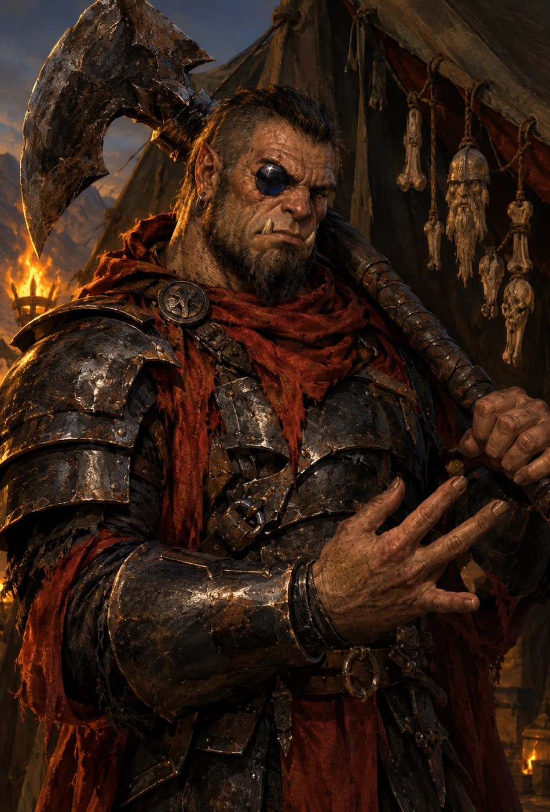
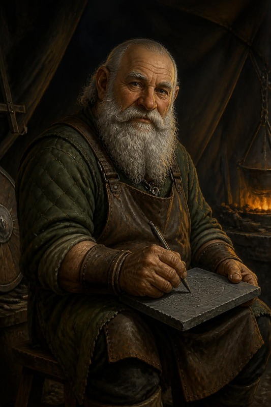
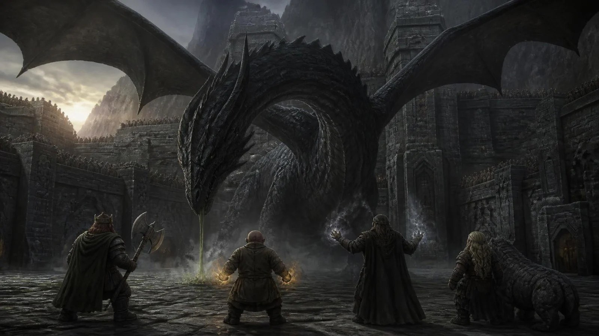
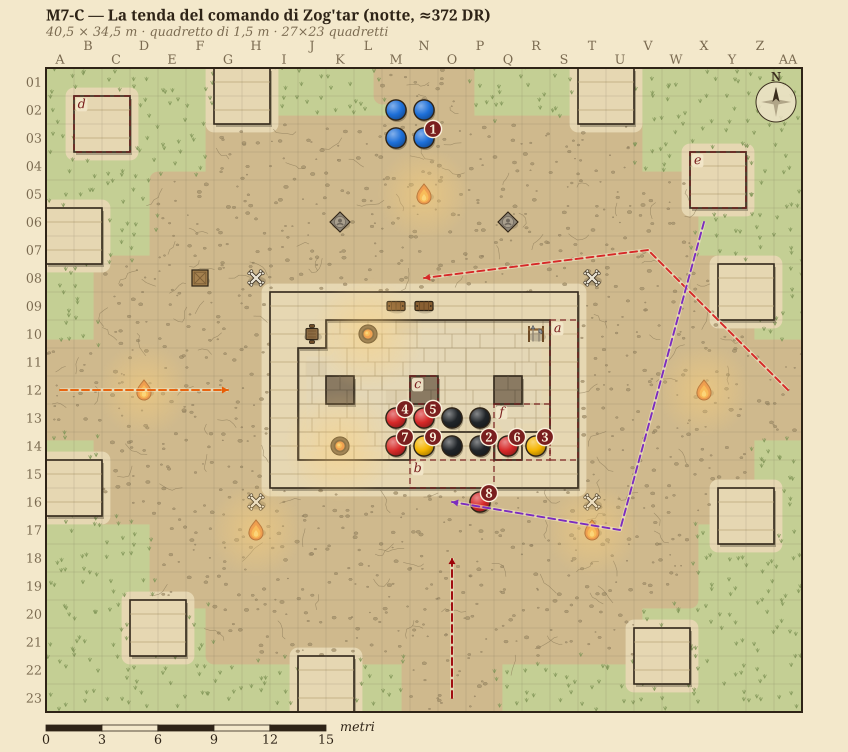
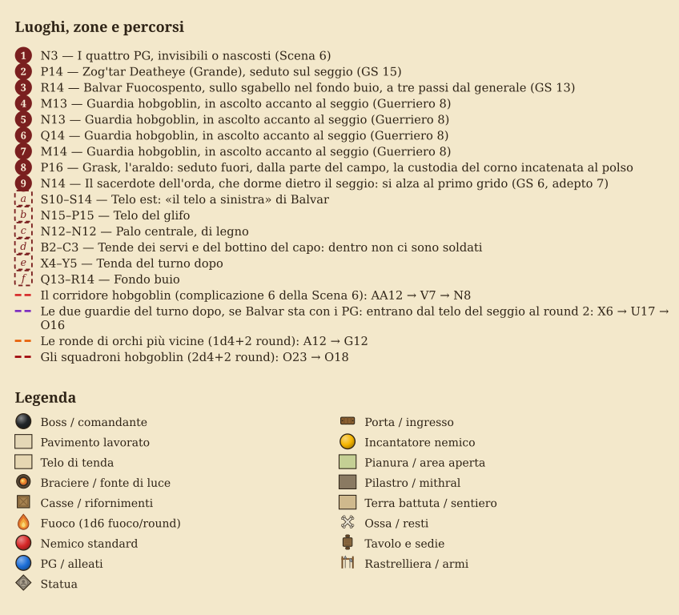
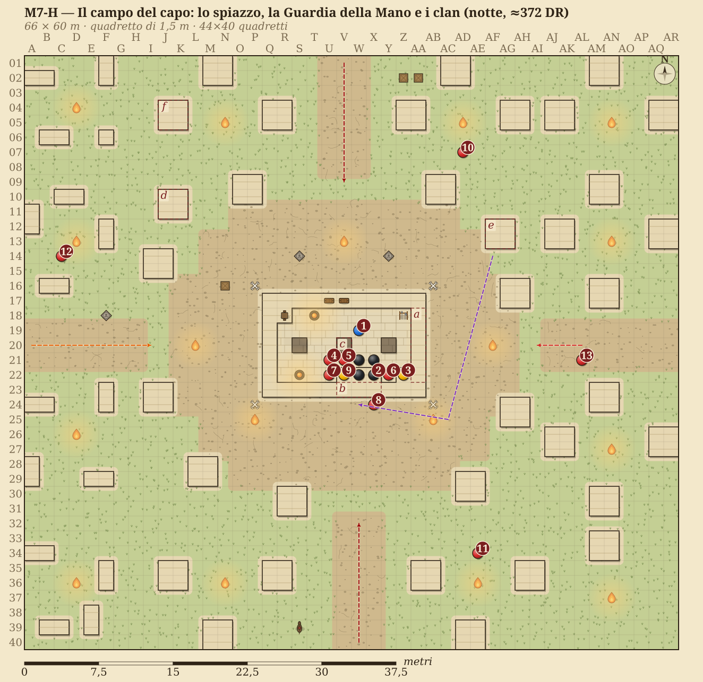
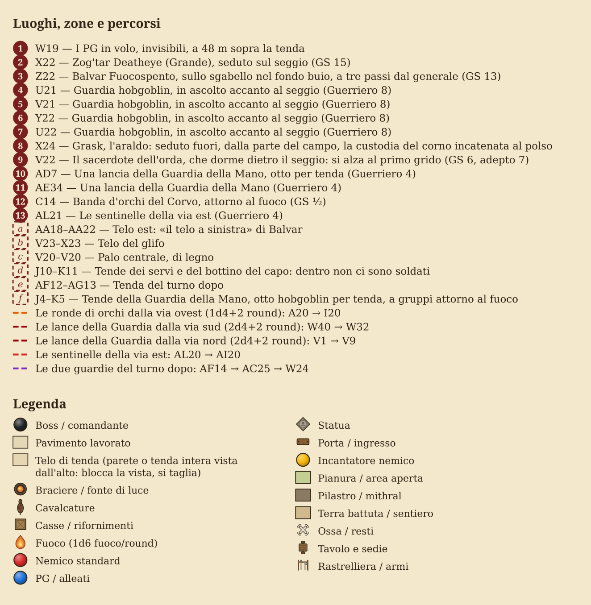

# Chi c'è stanotte, e dove sta

> **Cos'è.** Le facce della serata, una per una, nell'ordine in cui arrivano:
> chi è, cosa vuole, com'è, come parla, il ritratto e la scheda intera, uno
> accanto all'altro. Le mappe della tenda e del campo sono in fondo al
> capitolo. È lo stesso testo del master (`DEF-4`), copiato qui perché al
> tavolo non si sfoglia: se cambia il master, cambia anche questo capitolo.

## Zog'tar Deatheye, il generale

<!-- include: 07_il Portale Della Forgia Eterna/ARC07-DEF-4-VIAGGIO-MILLE-ANNI.md#zogtar-chi -->
| | |
|---|---|
| **Aspetto** | mezzo-ogre, grande quanto una porta di stalla, armatura completa di mithral annerita, di fattura nanica, presa ai nani. L'ascia a due mani appoggiata alla spalla. Al posto dell'occhio destro, una pietra nera levigata: l'**Occhio di Ossidiana**, un occhio vero `[CANONE — DM 2026-09-24]` |
| **Vuole** | Hammerfist. Sa uccidere diecimila uomini, non sa dove colpire le mura: per quello c'è Balvar |
| **Suona** | conta, sempre: *«due file», «tre ore», «cento»*. In ira: *«A ME, CANI! ABBATTETE LE OMBRE!»* |
| **Sa** | niente dei PG, a meno che il corridore non sia arrivato |
| **Eco** | come muore decide come comincia il duello. Se viene **umiliato e non ucciso**, l'orda che mille anni dopo sarà la Mano Rossa ha un generale in più nei suoi canti `[CANONE — DM 2026-10-07, Q26]` |
| **Ritratto** | qui sotto. Ai giocatori si mostra dopo l'incontro, non prima |
<!-- /include -->



<!-- include: 07_il Portale Della Forgia Eterna/ARC07-DEF-4-VIAGGIO-MILLE-ANNI.md#zogtar-scheda -->
```statblocco
nome: Zog'tar Deatheye, generale dell'orda antica
gs: 15 (Avanzato)
tipo: Mezzo-Ogre/Orco Grande, caotico malvagio · Barbaro 14 / Guerriero 1
taglia: Grande
spazio: 3 m
portata: 3 m
ca: 26
ca-dettaglio: contatto 12, impreparato 26 (−1 taglia, +10 arm. completa di mithral +2, +3 DES, +4 nat); 24 in Ira
pf: 283
pf-dado: 15 DV, massimi per dado; 328 in Ira Superiore
ts: Temp +18 (+21 in Ira), Rifl +9, Vol +9 (+12 in Ira; +16 contro gli ammaliamenti)
attributi: For 30 Des 20 Cos 24 Int 16 Sag 16 Car 18
velocita: 12 m
iniziativa: +9
sensi: scurovisione 18 m; Ascoltare +11, Osservare +3
attacchi:
  - Mischia ascia a due mani +1 +29/+24/+19 (3d6+20, 20/×3) in Ira; +26/+21/+16 (3d6+16) fuori dall'Ira
  - Distanza 3 giavellotti Grandi +19 (1d8+13) in Ira; (1d8+10) fuori dall'Ira; incremento 9 m
```
**Iniziativa** +9 · **Sensi** scurovisione 18 m (ogre e mezzorco, SRD); Ascoltare +11, Osservare +3

**Difesa** **CA 26** (−1 taglia, +10 arm. completa di mithral +2, +3 DES, +4 nat), contatto 12, impreparato 26 (Schivare Prodigioso Migliorato); 24 in Ira. Il mithral alza la DES massima a +3 (SRD); è preda presa ai nani, e i nani la riconoscono · **pf 283** (15 DV, massimi per dado), 328 in Ira Superiore · TS Tempra +18 (+21 in Ira), Riflessi +9, Volontà +9 (+12 in Ira; +16 contro gli ammaliamenti, Volontà Indomita) · RD 3/— (barbaro 13) · Schivare Prodigioso Migliorato · Percepire Trappole +4 · Volontà Indomita (14°)

**Attacco** Vel 12 m · **Mischia** in Ira, ascia a due mani +1 +29/+24/+19 (3d6+20, 20/×3); fuori dall'Ira (round di sorpresa) +26/+21/+16 (3d6+16) · **Distanza** 3 giavellotti Grandi +19 (BAB 15, DES +5, −1 taglia) (1d8+13 in Ira, 1d8+10 fuori dall'Ira), incremento 9 m · **Colpo Terrificante** (azione standard) +25 in Ira, 3d6+20; Riflessi con CD pari al danno, o vola via di 3 m e cade prono (+1d6 a lui e all'ostacolo se ne incontra uno) · **Attacco Poderoso** a due mani: fino a −15 al colpire per +30 ai danni

**Tattiche** La tenda della Scena 8: le quattro guardie gli tengono la CA, il sacerdote sta nella tenda.

**Statistiche** For 30 (36 in Ira), Des 20, Cos 24 (30 in Ira), Int 16, Sag 16, Car 18 · BAB +15; Lotta +29 (+32 in Ira) · **Talenti** (7) Attacco Poderoso, Spingere Migliorato, Colpo Terrificante (talento da mostro, SRD), Ira Extra, Iniziativa Migliorata, Volontà di Ferro, Arma Focalizzata (ascia) · **Abilità** Ascoltare +11, Osservare +3, Intimidire +14 (8 gradi in Ascoltare, 10 in Intimidire, nessuno in Osservare) · **Altro equipaggiamento** armatura completa di mithral +2, ascia a due mani +1, 3 giavellotti (tutto di taglia Grande); Occhio di Ossidiana (sotto)

**Capacità speciali**
- **Ira Barbarica Superiore** (6/giorno, con Ira Extra): +6 FOR, +6 COS, +3 Volontà, −2 CA, 13 round. Dopo l'Ira è affaticato (l'Ira Instancabile arriva al 17°).
- **Presenza Minacciosa**: entro 9 m, quando attacca o carica, Volontà CD 21 o scosso 1d4 round; chi supera il TS è immune per 24 ore (10 + ½ DV + CAR, e il resto come la presenza terrificante dei draghi; D57).
- **Occhio di Ossidiana** (artefatto minore maledetto, incastonato al posto dell'occhio destro, canone del DM): 3/giorno, azione di movimento, marca un bersaglio: −2 CA contro Zog'tar e +2 danni subiti da lui, 5 round. Prezzo: Zog'tar è **vulnerabile alla luce divina** (Luce di Lathander, Corona).
<!-- /include -->

## Le quattro guardie della tenda

Hobgoblin in armatura nera laccata, tutti uguali di proposito. Vogliono che
Zog'tar non li veda mai esitare, perché l'ultimo che ha esitato è sul seggio,
fra i teschi. Non parlano: al generale rispondono battendo il piatto dello
spadone per terra, una volta sì, due no. Ritratto: nessuno.

<!-- include: 07_il Portale Della Forgia Eterna/ARC07-DEF-4-VIAGGIO-MILLE-ANNI.md#guardie-scheda -->
```statblocco
nome: Guardia di Zog'tar (4)
gs: 8
tipo: Hobgoblin Medio · Guerriero 8 SRD sulle caratteristiche dell'hobgoblin
taglia: Media
spazio: 1,5 m
portata: 1,5 m
ca: 19
ca-dettaglio: +8 arm. completa, +1 DES, il massimo che l'armatura lascia; spadone, niente scudo
pf: 60
ts: Temp +8, Rifl +3, Vol +1
velocita: 6 m (armatura pesante)
iniziativa: +1
sensi: scurovisione 18 m; Ascoltare +1, Osservare +1 (senza gradi nelle due abilità)
attacchi:
  - Mischia spadone +14 (2d6+6/19-20)
  - Distanza giavellotti +9 (1d6+4), incremento 9 m
voci:
  - Linguaggi: Comune, Goblin
  - Altro equipaggiamento: armatura completa, spadone, giavellotti
```
<!-- /include -->

## Il sacerdote dell'orda

Hobgoblin secco, dagli occhi gialli, la mano sinistra nera di fuliggine fino
al polso, un bastone ferrato con appese ossa di dita. Canta invece di
parlare, sempre la stessa cantilena, e la interrompe solo per dare ordini.
Dorme sulla sua stuoia a N14. Dopo il barile è lui che mette la *luce* sul
giavellotto, al round 3 (capitolo III, §8). Ritratto: nessuno.

<!-- include: 07_il Portale Della Forgia Eterna/ARC07-DEF-4-VIAGGIO-MILLE-ANNI.md#sacerdote-scheda -->
```statblocco
nome: Sacerdote dell'orda
gs: 6
tipo: Hobgoblin Medio · Adepto 7
taglia: Media
spazio: 1,5 m
portata: 1,5 m
ca: 12
ca-dettaglio: +2 DES
pf: 38
pf-dado: 7d6+14
ts: Temp +4, Rifl +4, Vol +7
attributi: For 10 Des 14 Cos 15 Int 14 Sag 15 Car 8
velocita: 9 m
iniziativa: +2
sensi: scurovisione 18 m; Ascoltare +2, Osservare +2
attacchi:
  - Mischia bastone ferrato +3 (1d6)
```
**Iniziativa** +2 · **Sensi** scurovisione 18 m; Ascoltare +2, Osservare +2

**Difesa** **CA 12** (+2 DES) · **pf 38** (7d6+14) · TS Temp +4, Rifl +4, Vol +7

**Attacco** Vel 9 m · **Mischia** bastone ferrato +3 (1d6) · **Incantesimi** (3/4/3; CD 12 + livello): 0 *guida, individuazione del magico, luce*; 1° *benedizione, causare paura, comando, protezione dal bene*; 2° *vedere invisibilità, oscurità, forza del toro*

**Tattiche** Sta nella tenda di Zog'tar (Scena 8).

**Statistiche** For 10, Des 14, Cos 15, Int 14, Sag 15, Car 8 · **Abilità** Ascoltare +2, Osservare +2, Concentrazione +12 · **Linguaggi** Comune, Goblin · **Altro equipaggiamento** bastone ferrato
<!-- /include -->

## Grask, l'araldo col corno

Hobgoblin di quindici anni, magro. Il corno sta nella custodia col glifo,
incatenata al suo polso. Dorme seduto fuori dalla tenda, a P16, col braccio
sopra la custodia. Vuole una cosa sola: non perderlo più. Non parla, soffia.
Sveglio se l'ultima tacca segnata all'arrivo è la 4ª, addormentato dalla 5ª.
Ritratto: nessuno.

**Numeri** (combattente 1 dell'SRD): **CA 15** · **pf 6** · Riflessi +1 ·
Ascoltare e Osservare +2, −10 ad Ascoltare finché dorme. Dopo il barile suona
entro **1d4 round** dal boato, se è vivo (capitolo III, §8).

## Balvar Fuocospento, il runaio esiliato

<!-- include: 07_il Portale Della Forgia Eterna/ARC07-DEF-4-VIAGGIO-MILLE-ANNI.md#balvar-chi -->
| | |
|---|---|
| **Aspetto** | nano dello scudo vecchio, grembiule di cuoio, seduto su uno sgabello da bottega. Sulle ginocchia una lastra d'ardesia, in mano una punta di ferro |
| **Vuole** | che Hammerfist cada **in fretta**, perché un assedio lungo è fame, e lui l'ha già vista. E che qualcuno dica che c'era |
| **Suona** | non smette di incidere mentre parla. La punta sull'ardesia continua sotto le frasi |
| **Sa** | **che i PG non sono di questo secolo**, unico in tutta Hammerfist. Dove vanno colpite le mura. La runa-vincolo sulla scaglia del drago, perché l'ha incisa lui |
| **Non dice** | che ha un nipote di diciannove anni sul camminamento. Mai per primo |
| **Ritratto** | qui sotto. Ai giocatori si mostra dopo l'incontro, non prima |
<!-- /include -->



<!-- include: Bestiario/villain/balvar-fuocospento-cr13.md#scheda -->
```statblocco
nome: Balvar Fuocospento, il Consigliere dell'Orda
gs: 13
tipo: Umanoide Medio (nano), Chierico 9 di Abbathor / Runecaster 4, NE
taglia: Media
spazio: 1,5 m
portata: 1,5 m
ca: 24
ca-dettaglio: contatto 14, colto 22 (armatura completa di mithral +2, anello di protezione +2, DES +2)
pf: 101
pf-dado: 13d8+39
ts: Temp +13, Rifl +8, Vol +17
attributi: For 12 Des 14 Cos 16 Int 16 Sag 20 Car 14
velocita: 6 m
iniziativa: +2
sensi: scurovisione 18 m; Ascoltare +5, Osservare +5
attacchi:
  - Mischia martello da guerra runico +1 +11/+6 (1d8+2/x3)
voci:
  - Talenti: Incidere Rune (Inscribe Rune), Volontà di Ferro, Riflessi Fulminei, Incantare in Combattimento, Scrivere Pergamene
  - Abilità: Percepire Intenzioni +13, Concentrazione +19, Sapienza Magica +19, Conoscenze (storia) +19, Artigianato (incidere rune) +19
```
**Iniziativa** +2 · **Sensi** scurovisione 18 m; Ascoltare +5, Osservare +5

**Difesa** **CA 24**, contatto 14, colto 22 (armatura completa di mithral +2, anello di protezione +2, DES +2) · **pf 101** (13 DV) · TS Temp +13, Rifl +8, **Vol +17** (+2 razziale vs magia) · immune a paura (patto con Abbathor) · **Debolezza** le sue rune sono **scritte** — chi legge il nanico antico e le vede può contrastarle (vedi il modulo).

**Attacco** Vel 6 m · **Mischia** martello da guerra runico +1 +11/+6 (1d8+2/x3) · Domini **Inganno** e **Runa** (dominio Runa = FRCS). Incantesimi da **chierico di 13° livello**: è chierico 9 **e** Runecaster 4, e il Runecaster avanza il lancio (per questo ha *blade barrier*, che è di 6°). CD 15+liv: tipici *dispel magic, magic circle against good, greater magic weapon, divination, righteous might, blade barrier, slay living, silence, invisibility purge, glyph of warding, dimensional anchor*, *greater command* (uno slot di 5° libero)<!-- storico --> (aggiunto il 2026-10-07 su richiesta del DM)<!-- /storico -->.

**Tattiche** Dipendono da come è andata con lui prima dello scontro: il viaggio a mille anni fa, Scena 7, «Cosa fa quando comincia lo scontro» (canone, decisione Q21 del DM) (recuperato non combatte e indica la runa della Catena; trattativa aperta guarda un round e poi sta con chi vince; minacciato combatte con Zog'tar, come dice «Come si combatte, se si arriva a combatterlo» nella stessa scena). **Morale**: sotto 30 pf non fugge e non implora, finisce di incidere la lastra con un'azione di round completo, l'ultima, e in quel turno non attacca e non lancia (decisioni D52 e D71 del DM, nella stessa scena).

**Statistiche** For 12, Des 14, Cos 16, Int 16, **Sag 20**, Car 14 · BAB +9; Lotta +10 · **Abilità** Percepire Intenzioni +13, Concentrazione +19, Sapienza Magica +19, Conoscenze (storia) +19, Artigianato (incidere rune) +19 (il conto dei gradi è nella nota in testa) · **Talenti** Incidere Rune `[Private source — FRCS]`, Volontà di Ferro, Riflessi Fulminei, Incantare in Combattimento, Scrivere Pergamene · **Equipaggiamento** armatura completa di mithral +2, anello di protezione +2, martello da guerra runico +1, polvere di diamante per i glifi

**Capacità speciali**
- **Rune incise (Runecaster 4)**: incide fino a **4 rune persistenti** su superfici o creature consenzienti/legate; una runa incisa **non consuma slot al momento dell'uso** e scatta alla condizione scritta. Alla tenda di Zog'tar (ARC-07 DEF-4, Scene 6 e 7): *invisibility purge* sulla soglia, *blade barrier* sul palo centrale, *silence* su sé stesso, **la Catena** (sotto). *Dimensional anchor* lo lancia, non lo incide.
- **La Catena di Skullcrusher (Su, unica)**: la runa-vincolo incisa nella scaglia sternale del drago. Finché regge, **Skullcrusher combatte per l'orda**. Non è dominazione — è un **contratto scritto nella carne**, e il drago lo sa.
- **Leggere il Fuori-Posto (Su, 3/giorno)**: come *detect magic* ma sulle **anomalie temporali**: percepisce chi non appartiene a questo secolo. **È il solo, in tutta Hammerfist ≈372 DR, che sa cosa sono i PG.**
<!-- /include -->

## All'alba: Skullcrusher il Nero e le wyvern

<!-- include: 07_il Portale Della Forgia Eterna/ARC07-DEF-4-VIAGGIO-MILLE-ANNI.md#skullcrusher-chi -->
| | |
|---|---|
| **Aspetto** | drago nero vecchio (adulto maturo, se si usa l'Appendice A.1), snello e arrogante: collo lungo, cranio stretto e cornuto, scaglie nere opache con un riflesso verde d'olio. L'acido gli cola dalle fauci chiuse |
| **Vuole** | vincere **davanti all'orda**, perché per lui il potere è quello che gli altri hanno visto |
| **Teme** | che l'orda veda il guinzaglio. Chi dice la Catena ad alta voce se lo tira addosso (Scena 7, «Che cosa muove Skullcrusher») `[CANONE — DM 2026-10-12, D63]` |
| **Suona** | dice **il nome** dell'avversario prima di colpire, ogni volta. Il nome è l'incantesimo, *colpo accurato*: il morso arriva al round dopo. Non lo chiede: lo sa dal corno, o mette un epiteto al suo posto (Scena 7, «Che cosa muove Skullcrusher») `[CANONE — DM 2026-10-19]`. Per il resto provoca e commenta, e se il tavolo ci sta ci si parla |
| **Eco** | la tabella B4 (§7): ogni ferita che gli fate, la Forgia la ricorderà contro **Fauci di Palude** nel 1372 |
| **Ritratto** | la tavola qui sotto. Solo per il DM fino al duello |
<!-- /include -->



Stasera il drago è il **Vecchio**. La scheda qui sotto rimanda alla scheda
dell'Adulto (`DEF-4` Appendice A.1) per
sensi, velocità, capacità magiche, talenti e abilità.

<!-- nuova-pagina -->

<!-- include: 07_il Portale Della Forgia Eterna/ARC07-DEF-4-VIAGGIO-MILLE-ANNI.md#skullcrusher-vecchio-scheda -->
```statblocco
nome: Skullcrusher Vecchio
gs: 17 (Vecchio GS 16, +1 Avanzato)
tipo: Drago Enorme (acqua), caotico malvagio · drago nero Vecchio dell'SRD, Avanzato
taglia: Enorme
spazio: 4,5 m
portata: 3 m (4,5 m con il morso)
ca: 36
ca-dettaglio: contatto 10, impreparato 34 (−2 taglia, +2 DES, +26 nat); 40 con armatura magica
pf: 337
pf-dado: 25d12+175
ts: Temp +21, Rifl +18, Vol +20
attributi: For 33 Des 14 Cos 25 Int 18 Sag 19 Car 18
velocita: 18 m, volare 45 m (scarsa), nuotare 18 m
iniziativa: +6
sensi: percezione cieca 18 m, scurovisione 36 m, visione crepuscolare ×4
attacchi:
  - Mischia morso +34 (2d8+11), 2 artigli +29 (2d6+5), 2 ali +29 (1d8+5), colpo di coda +29 (2d6+16)
```
**Iniziativa** +6 · **Sensi** percezione cieca 18 m, scurovisione 36 m, visione crepuscolare ×4; Ascoltare e Osservare come l'Adulto (A.1)

**Difesa** **CA 36** (−2 taglia, +2 DES, +26 nat), contatto 10, impreparato 34; **40 con *armatura magica*** · **pf 337** (25d12+175) · TS Temp +21, Rifl +18, Vol +20 · RD 10/magia · RI 22 · immune acido, sonno, paralisi

**Attacco** Vel 18 m, volare 45 m (scarsa), nuotare 18 m · **Mischia** morso +34 (2d8+11), 2 artigli +29 (2d6+5), 2 ali +29 (1d8+5), colpo di coda +29 (2d6+16) · **Schiacciare** 2d8+16, Riflessi CD 29 (solo creature Piccole o minori) · **Soffio acido** linea di 30 m, 16d4, Riflessi CD 31 dimezza (aderente come A.1) · **Capacità magiche** come A.1, ma *oscurità* con raggio 24 m e *corrompere l'acqua* a CD 26 (la CD della sua Presenza Terrificante, come nell'SRD), più *crescita vegetale* 1/giorno · **Incantesimi da stregone** incantatore di 7°: 6/7/7/5 al giorno (*lentezza* CD 17)

**Tattiche** Come A.1: fugge a ⅓ dei pf, circa **112 pf**.

**Statistiche** For 33, Des 14, Cos 25, Int 18, Sag 19, Car 18 · BAB +25; Lotta +44 · **Talenti** Attacco in Volo, Capacità Focalizzata (soffio), Fluttuare, Iniziativa Migliorata, Riflessi Fulminei, Soffio Impregnante, Virare (non Ghermire), Volontà di Ferro, più Allerta · **Abilità** e il resto: come A.1

**Capacità speciali**
- **Presenza Terrificante**: raggio 72 m, Volontà CD 26 (meno di 25 DV).
- **Soffio impregnante**, come A.1, ma toglierselo è Riflessi CD 31, la CD del suo soffio.
<!-- /include -->

<!-- include: 07_il Portale Della Forgia Eterna/ARC07-DEF-4-VIAGGIO-MILLE-ANNI.md#wyvern-scheda -->
```statblocco
nome: Wyvern (2)
gs: 6
tipo: Drago Grande · wyvern SRD
taglia: Grande
spazio: 3 m
portata: 1,5 m
ca: 18
pf: 59
ts: Temp +7, Rifl +6, Vol +6
velocita: 6 m, volare 18 m (scarsa)
iniziativa: +1
sensi: scurovisione 18 m, visione crepuscolare, fiuto
attacchi:
  - Mischia pungiglione +10 (1d6+4 e veleno, Tempra CD 17, 2d6 COS), morso +8 (2d8+4)
voci:
  - Lotta: +15
  - Talenti: Allerta, Attacco in Volo, Capacità Focalizzata (veleno), Multiattacco
tattica: Vanno su chi tiene la corda dell'ala e su chi vola.
fonte: wyvern dell'SRD; i tiri salvezza sono quelli della sua scheda SRD
```
<!-- /include -->

<!-- nuova-pagina -->

## Le mappe: lo spiazzo, la tenda, il campo








