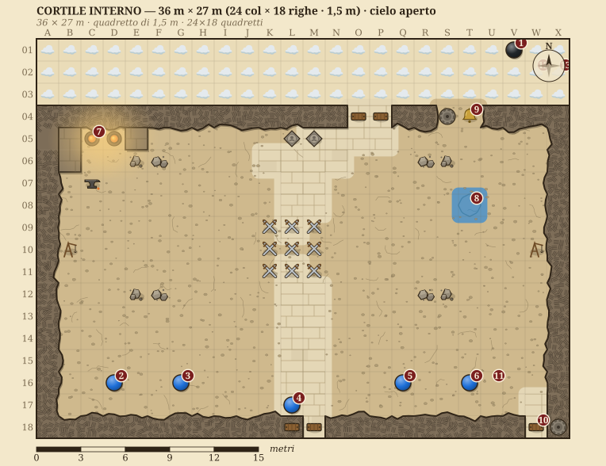
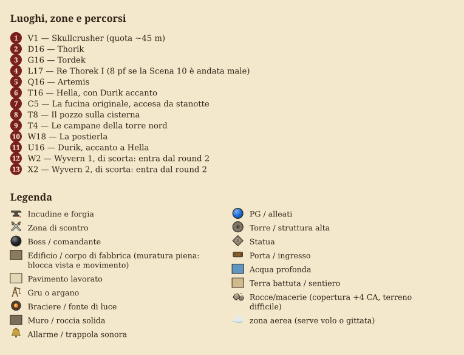

# M7-B · Il cortile del duello

La pianta del cortile dove Skullcrusher cala all'alba (Scena 11), con la legenda nella pagina dopo. Le piante della notte, M7-C e M7-H, sono in fondo al capitolo II, subito prima del barile.

<!-- nuova-pagina -->

