<!-- GENERATO da scripts/build_booklet_html.py --format hb (ADR-0013).
     Manifest: ARC07-NOTTE-E-ALBA-SERATA.manifest.json — i capitoli CITANO i master (ADR-0003).
     Le immagini restano riferimenti relativi al repo: per la resa con
     immagini incorporate usa la via HTML (--format html). -->

{{frontCover}}

{{logo }}

# RUMBLING STONE
## La Notte e l'Alba
___

### Hammerfist mille anni fa · il campo dell'orda · le mura · il duello con Skullcrusher

{{banner BOOKLET DELLA SERATA}}

{{footnote
  Sessione D&D 3.5 di circa tre ore per 4 personaggi di 13° livello · Faerûn, ≈372 DR · Campagna privata RumblingStone · regia della serata, cast e voci, il barile sulla tenda di Zog'tar, il viaggio a mille anni fa dal campo al duello, la tabella delle ferite. Le pagine ✉ sono nel volume dei giocatori
}}

\page

# Dove siamo — il barile sulla tenda e il drago all'alba

> *Quassù l'aria è fredda e non sa di niente. Sotto, il campo è una brace
> sparsa sulla piana, e in mezzo alla brace c'è una macchia nera, la tenda di
> Zog'tar, con i due falò della guardia accesi ai lati. Le corde della botte
> segano le dita. Il vento porta su un russare, il nitrito di un lupo, una
> risata che si spegne. Laggiù nessuno guarda in alto.*

**Questa serata riprende dal cielo sopra il campo**.
Le scelte nella fortezza e il giro delle pozioni di Kettra sono giocati. Il
gruppo è in volo, invisibile, con la botte d'olio e i due barilotti, e si
rigioca lo sgancio. Poi:

1. **Il barile**, capitolo III e cap. V Scena 6, «Variante — il barile sulla
   tenda»: lo sgancio, i round nel fuoco, il corno.
2. **Dopo il barile**, cap. V Scene 6 e 9: il ritorno, Vatore fra le tende,
   e le Scene 7-8 solo se qualcuno scende a finire il lavoro.
3. **L'alba**, capp. VI e VIII Scene 10 e 11: le mura e il duello con Skullcrusher.
   **Ci si ferma sull'esito del duello**, prima del rito all'incudine. Il
   Rubino, il torque del re e il ritorno sono della serata dopo.

**Come si gioca questa serata**:

| | Decisione | Dove pesa |
|---|---|---|
| **N1** | Circa **tre ore** al tavolo. La regia ha la versione da tre ore e quella intera, scena per scena | regia, §0 |
| **N2** | Lo stop è **prima della Scena 12**: niente Rubino, niente torque. Si chiude sull'esito del duello | regia, Atto III |
| **N3** | Il **Torque di Thorek I** non è stato consegnato al consiglio: lo dà il re di persona alla Scena 12, Momento 5. Stasera resta al collo del re | «Il Viaggio a 1.000 Anni fa» Scena 12 |
| **N4** | **Durik è sempre presente**, come nella serata del 25, tranne nel campo: non vola, e resta alla postierla o nel terzo seme della Collana fino all'alba (cap. V Scena 6) | scheda di Durik |

**Stato al tavolo, entrando**. Il log scritto sul ramo del gruppo si ferma
alla serata del 25 settembre: quello che è successo dopo, fino al volo, lo sai
tu. Qui ci sono solo le cose che servono prima del primo tiro:

- **Orologio della notte**: alla fine del 25 erano **3 tacche** su 8 (il
  consiglio, il giro della fortezza, le gallerie di Zeth). Da allora si sono
  aggiunte quelle delle scelte in fortezza e la tacca del volo: contale col
  tavolo prima dello sgancio, perché lo stato di Grask dipende da lì.
- **Re Thorek I**: fiducia piena. Le pozioni del re sono arrivate per mano del
  sergente, cinque di *volare* e quattro di *cura ferite gravi*; il torque no.
  **Nessuna pozione d'invisibilità del re**: al campo valgono le due comprate
  e la n. 10 delle boccette, da 3 minuti l'una. Il resto di quello che hanno
  in mano è nella regia, §1.
- **Hella**: risorta, con i tre Doni. Durik non vola: è alla postierla o nel
  terzo seme della Collana, e torna all'alba per il duello.
- **Thorik**: porta il Debito della Radice, senza sapere quale sia il prezzo.
  Stasera non si incassa: è un'eco lunga.
- **La Corona**: Topazio e Smeraldo accesi, l'incasso del Rubino vuoto.
- **Le dieci boccette** sono state identificate da Kettra, e il giro è
  giocato: il foglio ce l'hanno. Nel volume dei giocatori c'è una copia.

**Come usare questo booklet e il volume dei giocatori.**

| Capitolo | Per chi | Quando |
|---|---|---|
| I · Regia della serata | ⚠ DM | da leggere prima, da tenere aperto durante |
| II · Chi c'è stanotte | ⚠ DM | i cattivi uno per uno, con chi è, cosa vuole, aspetto, ritratto e scheda intera, e le mappe M7-C e M7-H |
| III · Il barile sulla tenda | ⚠ DM | **la serata comincia qui**: la scheda da tavolo, le quote, le tattiche round per round, che cosa cambia |
| IV · Il Seme-Mercato | ⚠ DM | al ritorno, se non è ancora stato giocato |
| V · La cassetta del DM | ⚠ DM | pronuncia, suoni, indice dei read-aloud dell'arco |
| VI · Il Viaggio a Mille Anni fa | ⚠ DM | stasera dalla Scena 6 («Variante — il barile sulla tenda») in avanti. Statistiche, versioni veloci e mappe sono nelle appendici A, C e D |
| VII · La Forgia ricorda le ferite | ⚠ DM | la tabella delle ferite del duello, da tenere aperta durante la Scena 11 |
| VIII · Durik | ⚠ DM | la scheda del compagno di Hella, accanto alla giocatrice |
| **Il volume dei giocatori** | ✉ | gli echi della serata, il contratto del Seme e le dieci boccette |

| Pagina ✉ del volume dei giocatori | A chi | Quando |
|---|---|---|
| Echi della notte | uno a testa | se non li hanno già avuti in fortezza: prima dello sgancio. Si legge ad alta voce solo il riquadro; la riga «Solo per te» resta del giocatore |
| Il contratto del Seme | ad Artemis, e il tavolo lo rilegge | solo se il Seme si gioca al ritorno, dopo il box che chiude l'ora della pergamena e il contratto letto a voce (cap. IV). Se si rinvia, la pagina resta nel volume |
| Le dieci boccette | a tutti | già consegnate: è la copia di riserva |

\page

# I · Regia della serata

{{note
##### ⚠ SOLO DM
Questo capitolo è materiale del DM: non mostrarlo ai giocatori.
}}

# Regia della serata — dal barile al drago

> **Cos'è.** La scaletta della serata, in ordine di gioco. Non riscrive il
> master: dice **quale paragrafo aprire, quando, per quanto**, cosa consegnare
> e cosa annotare. Per l'ordine della serata e per cosa leggere prima vale
> questa regia, anche contro la lista «La vostra serata» del §0 di cap. V.
> Per le regole vince il master, e prima ancora vince lo stato della campagna.
>
> **Stasera, 2 novembre**. Le scelte nella fortezza
> e il giro delle pozioni di Kettra sono giocati. Il gruppo è in volo sopra il
> campo, invisibile, con la botte e i due barilotti, e **si rigioca lo
> sgancio** sulla tenda di Zog'tar. La serata comincia lì: Atto I, il barile.
>
> **Pilastri della serata**: Andor guida la notte (un orologio, una tenda, un
> ladro che non è di qui), Salvatore guida l'alba (le mura e il duello), Mercer
> sotto tutto: le voci, il finisher, lo spotlight.
>
> **Chi si oppone**: nel campo **Zog'tar Deatheye**, il generale dell'orda, e
> accanto a lui **Balvar Fuocospento**, il runaio che sa che i PG non sono di
> questo secolo; all'alba **Skullcrusher il Nero**, il drago che combatte per
> l'orda perché Balvar gli ha inciso un contratto in una scaglia.

---

## §0 · La serata in una tabella

| Atto | Cosa | Master | Tre ore | Intera | Si consegna |
|---|---|---|---:|---:|---|
| **0** | Prima di cominciare: dove sono, cosa tengono in mano, le tacche | questa pagina | 5 | 10 | ✉ gli echi, se non li hanno già |
| **I** | Il barile: lo sgancio e i round nel fuoco | capitolo II per chi c'è e le mappe; capitolo III, la scheda da tavolo, §2-bis e §8; cap. V Scena 6, «Variante — il barile sulla tenda» | 45 | 60 | — |
| **II** | Dopo il barile: il ritorno, Vatore, la notte che resta | cap. V Scene 6 («Il ritorno», «Se il corno suona di notte») e 9; Scene 7-8 solo se scendono | 30 | 45 | ✉ il contratto del Seme, solo se il Seme si gioca al ritorno |
| — | Pausa | | 10 | 15 | |
| **III** | L'alba | capp. VI e VIII Scene 10 e 11 | 75 | 90 | — |
| **Stop** | L'esito del duello | cap. VIII Scena 11, fine | 5 | 5 | |

**Totale**: circa **2 ore e 50** nella colonna «tre ore», **3 ore e 45** in
quella intera. Per stare nelle tre ore si taglia, in quest'ordine: il ritorno
in un tiro solo (cap. V Appendice C.2), poi il duello in tre scambi (cap. V
Appendice C.3). **Il barile non si taglia**: è la scena che il tavolo ha
costruito, e da lì vengono le mura e il duello.

**Le immagini e la musica**, nell'ordine in cui servono:

- la mappa **M7-H**, il campo attorno allo spiazzo, e la **M7-C**, lo spiazzo
  e la tenda, in fondo al capitolo II: dall'alto i PG vedono tutte e due, con
  i fuochi accesi;
- Balvar e Zog'tar: i ritratti nel capitolo II, accanto alle loro schede, da
  mostrare solo se uno dei due si fa vedere nella luce dell'incendio;
- Skullcrusher nel cortile, Scena 11: la tavola è nel capitolo II, solo
  quando il drago scende;
- la **M7-B** per il cortile, «Il Viaggio a 1.000 Anni fa» Appendice D;
- *La canzone delle pietre* non si usa stasera: è del Rubino, la serata dopo.

---

## §1 · Atto 0 — Prima di cominciare

**Cosa leggere prima, in un'ora.** Questa lista sostituisce quella del §0 di
cap. V.

| Minuti | Cosa |
|---:|---|
| 10 | questa regia, per intero |
| 5 | capitolo III, «La scheda da tavolo»: i dieci passi dello sgancio |
| 5 | capitolo III, §2-bis: la tabella delle quote e chi vede il colmo |
| 12 | capitolo III, §8: chi li può trovare, l'iniziativa, le rune, le tattiche round per round, chi suona il corno, l'orda |
| 3 | capitolo III, §9 (i barilotti) e §10 (che cosa cambia) |
| 5 | cap. V Scena 6: «Variante — il barile sulla tenda», «Il ritorno», «Come torna il drago», «Se il corno suona di notte» |
| 3 | cap. V Scena 9: «Dopo il barile» e «Se tornano in volo» |
| 5 | cap. VI Scena 10: la tabella «Dalla notte», con le righe del barile, le tre vie, la tabella dei successi |
| 9 | cap. VIII Scena 11: «Dopo il barile», la scheda d'entrata, il giro round per round, «Chi sceglie», «Chi non vola», la sidebar di scala, l'Appendice A.1-bis e le wyvern in A.6 |

Il Seme (capitolo IV), se non è ancora stato giocato, si fa al ritorno: §3. La
Forgia ricorda (cap. IX) si apre durante il duello.

**Sul tavolo**: il foglio dell'orologio della notte con le tacche segnate come
le ha il tavolo, compresa quella del volo; le mappe M7-H e M7-C scoperte,
perché dall'alto il campo si vede; un d8 e i dadi della quota per la
deviazione; la scheda di Durik vicino alla giocatrice di Hella. Durik non
vola: è alla postierla o nel terzo seme della Collana (cap. V Scena 6). La scheda di Durik nel volume dei giocatori non c'è: lei usa la
sua copia della sessione del 25, e se non l'ha più le passi il
capitolo VIII del tuo volume.

**Le schede che contano stasera**, da tenere a portata. Quelle dei cattivi
sono tutte nel capitolo II, nell'ordine in cui arrivano, con chi è, cosa
vuole, l'aspetto e il ritratto accanto ai numeri:

| Scheda | Perché |
|---|---|
| Skullcrusher Vecchio, capitolo II (il resto della scheda dell'Adulto in cap. X Appendice A.1) | il duello. Il soffio contro Durik è nella Scena 11, riga 4-bis |
| Le due wyvern, capitolo II | questo gruppo conta come straripante: ci sono, dal round 2 del duello |
| Durik, cap. XII | +50% di danni dall'acido: il soffio lo prende in pieno. Con la runa prima il +50%, poi −20 (cap. X §1, Hella). Senza runa il soffio gli fa in media più di 50: Tempra CD 15 o torna polvere, e la carica rimasta dopo i Treant dell'alba lo riporta per un'ora (Scena 11, riga 4-bis) |
| Il capitolo III, la scheda da tavolo e il §8 | lo sgancio e i round nel fuoco: è lo scontro con cui si apre |
| Zog'tar, le quattro guardie, il sacerdote e Grask, capitolo II | i round nel fuoco, o le mura se Zog'tar è vivo all'alba |
| Balvar, capitolo II | il *dissolvi* al round 4. Dopo il barile non tratta più da solo, ma chi gli parla per primo del nipote Hald lo trova ancora aperto (capitolo III, §10) |
| La Forgia ricorda le ferite, cap. IX | si segnano le ferite durante il duello, non dopo |

**Gli echi.** Se il tavolo li ha già avuti in fortezza, salta questo
paragrafo. Se no, **consegnali** adesso, uno a testa, piegati. Di' solo:
*«Questo è quello che vi è rimasto addosso della notte. Leggetelo quando ve lo
dico.»* Li fai leggere ad alta voce, uno per giocatore, prima dello sgancio:
**solo il riquadro**. Dillo così:
*«Leggete il riquadro. La riga sotto, quella che comincia con "Solo per te",
è vostra: non leggetela.»* La pagina stampata lo dice anche lei, sopra il
riquadro e sulla riga privata, ma dillo tu: chi legge ad alta voce di solito
legge tutto.

Prima di consegnare l'eco di Thorik, chiedi al giocatore se alla Scena 4 ha
porto l'ascia a Thorgrim: la riga privata lo dà per avvenuto, e il registro
della sessione 4 non lo dice.

Tre cose da fissare prima di cominciare, se non le hai già fissate nelle
serate passate, perché il testo non le decide:

- **il Seme, capitolo IV**, se si gioca al ritorno: il tono dell'Anello (A o B) lo scegli adesso;
  i Bracieri, se Tordek li interroga, rispondono con una frase sola e mai
  sul Seme. Il testo copiato nel
  capitolo IV dice ancora «non commentano» e «in base a come Artemis ha
  gestito»: valgono queste due righe;
- **il dono a metà di Hella** (cap. VI §1): dipende dai successi dello Step 5
  del rito, e il log del 25 dice solo che i tre Doni sono stati dati tutti.
  Fissa adesso se sono stati tre su tre o due su tre;
- **lo Smeraldo della Corona**, 1 a settimana: il passaggio nel tempo ricarica
  solo gli usi giornalieri («Il Viaggio a 1.000 Anni fa» Scena 1). Il registro non dice quando
  Thorik l'ha usato l'ultima volta: chiedilo al giocatore.

**Le dieci boccette**: il giro di Kettra è giocato, quindi il foglio ce
l'hanno. Le pozioni identificate sono già nel loro inventario.

**Cosa hanno in mano**, dal log del 25 settembre. Chi porta cosa non è stato
registrato: lo si chiede al tavolo al passo 0 dell'Atto I. Quello che hanno
bevuto o comprato dopo il 25 lo sanno loro: la tabella è il punto di
partenza, non il conto.

| Cosa | Quante, e cosa fa | Quando conta |
|---|---|---|
| *Volare*, dal re | 5 pozioni, 5 minuti, 12 m di velocità in armatura | andata e ritorno (§2). Artemis vola a volontà, Hella da aquila con la forma selvatica: per andata e ritorno di Thorik e Tordek ne bastano 4 |
| *Invisibilità* | **3** pozioni da 3 minuti: le due comprate da Brynja e la n. 10 delle boccette. Nessuna è del re | ognuna copre mezzo blocco: a piedi si tira Nascondersi CD 22 dal primo blocco (cap. V Scena 6). In volo coprono l'atterraggio |
| *Velocità* | 3 pozioni di Kettra, 5 round | il round di sorpresa alla tenda, o il duello |
| Rune di *resistere all'energia*, acido 20 | 2, di Zeth: 70 minuti dall'attivazione, azione standard | si attivano al corno dell'alba o dopo: il drago arriva 70 round dopo il corno, e la runa dura 70 minuti. Uscendo dalla postierla, invece, all'alba sono scadute |
| Cure in pozione e bacchetta | 4 «di CFC» del re e la quinta comprata (3d8+11); 3 di *cura ferite gravi*; 10 bacchette di *cura ferite leggere*; 5 pozioni di *neutralizza veleno* | il veleno delle wyvern è Tempra CD 17 (A.6) |
| Pergamene | 4 *ristorare*, 3 *cura ferite critiche*, 5 *cura ferite gravi*, 3 *neutralizza veleno* | nel gruppo non c'è un chierico. *Ristorare* è della lista del chierico e del paladino, non del druido: la legge Artemis, Usare Oggetti Magici CD 27 (20 + livello dell'incantatore, 7°: lo stesso conto del *silenzio* a CD 23 in «Il Viaggio a 1.000 Anni fa» Scena 5). Le cure e *neutralizza veleno* le legge **Hella** senza tiro: sono sulla lista del druido dell'SRD, *neutralizza veleno* al 3°, *cura ferite gravi* al 4°, *cura ferite critiche* al 5°, e lei è druida di 12°. Se Hella è a terra le legge Artemis, Usare Oggetti Magici CD 25 per le *gravi* e 27 per le altre |
| Le Benedizioni della Sala | Pelle di Pietra (resistenza al fuoco 10, al freddo 5), Cuore Incrollabile, *Vigore della Forgia*: 3 cariche a PG, 3d8+5 | durano 24 ore vissute dalla preghiera all'Altare (cap. X §0-bis). Quando il gruppo ha pregato l'ultima volta lo chiedi al tavolo prima dell'Atto I: se ha pregato all'ingresso nella Sala, di solito all'alba ci sono ancora |
| La benedizione dei chierici | +2 morale al colpire e ai danni, 12 ore dal consiglio: viene con la fiducia piena («Il Viaggio a 1.000 Anni fa» Scena 4) | copre la notte e il duello. Rende **gratis** la Sapienza Magica della Via A contro Zog'tar (Scena 8). Non vale sui TS |
| I Doni di Hella | *Scudo del Custode* (1 al giorno, azione immediata: prende su di sé, dimezzato, il danno di un alleato entro 9 m); RD 3/adamantino; *Rovo Eldritch* a volontà, 2d6 a 18 m. Guarigione rapida 1 su terra o pietra, sospesa nel round dopo un danno da fuoco | lo Scudo vale contro il soffio, su Durik o sul re. La RD ferma i colpi, non l'acido. Ogni volta che Hella usa lo Scudo, Thorik è accelerato per 3 round verso chi lei ha protetto (l'Eco del Custode) |
| Artemis | *eldritch blast* a **6d6**: un dado è andato a Hella, al rito | — |
| Tordek | l'Ancoraggio della Montagna non ce l'ha più: è il Dono passato a Hella al rito (log del 25). Contro il drago la Cintura rifiuta. I Bracieri no: Castigo del Drago (+2 al potenziamento e +2d6 contro i draghi), Salto Fiammeggiante 3 al giorno, e la Collina, che la prima volta scatta da sola quando una creatura Enorme lo porta sotto metà pf (scheda dei Bracieri) | Skullcrusher è Enorme: la prima Collina può arrivare stasera, senza preavviso |
| Aegis Fang | *Dragondoom* vale contro Skullcrusher (cap. VIII Scena 11). Il Bane contro Fauci (+2, +3d6, critico ×4, Scosso 1 volta a incontro CD 22) è per Fauci nel 1372 | contro il capostipite il Bane **non vale** |
| Thorik | porta il Debito della Radice: stasera non si incassa (eco E-07g). Il **Torque** è ancora al collo del re: lo dà lui alla Scena 12, fuori da stasera | — |
| Il dado dei caduti | quattro tiri di 1d4 alla Scena 10: le bacchette, *ristorare*, *cura ferite critiche*, *neutralizza veleno* | i nomi vanno fra i caduti del 372 |

---

## §2 · Atto I — Il barile

**Già giocato, e non si rigioca**: le richieste aperte, le scelte in
fortezza, il giro delle pozioni di Kettra, la partenza in volo dalla
postierla. Il volo ha già la sua tacca.

**0 · Prima del primo tiro** (cinque minuti). Fai dire al tavolo, e segna:

- **chi tiene che cosa**: la botte (in due, è pesante), i due barilotti, chi
  è invisibile e con quale pozione, quanti round di *volare* e di
  *invisibilità* restano (il volo dura 50 round, le invisibilità comprate 30);
- **la quota** da cui sganciano. La sceglie il tavolo, e prima di sceglierla
  il tavolo può sapere solo quello che vede: dì quali fuochi illuminano la
  tenda e chi di loro vede il colmo a quella quota (capitolo III, §2-bis). Da
  48 m la botte fa 15d6 e devia poco; più in basso devia meno, fa meno male, e
  dal round dopo i PG sono a portata del campo;
- **le tacche**: lo stato di Grask si fissa adesso. Sveglio se l'ultima tacca
  segnata è la 4ª, addormentato dalla 5ª (B9). Non dirlo al tavolo.

**1 · Lo sgancio.** L'iniziativa si tira quando decidono di sganciare. Il round
di sorpresa è solo loro, e lasciar cadere è un'azione gratuita: botte e
barilotti possono andare giù nello stesso round, e nessuno diventa visibile.
Poi la scheda da tavolo del capitolo III, passo per passo: dove cade (d8 e il
dado della quota), che cosa prende, le fiale, l'olio, chi brucia. Tira i
danni ad alta voce e descrivi la tenda che si accende: la luce dell'incendio
è intensa entro 12 m e fioca fino a 24 m (B24).

**Se chiedono dove far cadere i barilotti**, la risposta è nel §9 del capitolo
III: su Grask, prima che suoni. È l'unico modo di tenere lontano il drago
senza scendere. Dillo solo se lo chiedono.

**2 · I round nel fuoco.** Segui la tabella «Le tattiche, round per round»
(capitolo III, §8) per Zog'tar, le guardie, il sacerdote, Balvar e Grask, e
la tabella «L'orda» per il campo. Le quattro cose che possono far male a chi
è in alto, e che hanno un nome:

- **il corno**: Grask suona entro 1d4 round dal boato. Se è morto, la parola
  di Balvar, Zog'tar che strappa la custodia, o il primo capolancia (B19). Il
  drago arriva 70 round dopo il primo suono;
- **il giavellotto con la luce**, al round 3, se il sacerdote è vivo: mostra
  chi è entro 6 m dal punto più alto del tiro, a 45 m sopra la tenda;
- **il *dissolvi magie* di Balvar**, al round 4, dove il giavellotto li ha
  mostrati o alla cieca sulla verticale, una volta su sei. Chi perde il volo
  cade da 48 m, 15d6 (B13);
- **il drago**, se il corno ha suonato e sono ancora lì al round 70.

Ricorda ai giocatori i round che restano di *volare* e di *invisibilità*
quando li chiedono, non prima.

**3 · Il danno massiccio** è attivo: 50 o più da un solo attacco, Tempra CD 15
o si muore, e le palle di fuoco nate insieme contano come un attacco solo
(B5). Due colpi diretti su tre, da 48 m, superano i 50.

**4 · Quando lasciano il cielo sopra la tenda**, chiudi con una frase su
quello che vedono da lassù: chi è uscito dal fuoco, chi no, se il corno ha
suonato. Poi segna nel registro (§6) chi è morto, il corno e la quota.

**I PE per la trovata** sono nel §13 del capitolo III (B15): la fascia di
mezzo, o quella alta se il corno non suona. Si danno a fine serata, insieme a
quelli dei nemici caduti davvero.

**Per stare nelle tre ore**: se lo scontro si allunga, dal round 5 in poi
racconta l'orda a blocchi di due round, e tira solo l'olio e il fuoco su chi
conta (Zog'tar, Balvar, il sacerdote, Grask).

---

## §3 · Atto II — Dopo il barile

**Il ritorno** (cap. V Scena 6, «Il ritorno»). Si torna in volo finché
bastano pozioni e pergamene; quando finiscono, a piedi o portati da Artemis.
Il ritorno in volo costa **1 tacca**, come quello a piedi. Chi torna a piedi
tira il viaggio della Scena 6 a **CD +2**: dopo il barile i lupi si sono
stretti sotto le vie (B25). Se il corno ha suonato, vale «Se il corno suona di
notte»: chi riparte in volo subito è dentro le mura prima del drago.

**Se scendono a finire il lavoro** (cap. V Scene 7 e 8, mappa M7-C,
Appendice A.2). La Scena 8 si gioca com'è, ma con la tenda in fiamme o
crollata, il campo sveglio e i rinforzi della tabella «L'orda» del capitolo
III già in strada. Balvar, se è vivo, non tratta più da solo: è stato
attaccato (capitolo III, §10). Resta la lastra d'ardesia col nome di Hald: chi
gli parla del ragazzo per primo lo trova ancora aperto. La Cintura di Tordek qui funziona. Il danno massiccio è
attivo.

**Il Seme**, se non è stato giocato: si fa al ritorno, con le tacche che
restano prima dell'8 (riga «≤ 6» della tabella d'uscita), oppure si rinvia al
1372. Costa **1 tacca**. Il contratto ✉ si consegna solo dopo il box dell'ora
della pergamena (capitolo IV).

**Scena 9, Vatore** (cap. V Scena 9). Dieci minuti, al ritorno. L'Anello di
Artemis lo sente prima di chiunque: dagli lo spotlight. Se tornano in volo e
non scendono, Vatore è sulle mura all'alba, nel caos della Scena 10 («Se
tornano in volo»).

**Gli scontri che possono capitare per strada**, tutti con la loro tattica nel
master: la pattuglia dei tre fallimenti e la squadra dei lupi (Scena 6), lo
sciamano che vede l'invisibile al ritorno (Scena 6, dopo il corno), Zog'tar e
le guardie se scendono (Scena 8). Lo scontro con la pattuglia o con i lupi costa
una tacca in più. Le tattiche sono canone.

**Quando escono dalla tenda**, conta le tacche e leggi la riga della tabella
d'uscita: ≤ 6 in tempo, 7 di corsa, 8 o più l'alba li coglie fuori.

**Per stare nelle tre ore**: il ritorno passa alla versione veloce, cap. V
Appendice C.2, un tiro solo.

**Gli scontri senza griglia.** La pattuglia dei tre fallimenti e i lupi della
Scena 6 non hanno una mappa in scala: M7-A non lo è. Giocali su M7-H, il
campo attorno allo spiazzo del capo: le lance hobgoblin a gruppi attorno ai
loro fuochi, i ripari dei clan degli orchi a ovest.

---

## §4 · Atto III — L'alba

**Scena 10, le mura** (cap. VI Scena 10). Il box, poi **«Che fate?»**: una via
su tre, prova collettiva. **Prima di contare i successi**, applica la tabella
«Dalla notte»: i Treant, il campo allertato, Zog'tar vivo o morto, e le tre
righe del barile. Il boato è un allarme (un successo in meno); Zog'tar
tirato fuori dal fuoco davanti ai suoi vale «umiliato» e lo annulla (B11);
Zog'tar vivo all'alba è un altro successo in meno. E tira il
**dado dei caduti**: quattro tiri di 1d4, uno per ogni tipo di cura comprata
alla cappella; il numero è quanti difensori con un nome muoiono sulle mura, e
i nomi vanno fra i caduti del 372. Se Zog'tar è vivo all'alba, con 0-1
successi sale sulla breccia: la sua tattica sul camminamento è scritta sotto la
tabella «Dalla notte».

Se le tacche sono 8 o più, la Scena 10 **non si gioca**: il dado dei caduti si
tira all'alba, prima del duello, e il duello comincia con i PG fuori dalle mura.

**Scena 11, il duello** (cap. VIII Scena 11, mappa M7-B, Appendice A.1-bis: stasera il drago è il **Vecchio**; l'Adulto di A.1 resta per un gruppo più debole). Dopo il
barile il drago **guarda in alto**: ha sentito i gridi della notte
attraverso la Catena, e sa che i nani volano (B21). Se il corno ha suonato di
notte, parte già in quota; se nessuno l'ha suonato, arriva a metà mattina,
furioso. La prima battuta del drago usa uno dei nomi che ha sentito gridare
vicino al corno; se non ne ha, un epiteto. Poi cinque cose da tenere davanti:

- la **Cintura di Tordek** si rifiuta contro il drago (§1 del master): dillo
  al primo tentativo, in una riga, e non spiegarlo. I Bracieri invece valgono;
- il **soffio acido** e Durik: è l'unica cosa del viaggio che lo corrode
  davvero. La runa d'acido e lo Scudo del Custode di Hella sono le due risposte
  del gruppo;
- **le wyvern**: dal round 2, due wyvern (sidebar di scala, statistiche in
  A.6) vanno su chi tiene la corda e su chi vola. Fuggono quando il drago fugge
  o muore. Il duello è EL 17, il tetto, e vale circa 4.060 PX a testa («Il Viaggio a 1.000 Anni fa» §8);
- **la passata e il nome**: il drago non si ferma in aria. Attraversa il
  cortile con Attacco in Volo e Virata, e a metà passata soffia o grida un
  nome; al turno dopo morde chi ha nominato. Non ghermisce nessuno: la presa
  in bocca è di Fauci, nel 1372. Si ferma in aria una volta sola, a ⅓ dei pf,
  ed è la prima paura (cap. VIII Scena 11);
- **Aegis Fang** scaglia la Cicatrice Ancestrale: segna la ferita nella tabella
  della Forgia nel momento in cui succede.

Il finisher, se il drago muore, **va al giocatore** (`[HDYWTDT]`, §0-ter).

Gli esiti della Scena 11 sono tre (ucciso, ferito grave, fuggito). Il quarto,
**vinto sporco**, sta nel cap. VIII §6, ultima riga: scatta se due PG cadono
nello stesso round o se il gruppo si ritira.

**Per stare nelle tre ore**: se il tavolo è stanco dopo Zog'tar, il duello
passa alla regia veloce, cap. VIII Appendice C.3, tre scambi. Le ferite si
registrano lo stesso.

**Gli scontri senza griglia.** Zog'tar sulla breccia (Scena 10) si gioca su un
camminamento che nessuna mappa disegna: traccia una striscia larga un
quadretto e lunga dodici, con il bordo e la caduta di 4,5 m. È il tratto est:
dal muro sud, sul ciglio del gradone, chi cade fuori arriva sulla spianata,
24,5 m più in basso. Il duello sulla spianata, se il tavolo ha sabotato gli
arieti, non usa M7-B: basta un campo aperto, con le mura 24,5 m più in alto e
la rampa della porta che sale a nord. Il cortile del duello è a +100 m: dal
camminamento sud si vedono la spianata, 20 m sotto, e la piana, 100 m sotto.

---

## §5 · Lo stop

Quando il duello ha un esito (**ucciso**, **ferito grave**, **fuggito** o
**vinto sporco**), fermati. Non leggere niente della Scena 12: il rito, il
Rubino e il torque del re sono della serata dopo.

Descrivi il cortile com'è rimasto, in due frasi tue: chi è a terra, chi
guarda il cielo. Poi: *«Ci fermiamo qui. La prossima volta, l'incudine.»*

---

## §6 · Il registro di fine serata

Tutto quello che si annota stasera, in un posto. Si trascrive **sul ramo del
gruppo**.

| | Cosa | Esito |
|---|---|---|
| ☐ | Il barile: la quota, dove sono caduti botte e barilotti, Grask sveglio o addormentato | |
| ☐ | Chi è morto nel fuoco: Zog'tar · Balvar · il sacerdote · Grask · le guardie (quante) | |
| ☐ | Zog'tar tirato fuori dal fuoco davanti ai suoi? Vivo all'alba? | |
| ☐ | Il giavellotto con la luce e il *dissolvi* di Balvar: chi è stato visto, chi è caduto | |
| ☐ | I PE per la trovata (capitolo III, §13): fascia | |
| ☐ | Il Seme, se giocato al ritorno: identificato · estirpato · tenuto · dato · firmato (e da chi) | |
| ☐ | Balvar, se è sceso qualcuno: ucciso · ignorato · «dite che c'ero»? Hald l'ha visto? | |
| ☐ | Il corno: suonato (da chi, a che round) · rubato · rimasto nella custodia | |
| ☐ | I Treant: dove sono andati (tenda, fianco, duello) | |
| ☐ | Vatore: ignorato · parlato · derubato · ferito · tentato di uccidere. Chi ha bevuto la n. 4, e se Vatore ha visto il segno | |
| ☐ | Tacche spese all'arrivo alle mura | … su 8 |
| ☐ | Mura: la via scelta, i successi, il nano caduto se c'è | |
| ☐ | Il dado dei caduti: i quattro tiri, e i nomi | |
| ☐ | Duello: ucciso · ferito grave · fuggito · vinto sporco | |
| ☐ | Ferite ancestrali segnate (N ≤ 3) e Cicatrice Ancestrale | |
| ☐ | La frase del finisher, se c'è | |
| ☐ | Durik: ha preso il soffio? Hella ha usato lo Scudo del Custode, e su chi? | |

**Echi da armare** nel registro degli echi, se il tavolo li ha prodotti
(proposte, il DM decide quali). Il debito di Thorik è già **E-07g**.

| ID proposto | Da cosa | Tono |
|---|---|---|
| E-07h | Balvar, «dite che c'ero» | grigio, lunga |
| E-07i | Vatore, qualunque esito | grigio, lunga (ARC-09) |
| E-07j | Zog'tar vivo all'alba | scuro, ARC-08 |
| E-07l | la notte del barile: chi è morto nel fuoco, e la lastra di Hald se Balvar è morto | grigio, ARC-09 |
| E-07k | la frase del finisher | intimo |

\page

# II · Chi c'è stanotte: i cattivi, le schede, le mappe

{{note
##### ⚠ SOLO DM
Questo capitolo è materiale del DM: non mostrarlo ai giocatori.
}}

# Chi c'è stanotte, e dove sta

> **Cos'è.** Le facce della serata, una per una, nell'ordine in cui arrivano:
> chi è, cosa vuole, com'è, come parla, il ritratto e la scheda intera, uno
> accanto all'altro. Le mappe della tenda e del campo sono in fondo al
> capitolo. È lo stesso testo del master (cap. V), copiato qui perché al
> tavolo non si sfoglia: se cambia il master, cambia anche questo capitolo.

## Zog'tar Deatheye, il generale

<!-- include: 07_il Portale Della Forgia Eterna/ARC07-DEF-4-VIAGGIO-MILLE-ANNI.md#zogtar-chi -->
| | |
|---|---|
| **Aspetto** | mezzo-ogre, grande quanto una porta di stalla, armatura completa di mithral annerita, di fattura nanica, presa ai nani. L'ascia a due mani appoggiata alla spalla. Al posto dell'occhio destro, una pietra nera levigata: l'**Occhio di Ossidiana**, un occhio vero |
| **Vuole** | Hammerfist. Sa uccidere diecimila uomini, non sa dove colpire le mura: per quello c'è Balvar |
| **Suona** | conta, sempre: *«due file», «tre ore», «cento»*. In ira: *«A ME, CANI! ABBATTETE LE OMBRE!»* |
| **Sa** | niente dei PG, a meno che il corridore non sia arrivato |
| **Eco** | come muore decide come comincia il duello. Se viene **umiliato e non ucciso**, l'orda che mille anni dopo sarà la Mano Rossa ha un generale in più nei suoi canti |
| **Ritratto** | qui sotto. Ai giocatori si mostra dopo l'incontro, non prima |
<!-- /include -->

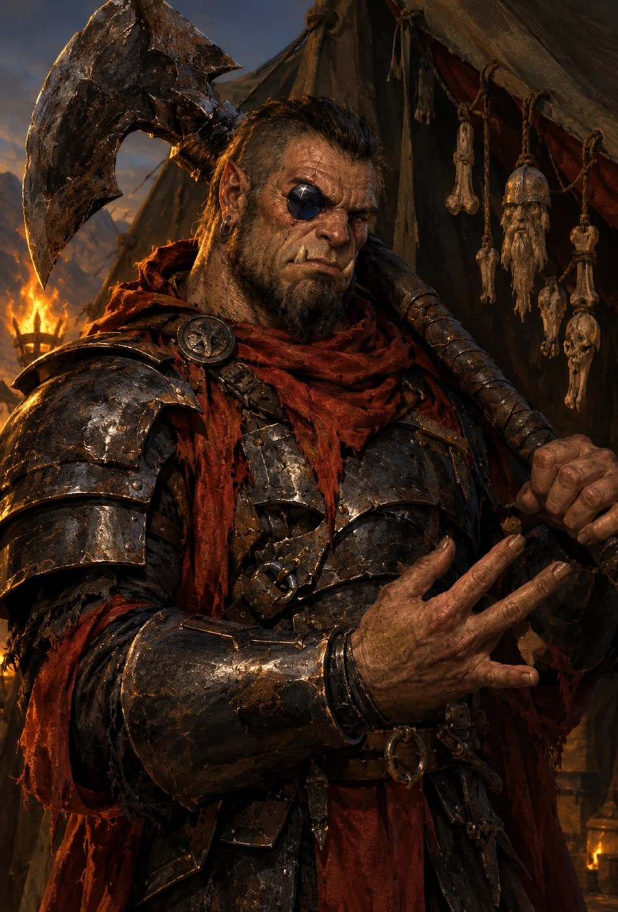

<!-- include: 07_il Portale Della Forgia Eterna/ARC07-DEF-4-VIAGGIO-MILLE-ANNI.md#zogtar-scheda -->
{{monster,frame
## Zog'tar Deatheye, generale dell'orda antica
*Mezzo-Ogre/Orco Grande, caotico malvagio · Barbaro 14 / Guerriero 1* · GS 15 (Avanzato)
___
**Iniziativa** +9 · **Sensi** scurovisione 18 m (ogre e mezzorco, SRD); Ascoltare +11, Osservare +3

**DIFESA**
___
**CA 26** (−1 taglia, +10 arm. completa di mithral +2, +3 DES, +4 nat), contatto 12, impreparato 26 (Schivare Prodigioso Migliorato); 24 in Ira. Il mithral alza la DES massima a +3 (SRD); è preda presa ai nani, e i nani la riconoscono · **pf 283** (15 DV, massimi per dado), 328 in Ira Superiore · TS Tempra +18 (+21 in Ira), Riflessi +9, Volontà +9 (+12 in Ira; +16 contro gli ammaliamenti, Volontà Indomita) · RD 3/— (barbaro 13) · Schivare Prodigioso Migliorato · Percepire Trappole +4 · Volontà Indomita (14°)  

**ATTACCO**
___
Vel 12 m · **Mischia** in Ira, ascia a due mani +1 +29/+24/+19 (3d6+20, 20/×3); fuori dall'Ira (round di sorpresa) +26/+21/+16 (3d6+16) · **Distanza** 3 giavellotti Grandi +19 (BAB 15, DES +5, −1 taglia) (1d8+13), incremento 9 m · **Colpo Terrificante** (azione standard) +25 in Ira, 3d6+20; Riflessi con CD pari al danno, o vola via di 3 m e cade prono (+1d6 a lui e all'ostacolo se ne incontra uno) · **Attacco Poderoso** a due mani: fino a −15 al colpire per +30 ai danni  

**STATISTICHE**
___
For 30 (36 in Ira), Des 20, Cos 24 (30 in Ira), Int 16, Sag 16, Car 18 · BAB +15; Lotta +29 (+32 in Ira) · **Talenti** (7) Attacco Poderoso, Spingere Migliorato, Colpo Terrificante (talento da mostro, SRD), Ira Extra, Iniziativa Migliorata, Volontà di Ferro, Arma Focalizzata (ascia) · **Abilità** Ascoltare +11, Osservare +3, Intimidire +14 (8 gradi in Ascoltare, 10 in Intimidire, nessuno in Osservare)  

**CAPACITÀ SPECIALI**
___
- **Ira Barbarica Superiore** (6/giorno, con Ira Extra): +6 FOR, +6 COS, +3 Volontà, −2 CA, 13 round. Dopo l'Ira è affaticato (l'Ira Instancabile arriva al 17°).  
- **Presenza Minacciosa**: entro 9 m, quando attacca o carica, Volontà CD 21 o scosso 1d4 round; chi supera il TS è immune per 24 ore (10 + ½ DV + CAR, e il resto come la presenza terrificante dei draghi; D57).  
- **Occhio di Ossidiana** (artefatto minore maledetto, incastonato al posto dell'occhio destro, canone del DM): 3/giorno, azione di movimento, marca un bersaglio: −2 CA contro Zog'tar e +2 danni subiti da lui, 5 round. Prezzo: Zog'tar è **vulnerabile alla luce divina** (Luce di Lathander, Corona).  

**TATTICHE**
___
La tenda della Scena 8: le quattro guardie gli tengono la CA, il sacerdote sta nella tenda.  
}}
<!-- /include -->

## Le quattro guardie della tenda

Hobgoblin in armatura nera laccata, tutti uguali di proposito. Vogliono che
Zog'tar non li veda mai esitare, perché l'ultimo che ha esitato è sul seggio,
fra i teschi. Non parlano: al generale rispondono battendo il piatto dello
spadone per terra, una volta sì, due no. Ritratto: nessuno.

<!-- include: 07_il Portale Della Forgia Eterna/ARC07-DEF-4-VIAGGIO-MILLE-ANNI.md#guardie-scheda -->
{{monster,frame
## Guardia di Zog'tar (4)
*Hobgoblin Medio · Guerriero 8 SRD sulle caratteristiche dell'hobgoblin* · GS 8
___
**Iniziativa** +1 · **Sensi** Ascoltare +1, Osservare +1 (senza gradi nelle due abilità)

**DIFESA**
___
**CA** 19, +8 arm. completa, +1 DES, il massimo che l'armatura lascia; spadone, niente scudo  
**pf** 60  
**TS** Temp +8, Rifl +3, Vol +1  

**ATTACCO**
___
**Velocità** 6 m (armatura pesante)  
**Mischia** spadone +14 (2d6+6)  
**Distanza** giavellotti +9 (1d6+4), incremento 9 m  
}}
<!-- /include -->

## Il sacerdote dell'orda

Hobgoblin secco, dagli occhi gialli, la mano sinistra nera di fuliggine fino
al polso, un bastone ferrato con appese ossa di dita. Canta invece di
parlare, sempre la stessa cantilena, e la interrompe solo per dare ordini.
Dorme sulla sua stuoia a N14. Dopo il barile è lui che mette la *luce* sul
giavellotto, al round 3 (capitolo III, §8). Ritratto: nessuno.

<!-- include: 07_il Portale Della Forgia Eterna/ARC07-DEF-4-VIAGGIO-MILLE-ANNI.md#sacerdote-scheda -->
{{monster,frame
## Sacerdote dell'orda
*Hobgoblin Medio · Adepto 7* · GS 6
___
**Iniziativa** +2 · **Sensi** Ascoltare +2, Osservare +2

**DIFESA**
___
**CA 12** (+2 DES) · **pf 38** (7d6+14) · TS Temp +4, Rifl +4, Vol +7  

**ATTACCO**
___
Vel 9 m · **Mischia** bastone ferrato +3 (1d6) · **Incantesimi** (3/4/3; CD 12 + livello): 0 *guida, individuazione del magico, luce*; 1° *benedizione, causare paura, comando, protezione dal bene*; 2° *vedere invisibilità, oscurità, forza del toro*  

**STATISTICHE**
___
For 10, Des 14, Cos 15, Int 14, Sag 15, Car 8 · **Abilità** Ascoltare +2, Osservare +2, Concentrazione +12  

**TATTICHE**
___
Sta nella tenda di Zog'tar (Scena 8).  
}}
<!-- /include -->

## Grask, l'araldo col corno

Hobgoblin di quindici anni, magro. Il corno sta nella custodia col glifo,
incatenata al suo polso. Dorme seduto fuori dalla tenda, a P16, col braccio
sopra la custodia. Vuole una cosa sola: non perderlo più. Non parla, soffia.
Sveglio se l'ultima tacca segnata all'arrivo è la 4ª, addormentato dalla 5ª.
Ritratto: nessuno.

**Numeri** (combattente 1 dell'SRD): **CA 15** · **pf 6** · Riflessi +1 ·
Ascoltare e Osservare +2, −10 ad Ascoltare finché dorme. Dopo il barile suona
entro **1d4 round** dal boato, se è vivo (capitolo III, §8).

## Balvar Fuocospento, il runaio esiliato

<!-- include: 07_il Portale Della Forgia Eterna/ARC07-DEF-4-VIAGGIO-MILLE-ANNI.md#balvar-chi -->
| | |
|---|---|
| **Aspetto** | nano dello scudo vecchio, grembiule di cuoio, seduto su uno sgabello da bottega. Sulle ginocchia una lastra d'ardesia, in mano una punta di ferro |
| **Vuole** | che Hammerfist cada **in fretta**, perché un assedio lungo è fame, e lui l'ha già vista. E che qualcuno dica che c'era |
| **Suona** | non smette di incidere mentre parla. La punta sull'ardesia continua sotto le frasi |
| **Sa** | **che i PG non sono di questo secolo**, unico in tutta Hammerfist. Dove vanno colpite le mura. La runa-vincolo sulla scaglia del drago, perché l'ha incisa lui |
| **Non dice** | che ha un nipote di diciannove anni sul camminamento. Mai per primo |
| **Ritratto** | qui sotto. Ai giocatori si mostra dopo l'incontro, non prima |
<!-- /include -->

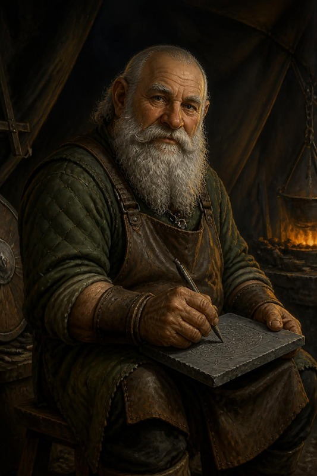

<!-- include: Bestiario/villain/balvar-fuocospento-cr13.md#scheda -->
{{monster,frame
## Balvar Fuocospento, il Consigliere dell'Orda
*Umanoide Medio (nano), Chierico 9 di Abbathor / Runecaster 4, NE* · GS 13
___
**Iniziativa** +2 · **Sensi** scurovisione 18 m; Ascoltare +5, Osservare +5

**DIFESA**
___
**CA 24**, contatto 14, colto 22 (armatura completa di mithral +2, anello di protezione +2, DES +2) · **pf 101** (13 DV) · TS Temp +13, Rifl +8, **Vol +17** (+2 razziale vs magia) · immune a paura (patto con Abbathor) · **Debolezza** le sue rune sono **scritte** — chi legge il nanico antico e le vede può contrastarle (vedi il modulo).  

**ATTACCO**
___
Vel 6 m · **Mischia** martello da guerra runico +1 +11/+6 (1d8+2) · Domini **Inganno** e **Runa** (dominio Runa = FRCS). Incantesimi da **chierico di 13° livello**: è chierico 9 **e** Runecaster 4, e il Runecaster avanza il lancio (per questo ha *blade barrier*, che è di 6°). CD 15+liv: tipici *dispel magic, magic circle against good, greater magic weapon, divination, righteous might, blade barrier, slay living, silence, invisibility purge, glyph of warding, dimensional anchor*, *greater command* (uno slot di 5° libero).  

**STATISTICHE**
___
For 12, Des 14, Cos 16, Int 16, **Sag 20**, Car 14 · BAB +9; Lotta +10 · **Abilità** Percepire Intenzioni +13, Concentrazione +19, Sapienza Magica +19, Conoscenze (storia) +19, Artigianato (incidere rune) +19 (il conto dei gradi è nella nota in testa) · **Talenti** Incidere Rune `[Private source — FRCS]`, Volontà di Ferro, Riflessi Fulminei, Incantare in Combattimento, Scrivere Pergamene · **Equipaggiamento** armatura completa di mithral +2, anello di protezione +2, martello da guerra runico +1, polvere di diamante per i glifi  

**CAPACITÀ SPECIALI**
___
- **Rune incise (Runecaster 4)**: incide fino a **4 rune persistenti** su superfici o creature consenzienti/legate; una runa incisa **non consuma slot al momento dell'uso** e scatta alla condizione scritta. Alla tenda di Zog'tar (ARC-07 cap. V, Scene 6 e 7): *invisibility purge* sulla soglia, *blade barrier* sul palo centrale, *silence* su sé stesso, **la Catena** (sotto). *Dimensional anchor* lo lancia, non lo incide.  
- **La Catena di Skullcrusher (Su, unica)**: la runa-vincolo incisa nella scaglia sternale del drago. Finché regge, **Skullcrusher combatte per l'orda**. Non è dominazione — è un **contratto scritto nella carne**, e il drago lo sa.  
- **Leggere il Fuori-Posto (Su, 3/giorno)**: come *detect magic* ma sulle **anomalie temporali**: percepisce chi non appartiene a questo secolo. **È il solo, in tutta Hammerfist ≈372 DR, che sa cosa sono i PG.**  

**TATTICHE**
___
Dipendono da come è andata con lui prima dello scontro: il viaggio a mille anni fa, Scena 7, «Cosa fa quando comincia lo scontro» (canone, decisione Q21 del DM) (recuperato non combatte e indica la runa della Catena; trattativa aperta guarda un round e poi sta con chi vince; minacciato combatte con Zog'tar, come dice «Come si combatte, se si arriva a combatterlo» nella stessa scena). **Morale**: sotto 30 pf non fugge e non implora, finisce di incidere la lastra con un'azione di round completo, l'ultima, e in quel turno non attacca e non lancia (decisioni D52 e D71 del DM, nella stessa scena).  
}}
<!-- /include -->

## All'alba: Skullcrusher il Nero e le wyvern

<!-- include: 07_il Portale Della Forgia Eterna/ARC07-DEF-4-VIAGGIO-MILLE-ANNI.md#skullcrusher-chi -->
| | |
|---|---|
| **Aspetto** | drago nero vecchio (adulto maturo, se si usa l'Appendice A.1), snello e arrogante: collo lungo, cranio stretto e cornuto, scaglie nere opache con un riflesso verde d'olio. L'acido gli cola dalle fauci chiuse |
| **Vuole** | vincere **davanti all'orda**, perché per lui il potere è quello che gli altri hanno visto |
| **Teme** | che l'orda veda il guinzaglio. Chi dice la Catena ad alta voce se lo tira addosso (Scena 7, «Che cosa muove Skullcrusher») |
| **Suona** | dice **il nome** dell'avversario prima di colpire, ogni volta. Il nome è l'incantesimo, *colpo accurato*: il morso arriva al round dopo. Non lo chiede: lo sa dal corno, o mette un epiteto al suo posto (Scena 7, «Che cosa muove Skullcrusher»). Per il resto provoca e commenta, e se il tavolo ci sta ci si parla |
| **Eco** | la tabella B4 (§7): ogni ferita che gli fate, la Forgia la ricorderà contro **Fauci di Palude** nel 1372 |
| **Ritratto** | la tavola qui sotto. Solo per il DM fino al duello |
<!-- /include -->

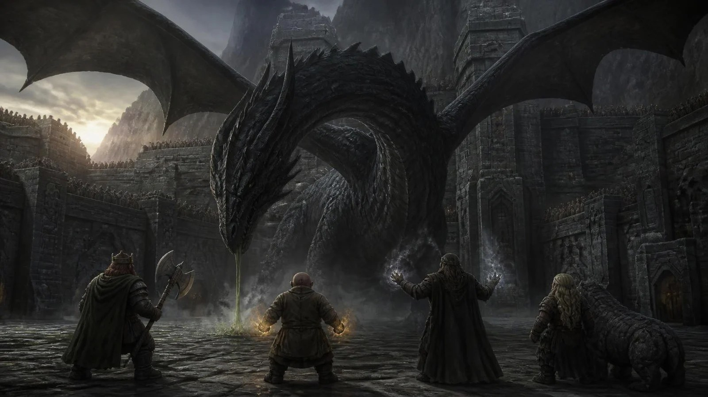

Stasera il drago è il **Vecchio**. La scheda qui sotto rimanda alla scheda
dell'Adulto (cap. X Appendice A.1) per
sensi, velocità, capacità magiche, talenti e abilità.

<!-- nuova-pagina -->

<!-- include: 07_il Portale Della Forgia Eterna/ARC07-DEF-4-VIAGGIO-MILLE-ANNI.md#skullcrusher-vecchio-scheda -->
{{monster,frame
## Skullcrusher Vecchio
*Drago Enorme (acqua), caotico malvagio · drago nero Vecchio dell'SRD, Avanzato* · GS 17 (Vecchio GS 16, +1 Avanzato)
___
**Iniziativa** +6 · **Sensi** come A.1

**DIFESA**
___
**CA 36** (−2 taglia, +2 DES, +26 nat), contatto 10, impreparato 34; **40 con *armatura magica*** · **pf 337** (25d12+175) · TS Temp +21, Rifl +18, Vol +20 · RD 10/magia · RI 22 · immune acido, sonno, paralisi  

**ATTACCO**
___
come A.1 · **Mischia** morso +34 (2d8+11), 2 artigli +29 (2d6+5), 2 ali +29 (1d8+5), colpo di coda +29 (2d6+16) · **Schiacciare** 2d8+16, Riflessi CD 29 (solo creature Piccole o minori) · **Soffio acido** linea di 30 m, 16d4, Riflessi CD 31 dimezza (aderente come A.1) · **Capacità magiche** come A.1, ma *oscurità* con raggio 24 m e *corrompere l'acqua* a CD 26 (la CD della sua Presenza Terrificante, come nell'SRD), più *crescita vegetale* 1/giorno · **Incantesimi da stregone** incantatore di 7°: 6/7/7/5 al giorno (*lentezza* CD 17)  

**STATISTICHE**
___
For 33, Des 14, Cos 25, Int 18, Sag 19, Car 18 · BAB +25; Lotta +44 · **Talenti** quelli di A.1 (Virata, non Ghermire), più Allerta · **Abilità** e il resto: come A.1  

**CAPACITÀ SPECIALI**
___
- **Presenza Terrificante**: raggio 72 m, Volontà CD 26 (meno di 25 DV).  
- **Soffio impregnante**, come A.1, ma toglierselo è Riflessi CD 31, la CD del suo soffio.  

**TATTICHE**
___
Come A.1: fugge a ⅓ dei pf, circa **112 pf**.  
}}
<!-- /include -->

<!-- include: 07_il Portale Della Forgia Eterna/ARC07-DEF-4-VIAGGIO-MILLE-ANNI.md#wyvern-scheda -->
{{monster,frame
## Wyvern (2)
*Drago Grande · wyvern SRD* · GS 6
___
**Sensi** scurovisione 18 m, visione crepuscolare, fiuto

**DIFESA**
___
**CA** 18  
**pf** 59  
**TS** Temp +7, Rifl +6, Vol +6  

**ATTACCO**
___
**Velocità** volare 18 m  
**Mischia** pungiglione +10 (1d6+4 e veleno, Tempra CD 17, 2d6 COS), morso +8 (2d8+4)  

**TATTICHE**
___
Vanno su chi tiene la corda dell'ala e su chi vola.  

*wyvern dell'SRD; i tiri salvezza sono quelli della sua scheda SRD*
}}
<!-- /include -->

<!-- nuova-pagina -->

## Le mappe: lo spiazzo, la tenda, il campo

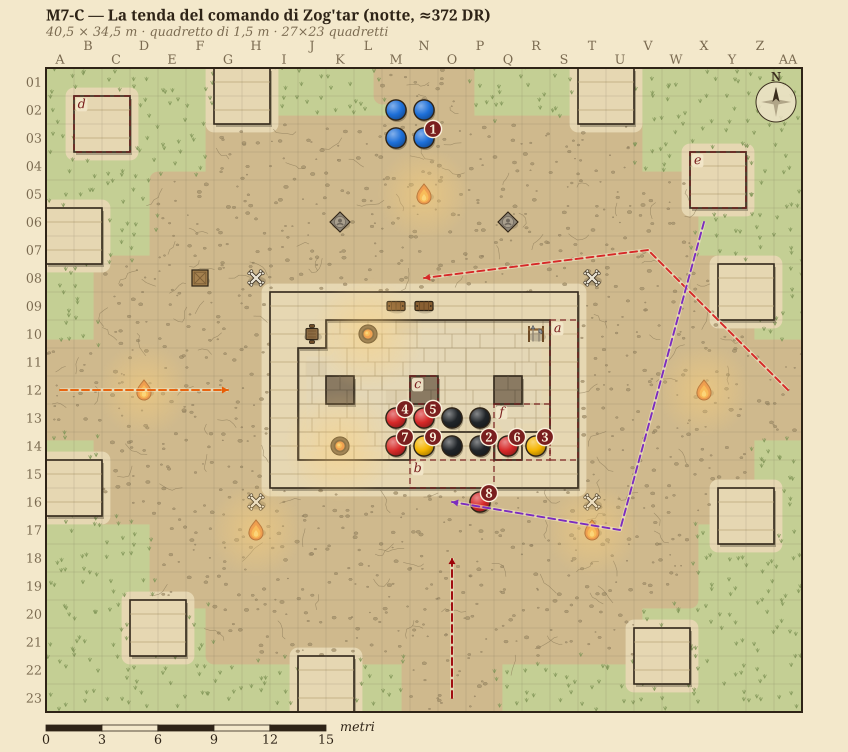

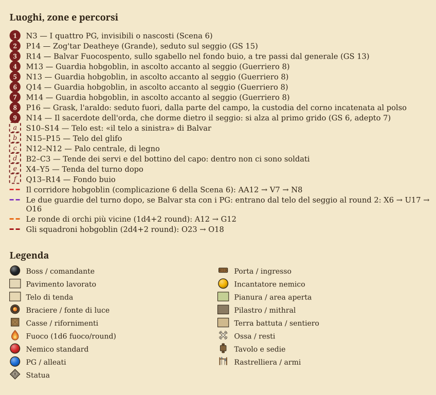

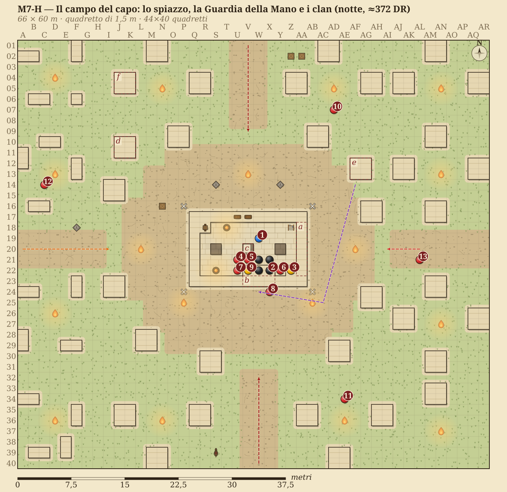

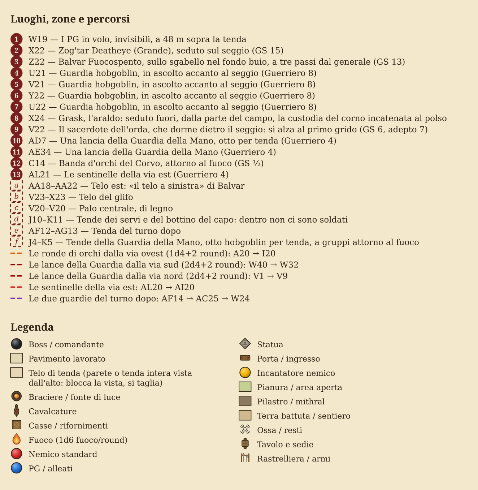

\page

# III · Atto I · Il barile sulla tenda di Zog'tar

{{note
##### ⚠ SOLO DM
Questo capitolo è materiale del DM: non mostrarlo ai giocatori.
}}

# ARC-07 · Il barile sulla tenda di Zog'tar

> **Che cos'è.** Il supplemento alle Scene 7 e 8 di cap. V
> per quello che il tavolo ha fatto davvero: invece di entrare nella tenda del
> comando, i PG ci hanno lasciato cadere sopra, da 48 m e invisibili, una botte
> d'olio piena di sassi, con i rostri dei fabbri nanici sotto e le fiale della
> fenice legate con le corde. In apertura c'è la **scheda da tavolo**, dieci
> passi da tirare senza improvvisare; poi la caduta e la deviazione, i danni
> della caduta, dell'olio e delle palle di fuoco e l'area che coprono, tutto
> rifatto per la quota da cui il tavolo rigioca lo sgancio, il telo e i rostri, le 25
> cadute possibili sopra il palo centrale, che cosa vedono i PG da 48 m e chi
> li può trovare, quando si tira l'iniziativa e che cosa fanno le rune, le
> tattiche di chi è dentro e del campo, round per round, chi suona il corno se
> Grask muore, i
> due barilotti da 10 litri e una procedura, con i PE, per le trovate dei
> giocatori delle prossime volte.
>
> **Le mappe** sono M7-C, lo spiazzo del capo con la tenda, e M7-H, il campo
> attorno. Le coordinate di questo documento sono quelle di M7-C; su
> M7-H si sommano otto colonne e otto righe.
>
> **Da dove vengono i numeri.** Dall'SRD 3.5. Dove l'SRD non ha una regola per
> quello che è successo, c'è una **variazione**, segnata come tale e costruita
> su una regola dell'SRD vicina; quando le letture possibili sono due, vale la
> più forte, come vuole il DM. Le probabilità vengono da 20.000 prove di una
> simulazione che usa queste stesse regole.

**In tre righe**
- **Succede**: in volo e invisibili sopra lo spiazzo del capo, i PG sganciano la botte e i barilotti sulla tenda di Zog'tar; si tirano i dieci passi della scheda, nell'ordine.
- **Chi vuole cosa**: dentro, Zog'tar racconta alle guardie come impalerà il re, Balvar incide, il sacerdote dorme; fuori Grask tiene il corno, e il campo intorno dorme finché non brucia.
- **Come finisce**: la tenda in fiamme o crollata, il corno suonato o no, i PG ancora in aria; poi il ritorno o la discesa (Scene 6-8 di cap. V), e i conti per le mura all'alba (§10).

## La scheda da tavolo

Dieci passi, nell'ordine in cui si tirano. Ogni riga dice da quale regola
dell'SRD viene; le variazioni sono segnate ◆ e sono le scelte del DM B4, B5, B6,
B12 e B16. I dadi delle righe 2 e 3 dipendono dalla quota da cui i PG
sganciano: la tabella è nel §2-bis. Con questa scheda il DM non deve inventare niente: tira i dadi
della colonna di destra.

<!-- pagina: una-colonna -->

| # | Che cosa | Regola | Si tira |
|---|---|---|---|
| 1 | **Lo sgancio** | Non è un attacco (SRD, *invisibilità*: chi causa danno in modo indiretto non attacca). È un'azione gratuita, e chi sgancia resta invisibile. Si può fare nel round di sorpresa, e tutti e quattro i PG possono sganciare nello stesso round | niente |
| 2 | **Dove cade** | Non si mira: la deviazione è l'attrito dell'aria più quanto chi sgancia era spostato dalla verticale. Come l'arma a spargimento che manca (SRD): 1d8 per la direzione, 1 = nord e poi in senso orario. ◆ La distanza dipende dalla **quota**, dal peso e da che cosa vede chi sgancia (§2 e §2-bis): da 48 m la botte, sopra la tenda illuminata dai fuochi, 1d4−1 quadretti, un barilotto 1d6−1; se chi sgancia non vede il bersaglio, un dado in più. Se si è mosso in quel round, in più 6 quadretti nella direzione del volo | **1d8** e il dado della quota (§2-bis); da 48 m **1d4−1**, barilotto **1d6−1** |
| 3 | **Che cosa prende** | Il telo non la ferma: i rostri lo tagliano e toglie solo 3 danni (§3). Una creatura nella casella: oggetto in caduta (SRD), senza TS, meno la RD; ◆ in più le lame dei rostri, 1d4 lame da 1d8, nello stesso colpo. La riga 12, cioè un palo in cima (K12, N12, Q12) o la trave del colmo: la botte prende il legno, durezza 5 e 60 pf (SRD, §3). Se lo spezza, la tenda crolla subito; se no gli si apre sopra, e sotto nessuno prende il colpo diretto | i dadi della quota (§2-bis): da 48 m **15d6** − 3 + **1d4 × 1d8** (barilotto 3d6 − 3); sul legno **13d6 + 1d4 × 1d8 − 5**, si spezza a 60 |
| 4 | **Le fiale** | Si rompono sempre: prendono anche loro i 15d6 della caduta, e il vetro ha 1 pf. Ogni fiala è una *palla di fuoco* (SRD). L'origine è un angolo della casella d'impatto (d4, o quello che sceglie il DM). ◆ Sotto il telo la tenda fa da forno: chi è dentro la tenda è nell'area. Fuori dal telo valgono i 6 m dall'angolo | **6d6 per fiala**, **Riflessi CD 14** dimezza, un TS per fiala |
| 5 | **L'olio, subito** | Il **cuore** è la casella d'impatto e le otto attorno: chi c'è è colpito in pieno, come da un'ampolla d'olio (SRD, fuoco dell'alchimista), e prende fuoco ◆ senza TS. Il resto dell'olio copre **tutto il pavimento della tenda** (all'aperto: fino a 7 m): chi c'è prende lo spruzzo | cuore **1d6**; resto **1** |
| 6 | **L'olio, ogni round** | La palla di fuoco lo accende tutto nello stesso istante. Chi sta nell'olio che brucia prende 1d3 (SRD, la pinta versata) e tira per non prendere fuoco (SRD, «Catching on Fire»). Chi è nel cuore prende il secondo 1d6 dell'ampolla al round dopo l'impatto. ◆ Il cuore brucia 10 round, il resto del pavimento 3 (all'aperto 2) | **1d3**, **Riflessi CD 15** |
| 7 | **Chi brucia** | SRD, «Catching on Fire»: 1d6 a round, un TS a round per spegnersi; rotolarsi a terra dà +4, ma non dentro l'olio, che riaccende. Un mantello addosso, gettato da un altro, dà +4 come il rotolarsi | **1d6** a round, **Riflessi CD 15** |
| 8 | **Il crollo** | Se non è già crollata, la tenda crolla alla fine del round 1d4+1. Chi è sotto il telo che cade prende il fuoco del telo, è intralciato e per uscire tira un TS a round, con 1d6 a ogni round sotto `[Regola della casa, costruita sullo stato F di M7-C]` | **2d6**, **Riflessi CD 15** |
| 9 | **Il fumo** | SRD, «Smoke Effects», sotto il telo: chi fallisce passa il round a tossire, due round di fila fanno 1d6 non letali; occultamento 20% per tutti | **Tempra CD 15**, +1 per prova |
| 10 | **Il danno massiccio** | SRD 3.5: 50 danni o più da un solo attacco, e chi fallisce muore; un 1 naturale fallisce sempre. ◆ Le palle di fuoco nate insieme contano come un attacco solo; il colpo diretto e l'olio restano a parte | **Tempra CD 15** |

<!-- /pagina -->

**Due conti da avere in testa.** Il colpo diretto da 15d6 fa 50 o più due
volte su tre. Due palle di fuoco fanno 42 in media a chi fallisce tutti e due i
TS, 21 a chi li supera.

## 1. Che cosa hanno fatto, e che cosa si suppone

Il racconto del DM, messo in ordine:

- I PG volano sopra il campo, invisibili, a **48 m** di quota, in una notte
  stellata. Partono dalla postierla in volo, come nella variante «dall'alto»
  della Scena 6.
- Lasciano cadere **una botte da 59 litri**: in fondo sassi, sopra **50 litri
  d'olio**, e sotto il fondo i **rostri**, lame forgiate dai fabbri nanici di
  Hammerfist. Alla botte sono legate con le corde le **fiale della fenice**, da
  6d6 con l'effetto di una *palla di fuoco*.
- Tengono in mano **due barilotti da 10 litri**, senza rostri e senza sassi,
  ciascuno con le sue fiale della fenice legate.
- Vogliono squarciare la tenda di Zog'tar.

Quello che il racconto non dice si suppone così, e ogni supposizione è una
scelta del DM:

- Le fiale sulla botte sono **due**. Le tabelle danno anche una e tre.
- Una fiala della fenice **scoppia quando si rompe**: il vetro che va in pezzi
  è l'innesco, come per un'ampolla di fuoco dell'alchimista.
- Nella tenda c'è la **disposizione A** di M7-C (Scena 7): Zog'tar sul seggio
  che racconta, le quattro guardie attorno, Balvar che incide, il sacerdote
  che dorme, Grask fuori.
- Chi sgancia **sta fermo in aria**. La pozione di *volare* dà manovrabilità
  buona, e con la manovrabilità buona si resta sospesi (SRD, movimento
  aereo).

## 2. La caduta e dove finisce il barile

| | Botte (circa 93 kg, 205 libbre) | Barilotto (circa 14 kg, 31 libbre) |
|---|---|---|
| Quota | 48 m, 157 piedi | 48 m |
| Tempo di caduta | 3,15 s | 3,18 s |
| Velocità all'impatto | 30 m/s, 109 km/h | 29 m/s |
| Energia | 40 kJ | 6 kJ |
| Deriva con 5 m/s di vento laterale | 20 cm | 40 cm |
| Spostamento se chi sgancia vola a 18 m per round | 9,5 m in avanti | 9,5 m |

L'aria quasi non frena una botte così pesante: la velocità finale è il 98%
di quella nel vuoto, e il vento di una notte di pianura la sposta meno di un
quadretto. Contano due cose: se chi sgancia si muove, e quanto l'attrito e il
buio lo portano lontano dalla verticale.

**Nessun tiro per colpire.** L'SRD dice che chi è invisibile e «causa danno in
modo indiretto» non attacca: l'esempio è chi taglia le corde di un ponte con i
nemici sopra. Lasciar cadere un barile è lo stesso gesto. Non è un attacco,
quindi non c'è tiro per colpire, l'invisibilità resta, e lasciarlo andare è
un'azione gratuita.

**La deviazione** `[Variazione sull'SRD, B4]`.
I PG non mirano: lasciano andare. Il barile finisce lontano dalla verticale
per due ragioni, e la regola le mette tutte e due in un dado solo.

- **L'attrito.** Un oggetto pesante e compatto cade quasi dritto; uno leggero
  e storto si gira, e l'aria lo spinge di lato. La botte coi sassi in fondo
  cade sui rostri come una freccia sulla punta: a 30 m/s l'aria la frena del
  12% del suo peso, e se la spinge di lato la sposta di 0,5-2 m. Un barilotto
  da 14 kg senza sassi rotola: l'aria lo frena del 30%, e lo sposta di 1,5-4
  m.
- **La luce.** Chi sgancia sa di essere sopra il bersaglio solo se lo vede. A
  48 m la scurovisione non arriva (18 m) e le stelle non bastano: si vedono
  solo i fuochi, e ciò che illuminano. La tenda si vede, nera in mezzo ai due
  falò della guardia e al fuoco del consiglio. Un punto fuori dalla luce non
  si vede, e si sgancia a stima.

L'SRD ha una regola sola per un oggetto che cade dove non si voleva, l'arma a
spargimento che manca: **1d8 per la direzione** (1 è il nord, poi in senso
orario) e una distanza in quadretti. La distanza, da 48 m, è questa:

| Che cosa cade (le fasce di peso degli oggetti in caduta, SRD) | Bersaglio nella luce di un fuoco | Bersaglio al buio |
|---|---|---|
| pesante e compatto, 200 libbre (91 kg) o più: la botte con i sassi | **1d4−1** quadretti (0-4,5 m) | 1d6−1 (0-7,5 m) |
| medio, da 31 a 200 libbre: i barilotti da 14 kg | **1d6−1** (0-7,5 m) | 1d8−1 (0-10,5 m) |
| leggero o storto, sotto le 31 libbre | 1d8−1 (0-10,5 m) | 1d10−1 (0-13,5 m) |

- Da più in alto o più in basso: un dado in più o in meno ogni 15 m di
  differenza dai 48 (sotto i 15 m non si devia).
- In diagonale lo stesso numero di quadretti è più lontano: tre quadretti in
  diagonale sono 6,4 m.
- Se chi sgancia si è mosso in quel round, la botte conserva la sua velocità:
  in più, 6 quadretti nella direzione del volo, e la tenda si manca.

Il conto della fisica sta nella simulazione; la regola lo arrotonda per
eccesso, perché al buio si sbaglia anche il punto da cui si parte.

## 2-bis. Rigiocare lo sgancio: tutto dalla quota

Il DM farà rigiocare lo sgancio, e la quota la scelgono i PG. Da quella
dipendono tre cose: quanti dadi fa la botte a chi sta sotto, quanto devia, e
chi dei PG vede davvero dove la lascia andare. Più in basso si vede meglio e
si sbaglia meno, ma la botte fa meno male, e dal round dopo i PG sono a
portata del campo.

**Prima: chi vede che cosa, al buio.** La notte è stellata, ma le stelle non
fanno luce per l'SRD: a occhio nudo si vedono le sagome contro i fuochi, non il
punto dove lasciar andare la botte. Le luci attorno alla tenda, su M7-C:

| Fuoco | Luce (come una torcia dell'SRD) | Che cosa illumina della tenda |
|---|---|---|
| i due falò della guardia, H17 e T17 | intensa entro 6 m, fioca fino a 12 m | gli angoli sud del telo. La cima del palo centrale è a 11,7 m da ciascuno in pianta e a 6 m d'altezza: **13,2 m, appena fuori**. Grask, a P16, è a 4 m da T17: in piena luce |
| i fuochi delle sentinelle, D12 e X12 | intensa entro 6 m, fioca fino a 12 m | il bordo ovest e il bordo est del telo, non il colmo (15 m) |
| il fuoco del consiglio, N5 | brace: fioca entro 3 m | niente: il telo è a 6 m |
| i due bracieri, L10 e K14 | dentro, sotto il telo nero | da fuori non si vedono |

Chi ha la **visione crepuscolare** vede il doppio lontano con la stessa luce
(SRD): per lui i falò fanno luce fioca fino a 24 m, e il colmo ci sta dentro.
La **scurovisione** si misura fino al colmo, che è a 6 m da terra: chi ha 18 m
di scurovisione vede il colmo da 24 m di quota.

| PG | Che cosa ha | Vede il colmo, da che quota |
|---|---|---|
| **Artemis** | scurovisione 36 m, Vista del Diavolo 18 m e visione crepuscolare, dall'Anello dell'Illuminazione Caotica | **da qualunque quota**, nella luce doppia dei falò; col solo buio fino a 42 m |
| **Thorik** | *Visione del Vero* della Corona, 1 volta al giorno per 10 minuti: vede nel buio, anche magico, e vede gli invisibili | **42 m**, se la attiva prima |
| **Hella** | nana dei sogni, scurovisione 27 m | **33 m** |
| **Tordek** | nano, scurovisione 18 m | **24 m** |

Chi sgancia e vede il colmo usa la colonna «chi vede» della tabella; chi non lo
vede, quella «al buio», un dado in più.

**Lo sgancio guidato**. Se Tordek
tiene la botte e Artemis guida, c'è un problema che al tavolo non si vede
subito: **Artemis vede la tenda, ma non vede Tordek**, perché anche lui è
invisibile. Può dirgli «ora», non «un metro a sinistra».

| Chi sgancia | Chi lo guida | Che colonna usa |
|---|---|---|
| vede il colmo | nessuno | «chi vede» |
| non lo vede | **Thorik con la Visione del Vero**, che vede il colmo e vede anche lui | «chi vede» |
| non lo vede | **Artemis**, che lo tiene per la spalla o è legata a lui con una corda corta | «chi vede», e **1 quadretto in più** nella direzione del d8: lei sa dov'è la sua mano, non dov'è la botte |
| non lo vede | Artemis a voce, senza toccarlo | «al buio»: lei non sa dov'è lui |
| tengono la botte in due, e la lascia andare chi vede | | quella di chi lascia andare |

Da 48 m, Tordek guidato da Artemis con la mano sulla spalla sbaglia di **1d4**
quadretti (da 1 a 4); da solo, al buio, di 1d6−1 (da 0 a 5). Conviene l'ultima
riga: la botte la tengono in due, e la lascia andare Artemis.

Parlare si sente: Ascoltare ha −1 ogni 3 m (SRD). Un sussurro è CD 15
: da 48 m diventa CD 31, e Zog'tar con +11 non lo sente; da 18 m è
CD 21, e lo sente una volta su due.

**La tabella.** Danno dell'oggetto in caduta dall'SRD: la botte con i sassi
pesa 205 libbre, quindi 1d6 più 1d6 ogni 3 m oltre i primi; il barilotto da
31 libbre fa 1d6 ogni 12 m. La botte si apre se il danno della sua stessa
caduta (1d6 ogni 3 m, come chi cade) passa durezza 5 e 10 pf. Deviazione: un
gradino di dado ogni 15 m di caduta, uno in più per il barilotto, uno in più
se chi sgancia non vede il bersaglio (§2).

| Quota | Caduta | Botte: danno a chi sta sotto | 50 o più | La botte si apre | Spezza un palo o la trave | Deviazione: botte nella luce / al buio | Barilotto: danno, deviazione nella luce |
|---|---|---|---:|---:|---:|---|---|
| 48 m | 3,2 s | **15d6** | 68% | 100% | 19% | 1d4−1 / 1d6−1 | 3d6 · 1d6−1 |
| 42 m | 3,0 s | **13d6** | 26% | 100% | 4% | 1d3−1 / 1d4−1 | 3d6 · 1d4−1 |
| 36 m | 2,7 s | **11d6** | 2% | 100% | 0% | 1d3−1 / 1d4−1 | 2d6 · 1d4−1 |
| 30 m | 2,5 s | **9d6** | 0% | 100% | 0% | 1d3−1 / 1d4−1 | 2d6 · 1d4−1 |
| 27 m | 2,4 s | **8d6** | 0% | 100% | 0% | 1d2−1 / 1d3−1 | 2d6 · 1d3−1 |
| 24 m | 2,2 s | **7d6** | 0% | 99% | 0% | 1d2−1 / 1d3−1 | 1d6 · 1d3−1 |
| 18 m | 1,9 s | **5d6** | 0% | 78% | 0% | 1d2−1 / 1d3−1 | 1d6 · 1d3−1 |
| 12 m | 1,6 s | **3d6** | 0% | 9% | 0% | nessuna / 1d2−1 | niente · 1d2−1 |
| 9 m | 1,4 s | **2d6** | 0% | 0% | 0% | nessuna / 1d2−1 | niente · 1d2−1 |

- **Sotto i 18 m la botte può restare intera.** Le fiale si rompono lo stesso
  (il vetro ha 1 pf) e le palle di fuoco scoppiano. Il fuoco apre la botte
  alla fine del round, e l'olio esce al round dopo: niente cuore e niente
  pavimento inzuppato al primo round, solo una pozza di 3 × 3 quadretti attorno
  alla botte che brucia per 10 round.
- **Sopra un palo o sulla trave** la botte cade 6 m in meno, e il danno va al
  legno (§3): da 48 m lo spezza una volta su cinque, da 42 m una volta su
  venticinque, più in basso mai. Se il legno regge, la botte gli si apre sopra.
- **Il danno massiccio** arriva solo dall'alto: due volte su tre da 48 m, una
  volta su quattro da 42, quasi mai sotto.

**Che cosa rischiano i PG, quota per quota.** Al momento dello sgancio
nessuno sta guardando in alto; i rischi valgono dal round dopo.

| Quota | Che cosa li raggiunge |
|---|---|
| sopra i 45 m | niente. Fuori dalla gittata massima dei giavellotti, fuori da ogni scurovisione |
| da 45 a 37 m | i giavellotti, ma solo se qualcuno li vede (il giavellotto con la *luce*, §8) |
| 36 m e sotto | la scurovisione di Skullcrusher, se arriva |
| 19,5 m e sotto | l'*epurare invisibilità* di Balvar: raggio 19,5 m attorno a lui. Se lo lancia, chi è dentro torna visibile |
| 18 m e sotto | la scurovisione di tutto il campo: visibili, li vedono tutti; invisibili, li vede il sacerdote con *vedere invisibilità*. *Comando* del sacerdote a 12 m |
| 9 m e sotto | Osservare CD 20 per notare un invisibile che si muove (SRD) |
| 6 m e sotto | sono dentro la loro stessa palla di fuoco |

**Che cosa succede, quota per quota.** Il barile lasciato cadere sopra il palo
centrale da chi vede il colmo, due fiale; 20.000 prove per riga, fino alla
fine del primo round.

| Quota | La tenda giù subito | La botte resta intera | Zog'tar, pf (mediana) | Il sacerdote morto | Una guardia a terra (M13) | Grask morto |
|---|---:|---:|---:|---:|---:|---:|
| 48 m | 8% | 0% | 250 | 34% | 6% | 30% |
| 42 m | 2% | 0% | 249 | 32% | 7% | 30% |
| 36 m | 0% | 0% | 249 | 33% | 7% | 31% |
| 30 m | 0% | 1% | 249 | 31% | 7% | 29% |
| 27 m | 0% | 4% | 249 | 30% | 9% | 28% |
| 24 m | 0% | 15% | 250 | 29% | 9% | 28% |
| 18 m | 0% | 65% | 257 | 18% | 5% | 28% |
| 12 m | 0% | 100% | 260 | 8% | 0% | 25% |
| 9 m | 0% | 100% | 260 | 9% | 0% | 25% |

**Che cosa vuol dire.** Il danno della botte conta poco: sotto il palo
centrale non c'è nessuno, e quello che uccide è il fuoco, che non dipende dalla
quota. Scendere serve a sbagliare meno, non a fare più male a Zog'tar. Il
crollo subito è raro (una volta su dodici da 48 m, mai sotto i 36), ma la tenda
crolla comunque alla fine del round 1d4+1. Sotto i 24 m la botte resta intera
sempre più spesso, l'olio esce un round dopo, e il sacerdote se la cava: da 18 m
muore una volta su cinque invece di una su tre. La quota buona, se il
DM vuole un consiglio da dare, è **fra 30 e 36 m**, con Artemis o Thorik che
sgancia: vedono la tenda anche dove i falò non arrivano, la deviazione scende a
1d3−1, la botte si apre sempre, e restano fuori da tutto quello che il campo può
fare.

## 3. Il telo, il colmo e i rostri

**Il telo non la ferma, e non la rallenta.** La botte arriva a 30 m/s con
40 kJ. Per tagliare un telo di pelle con la punta di una lama bastano poche
centinaia di joule: il telo le toglie meno dell'1% dell'energia, mezzo punto
percentuale di velocità. Nell'SRD la pelle ha durezza 2 e 5 pf per pollice di
spessore; un telo di 6 mm ha 1 pf. Al tavolo vale così: **il telo toglie 3 danni
al colpo diretto** (durezza 2 più 1 pf), e la botte arriva a terra come se il
telo non ci fosse.

**Che cosa fanno i rostri.** Sono lame di spada piantate nel fondo della
botte, con le punte in giù. Tre cose:

- **Tagliano invece di tirare.** Una botte senza rostri sfonderebbe il telo
  lo stesso, ma lo trascinerebbe giù con sé, e tirerebbe i pali: la tenda
  crollerebbe più spesso. Con i rostri lo squarcio è pulito, largo un metro e
  mezzo, e il telo attorno resta su.
- **Tengono la botte dritta e la piantano.** Con i sassi sul fondo la botte
  cade sulle punte come una freccia, e le punte entrano nella terra battuta:
  non rotola e non rimbalza.
- **Feriscono chi è sotto**. L'SRD ha la fossa con gli spuntoni, dove chi cade
  finisce su 1d4 punte. Qui è rovesciato: le punte cadono su chi sta sotto.
  Chi prende il colpo diretto prende anche **1d4 lame da 1d8**, nello stesso
  colpo, quindi contano per i 50 danni del danno massiccio.

**Lacera tutto, lacera in parte, rotola al bordo?** Le tre possibilità che il
DM ha chiesto di pesare, con i numeri:

| Dove tocca il telo | Che cosa succede alla botte | Al tavolo |
|---|---|---|
| sulla falda, fra il colmo e il bordo | taglia e passa: la falda scende di 50° circa, ma a 30 m/s la botte non scivola, e le punte mordono prima che la pelle ceda | arriva a terra nella casella tirata: il caso normale |
| sulla riga 12: un palo in cima (K12, N12, Q12) o la trave del colmo | prende il legno, a 6 m da terra | il danno della caduta va al legno (qui sotto): se lo spezza, la tenda crolla subito; se no la botte gli si apre sopra, e olio e fiale cadono da lì. Sotto nessuno prende il colpo diretto; il fuoco e l'olio sono gli stessi |
| sul bordo del telo, l'anello esterno di M7-C | taglia il telo dove scende verso terra, a un metro e mezzo d'altezza | arriva a terra contro la parete: metà dell'olio resta dentro, metà esce, e fuori arriva fino a 3 m |
| un barilotto, sulla falda | senza rostri e senza sassi cade storto, di piatto o di spigolo | d6: con 1-2 rimbalza sulla falda, scivola giù e si apre fuori, nella casella oltre il bordo, dalla parte della falda (nord se è sopra la riga 12, sud se è sotto). Con 3-6 sfonda e cade dentro |

**I pali e la trave reggono la botte?** Prima quanto devono reggere. Il telo
copre 16,5 × 10,5 m: con le due falde sono circa 230 m² di pelle, a 2 kg al
metro quadro 450 kg. La trave del colmo, quercia di 15 × 20 cm lunga 16,5 m,
pesa 300 kg. Metà del telo tira sui picchetti del bordo, e sui tre pali vanno
circa 180 kg ciascuno. Un palo di legno alto 6 m regge quel peso cinque volte,
con il vento e il telo bagnato, se ha almeno 10-12 cm di diametro; il padiglione
di un capo ha pali da **15 cm**, e la trave ha lo stesso spessore.
Nell'SRD il legno ha durezza 5 e 10 pf ogni 2,5 cm di spessore: palo e trave
hanno **60 pf**.

La botte che cade sul palo o sulla trave fa al legno il danno della sua caduta
fino a 6 m da terra, più le lame dei rostri (B16). Se, tolta la durezza, arriva
a 60, il legno si spezza.

| Quota di sgancio | Danno al legno | Il palo o la trave si spezza |
|---|---|---|
| 48 m | 13d6 + 1d4 × 1d8 | **19%**, una volta su cinque |
| 42 m | 11d6 + 1d4 × 1d8 | 4% |
| 36 m e sotto | 9d6 + lame, o meno | mai |
| un barilotto, da qualunque quota | 3d6 al massimo | mai: si apre sul legno |

**La fisica, su questo, non è d'accordo del tutto, e va detto** (B22). In punta
il palo lavora di compressione, e la botte ci si infilza sopra: SRD e fisica
dicono la stessa cosa, il palo regge quasi sempre. Una trave presa in mezzo,
fra due pali, invece si piega: assorbe un paio di kJ prima di rompersi, e la
botte ne porta 40. Per la fisica la trave presa fra due pali si spezza sempre.

**Le palle di fuoco scoppiano sotto il telo.** Le fiale si rompono quando la
botte tocca terra, o la trave, e tutte e due stanno sotto il telo. L'olio e il
fuoco nascono dentro la tenda, mai sopra; solo al bordo metà resta fuori. Se una
fiala si rompesse sul telo, la palla di fuoco nascerebbe sul tetto: la tenda fa
da forno lo stesso, e chi è dentro è comunque nell'area.

La runa della barriera di lame è incisa sul palo centrale, N12. Se il palo si
spezza, la runa si spezza con lui **senza scattare**: scatta solo quando la
attiva Balvar.

## 4. La botte e le fiale toccano terra

Nell'SRD un oggetto che cade prende anche lui il danno della caduta, 1d6 ogni
3 m, e la durezza lo riduce. La botte e le fiale cadono da 48 m: **15d6**, in
media 52.

| Che cosa | Durezza e pf (SRD) | Che fine fa |
|---|---|---|
| La botte, doghe di quercia e cerchi di ferro | durezza 5, 10 pf, come una porta di legno semplice | si apre sempre: anche il minimo, 15, passa la durezza e i punti ferita |
| Le fiale della fenice, legate alle doghe | vetro: durezza 1, 1 pf | si rompono sempre, nella casella dell'impatto, e scoppiano insieme |
| I barilotti | durezza 5, 5 pf | si aprono sempre |

I sassi tengono il fondo in basso, quindi la botte cade dritta, sui rostri, e
i rostri la piantano nel terreno: non rotola. Che il barile non scoppi o che
una fiala resti intera non succede con le regole dell'SRD: la versione di
prima, con il d20 per la tenuta, è tolta.

## 5. I danni

### Il colpo diretto: l'oggetto in caduta

Chi sta nella casella dove cade la botte prende il danno di un **oggetto in
caduta** (SRD 3.5, «Falling Objects»): un oggetto da 200 libbre in su fa 1d6
ogni 200 libbre, più 1d6 per ogni 3 m di caduta oltre i primi, fino a 20d6. Da
48 m sono **15d6**, in media 52. L'SRD non dà un TS e non chiede un tiro per
colpire: lo prende chi sta sotto. La riduzione del danno conta (Zog'tar ha RD
3/—). Il telo toglie 3 danni, e i rostri aggiungono 1d4 lame da 1d8 nello
stesso colpo (§3, variazione B16). Da 48 m, quindi, chi è sotto prende 15d6 − 3
+ 1d4 × 1d8, in media 60. Da un'altra quota, i dadi del §2-bis.

Una creatura sola prende il colpo diretto, quella della casella. Per Zog'tar,
che è Grande, basta una delle sue quattro caselle.

> **Il peso sta sul filo.** Botte di quercia da 59 litri con i cerchi di ferro
> 14-16 kg, olio 45,5 kg, sassi 15-24 kg (al massimo i 9 litri che l'olio
> lascia liberi), rostri 4-6 kg, fiale e corde 2 kg: da **80 a 93 kg**. Dalle
> 200 libbre (91 kg) in su l'SRD dà 15d6; sotto, nella fascia da 101 a 200
> libbre, dà 1d6 ogni 6 m, cioè **7d6**. Con i sassi fino all'orlo la botte
> pesa 93 kg e vale la prima riga: 15d6. La fisica è d'accordo: 40 kJ uccidono
> un uomo, e 7d6 non ucciderebbero una guardia hobgoblin
>.

### Le palle di fuoco, e perché non si allargano

Ogni fiala rotta è una *palla di fuoco* da 6d6. L'SRD fa partire un'area da un
incrocio della griglia: l'origine è **un angolo della casella d'impatto**, a
scelta del DM o con 1d4. La palla è uno spargimento di **6 m di raggio, 4
quadretti**. Riflessi **CD 14** dimezza: è la CD dell'SRD per un oggetto con un
incantesimo di 3° livello, 10 + 3 + 1. Due fiale sono due palle di fuoco dallo
stesso angolo, con due TS, e i danni si sommano. Nessuno nella tenda ha
Eludere.

**Perché non si allarga.** Nel 3.5 la *palla di fuoco* ha un raggio fisso: se
trova un muro si ferma, se trova un angolo lo gira, ma non riempie il volume
che le manca. Era l'AD&D a farla allargare nei luoghi chiusi. Due palle di
fuoco nello stesso punto non fanno un'area più grande: fanno due volte il
danno nella stessa area.

**La tenda fa da forno** `[Variazione — la versione più terribile, B12]`. Il
telo è chiuso su quattro lati e alto da 3 a 6 m: le fiamme non hanno dove
andare, e riempiono tutto quello che c'è sotto prima di squarciarlo. **Chi è
sotto il telo è nell'area, dovunque sia**, anche oltre i 6 m. Dal palo
centrale cambia poco, perché la palla da 6 m copre già quasi tutto il
pavimento: aggiunge Balvar nel fondo buio e la guardia Q14, che l'SRD puro
lascia fuori con tre angoli d'origine su quattro. Fuori dal telo valgono i 6 m
dell'SRD: Grask, a P16, è dentro o fuori secondo l'angolo.

### L'olio: quanto ne cade e dove arriva

L'SRD dà due regole per l'olio, e qui servono tutte e due.

- **La pinta versata.** Mezzo litro d'olio (una pinta) copre un quadretto, se
  il terreno è liscio; acceso, brucia **2 round** e fa **1d3 da fuoco** a round
  a chi ci sta.
- **L'ampolla lanciata.** Un'ampolla d'olio è un'arma a spargimento, con le
  regole del fuoco dell'alchimista: chi è colpito in pieno prende **1d6**, e
  **1d6 ancora il round dopo**; chi è vicino prende lo **spruzzo, 1 danno**.

La botte ha 50 litri, cioè **105 pinte**. Una botte che si apre a 110 all'ora
schizza l'olio tutto attorno, e il conto delle pinte dice fin dove arriva
`[Variazione sull'SRD, B6]`:

| Zona | All'aperto | Dentro la tenda | Olio | Brucia |
|---|---|---|---|---|
| **Cuore** | la casella d'impatto e le otto attorno, 3 × 3 | lo stesso | 5 pinte a quadretto, 45 in tutto | 10 round |
| **Il resto** | fino a **7 m** dall'impatto: 60 quadretti | **tutto il pavimento**, J10–R14, e le pareti del telo inzuppate fino a 3 m: il telo ferma gli schizzi | 1 pinta a quadretto all'aperto, quasi 2 dentro | 2 round all'aperto, 3 dentro |

**Quanto va oltre la palla di fuoco.** All'aperto l'olio arriva a 7 m e la
palla di fuoco a 6: **un metro in più**, un anello sottile di un quadretto,
che prende fuoco nello stesso istante, perché il velo d'olio è tutto unito e
la fiammata lo corre in un attimo. Dentro la tenda la domanda non si pone: dal
palo centrale il telo è a 4,5 m a nord e a sud e a 7,5 m a est e a ovest,
quindi l'olio si ferma sul telo e copre ogni quadretto del pavimento. Se il
barile cade sul bordo del telo (le cadute da 4,5 m del §6), metà dell'olio va
fuori, in una striscia di un quadretto lungo il telo da quella parte.

La variazione è una sola: le pinte nello stesso quadretto si sommano, e ogni
pinta in più fa bruciare il quadretto 2 round in più, non più forte. Il resto
è l'SRD.

### L'olio acceso

- **Si accende subito**, tutto: la palla di fuoco accende i combustibili
  nell'area (SRD), e la fiammata corre il velo d'olio fino al bordo.
- **Chi sta nell'olio che brucia** prende **1d3 da fuoco** a round (SRD, la
  pinta) e tira **Riflessi CD 15** per non prendere fuoco (SRD, «Catching on
  Fire»: chi è esposto a olio in fiamme).
- **Chi era nel cuore è inzuppato**: prende il secondo 1d6 dell'ampolla e
  prende fuoco **senza TS** `[Variazione — la versione più terribile; per l'SRD
  tira anche lui Riflessi CD 15]`.
- **Chi brucia** prende **1d6 a round** finché non riesce Riflessi CD 15;
  rotolarsi a terra dà +4, ma non dentro l'olio, che riaccende. Una palla di
  fuoco da sola non accende i vestiti (SRD: gli effetti istantanei non lo
  fanno); l'olio sì.

### Il fumo e il crollo

- **Fumo**, da subito, sotto il telo: Tempra CD 15, +1 per ogni prova
  precedente, o il round si passa a tossire; due round di fila fanno 1d6 non
  letali. Il fumo dà occultamento (20%) a tutti quelli dentro (SRD, «Smoke
  Effects»).
- **Il telo brucia** dal primo round. Alla fine del round **1d4+1** crolla, se
  non è crollato prima per il colmo: chi è ancora sotto prende 2d6 da fuoco, è
  intralciato e tira Riflessi CD 15 per uscire, un tentativo per round, con 1d6
  da fuoco a ogni round sotto il telo che brucia `[Regola della casa, costruita
  sullo stato F di M7-C]`.
- **La luce**: la tenda che brucia illumina lo spiazzo come un falò grande. Il
  fondo buio di M7-C non c'è più.

### Il danno massiccio

Nel 3.5 chi prende **50 danni o più da un solo attacco** e non è già morto tira
**Tempra CD 15**: se fallisce, muore, quali che siano i suoi punti ferita. Un 1
naturale fallisce sempre, quindi anche Zog'tar, con Tempra +18, ha il 5%.

- Il **colpo diretto** da 15d6 arriva a 50 due volte su tre.
- **Le due palle di fuoco contano come un attacco solo**: si sommano, e la
  somma è quella che conta per i 50 `[Variazione, la versione più terribile —
  B5: per l'SRD ogni palla di fuoco è un attacco a sé, e 6d6 non
  arrivano mai a 50]`. Con due fiale e il TS fallito, la somma
  arriva a 50 una volta su dieci.
- Il colpo diretto, il fuoco e l'olio restano attacchi diversi.

### Le cose

| Che cosa | Che fine fa |
|---|---|
| La mappa di Hammerfist con le croci rosse, sulla tavola a J10 | brucia nel primo round se J10 è nella palla di fuoco; chi la vuole la prende prima |
| La lastra d'ardesia di Balvar | non brucia. La ha in mano, e la porta fuori con sé |
| Il corno di ferro nero, nella custodia al polso di Grask | non brucia. La custodia è di cuoio e ferro, e il glifo resta |
| Le armature delle guardie | niente: l'SRD fa danneggiare gli oggetti indossati solo con un 1 naturale al TS |

## 6. Il palo centrale, caduta per caduta

I PG non hanno mirato: stavano più o meno sopra il palo centrale, N12, e hanno
lasciato andare il barile. La deviazione del §2 dice quanto erano spostati
dalla verticale. Una volta su quattro erano proprio sopra il palo; le altre
volte il barile cade da 1,5 a 4,5 m più in là, nella direzione del d8, e in
diagonale un po' di più, fino a 6,4 m.

Le 25 cadute possibili, con quello che prende il barile, chi sta nel cuore
dell'olio (colpito in pieno, prende fuoco) e chi resta fuori dalle palle di
fuoco con la tenda che fa da forno. Chi non è nominato nelle ultime due colonne
è nell'area: prende le palle di fuoco e l'olio del pavimento.

<!-- pagina: una-colonna -->

| d8 · metri | Casella | Probabilità | Che cosa prende | Nel cuore dell'olio | Fuori dalle palle di fuoco |
|---|---|---:|---|---|---|
| nessuna deviazione | N12 | 25% | il palo centrale, in cima: lo spezza il 19%, e la tenda crolla; se no la botte gli si apre sopra | Zog'tar, Guardia M13, Guardia N13 | nessuno · secondo l'angolo: Grask |
| 1 nord · 1,5 m | N11 | 3,1% | il pavimento | nessuno | Grask |
| 2 nord-est · 2,1 m | O11 | 3,1% | il pavimento | nessuno | Grask |
| 3 est · 1,5 m | O12 | 3,1% | la trave del colmo: la spezza il 19%, e la tenda crolla; se no la botte le si apre sopra, e sotto niente colpo diretto | Zog'tar, Guardia N13 | nessuno · secondo l'angolo: Grask |
| 4 sud-est · 2,1 m | O13 | 3,1% | **Zog'tar**, 15d6 − 3 + 1d4 × 1d8 | Zog'tar, Guardia N13, Sacerdote | nessuno |
| 5 sud · 1,5 m | N13 | 3,1% | **Guardia N13**, 15d6 − 3 + 1d4 × 1d8 | Zog'tar, Guardia M13, Guardia N13, Guardia M14, Sacerdote | nessuno · secondo l'angolo: Grask |
| 6 sud-ovest · 2,1 m | M13 | 3,1% | **Guardia M13**, 15d6 − 3 + 1d4 × 1d8 | Guardia M13, Guardia N13, Guardia M14, Sacerdote | nessuno · secondo l'angolo: Grask |
| 7 ovest · 1,5 m | M12 | 3,1% | la trave del colmo: la spezza il 19%, e la tenda crolla; se no la botte le si apre sopra, e sotto niente colpo diretto | Guardia M13, Guardia N13 | Grask |
| 8 nord-ovest · 2,1 m | M11 | 3,1% | il pavimento | nessuno | Grask |
| 1 nord · 3,0 m | N10 | 3,1% | il pavimento | nessuno | Grask |
| 2 nord-est · 4,2 m | P10 | 3,1% | il pavimento | nessuno | Grask |
| 3 est · 3,0 m | P12 | 3,1% | la trave del colmo: la spezza il 19%, e la tenda crolla; se no la botte le si apre sopra, e sotto niente colpo diretto | Zog'tar | nessuno · secondo l'angolo: Grask |
| 4 sud-est · 4,2 m | P14 | 3,1% | **Zog'tar**, 15d6 − 3 + 1d4 × 1d8 | Zog'tar, Guardia Q14 | nessuno |
| 5 sud · 3,0 m | N14 | 3,1% | **Sacerdote**, 15d6 − 3 + 1d4 × 1d8 | Zog'tar, Guardia M13, Guardia N13, Guardia M14, Sacerdote | nessuno |
| 6 sud-ovest · 4,2 m | L14 | 3,1% | il pavimento | Guardia M13, Guardia M14 | nessuno · secondo l'angolo: Grask |
| 7 ovest · 3,0 m | L12 | 3,1% | la trave del colmo: la spezza il 19%, e la tenda crolla; se no la botte le si apre sopra, e sotto niente colpo diretto | Guardia M13 | Grask |
| 8 nord-ovest · 4,2 m | L10 | 3,1% | il pavimento | nessuno | Grask |
| 1 nord · 4,5 m | N9 | 3,1% | il telo, sul bordo: metà olio fuori | nessuno | Grask |
| 2 nord-est · 6,4 m | Q9 | 3,1% | il telo, sul bordo: metà olio fuori | nessuno | Grask |
| 3 est · 4,5 m | Q12 | 3,1% | il palo est, in cima: lo spezza il 19%, e la tenda crolla; se no la botte gli si apre sopra | Zog'tar | nessuno · secondo l'angolo: Grask |
| 4 sud-est · 6,4 m | Q15 | 3,1% | il telo, sul bordo: metà olio fuori | Zog'tar, Guardia Q14, Balvar, Grask | nessuno |
| 5 sud · 4,5 m | N15 | 3,1% | il telo, sul bordo: metà olio fuori | Zog'tar, Guardia M14, Sacerdote | nessuno |
| 6 sud-ovest · 6,4 m | K15 | 3,1% | il telo, sul bordo: metà olio fuori | nessuno | Grask |
| 7 ovest · 4,5 m | K12 | 3,1% | il palo ovest, in cima: lo spezza il 19%, e la tenda crolla; se no la botte gli si apre sopra | nessuno | Grask |
| 8 nord-ovest · 6,4 m | K9 | 3,1% | il telo, sul bordo: metà olio fuori | nessuno | Grask |

<!-- /pagina -->

**Come si legge al tavolo.** Si tirano il d4 e il d8, si trova la riga, e la
riga dice tutto: chi prende i 15d6, se la tenda crolla subito, chi è
inzuppato. Poi si tirano i TS della scheda per tutti gli altri.

**Che cosa dice la tabella.** Il caso più probabile, una volta su quattro, è
la botte che si schianta in cima al palo centrale. Una volta su cinque lo
spezza, e il colmo viene giù con il telo in fiamme; le altre volte gli si apre
sopra, e l'olio e le fiale cadono da 6 m sullo stesso punto. Nessuno prende il
colpo diretto, perché sotto il palo non c'è nessuno. Zog'tar lo prende solo con
due righe su 25 (O13 e P14), una volta su sedici.

## 7. Che cosa succede, in numeri

Venti mila prove con le regole della scheda, la disposizione A, il barile
lasciato cadere sopra il palo centrale e due fiale. Il conto va fino alla fine
del primo round: lo scoppio, l'olio che brucia una volta, chi prende fuoco, il
telo che crolla addosso se il palo o il colmo si sono spezzati.

| Chi | pf pieni | pf alla fine del round 1 (mediana) | in fiamme | a 0 pf o meno | morto |
|---|---:|---:|---:|---:|---:|
| Zog'tar | 283 | 249 | 65% | 0% | 0% |
| Guardia M13, N13 (ciascuna) | 60 | 20 | 71% | 6-7% | 4% |
| Guardia Q14, M14 (ciascuna) | 60 | 22-23 | 60% | 1% | 1% |
| Il sacerdote, che dorme | 38 | −5 | 66% | 71% | 34% |
| Balvar | 101 | 72 | 33% | 0% | 0% |
| Grask, fuori a P16 | 6 | 6 | 0% | 30% | 30% |

- La tenda crolla subito l'**8%** delle volte, quando la botte spezza il palo o la trave (§3). Le altre volte crolla alla fine del round 1d4+1.
- Il sacerdote dorme: è indifeso, la sua Destrezza conta 0 (SRD), e i suoi
  Riflessi scendono da +4 a −1. Per questo è il primo a cadere.
- Con **una fiala** il sacerdote muore il 3% delle volte e le guardie
  restano a metà; con **tre fiale** il sacerdote muore nove volte su dieci e
  ogni guardia una volta su quattro.
- **Con la lettura SRD pura** (le palle di fuoco sono attacchi separati,
  l'inzuppato tira il TS, la palla resta di 6 m anche sotto il telo) il
  sacerdote muore il 28% delle volte, Balvar resta quasi intatto e Zog'tar
  brucia una volta su quattro invece di due su tre.
- **Se fossero stati sopra il seggio** invece che sopra il palo, Grask
  sarebbe morto l'83% delle volte e Zog'tar avrebbe preso i 15d6 una volta su
  tre.

**Che cosa vuol dire.** Il barile **non uccide Zog'tar**: 283 punti ferita, RD
3 e Riflessi +9 reggono anche il colpo in pieno. Gli toglie un quinto dei punti
ferita prima ancora di cominciare, gli brucia la tenda, la mappa dell'assalto
e la scena di Balvar, e una volta su tre gli toglie il sacerdote. Lascia vivo Grask
due volte su tre, e Grask suona il corno: per questo i barilotti contano (§9).
Con 50 litri d'olio in una tenda di 100 metri quadri un giocatore si aspetta
una strage, e per Zog'tar questa non è una strage: va detto al tavolo prima di
tirare.

## 8. Chi vede che cosa, e le tattiche round per round

### Che cosa vedono e possono fare i PG da 48 m

| Che cosa | Regola | Al tavolo |
|---|---|---|
| **Vedere giù** | La scurovisione dei nani arriva a 18 m: a 48 m non serve. Si vede solo quello che è illuminato. Osservare ha −1 ogni 3 m di distanza (SRD), qui −15 | Si vedono i fuochi, i bracieri, e dal round 1 la tenda che brucia, che illumina lo spiazzo come un falò grande. Contare le sagome è facile; dire chi è chi chiede **Osservare CD 25** (10 + 15). Grask si riconosce perché sta dove sta |
| **Restare invisibili** | Lasciar cadere un barile o un barilotto non è un attacco. Lanciare un incantesimo che colpisce un nemico, o tirare con l'arco, rompe l'invisibilità (SRD) | Anche visibili, a 48 m nel buio nessuno li vede: sono fuori dalla luce del fuoco e oltre la scurovisione. Rompere l'invisibilità quassù costa poco, finché nessuno illumina il cielo |
| **Farsi sentire** | Ascoltare: −1 ogni 3 m (SRD), −15. *Volare* non fa rumore. Parlare a voce normale è CD 0, quindi 15 | **Non parlate.** Zog'tar ha Ascoltare +11: sente voci dall'alto una volta su tre, e da quel momento sa dove guardare. Le componenti verbali degli incantesimi si sentono allo stesso modo |
| **Colpire da quassù** | Gittata media: 30 m + 3 m per livello, al 13° 69 m. Gittata corta (7,5 m + 1,5 m ogni due livelli, 16,5 m al 13°) non arriva. Arco lungo: 48 m sono due incrementi, −2 | Incantesimi a gittata media e lunga sì, a contatto e corta no. Le frecce arrivano, ma chi le prende capisce che vengono dall'alto |
| **Il tempo** | Pozione di *volare* dell'incantatore di 5°: 5 minuti, 50 round. Pozione di *invisibilità* del 3°: 3 minuti, 30 round | L'invisibilità finisce prima del volo. Il viaggio di ritorno è quello della Scena 6. Se il corno suona, il drago arriva al round 70: chi è ancora in aria lì sopra non c'è più, perché il volo è finito da un pezzo |

### Chi può trovarli

| Chi | Che cosa ha | Che cosa può fare contro chi sta a 48 m |
|---|---|---|
| Guardie, orchi, lance della Guardia | scurovisione 18 m, Osservare e Ascoltare +1/+2 | niente. Notare un invisibile che si muove si fa solo entro 9 m (SRD, *invisibilità*, Osservare CD 20) |
| **Zog'tar** | scurovisione 18 m, Ascoltare +11, Int 16, tre giavellotti Grandi (incremento 9 m, al massimo cinque incrementi: 45 m) | capisce subito che il barile è venuto dall'alto. Non vede niente, ma sa dove guardare e non sta mai fermo nella luce |
| **Il sacerdote** (adepto 7) | *vedere invisibilità*, *luce*, *comando* (gittata corta, 12 m) | *vedere invisibilità* fa vedere gli invisibili, ma non fa luce: a 48 m nel buio non vede nessuno. Con *luce* su un giavellotto che Zog'tar scaglia verso l'alto illumina per un istante 6 m attorno al punto più alto del tiro, a 45 m: se un PG è lì vicino, lo vede (sotto) |
| **Balvar** (chierico 13) | *Leggere il Fuori-Posto* (18 m), *epurare invisibilità* (19,5 m), *dissolvi magie* (gittata media, 69 m, area di 6 m di raggio) | le prime due non arrivano a 48 m. *Dissolvi magie* ad area sì: può lanciarlo alla cieca sopra la tenda, o sul punto che il giavellotto ha illuminato (sotto, e B13) |
| Gli sciamani dei clan (15 adepti di 5°) | *vedere invisibilità*, *luce* | arrivano solo dopo il corno; stessi limiti del sacerdote |
| **Skullcrusher** | scurovisione 36 m, percezione cieca 18 m, *vedere invisibilità*, Osservare +29, vola | l'unico che li trova davvero. Arriva 70 round dopo il primo suono del corno (Scena 6) |

**Il giavellotto con la luce**. Se il
sacerdote è sopravvissuto ed è sveglio, al round 3 ha già *vedere invisibilità* addosso e
lancia *luce* su un giavellotto di Zog'tar (azione standard tutti e due). Zog'tar
lo scaglia dritto in alto sopra la tenda: arriva a 45 m e illumina 6 m attorno
per un round. Se i PG sono ancora sulla verticale della tenda (entro 6 m dal
punto), il sacerdote li vede, e li indica. Se si sono spostati anche solo di
dieci metri, il giavellotto illumina il vuoto. È la ragione per cui, dopo lo
sgancio, conviene allontanarsi.

**Il dissolvi di Balvar**. *Dissolvi
magie* ad area ha 6 m di raggio. Se il giavellotto ha mostrato i PG, Balvar lo
lancia lì al round 4. Se non li ha mostrati, può lanciarlo alla cieca sopra la
tenda, e prende chi è rimasto sulla verticale una volta su sei. Ogni PG nell'area
tira la prova del dissolvi contro ogni effetto: d20 + 10 contro **CD 16** per il
*volare* della pozione (11 + 5) e **CD 14** per l'invisibilità (11 + 3). Chi
perde il volo cade: 48 m, **15d6** (SRD, 1d6 ogni 3 m). Lo fa solo se è in
modalità «minacciato, o attaccato» della Scena 7, ed è il caso: il barile è un
attacco.

### Quando si tira l'iniziativa, e che cosa fanno le rune

**L'iniziativa si tira quando i PG decidono di sganciare**, prima di tirare i
dadi della caduta: per l'SRD il combattimento comincia quando una parte agisce
contro l'altra, e i PG sono gli unici che sanno che sta cominciando. Tirano tutti,
PG e PNG. Poi:

1. **Il round di sorpresa è solo dei PG.** Nessuno nel campo sa che sono lì.
   Ognuno ha un'azione standard o di movimento, e lasciar cadere qualcosa è
   un'azione gratuita: la botte e i due barilotti possono andare giù nello stesso
   round. La botte cade in 3 secondi, meno di mezzo round: **arriva nel turno di
   chi l'ha lasciata**, e il DM risolve subito la scheda, dal passo 2 al 5.
2. **Il round 1 comincia in ordine d'iniziativa.** Chi è nella tenda è colto alla
   sprovvista fino al suo primo turno: niente Destrezza alla CA, che quassù conta
   poco. I TS contro le palle di fuoco li tira con il suo bonus pieno: l'SRD toglie
   la Destrezza alla CA, non ai Riflessi.
3. **L'olio che brucia** (passo 6 della scheda) si tira alla fine di ogni round,
   per tutti insieme. È lì che chi brucia perde i punti ferita.

**Balvar non è colto alla sprovvista**. Il suo *Leggere il Fuori-Posto* è acceso, un cono di 18 m verso la
soglia, e il palo centrale ci sta dentro. Le fiale della fenice sono magiche:
Balvar le sente arrivare un battito prima dell'urto. Non fa in tempo a fare
niente, il round di sorpresa resta dei PG, ma al round 1 non è colto alla
sprovvista, e sa che cosa è caduto prima di vederlo.

**Le rune non scattano con il barile.** Una per una, con la regola di ciascuna:

| La runa o il glifo | Scatta? | Perché, e la versione più forte |
|---|---|---|
| La soglia, *epurare invisibilità* | no | scatta quando un nano varca la soglia: la botte non è una creatura, e i PG sono a 48 m. Se dopo uno di loro scende sotto i 19,5 m sopra la soglia, scatta su di lui |
| Il palo centrale, *barriera di lame* | no | la attiva Balvar. Se il palo si spezza, la runa si spezza senza scattare (B7) |
| Su Balvar, *silenzio* | non da sola | la accende lui, a comando. Contro chi è a 48 m non serve: la tiene per dopo |
| Il glifo sul telo sopra il seggio, 5d8 sonori | no, per l'SRD | il glifo scatta solo per una creatura che lo varca o lo tocca. La versione più forte, scelta dal DM: **scatta quando il telo che lo porta brucia o crolla**, alla fine del round 1 o al crollo. Scoppio sonoro di 5d8, Riflessi CD 18 dimezza, su chi sta entro 1,5 m dal punto del telo sopra il seggio: Zog'tar, se è ancora lì, e la guardia Q14 |
| La custodia del corno, al polso di Grask | no | cuoio e ferro: il fuoco non la apre, e il glifo scatta solo per chi la apre senza la parola |
| La gemella della Catena, sul corno | non scatta, ma **ascolta** | tutto quello che si grida vicino a Grask arriva a Skullcrusher sulle colline (Scena 6). Il boato, «A ME, CANI! IL CORNO!» e «Dall'alto. Hanno ali.»: all'alba il drago sa che i nani volano, e guarda in alto |

### Le tattiche, round per round

Le righe valgono per i due casi del §6: la tenda crollata subito (8%) e la
tenda in piedi che brucia.

| Chi | Round 1 | Round 2-3 | Dal round 4 |
|---|---|---|---|
| **Zog'tar** (Iniz +9) | Ira Superiore, azione gratuita, e il grido *«A ME, CANI! IL CORNO!»*. Se la tenda è crollata è sotto il telo in fiamme: lo squarcia con l'ascia ed esce in un round (Riflessi CD 15, ha +9). Se è in piedi esce dal lato più corto, tagliando il telo. Prende fuoco quasi sempre: si getta a terra fuori dall'olio (+4) | Fuori, guarda in alto e non vede niente. Capisce: *«Dall'alto. Hanno ali.»* Esce dalla luce del fuoco e non ci rientra: non sta mai fermo dove un secondo barile lo troverebbe. Al round 3 scaglia il giavellotto con la *luce* del sacerdote, se il sacerdote è vivo. Se Grask è morto va al corpo e strappa la custodia: il glifo gli scoppia addosso, 5d8 sonori, Riflessi CD 18, e lui suona lo stesso (B8) | Raduna le guardie nel buio, lontano dalla tenda, e manda le lance a cercare per il campo chi ha portato il fuoco. Se un PG scende sotto i 45 m e si fa vedere, i giavellotti; se scende sotto i 3 m, la carica |
| **Le quattro guardie** (Iniz +1) | Chi brucia si getta a terra fuori dall'olio (+4). Chi non brucia trascina fuori il sacerdote, se è vivo, oppure spegne Zog'tar con il mantello | Spengono chi brucia con i mantelli (+4, un'azione standard ciascuno), poi si mettono attorno al generale, spadoni in pugno, nel buio | Come Zog'tar. Non tirano verso l'alto finché nessuno indica un bersaglio |
| **Il sacerdote** (se è vivo) | Si sveglia nel fuoco, indifeso fino al suo turno. Striscia fuori, quasi sempre in fiamme | Round 2 si spegne. Round 3 *vedere invisibilità* e *luce* sul giavellotto di Zog'tar | Cura chi brucia. Se vede un PG, lo indica a Balvar; *comando* arriva solo a 12 m |
| **Balvar** (se è vivo) | Esce dal telo est, quello a sinistra, e si spegne. Guarda la botte squarciata e i rostri: lavoro dei fabbri di Hammerfist, lo riconosce al primo sguardo | Va da Zog'tar: *«Nani. Dall'alto.»* E la parola che conta: *«Chiamate il drago.»* Se Grask è morto e la custodia è intera, dà a Zog'tar la parola che la apre senza glifo | Il barile è un attacco: Balvar è «minacciato, o attaccato» (Scena 7). Al round 4 *dissolvi magie* ad area dove il giavellotto ha mostrato i PG, o alla cieca sopra la tenda (B13) |
| **Grask**, il suonatore del corno | Se è vivo, sveglio o no, il boato lo sveglia: suona il corno entro **1d4 round**, come al primo grido di Zog'tar (Scena 6) | Suona finché qualcuno non gli dice di smettere. Sta dove sta: è lui il bersaglio più facile del campo | |
| **Le due guardie del turno dopo** | Si svegliano nella loro tenda, a X4–Y5 | Arrivano al round 2, armate, da Zog'tar | Con le altre |
| **Il campo** (M7-H) | Le sentinelle dei fuochi gridano. I clan degli orchi si svegliano tutti insieme | Le ronde d'orchi arrivano dalla via ovest in 1d4+2 round, le lance della Guardia della Mano dalle vie nord e sud in 2d4+2. Finché Zog'tar è in piedi non vanno addosso alla tenda: fanno quadrato nello spiazzo, a una decina di metri dal telo, e portano acqua e pelli bagnate | Gli sciamani, se il corno ha suonato, cercano con *vedere invisibilità* e *luce*; nessuno vede a 48 m. Il campo resta sveglio fino all'alba |
| **Skullcrusher** | | | Se il corno ha suonato, arriva **70 round** dopo il primo suono e caccia sopra il campo (Scena 6, «Se il corno suona di notte») |

### Chi suona il corno, se Grask muore

Il corno chiama il drago chiunque lo suoni: la Catena è incisa sul corno, non su
Grask. Il problema è la custodia, chiusa da un glifo e incatenata al polso del
ragazzo morto. In ordine, chi ci prova:

| Chi | Quando | Come |
|---|---|---|
| **Balvar**, se è vivo | round 2-3 | non apre la custodia: dà la parola a Zog'tar, o a una guardia, e il corno suona senza glifo **al round 3-4** |
| **Zog'tar**, se Balvar è morto o lontano | round 2-3 | va al corpo, spezza la catena e strappa la custodia: il glifo gli scoppia addosso, 5d8 sonori, Riflessi CD 18, e lui suona lo stesso **al round 3** (B8) |
| **La guardia più vicina**, se Zog'tar è a terra | appena Zog'tar lo ordina, anche da a terra | come Zog'tar, ma con 60 pf e Riflessi +3 il glifo la può uccidere: una guardia già bruciata muore una volta su tre. Se muore, il corno resta nella custodia aperta, e lo prende la seguente |
| **Il primo capolancia della Guardia della Mano** | quando arriva, round 4-10 (2d4+2) | se nella tenda nessuno è in piedi a dare ordini, il capolancia sa che il corno è il segnale dell'alba e del drago. Lo fa suonare |
| **Nessuno** | | se sono morti Grask, Zog'tar e Balvar, e le guardie sono tutte a terra prima che arrivino le lance. È il caso «se rubano o rompono il corno» della Scena 6: il drago arriva a metà mattina, furioso |

Il drago arriva 70 round dopo il primo suono, chiunque abbia suonato.

### Se sopravvivono: che cosa fanno dopo la notte

| Chi | Che cosa fa fino all'alba | All'alba |
|---|---|---|
| **Zog'tar** | brucia di rabbia, ma non perde la testa: dorme al buio, fuori dalla luce, e ogni ora in un posto diverso. Fa spegnere i fuochi dello spiazzo e mette due guardie a guardare il cielo. Manda le lance a cercare per il campo, perché pensa a un traditore prima che a dei nani in volo | guida l'assalto (§10), con il segno delle ustioni addosso. Ai suoi dice che il fuoco era un segno: chi l'ha attraversato vince |
| **Balvar** | è stato attaccato: non tratta più da solo (§10). Incide di nuovo i glifi scattati, rifà la custodia, e ricorda la botte di Hammerfist | sta sulla collina col drago, come nel canone. Ha capito che i nani vengono dall'alto, e lo dice al drago attraverso la Catena |
| **Il sacerdote** | cura chi brucia fino a finire gli incantesimi. Prepara *vedere invisibilità* e *luce* per la notte dopo | sale sulla breccia con Zog'tar, se ci sono incantesimi da spendere |
| **Le guardie** | stanno attorno al generale, con gli spadoni in pugno, al buio. Chi ha visto morire i compagni nel fuoco odia i nani in un modo nuovo | combattono con Zog'tar sulla breccia |
| **Grask**, se è vivo | non lascia più il corno. Dorme in piedi | suona all'alba, e il drago arriva sull'assalto |

### L'orda: che cosa fa, che cosa vede, che cosa può fare

Il campo è un'orda di circa diecimila: la Guardia della Mano, che è
disciplinata, le bande d'orchi, che non lo sono, i goblin sui carri, i lupi fuori.
Una tenda che scoppia nel cuore del campo, di notte, senza un nemico in vista,
non è una cosa che l'orda abbia mai visto. Su M7-H, attorno allo spiazzo, ci
sono otto lance della Guardia (quattro tende da otto attorno a ogni fuoco) e
quattro bande d'orchi a ovest, una ventina ciascuna con il loro sciamano.

| Chi | Che cosa fa | Che cosa vede, e fin dove | Che cosa può fare a chi vola |
|---|---|---|---|
| **Le sentinelle** dei fuochi e dei falò | round 1 gridano, round 2 corrono alla tenda e tirano fuori chi possono | scurovisione 18 m, e tutto quello che i fuochi illuminano: la tenda in fiamme, nessun nemico | giavellotti, solo se vedono qualcuno |
| **La Guardia della Mano**, otto lance | escono armate al round 2, arrivano nello spiazzo in 2d4+2 round. Quattro lance fanno quadrato a 10 m dal telo, portano acqua e pelli bagnate e tengono indietro gli orchi; le altre chiudono le quattro vie battute e cercano tenda per tenda chi ha portato il fuoco | come le sentinelle. Ascoltare e Osservare +2 | giavellotti: incremento 9 m, al massimo 45 m, −2 a incremento |
| **Le bande d'orchi** | non capiscono, e si infuriano. Un fuoco dal cielo senza nemici: gli sciamani gridano che è l'occhio di Gruumsh, e le quattro bande corrono armate allo spiazzo con le torce, urlando al cielo. Arrivano in 1d4+2 round, come le ronde, senza ritardo: fanno muro attorno alla Guardia, e ogni torcia è un occhio in più che guarda in alto | scurovisione 18 m, Ascoltare e Osservare +1. Le torce fanno luce fino a 12 m da terra | giavellotti alla cieca contro il cielo: chi è invisibile ha occultamento totale, 50% di mancare, e l'orco deve indovinare il quadretto (SRD) |
| **Le vedette goblin** sui carri | strillano, e non scendono | scurovisione 18 m | niente |
| **I lupi**, fuori dal campo | le sei squadre si stringono verso il campo e girano sotto le vie del ritorno: il viaggio a piedi della Scena 6 si tira a CD +2 | fiuto a 9 m (18 col vento): chi vola sopra i 20 m ne resta fuori | i goblin in sella tirano giavellotti; i worg aspettano l'atterraggio |
| **Gli sciamani**, quindici adepti di 5° | dopo il corno: *vedere invisibilità*, e *luce* sulle punte dei giavellotti | vedono gli invisibili, ma solo dove vedono: 18 m di scurovisione, o la luce | *raggio rovente* (4d6, gittata corta: 10,5 m). La *ragnatela* arriva a 45 m ma in aria non ha dove attaccarsi, e non si forma (SRD) |

**Chi li vede, e chi li colpisce, quota per quota.** La tenda che brucia fa
luce come un falò grande: intensa entro 12 m, fioca fino a 24 m, finché non
crolla. I numeri dei giavellotti
sono per un hobgoblin o un orco con +1 a distanza.

| Quota sopra la tenda | Visibili | Invisibili | Che cosa arriva |
|---|---|---|---|
| sopra i 45 m | nessuno li vede | nessuno li vede | niente: oltre la gittata dei giavellotti |
| da 45 a 25 m | nessuno, se non li illumina il giavellotto con la *luce* (§8) | nessuno | giavellotti a −4/−8 (−2 ogni 9 m): colpiscono solo col 20 naturale, 1d6+1 |
| da 24 a 19 m | **tutti**, nella luce dell'incendio | nessuno, finché non suona il corno; dopo, gli sciamani | giavellotti a −4: raffiche di 20-30, colpisce un giavellotto ogni venti |
| 18 m e sotto | tutti, anche al buio | gli sciamani dopo il corno, e il sacerdote. *Comando* del sacerdote a 12 m | giavellotti a −2 o senza penalità; Zog'tar con i giavellotti Grandi |
| 10,5 m e sotto | | | il *raggio rovente* degli sciamani, 4d6 |

Il conto che conta: l'orda non può far male a chi resta in alto. Quello che
temere sono quattro cose sole, e tutte hanno un nome: il *dissolvi* di Balvar,
il giavellotto con la *luce* di Zog'tar, il corno, e il drago.

**Che cosa rischiano i PG.** Finché restano a 48 m, zitti, e si allontanano
dalla verticale della tenda dopo lo sgancio, niente: nessuno nel campo vede
così in alto al buio. Restano sopra la tenda a guardarla bruciare, e dal round
3-4 rischiano il giavellotto con la luce e il dissolvi di Balvar, cioè una
caduta da 48 m. Il resto è tempo: il volo dura 50 round, l'invisibilità 30, e
se il corno ha suonato il drago è lì al round 70.

**La mossa migliore, se la chiedono.** Nel round di sorpresa, insieme alla
botte, un barilotto su Grask. Ha 6 pf e Riflessi +1: una palla di fuoco lo
uccide anche se il TS gli riesce (3d6, in media 10). Grask sta nella luce del
falò della guardia, quindi il barilotto devia di 1d6−1 quadretti: lasciato
cadere sopra P16, la palla di fuoco lo prende due volte su tre. Tutti e due i
barilotti su di lui, nello stesso round: nove volte su dieci. Senza
Grask il corno resta nella custodia col glifo, e la notte resta senza drago.

## 9. I due barilotti da 10 litri

| | Il numero | Da dove |
|---|---|---|
| Peso | circa 14 kg, 31 libbre: 9 kg d'olio, 5 di doghe e cerchi | |
| Dove cade | 1d8 per la direzione, **1d6−1 quadretti** nella luce di un fuoco, 1d8−1 al buio: senza sassi rotola, e l'aria lo sposta | §2 |
| Colpo diretto | oggetto in caduta da 31 a 50 libbre: 1d6 ogni 12 m, da 48 m **3d6** | SRD |
| Tenuta | si apre sempre: 15d6 contro durezza 5 e 5 pf | §4 |
| Fiale | una per barilotto: una *palla di fuoco* da 6d6, 6 m di raggio, Riflessi CD 14 | §5 |
| Olio | 21 pinte: il cuore è la sola casella d'impatto (5 pinte, 10 round, colpito in pieno chi c'è), il resto i quadretti entro 3 m (16, una pinta l'uno, 2 round, lo spruzzo): l'olio va 3 m, la palla di fuoco 6 | §5, con la stessa variazione |

La palla di fuoco del barilotto è grande quanto quella della botte; l'olio
copre un quarto dell'area.

Dove fanno più male, in ordine:

1. **Su Grask, prima che suoni.** Ha 6 pf e Riflessi +1: una palla di fuoco lo
   uccide quasi sempre, e senza Grask il corno resta nella custodia col glifo.
   È l'unico modo di tenere lontano il drago senza scendere. Dal round 1 Grask
   è a P16, nella luce del falò: lasciato cadere sopra di lui, il barilotto lo
   prende due volte su tre; tutti e due, nove volte su dieci (§8).
2. **Su una via battuta quando arrivano i rinforzi.** Le ronde d'orchi
   arrivano in fila dalla via ovest: gli orchi hanno 5 pf, e una palla di
   fuoco ne ammazza una ronda intera. Le lance della Guardia (guerrieri di 4°,
   30 pf) passano bruciate ma vive.
3. **Su Zog'tar fuori dalla tenda.** Fa poco: 3d6 se lo prende in pieno, 6d6
   di fuoco, e lo trova già in Ira.
4. **Sulla tenda del turno dopo**, a X4–Y5, prima che le due guardie escano.

Un consiglio da dire al tavolo solo se lo chiedono: i barilotti valgono di più
**contro il corno** che contro Zog'tar.

## 10. Che cosa cambia per la storia

- **Balvar.** Se è vivo, è stato attaccato: non tratta più da solo. La
  Diplomazia CD 18 del nipote funziona solo con chi non l'ha minacciato, e
  bruciargli la tenda è una minaccia. Resta la lastra d'ardesia, che porta
  fuori dal fuoco: chi la guarda (Osservare CD 20, da vicino) legge il nome di
  Hald, e chi gli parla del ragazzo per primo lo trova ancora aperto, perché
  quella leva non dipende da come lo si è trattato (Scena 7, «Ricattabile»).
  Se è morto nel fuoco è il caso «ucciso senza ascoltarlo» della Scena 7: la
  lastra resta fra le ceneri della tenda, e qualcuno la trova in ARC-09. La
  Catena sul drago e la sua gemella sul corno restano: le rune incise
  sopravvivono al runaio.
- **Il corno e il drago.** Se Grask muore e nessuno apre la custodia, all'alba
  nessuno chiama il drago, ed è il caso «se rubano o rompono il corno» della
  Scena 6: arriva tardi, a metà mattina, furioso. Se il corno suona di notte,
  vale «se il corno suona di notte»: il duello all'alba si fa senza sorpresa,
  con il drago già in quota.
- **L'assalto dell'alba.** Le mura contano quello che arriva dalla notte
  (Scena 10), e il barile ci porta due righe del canone: il boato è un
  **allarme**, quindi un successo in meno, e Zog'tar quasi sempre è **vivo
  all'alba**, quindi un altro successo in meno, e guida l'assalto. Tutte e due
  valgono anche se la tenda è bruciata. Per bilanciarle propongo di leggere la
  tenda in fiamme come la riga «Zog'tar umiliato davanti alle guardie»: il
  generale tirato fuori dal fuoco davanti ai suoi annulla il successo in meno
  dell'allarme. Se il barile uccide il
  sacerdote, Zog'tar sale sulla breccia senza di lui, come il canone prevede
  già (EL 16, senza Balvar e senza il sacerdote).
- **Hammerfist vede.** Dalle mura le sentinelle vedono la tenda nera prendere
  fuoco a un chilometro, nel mezzo del campo. Re Thorek lo sa prima che i PG
  rientrino.
- **Il nemico impara.** Dopo questa notte Zog'tar sa che i nani volano. Per il
  resto dell'assedio dorme ogni notte in un posto diverso, al buio, e non sotto
  una tenda; i fuochi dello spiazzo si spengono; gli sciamani tengono pronti
  *vedere invisibilità* e *luce* sui giavellotti, e due di loro guardano il
  cielo. Un secondo barile non trova più
  niente di così facile.
- **I PE per la trovata**: §13.
- **Echo Ledger** (§7 di cap. V): «la notte del barile», con chi è morto e se il
  corno ha suonato.

## 13. Le trovate dei giocatori: come gestirle le prossime volte

Il barile non è stato un incidente: il tavolo ha guardato quello che aveva
(olio, botti, fabbri nanici, pozioni, volo e invisibilità) e ha costruito
un'arma che il modulo non prevedeva. Succederà ancora, ed è una cosa da
premiare, non da contenere. Perché il DM non debba improvvisare, serve una
procedura breve e sempre uguale `[Proposta — B14 e B15]`.

**La procedura, in cinque passi.**

1. **La regola più vicina dell'SRD.** Quasi tutto quello che i giocatori
   costruiscono è già nell'SRD sotto un altro nome: oggetto in caduta, arma a
   spargimento, olio e fuoco dell'alchimista, danni agli oggetti (durezza e
   pf), trappole, crolli, fumo, annegamento. Si parte da lì e si scrive la
   variazione, una sola, accanto.
2. **Un tiro per l'imprevisto, non di più.** Se la trovata non è un attacco,
   non c'è tiro per colpire. L'imprevisto si tira con un dado solo, come la
   deviazione di questo documento (1d8 per la direzione, un dado per la
   distanza), o con una prova di abilità del PG che l'ha costruita
   (Artigianato, Conoscenze (architettura e ingegneria), Disattivare
   Congegni) contro **CD 15 / 20 / 25** per una cosa semplice, ingegnosa o al
   limite.
3. **Il danno dalle tabelle.** Se la trovata fa danno, si prende la tabella
   SRD più vicina (oggetti in caduta, trappole) e si sta dentro il tetto
   delle trappole dell'SRD per il livello del gruppo: al 13° una trappola
   seria fa in media 50-70 danni e ha CD 20-25. Il barile di questa notte,
   15d6 + 12d6 di fuoco, sta proprio lì.
4. **Le reazioni, da una tabella fissa.** Ogni scena di un modulo dovrebbe
   avere tre righe pronte: chi è colpito e che cosa fa al suo primo turno, chi
   se ne accorge e in quanti round, e che cosa arriva (allarme, rinforzi,
   incantatori). È quello che il §8 fa per questa scena.
5. **La conseguenza e il premio.** Una riga di canone (che cosa cambia nel
   mondo) e i PE.

**I PE per l'ingegno.** Il 3.5 lascia al DM i premi fuori dagli scontri. La
proposta è dare per la trovata, oltre ai PE dei nemici che cadono davvero, i
PE di uno scontro immaginario, con il GS legato a quanto la trovata pesa:

| La trovata | GS dello scontro immaginario | Al 13°, PE da dividere fra i quattro |
|---|---|---|
| risolve una scena in un modo che il modulo non prevedeva | livello del gruppo −4 | 975, cioè 244 a testa |
| cambia l'arco: tocca il canone, toglie un pezzo al nemico | livello del gruppo −2 | 1.950, cioè 487 a testa |
| ribalta l'arco: salva un luogo, abbatte un boss prima del tempo | livello del gruppo | 3.900, cioè 975 a testa |

Per il barile, la proposta è la seconda riga: brucia la tenda del comando, la
mappa dell'assalto e quasi sempre il sacerdote, e tocca le mura all'alba. Se
uccide Grask e il corno non suona, sale alla terza. I PE si segnano a mano: il
registro PE dello script parte da zero, e senza un punto di partenza non va
usato.

**Lasciare che i PG stravolgano le cose.** Il modulo non deve difendere le sue
scene. Due cose aiutano. La prima: nei master dei prossimi archi, accanto alle
risorse che i PG trovano, una riga «se ci fanno l'ingegnere», con la regola SRD
più vicina già scritta (la botte d'olio, la diga, il ponte, il forno della
forgia). La seconda: i nemici intelligenti imparano. Dopo questa notte Zog'tar
sa che i nani volano, e il resto dell'assedio lo mostra (§10).

\page

# IV · Il Seme-Mercato, se si gioca al ritorno

{{note
##### ⚠ SOLO DM
Questo capitolo è materiale del DM: non mostrarlo ai giocatori.
}}

# Il Seme-Mercato — l'ora della pergamena

> **Cos'è.** La scena del Seme come la scrive «Il Piano della Terra & Terros l'Antico» §6-bis, copiata
> qui perché stasera è la prima cosa che il tavolo chiede. La fonte resta il
> master.
>
> **Quando**: Atto I della regia, prima delle scelte che costano tacche.
> **Chi**: Artemis, con gli altri presenti; Tordek, perché il Seme è nel suo
> zaino. **Cosa serve**: la pergamena di *identificare* del forziere del re,
> 125 mo, che è fra le richieste aperte e si compra al passo 0 della regia, e
> la bottega di Kettra.
>
> **Stasera, prima del testo qui sotto.** Il passo 3 dice che l'ora porta
> «verso le 7 tacche»: è il conto a piedi. Questo gruppo vola, e col volo il
> Seme porta a 6, ancora in tempo; all'atterraggio Grask dorme (regia §2). Al
> passo 5 leggi prima il box finale dell'ora, poi il contratto in due tempi,
> con una pausa dopo la clausola 4. Poi consegni ad Artemis il ✉ «Il
> contratto del Seme», nel volume dei giocatori: ha il contratto, le regole e
> la firma della bottega, e niente sul creditore. Prima di quel box la pagina
> resta nel volume.
>
> **Se Tordek lo tocca stasera.** Vale il paragrafo «A ≈372 DR il creditore
> non c'è ancora», e non la riga «Se Tordek lo tocca», che è scritta per il
> 1372: nessuna voce, nemmeno per lui. Col guanto non succede niente; a pelle
> nuda firma, l'anticipo arriva subito, e filo, voce e riscossione si
> accendono al ritorno nel 1372.
>
> **I rimandi del testo copiato.** «Echo Ledger (§11)» è, in questo booklet,
> il cap. VI §7; «il #4» è il cap. VI, e Vatore è alla sua Scena 9.
>
> **Dove eravamo**. Il Seme nessuno l'ha toccato a
> mani nude: è nello zaino di Tordek dal 31 luglio. Le dieci pozioni le
> identificano Brynja e Kettra; la pergamena del re nessuna delle due la sa
> usare, quindi la legge Artemis.

<!-- include: 07_il Portale Della Forgia Eterna/ARC07-DEF-1-PIANO-TERRA-TERROS.md#contratto-del-seme -->
### La reazione dell'Anello — coerente col suo carattere (Caotico Buono)
L'Anello **sussurra segreti del divino e dell'arcano** e **rispetta la scelta
di Artemis di forgiare il proprio destino** (non lo comanda mai): non gli
impedirà di sbagliare. Ma **odia i guinzagli** (è *Caos e Luce*, non
sottomissione). Il DM sceglie il tono in base a come Artemis ha gestito
finora la propria avidità nell'arco:

- **A) L'Anello avverte (se finora è stato leale coi compagni).** Prima che
  tocchi la gemma, una riga in infernale gli affiora nella mente: *«Il Caos lo
  amo. Un guinzaglio no. Quella gemma è una mano — e non è la tua.»* Gli
  concede la scelta, informato.
- **B) L'Anello TACE (se l'avidità ha già vinto altre volte) — e osserva.** Il
  Caos è curioso: vuole vedere cosa fa il suo portatore quando crede di non
  essere guardato. Se Artemis **prende comunque** la gemma per pura cupidigia,
  l'Anello interviene **dopo**, a modo suo:
  - **Deride e neutralizza** — con un lampo di *Dawn's Defiance*
    (anti-dominazione) l'Anello **spezza il controllo** di Varis sul marchio
    (Varis non può più *comandare* Artemis) ma **lascia il debito**, e si
    prende gioco di lui: *«Così il grande collezionista è stato…
    collezionato. Terrò io il tuo guinzaglio, portatore. Vediamo se impari.»*
    → il Seme diventa un **jolly caotico** dell'Anello (una carica extra
    imprevedibile 1/arco, effetto a scelta del DM), ma Varis conserva la
    **localizzazione** finché il marchio non è dissolto.
  - **Vincola** (variante più dura) — l'Anello lega Artemis a un piccolo
    **geas caotico** («paga sempre i tuoi debiti, ma mai nel modo atteso»);
    finché non lo onora, i poteri *attivati* dell'Anello hanno un −1 di
    circostanza. Puro colore, leva narrativa.

### Meccanica sintetica (3.5)
| Scelta di Artemis | Effetto immediato | Eco a lungo termine |
|---|---|---|
| **Rifiuta / distrugge la gemma** (Sapienza Magica CD 20 per estirparla pulita, o la lascia dov'è) | Varis perde l'esca; l'Anello approva (+1 morale al prossimo TS di Artemis, colore) | Varis lo segna come "sfuggito": nemico che rispetta, non pollo (→ #4/ARC-09) |
| **Prende la gemma** | **Esca reale**: un **Frammento di Mercato** (una volta: −25% su un acquisto o +4 di circostanza a una prova commerciale/UMD) — la cupidigia è **premiata sul serio**, per un attimo | **Marchio di Varis**: Varis lo **localizza**; una volta potrà riscuotere (favore/tradimento). L'Anello può spezzare il *controllo* (Dawn's Defiance) ma **non** il debito. → grande gancio grigio per ARC-09 |

> **Perché è bello (stile Andor/BG3).** Più che "una trappola cattiva", è un
> **affare vero con un amo vero**. Artemis può vincerci (se è furbo o retto) o
> pagarlo caro (se è avido), e in entrambi i casi la scelta **torna** più
> avanti. Registra l'esito nell'**Echo Ledger** (§11).

#### ✅ CANONE GIOCATO — la terza strada: PRESO, MAI TOCCATO

**Cos'è successo davvero.** La gemma **è caduta da sola** dalla parete e,
pesantissima per la sua taglia, si è **conficcata nel pavimento** come una
punta di trapano — *«densa in un modo che le gemme non sono»*. Artemis **non
ha rifiutato** e **non ha accettato**: l'ha recuperata **senza toccarla a
mani nude** e l'ha fatta **mettere nello zaino di TORDEK**. Il Seme viaggia
col party, sigillato in una sacca che non è la sua.

**Cosa ha rilevato Artemis** (Vista Potenziata + Sapienza Forgiata
dell'Anello): oggetto magico, **Trasmutazione + Ammaliamento**. Le due scuole
raccontano da sole cos'è, per chi sa leggerle: la **Trasmutazione** è
l'innesto che cresce e si radica; l'**Ammaliamento** è **la parte che parla**.
Un mercante non pianta una trappola: pianta un **venditore**.

**La visione del bazar (giocata).** Prima ancora del contatto, ad Artemis è
arrivato **negli occhi della mente** il mercato di Varis: banchi, teli,
registri, la ricchezza ordinata di un posto dove tutto ha un prezzo scritto.
⚠️ **La visione NON è il contratto**: è la **vetrina**. L'Ammaliamento serve
a far vedere la merce; il **Marchio si chiude solo col tocco**. Artemis ha
guardato la vetrina e non è entrato — ma adesso **sa cosa c'è dentro**, e
quello non si dimentica.

**Stato meccanico — il Marchio NON è attivo.** Il vincolo si chiude **col
tocco a pelle nuda**: la voce arriva a ogni tocco, anche col guanto o col
panno, ma firma solo la pelle, e Varis chiede di incastonarla
nell'Anello. Quindi, oggi:

| | Stato |
|---|---|
| **Marchio di Varis** | ❌ **non attivo**. Varis **non** localizza Artemis, non ha crediti da riscuotere |
| **Frammento di Mercato** (lo sconto/+4) | ❌ non ottenuto: il premio si paga col tocco |
| **+1 morale del rifiuto** | ❌ non ottenuto: non ha rifiutato |
| **Il Seme** | ✅ **posseduto**, integro, tiepido, nello **zaino di Tordek** |

**Come reagisce Varis (e perché è meglio così).** Il mercante **non sa** che
gli è successo. La sua esca non è stata né morsa né distrutta: è stata
**presa e messa da parte**, che per un mercante è la risposta più
inquietante di tutte — significa che il cliente ha capito il prezzo e **ha
deciso di decidere dopo**. Il Seme resta un'offerta aperta a tempo
indeterminato, e Varis, quando se ne accorgerà, la leggerà come una
**contro-mossa**: non un pollo, non uno sfuggito, ma **qualcuno che tratta**.
Aggiorna così la nota su Vatore al #4: non riconosce la firma di un
debitore, riconosce quella di un collega.

**Il dettaglio che vale la campagna: è nello zaino di TORDEK.** Artemis la
tentazione l'ha **rimandata**, e nel rimandarla l'ha **appoggiata sulla
schiena di qualcun altro**. Tordek porta un innesto
planare tiepido, e **non sa cosa sia**. Non serve nessuna meccanica per
renderlo pesante: basta ricordarsene.

- **Se Tordek lo tocca** (curiosità, inventario, un compagno che rovista):
  la voce di Varis arriva **a lui**, ricalibrata su un monaco nanico — non
  offre tesori, offre **certezze** («posso dirti dove sarà tuo fratello
  quando servirà»). Il Marchio si chiuderebbe su **Tordek**, non su Artemis.
- **Se lo tocca Artemis più avanti**: vale la riga «Prende la gemma» della
  tabella qui sopra, senza sconti — l'offerta non scade.
- **Se lo distruggono** (Sapienza Magica CD 20): vale la riga «Rifiuta», ma
  **tardi** — Varis ha già capito che è stato riconosciuto.

**Semi da far germogliare (nessuna meccanica, solo memoria).** Lo zaino di
Tordek è **appena più caldo** degli altri quando lo posa. I Bracieri, che
hanno una coscienza e un carattere da vecchio fabbro, **non commentano** —
e quel silenzio, per chi lo nota, dice più di un avvertimento.

→ **Echo Ledger (§11): «Il Seme dorme nello zaino sbagliato».**

> **Nota su Sal/Vatore (per il DM).** Questo marchio si intreccia col #4
> (Viaggio a 1.000 anni fa), dove **Sal è presente come "Vatore"**: se Artemis
> porta il Marchio di Varis, il DM può far riconoscere a Vatore la "firma" del
> mercato — un filo che lega passato e presente della rete di **Varis ↔ Il
> Collezionista** (le due reti sono collegate).

### Il contratto del Seme, per intero

Fino a qui il §6-bis diceva cosa **fa** il Seme, sparso in tre posti. Questa
è la scheda completa, scritta perché Artemis lo identifica con la pergamena
del re a ≈372 DR (il Viaggio a mille anni fa, «Le dieci pozioni del gruppo»).
Il contratto e il riquadro delle regole sono quelli del foglio che va ai
giocatori, l'handout «Il contratto del Seme»: è **tutto ciò che *identificare*
rivela**. Il riquadro «Solo per il DM» e il paragrafo che lo segue restano
al DM.

> **Quando darlo**: ad Artemis, **alla fine dell'ora della pergamena**, subito
> dopo il read-aloud in cui la gemma mostra la scrittura da libro mastro.
> Il DM legge il contratto a voce **in due tempi**, con una pausa dopo la
> clausola 4, poi consegna il foglio. Il riquadro di regole si dà insieme.

> *Dentro la pietra, in scrittura fitta da libro mastro:*
>
> *Contratto di un seme. Chi firma è debitore; l'altro capo è del creditore.*
>
> *1. Firma il primo che tocca la pietra a pelle nuda. Basta un dito, anche
> senza volerlo. Guanto, panno o pinza non firmano, ma la voce del creditore
> passa lo stesso: l'offerta si ascolta senza firmarla.*
>
> *2. Alla firma la pietra si scioglie nella pelle e lascia nel palmo una vena
> viola. Se su quella mano c'è un anello o un gioiello, si incastona lì.*

> *3. Al debitore, una volta sola, l'anticipo: il Frammento di Mercato. Vale
> un quarto in meno su un acquisto, oppure un aiuto a strappare un prezzo o a
> farsi obbedire da un oggetto magico.*
>
> *4. Il creditore sa sempre in che direzione e a che distanza sta il
> debitore, purché siano sullo stesso piano.*

> *5. Il creditore parla al debitore nella testa, un minuto al giorno. Una
> volta alla settimana gli dà un consiglio, e chi non sta in guardia lo segue.*
>
> *6. La riscossione è una sola, e la tiene il creditore. Chiede una volta:
> un favore, una consegna, un silenzio. Nessuno obbliga a pagare. Chi rifiuta
> diventa insolvente, e da quel giorno il creditore vende il filo a chi vuole.*
>
> *7. Prima della firma, chi conosce il mestiere della magia estirpa la pietra
> pulita, o la disfa. Un incanto che dissolve la spegne per pochi istanti.*

> *8. Dopo la firma, il contratto si chiude pagando la riscossione. Lo scioglie
> anche chi spezza gli incanti o toglie le maledizioni, se ha la forza che
> serve. Oppure un desiderio.*
>
> *In fondo alla pagina, al posto del nome, una bilancia con un filo d'argento
> avvolto al giogo.*

> **Per il giocatore di Artemis — le regole** (fuori dal gioco)
>
> **L'oggetto.** Oggetto magico: **non** è un artefatto e **non** è
> maledetto. *Identificare* (Identify) funziona e rivela tutto, senza il
> controllo dell'1% delle maledizioni. Aura moderata di Trasmutazione e
> Ammaliamento, livello dell'incantatore 9. Un cabochon violetto grande come
> l'unghia del pollice, pesante come un pugno di piombo, sempre tiepido.
>
> 1. **Chi firma.** Contatto a pelle nuda, anche involontario. Nessun tiro
>    salvezza. Con guanto, panno o pinza non firmi, ma la voce arriva lo stesso.
> 2. **La firma.** Vena violetta nel palmo. Se sulla mano porti un anello o un
>    gioiello, il Seme ci si incastona: per Artemis, nell'Anello. Come reagisce
>    l'Anello te lo dice il DM.
> 3. **L'anticipo.** Il Frammento di Mercato, una volta sola: −25% su un
>    acquisto, **oppure** +4 di circostanza a una prova di contrattazione o di
>    Usare Oggetti Magici (Use Magic Device).
> 4. **Il filo.** Il creditore conosce direzione e distanza del debitore, se è
>    sullo stesso piano.
> 5. **La voce.** Telepatia, 1 minuto al giorno. 1 volta alla settimana
>    una *suggestione* (Suggestion), tiro salvezza sulla Volontà (Will)
>    **CD 16**. È il controllo che l'Anello può spezzare con *Dawn's Defiance*.
> 6. **La riscossione.** 1 carica, e appartiene al creditore, non a chi porta
>    il Seme: un favore, una consegna, un silenzio. Niente ti obbliga a pagare.
>    Se rifiuti diventi insolvente, e il creditore può vendere il filo a chiunque.
> 7. **Uscirne prima della firma.** Estirparlo pulito o disfarlo: Sapienza
>    Magica (Spellcraft) **CD 20**. *Dissolvi magie* (Dispel Magic) lo spegne
>    per 1d4 round.
> 8. **Uscirne dopo la firma.** Pagando la riscossione. Oppure *spezzare
>    incantamento* (Break Enchantment), *rimuovi maledizione* (Remove Curse)
>    o *dissolvi magie superiore* (Greater Dispel Magic) con prova di livello
>    dell'incantatore **CD 20**, oppure *desiderio* (Wish). Il contratto si
>    scioglie, l'anticipo già speso resta speso.
>
> **Cosa *identificare* non dice.** Chi è il creditore e cosa vuole. Mostra
> soltanto la firma della bottega, incisa dentro la pietra: la bilancia con il
> filo d'argento avvolto al giogo.
>
> **A ≈372 DR il creditore non c'è ancora.** Il contratto è intero, ma il filo
> non porta da nessuna parte e la voce tace. Se firmi qui, l'anticipo arriva
> subito e la vena si chiude; filo, voce e riscossione si accendono solo al
> ritorno nel 1372.

> **Solo per il DM: *dissolvi magie superiore* (Greater Dispel Magic).**
> Vale la regola 3.5
> com'è scritta, ed è nella clausola 8. *Dissolvi magie superiore* ha una
> possibilità di dissolvere tutto ciò che *rimuovi maledizione* può rimuovere
> (PHB 3.5, p. 223), e la clausola 8 dice che *rimuovi maledizione*
> funziona. Quindi:
> - **prima della firma**, sulla pietra: come *dissolvi magie*, la spegne per
>   1d4 round e non la distrugge;
> - **dopo la firma**, sul debitore: prova di dissolvere (1d20 + livello
>   dell'incantatore, massimo +20) contro **CD 20** (11 + LI 9 del Seme). Se
>   riesce, il contratto si scioglie come con *rimuovi maledizione*: la vena
>   sparisce, filo, voce e riscossione si spengono. L'anticipo già speso resta
>   speso.
> - *Dawn's Defiance* dell'Anello spezza solo la voce (clausola 5), non il
>   debito.

**Quello che il foglio non dice, e il DM sa.** Il creditore è Varis, e
*identificare* non rivela il suo nome, le sue intenzioni né il legame con il
Collezionista. Per Artemis l'incastonatura nell'Anello della clausola 2 è
proprio quello che Varis gli chiede. La firma della bottega si vede solo
alla luce dell'incantesimo; i PG la rivedranno a Rethmar, sull'insegna di Varis, e
allora capiranno. A ≈372 DR Varis nascerà fra quasi mille anni: se qualcuno
firma lì, al ritorno nel 1372 Varis scopre un debitore che ha firmato mille
anni prima di lui, e per un mercante non c'è niente di più interessante.

#### La scena al tavolo — l'ora della pergamena

*Si gioca di persona, con il giocatore di Artemis, e gli altri presenti.*

1. **Lo zaino di Tordek.** Il Seme è lì dal 31 luglio. Artemis deve chiederlo,
   e quello che dice a Tordek, o che non gli dice, è canone (eco E-07b). Se
   Tordek chiede «cos'è?», la risposta la sceglie il giocatore.
2. **La pergamena.** Usare Oggetti Magici **CD 21**. Il warlock può prendere 10
   (*Deceive Item*, `[Private source — Complete Arcane]`).
3. **L'ora.** Un'ora con il guanto sulla gemma. Conta **1 tacca** sul foglio
   della notte: con le 3 già segnate, una scelta lenta in più porta verso le
   7 tacche (si arriva alle mura correndo). In alternativa la si rimanda a
   dopo la missione nel campo. È la scelta del tavolo, e va detta prima.
4. **Il posto.** Brynja non la vuole sull'incudine della cappella («non qui»,
   una volta, e la seconda più piano). Kettra la lascia fare nella bottega,
   dietro la porta foderata di piombo.
5. **Il DM legge il contratto.** Alla fine dell'ora, prima il read-aloud qui
   sotto, poi il contratto del riquadro «Il contratto del Seme, per intero»,
   a voce e in due tempi, con una pausa dopo la clausola 4. Poi consegna ad
   Artemis il foglio, con il riquadro delle regole. Niente sul creditore.
6. **Dopo**, il gruppo decide: estirparlo (CD 20), tenerlo com'è, darlo a
   qualcuno, firmarlo. Ogni strada è nella tabella «Meccanica sintetica» qui
   sopra, con la correzione del paragrafo «A ≈372 DR il creditore non c'è
   ancora» per chi firma a ≈372 DR.

> **Read-aloud (Andor lead) — per Artemis, alla fine dell'ora.** *La pergamena
> si accartoccia in cenere tiepida. Sotto il guanto la gemma pesa e scalda
> come prima, ma dentro la pietra c'è una scrittura fitta e ordinata, da libro
> mastro. In fondo alla
> pagina, una bilancia con un filo d'argento avvolto al giogo. Per tutta l'ora
> hai aspettato una voce, e dall'altra parte del filo non c'è ancora nessuno.*
<!-- /include -->

\page

# V · Atto II · Dopo il barile: il ritorno, la tenda, Vatore

{{note
##### ⚠ SOLO DM
Questo capitolo è materiale del DM: non mostrarlo ai giocatori.
}}

## §4 — ATTO II · LA NOTTE

> **Il percorso dell'atto.** Dalla fine del consiglio all'alba. I PG scelgono
> cosa fare nella fortezza, poi escono da una postierla, attraversano il campo,
> entrano nella tenda del comando e tornano indietro. Tutto costa tacche.

| Scena | Dove | Chi entra | Se fanno l'inatteso | Tacche · al tavolo |
|---|---|---|---|---:|
| **5** · La notte nella fortezza | quartieri ospiti, fucina, gallerie | **Zeth**, **Gunnvor** | escono subito: zero tacche, e niente di quello che la fortezza vende | da 0 a 7, a scelta · 40-60 min |
| **6** · Il mare di tende | dalla postierla al centro del campo | — | tre fallimenti: la pattuglia, EL 10; vanno di notte sulle colline del drago: §6 | 2, più 1 per fallimento · 30-40 min |
| **7** · La tenda del comando | la tenda di Zog'tar | **Balvar** | colpiscono prima di parlare: Balvar combatte con Zog'tar | 1 se gli parlano prima di colpire · 20 min |
| **8** · Zog'tar | la stessa tenda | **Zog'tar** | lo catturano o lo umiliano vivo: Via A, ed eco in §7 | — · 30-45 min |
| **9** · Vatore | fra le tende, al ritorno | **Vatore** | provano a ucciderlo: il Cronolito lo salva a 1 pf | — · 10 min |

### ⏳ L'OROLOGIO DELLA NOTTE — otto ore, e ogni cosa ne costa

> **Perché esiste.** La scelta del riposo della Scena 5 era già un orologio, scritto
> a parole, in ore che non tornavano con queste tacche. Ma un tempo che non si segna non si sente,
> e il tavolo non può *scegliere di correre un rischio* se non sa quanto ha in
> mano.

**Dove si riprende**. Al tavolo del 25 settembre
il gruppo ha fatto il consiglio e poi il giro della fortezza: la fucina,
l'alchimista, la cappella, e sono scesi nelle gallerie a cercare Zeth. Sul
foglio ci sono quindi **3 tacche**. Ne restano 5: il campo e il ritorno ci
stanno, le otto ore di sonno no.

**Si segna su un foglio, in vista.** Dal tramonto all'alba ci sono **8 tacche**,
e quando il foglio arriva sul tavolo la prima è già segnata: il consiglio. Ogni
tacca è mezz'ora scarsa di gioco reale.

| Cosa | Tacche |
|---|---:|
| Il consiglio di guerra (Scena 4), già segnato | **1** |
| Fermarsi **tre ore** · dormire **otto ore** (Scena 5) | **2** · **6** |
| Banchetto e benedizioni (Scena 5, facoltativo, +1 morale 12 h) | **1** |
| Hella veglia i semi della Collana: i Treant dell'alba (Scena 5); un Treant chiamato alla tenda non costa tacche | **1** |
| Cercare il Mastro Costruttore Zeth (Scena 5) | **1** |
| Identificare il Seme-Mercato con la pergamena del re (Scena 5, un'ora; si può rimandare a dopo la missione) | **1** |
| Sorvolare il campo invece di attraversarlo (Scena 6, variante dall'alto) | **1** |
| La fucina di notte: comprare, vendere, barattare con Gunnvor, e nella stessa tacca la cappella, la bottega di Kettra e le rune di Zeth (Scena 5) | **1** |
| Attraversare il mare di tende (Scena 6, skill challenge) | **2** |
| Ogni **fallimento** nello skill challenge | **+1** |
| Parlare con Balvar prima dello scontro (Scena 7) · parlargli **durante** lo scontro nella tenda costa **0** | **1** · **0** |
| Spogliare la tenda delle armature (Scena 8, solo se nessuno ha dato l'allarme) | **1** |
| Curarsi nella tenda con più di 20 cariche di bacchetta, prima di ripartire (Scena 8) | **1** |
| Tornare a piedi dalla tenda alle mura (Scena 8) | **1** |
| … e ogni blocco **fallito** del ritorno | **+1** |
| Tornare in volo dalla tenda alle mura, al posto del ritorno a piedi (serve un secondo *volare*) | **1** |
| Uno scontro con la squadra dei lupi (Scena 6), come la pattuglia | **+1** |
| … e una banda chiamata da uno sciamano (Scena 6) | **+1** |
| Attaccare il drago di notte, sulle colline (§6) | **2** |

Se il gruppo si divide (metà vola, metà cammina), vale il conto del gruppo più
lento.

**Quando le tacche finiscono, sorge il sole.** Non è una punizione: è la Scena 10
che comincia, con i PG dove sono in quel momento.

| Tacche spese all'arrivo alle mura (il ritorno compreso) | Come si arriva alle mura |
|---|---|
| ≤ 6 | in tempo. Si rientra, si schiera, le mura e il duello vanno come scritto. Le tacche che restano prima dell'8 si spendono con la tabella qui sopra, come nella Scena 5: tre ore di sosta (2) ci stanno, otto ore di sonno (6) no. La fucina, la cappella e la bottega sono aperte come nella Scena 5 |
| 7 | 🟡 si rientra **correndo**: nessun riposo prima del drago, −1 a tutti i TS del primo round del duello (Scena 11) |
| 8 o più | 🔴 **l'alba vi coglie fuori dalle mura.** Non morite: attraversate un campo che si sta svegliando. Prova di gruppo Muoversi Silenziosamente **CD 20**, o Nascondersi **CD 22** per chi non è più invisibile, poi il duello (Scena 11) comincia con i PG **fuori**. La Scena 10 **non si gioca**: le mura valgono «a stento» (2-3 successi). Se la prova fallisce, il drago ha già scelto il suo bersaglio: il duello si apre con il suo round di sorpresa, e il soffio va sul PG che ha tirato peggio. Con 3 tacche già spese e il campo a piedi (3), una scelta lenta porta al giallo (7), e una scelta lenta più un fallimento portano qui; il margine viene da Balvar, a cui si parla durante lo scontro senza spendere tacche |

**Se l'alba arriva prima della tenda**. Zog'tar è vivo all'alba (riga
della tabella «Dalla notte», Scena 10), e siccome la Scena 10 non si gioca,
durante il duello sta sotto le mura a guardare, come nella sua tattica sulla
breccia. Balvar resta nella tenda: la Catena si può solo spezzare. Vatore, mai
incontrato, non si perde: il filo [VATORE/SAL] passa ad ARC-09.

⚠️ **L'orologio corre sulle SCELTE, non sul tempo reale.** Un tavolo che discute
mezz'ora su cosa fare non spende una tacca; un tavolo che decide di andare a
cercare Zeth sì. È la regola dell'Abbazia (`ADR-10` interno: *l'oppressione
avanza sulle scoperte*), e serve a non punire proprio il comportamento che
questo master vuole ottenere — **guardarsi intorno**.

🔎 **E qui l'orologio dice una cosa**: parlare con
Balvar prima di colpire, cercare Zeth e fare il banchetto costano **3 tacche** in tutto
(parlargli mentre si combatte non ne costa nessuna). Sono i
tre pezzi migliori della notte, e sommati sono anche il rischio più grosso. È
il bivio, ed è **vero** — non una finta scelta con una risposta giusta.

<!-- pagina: una-colonna -->
### A.3 · Durin Rocciadura (Scena 2)

{{monster,frame
## Durin Rocciadura
*Nano Medio · Guerriero 6* · GS 6
___
**Sensi** scurovisione 18 m

**DIFESA**
___
**CA 22** (arm. completa +1, scudo pesante +1) · **pf 52** · TS Temp +8, Rifl +2, Vol +4  

**ATTACCO**
___
**Mischia** ascia da guerra nanica +1 +11 (1d10+5, ×3), a una mano  

**STATISTICHE**
___
For 18, Cos 16, Sag 14 · BAB +6; Lotta +10  
}}

**Onesto e leale fino alla morte** una volta convinto; antenato di Othrek (Hammerfist 1372).

<!-- /pagina -->

### SCENA 6 — Il mare di tende

**In scena** — Dove: la postierla · il campo — Chi: Durin · Grask · i cavalieri dei lupi · la pattuglia di quattro orchi · le vedette goblin · lo squadrone hobgoblin · il corridore

**In tre righe**
- **Succede**: dalla postierla al centro del campo, di notte, con la prova di gruppo del viaggio; ogni fallimento costa una tacca, e il terzo porta la pattuglia (EL 10).
- **Chi vuole cosa**: l'orda dorme e non aspetta nessuno; Grask non lascia il corno, il corridore porta le notizie alla tenda.
- **Come finisce**: davanti alla tenda senza farsi vedere, con una pattuglia alle calcagna o con il campo pre-allertato; dopo la tenda, il ritorno, che cambia se il corno ha suonato.

> **Read-aloud (Andor lead) — la postierla.** *A notte fonda si apre una
> feritoia bassa nella roccia viva, di quelle che gli esploratori usano da
> sempre e che nessun cronista mette per iscritto. Il fiato esce bianco nel
> freddo. Durin vi accompagna fino all'imboccatura, vi mette una mano guantata
> sul braccio, apre la bocca e la richiude.*

**DURIN (piano, alla fine):** *«Tornate. Il Padre non butta via un dono così.»*

**Prima di uscire**, se la fiducia al consiglio è stata piena: ognuno beve la
**Pozione di Invisibilità** del re, se il tavolo ha scelto la dotazione dal
basso (CL 12, 12 minuti: l'SRD dà 1 minuto per livello), e la **benedizione
dei chierici di Hammerfist** è già addosso (+2 morale al colpire e ai danni, 12 ore).

Con la dotazione **dall'alto**, come al tavolo, nessuno ha
l'invisibilità del re: chi ne ha una comprata alla cappella (3 minuti) copre
mezzo blocco, e quel blocco lo tira già a **Nascondersi CD 22** come gli altri
(«Quanto dura l'invisibilità», qui sotto); oppure si vola, con la
variante qui sotto.

**Cosa sanno gli esploratori nanici, e cosa non è esatto.** Hanno guardato il
campo dalle mura da quando è arrivato, senza mai entrarci. Durin lo dice alla
postierla, prima di aprire, anche se nessuno glielo chiede: manda fuori quattro
persone e vuole che sappiano quello che sa lui. Non sa quali cose sono esatte.
Se al tavolo i giocatori l'hanno già saputo prima (dal re, o da te), non lo
ripete: conferma soltanto la prima riga, *«il drago va sulle colline al
tramonto»*, perché è quella su cui si decide se uscire stanotte.

| Cosa dicono | Com'è davvero |
|---|---|
| «Il drago va sulle colline al tramonto e torna all'alba» | vero a metà: torna quando il corno lo chiama. Il sesto giorno il corno ha suonato tardi e il drago è arrivato tardi. L'hanno notato, e l'hanno preso per caccia |
| «Ogni mattina gli orchi suonano la sveglia» | è il corno che chiama il drago, e loro non l'hanno collegato |
| «Nel campo c'è un nano prigioniero, lo fanno lavorare a una forgia» | non esatto: il nano è Balvar, e nessuno lo sorveglia. All'alba gira fra le tende con uno scalpello: sono le sue rune |
| «La tenda nera al centro è del generale» | vero |

La terza riga è un **errore fecondo**: un tavolo che va a «salvare il nano
prigioniero» trova Balvar lo stesso, e la trattativa della Scena 7 comincia con
un equivoco che gli conviene.

> **Read-aloud (Salvatore lead) — il campo.** *Fuori dalle mura il buio è vivo.
> Diecimila fra orchetti, hobgoblin e cose peggiori dormono attorno a mille
> fuochi, e il campo si stende fino all'orizzonte: un mare in cui ogni onda è
> una gola che russa. L'aria sa di grasso bruciato, di ferro e di bestia, e da
> qualche parte, al centro, c'è la tenda del generale. Fra i fuochi passano le
> ronde, e lontano ulula un lupo. Un passo falso, e il mare si sveglia tutto
> insieme.
> Che fate?*

#### Lo skill challenge: attraversare il mare di nemici

Il campo è largo circa **2 km**, e la tenda del
generale sta al centro: dalla postierla sono circa **1 km**, cioè **cinque
blocchi** da 200 m.

**La discesa**. La postierla è a +100 m, il campo
sulla piana. Il primo blocco è il fianco est della montagna: 100 m di
dislivello su un pendio ripido, per il sentiero degli esploratori, e al piede
gira l'anello dei lupi.
- **Prima di scendere, la vista.** Dalla postierla il campo si guarda
  dall'alto: è qui che si tira l'Osservare **CD 18** della scheda sensoriale
  (§2) per capire quale tenda è del generale, se Durin non l'ha già detto.
- **Scalare non serve**: il fianco è un pendio ripido (DMG, Colline), non una
  parete. La prova del primo blocco resta Muoversi Silenziosamente **CD 20**,
  e la CD copre già i sassi del sentiero. Chi corre giù, inseguito, tira
  Equilibrio **CD 10** (DMG).
- **Il tempo.** In discesa il passo furtivo non cambia: i conti
  dell'invisibilità qui sotto valgono come scritti. La salita del ritorno no
  (Scena 8, «Il ritorno a piedi»).

- **Ogni blocco è una prova di gruppo** (SRD): tirano tutti, e il blocco
  riesce se riesce almeno la metà del gruppo. Durik non tira: è alla postierla
  o nel seme.
- **Cosa si tira.** Finché dura l'invisibilità, **Muoversi Silenziosamente
  CD 20**: Nascondersi non serve, perché il +20 dell'invisibilità lo supera da
  solo. Quando l'invisibilità finisce, **Nascondersi CD 22**. Chi non ha
  una pozione (con gli aiuti dimezzati sono due per quattro) tira Nascondersi
  CD 22 fin dal primo blocco: ognuno tira la sua prova, e il blocco riesce se
  riesce almeno la metà del gruppo.
- **Quanto dura l'invisibilità.** Le pozioni del re durano 12 minuti. Un nano in
  armatura, a passo furtivo, fa 3 m a round: 12 minuti coprono circa **360 m**,
  cioè il primo blocco intero e quasi tutto il secondo. Il secondo, quindi, si
  tira già a Nascondersi, come vuole la regola del blocco in cui finisce,
  a meno che qualcuno abbia altra invisibilità da
  spendere. I minuti corrono anche sui blocchi ritentati: un blocco fallito
  consuma la sua parte d'invisibilità come uno riuscito. Una pozione comprata alla cappella dura
  3 minuti, circa 90 m: mezzo blocco. Non ne toglie uno, e il blocco in cui
  finisce si tira a Nascondersi.
- **Cinque blocchi riusciti**: si arriva alla tenda. Un blocco fallito non fa
  avanzare: si ritenta lo stesso tratto. **Tre blocchi falliti** prima dei
  cinque: **la pattuglia**. Ogni blocco fallito costa anche una
  tacca, come dice l'orologio. Dopo la pattuglia il conto riparte da zero:
  altri tre blocchi falliti ne portano una seconda, con la sua tacca. Il
  ritorno a piedi ha un conto suo, che parte da zero all'uscita dalla tenda.
- **La pattuglia**: otto hobgoblin guerrieri
  di 4° livello, EL 10. Non serve vincerla, serve che nessuno scappi. A ogni
  round di scontro si tira 1d6: con 1 un hobgoblin corre verso la tenda, ed è
  il corridore della Via B, qui sotto. Se arriva, Zog'tar è pre-allertato.
  Dopo lo scontro si riparte dal blocco in cui si era, e lo scontro costa una
  tacca in più.
- **Come combatte la pattuglia**. Sono
  soldati, non predoni: marciano in due file da quattro e combattono in coppia,
  due su ogni PG che vedono, spalla a spalla per darsi il fiancheggiamento
  (+2, SRD). **Non gridano**, perché in un campo che dorme un grido sveglia il
  generale, e il generale frusta chi l'ha svegliato. Per questo mandano un
  corridore, ed è il tiro di 1d6 qui sopra.
  - *Contro chi è invisibile* colpiscono il quadretto da cui è venuto il colpo,
    con il 50% di mancare (occultamento totale, SRD). Non hanno modo di vederlo.
  - *Contro chi vola* non hanno armi da lancio: si stringono attorno a chi è a
    terra, e il corridore parte comunque.
  - *Quando metà è a terra*, i quattro rimasti fanno quadrato e arretrano verso
    la tenda più vicina, per prendere tempo. Da lì il corridore parte con
    **1-2** su 1d6.
  - Non inseguono oltre il blocco: tornare in fila conta più di vincere.
  - *Chi sente*: non gridano, ma il clangore sì. La ronda di orchi più vicina
    arriva in **1d4+2 round**, come per i lupi qui sotto. La ronda **grida**:
    se arriva e vede lo scontro, il campo è pre-allertato (un successo in meno
    sulle mura, Zog'tar sveglio), e il blocco dopo si tira a CD +2. Se la si
    abbatte in 2 round, prima che arrivi alle tende, non grida nessuno.

**Come si sorveglia un campo di diecimila**. I numeri sono una proposta costruita sulle
organizzazioni dell'SRD (una tribù goblin ha da 10 a 24 worg).

| Chi | Quanti | Dove | Cosa sente |
|---|---|---|---|
| **i cavalieri dei lupi**, goblin su worg | 6 squadre da 10 in giro alla volta: 60 worg sui circa 120 del campo | l'anello **fuori** dal campo, circa 6 km di giro. Ogni squadra tiene un chilometro e ripassa dallo stesso punto ogni quarto d'ora | il worg: Ascoltare e Osservare **+6**, olfatto a **9 m** (18 m col vento a favore, 4,5 m contro), scurovisione 18 m. Il goblin in sella: +2 |
| **le ronde degli orchi** | quattro orchi e un sergente di 3°, una ogni 200 m circa | dentro, fra i fuochi | Ascoltare e Osservare **+1** |
| **gli squadroni hobgoblin** | sei in fila, uno per quartiere | dentro, verso il centro | Ascoltare e Osservare **+2**. Sono i soli che marciano al passo |
| **le vedette goblin** | due per carro, sui carri dei viveri | dentro, ai margini dei fuochi | Ascoltare e Osservare **+2**, scurovisione 18 m. Strillano prima di pensare |

- **Il primo blocco è l'anello dei lupi**, e al ritorno lo è l'ultimo. Prima
  della prova si tira 1d6: con **1-2** una squadra passa entro fiuto. Contro il
  naso l'invisibilità non serve: il worg sente che qualcuno c'è, e la squadra
  si ferma a cercare. La CD del blocco sale di **+2**; se il blocco fallisce,
  il fallimento conta doppio verso la pattuglia, ma costa una tacca sola (più
  quella dello scontro, se c'è). Chi vola sopra i 20 m resta
  fuori dal fiuto.
  **Se la squadra dei lupi li trova**
  (il blocco fallito col fiuto addosso, o un PG che attacca per primo): dieci
  worg con dieci goblin in sella, EL 9, statistiche in A.6. Il worg **sbilancia**
  con il morso (SRD): due lupi su un bersaglio, uno lo butta a terra e l'altro
  morde chi è prono. I goblin non scendono di sella e tirano giavellotti. **Il
  rumore di uno scontro con i lupi si sente**: è fuori dal campo, ma la ronda di
  orchi più vicina arriva in **1d4+2 round**, come alla tenda (Scena 8), e lo
  scontro costa una tacca in più, come la pattuglia. Quando
  metà dei worg è a terra, la squadra scappa ululando verso le altre, e il
  primo blocco dentro il campo si tira a CD +2. Contro l'invisibile il worg
  segue il fiuto: l'olfatto dà la direzione, e da adiacente il quadretto
  (SRD). Morde con il 50% di mancare, ma non deve indovinare dove colpire.
  Contro chi vola i goblin tirano i giavellotti (incremento 9 m) e i worg
  girano sotto, ad aspettare l'atterraggio. **Thorik e Tordek sono nani**: la
  stabilità dà loro +4 contro lo sbilanciare (SRD), e sono i due che i lupi
  non buttano giù (anche Hella, se la sua scheda di nana del sogno ha la
  stabilità).
- **Gli sciamani.** Gli esploratori di Durin non li hanno visti, e non vuol dire
  che non ci siano: uno sciamano non esce dal campo, e di giorno dorme. Nel 3.5
  lo sciamano di una tribù è un **adepto** (classe da PNG dell'SRD). Settemila
  orchi fanno una quindicina di bande, e ognuna ha il suo: **circa quindici
  adepti orchi di 5° livello**, più qualche goblin (un adepto lancia incantesimi
  di 2° livello solo dal 5°). Dormono vicino al fuoco
  della loro banda; uno su tre veglia e canta. Nello skill challenge si
  sentono e basta, finché non suona il corno: **dopo il corno**, ogni sciamano
  sveglio lancia *vedere invisibilità* (2° livello, lista dell'adepto) e va
  verso il rumore. Al ritorno a piedi, allora, nei blocchi in cui esce il
  **5** (il falò) l'invisibilità non protegge: c'è uno sciamano che la vede.
  **Se uno sciamano li vede**: non
  combatte da solo. Grida il nome della sua banda, e dal blocco dopo la CD
  sale di +2, come per le vedette, e si somma al +4 del corno. Se lo
  colpiscono prima che gridi (vincendo l'iniziativa, o con un'azione
  preparata), cade in silenzio: è un adepto di 5° con
  una ventina di pf. Se grida, la sua banda arriva in **1d4+2 round**: venti
  orchi guerrieri di 1° livello, che contro PG di 13° non sono un pericolo ma
  un rumore, e il rumore costa una tacca (è la riga «una banda chiamata»
  dell'orologio, §4).

- **Complicazioni (tira 1d6 per blocco):**

| d6 | Complicazione |
|---|---|
| 1-2 | Nessun evento. |
| 3 | **Pattuglia di 4 orchi** (la ronda di Appendice A.6) passa a 6 m: restare immobili. Chi è invisibile non tira; chi è solo nascosto tira Nascondersi **CD 18**. Se fallisce più della metà del gruppo (la stessa soglia del blocco), gli orchi li vedono: il blocco conta come fallito e gli orchi gridano, quindi è un fallimento in più verso la pattuglia. |
| 4 | **Vedette goblin** su un carro dei viveri (Ascoltare e Osservare +2): se il blocco fallisce, strillano; la ronda più vicina si ferma a guardare, e il blocco dopo si tira a CD +2. |
| 5 | **Falò vicino**: luce intensa, Nascondersi **CD +4** per quel blocco. Chi è invisibile non se ne accorge nemmeno. |
| 6 | **Squadrone hobgoblin (6)** a 24 m: se il blocco fallisce, mandano un **corridore** alla tenda di comando (Zog'tar sarà pre-allertato). |

**Via B — il corridore che non parte** *(chiunque, e non serve nessun grado)*.
È una delle due vie che non passano dall'iniziativa; l'altra, l'Occhio, è nella
Scena 8.
Se la complicazione **6** dello skill challenge è uscita, c'è un corridore
hobgoblin che sta per andare alla tenda. Fermarlo **non richiede di ucciderlo**:
- **DES grezza CD 14** — sgambetto nel buio, e il ragazzo cade nel fuoco altrui;
- **Raggirare CD 16** in orchesco (chi lo parla) — *«Messaggio già passato, torna
  in fila»*;
- **FOR grezza CD 16** — una mano sulla bocca, e lo si tiene finché non sviene.
- **Riesce** → Zog'tar non è pre-allertato, e il round di sorpresa resta.
- **Fallisce** → il corridore arriva. **Non è la fine**: Zog'tar sveglio è più
  duro, e la Scena 8 ha già la riga per quel caso.

- ► **Esito**: *la tenda raggiunta senza farsi vedere* · *con una pattuglia alle
  calcagna* · *con il campo pre-allertato* (corridore, allarme: un successo in meno
  nella prova delle mura della Scena 10, e Zog'tar sveglio).

**Con un gruppo diverso: la riga di scala**. La
scena è stata giocata da quattro PG di 13° (APL 13), e per loro resta com'è.
La riga serve a un gruppo diverso: le statistiche sono quelle dell'Appendice
A.6, cambia quanti sono.

- **Con tre PG** (APL 12), o se in un gruppo di quattro manca un PG: la
  pattuglia dei tre fallimenti marcia in due file da tre, sei hobgoblin invece
  di otto, EL 9. Combatte in coppia come sempre, una coppia su ogni PG. Ogni
  blocco dello skill challenge riesce con due successi su tre.
- **Con cinque PG** (APL 13, come con quattro): la pattuglia marcia in due file
  da sei, dodici hobgoblin, EL 11, sotto il tetto di 17. Cinque coppie vanno
  una per PG, la sesta chiude la fila. Ogni blocco riesce con tre successi su
  cinque.
- **La squadra dei lupi resta di dieci** in tutti e tre i casi: è il giro del
  campo, e non dipende da quanti escono dalla postierla.

#### ✈️ Variante — dall'alto, invisibili e in silenzio

Un tavolo che ha la dotazione dall'alto del re (Scena 4) o che vola da sé,
qualche pozione d'*invisibilità* della cappella e una pietra che porta il
*silenzio*, può passare **sopra** il campo invece che
in mezzo. È un buon piano, e il modulo lo premia: **niente prova di gruppo**.
Il rischio non sparisce, si sposta alla tenda e sull'orologio del drago.

> **Read-aloud (Salvatore lead) — il volo.** *Da quassù il campo è una
> brace sparsa sulla piana. I fuochi mandano tutti lo stesso odore di
> grasso, e nessuno, laggiù, guarda in alto. Un russare sale fin qui, forte
> come se venisse dalla tenda accanto. Poi la pietra fa il suo lavoro, e il mondo si
> spegne: niente russare, niente vento, nemmeno il fiato.*

**I numeri dell'SRD, che decidono il piano**

| | Quanto dura | Cosa vuol dire stanotte |
|---|---|---|
| *Volare*, pozione (5° livello) | 5 minuti | 18 m di velocità, **12 m** in armatura media o pesante (SRD), cioè i nani: circa 1.800 m in tutto, 1.200 per chi è in armatura. Bastano per l'andata, **non** per il ritorno |
| *Invisibilità*, pozione comprata (3°) | 3 minuti | in volo a 18 m copre circa 1 km; in armatura (12 m) circa 720 m, e l'ultimo tratto si fa visibili. Quelle del re durano 12 minuti |
| *Silenzio* sulla pietra | 8 minuti: la lancia Brynja all'8° livello, 1 minuto per livello come nell'SRD. Copre l'andata e l'atterraggio; alla tenda resta fuori, a più di 6 m (qui sotto, «La bolla alla tenda»); il ritorno no | sopra i 6 m di quota nessuno a terra è nella bolla. Dentro: niente incantesimi con componente verbale, niente voce |

- **Si parte dall'alto**. La postierla è 100 m
  sopra la piana: chi esce in volo ha già il campo sotto di sé, e in discesa
  si vola al doppio della velocità (SRD), quindi l'andata costa meno della
  tabella. Il ritorno è in salita, a metà velocità, e costa di più.
- **Le tacche**. Il volo costa **1 tacca** invece
  delle 2 dello skill challenge.
- **Chi vola, e chi no**. Tre pozioni per Thorik,
  Tordek e Hella; **Artemis vola a volontà** con la sua invocazione
  `[Private source]`, quindi è coperta. **Durik** non vola: o resta alla
  postierla, o **Hella lo rimanda nel terzo seme** della Collana per la notte.
  La scheda della Collana dice già che all'alba è di nuovo intero: così torna
  per il duello senza spendere cariche. **Hella** è druida di 12° livello: può
  volare da aquila con la forma selvatica (SRD) e lasciare la sua pozione a chi
  torna in volo. Richiamarlo prima, alla tenda, costa
  una carica dell'Evocazione dei Guardiani; richiamato dal seme, e non distrutto,
  resta con Hella come sempre. È una carica della notte: all'alba
  i semi tornano tutti e tre (Scena 5), e dopo i due Treant dell'alba ne
  resta una: se Durik è distrutto nel duello, lo riporta subito, per un'ora
  (scheda della Collana, «La Resurrezione di Hella» §7).
- **Il ritorno**. Si torna in volo finché
  bastano le pozioni e le pergamene prese nelle avventure di prima. Quando
  finiscono, o si scende e si va a piedi, o **Artemis porta** chi resta a terra,
  uno alla volta. ⚠️ Un nano in armatura completa pesa più di cento chili: se
  Artemis riesce a sollevarlo lo dice la sua Forza, e con un carico pesante
  vola più piano. Chi torna a piedi incontra Vatore (Scena 9) come scritto; chi
  torna in volo lo vede dall'alto, e la scena comincia da dove atterra.
- **Chi li può scoprire in volo.** Nessuno, se restano sopra i 20 m: i lupi
  fiutano a 9 m, il drago è sulle colline. Con 3 tacche e il volo subito, il
  gruppo atterra alla 4ª e **Grask è sveglio**; con una tacca spesa prima
  nella Scena 5 atterra alla 5ª e Grask dorme (Grask, qui sotto). Il rischio è **l'atterraggio**:
  le pattuglie non passano dalla tenda del generale, quindi atterrare non si
  tira; ma se Grask è sveglio, chi scende visibile tira Nascondersi contro il
  suo Osservare, e può tirarlo solo se atterra dietro una tenda vicina, che
  gli toglie la linea di vista. Con la mappa del campo una tenda così c'è
  sempre, e il tiro si può fare: Grask è un hobgoblin e vede al buio, come le
  guardie (Scena 7). Chi scende invisibile Muoversi Silenziosamente contro il
  suo Ascoltare. Se Grask li scopre non
  grida, perché non parla: va al corno, ed è l'allarme della tenda, con il
  corno che suona entro **1d4 round** come al primo grido di Zog'tar. In quei
  round lo si può ancora fermare: ha 6 pf, e un colpo o una mano sulla bocca
  (FOR grezza CD 16, come per il corridore della Via B, più sopra) lo
  tengono muto.
- **Le piante.** Hella, druida di 12°, ha *trasporto vegetale*. Il campo
  non le dà un arrivo: gli orchi hanno tagliato tutto per i fuochi e per le
  palizzate, e nel raggio di 500 m dalla tenda non resta un albero vivo della
  sua taglia. Il bosco a est arriva fino al margine del campo, e da lì alla
  tenda resta più di mezzo chilometro, cioè tre blocchi.
- **La bolla alla tenda.** Se la pietra arriva a meno di 6 m dalla tenda, le
  guardie di dentro si accorgono che la loro voce è sparita. Una esce dalla
  bolla e grida: è l'allarme. La pietra si lascia **fuori**, o si entra senza.

**Le tattiche più probabili, per chi sta nel campo**

| Chi | Cosa fa |
|---|---|
| **Il campo** | niente. Dorme, e non guarda in alto |
| **Balvar** | li vede comunque, invisibili o no, e **non dà l'allarme**: tratta, come nella Scena 7. Le sue difese sono le rune alla tenda, qui sotto. Ha *epurare invisibilità*, ma lo usa solo se il combattimento lo tocca |
| **Zog'tar e le guardie** | come nella Scena 8. Se sopravvive al primo round, la prima cosa che grida è il nome dell'araldo |
| **L'araldo col corno** | sta fuori dalla tenda, dalla parte del campo, sveglio fino alla 4ª tacca e addormentato dalla 5ª (Grask, qui sotto). All'allarme suona il corno entro **1d4 round** |
| **Skullcrusher** | dalle colline al campo ci mette **circa 7 minuti** dal primo suono del corno. Vede al buio e sente chi è invisibile entro 18 m |

**Le rune di Balvar alla tenda**. Balvar
conosce i nani: sa che di notte mandano esploratori, invisibili quando possono.
Lancia gli incantesimi, rune comprese, da **chierico di 13° livello** (chierico 9 e Runecaster 4, che avanza il lancio:). Alla tenda
usa due cose diverse, e tutte e due si possono fare:

| Dove | Cosa fa | La regola |
|---|---|---|
| **La soglia** | *epurare invisibilità*: chiunque sia invisibile entro 19,5 m diventa visibile, per 13 minuti. **Non fa rumore** | una delle sue **quattro rune incise** (scheda nel Bestiario, `[Private source]`); la quarta è la Catena del drago |
| **Il telo sopra il seggio** | scoppio **sonoro**, 5d8, Riflessi CD 18 dimezza. Il boato sveglia la tenda ed è l'allarme | *glifo di interdizione*, SRD |
| **La custodia del corno** | il corno sta in una custodia di cuoio e ferro, chiusa da un glifo e **incatenata al polso di Grask**. Chi la apre senza la parola fa scattare lo stesso scoppio; chi la tira, sveglia Grask | *glifo di interdizione*, SRD |

- **Perché la soglia è una runa e non un glifo.** Il glifo dell'SRD accetta solo
  incantesimi che fanno danno, ed *epurare* non ne fa. Le rune incise di Balvar
  invece scattano con qualunque incantesimo che conosce, alla condizione
  scritta. I due glifi costano 200 mo di polvere di diamante l'uno: ogni sera
  Balvar rifà quelli scattati.
- **Sono legati ai nani.** L'SRD permette di legare un glifo a una razza, e la
  runa scatta alla condizione che Balvar scrive: «un nano varca la soglia». Lo
  fa perché è dai nani che si difende. Un invisibile li fa scattare
  come un visibile. Chi nel gruppo non è nano passa senza niente. Hella in
  forma selvatica resta una nana per la runa: la forma selvatica funziona
  come la forma alternativa dell'SRD, che conserva tipo e sottotipo. Da
  aquila la fa scattare come da nana.
- **Il silenzio spegne i glifi, non la soglia.** Dentro la bolla della pietra
  nessuno subisce danni sonori e il boato non esce. *Epurare* invece non fa
  rumore, e il silenzio non lo ferma: chi varca la soglia invisibile si ritrova
  visibile davanti a quattro guardie, in una tenda muta.
- **Trovarli e leggerli.** Cercare **CD 28**; toglierli con Disattivare
  Congegni CD 28 serve la capacità del ladro, oppure *dissolvi magie* contro
  il 13° livello (CD 24). Ma sono **scritti**, come tutte le sue rune: chi li vede e
  legge il nanico antico sa che sono legati ai nani.
- **Balvar non vuole che scattino.** Il boato sveglia Zog'tar e rovina la
  trattativa della Scena 7. Quando i PG arrivano, il Fuori-Posto è già
  attivo: Balvar ha speso un uso della sera
  aspettando gli esploratori, come nelle due incursioni che ha già fermato.
  Funziona come *individuazione del magico* (SRD): un cono di 18 m, con la
  concentrazione, per 13 minuti, e il telo non lo ferma. Chi entra nei 18 m è
  letto, invisibile o no, e allora Balvar dice in nanico antico, piano, attraverso la pelle
  della tenda: *«Non la soglia. Il telo a sinistra.»* È il telo del fianco
  sinistro per chi arriva da nord, cioè il fianco est, non quello sopra il
  seggio che porta il glifo. Il consiglio non gli
  costa niente, e d'ora in poi i PG gli devono qualcosa.

#### 💣 Variante — il barile sulla tenda

Il gruppo del 25 settembre non è sceso: ha lasciato cadere sulla tenda una
botte d'olio con i rostri e le fiale della fenice, e tiene in mano due
barilotti. Le regole sono tutte nel supplemento «Il barile sulla tenda»
(capitolo a sé nel booklet della serata); qui c'è solo dove si innesta nelle
scene di questo master.

- **Al posto delle Scene 7 e 8.** Niente soglia, niente trattativa, niente
  scontro nella tenda: lo scontro è il barile, e si gioca con la scheda da
  tavolo del supplemento, i dieci passi in ordine. La quota la scelgono i PG
  (§2-bis del supplemento), e da lì vengono danno, deviazione e chi vede il
  colmo. Le schede di Zog'tar, delle guardie e di Balvar restano quelle delle
  Appendici A.2 e A.4.
- **Le tacche.** Lo sgancio sta dentro la tacca del volo: non costa altro.
  Grask è sveglio o addormentato secondo la tacca segnata all'arrivo sopra la
  tenda (B9), come per chi atterra.
- **L'iniziativa** si tira quando i PG decidono di sganciare. Il round di
  sorpresa è solo loro; Balvar al round 1 non è colto alla sprovvista (B18).
- **Le reazioni** sono la tabella «Le tattiche, round per round» del §8 del
  supplemento: Zog'tar esce dal fuoco e grida al corno, il sacerdote al round
  3 mette la *luce* sul giavellotto, Balvar al round 4 lancia *dissolvi
  magie* ad area sul punto illuminato o alla cieca sulla verticale (B13: chi
  perde il volo cade da 48 m, 15d6). Grask suona entro 1d4 round dal boato,
  se è vivo; se è morto il corno lo suona qualcun altro (§8, «Chi suona il
  corno»). L'orda corre allo spiazzo con le torce (B25).
- **Che cosa rischiano.** Chi resta sopra i 45 m, zitto, e si allontana dalla
  verticale dopo lo sgancio, niente. Chi resta a guardare rischia il
  giavellotto con la luce e il dissolvi. Chi scende sotto i 24 m nella luce
  dell'incendio è visto (B24).
- **Dopo il barile** valgono le righe del §10 del supplemento, cucite nelle
  scene che seguono: il ritorno (Scena 9), le mura (Scena 10, tabella «Dalla
  notte»), il duello (Scena 11, «Dopo il barile») e l'Echo Ledger (§7).
- **Se scendono dopo il barile** per finire il lavoro, la Scena 8 si gioca
  com'è, ma con la tenda in fiamme o crollata, il campo sveglio e i rinforzi
  della tabella «L'orda» del §8 del supplemento già in strada.

**Come torna il drago**. Il **corno da
guerra di ferro nero** (§8 B) non è una curiosità: Balvar ci ha inciso la runa
gemella di quella sulla scaglia sternale. Quando il corno suona, la Catena tira
e Skullcrusher deve tornare. Di notte il drago va sulle colline perché odia la
Catena, e si allontana quanto la runa glielo lascia fare. All'alba l'araldo suona
e il drago arriva sull'assalto.

**Quello che si dice qui lo sente il drago**.
Dalla gemella sul corno, Skullcrusher ascolta: quello che si dice vicino a
Grask gli arriva sulle colline come un sussurro, e all'alba sa i nomi che i
PG si sono detti alla tenda (Scena 7, «Che cosa muove Skullcrusher»). Fuori
dal telo sente anche chi parla sottovoce; da dentro la tenda, come Grask,
solo i gridi.

**Comparse**

| Chi | Com'è | Come parla |
|---|---|---|
| **Grask, l'araldo** | hobgoblin di quindici anni, magro. Il corno sta nella custodia col glifo, e la custodia è **incatenata al suo polso** da quando una volta l'ha perso e l'hanno frustato. Dorme seduto, fuori dalla tenda, col braccio sopra la custodia, e si sveglia al primo grido. **Se qualcuno tocca la custodia o la catena si sveglia comunque**, anche se dorme: niente prova, è la catena che tira. Veglia nella prima metà della notte e dorme nella seconda: sveglio finché l'ultima tacca segnata è la **4ª**, addormentato da quando si segna la **5ª**: prima del cambio è sveglio, dopo è a −10. Il suo stato si fissa quando i PG atterrano alla tenda: se poi la trattativa con Balvar porta la 5ª tacca, Grask resta com'era all'arrivo. Vuole una cosa sola: non perderlo più. Statistiche: hobgoblin combattente 1 dell'SRD, 6 pf, CA 15, Ascoltare e Osservare +2 (sono i numeri dell'SRD), e −10 ad Ascoltare finché dorme (SRD). Avvicinarlo: Muoversi Silenziosamente contro il suo Ascoltare. Sveglio o no, da P16 è fuori dal telo: non vede dentro la tenda e non sente chi parla sottovoce, sente i gridi | non parla: soffia |
| la pattuglia di quattro orchi | quattro orchi con le lance in spalla e una torcia sola, che tengono bassa per non abbagliarsi | litigano in orchesco su chi ha rubato il rancio |
| i cavalieri dei lupi | goblin piccoli e magri, legati alla sella con una cinghia. I worg sono grigi, col collare di cuoio chiodato, e annusano il vento prima di camminare | il worg non ringhia finché non è sicuro. Poi non smette, e il goblin ride |
| le vedette goblin | due per carro, seduti sui sacchi di farina, avvolti nella stessa coperta | si danno di gomito a ogni rumore, e il secondo strilla sempre prima del primo |
| lo squadrone hobgoblin | sei, in fila, gli scudi tutti con lo stesso segno rosso. Marciano al passo anche di notte | ordini di una sillaba, e nessuno risponde |
| il corridore | un hobgoblin ragazzo, senza armatura per correre più forte | ripete il messaggio a mezza voce per non dimenticarlo |

- **Lo scontro nella tenda è l'allarme.** Al primo grido di Zog'tar, Grask si
  sveglia e suona **entro 1d4 round**. Se i PG se ne sono occupati prima, non
  suona: dorme seduto fuori, e lo si lega, lo si addormenta o gli si ruba il
  corno. Oppure se il *silenzio* copre lui o il corno: un corno che non fa
  suono non chiama nessuno. Ma Grask sta a tre metri dal seggio, e una bolla
  su di lui prende anche la tenda: le guardie si accorgono che la voce è
  sparita, una esce a gridare, ed è un **allarme** senza corno. Costa il
  successo in meno sulle mura, e il drago non arriva, perché nessuno l'ha
  chiamato. Vale anche per la bolla di
  Balvar: se combatte con Zog'tar e accende il suo *silenzio* (R14, raggio
  6 m), Grask a P16 ci sta dentro, e il corno suonato lì non chiama il drago.
- **Se il corno suona di notte**, per un allarme, il drago arriva mentre i PG
  sono ancora nel campo, a piedi e visibili, perché volo e invisibilità sono
  finiti. Chi riparte in volo subito è dentro le mura prima di lui: un
  chilometro in armatura, a 12 m col doppio movimento, sono circa 42 round, e
  il drago ne mette 70. I 42 sono in piano:
  la risalita dei 100 m sotto le mura ne aggiunge una decina, perché in salita
  si vola a metà velocità (SRD, *Volare*), e restano sotto i 70.
  Gira sul campo e li cerca: si gioca il ritorno a piedi della Scena 8 a
  Nascondersi **CD 26** (22, più 4 per il corno), e al primo blocco fallito li
  trova; chi gli passa entro 18 m lo sente anche invisibile. Se li trova, soffia
  una volta e se ne va **sulle colline**, come ogni notte, e torna solo al corno
  successivo. All'alba il duello si fa lo stesso, ma **senza sorpresa**: il drago
  parte già in quota e conosce il loro odore.
- **Se suonano loro il corno rubato**, la Catena
  tira il drago verso il corno, dovunque sia. Arriva dopo 70 round, sa chi lo
  ha chiamato, e va prima su chi tiene il corno, come su chi dice la Catena ad
  alta voce. Si può usare per portarlo lontano dal campo o dentro una
  trappola: il drago ci viene, e viene furioso.
- **Se rubano o rompono il corno**, all'alba nessuno chiama il drago. Arriva
  tardi, a metà mattina e da solo, furioso: le mura hanno un'ora di respiro, e
  il duello comincia con il drago già in collera. Il corno è **scritto**, quindi
  si legge: nanico antico o Sapienza Magica CD 22 rivelano a cosa serve.

### SCENA 7 — La tenda del comando

**In scena** — Dove: la tenda — Chi: Zog'tar · Balvar · le quattro guardie

**In tre righe**
- **Succede**: i PG entrano nella tenda di Zog'tar, dove Balvar incide sullo sgabello in fondo; se parlano prima di colpire, Balvar tratta.
- **Chi vuole cosa**: Zog'tar vuole Hammerfist e racconta come impalerà il re; Balvar vuole che la fortezza cada in fretta, perché ha già visto la fame di un assedio lungo.
- **Come finisce**: con Balvar che parla o tace, e con Zog'tar che si alza dal seggio: è la Scena 8.

> **Read-aloud (Andor lead) — la tenda.** *Al centro del campo, una tenda più
> alta delle altre, di pelle nera, con ossa ai tiranti che battono nel vento.
> Le pattuglie qui non passano. Dentro si ride.*

> **Read-aloud (Salvatore lead) — dentro.** *Fa caldo, e c'è puzza di sangue
> secco e di carne mezza cruda. Sulla tavola, una mappa di Hammerfist piena di
> croci rosse. In fondo, su un seggio di vertebre e di teschi inchiodati, c'è un
> mezzo-ogre grande quanto una porta di stalla. Ha una pietra nera al posto
> dell'occhio destro e l'ascia appoggiata alla spalla. Racconta alle guardie
> come impalerà il re sul bastione più alto, e ride da solo.
> Quattro hobgoblin in armatura nera ascoltano, le mani sulle armi.*

**Scheda d'entrata — Zog'tar Deatheye, il generale** *(statistiche: Appendice A)*

<!-- blocco: zogtar-chi -->
| | |
|---|---|
| **Aspetto** | mezzo-ogre, grande quanto una porta di stalla, armatura completa di mithral annerita, di fattura nanica, presa ai nani. L'ascia a due mani appoggiata alla spalla. Al posto dell'occhio destro, una pietra nera levigata: l'**Occhio di Ossidiana**, un occhio vero |
| **Vuole** | Hammerfist. Sa uccidere diecimila uomini, non sa dove colpire le mura: per quello c'è Balvar |
| **Suona** | conta, sempre: *«due file», «tre ore», «cento»*. In ira: *«A ME, CANI! ABBATTETE LE OMBRE!»* |
| **Sa** | niente dei PG, a meno che il corridore non sia arrivato |
| **Eco** | come muore decide come comincia il duello. Se viene **umiliato e non ucciso**, l'orda che mille anni dopo sarà la Mano Rossa ha un generale in più nei suoi canti |
| **Ritratto** | qui sotto. Ai giocatori si mostra dopo l'incontro, non prima |
<!-- /blocco -->

**Mappa M7-C** (Appendice D). I PG entrano da nord, dalla parte della fortezza.
La soglia è illuminata, il fondo no.

**Comparse** *(statistiche: Appendice A.2)*

| Chi | Com'è | Come parla |
|---|---|---|
| le quattro guardie | hobgoblin in armatura nera laccata, tutti uguali di proposito. Vogliono che Zog'tar non li veda mai esitare, perché l'ultimo che ha esitato è sul seggio, fra i teschi | non parlano: al generale rispondono battendo il piatto dello spadone per terra, una volta sì, due no |

**Se arrivano visibili.** A piedi l'invisibilità del re finisce dentro il
secondo blocco, quindi il caso più probabile è che arrivino **nascosti**, non
invisibili. Vale tutto quello che segue, con tre differenze:

- la runa della soglia non ha niente da rivelare: chi entra da lì con un nano
  la fa scattare, ma resta com'era;
- le guardie dentro la tenda si evitano con **Nascondersi** contro il loro
  **Osservare** (Appendice A.2): una prova entrando, un'altra se qualcuno si
  muove. Il buio del fondo non nasconde nessuno: le guardie, hobgoblin, e
  Balvar, nano, vedono al buio fino a 18 m, e la tenda sta tutta in quel
  raggio. Per l'SRD l'oscurità non dà occultamento contro la scurovisione, e
  Nascondersi senza copertura né occultamento non si tenta. La copertura c'è
  dietro i tre pali in fila sotto il colmo (K12, N12 e Q12), la tavola della
  mappa a J10 e lo schienale del seggio. Chi entra senza invisibilità e senza
  arrivare dietro uno di questi è visto;
- se una guardia li vede, si passa alla **Scena 8** senza round di sorpresa.

Balvar li legge comunque. Finché gli parlano sottovoce in nanico antico nessuno
tira niente: nella tenda si ride e si grida. Chi alza la voce, o risponde in
comune, si fa sentire, e si passa alla Scena 8.

**L'invisibilità finisce durante la trattativa.** Parlargli prima di colpire
costa una tacca, e nessuna pozione del gruppo dura tanto: le comprate durano 3
minuti, *volare* 5. Chi torna visibile dietro una delle coperture (un
palo, la tavola, lo schienale del seggio) tira Nascondersi contro l'Osservare
delle guardie, come chi arriva visibile; chi torna visibile allo scoperto, o
sospeso in volo sotto il telo, è visto, e si passa alla Scena 8 senza round di
sorpresa.

**Da dove entrano decide come comincia.** Le rune della soglia sono nella
Scena 6, e qui basta il riassunto. La soglia porta *epurare invisibilità*,
che scatta se la varca un nano e non fa rumore. Il telo sopra il seggio
porta un *glifo di interdizione* legato ai nani, 5d8 sonori con Riflessi
CD 18, e il boato è l'allarme. Il telo est, a sinistra per chi arriva da
nord, non ha niente. Grask è fuori, a due quadretti dal seggio: sveglio
finché l'ultima tacca segnata è la 4ª, addormentato dalla 5ª. Lo stato si
fissa all'atterraggio, e la tacca della trattativa non lo cambia.
Accanto a lui c'è il corno, e quello che si dice lì lo sente il drago (Scena 6,
«Quello che si dice qui lo sente il drago»).

| Come entrano | Cosa succede |
|---|---|
| **dalla soglia, con un nano fra loro** | la runa di *epurare invisibilità* li rende visibili tutti, senza un rumore. Le guardie li vedono: si passa alla **Scena 8**, senza round di sorpresa. Balvar resta seduto |
| **dal telo, dopo il consiglio di Balvar** (*«Non la soglia. Il telo a sinistra.»*) | restano invisibili. La scena va come scritta qui sotto |
| **tagliando la tenda altrove** | restano invisibili, ma il taglio fa rumore: le guardie tirano Ascoltare contro il Muoversi Silenziosamente di chi taglia |

**Come va la scena, in ordine.** Nella tenda ci sono due persone che contano, e
**parla prima quella che non dovrebbe**. Zog'tar è sul seggio con le sue
guardie; **Balvar** è nell'angolo in fondo, dove i bracieri non arrivano. I PG
sono invisibili, o nascosti dietro un palo o la tavola, ma Balvar li **legge**: il suo *Leggere il Fuori-Posto*
percepisce chi non appartiene a questo secolo. Parla in **nanico antico**, a
voce bassa, e nessuno nella tenda capisce: Zog'tar crede che borbotti sulle sue
rune, come fa sempre. Fra i PG, i nani lo capiscono **a fatica**: tutto il senso,
non le sfumature. Thorik lo **legge**. La
conversazione con Balvar si fa **a tre passi dal generale**, ed è questa la
tensione della scena. Quando finisce, o quando
qualcuno colpisce, comincia la Scena 8.

**Se sono ancora invisibili, Balvar non vede la Corona: la sente.** *Leggere il
Fuori-Posto* gli dice dov'è quello che non appartiene a questo secolo, e la
Corona lo è più di tutto il resto. Nel box 2 qui sotto, allora, non guarda
«voi»: guarda il punto in cui siete, uno per uno, e si ferma davanti al capo.

**Scheda d'entrata — Balvar Fuocospento, il runaio esiliato** *(statistiche:
Appendice A)*

<!-- blocco: balvar-chi -->
| | |
|---|---|
| **Aspetto** | nano dello scudo vecchio, grembiule di cuoio, seduto su uno sgabello da bottega. Sulle ginocchia una lastra d'ardesia, in mano una punta di ferro |
| **Vuole** | che Hammerfist cada **in fretta**, perché un assedio lungo è fame, e lui l'ha già vista. E che qualcuno dica che c'era |
| **Suona** | non smette di incidere mentre parla. La punta sull'ardesia continua sotto le frasi |
| **Sa** | **che i PG non sono di questo secolo**, unico in tutta Hammerfist. Dove vanno colpite le mura. La runa-vincolo sulla scaglia del drago, perché l'ha incisa lui |
| **Non dice** | che ha un nipote di diciannove anni sul camminamento. Mai per primo |
| **Ritratto** | qui sotto. Ai giocatori si mostra dopo l'incontro, non prima |
<!-- /blocco -->

> **Perché esiste.** Due giocatori hanno chiesto la stessa cosa da due lati:
> Artemis non ha mai niente da individuare, Thorik non incontra mai
> incantatori (`DM-CAMPAIGN-PLAYBOOK` §1-bis). Balvar è la risposta — ma non è
> un boss in più appiccicato al modulo: è **il motivo per cui l'orda ha un
> drago**. Toglilo e il duello della Scena 11 cambia. Statblocco: Appendice A.4.

#### Chi è

Un **nano dello scudo**, vecchio, esiliato da Hammerfist prima che i PG
nascessero. Era già un mastro runaio, di altre fortezze, quando Hammerfist fu
eretta: ci arrivò per la sua abilità, e ne divenne il **runaio**, quello che
incideva le protezioni sulle porte. Adesso incide per Zog'tar, e Abbathor gli tiene la
mano ferma.

Non comanda l'orda. **Consiglia**, e per questo è più pericoloso del generale:
Zog'tar sa uccidere diecimila uomini, Balvar sa **dove** vanno colpite le mura.

#### ⚖️ Il grigio — perché **crede di aver ragione** *(pilastro GoT)*

| | |
|---|---|
| **Vuole** | che Hammerfist **cada in fretta**. Non per odio: perché un assedio lungo significa fame dentro le mura, e lui l'ha già vista una volta |
| **Crede** | che i re nanici mentano ai loro, e che le sue rune abbiano protetto per trent'anni una fortezza che l'ha esiliato **senza processo** |
| **La leva** | = suo nipote. È dentro le mura, ha diciannove anni, e Balvar sa esattamente su quale camminamento monta la guardia |
| **Ricattabile** | sì, e da nessuno che non gliene parli **per primo**. Se i PG lo minacciano, si chiude; se gli dicono che il ragazzo è vivo, no. Non l'hanno mai visto, quindi è una promessa o una bugia: Raggirare contro il suo Percepire Intenzioni **+13** (statblocco in Appendice A). Se ci crede, conta come recuperato |
| **Non è un mostro** | e questo è il punto: se il tavolo lo tratta da mostro, lo scontro funziona lo stesso. Se lo tratta da nano, il master cambia forma |

⚠️ **È una fazione recuperabile, non una fazione debole.** Balvar in combattimento
resta un GS 13, e le sue rune fanno male. Recuperarlo **non lo indebolisce**:
gli cambia bersaglio.

**Cosa fa quando comincia lo scontro**

| Com'è andata con lui | Nella Scena 8 |
|---|---|
| **Recuperato**: il nipote, o il patto *«dite che c'ero»* accettato | non combatte. Resta sullo sgabello e incide. Il suo bersaglio diventa il drago: al primo round dice ai PG dov'è la runa della Catena e come si spezza, e la riga «Individuano la runa» qui sotto è già fatta |
| **Trattativa aperta**, nessuno l'ha minacciato | il primo round guarda. Dal secondo sta con chi sta vincendo: vince chi ha tolto più di metà dei pf all'altra parte, e Zog'tar se nessuno ci è riuscito. Con i PG non combatte il generale in faccia: *dissolvi magie* sui suoi, e la *barriera di lame* fra le guardie e il gruppo |
| **Minacciato, o attaccato** | combatte con Zog'tar: vedi «Come si combatte» più sotto |

**Quanto pesa lo scontro.** Zog'tar (GS 15), Balvar (GS 13), le quattro
guardie (Guerriero 8) e il sacerdote dell'orda (GS 6) insieme fanno **EL
17**, cioè il tetto di APL + 4: più su non si va. Senza Balvar, **EL 16**. Il conto è fatto a mano con le
regole di combinazione della DMG, ed è un'approssimazione.

🚫 **Cosa NON dire.** Che il nipote esiste. Balvar non lo nomina mai per primo:
si arriva al ragazzo solo se qualcuno **guarda** cosa sta incidendo sull'ardesia
(Osservare **CD 20**: è un nome nanico, **Hald**, e sotto una data di nascita;
Hald è il figlio di sua sorella), oppure se
un PG nano gli chiede chi ha lasciato a Hammerfist — **Diplomazia CD 18**, e
funziona solo se non l'hanno ancora minacciato.

> **Read-aloud (Andor lead) — il primo incontro, 1 di 3, poi FERMATI.** *In fondo alla tenda, dove
> la luce dei bracieri non arriva, un vecchio è seduto su uno sgabello da
> bottega. Grembiule di cuoio. Sulle ginocchia una lastra di ardesia che sta
> incidendo con una punta di ferro, piano, come se fuori non ci fossero
> diecimila tende e un drago.*

> **Read-aloud (Andor lead) — 2 di 3, dopo che qualcuno ha reagito.** *Alza la
> testa e vi guarda lentamente, uno per uno. Sulla gemma del vostro capo si
> ferma un istante di troppo. Poi torna a incidere. Non chiama la guardia.*

> **Read-aloud (Andor lead) — 3 di 3, solo quando il silenzio diventa scomodo.** *Il vecchio parla piano, da artigiano, senza fretta: «Quella
> corona la finirono con tre gemme. Tu ne hai due.» Un colpo di punta
> sull'ardesia. «Quindi non è oggi.»*

#### Perché è con l'orda, e perché Zog'tar si fida

- **Perché è con l'orda.** Esiliato senza processo, come dice la sua scheda, ha
  trovato in Abbathor un dio che non gli chiede di perdonare. Il prezzo che ha
  chiesto a Zog'tar non è oro: è che la fortezza cada **in fretta**, e che chi si
  arrende non venga toccato. Sul camminamento c'è suo nipote.
- **Perché Zog'tar si fida.** Non ciecamente: per tre ragioni che vede. Balvar gli
  ha dato un drago, e nessun altro poteva. In dieci notti le sue rune hanno
  fermato due incursioni di esploratori nanici, ed è per questo che gli
  esploratori da allora guardano soltanto dalle mura. E Balvar non chiede il
  comando né il bottino: un uomo che non vuole niente di quello che vuoi tu non
  è un rivale.
- **Cosa Zog'tar non sa.** Il patto sulla resa, che Balvar non gli ha mai detto
  in quei termini.

#### La cosa che lo rende memorabile: sa che non siete di qui

**Leggere il Fuori-Posto** (3/giorno) è l'unica capacità che conta davvero. In
tutta Hammerfist del ≈372 DR, **Balvar è il solo che sa che i PG non
appartengono a questo secolo** — e non lo dice a nessuno, perché
un'informazione che nessuno ha vale più di un'informazione condivisa.

**Come lo sa, e cosa non sa.** *Leggere il Fuori-Posto* gli dice che i PG non
sono di questo secolo, non di quale. Il resto lo capisce dalla **Corona**. Da
giovane, quando era il runaio della fortezza, l'ha vista sulla testa del vecchio
re, quello che l'ha persa contro Skullcrusher cinquant'anni fa: per questo dice
*«la finirono con tre gemme»*. Adesso la vede sulla fronte di uno straniero,
con due gemme accese. Ne deduce che viene da **dopo**, e da molto dopo. L'anno,
i nomi e quello che è successo nel frattempo non li sa.

**Non li smaschera. Tratta.** È un mercante di segreti come Varis è un mercante
di merce, e la scena giusta è la stessa: un affare vero con un amo vero.

**BALVAR (piano, senza alzare gli occhi):** *«Non chiedo chi siete. Chiedo una
cosa sola, e ve la chiedo adesso, perché fra un'ora saremo tutti occupati.»*

*Un colpo di punta sull'ardesia.*

**BALVAR:** *«Quando avrete finito quello che siete venuti a fare, e lo
finirete, lo vedo da come camminate, dite che c'ero.»*

*Posa la punta, e adesso li guarda.*

**BALVAR:** *«Non che ho vinto. Che c'ero. La Cronaca scrive solo i nomi che
qualcuno pronuncia.»*

Questo è il suo prezzo, ed è per questo che ha lasciato passare i PG. Un uomo
cancellato dagli annali che chiede a dei viaggiatori del tempo di **essere
ricordato**. Se accettano, in ARC-08 e ARC-09 gli affreschi della Sala avranno
**un pannello in più**, e nessuno saprà spiegarlo — tranne loro.

#### La Catena: perché il drago combatte per l'orda

Balvar ha inciso una **runa-vincolo** nella scaglia sternale di Skullcrusher.
Non è dominazione: è un **contratto scritto nella carne**, e il drago lo sa,
e lo odia. Questo aggancia direttamente il duello (Scena 11):

| Cosa fanno i PG | Effetto sul duello con Skullcrusher (Scena 11) |
|---|---|
| **Non se ne accorgono** | il duello va come scritto |
| **Individuano la runa** (Sapienza Magica **CD 24**, o Conoscenze storia CD 22 per riconoscere il nanico antico — **è scritta, quindi si legge**) | sanno dove colpire. **Quando**: di notte il drago è sulle colline, quindi la runa si vede all'alba, nel duello, con un'azione di movimento entro 9 m. Nella tenda si legge la **gemella** sul corno (Scena 6), che dice dove sta l'altra; e Balvar, se è recuperato, lo dice lui |
| **Colpiscono la scaglia** | **regola della casa**: il 3.5 non ha colpi mirati. Si attacca la CA del drago **+4**, perché il bersaglio è piccolo, e il primo colpo che va a segno **spezza la Catena** |
| **Balvar la scioglie** (solo se è recuperato) | può farlo, e lo sa, ma **solo toccando la scaglia**: cioè nel cortile, durante il duello. Vale come spezzarla (riga sotto). Per arrivarci torna con i PG (se tornano in volo: Scena 8, «Se Balvar è recuperato»): nel ritorno a piedi tira con loro, e conta per la metà del gruppo (Nascondersi e Muoversi Silenziosamente **−1**: nessun grado, DES +2, armatura completa di mithral −3), alla postierla Durin lo fa entrare se un PG garantisce per lui (Scena 8, «Se Balvar è recuperato»), e nel cortile resta ai margini fino al duello |
| **Spezzano la Catena** | Skullcrusher **smette di combattere per l'orda**. Non diventa alleato — è un drago nero — ma se ne va, e l'assalto alle mura perde le ali. Vale **FERITO GRAVE** se il drago aveva già perso almeno un terzo dei pf, altrimenti **FUGGITO**. È una soglia diversa da quella della fuga della Scena 11, che arriva a un terzo dei pf **rimasti**: la Catena spezzata accorcia la strada |
| **Uccidono Balvar prima dell'alba** | la runa resta (è incisa, non sostenuta), **ma** senza chi la rinnova si indebolisce: Skullcrusher parte con **−2 a tutto** e fugge a **metà** pf invece che a ⅓ |

⚠️ **È qui che il gruppo diventa un gruppo.** Artemis vede l'aura, Thorik legge
il nanico antico, Tordek arriva alla scaglia. Nessuno dei tre ce la fa da solo:
**è esattamente la scena che mancava all'arco.**

#### Che cosa muove Skullcrusher

Il drago non ha mai perso. Cinquant'anni fa, in questa stessa valle, ha ucciso
il re di Hammerfist, e da allora i nani per lui sono una cosa da mangiare
quando ha fame. Per questo ha accettato il patto di Balvar: quando la fortezza
cade, il tesoro del re è suo. A un drago un contratto piace, perché è oro
promesso per iscritto, e la runa sulla scaglia gli è sembrata il sigillo.

Il guinzaglio l'ha scoperto dopo, la prima volta che il corno ha suonato e lui
è tornato senza volerlo. Balvar ci aveva inciso una riga che non gli aveva
letto. Da quella notte odia la Catena più dei nani.
Se non l'ha letta da sé è per arroganza: un drago che non ha mai perso non
cerca la riga piccola. Il resto del patto però regge, e il tesoro del re gli
è ancora dovuto.

**Il corno gli porta le voci**. Odiando la Catena,
l'ha studiata per liberarsene. Spezzarla non ci riesce, ma ha scoperto che la
runa sulla scaglia è gemella di quella incisa sul corno di Grask, e ha
imparato ad ascoltarci dentro: quello che si dice vicino al corno gli arriva
come un sussurro, anche sulle colline. Di notte il corno sta fuori dalla
tenda di Zog'tar, nella custodia incatenata al polso di Grask (Scena 6), e
così all'alba il drago sa i nomi che i PG si sono detti vicino alla tenda.
Chi non ha sentito nominare lo chiama per quello che vede: *la morta
tornata*, *il nano con la Corona*. A *colpo accurato* basta una parola, e la
passata col nome resta com'è (Scena 11, «La passata, il nome, la prima
paura»). I nomi non li chiede: un PG sano di mente non glieli darebbe.

| | |
|---|---|
| **Vuole** | il tesoro di Hammerfist, e uccidere un secondo re **davanti all'orda**, con diecimila bocche che poi lo raccontano |
| **Teme** | che si veda il guinzaglio: che l'orda capisca che il suo drago torna quando lo chiamano |
| **Ha in mano** | le ali. Senza di lui l'assalto è una scala appoggiata alla pietra, e Zog'tar lo sa |
| **Prossimo passo** | all'alba, al corno, cala sul cortile dove sta il re |

**Cosa ne fa il tavolo.** Quattro leve, e nessun numero nuovo:

- **Dire la Catena ad alta voce**, in comune o in goblin, dove l'orda sente. È
  la stessa azione di movimento che serve a leggerla (Scena 11). Danni non ne fa,
  ma dal suo turno successivo il drago va su chi l'ha detta, e ci resta. È il modo di tirarlo giù su un PG che lo regge, e chi
  lo fa se lo prende addosso.
- **Offrirgli di spezzarla.** Davanti all'orda rifiuta sempre, perché accettare
  vorrebbe dire ammettere il guinzaglio, e chi l'ha offerto diventa il bersaglio
  preferito come chi lo ha ferito di più. Lontano da quegli occhi ascolterebbe,
  ma il master non prepara quel caso: se il tavolo ci arriva, è del DM.
- **Parlare al corno apposta**. Balvar recuperato
  lo sa o lo intuisce, perché le due rune le ha incise lui, e lo dice se gli
  chiedono come fa il drago a sapere le cose; oppure il tavolo ci arriva da
  sé, dalla battuta d'apertura del duello. Allora vicino al corno si può
  mentire di proposito: un nome scambiato fra due PG, un piano detto ad alta
  voce per non farlo, una trappola. Il drago agisce su quello che ha sentito,
  e grida il nome che crede giusto. Quando la passata gli mostra l'inganno è
  un'altra cosa che l'orda ha visto.
- **Farlo fuggire.** Alla prima paura (⅓ dei pf, Scena 11) non passa sopra il
  campo: va basso, verso le paludi, sotto la sua *oscurità*, per non farsi
  vedere. È l'unica volta che la usa nel duello. L'orda lo vede lo
  stesso, ed è da lì che comincia a sfaldarsi (Scena 13).

#### Come si combatte, se si arriva a combatterlo

**Con tre o cinque PG** vale la riga di scala della Scena 8: la tenda è uno
scontro solo, e Balvar ne fa parte. Cambiano le guardie, non lui.

**Non ingaggiarlo in campo aperto**: non è un duellante, è un **preparatore**.

Le rune incise che regge sono **quattro**, e la quarta è la Catena del drago.
Le altre tre sono qui, incise sapendo che qualcuno sarebbe entrato:

1. sulla **soglia** — *epurare invisibilità* (Scena 6): chi entra da lì con un
   nano diventa visibile, senza un rumore;
2. sul **palo centrale** — *blade barrier*, che scatta e taglia la tenda in
   due, separando il gruppo: 13d6, Riflessi CD 21 per evitarla;
3. **su di sé** — *silenzio*, che attiva a comando: chi conta sulla componente
   verbale è fuori, lui no, perché le rune non ne hanno.

E poi c'è la **lastra d'ardesia**. Non è una runa attiva, perché la quinta non
la reggerebbe, ma lui **continua a incidere mentre combattete**. Falla vedere:
è l'immagine che li terrorizza. *Àncora dimensionale* è fra i suoi
incantesimi: se qualcuno prova a teletrasportarsi fuori, la lancia.

**Tattica**: *righteous might* al round 1 e *slay living* (Tempra CD 20) sul
più fragile al round 2, **prima** del silenzio, perché tutti e due hanno la
componente verbale. Chi fallisce il TS contro *slay living* muore davvero,
come nell'SRD: la cattura del Q29 vale per chi cade a 0 pf, non per chi muore.
Si torna con *rianimare morti* alla cappella, che ha l'unico diamante della
fortezza (5.450 mo, Scena 5), o con *reincarnazione*, se Hella l'ha preparata.
Dal round 3 attiva la runa del *silenzio* su di sé e usa
solo quello che non parla: la *blade barrier* del palo, che è una runa, e il
martello. Se nella tenda qualcuno vola, al round 1 lancia *comando superiore*
al posto di *righteous might*, e al round 2 *slay living* come sopra, oppure
*dissolvi magie* sul volo se il comando non è bastato; *àncora dimensionale* la lancia solo nei primi due
round. Dal round 3, dentro il suo *silenzio*, nessuno dei tre è possibile,
perché tutti hanno la componente verbale (SRD). Numeri in Appendice A.4. Se scende
sotto **30 pf** non fugge e non implora: **finisce di incidere la lastra** e la
lascia lì. Gli costa un'azione di round
pieno, l'ultima: in quel turno non attacca e non lancia.
`[HDYWTDT — il finisher a chi abbatte Balvar: «com'è che lo fai?», e il vecchio
non alza la testa dalla lastra]`. Se il tavolo la legge subito:

> **Read-aloud (Salvatore).** *Tre rune nane, tutte spezzate a metà dallo
> stesso colpo di punta. Sotto, inciso più a fondo, un nome: Hald. Poi una
> freccia, verso nord.*

Il senso si decide in ARC-09. Il nome è quello del nipote, la freccia no:
cosa c'è a nord non lo sa ancora nessuno, nemmeno il master.

#### Se lo divinano: la natura di Balvar

Al 13° il gruppo può lanciare *divinazione*, *comunione*, *individuazione dei
pensieri* e *zona di verità*. Nessuno di questi incantesimi rompe la scena:
ogni risposta porta dove la scena porta comunque, solo un passo prima, e chi ha
lanciato arriva alla trattativa sapendo una cosa in più. Una riga per ciò che
Balvar nasconde.

- **Che cos'è.** *Individuazione del male* lo mostra malvagio: è un chierico di
  Abbathor, neutrale malvagio. Non cambia niente, perché Balvar non finge di
  essere un'altra cosa. Lavora per l'orda e lo si vede.
- **Che sa chi sono.** *Divinazione* o *comunione* confermano che sa che i PG
  non sono di questo secolo, ma non di quale, e che l'ha capito dalla Corona.
  Saperlo prima toglie al tavolo la sorpresa del terzo box, non la trattativa.
- **Il nipote.** *Individuazione dei pensieri* deve vincere la sua Volontà
  (+17), e con un incantesimo di 2° livello ci riesce di rado. Se ci riesce,
  il pensiero in superficie è quello che sta incidendo sull'ardesia: un nome,
  Hald, e una data di nascita. Vale come l'Osservare CD 20 sulla lastra e apre
  la stessa porta: chi gli parla del ragazzo per primo non lo trova chiuso.
- **La Catena.** *Comunione* o *divinazione* sul drago rispondono che è legato
  da una runa, e che l'ha incisa Balvar. Vale come aver letto la gemella sul
  corno: i PG sanno che all'alba devono cercarla sulla scaglia sternale.
- **Il patto con Zog'tar.** In una *zona di verità*, se fallisce il TS sulla
  Volontà, Balvar non può mentire, e alla domanda giusta dice il suo prezzo:
  che la fortezza cada in fretta e che chi si arrende non venga toccato.
  Zog'tar non lo sa. Il nipote invece non lo nomina nemmeno lì, perché la zona
  impedisce di mentire, non obbliga a parlare.
- **Il suo nome.** *Leggende e tradizioni* non trova niente: la Cronaca non
  ha il suo nome, e non l'avrà finché qualcuno non lo pronuncia. È il prezzo
  che chiede ai PG, e chi ha lanciato l'incantesimo lo capisce prima degli
  altri.

#### L'eco a 1372 (il motivo per cui vale la pena)

Balvar è morto da mille anni comunque vada. Ma:

- se i PG hanno **pronunciato il suo nome**, in ARC-08 la Cronaca ha un
  pannello in più — e **Aegis Fang lo riconosce**;
- se hanno **spezzato la Catena**, il carry-over B4 verso **Fauci di Palude**
  cambia di tono: il figlio del drago incatenato ha una ragione in più per
  odiare i nani, o per **non** volere una catena addosso;
- se lo hanno **ucciso senza ascoltarlo**, resta una lastra d'ardesia incisa a
  metà tra le rovine del campo. Qualcuno, in ARC-09, l'ha trovata.

→ Registra l'esito nell'**Echo Ledger** (§7).

### SCENA 8 — Zog'tar

**In scena** — Dove: la tenda — Chi: Zog'tar · le quattro guardie · Balvar · il sacerdote dell'orda

**In tre righe**
- **Succede**: lo scontro nella tenda con Zog'tar, le quattro guardie, il sacerdote e Balvar, se non è passato ai PG.
- **Chi vuole cosa**: Zog'tar vuole uccidere chi è entrato davanti ai suoi, le guardie lo coprono, Grask non lascia il corno.
- **Come finisce**: Zog'tar ucciso in silenzio, ucciso in modo spettacolare o umiliato e vivo (Via A); l'esito va nell'Echo Ledger (§7) e pesa sulle mura e sul drago.

*La scheda d'entrata di Zog'tar è nella Scena 7, dove i PG lo vedono per la prima volta.*

> **Read-aloud (Salvatore lead) — la tenda, il seggio.** *Il mezzo-ogre si alza
> dal seggio, e i teschi inchiodati sbattono fra loro come nacchere. Non grida
> subito. Prima gira la testa, e la pietra nera dove dovrebbe esserci l'occhio
> si ferma sul più vicino di voi. Poi l'ascia scende dalla spalla.*
>
> **Che fate?**

**Il round di sorpresa.** I PG che nessuno ha visto, invisibili o nascosti, hanno il **round di sorpresa**, cioè
per l'SRD un'azione standard o di movimento a testa, se
nessuno ha parlato ad alta voce o lanciato incantesimi che li rivelano. Parlare
con Balvar in nanico, a bassa voce, **non** conta come parlare ad alta voce: è il
motivo per cui la Scena 7 viene prima.

#### Tattiche di Zog'tar — round per round (stile RHoD)
> È un macellaio arrogante che si crede immortale: non conosce la paura finché
> non gli entra nelle ossa. Non sa che la Morte è già nella tenda.

- **Round di sorpresa** (se nessuno li ha visti né sentiti): un'azione
  standard o di movimento a testa. *È qui che si vince o si complica.* Un
  colpo coordinato gli fa male ma non lo abbatte: fuori dall'Ira ha 283 pf,
  e non perde la Destrezza alla CA nemmeno colto di sorpresa (Schivare
  Prodigioso Migliorato). È voluto: il DM lo vuole in piedi al secondo round.
- **Chi accorre al grido**. Le ronde di orchi più vicine arrivano
  alla tenda in **1d4+2 round**, gli squadroni hobgoblin in **2d4+2**: sono
  «i rinforzi» di cui parla la Scena 7. Statistiche in Appendice A.6. Chi
  resta oltre il loro arrivo combatte l'orda, non più un generale. Le ondate
  non finiscono: dalla prima ronda ne arriva
  un'altra ogni round, e dal primo squadrone un altro ogni due round, finché i
  PG restano nel campo. Un round prima che arrivino si vedono torce muoversi
  sul telo e si sente un ordine gridato in orchesco: è il segno per chi vuole
  uscire prima. Finché Zog'tar è in piedi non entrano nella tenda,
  perché il generale non vuole aiuto davanti alle sue guardie: fanno quadrato
  fuori, attorno al telo, e aspettano chi esce. Chi esce a piedi li trova
  tutti; contro chi vola tirano le lance, e contro chi è invisibile colpiscono
  il quadretto da cui viene il rumore, con il 50% di mancare. Quando Zog'tar
  cade, o scappa, entrano. Smettono solo quando i PG sono fuori dal campo.
  Lo scontro col generale resta a EL 17; i rinforzi sono sopra il tetto per
  scelta, come il drago sulla tenda.
- **La tenda è alta 6 m al palo centrale e 3 m ai lati**. I pali
  sono tre, in fila sotto il colmo e tutti alti 6 m (mappa M7-C): il centrale è
  il palo maestro, con la runa di Balvar. Sotto il
  telo chi vola **non** esce dalla portata dell'ascia: Zog'tar è alto 3 m e
  arriva a 3 m oltre, cioè fino al colmo. Ne esce solo chi sta fuori dal telo.
  Le risposte dell'orda, tutte SRD:
  - **Zog'tar** tiene **tre giavellotti Grandi** accanto al seggio: +19 a
    distanza, 1d8+13 in Ira, incremento 9 m. E se il volo dura, **abbatte il
    palo centrale** (Forza **CD 20**, azione standard): il colmo è fatto di due
    travi incastrate sul palo centrale, e senza quello cadono e si portano
    dietro i pali di testa. Il telo crolla, e chi è
    in volo sotto finisce a terra, intralciato, finché non supera Riflessi
    **CD 15** (un tentativo per round). Le guardie e lui escono dal telo in un
    round;
  - **Balvar**, se combatte: *dissolvi magie* sul volo, e **comando superiore**
    (5° livello, uno slot che aveva libero): una
    parola a un bersaglio per ogni livello, tutti entro 9 m l'uno dall'altro,
    Volontà **CD 20**, e dura fino a 13 round: all'inizio di ogni suo turno dopo il primo, il bersaglio ritenta il TS sulla Volontà, e se riesce l'effetto finisce (SRD). L'ordine è **«Cadi»**
    (*«A terra!»*), uno dei cinque dell'SRD: il bersaglio cade a terra e resta
    prono un round, obbedendo al meglio che può. Finché non riesce il TS
    obbedisce di nuovo a ogni suo turno: da prono agisce, attacca con le
    penalità del prono e lancia, ma non si rialza (SRD, *comando*). Chi vola **scende fino a
    terra** nel suo turno, senza danni da caduta, e si mette prono
    (l'SRD non parla di chi vola: è una scelta del DM): sotto un telo
    alto 6 m ci arriva sempre. Se fosse troppo in alto per toccare terra in un
    turno, l'incantesimo fallisce (SRD). Thorik è immune
    (Mente Vuota della Corona), e per la stessa ragione lo è alla Presenza
    Minacciosa di Zog'tar e alla Presenza Terrificante del drago: per l'SRD
    sono effetti di paura che influenzano la mente, e *mente vuota* protegge
    da tutti. Balvar lancia il comando nei primi due round, prima del suo
    *silenzio* (Scena 7). E *barriera di lame* sul palo. *Àncora dimensionale*
    non c'entra col volo: blocca il teletrasporto e la *porta dimensionale*, e
    chi è ancorato continua a volare (SRD). La tiene per chi prova a sparire;
  - **il sacerdote**: *comando* «Cadi!» (Volontà CD 13) su chi vola: scende a terra e resta prono un round;
  - **le guardie**: giavellotti, +9 a distanza (1d6+4).
- **Il corno e il drago sulla tenda**. Il corno è magico: Balvar ci ha
  inciso la runa gemella della Catena, e quando suona il drago **deve**
  tornare, anche se dorme. Dalle colline ci mette **circa 7 minuti, 70 round**
  dal primo suono. Quindi arriva sulla tenda solo se il corno ha suonato
  **prima** dello scontro (un allarme durante l'infiltrazione, Scena 6) o se i
  PG si attardano dopo. **Se quando arriva Zog'tar o almeno una guardia sono
  ancora in piedi**, Skullcrusher entra nello scontro, ed è uno scontro in cui
  si scappa o si muore: EL **18-19**, oltre il tetto di APL+4, voluto dal DM.
  Si vede arrivare: il corno, poi l'ombra che passa sul telo e il fuoco dei
  bracieri che si piega. L'uscita è il telo tagliato e il buio fuori.
  - **Come combatte, da drago nero che si chiama Skullcrusher**: non atterra fra
    le tende. Strappa il telo con un passaggio radente (Attacco in Volo, artigli
    sul telo: la tenda è scoperchiata) e **soffia sulla linea più lunga che
    prende più PG**, anche se ci sono dentro le sue guardie: se le prende, le
    guarda sciogliersi e ride. Poi resta sopra, a 12-15 m, e picchia su chi è
    isolato o ferito, mai su chi lo sfida. Usa *oscurità* sulla tenda per
    togliere la vista a chi non vede al buio, e *corrompere l'acqua* su chi
    beve. Non insegue fuori dal campo: la Catena lo tiene lì.
  - **Cosa si porta all'alba**: i pf che ha perso stanotte restano persi, e il
    duello della Scena 11 comincia **senza sorpresa**, perché li conosce.
- **Round 1** (se reagisce): **Ira Barbarica** (*«A ME, CANI! ABBATTETE LE
  OMBRE!»*) + **Occhio di Ossidiana** su Thorik (la minaccia). Delle quattro
  guardie, due restano al seggio e due vanno sul PG più esposto (qui sotto).
- **Come combattono le quattro guardie**.
  Due davanti al seggio, sempre, fra Zog'tar e chi lo minaccia: non lo
  lasciano fiancheggiare, e non attaccano. **Lo coprono**, con *Aiutare un
  altro* (SRD): un'azione standard, un attacco contro CA 10, e se riesce
  Zog'tar ha +2 alla CA contro il prossimo attacco di quell'avversario.
  Ognuna copre il generale da un PG diverso, di solito Thorik e Tordek, e
  deve stargli accanto. Le altre due vanno su chi lancia incantesimi o
  colpisce da lontano, in coppia. Contro chi vola tirano i giavellotti, poi
  tornano davanti al seggio. Contro chi è invisibile colpiscono il quadretto da
  cui viene il colpo, con il 50% di mancare. **Finché Zog'tar è in piedi non
  scappano**: lui le guarda. Se cade, le guardie rimaste gettano le armi e
  corrono fuori a gridare, ed è l'allarme anche se Grask dorme. Per questo un
  Zog'tar ucciso in silenzio vuole prima le guardie a terra, o una bolla di
  *silenzio* sulla tenda.
- **Round 2-3**: carica il bersaglio che fa più danni, **Attacco Poderoso**
  moderato (−5/+10) se ha colpito bene.
  Contro chi porta armatura leggera o niente (Artemis, Hella in forma
  normale) non alza l'Attacco Poderoso: usa il **Colpo Terrificante** e lo
  scaglia lontano, contro un palo o fuori dal telo. Un nano scagliato contro
  il telo del seggio (N15–P15) fa scattare il glifo legato ai nani,
  e il boato è un allarme. Separa il gruppo e lascia
  vivo il bersaglio. Se Artemis lo martella, si gira su di lui.
- **Danno massiccio** (regola SRD, attiva nelle regole della casa). Con
  l'Attacco Poderoso pieno o un critico l'ascia supera spesso i 50 danni: il
  bersaglio tira Tempra CD 15 o muore. La cattura del Q29 vale per chi cade a
  0 pf, non per chi fallisce questo TS.
- **Soglia 30% pf**: combatte disperato, cerca di **portare un PG con sé** nella
  morte (un ultimo Attacco Poderoso pieno, −15/+30, Appendice A.2).
- **Se è pre-allertato** (il corridore è arrivato, o c'è stato un allarme):
  è in piedi con l'ascia in mano, le quattro guardie davanti al seggio, e Grask
  è sveglio fuori dalla tenda col corno pronto. Niente round di sorpresa, e
  l'Ira comincia al suo primo turno. Balvar parla lo stesso, se i PG ci
  arrivano: lui non ha fretta.
- **Il sacerdote dell'orda**. Dorme nella
  tenda, su una stuoia dietro il seggio, a N14.
  Si alza al primo grido e agisce dal **round 1**, con *vedere invisibilità*
  già addosso se ha sentito il corno. Lancia *comando* («Cadi!», Volontà CD 13) sul PG più vicino a Zog'tar,
  poi *benedizione* sulle guardie, poi *oscurità* per coprire la ritirata del
  generale. È un adepto: con Balvar, Zog'tar e le guardie la tenda arriva a EL
  17, il tetto. Statistiche in A.2.
- **Se Balvar sta con i PG, entrano le guardie del turno dopo**.
  Vale se è recuperato prima dello scontro, o se passa con i PG alla fine
  del round 1 («sta con chi sta vincendo», Scena 7). Sono due, con i numeri
  delle altre quattro (A.2), e dormono nella tenda accanto: al round 2
  entrano dal telo del seggio e vanno su chi lancia incantesimi. Sei
  guardie, Zog'tar e il sacerdote fanno **EL 16**, un punto sotto il tetto.
  Con cinque PG sono già nella tenda (la riga di scala, più sotto), e non
  se ne aggiungono altre.

**Comparse**

| Chi | Com'è | Come parla |
|---|---|---|
| il sacerdote dell'orda | hobgoblin secco, dagli occhi gialli, la mano sinistra nera di fuliggine fino al polso, un bastone ferrato con appese ossa di dita | canta invece di parlare, sempre la stessa cantilena, e la interrompe solo per dare ordini |
- **Il bottino e il tempo**: le armature della tenda, quanto pesano, quando
  si possono togliere e dove stanno nel buco portatile sono in §8 B, «Il
  bottino della tenda e il tempo».
- **Curarsi prima di ripartire**. Le
  bacchette di cura funzionano anche nella tenda, ma la tenda è circondata
  dalle ronde, e ogni carica è il round di chi la usa. Se il gruppo, in tutto,
  spende **più di 20 cariche** di bacchetta prima di ripartire dalla tenda,
  segna **una tacca** sull'orologio della notte. Il gruppo sceglie: rientrare
  ferito e curarsi alle mura, o perdere la tacca. In tutti e due i casi
  all'alba si vede che è stato nella tenda.
- **Sviluppi.** Zog'tar **esce dalla storia in questa scena**: morto, oppure
  umiliato e cacciato dal suo stesso campo (Via A, qui sotto). Il COME conta
  (► Esito, in fondo alla scena). `[HDYWTDT — il finisher a chi lo abbatte: «com'è che
  lo fai?», e aspetta. Se non vuole, una riga tua e si va avanti.]` Alla sua morte, l'Occhio di Ossidiana si spegne; il
  campo perde il direttore. *Se catturato/interrogato invece che ucciso*: Moradin
  approva la saggezza pragmatica (nessun tono «nessuna pietà» sul Rubino).

La seconda via che non passa dall'iniziativa (la prima, il corridore, è
nella Scena 6):

**Via A — l'Occhio contro il suo padrone** *(Artemis, Hella, chi ha visto la runa)*.
L'**Occhio di Ossidiana** è un artefatto **maledetto** e Zog'tar lo sa a metà:
il prezzo è che la luce divina lo brucia. Chi lo capisce — Sapienza Magica
**CD 20**, oppure **gratis** se hanno addosso la benedizione dei chierici di
Hammerfist (fiducia piena al consiglio, Scena 4) e le vedono reagire — può **mostrargliela invece di colpirlo**:
Intimidire **CD 22** con la Corona scoperta o la Luce di Lathander in mano `[regola della casa: nell'SRD Intimidire si tira contro il livello del bersaglio]`.
Non è un tiro salvezza, quindi la Volontà Indomita di Zog'tar non entra.
- **Riesce** → Zog'tar **arretra**, e arretrando esce dalla tenda davanti alle
  sue guardie. Perde la faccia, e con lei il campo: l'orda all'alba combatte a
  **−1 morale**, che annulla il successo in meno delle mura della Scena 10, se
  c'era. È un'azione standard. Le guardie lo seguono fuori senza combattere e
  Grask non suona; umiliato non vuol dire «vivo all'alba»: non sale sulla
  breccia.
- ► **Esito nuovo**: *umiliato, non ucciso*. 🔴 **Ed è un problema, non un
  premio**: Zog'tar **vive**, e in ARC-08 i discendenti della sua orda, nella Mano Rossa, hanno un generale in più
  nella sua storia. Registra nell'Echo Ledger (§7).

⚠️ **Perché due e non una.** Una via alternativa sola diventa «la soluzione
giusta» e il tavolo la cerca invece di giocare. Due che costano in modi diversi
— una la fama del nemico, l'altra il fiato — restano **scelte**.

#### Le scelte-costo dei PG contro Zog'tar (interazioni d'artefatto)
> ⚠️ **Niente tentazione Lathander/Mask per Artemis** (mai giocata, §1). Le sue
> scelte qui sono **tattiche e morali**, non divine.
- **THORIK — la preghiera a Moradin** (non è la *Benedizione della Forgia* dei Bracieri di Tordek): può chiedere a Moradin +2 sacro ai
  danni vs Zog'tar e guardie, al **costo di essere affaticato** (la condizione SRD) dopo la
  battaglia (peserà su Skullcrusher). *Scelta: potenza ora vs freschezza al drago.*
- **THORIK — finire o interrogare Zog'tar**: colpo finale spettacolare → il
  Rubino registra «nessuna pietà» (tono §7); interrogarlo → «saggezza pragmatica».
- **TORDEK — Cintura della Devastazione**: 4 cariche al giorno, +2d6 ciascuna,
  come dice la sua scheda. Se
  le brucia tutte per l'overkill, la Cintura lo «assaggia»: contro **Fauci nel
  1372** dovrà superare **Volontà CD 18** per non cedere all'aggressività. Se
  **modera** (1-2 cariche, colpi mirati) → Moradin gli concede **+1 sacro ai TS
  vs paura** in futuro. *(Nota: contro Skullcrusher la Cintura si rifiuta, Scena 11.)*
- **ARTEMIS — pulito o spettacolare**: uccidere Zog'tar in **silenzio** (blast
  mirato) tiene basso l'allarme: se nessuno esce dalla tenda a gridare (le
  guardie, qui sopra), Grask non suona e le ronde non arrivano a vedere lo
  scontro (1d4+2 round dal primo grido, o una bolla di *silenzio* sulla tenda), alle mura non c'è il successo in meno
  e il duello comincia senza picchiata; ucciderlo in modo **spettacolare** (esplosione
  davanti alle guardie) sparge terrore ma **fa infuriare Skullcrusher** (il
  duello della Scena 11 inizia in picchiata). È il suo bivio da predone: efficienza vs leggenda.
- **HELLA — controllo o distruzione**: *Intralciare* fuori dalla tenda blocca i
  rinforzi (controllo); fulmini/spine (distruzione). Nessun effetto meccanico
  immediato, ma orienta come gli spiriti/Moradin la giudicheranno alla battaglia
  di Rethmar (ARC-09): bonus a controllo-campo o a danni elementali.
- **PX Zog'tar**: sono dentro le ≈ 3.650/PG delle Scene 6-8 (§8,
  budget PX), con le guardie, il sacerdote e Balvar. Non si sommano. Catturato
  o umiliato vale come ucciso: la DMG dà i PX per l'avversario sconfitto, non
  per quello morto.

- ► **Esito**: *ucciso in silenzio / spettacolare / umiliato e vivo* (Via A). Se
  **spettacolare** (esplosione, decapitazione davanti alle guardie), il terrore
  dilaga MA **Skullcrusher interviene furioso**: non subito, perché di notte è
  sulle colline, ma all'alba il duello inizia col drago già in picchiata: ha un
  round di sorpresa (SRD), e i PG sono colti alla sprovvista fino al loro
  primo turno. Vale anche se di notte il drago li ha già visti, e un'altra riga
  direbbe «senza sorpresa»: vince la picchiata. Se l'orda è stata **pre-allertata** (corridore,
  allarme): un successo in meno sulle mura (Scena 10), e Zog'tar non è di
  sorpresa.
- **Come si decide**. Due domande,
  nell'ordine. **Qualcuno esce dalla tenda a gridare, o Grask suona?** Se no,
  è **in silenzio**: niente picchiata e nessun successo in meno. Se sì, è un
  **allarme**, e costa il successo in meno sulle mura come il campo
  pre-allertato; le guardie che scappano quando lui cade bastano. Conta come
  uscire a gridare anche la ronda che arriva al grido di Zog'tar (1d4+2 round,
  «Chi accorre al grido») e trova lo scontro ancora in corso: grida, come la
  ronda della Scena 6. **Chi è
  uscito ha visto un colpo che si fa vedere?** Un incantesimo ad area, una
  decapitazione, il finisher che il giocatore descrive esibito
  (`[HDYWTDT]`), un Treant che compare nella tenda: allora è anche **spettacolare**, e all'alba il drago arriva
  in picchiata. Un allarme senza spettacolo costa il successo e basta.

**Con un gruppo diverso: la riga di scala**. La
tenda è stata giocata da quattro PG di 13°, ed è a EL 17, il tetto esatto per
APL 13. La riga serve a un gruppo diverso: i numeri restano quelli delle
Appendici A.2 e A.4, cambia chi c'è nella tenda.

- **Con tre PG** (APL 12, tetto 16), o se in un gruppo di quattro manca un PG:
  davanti al seggio ci sono due guardie, non quattro. Le altre due sono fuori,
  al giro delle tende con la ronda, e tornano solo con i rinforzi. Il
  sacerdote dell'orda non si sveglia al primo grido: arriva al corno, insieme
  alle ronde. Zog'tar, Balvar e le due guardie fanno EL 16; senza Balvar,
  EL 15. Le due guardie restano davanti al seggio e non vanno su chi lancia.
- **Con cinque PG** (APL 13, tetto 17): le guardie sono sei. Le due in più sono
  quelle del turno dopo, sedute dietro il seggio, a L14 e Q14, e si alzano al primo grido.
  Due restano davanti a Zog'tar, le altre quattro vanno in coppia su chi lancia
  incantesimi e su chi colpisce da lontano. Con Balvar e il sacerdote la tenda
  resta a EL 17; senza Balvar, EL 16.
- **I rinforzi, il corno e il drago** non cambiano: sono sopra il tetto per
  scelta, con qualunque gruppo.

**Il ritorno a piedi**. Dalla tenda alle
mura si rigiocano i **cinque blocchi** della Scena 6, con le stesse regole.
L'invisibilità del re a questo punto è finita, quindi si tira **Nascondersi
CD 22**. Il ritorno costa **una tacca** di suo, e ogni
blocco fallito ne aggiunge un'altra. Se il corno ha
suonato, la CD sale di **+4** e il drago è in aria (Scena 6). Chi torna in volo
segue «Il ritorno» della variante dall'alto. Vatore (Scena 9) si incontra a
metà strada.

**L'ultimo blocco è la salita**. Il fianco est
si risale all'alba: 100 m di dislivello, e su un pendio ripido ogni quadretto
in salita ne costa due (DMG, Colline). Il blocco dura il doppio, una ventina di
minuti a passo furtivo, ma la tacca resta quella del ritorno. Scalare non
serve. Si tira Nascondersi come negli altri blocchi; sul pendio non ci sono
tende, e ci si nasconde fra le rocce del sentiero. Dall'alto la postierla
vede chi sale: Durin la tiene aperta e li riconosce prima che arrivino.

**Se Balvar è recuperato e il gruppo torna in volo**.
Balvar non vola. Esce dal campo da solo nella confusione dell'alba, con le sue
rune: nessuno lo sorveglia (Scena 6), quindi non tira. Alle mura entra dalla
postierla, che all'alba Durin tiene aperta per gli esploratori. Arriva nel cortile al
round **1d4+2** del duello, e da lì vale la riga «Balvar la scioglie» della
Scena 7.

Se invece i PG se lo **portano in volo**, cambia questo.
La postierla e la notte in catene valgono
anche se rientra **a piedi** con loro:

- **Il peso.** Un nano in armatura completa di mithral fa circa 85 kg. Lo
  regge chi ha Forza 18 o più come carico medio, e col carico medio *volare*
  va a 12 m (SRD), come in armatura. Con lui addosso il volo costa la stessa
  tacca, ma l'andatura è quella dei nani.
- **La postierla, di notte.** Durin riconosce un esiliato. Lo fa entrare solo
  se un PG garantisce per lui, Diplomazia **CD 20**. Fallita, Balvar resta fuori dalle mura fino all'alba e
  si torna alla riga sopra: entra al round 1d4+2.
- **Una notte dentro le mura.** Re Thorek lo vuole in catene nel cortile fino
  al duello, e lui ci sta. Se i PG gli hanno promesso il nipote, è questa la
  notte in cui Hald lo vede, dal camminamento est: la scena è del tavolo.
- **Il duello.** Balvar è nel cortile dal primo round, quindi può sciogliere
  la Catena appena il drago tocca terra o viene inchiodato con le corde, e
  non dal round 1d4+2.
- **Il campo all'alba.** Senza il runaio nessuno rinnova le rune della tenda,
  ma la Catena è incisa e regge lo stesso (Scena 7). Se Zog'tar è vivo, scopre
  all'alba che Balvar non c'è più, e lo sa anche l'orda.

**Se Zog'tar è catturato**. Sa dove
colpiranno all'alba: il punto che Balvar ha segnato sulla mappa, lo stesso che
Hrodgar conosce (Scena 10). Portarlo alle mura vale **un successo in più** nella
prova della Scena 10. Del corno sa che chiama il drago, non come. Dei PG non sa
niente.

**Come si porta via**. Solo legato e privo di
sensi. In volo non si porta: è Grande, in mithral, oltre il carico di
chiunque nel gruppo: con l'armatura sono circa 300 kg. Una
bestia Grande della forma selvatica di Hella lo porta da sola, e il −4 è solo
suo. Nel **buco portatile** di Artemis ci sta: Grande, in armatura, circa
0,5 m³ più il corpo, contro i 7,5 m³ del buco (§8 B). Quanto ci resta vivo,
senz'aria: l'SRD del buco portatile dà aria per 10 minuti a una creatura
Media o a due Piccole. Zog'tar è Grande e respira per due Medie, quindi ci
resta **5 minuti**, poi soffoca. A piedi lo reggono due PG, e il ritorno a piedi (qui
sopra) si tira a **−4** per tutti e due. Se si sveglia e grida, è l'allarme:
il corno suona e la CD sale di +4. **Quando si sveglia** (SRD): steso con
danni letali e stabilizzato, ha il 10% l'ora, quindi sul ritorno si tira una
volta sola, 1 su 1d10; steso con danni non letali si sveglia quando quei danni
scendono sotto i suoi pf, e ne smaltisce 15 l'ora. Imbavagliato non grida, ma
si dibatte: il blocco in cui si sveglia si tira a −8 invece di −4.

**Dopo, se arriva alle mura vivo**. Il re lo fa incatenare
nella cella sotto la torre nord e non lo guarda nemmeno: lo giudicherà dopo
la battaglia, se ci sarà un dopo. Durante il duello resta lì, e non conta.
Se il duello va bene, Re Thorek lo fa giustiziare all'alba del giorno dopo,
davanti all'orda che si ritira, ed è la sua risposta alla promessa di
Zog'tar; i PG a quel punto sono già nel 1372. Che cosa resta di lui nel 1372
è in §7.

**Se va male nella tenda**. Zog'tar non
uccide i PG che cadono: li vuole vivi, e li tiene incatenati nel campo fino
all'alba, per giustiziarli davanti alle mura come ha promesso di fare col re. È
la stessa regola di §6, la profezia è incisa. All'alba, sul palco
dell'esecuzione, **i PG scompaiono nel nulla**, sotto gli occhi dell'orda e
delle mura. Nessuno dei due eserciti sa spiegarlo. Ricompaiono nel cortile
della fortezza nel momento in cui il drago cala, feriti come sono, e il duello
si gioca su M7-B.

### SCENA 9 — Vatore, fra le tende

**In scena** — Dove: fra le tende — Chi: Vatore

**In tre righe**
- **Succede**: al ritorno, fra le tende, i PG incrociano Vatore, il ladro che diventerà Sal; dieci minuti.
- **Chi vuole cosa**: Vatore vuole potere e che il conto lo paghino altri, e ha paura di quattro persone che non dovrebbero esistere.
- **Come finisce**: Vatore sopravvive comunque (il Cronolito lo salva a 1 pf); se i PG tornano in volo senza scendere, lo si ritrova sulle mura all'alba.

**Scheda d'entrata — Vatore, il ladro che diventerà Sal**

| | |
|---|---|
| **Aspetto** | lo stesso volto di Sal, irriconoscibile nel portamento. Vesti di seta grigia di taglio drow, cappuccio, niente ornamenti. Stringe al petto un fagotto |
| **Vuole** | la stessa cosa che vorrà Sal: potere, e il conto lo pagano altri |
| **Suona** | il tono del collega, non del nemico. Monosillabi. Terrore reverenziale mal nascosto |
| **Sa** | di aver visto quattro persone che non dovrebbero esistere. Che il **Sigillo di Ossidiana** divora anime |
| **Non sa** | niente di Sal. Nessuno al tavolo lo sa |
| **Si riconosce** | è l'incappucciato che ha dato i componenti a Zeth (Scena 5): stessa cera nera sulle dita, Osservare **CD 15** se l'hanno cercato in fortezza |
| **Eco** | la sincronizzazione su Sal nel 1372: sanguina nello stesso punto, gli manca un asso, li teme, li odia. Qualunque cosa facciano, **sopravvive** |
| **Ritratto** | qui sotto. Ai giocatori si mostra dopo l'incontro, non prima |

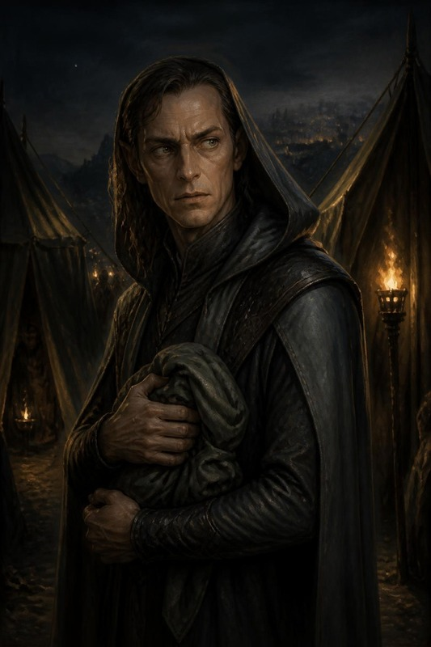

> **La scena «molto bella».**
> **Quando**: al ritorno dalla tenda, fra le tende del campo. Se il tavolo ha
> fretta si sposta nel caos delle mura (Scena 10), e il box funziona uguale. I
> PG **incrociano un ladro** che non c'entra con l'orda — un
> uomo incappucciato che si muove tra le tende con troppa grazia, un fagotto
> stretto al petto. È **Vatore**: mille anni prima di diventare **Salvatore
> «Sal» della Luna d'Argento**, il mercante-spia che li tradirà in ARC-09. Loro
> **non possono saperlo**. Questo è il cuore grigio della scena.

**Chi è, adesso.** Vatore, il «Ladro d'Ombra» di Hammerfist. Ha **appena rubato
il Sigillo di Ossidiana** (Appendice B) e pianifica la fuga nel futuro (userà un
Cronolito). Ha appena visto **quattro ombre uscire vive dalla tenda del generale**, e nelle
cronache che non dovrebbe aver letto i Quattro sono quattro: ne è **ossessionato**. Personalità: freddo, parla il meno possibile, li osserva
con un **terrore reverenziale mal mascherato**.
> **Cosa lo corrompe**. Vatore è **già marcio di
> avidità e sete di potere**: non gli importano le conseguenze. Ha rubato il
> Sigillo *sapendo* che divora anime — e ha deciso che le pagherà con quelle
> degli altri, e poi con la propria. È questa scelta, non un incidente, a
> renderlo **Sal**. Nella scena non è un innocente ingenuo: è un uomo che ha
> già scelto l'ombra, e che ora vede in VOI un potere che vorrebbe rubare.

> **Read-aloud (Andor lead) — fra le tende, l'incontro che non capiscono.** *Tra due tende c'è un uomo che non è dell'orda.
> Veste ombre cucite bene, e stringe al petto qualcosa avvolto in un panno.
> Non attacca. E non scappa, non subito. Vi fissa come si fissa una cosa che
> non dovrebbe esistere, e sussurra, più a sé stesso che a voi: «…quattro.
> Eravate davvero in quattro.» Poi gli torna la maschera: un sorriso freddo, e
> un passo indietro verso l'ombra. Che fate?*

**A parte, al giocatore di Artemis**, subito dopo:

> **Read-aloud (Andor lead) — l'anello.** *Artemis, l'anello che porti al dito
> è diventato gelido.*

**Le risposte del party (grigie — non sanno cosa diventerà):**

| Approccio | Prova | Cosa succede | Eco su Sal nel 1372 (ARC-09) |
|---|---|---|---|
| **Lo ignorano / lo lasciano andare** | — | Vatore svanisce nell'ombra col Sigillo. | Sal esiste «intatto» in ARC-09 — nessun vantaggio, ma nessun sospetto reciproco. |
| **Gli parlano** (Percepire Intenzioni o Diplomazia CD 18; se fallisce, vale la riga di sopra: se ne va) | 18 | Vatore, terrorizzato, lascia sfuggire un frammento: *«Voi non morite. L'ho letto. Nelle cronache che non sono ancora scritte.»* Poi fugge. | In ARC-09 Sal **esita** un istante di fronte a loro (li ha già temuti mille anni fa): +2 dei PG a Percepire Intenzioni e Diplomazia contro Sal la prima volta. |
| **Lo derubano** (Rapidità di Mano CD 22, solo con i gradi: «Chi può derubarlo», qui sotto) | 22 | Gli sfilano il **Sigillo di Ossidiana** (o parte del bottino). Se la prova fallisce, se ne accorge: niente ferita, ma il **Cronolito** lo porta via come nella riga «Lo feriscono», e il Sigillo va con lui | In ARC-09 Sal si presenta **senza** un asso che avrebbe avuto (il DM toglie a Sal un oggetto/piano — es. l'Olio di Sabotaggio parte scarico). |
| **Lo feriscono** (attacco riuscito) | — | Vatore urla, sanguina, attiva il **Cronolito** e sparisce nel tempo. | **Sincronizzazione**: nel 1372 **Sal sanguina nello stesso punto**, all'improvviso, davanti a chi lo osserva (la maschera vacilla) — i PG lo **riconoscono** come «l'uomo del passato» se collegano i punti. |
| **Cercano di ucciderlo** | scontro breve | Non muore qui (il Cronolito lo salva a 1 pf: *deve* sopravvivere per esistere nel 1372 — paradosso auto-consistente). | Sal in ARC-09 porta una **cicatrice antica** e un odio personale: sa che loro ci hanno provato. Nemico più cattivo, ma più fragile emotivamente. |

> **Perché è grigia (nota di tono).** I PG hanno davanti un ladro spaventato che
> **non ha ancora fatto nulla** — ma che (loro non lo sanno) diventerà un
> traditore. Ucciderlo «preventivamente» è un atto oscuro contro un innocente-per-
> ora; lasciarlo andare significa (senza saperlo) crescere il proprio nemico. Non
> c'è scelta pulita. **Registra tutto**: paga in ARC-09. *(Il paradosso regge
> sempre: Vatore DEVE sopravvivere per diventare Sal — il Cronolito lo garantisce.
> I PG possono segnarlo, derubarlo, terrorizzarlo, non cancellarlo.)*

> **Registrazione**: annota l'esito nel registro di fine serata (il filo
> «[VATORE/SAL]») e nell'Echo Ledger (§7).

**Vatore non ha statistiche, ed è voluto**.
Non combatte. Se lo attaccano, il primo colpo che va a segno lo ferisce (riga
«Lo feriscono») e alla fine del suo turno il **Cronolito** lo porta via. Il suo
urlo è un allarme: il campo è pre-allertato, e alle mura c'è un successo in
meno (Scena 10). La ronda arriva in **1d4+2
round**, come le ronde del campo (Scene 6 e 8). Quel colpo si
tira contro la CA di Sal nel Bestiario: **CA 22, contatto 16**. Il
Cronolito sposta nel tempo, non nello spazio: *àncora dimensionale* non lo
ferma, e nemmeno una lotta. Chi lo teneva si ritrova con il suo mantello in
mano. Un incantesimo ostile senza danno (*charme*, *blocca persone*) vale come
un colpo: nessun tiro salvezza, e alla fine del suo turno il Cronolito lo porta
via.

**Chi può derubarlo.** Rapidità di Mano si usa solo con i gradi: senza, la
prova è una prova di Destrezza e non supera CD 10 (SRD, *Sleight of Hand*).
Nessuna classe del gruppo la ha come abilità di classe, e la scheda di Tordek
al 12° non ha gradi: chiedi al tavolo, prima della scena, se qualcuno li ha
comprati. Per chi non li ha, il fagotto si strappa di mano: lo afferra chi
gli mette le mani addosso, Vatore attiva il Cronolito come quando lo tengono,
e chi stringeva il fagotto se lo ritrova in mano. Vale la riga «Lo derubano»
riuscita, e Vatore sa chi è stato.

**Se uno di loro porta il segno** (la cura con la cera nera, Scena 5). Vatore
guarda quel polso prima di quel volto. Per lui quel PG è della gilda, e il
terrore diventa complicità: parla a lui per primo, a voce bassa, e con lui la
riga «Gli parlano» riesce con **CD 14**. Il segno resta il suo ricordo di loro:
in ARC-09 Sal lo cerca su quel polso.

**Dopo il barile**. Il campo è sveglio e le
bande d'orchi corrono allo spiazzo con le torce: Vatore si ferma fra due tende
a guardare il fuoco, e la scena dall'alto comincia lì. Chi torna a piedi tira
il ritorno della Scena 6 a **CD +2**, perché i lupi si sono stretti sotto le
vie. Se il corno ha suonato, vale anche «Se il corno suona di notte» (Scena 6).

**Se tornano in volo.** Sopra i 20 m nessuno ha motivo di scendere fra le
tende. Lo vedono dall'alto, un incappucciato che si ferma fra due tende e
stringe un fagotto, e l'Anello di Artemis diventa gelido. Se scendono, la
scena comincia da dove atterrano; se no, Vatore è sulle mura all'alba, nel
caos della Scena 10: compare dopo il primo box, e lì il suo urlo non costa
successi, perché l'assalto è già cominciato.

**Se passano invisibili.** Vatore non li vede: nessuno dei suoi sensi li
coglie, e il Sigillo non glieli mostra. Li **sente**, se fanno rumore
(se qualcuno fallisce una prova di Muoversi Silenziosamente **CD 20**, la
stessa del campo). Se non li sente e non si fanno vedere, la scena la aprono loro: vedono un uomo incappucciato che si
ferma fra due tende, si guarda alle spalle e stringe un fagotto. L'Anello di
Artemis diventa gelido lo stesso. Se lo lasciano passare, vale la riga «Lo
ignorano» della tabella; se si mostrano, il box comincia da *«Tra due tende, un
uomo»* e Vatore dice la sua frase dopo averli visti.

#### Se lo divinano: Vatore, il Sigillo, Zeth

Una riga per segreto. Ognuna dà una mezza verità, e nessuna rompe il segreto
lungo: Vatore non sa che diventerà Sal, e nessun incantesimo lo legge in lui.

- **Che cosa pensa Vatore.** *Individuazione dei pensieri* legge «il Cronolito»,
  «la gilda», «non devono vedermi». Mai «Sal».
- **Che cos'è il Sigillo.** *Leggende e tradizioni* dà Shar e il prezzo delle
  anime (Appendice B).
- **I componenti di Zeth.** *Individuazione del magico* mostra necromanzia
  sotto la consacrazione (Scena 5).
- **Chi c'è dietro Zeth.** Se gli chiedono di Zeth e del suo padrone, Vatore
  risponde con la sua gilda, e non nomina il Collezionista.

L'artefatto che stringe al petto è in **Appendice B**.

---

<!-- pagina: una-colonna -->
### C.2 · La tenda in dieci minuti (Scene 6-8)

- **Infiltrazione (3 tiri di gruppo invece di cinque blocchi)**: le prove e le
  CD della Scena 6, cioè Muoversi Silenziosamente **CD 20** finché dura
  l'invisibilità, poi Nascondersi **CD 22** (−2 se aiuti dimezzati); un tiro
  riesce se riesce la metà del gruppo. Costa **2 tacche**, più 1 per ogni tiro
  fallito. Tre tiri riusciti = raggiungete la tenda non visti; **due falliti** =
  la pattuglia (Scena 6), come i tre blocchi falliti del corpo. Il ritorno è un tiro solo,
  Nascondersi **CD 22**, e costa 1 tacca.
- **Zog'tar (risoluzione veloce, GS 15)**: un **assalto coordinato** (sorpresa +
  il colpo più forte del party) lo abbatte se dichiarano tattica sensata e
  fanno **un** tiro: il colpo più forte del gruppo contro la sua CA (**26**, 24 in Ira). Se l'infiltrazione è fallita, è sveglio: −4
  alla sorpresa, un solo scambio.

<!-- /pagina -->

\page

# VI · Atto III · L'alba: le mura

{{note
##### ⚠ SOLO DM
Questo capitolo è materiale del DM: non mostrarlo ai giocatori.
}}

## §5 — ATTO III · L'ALBA

> **Il percorso dell'atto.** Dal primo ariete al ritorno. Le mura, il drago che
> cala sul cortile, il rito all'incudine, la luce del Rubino.
>
> 🛑 **Dove si ferma una serata**: per chi gioca l'arco da capo, la prima serata si ferma al primo box della Scena 10,
> e il resto dell'atto è della sessione dopo. Il gruppo di oggi si è fermato
> prima, alla Scena 5 (§4, «Dove si riprende»), e la sua serata dopo si ferma
> sull'esito del duello, prima della Scena 12.

| Scena | Dove | Chi entra | Prova | Se fanno l'inatteso | Al tavolo |
|---|---|---|---|---|---:|
| **10** · Le mura all'alba | il camminamento est | il capitano delle mura | prova collettiva, una via su tre | sabotano gli arieti: il duello comincia fuori dalle mura (Scena 11) | 15 min |
| **11** · Il duello | il cortile interno | **Skullcrusher il Nero** | combattimento su **M7-B** | due PG a terra nello stesso round, o il gruppo si ritira: intervengono gli avi, «vinto sporco» (§6) | 60-75 min |
| **12** · Il Rituale della Forgia Eterna | l'incudine, nel cortile | Thorgrim · Re Thorek I | nessuna | la scena salta: il re fa murare il torque nell'incudine | 15 min |
| **13** · Il Rubino e il ritorno | il cortile | — | nessuna | nessuno: la luce li prende comunque | 5 min |

### SCENA 10 — Le mura all'alba

**In scena** — Dove: le mura — Chi: Hrodgar · Re Thorek I · Zog'tar Deatheye, se è vivo all'alba

**In tre righe**
- **Succede**: il primo ariete arriva alle mura e il gruppo sceglie una via su tre per una prova collettiva, dopo la tabella «Dalla notte».
- **Chi vuole cosa**: l'orda vuole la breccia prima che il sole superi il crinale; Re Thorek I e il capitano delle mura vogliono tenere il camminamento est.
- **Come finisce**: mura tenute saldamente, a stento o breccia ceduta; il dado dei caduti dice quanti difensori con un nome muoiono, poi il drago cala sul cortile.

Si arriva qui **dove le tacche hanno lasciato i PG** (tabella di uscita
dell'orologio, §4). Se Hella ha vegliato i semi, i **due Treant di Adamantio**
caricano il fianco dell'orda mentre il primo ariete arriva (Scena 5).

> **Read-aloud (Salvatore lead, LotR support) — le mura.** *Il primo ariete
> arriva alle mura che il sole non è ancora sopra il crinale, e il legno prende
> la pietra con un rimbombo che arriva allo sterno prima che alle orecchie. Il
> camminamento vi si muove sotto i piedi di un dito. Un nano accanto a voi si sputa
> nelle mani e riprende l'ascia senza dire niente; quello dopo di lui ha la
> barba incastrata nella cinghia dell'elmo, e non ha il tempo di liberarla. In
> basso, le scale salgono.*
>
> **Che fate?**

**Dove sale l'assalto**. Dal camminamento la
piana si vede tutta, 100 m sotto. Il primo ariete sale dalla spianata alla
porta per la rampa del fronte sud; le scale arrivano sul tratto est, dove il
fianco della montagna tocca il piede delle mura, ed è lì che sta Hrodgar
 (M7-A, «La rampa della porta»).

Poi, quando le prime scale arrivano in cima, arriva il capitano delle mura.

**Comparse**

| Chi | Com'è | Come parla |
|---|---|---|
| **Hrodgar, il capitano delle mura** | nano con la barba bruciata da un lato, di un'altra battaglia, e un elmo senza cresta perché la cresta si vede da lontano. Vuole tenere il tratto est fino a che il re non gli dice di lasciarlo, e sa dove la pietra è più giovane: lo stesso punto che Balvar ha segnato sulla mappa di Zog'tar | dà gli ordini con una parola sola |
| **Hald, il nipote di Balvar** | nano di diciannove anni, di guardia sul camminamento est col gruppo di Hrodgar; la barba ancora corta, l'ascia troppo nuova. Non sa che lo zio esiliato è vivo, né che è nel campo di Zog'tar | poco e a bassa voce, da recluta; si drizza quando passa il capitano |
| **Zog'tar Deatheye, se è vivo all'alba** | il generale mezzo-ogre, l'ascia in mano e la pietra nera al posto dell'occhio destro, che guida l'orda sotto le mura; con 0-1 successi sale sulla breccia (la tattica sul camminamento è sotto la tabella «Dalla notte», la scheda d'entrata nella Scena 7) | conta, sempre: *«due file», «tre ore», «cento»*. In ira: *«A ME, CANI! ABBATTETE LE OMBRE!»* |

> **Read-aloud (Salvatore lead) — il camminamento.** *Il camminamento è largo
> quanto un tavolo da pranzo e lungo quanto la fortezza. Sotto, l'orda non
> urla più: ha smesso quando ha cominciato a salire, e il silenzio che ha
> lasciato è peggio. Un uncino morde la pietra a tre passi da voi, poi un
> altro, poi sei insieme. Il capitano delle mura guarda voi, non i suoi.*
>
> **Che fate?**

**Le tre vie, e nessuna è quella giusta.** La prova è **collettiva**: il party
sceglie **una** via, tutti tirano quella. Non c'è una scelta migliore — c'è
quella che costa meno a *questo* gruppo.

| Via | Prova | Se riesce | Il costo, anche riuscendo |
|---|---|---|---|
| **Tenere la breccia** | Forza **CD 18**, o un attacco contro **CA 28** | la falla regge; i nani vi vedono farlo | ci si arriva al duello **stanchi**: −2 al primo tiro d'iniziativa del duello (Scena 11) |
| **Rincuorare i difensori** | Diplomazia o Guarire, **CD 18** | +2 morale a tutta la linea per l'assalto | la breccia la tiene qualcun altro, e **qualcuno muore**: un nano con un nome, che il DM annota fra i caduti del 372 |
| **Sabotare gli arieti** | Disattivare o Artigianato, **CD 20** | due arieti fuori uso, l'assalto rallenta di mezz'ora | siete **fuori** dalle mura quando il drago arriva: il duello comincia con i PG separati di 18 m |

**🚫 Modi di fallimento — il fallimento è un costo, mai uno stop.** Nessuna
combinazione di tiri ferma l'avventura: il duello con Skullcrusher si gioca
comunque, perché è già accaduto.

**Prima di contare i successi, raccogli quello che arriva dalla notte.** Vale
un successo in più o in meno, e si applica dopo i tiri:

| Dalla notte | Effetto sulla prova delle mura |
|---|---|
| campo pre-allertato: il corridore è arrivato, o è suonato l'allarme (Scene 6 e 8) | **un successo in meno** |
| Zog'tar umiliato davanti alle guardie (Scena 8) | annulla il successo in meno, se c'era |
| Zog'tar catturato e portato alle mura (Scena 8) | **un successo in più** |
| cure comprate alla cappella (Scena 5) | nessuno sulla prova. Si tira il **dado dei caduti**: 1d4 per ogni tipo di cura comprata (per il gruppo del 25 settembre, quattro tiri). Il numero è quanti difensori con un nome muoiono sulle mura per quella cura mancata; il DM li annota fra i caduti del 372. Non tocca ARC-08 |
| i due Treant dell'alba caricano il fianco dell'orda (Scena 5) | **un successo in più** |
| **Zog'tar è vivo all'alba** (il gruppo ha dormito, o non è arrivato alla tenda) | **un successo in meno**, e Zog'tar guida l'assalto: vedi sotto |
| **il barile sulla tenda**: il boato è un allarme (supplemento, §10) | **un successo in meno**, anche se la tenda è bruciata |
| **il barile, e Zog'tar tirato fuori dal fuoco davanti ai suoi** | vale «umiliato davanti alle guardie»: annulla il successo in meno dell'allarme (B11) |
| **il barile, e Zog'tar vivo** (quasi sempre: §7 del supplemento) | la riga «Zog'tar è vivo all'alba» qui sopra, un successo in meno. Se il barile ha ucciso il sacerdote, sulla breccia sale senza di lui, come già scritto |

**Se Zog'tar è vivo all'alba**. Guida l'orda sotto le mura. Con
**0-1 successi** sale sulla breccia del camminamento est con le sue quattro
guardie, ed è uno scontro sulle mura prima del drago (Appendice A.2; EL 16, senza
Balvar e senza il sacerdote, rimasti al campo). Con **2 o più** resta sotto, a
spronare, e il drago arriva come sempre. In tutti e due i casi Zog'tar vivo è un
eco in §7: la Mano Rossa del 1372 discende anche da lui.
Sulla breccia i PG sono i difensori, non chi entra: **se volano** possono
scendergli addosso e prenderlo alle spalle, ma restano a tiro delle
balestre dell'orda, e chi resta a terra lo affronta sul camminamento; **se sono invisibili**, Zog'tar non li vede arrivare, ma la DES alla CA la
tiene: Schivare Prodigioso Migliorato (Appendice A.2) non lo lascia colto alla
sprovvista nemmeno contro un invisibile.

**Come combatte sulla breccia**. Il
camminamento è largo quanto un tavolo da pranzo: ci si sta in uno, al massimo
in due. Zog'tar è Grande e arriva a 3 m, quindi colpisce oltre il primo nano. Lassù
**si stringe** (SRD): −4 al colpire e −4 alla CA finché resta sul camminamento,
ed è per questo che vuole buttare giù chi ha davanti.
- **Round 1**: Ira, e l'Occhio di Ossidiana su chi porta la Corona. Le quattro
  guardie tengono la testa delle scale alle sue spalle: chi vuole arrivargli
  dietro deve passare da loro.
- **Round 2 e dopo**: il **Colpo Terrificante** (Appendice A.2) su chi gli sta
  davanti, perché non deve entrare nel suo spazio; **Spingere Migliorato** solo
  se il bersaglio è già al bordo. Thorik e Tordek hanno la stabilità dei nani,
  +4 contro la spinta (SRD). Sul camminamento non c'è dove arretrare, e un PG
  scagliato oltre il bordo cade nel cortile o fuori, fra l'orda: le mura sono
  alte **4,5 m** (mappa M7-B), cioè 1d6 di caduta (SRD). Fa poco male; il
  guaio è dove si atterra. Chi cade fuori ha un round per rialzarsi, e intorno
  ci sono scale e uncini. Vale per il tratto est, dove fuori c'è il pendio. Dal
  muro sud, che sta sul ciglio del gradone, si cade sulla spianata, 24,5 m più
  in basso: 8d6.
- **Contro chi vola**: i giavellotti, come nella tenda. Non lascia la breccia
  per inseguire nessuno: la breccia è sua.
- **Sotto il 30% dei pf** fa come nella tenda: cerca di portarsi via qualcuno.
- **Se il drago cala mentre lui è vivo**, Zog'tar scende dalla scala e resta
  sotto le mura a guardare: vuole vedere il drago finirli. Il duello della
  Scena 11 si gioca con lui là sotto, e chi lo cerca lo trova.
- **I PE** sono quelli della Scena 8, e non si sommano. Se Zog'tar si combatte
  solo qui, con le quattro guardie, vale circa **2.600 a testa**: Zog'tar circa 7.800
  e le guardie 2.600 in tutto, diviso quattro (§8 A).
- **Se cade qui**, il colpo finale va al giocatore (`[HDYWTDT]`, §0-ter).

| Successi (su 4) | Cosa cambia davvero |
|---|---|
| 4 | le mura reggono pulite; il duello parte con i PG schierati e **Re Thorek in piedi dietro di loro** |
| 2-3 | reggono a stento. Il duello parte normale |
| 1 | i nani perdono il camminamento est: il duello si combatte **con Re Thorek a 8 pf alle spalle**, e il drago lo punta quando nessun PG lo chiama (Scena 11, «Il re»), e a 8 pf basta un colpo a metterlo a terra |
| 0 | 🔴 **la breccia cede.** Re Thorek è a 8 pf, come con 1 (M7-B). Il duello si combatte **in mezzo ai feriti** portati giù dalle mura: M7-B con 6 quadretti di terreno difficile e **due nani a terra** che Hella può scegliere di raggiungere invece di combattere. Nessun malus: una **scelta in più**, e più dura |

⚠️ **La riga a zero successi è il punto di questa tabella.** Il modo più veloce
di insegnare a un tavolo che indagare e rischiare non conviene è punire il
fallimento con meno gioco. Qui a zero successi **si gioca di più**, non di meno.

- ► **Esito**: *mura tenute saldamente / a stento / breccia ceduta*.

**Con un gruppo diverso: la riga di scala**. Le mura
sono state giocate da quattro PG di 13°, e la tabella conta i successi su
quattro. La riga serve a un gruppo diverso. Quello che arriva dalla notte, un
successo in più o in meno, si applica allo stesso modo.

- **Con tre PG** (APL 12, tetto 16), o se in un gruppo di quattro manca un PG:
  i successi si contano su tre. Tre valgono la riga del 4, due quella del 2-3,
  uno e zero restano le loro righe. Se Zog'tar sale sulla breccia (con 0-1
  successi), porta due guardie e non quattro: le altre due restano in fondo
  alla scala a tenerla. Zog'tar e due guardie fanno EL 15.
- **Con cinque PG** (APL 13, tetto 17): i successi si contano su cinque.
  Cinque valgono la riga del 4, tre o quattro quella del 2-3, uno o due la riga
  dell'1, zero la breccia che cede. Zog'tar sale sulla breccia con 0-2
  successi, e porta le guardie della tenda, che con cinque PG sono diventate
  sei, tutte alla testa delle scale alle sue spalle.
  È la versione più forte, a EL 16, sotto il tetto.

\page

# VII · La mappa del duello: M7-B

{{note
##### ⚠ SOLO DM
Questo capitolo è materiale del DM: non mostrarlo ai giocatori.
}}

# M7-B · Il cortile del duello

La pianta del cortile dove Skullcrusher cala all'alba (Scena 11), con la legenda nella pagina dopo. Le piante della notte, M7-C e M7-H, sono in fondo al capitolo II, subito prima del barile.

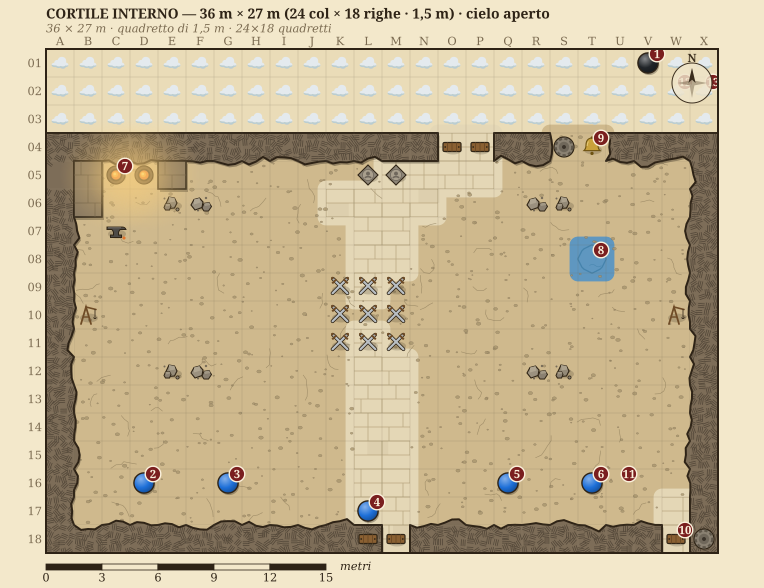

<!-- nuova-pagina -->

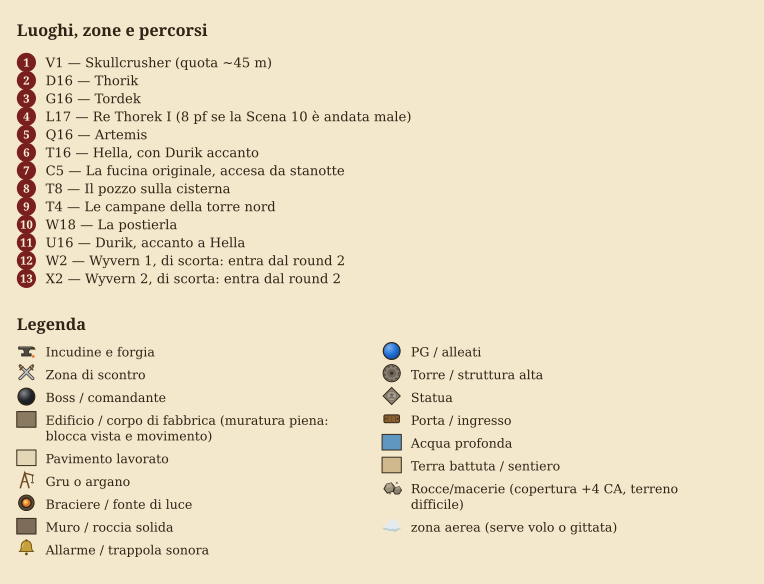

\page

# VIII · Il duello con Skullcrusher

{{note
##### ⚠ SOLO DM
Questo capitolo è materiale del DM: non mostrarlo ai giocatori.
}}

### SCENA 11 — Il duello con Skullcrusher

**In scena** — Dove: il cortile — Chi: Skullcrusher · Re Thorek I · Aegis Fang

**In tre righe**
- **Succede**: Skullcrusher il Nero cala sul cortile con due wyvern e combatte in passate, gridando i nomi che ha sentito di notte attraverso la Catena.
- **Chi vuole cosa**: il drago vuole vincere davanti all'orda, perché per lui il potere è quello che gli altri hanno visto; Re Thorek I è nel cortile con i PG.
- **Come finisce**: drago ucciso, ferito grave, fuggito, o vinto sporco (§6); con l'esito la serata si ferma, prima della Scena 12.

**Dopo il barile**. Attraverso la
gemella sul corno il drago ha sentito i gridi della notte, «Dall'alto. Hanno
ali.» compreso: all'alba sa che i nani volano e **guarda in alto**. Chi lo
aspetta in volo sopra il cortile non ha la sorpresa. La Catena regge anche se
Balvar è morto nel fuoco: le rune incise sopravvivono al runaio. Se il corno
ha suonato di notte vale «Se il corno suona di notte» (Scena 6): il drago parte
già in quota e conosce il loro odore. Se nessuno l'ha suonato, perché Grask è
morto e nessuno ha aperto la custodia, il drago arriva a metà mattina,
furioso (Scena 6, «Se rubano o rompono il corno»).

**Comparse**

| Chi | Com'è | Come parla |
|---|---|---|
| Aegis Fang | l'ascia di Thorik, che qui riconosce il sangue degli avi | non canta: urla dentro il cranio di chi lo impugna, a frasi brevi in maiuscolo; la sua voce è nella sua pagina fra gli artefatti dei PG |

**Scheda d'entrata — Skullcrusher il Nero, il capostipite** *(statistiche:
Appendice A)*

<!-- blocco: skullcrusher-chi -->
| | |
|---|---|
| **Aspetto** | drago nero vecchio (adulto maturo, se si usa l'Appendice A.1), snello e arrogante: collo lungo, cranio stretto e cornuto, scaglie nere opache con un riflesso verde d'olio. L'acido gli cola dalle fauci chiuse |
| **Vuole** | vincere **davanti all'orda**, perché per lui il potere è quello che gli altri hanno visto |
| **Teme** | che l'orda veda il guinzaglio. Chi dice la Catena ad alta voce se lo tira addosso (Scena 7, «Che cosa muove Skullcrusher») |
| **Suona** | dice **il nome** dell'avversario prima di colpire, ogni volta. Il nome è l'incantesimo, *colpo accurato*: il morso arriva al round dopo. Non lo chiede: lo sa dal corno, o mette un epiteto al suo posto (Scena 7, «Che cosa muove Skullcrusher»). Per il resto provoca e commenta, e se il tavolo ci sta ci si parla |
| **Eco** | la tabella B4 (§7): ogni ferita che gli fate, la Forgia la ricorderà contro **Fauci di Palude** nel 1372 |
| **Ritratto** | la tavola qui sotto. Solo per il DM fino al duello |
<!-- /blocco -->

**SKULLCRUSHER (lento, divertito, forte perché lo sentano le mura):** *«Un re
l'ho già mangiato, qui. Thorik. I tuoi amici lo dicono troppo forte, il tuo
nome, quando credono che il campo dorma.»*

Thorik è un esempio: il drago dice il primo nome che ha sentito alla tenda.
Se non ne ha sentito nessuno, la battuta cambia:

**SKULLCRUSHER (lento, divertito):** *«Un re l'ho già mangiato, qui. Voi, i
nomi ve li siete tenuti. Non importa: comincio dal nano con la Corona.»*

**SKULLCRUSHER (basso, quando sente dire la Catena):** *«Chi te l'ha
insegnata, quella? No. Non importa. Tocca a te.»*

> **Mappa M7-B.** Il drago entra dall'alto (quota ~45 m) e picchia sul cortile
> interno. È il capostipite della stirpe di **Fauci di Palude**: ogni ferita che
> gli infliggete qui, la Forgia la ricorderà mille anni dopo (§7, carry-over B4).

**Quale drago si usa, e quando**.
Stasera il **Vecchio** dell'Appendice A.1-bis, con le 2 wyvern dell'Appendice
A.6 dal round 2: EL 17, il tetto esatto di APL+4 per un gruppo di 13°, e lo
stesso per un gruppo di 14° o per cinque PG. L'**Adulto** dell'Appendice A.1,
con le stesse wyvern, è l'alternativa: per un gruppo di 13° logorato o senza
tutti gli artefatti, per tre PG, e per il DM che non conferma il Vecchio. Le
tattiche qui sotto valgono per tutti e due; dove i numeri cambiano, il primo
è del Vecchio e il secondo dell'Adulto.

**Se il duello comincia fuori dalle mura** (arieti sabotati, alba colta fuori
dal campo).
M7-B non serve: si gioca sulla spianata davanti alla porta, aperta e senza
copertura, con le carcasse degli arieti come unico riparo. I nani sono sulle
mura, a 18 m e 24,5 m più in alto (i 20 m del gradone e i 4,5 delle mura), e
le balestre tirano da lì. La fucina, la cisterna e le campane
della tabella del cortile qui sotto non ci sono; le corde sì, quelle degli arieti
rovesciati, con la stessa prova.

> **Read-aloud (Salvatore lead) — il cortile.** *Prima arriva il freddo: passa
> un'ombra, e l'aria del cortile perde dieci gradi in un respiro, e la pelle
> lo sa prima di voi. Poi il rumore, un risucchio come quello del mare che si
> tira indietro, e le braci della forgia si piegano tutte nella stessa
> direzione. Un nano vicino a voi lascia
> cadere lo scudo e non si china a raccoglierlo.*
>
> *Dove il drago passa basso, la pietra fuma. L'acido gli cola dalle fauci chiuse e si mangia il selciato come acqua
> nella neve.*
>
> **Che fate?**

🎚️ **Se e solo se Thorik tiene Aegis Fang in mano**, un secondo box, corto, e
a lui soltanto.

**AEGIS FANG (non canta: urla, dentro il cranio):** *«SANGUE ANTICO. ARTEFICE
DI LACRIME.»*

> **Read-aloud (Mercer lead) — la visione, solo per Thorik.** *Per un istante
> la Corona ti mostra due immagini sovrapposte: questo drago adesso, e un altro
> drago sopra mura che bruciano, mura che non hai mai visto.*

#### 🎬 La regia dei primi due round — una battuta per attore

>
> **Non sono numeri nuovi.** CD e danni restano quelli dell'Appendice A. Qui c'è solo
> **cosa leggere, quando**, e sono sei secondi a testa.

**Apertura di round — cosa è cambiato nel mondo.** Prima di ogni giro, una riga
sola: *dove* è il drago (in cielo, in picchiata, a terra) e *cosa* ha lasciato
il round prima (una crepa, un nano che non si rialza, il fumo dell'acido).

**Il giro, in quattro battute** *(ordine di gioco dichiarato: chi ha vinto
l'iniziativa parla per primo, ma la descrizione segue sempre questo ordine)*:

| | Attore | Riuscita — **una riga** | Fallimento — **una riga, e non è «manchi»** |
|---|---|---|---|
| 1 | **THORIK** — regge | l'ascia entra fra due scaglie e ci resta un istante di troppo: il drago **si gira verso di lui**, ed è quello che serviva | il colpo scivola sulla scaglia bagnata d'acido. Thorik resta in piedi, ma adesso ha le mani che bruciano |
| 2 | **TORDEK** — colpisce | il pugno prende l'ala dove l'osso è sottile: un suono secco, e la picchiata si sbilancia | il drago si alza di un metro e il colpo passa sotto. Tordek finisce in avanti e per un momento **non vede dov'è** |
| 3 | **ARTEMIS** — sceglie il bersaglio | il blast arriva **all'occhio**, e per un round il drago tiene la testa girata di tre quarti | l'ombra si apre troppo presto. Il drago la vede arrivare e **ricorda da dove è partita** |
| 4 | **HELLA** — cambia il campo | le radici salgono dal cortile e chiudono una via di fuga: il drago **deve** restare | la pietra non risponde — qui la terra è giovane e non la conosce. Hella sente l'assenza, e le costa |
| 4-bis | **DURIK** — si mette in mezzo | il drago deve scavalcarlo per arrivare a Hella, e scavalcarlo gli costa il turno di picchiata | il soffio lo prende in pieno: la pietra **fuma**, e l'acido gli fa il 50% in più. Durik non arretra. Senza runa il soffio gli fa in media più di 50 danni: danno massiccio, Tempra CD 15 (lui +11) o torna polvere, e la carica rimasta dopo i Treant dell'alba lo riporta per un'ora (Scena 5) |

**Chiusura di round — l'avanzamento visibile.** Una riga che dica cosa è
**cambiato**, non quanti pf restano: la prima scaglia che manca, il fiato che si
accorcia, il primo passo indietro che il drago fa senza volerlo.

> **Round 1 — apertura da leggere.** *L'ombra passa sul cortile prima del
> rumore. Quando il rumore arriva, è il vostro stesso nome gridato da ottocento
> nani che hanno smesso di combattere per guardare in alto.*
>
> **Che fate?**

⚠️ **Dal round 3 si smette.** La regia serve a far **atterrare** l'inizio; se la
tieni per otto round diventa una lettura e il combattimento si ferma. Dal terzo
round si torna alle tattiche del drago, più sopra, e si descrive solo quello che
cambia davvero.

#### Tattiche di Skullcrusher — regia round per round (stile RHoD, aggancio M7-B)
> Scritte dal punto di vista del drago. Skullcrusher è **giovane nella sua
> arroganza**: non ha mai perso, non sa ancora aver paura. È questo che i PG gli
> insegnano — ed è questo che il suo sangue ricorderà.

- **Round 1 — la Presenza.** Cala dall'alto (Presenza Terrificante CD 26 o 25:
  chi fallisce è scosso; Thorik non tira, perché la *mente vuota* della
  Corona lo rende immune agli effetti di paura, Scena 8). Se Zog'tar è morto in modo «spettacolare» (Scena 8), arriva **già
  in picchiata**: ha un round di sorpresa (SRD), e i PG sono colti alla
  sprovvista fino al loro primo turno. La picchiata vince anche sul «senza
  sorpresa» del drago che li ha già visti di notte; agisce nel round di
  sorpresa chi supera Ascoltare CD 20, e con le campane suonate vale la loro
  riga nella tabella delle difese. Apre col **Soffio acido** sul
  gruppo più fitto (Riflessi CD 31 o 30), **aderente**: l'acido resta addosso e al round dopo morde ancora (Appendice A.1). *Non atterra, perché vuole restare in cielo, dove
  si sente un dio.* Chi ha la runa di Zeth (*resistere all'energia*, acido 20)
  e non l'ha attivata al corno dell'alba (Scena 5) la attiva adesso, con
  un'azione standard: prima del soffio, se ha l'iniziativa.
- **Round 2-3 — la passata.** Non si ferma. Ogni turno attraversa il
  cortile con Attacco in Volo, e a metà del movimento fa una cosa sola: il
  soffio, se è tornato, lungo la linea più lunga che trova; il morso su chi
  ha nominato il turno prima; oppure il nome di un altro. Poi va oltre e
  risale. Punisce chi non ha gittata o volo. Bersaglio: «Chi sceglie», qui
  sotto. Fra un turno e l'altro resta a circa 15 m sopra il cortile: Aegis Fang
  scagliata, cinque incrementi da 3 m, ci arriva al limite, e il blast di
  Artemis sempre. *Corrompere l'acqua* sulle
  pozioni: un uso prende le pozioni
  di un solo PG, perché l'SRD guasta 10 piedi cubi, poco più di un quarto di
  metro cubo, entro il raggio della Presenza. Ognuna tira a parte Volontà
  CD 25, e quelle nel buco portatile non le tocca.
- **La passata, il nome, la prima paura**.
  Il drago giovane combatte in movimento e davanti a un pubblico: non si
  ferma mai finché non ha paura, e prima di colpire dice chi colpirà.
  - ***Attacco in Volo*** (SRD, *Flyby Attack*). In volo fa un'azione di
    movimento e un'azione standard in un punto qualsiasi del movimento. Il
    soffio è un'azione standard: lo usa a metà della passata e continua a
    volare. Il morso in passata è un attacco solo.
  - ***Virata*** (SRD, *Wingover*). Una volta per round, con un'azione
    gratuita, gira fino a 180° nonostante la manovrabilità scarsa. La virata
    costa 3 m di volo, e nel round in cui vira non sale: resta in quota o
    scende. È il talento che gli fa girare un drago Enorme dentro un cortile
    di 36 m: entra, soffia, e torna indietro sulla stessa linea quando il
    gruppo pensava di averlo alle spalle. 🔎 Il testo è quello dell'SRD letto
    su una trascrizione: va riscontrato su d20srd.org.
  - ***Colpo accurato*** (SRD, *true strike*, stregone di 1°). Azione
    standard: +20 di intuizione al prossimo tiro per colpire, entro la fine
    del round dopo, e niente probabilità di mancare per occultamento. La
    componente verbale è il nome: lo grida a metà della passata, forte perché
    lo sentano le mura, e al round dopo morde quel PG a +54 (+50). Il nome
    non lo chiede: è quello sentito di notte attraverso il corno, oppure un
    epiteto preso da quello che vede, *la morta tornata*, e basta una parola
    (Scena 7, «Che cosa muove Skullcrusher»). Il tavolo
    sente il nome un round prima: chi è nominato sa che sarà colpito, e gli
    altri sanno su chi preparare la corda. Oltre all'*armatura magica* ha sei
    slot di 1°. ⚠ Non SRD: l'incantesimo vuole anche un fuoco, un piccolo
    bersaglio di legno, e il drago non lo porta.
  - ***Fluttuare*** (SRD, *Hover*), **una volta sola**: alla prima paura, a
    ⅓ dei pf (la soglia qui sotto). Con un'azione di movimento si ferma in
    aria, e da fermo si sposta in ogni direzione, anche in verticale, a metà
    velocità, nonostante la manovrabilità scarsa. Se comincia il turno fermo
    in aria può fare un'azione di round completo: niente attacchi d'ala, ma
    morso, artigli e coda come in un attacco completo, oppure il soffio o un
    incantesimo. Sotto i 6 m dal suolo, sopra le macerie e la cenere del
    cortile, alza una nube di 18 m di raggio: dentro si vede a 3 m, chi è a
    4,5-6 m ha occultamento (20%), chi è a 7,5 m o più occultamento totale
    (50%), e per lanciare un incantesimo nella nube serve Concentrazione
    **CD 21**. La nube spegne le fiamme piccole non magiche.
  - ***Oscurità*** **una volta sola**, alla fuga. Finché l'orda guarda vuole
    essere visto, e non la usa. Quando scappa verso le paludi se la porta
    dietro: è la vergogna, e non deve vederla nessuno.
  - **La sequenza.** Al round 1 il soffio d'apertura. Poi una passata a
    round: il nome di un PG, il morso su chi ha nominato, o il soffio quando
    torna. Scende sotto i 6 m solo per l'attacco completo contro chi lo ha
    inchiodato con le corde: in quel round è a terra e non fluttua, quindi la
    nube non c'è. Si ferma in aria una volta sola, alla prima paura, e lì la
    nube c'è.
  *Momento Artemis*: in volo (Ali d'Ombra) è l'unico che lo raggiunge alla pari.
  *Momento Aegis Fang*: Thorik la **scaglia** — se colpisce in volo, incide la
  **Cicatrice a forma di martello** su un'ala (§7: −2 alla Volare di Fauci nel 1372).
  È un'ascia da guerra nanica +2 *da ritorno*: scagliata, è
  un'arma da mischia lanciata, −4 al tiro e incremento 3 m, e torna in mano a
  Thorik prima del suo turno successivo (SRD, *da ritorno*). «Colpisce in
  volo» vuol dire un tiro a distanza a segno mentre il drago è in quota.
- **La Catena, in ogni round.** Se i PG sanno della runa (Scena 7), leggerla
  sulla scaglia è un'azione di movimento entro 9 m, e colpirla è un attacco
  contro **CA 44** col Vecchio e **41** con l'Adulto: la CA con l'armatura magica, 40 o 37, più 4 perché il bersaglio è piccolo; la runa è sotto la scaglia, e un attacco di contatto non la raggiunge: il primo colpo a segno la spezza, e il drago se ne va. Se
  Balvar è morto prima dell'alba, il drago combatte a **−2** e fugge a metà pf.

**Quando qualcuno la legge**, la prima volta:

> **Read-aloud (Salvatore lead) — la runa sotto la scaglia.** *Sotto la scaglia
> calda del petto, più pallida delle altre, corrono righe di rune naniche
> incise a punta, fitte come i conti di un mercante. L'ultima riga è più piccola e
> più fonda delle altre, ed è quella che il drago non ha mai letto.*

- **La Catena detta ad alta voce**. Chi
  la legge forte, dove l'orda sente, diventa il suo bersaglio dal turno dopo,
  anche se deve scendere. Il perché è in Scena 7, «Che cosa muove Skullcrusher».
- **Chi sceglie, se più cose lo chiamano**. Colpisce
  solo chi prima ha nominato, forte, ogni volta. Il nome non lo
  chiede: o l'ha sentito al corno, o mette al suo posto un epiteto preso da
  quello che vede, che vale lo stesso. Fra
  quelli che lo chiamano, nell'ordine: chi ha detto la Catena ad alta voce;
  chi tiene la corda dell'ala; chi lo ha ferito di più. A parità decide
  l'arroganza: sceglie quello la cui caduta fa più orrore agli altri, la
  druida appena tornata dalla morte o chi porta la Corona, e lo nomina in modo
  che lo sentano tutti.
  **Quando valgono le altre righe.** Questo ordine viene prima di tutte, con
  tre eccezioni. Il soffio d'apertura del round 1 va sul gruppo più fitto,
  perché non ha ancora nominato nessuno. I nani chiamati dal tavolo prendono
  l'attacco pieno nel round in cui arrivano, come dice la tabella del
  cortile, e dal round dopo l'ordine torna questo. Chi tira con le balestre o
  suona le campane lo chiama solo nei round in cui nessun PG lo chiama: in
  quei round le fa tacere con la coda, in passata (2d6+16 o 2d6+15), e viene
  prima del re. Il soffio lo tiene per i PG.
- **Il re**. Re Thorek sta nel cortile alle spalle
  dei PG. Se in un round nessun PG ha chiamato il drago (la Catena detta, la
  corda, le ferite) e nessuno ha tirato con le balestre o
  suonato le campane, Skullcrusher va su di lui: è il secondo re
  che vuole mangiare davanti all'orda. Chi sta sulla linea del soffio o
  accanto al re prende il colpo al posto suo. ⚠ Non SRD: in 3.5 non c'è
  un'azione per prendere un colpo al posto di un altro; qui basta essere lì.
  Hella invece ce l'ha: lo *Scudo del Custode* della Collana (1 al giorno,
  azione immediata) prende su di lei, dimezzato, il danno di un alleato entro
  9 m, e Thorik è accelerato per 3 round verso chi è stato protetto (stato
  della campagna, §7, «I tre Doni»).
  Il re non muore, perché alla Scena 12 è vivo. Per colpirlo non si tira: due
  colpi del drago lo mettono a terra, stabile, e uno solo se è già a 8 pf
  (Scena 10). Il Rubino lo ricorda come il
  giorno in cui il re è caduto.
- **Soglia: quando gli resta un terzo dei pf, ~112 col Vecchio e ~100 con l'Adulto — la prima paura.** Per la prima volta nella sua vita,
  Skullcrusher **esita**, e **si ferma in aria** (*Fluttuare*): è l'unica
  volta nel duello. È il momento dei tre esiti (sotto). Al suo turno
  fugge nelle paludi sotto la sua *oscurità*, a meno che nel round prima abbia preso **almeno due
  colpi**: allora resta fermo lì un round ancora, e lì si può uccidere (le soglie,
  più sotto). *«Qualcosa in lui — nel
  sangue — capisce che questi quattro non sarebbero dovuti esistere.»*
- **«La Forgia ricorda» (meccanica cardine).** **CONTA i colpi a segno** su
  Skullcrusher (ferite ancestrali, N≤3) — è il dato per il carry-over B4 (§7).
  Moradin, nella mente di Thorik: *«Ogni ferita che infliggi ora all'antenato,
  la mia Forgia la ricorderà quando affronterai il discendente.»*
- ***Dragondoom* di Aegis Fang funziona**:
  3 volte al giorno, come contro ogni drago Grande o più (+1d6 per
  la taglia sopra la Media). La Catena non la blocca, e la Cintura qui sotto
  non c'entra.
- **Il Bane contro Fauci qui non vale**.
  Aegis Fang lo ha imparato all'affresco A7 contro Fauci di Palude, e contro
  il suo capostipite tace. Contro Skullcrusher l'ascia ha la *Dragondoom* e
  basta: il +2, i 3d6, il critico ×4 e lo *Scosso* tornano contro Fauci, nel
  1372.
- **La Cintura di Tordek RIFIUTA di attivarsi** qui (*«il vero scontro appartiene
  al futuro»*): coerenza col 1372, non nerf. È voluto — Tordek vince senza.
- **Sviluppi.** Comunque finisca (ucciso/ferito/fuggito), il sangue di
  Skullcrusher **sopravvive**: se ferito o fuggito, si ritira nelle paludi a
  leccarsi le ferite e a generare la stirpe che, mille anni dopo, culminerà in
  **Fauci di Palude**. Se **ucciso**, la stirpe nasce comunque (aveva già figli):
  la profezia non spezza il sangue, lo **segna** (carry-over B4). In ogni caso,
  con il drago via, l'orda perde lo sprone e si sfalda entro poche ore (→ Scena
  13). Se Skullcrusher ha **visto** Aegis Fang scagliata, il terrore di
  quell'arma entra nel sangue: Fauci, mille anni dopo, la riconoscerà (gancio
  inverso B4).

#### 🏟️ IL CORTILE — cosa c'è, e cosa ci si può fare che qui non è scritto

> **Perché questa tabella esiste.** Il duello aveva la regia, le tattiche del
> drago e la scalatura, ma **niente sull'arena**: un tavolo che volesse essere
> furbo non trovava appigli, e restava l'iniziativa. Qui non ci sono soluzioni
> pronte — ci sono **cose**, e una riga su cosa succede se qualcuno le usa.
> Per tutto il resto vale il §0-ter: **assorbi, poi rilancia**.

| Nel cortile c'è | Se qualcuno lo usa |
|---|---|
| **Le corde delle gru sulle mura**, tese e bagnate | tirarle mentre è basso: prova di **Forza CD 25**, e chi aiuta dà **+2** a testa (aiutare, SRD: Forza CD 10), al massimo tre per corda; i nani possono essere fra loro, e il soffio li prende come nella riga dei nani. Non lo atterra: gli **inchioda un'ala a terra per un round**, ed è tutto quello che serve |
| **La fucina originale**, accesa da stanotte | ci si può spingere dentro qualcosa. Il drago è **immune all'acido, non al calore della forgia**: 4d6 e — più utile — il fumo gli toglie l'olfatto per 1d4 round |
| **La cisterna sotto il pozzo** | l'acido colpisce l'acqua e **ribolle**: nuvola che oscura, −4 agli attacchi di tutti. Danneggia i PG quanto lui. È una **scelta**, non un trucco |
| **Le campane della torre nord** | il suono nell'aria fredda copre il battito d'ali: con le campane suonate il drago **perde il round di sorpresa** della picchiata: Ascoltare CD 20 per sentirlo arrivare (e chi le suona si fa **bersagliare**) |
| **Ottocento nani che guardano** | chiamarli è gratis. Arrivano, **e muoiono**: il DM ne annota i nomi fra i caduti del 372. Il drago fa un attacco pieno su di loro invece che sui PG. Nessuno lo dice al tavolo prima |

#### 🪂 Chi non vola — cosa fa nei round in quota

Il drago resta in cielo dai round 2-3, e la domanda del tavolo arriverà: *«e io
che non volo?»*. La risposta non è «aspetti». Per Tordek, prima di tutto:

- **Tordek e i Bracieri.** Contro il drago rifiuta la Cintura, non i
  Bracieri, che sono un altro oggetto: Castigo del Drago (+2 al potenziamento
  e +2d6 contro i draghi), Salto Fiammeggiante 3 volte al giorno, e la
  Collina, che la prima volta scatta da sola quando uno scontro con una
  creatura Enorme lo porta sotto metà pf (scheda dei Bracieri in
  `PG/Artefatti/Artefatti-Pg/Tordek/`). Skullcrusher è Enorme.
  L'Ancoraggio della Montagna non c'è più: al rito è diventato il Dono di
  Hella (log del 25).

Per tutti, tre cose SRD:

- **Preparare un'azione, sul momento giusto.** Il morso ha portata 4,5 m: in
  volo Skullcrusher morde da lì e risale, e non entra mai nel metro e mezzo di
  un nano. Un'azione preparata su *«quando scende»* non scatta. Scatta su
  *«quando le corde lo inchiodano»*: nel round a terra chi l'ha preparata
  colpisce per primo, poi è attacco completo. È il round di Thorik e di Tordek,
  e il colpo preparato di Tordek può essere il suo Pugno Stordente.
- **Le corde delle gru** (la tabella qui sopra). Si fa **tutto
  nello stesso momento**, con azioni preparate sullo stesso innesco: *«quando
  il drago picchia sotto i 9 m»*, cioè ogni volta che scende a mordere qualcuno
  nel cortile. I ruoli:
  - **chi lancia il gancio** (sul camminamento, accanto alla gru): attacco di
    contatto a distanza, incremento 3 m, contro la CA di contatto del drago (**10**).
    È un'arma da lancio, quindi arriva a cinque incrementi, 15 m, con −2 al
    tiro per ogni incremento intero di distanza (SRD, gittata): dalle gru in
    B10 e W10 il gancio prende il drago quando picchia entro 15 m da una
    delle due, contando anche la quota;
  - **chi tira** (a terra, alla corda): se il gancio prende, **Forza CD 25**
    subito, nella stessa azione preparata; chi tira insieme aiuta, +2 a testa
    (aiutare, Forza CD 10);
  - **chi colpisce**: con l'ala inchiodata il drago resta a terra **un round**,
    e chi aveva preparato un attacco lo porta adesso.
  Così Thorik e Tordek hanno sempre un'azione mentre il drago è in quota:
  preparano la corda. Se il gancio manca, l'azione preparata va persa, come
  dice l'SRD. È il momento in cui il drago smette di essere in cielo per tutti.
- **Le balestre delle mura.** Sul camminamento ci sono le balestre pesanti dei
  difensori: 1d10, incremento 36 m, un
  round intero per ricaricarle. Contro la sua RD 10/magia un dardo normale non
  fa danni. Serve ad altro: un colpo a segno, per il suo orgoglio, è un insulto,
  e il drago si gira su chi l'ha fatto.
  Chi tira, attira, e lascia respirare chi sta sotto.

Il DM non deve inventare niente di più. Se il giocatore trova una quarta via, è
§0-ter.

🚫 **Cosa NON dire.** Che la fucina funziona contro di lui. Se lo dici, la
tabella diventa un elenco di mosse; se aspetti, resta un cortile. Il DM **non
legge questa tabella ai giocatori**: la tiene sotto gli occhi e risponde.

⚠️ **E se hanno un'idea che non è in tabella**, la risposta è già scritta in
§0-ter: sì, e adesso c'è un problema nuovo. **Questa tabella è un esempio di
tono, non l'elenco delle cose permesse.**

#### ► ESITO DEL DUELLO (aperto — MAI fisso) → carry-over B4 (§7)

`[HDYWTDT — il finisher a chi mette a terra il drago. «Com'è che lo fai?», e
aspetta. È il momento più grosso della campagna finora: non riempirlo tu.]`

1. **UCCISO** (0 pf): impresa immensa, la profezia in pieno. → Fauci nel 1372
   parte con **−10% PF** e Presenza ridotta contro i portatori (B4).
2. **FERITO GRAVE** (fugge quando gli resta un terzo dei pf, ~112 su 337 o ~100 su 297): esito «medio», il più probabile. →
   Fauci perde **un uso del soffio** (B4).
3. **FUGGITO** (i PG scelgono la sopravvivenza / non lo intaccano): quasi illeso,
   ma **vi ha visti e riconosciuti**. → Fauci **+2 iniziativa** ma morale
   fragile (fugge sotto 75 pf invece di 50) (B4).
**Le soglie**: a ⅓ dei pf fugge al suo turno, a meno che nel round
prima abbia subito almeno due colpi (allora resta un round ancora). Se Balvar è
morto e il drago fugge a **metà** pf, l'esito è **FERITO GRAVE**.
*Registra esito + N ferite + se Aegis Fang colpì in volo.*

#### Sidebar — Scalare lo scontro (stile RHoD)
| Situazione | Aggiustamento |
|---|---|
| Il gruppo di stasera, e ogni party **straripante** (4 PG di 13° con la fiducia piena del consiglio, tutti gli artefatti e il banco della fucina speso, o 4 PG di 14°) | Skullcrusher **Vecchio e Avanzato** (GS 17): **337 pf**, CA 36 (40 con *armatura magica*), soffio 16d4 CD 31, Presenza CD 26, morso +34; statistiche in Appendice A.1-bis. Con lui, dal round 2, le 2 **wyvern** (SRD, *Wyvern*: GS 6, 59 pf, CA 18, volare 18 m, pungiglione +10 con veleno Tempra CD 17, 2d6 COS, morso +8 2d8+4; Appendice A.6). Per un gruppo di 13° fanno EL 17, il tetto esatto di APL+4; per uno di 14°, APL+3. Le wyvern vanno su chi tiene la corda dell'ala e su chi vola; quando il drago fugge o muore, fuggono anche loro. Il gruppo di 13° straripante ha le wyvern |
| Un gruppo di 13° che non è straripante, o il DM non conferma il Vecchio | l'**Adulto** dell'Appendice A.1, con le 2 wyvern: EL 14 sulla carta, 15 al tavolo |
| Party **logorato** (il campo e le mura andati male, risorse spese, Hella ancora fragile) | Skullcrusher NON usa il soffio 2 volte di fila; quando gli restano ~100 pf **fugge subito**, senza il round in più (esito FERITO GRAVE garantito) |
| **Hella appena risorta** — vuoi proteggerla | Riga da scegliere, non di base: il drago la ignora finché non lo ferisce (predatore: va per la minaccia, non per la novità). Senza questa scelta vale «Chi sceglie», che la mette fra i preferiti — dà alla giocatrice spazio per il suo primo scontro |
| **Tre PG** (APL 12, tetto 16), o un gruppo di quattro a cui manca qualcuno | lo stesso drago di A.1, che resta sotto il tetto. Nella regia si salta la riga di chi manca; se manca Hella, manca anche Durik. Alle corde la terza mano la dà un nano, che il soffio prende come nella riga dei nani del cortile |
| **Cinque PG** (APL 13, tetto 17) | il Vecchio della prima riga con le 2 **wyvern** dal round 2, con la stessa tattica: EL 17, il tetto |
| **Con le wyvern**, quanto vale | due GS 6 fanno EL 8, molti punti sotto il drago, e aggiungono meno di mezzo punto. Col Vecchio il duello è **EL 17**; PX per un gruppo di 13°: 16.250 in tutto, cioè **≈ 4.060 a testa** con quattro PG e **3.250** con cinque. Con l'Adulto resta **EL 14** sulla carta, 15 al tavolo: 6.500 in tutto, **1.625 a testa** con quattro PG e **1.300** con cinque (§8 A) |
| Un PG **abbattuto** | Skullcrusher lo ignora (caccia chi è in piedi e lo minaccia): finestra per stabilizzarlo |

## §6 — CONTINGENZE & SCONFITTA

| Mossa | Risposta del modulo |
|---|---|
| **Vogliono cambiare il passato** (salvare qualcuno destinato a morire, avvisare i nani di eventi futuri) | Timeline auto-consistente: ci **provano**, ma «va sempre come doveva». Il nano che vogliono salvare muore comunque, in un altro modo. Non è fato crudele: è che **è già successo**. Ottimo pathos, zero paradossi. |
| **Cercano tesori/conoscenze da riportare nel futuro** | Possono. Torna ciò che **portano addosso** quando il Rubino si accende, anche se l'hanno comprato alla fucina (Scena 5); le conoscenze tornano con chi le sa. Vale per tutto, pozioni, pergamene, bacchette e rune comprese, per la stessa ragione dell'ascia e dello scudo. Resta qui ciò che consumano, vendono o lasciano, e ritorna come reliquia (§7). Il **Sigillo di Ossidiana** rubato a Vatore (Appendice B) torna come il resto, e con lui il Cronolito che lo lega a Vatore: è il gancio ARC-09. |
| **Attaccano la pattuglia di Durin** (Scena 2) | Durin è un Guerriero 6 con sei veterani: contro PG di 13° livello non regge un round, e lo sa. Alla prima ferita grave getta l'ascia e grida *«Se siete dei nostri, dimostratelo!»*. I PG arrivano alla porta lo stesso, con Durin ferito, e al consiglio (Scena 4) la CD della prova sale di **+4**. Se Durin muore, un veterano senza nome prende il suo posto, e il DM annota Durin fra i caduti del 372 |
| **Vogliono reclutare Thorgrim / portarlo nel futuro** | Impossibile (non è «loro»): Thorgrim resta, e la sua eco è l'affresco A3 della Sala della Forgia. Commovente: si separano da un fratello che è già polvere da mille anni. |
| **Vogliono attaccare il drago di notte, sulle colline** | Si può. Le colline sono a qualche chilometro, e il drago vede al buio e sente chi è invisibile entro 18 m. Di notte non combatte per l'orda: combatte due round per orgoglio, poi vola via, perché la Catena lo lega al campo e non alle colline. Il danno che ha preso **resta** all'alba, ma il duello comincia **senza sorpresa**: li conosce. Costa **2 tacche**, e la Scena 7 resta da fare |
| **Evitano del tutto il duello con Skullcrusher** | Difficile ma possibile (montaggio): allora il Rubino si accende comunque (la fortezza regge), ma **senza ferite ancestrali** → nessun carry-over B4 (Fauci al 1372 a piena forza). La scelta ha un prezzo futuro. |
| **FALLIMENTO — il duello va malissimo / un PG cade / fuggono sconfitti** | Non c'è TPK: la timeline **esige** che vincano (la profezia È incisa). Se il combattimento crolla (**due PG a terra nello stesso round**, o il gruppo che **si ritira dal cortile**), gli antenati, chiamati da Thorgrim che dà l'ordine, **intervengono** e ricacciano il drago (a caro prezzo: molti nani antichi muoiono — pathos, e il DM ne annota i nomi fra i caduti del 372). I PG vincono «sporco»: **nessuna ferita ancestrale** registrata, il Rubino si accende col tono «misericordia/dovere», e portano il peso di essere stati salvati dagli avi che erano venuti a salvare. |

---

<!-- pagina: una-colonna -->
### C.3 · Il duello in tre scambi (Scena 11)

> **🎚️ [FAST-PLAY] del duello** (se vuoi chiudere veloce): 3 scambi narrati a
> prova di gruppo (un attacco contro **CA 40**, 37 con l'Adulto, o Saltare/Equilibrio **CD 22** per chi lo affronta dalle mura), poi si sceglie l'esito tra i tre
> della Scena 11 in base a quanti scambi i PG hanno «vinto» (0-1 = fuggito, 2 = ferito
> grave, 3 = ucciso). Uno scambio è vinto se metà del gruppo supera la prova.
> Registra comunque le ferite per B4: N = scambi vinti. **[COMBATTIMENTO
> COMPLETO]** = la regia round-per-round della Scena 11, su M7-B.

<!-- nuova-pagina -->

<!-- /pagina -->

\page

# IX · La Forgia ricorda le ferite

{{note
##### ⚠ SOLO DM
Questo capitolo è materiale del DM: non mostrarlo ai giocatori.
}}

# B4 — "LA FORGIA RICORDA LE FERITE" (tabella di carry-over)
## Ponte meccanico P5 (duello con Skullcrusher, ≈372 DR) → ARC-08 (Fauci di Palude, 1372 DR)

> **Stato (B4)**: ⭐ deliverable cross-arc più importante dell'arco. Traduce
> l'**esito del duello con Skullcrusher** (oggi cap. VIII, Scena 11; nel vecchio P5 fast-play era la Scena 5) in un
> **effetto quantificato** sullo statblock di **Fauci di Palude** nell'ARC-08
> (GS 15, 337 PF).
>
> **Fonte narrativa**: Moradin, P5-DEFINITIVO-PARTE2 r.290 — *«Ogni ferita che
> infliggi ora all'antenato, la mia Forgia la ricorderà quando affronterai il
> discendente.»* + Aegis Fang, P6 r.746 (*"sangue Skullcrusher chiama"*).
>
> ✅ **Canone di carry-over.** Sistema
> **D&D 3.5** — solo bonus tipizzati (competenza/circostanza/morale), **niente
> vantaggio/svantaggio 5e**. (Il DM può sempre ritoccare in corsa, ma questi
> sono i valori di riferimento su cui l'ARC-08 può contare.)

---

## 1. INPUT DAL P5 (cosa registra il fast-play)

Dalla **Scena 11 di cap. V**, il duello, si registrano due dati (nel vecchio P5 era la Scena 5; stasera la Scena 5 è la notte nella fortezza):

1. **Esito del duello**: `UCCISO` / `FERITO GRAVE` / `FUGGITO`.
2. **Ferite ancestrali segnate** (`N`): numero di colpi andati a segno su
   Skullcrusher durante il duello (la "Cicatrice della Forgia"). Cap
   consigliato **N ≤ 3** ai fini del bonus. Con un gruppo di 13° tre colpi a
   segno arrivano già al secondo round: **N arriva a 3 quasi sempre**, e il
   bonus pieno è l'esito normale, non il premio raro.

---

## 2. TABELLA ESITO → EFFETTO SU FAUCI DI PALUDE (1372)

| Esito del duello | Effetto sullo statblock di Fauci (GS 15, 337 PF) | Razionale |
|---|---|---|
| **UCCISO** (Skullcrusher a 0 pf) | **Cicatrice ancestrale attiva**: Fauci entra in campo con **−10% PF** (337 → **303 PF**) e **Presenza Terrificante CD 25 → 23** contro i **portatori degli artefatti** (Thorik/Corona, Tordek/Bracieri+Cintura, Hella/Collana, Artemis/Ring). | La stirpe porta la ferita mortale del capostipite: il sangue "ricorda" di poter cadere. |
| **FERITO GRAVE** (fugge sotto ⅓ pf) | **−1 uso del soffio**: il primo **Soffio a Cono** (1/giorno) è **indisponibile**; il soffio in linea parte comunque ma la **prima** volta a −2 alla CD (27 invece di 29). Nessuna riduzione di PF. | La ferita non è letale ma "storpia" l'arma migliore del sangue. |
| **FUGGITO** (Skullcrusher si allontana quasi illeso) | Fauci **vi ha visti e riconosciuti**: **+2 iniziativa** e nessuna sorpresa contro di voi (sa chi siete) **MA morale fragile** — **fugge sotto i 75 PF** invece di 50 (soglia di ritirata alzata di 25). | Il drago è forte ma il sangue teme già i "quattro del futuro": più cauto, meno disposto a morire. |

---

## 3. BONUS PER "FERITE ANCESTRALI SEGNATE" (N)

Indipendente dall'esito (si somma), riflette P5-DEF-P2 r.294:

- **Ogni ferita ancestrale segnata** dà ai **portatori d'artefatto**, **solo
  contro Fauci nel 1372**, a **scelta unica del gruppo** all'inizio della
  battaglia:
  - **+1 di competenza ai tiri per colpire** contro Fauci, **oppure**
  - **+1d6 danni** ai colpi che vanno a segno su Fauci.
- Cap: **N ≤ 3** (max **+3 TxC** o **+3d6**).
- **Cicatrice fisica** (se Aegis Fang colpì Skullcrusher in volo, cap. VIII Scena 11):
  Fauci ha una **cicatrice a forma di martello** su un'ala → **−2 metri alla
  Volare** (45 → 43) e i PG che lo sanno hanno **+2 di circostanza** a
  colpirlo mentre è in volo.

---

## 4. IL GANCIO INVERSO — AEGIS FANG "SENTE" FAUCI

- Quando Fauci di Palude entra in scena nel 1372, **Aegis Fang canta**
  (*"sangue Skullcrusher chiama"*, P6 r.746). Meccanicamente: **Thorik ottiene
  +2 di circostanza ai tiri per colpire contro Fauci** (bonus di circostanza
  3.5, definito e non 5e) e **avverte in anticipo** il primo soffio di Fauci
  (può dichiarare *pronto a ripararsi* → TS Riflessi del soffio **+2**).
- È l'eco meccanica del legame ancestrale: l'arma che uccise il capostipite
  riconosce il discendente.

\page

# X · Appendice della serata: conseguenze, regole rapide, PG, zone, statistiche

{{note
##### ⚠ SOLO DM
Questo capitolo è materiale del DM: non mostrarlo ai giocatori.
}}

<!-- pagina: una-colonna -->
## §7 — ECHO LEDGER (le conseguenze che attraversano gli archi)

| Evento (qui) | Eco | Quando riemerge | Dove si gestisce |
|---|---|---|---|
| **Esito del duello con Skullcrusher** (Scena 11) | UCCISO/FERITO/FUGGITO → effetto quantificato su Fauci di Palude | ARC-08 (boss di Hammerfist) | **«La Forgia ricorda le ferite»** + statblock Fauci ARC-08 |
| **Ferite ancestrali segnate** (N≤3) | +N TxC **o** +Nd6 ai portatori vs Fauci; Aegis Fang in volo → cicatrice d'ala (−2 Volare Fauci) | ARC-08 | B4 §3 |
| **Aegis Fang «sente» Fauci** (gancio inverso) | +2 circostanza a Thorik vs Fauci + preavviso del soffio | ARC-08 | B4 §4 |
| **Vatore segnato/derubato/ferito** (Scena 9) | sincronizzazione su Sal nel 1372 (sanguina / manca un asso / vi teme) | ARC-09 (Sal mercante-spia) | registro di fine serata + scheda di Sal |
| **Seme del Ghostlord** (Scena 5, incontro con Zeth) | i PG assistono all'inizio della Lichificazione di Zeth (i componenti li porta Vatore, per il Collezionista: Q4-bis) | ARC-09 (dilemma etico di Hella su Zeth il Murato) | registro di fine serata + scheda del Ghostlord |
| **Zog'tar catturato, o umiliato e vivo** (Scena 8) | un generale mezzo-ogre che sopravvive alla notte del 372: giustiziato dal re se catturato, ramingo se umiliato. Nel 1372 è un nome nelle cronache dell'assedio antico | ARC-08 | registro di fine serata |
| **La notte del barile** (Scena 6, variante del barile) | chi è morto nel fuoco (Zog'tar, Balvar, il sacerdote, Grask, le guardie), se il corno ha suonato, e se Zog'tar è uscito dal fuoco davanti ai suoi. Balvar vivo non tratta più da solo; morto, la lastra col nome di Hald resta fra le ceneri e qualcuno la trova. Zog'tar vivo dorme ogni notte in un posto diverso, e il campo guarda il cielo: un secondo barile non trova più niente di facile | Scena 10 · Scena 11 · ARC-08, se Zog'tar è vivo (riga qui sopra) · ARC-09 (la lastra di Hald) | registro di fine serata + supplemento «Il barile sulla tenda» §10 |
| **Scelte-costo vs Zog'tar** (Scena 8) | Thorik affaticato / Cintura di Tordek «assaggiata» o disciplinata / tono del Rubino | ARC-08 (vs Fauci) | Scena 8 + B4 |
| **Tono del Rubino** (esito duello) | «nessuna pietà» (UCCISO) / «dovere» (FERITO) / «vigile» (FUGGITO) → colore della Corona in ARC-08 (vedi sotto) | ARC-08 ingresso | registro delle conseguenze dell'arco |
| **La Senzienza arriva calda o fredda** («Il Ritorno a Hammerfist» §3, dopo il Rubino) | il ramo lo ha deciso «La Resurrezione di Hella» §5: se Thorik ha donato il +2 di deflessione la Corona **commenta**, se ha rifiutato **informa e basta**. ⚠️ Il freddo è **reversibile** | ARC-08 e ARC-09, ogni volta che la Corona parla | stato degli artefatti · registro delle conseguenze |
| **Aegis Fang allo Stage 1** (Scena 12) | l'ascia ha smesso di interrogare Thorik — **oppure** lo giudica, e il giudizio finisce la prima volta che lui rischia qualcosa di suo per Hella | ARC-08, alla prima scena che riguarda Hella o nani da proteggere | scheda di Aegis Fang + stato degli artefatti |
| **La prima frase dell'ascia, detta dal giocatore** (`[HDYWTDT]`, Scena 12) | quella frase è canone: ottocento nani l'hanno sentita, e a Hammerfist qualcuno la **ripeterà storta** | ARC-08, arrivo al Cuore della Montagna | registro delle conseguenze |
| **La fucina** (Scena 5): monete, oggetti venduti, l'ascia del gelo, i due pezzi del capo fabbro | monete di re non ancora nati murate nella fortezza; le cose vendute tornano come reliquie | ARC-08, a Hammerfist | registro delle conseguenze |
| **Il dado dei caduti** (Scena 5): i difensori del 372 morti per le cure comprate dai PG | nessuna perdita nel 1372: solo i nomi, nel pannello in più della Sala degli affreschi | ARC-08 | registro di fine serata |
| **Cronache dei Quattro Eroi compiute** | fama crescente presso i nani → Custodi Eterni | ARC-08 E5 / Cerimonia 100 Asce | ARC-08 |
| **Sigillo di Ossidiana** (se rubato a Vatore) | artefatto di Shar (anti-luce / furto d'ombra, divora anime) — vedi Appendice B; contrasta l'Anello di Artemis | ARC-09 | filo «[SIGILLO DI OSSIDIANA]» + scheda di Sal |

**Il tono del Rubino, se i segni non concordano**: vince l'esito del duello. La
targa, la morte di Zog'tar e il «vinto sporco» colorano solo la prima frase
della Corona.

<!-- /pagina -->

---

## §0-bis — QUICK-REFERENCE DM (una pagina)

### Le prove di gruppo delle scene a montaggio (party 4, ≥2 successi)
| Scena | Prova | CD |
|---|---|---|
| 3 — la targa | non è una prova di gruppo: è il nodo d'indizio della Scena 3. Il Fatto è gratis, la Lettura vuole una porta, il Nome due | 12-18, secondo la porta |
| 4 — il consiglio | Diplomazia/Intimidire | 20 (16 se hanno il Nome) |
| 6 — il campo | una prova di gruppo per blocco, cinque blocchi: Muoversi Silenziosamente, poi Nascondersi quando l'invisibilità finisce | 20 · 22; con gli aiuti dimezzati, −2 alle prove (la CD non cambia) |
| 9 — Vatore | Percepire Intenzioni o Diplomazia · Rapidità di Mano (a seconda dell'approccio) | 18 · 22 |
| 10 — le mura | Forza / Diplomazia-Guarire / Disattivare (scelta collettiva) | 18 / 18 / 20 |

### Le Benedizioni della Sala, a mille anni fa
Pelle di Pietra, Cuore Incrollabile e *Vigore della Forgia* durano 24 ore
vissute dalla preghiera all'Altare, e a −1000 non si rinnovano. Allo scadere
si spengono, e con loro le cariche di *Vigore* rimaste. Da lì le cure sono
quelle del re e del banco della fucina (Scena 5). Finché sono attive, ogni
sonno di otto ore ricarica il *Vigore*, anche a mille anni fa. Finché durano danno questo
 («Il Ritorno e gli Affreschi» §7): Pelle di Pietra, resistenza al fuoco 10 e al freddo 5; Cuore
Incrollabile, immunità al caldo e al freddo ambientali non letali e +2 ai TS su Tempra
contro gli effetti ambientali; *Vigore della Forgia*, 3 cariche per PG, che
con un'azione standard curano 3d8+5 a sé o 2d8+2 a un alleato toccato.
Quando il gruppo ha pregato l'ultima volta lo si chiede al tavolo prima
dell'Atto I. Se ha pregato all'ingresso nella Sala, di solito all'alba le
Benedizioni ci sono ancora.

### Il giro di Skullcrusher (boss, Scena 11) — 3.5, niente 5e
- **Quale drago.** Con il gruppo di stasera si usa il **Vecchio** (Appendice
  A.1-bis) con le 2 wyvern: EL 17, il tetto esatto di APL+4.
  L'**Adulto** (Appendice A.1) resta per un gruppo di 13° più debole, per tre
  PG, o se il DM non conferma il Vecchio. Qui sotto, fra parentesi, i suoi numeri.
- **Soffio acido** in **linea** di 30 m, 16d4 (14d4), Riflessi CD 31 (30) ½, **ricarica 1/1d4 round**;
  se lo vuole **aderente**, chi ne prende danno ne riprende metà al round dopo, e la ricarica sale di 1 round (Appendice A.1).
- **Full-attack** (se a terra/quota bassa): morso +34 (+30), 2 artigli +29
  (+25), 2 ali +29 (+25), coda +29 (+25).
- **La passata e il nome.** Non si ferma mai in aria, finché non ha paura.
  Con Attacco in Volo attraversa il cortile e a metà della passata soffia, o
  morde, o grida il nome di un PG (*colpo accurato*); con *Virata* torna
  indietro sulla stessa linea. Il PG nominato lo morde al round dopo, a +54
  (+50), e l'occultamento non lo salva. Il nome non lo chiede: lo ha sentito
  di notte attraverso il corno, o usa un epiteto.
  Fra un turno e l'altro sta a circa 15 m (Scena 11, «La passata, il nome,
  la prima paura»).
- ***Fluttuare*** **una volta sola**, a ⅓ dei pf: è la prima paura.
  ***Oscurità*** **una volta sola**, per coprire la fuga verso le paludi.
- **Dal round 2, due wyvern** (Appendice A.6) su chi tiene la corda e su chi
  vola. Fuggono quando il drago fugge o muore. Il duello è EL 17 col Vecchio,
  EL 14 con l'Adulto.
- **La Catena**: la runa sotto la scaglia si colpisce contro **CA 44** (41), e il
  primo colpo a segno la spezza: il drago se ne va (Scena 11).
- **Aegis Fang**: il Bane contro Fauci qui **non vale**; la *Dragondoom* sì.
- **Presenza Terrificante** CD 26 (25) all'ingresso (Volontà o scossi), raggio 72 m (63).
- **Le campane e le balestre**: chi le usa prende la coda in passata, e il
  soffio resta per i PG.
- **Danno massiccio** (regola SRD, attiva nelle regole della casa): un
  colpo o un soffio da 50 danni o più, Tempra CD 15 o si muore.
- **«La Forgia ricorda»**: CONTA i colpi a segno (ferite ancestrali, N≤3) e
  l'esito → tabella B4 (§7). La Cintura di Tordek **rifiuta** di attivarsi qui.

### 🐾 Supporto Pathfinder 1e (dove il 3.5 è vago) — opzionale, dichiarato
> - **Viaggio nel tempo & paradosso**: il 3.5 non ha regole. Usa il principio
>   **«timeline auto-consistente»** (Novikov): tutto ciò che i PG fanno è già
>   accaduto, e non possono cambiare che vincono, solo COME. Nessun
>   TS/meccanica: è una **cornice**, non un puzzle da rompere.
> - **Sincronizzazione di Vatore** (Scena 9): danno/marchio inflitto a Vatore a −1000
>   → si manifesta su **Sal nel 1372** (ARC-09). Trattalo come un **legame
>   simpatico** permanente (stile *sympathy/antipathy* narrativo): nessun TS,
>   è un eco garantito. Registra il tipo di segno.

---

## §0-ter — QUANDO UN GIOCATORE HA UN'IDEA CHE NON È SCRITTA QUI

> **Una pagina sola, e serve mentre giochi.** Questo master ha molte vie
> scritte. I giocatori ne troveranno una che non c'è — è quello che si spera —
> e quel momento decide se la serata resta in piedi o si affloscia in un
> «mmh, non credo si possa».

### La regola, dalla skill dello stile: **assorbi, poi rilancia**

Al tavolo la chiamano *«yes-and with teeth»*:
**l'invenzione del giocatore entra nel canone *e* genera una complicazione.**
Non «sì»; non «no». **Sì, e adesso c'è un problema nuovo.**

| Il giocatore dice | ❌ Come si spegne | ✅ Come si assorbe e si rilancia |
|---|---|---|
| *«Conosco un nano di qui — mio bisnonno me ne parlava»* | «Non c'è nessuno così» | «C'è. È il fratello di Durin, e ti riconosce dal naso. **Ma sta sul camminamento est, e stanotte non dovrebbe esserci nessuno lì.**» |
| *«Verso l'olio delle lanterne sulle scale e do fuoco»* | «Non è previsto» | «Funziona: due scale bruciano. **Il fumo sale dritto sul camminamento dove siete voi**, e adesso non vedete chi arriva» |
| *«Grido ai nani che la profezia parla di noi»* | tira Diplomazia | «La linea si rinsalda, +2 morale. **E l'orda sente il nome**: da adesso puntano voi» |
| *«Prendo la lastra di Balvar e la porto via»* | «È troppo pesante» | «Te la carichi. **Pesa, −1 alla DES finché non la posi**, e Balvar adesso sa esattamente dove sei» |

**Il metro, in una riga**: se l'idea è **specifica** e il giocatore accetta che
il mondo reagisca, **funziona**. Se è generica («cerco un modo»), chiedi
*«come, di preciso?»* — e poi funziona.

### Tre cose da non fare, che costano il tavolo

1. **Non chiedere un tiro per dire di no.** Un tiro è una domanda vera solo se
   entrambi gli esiti ti vanno bene. Se l'idea non deve riuscire, dillo e di'
   **perché**, in finzione.
2. **Non far pagare l'ingegno più della forza bruta.** Se spaccare la porta
   costa un round e aprirla con l'astuzia ne costa tre, hai insegnato al tavolo
   a spaccare le porte.
3. **Non salvare la scena scritta.** Se l'idea del giocatore salta un incontro
   che avevi preparato, **è saltato**. Il tempo che avanza lo spendi
   sull'orologio della notte — e i giocatori se ne accorgono, e ti ringraziano.

### 🎁 Il finisher va al giocatore — `[HDYWTDT]`

È una regola della campagna: al colpo che uccide un boss,
**la narrazione passa a chi l'ha tirato**. In questo master ci sono **tre**
punti, e li trovi marcati nel testo:

- `[HDYWTDT — il finisher a chi abbatte Balvar]` → Scena 7, se si arriva a combatterlo
- `[HDYWTDT — il finisher a chi abbatte Zog'tar]` → Scena 8
- `[HDYWTDT — il finisher a chi abbatte Skullcrusher]` → Scena 11

⚠️ **Come si fa senza che diventi imbarazzante**: non si dice «descrivi tu».
Si dice **«com'è che lo fai?»**, e si aspetta. Se il giocatore non vuole,
descrivi tu in una riga e vai avanti: è un regalo, non un compito.

---

## §1 — HIGHLIGHT ASIMMETRICI PER PG (i QUATTRO, Hella è tornata)

### 🛡️ THORIK — la profezia fatta carne (Casa di Davide lead)
- È la SUA leggenda: la Corona che porta è la stessa che il nonno di Thorgrim
  perse contro Skullcrusher. Aegis Fang, nelle sue mani e in quelle di Thorgrim,
  **canta la stessa nota** attraverso mille anni. Thorik non compie la profezia:
  **la profezia era sempre stata Thorik.**
- Al duello, **Aegis Fang scaglia la Cicatrice Ancestrale** (Scena 11): è il gesto che
  segna Skullcrusher e, mille anni dopo, Fauci (carry-over B4).

### 🌙 HELLA — la seconda vita alla prova (BG3 lead — il ritorno che conta)
- È il suo **primo scontro da risorta**: Ibrido Treant, Collana, Durik al
  fianco. Il DM lo faccia pesare — la morte l'ha cambiata, e ora combatte in un
  passato dove non è mai esistita.
- ⚠️ **Vulnerabilità al fuoco** (costo del viaggio): Skullcrusher è acido, non
  fuoco — ma l'orda ha incendiari. E se evoca l'**Avatar della Radice** (Enorme),
  diventa un bersaglio: gioca il dilemma.
- 🐾 **Durik c'è, sempre**: attraversa il portale con
  lei, perché è legato alla Collana. Contro Skullcrusher conta una riga della sua
  scheda: **vulnerabile all'acido, +50%**. Il soffio del drago è l'unica cosa in
  questo viaggio che lo corrode davvero, e la giocatrice lo sa. Se Durik ha
  la runa di Zeth, prima si aumenta il danno del 50% e poi si tolgono i 20
  della resistenza: l'SRD non dà l'ordine, e vale quello che gli fa più male.
  Il resto, per il duello: Media, **102 pf**, CA **21**, RD 5/adamantio, morso
  **+15** (2d6+6) e 2 artigli **+13** (1d4+3), Tempra +11, Riflessi +10, Volontà
  +6. La scheda intera è quella consegnata alla giocatrice.
- 🌱 **Il dono «a metà»** *(«La Resurrezione di Hella» §9, riga «2 su 3»)*: se al rito i successi
  dello Step 5 sono stati **due su tre**, il PG che ha fallito lo scopre **qui**,
  al primo uso: il seme che porta il suo dono **non risponde al primo
  tentativo**. Risponde al secondo. Dillo in una riga, nel momento peggiore, e
  non spiegarlo.

### ⚒️ TORDEK — il pugno che deve trattenersi (Andor support)
- La **Cintura della Devastazione rifiuta di attivarsi** contro Skullcrusher,
  nella Scena 11 (*«il vero scontro appartiene al futuro»*); contro Zog'tar, nella
  Scena 8, funziona: è coerenza, non nerf — Tordek deve vincere **senza**
  la sua arma migliore, che è riservata a Fauci nel 1372. Beat di disciplina.
- I **Bracieri** (coscienza) riconoscono la fucina antica di Hammerfist: *«Qui
  è dove tutto è cominciato, ragazzo. Batti bene.»*

### 🔮 ARTEMIS — il predone davanti al ladro (Andor lead)
- **Vatore** (Scena 9) è il suo specchio oscuro: un ladro che ruba attraverso il
  tempo. L'Anello lo **percepisce** (aura temporale) prima di chiunque. È il PG
  giusto per fiutare che quel ladro «non è di qui» — e per decidere cosa farne
  (grigio: robarlo? ucciderlo? lasciarlo?). La sua avidità incontra un pari.
- ⚠️ **Il Marchio di Varis non è attivo**: Artemis
  ha preso il Seme senza toccarlo e l'ha fatto mettere nello zaino di Tordek, e
  il Marchio si chiude col tocco. Quindi la risonanza qui sotto **non scatta**.
  Scatta solo se, prima del viaggio, qualcuno ha toccato il Seme: allora la
  sente chi lo ha toccato, anche se è Tordek. *Se scatta*: il marchio
  «riconosce» la firma temporale di Vatore, due fili della **stessa rete**
  (Varis ↔ Il Collezionista), mille anni prima che esista.

---

### 🎚️ Scheda sensoriale delle tre zone — e cosa NON dire

> **Come si usa.** Le prime tre colonne sono quello che i PG colgono **in sei
> secondi** senza tirare. La quarta è **vincolante quanto le altre**
> ([ADR-0057](../../../plans/adr/ADR-0057-la-quarta-colonna-e-di-tutto-il-repo.md)):
> sono le cose che il tavolo deve **scoprire**, e che l'atmosfera, se ti scaldi,
> racconta al posto loro.

| Zona | Occhi | Orecchie | Pelle / naso | 🚫 Cosa NON dire |
|---|---|---|---|---|
| **1** Fortezza giovane | Pietra bianca, spigoli ancora vivi. **Una** statua di re, non venti | Scalpelli. Di giorno, a quest'ora, in tempo di guerra | Polvere di taglio fresco, che sa di calcare e non di fuliggine | **Che la targa è la profezia su di loro.** Lasciala leggere: è il nodo della Scena 3 |
| **2** Mare di tende | Mille fuochi fino all'orizzonte; una tenda più alta, nera | Un russare che non si interrompe mai del tutto | Grasso bruciato, ferro, bestia | **Quale tenda è quella del generale.** Si deduce da dove *non* passano le pattuglie (Osservare CD 18). Se Durin l'ha già indicata alla postierla (Scena 6, «La tenda nera al centro è del generale»), la prova non serve |
| **3** Mura all'alba | Scale contro la pietra; nani spalla a spalla che non indietreggiano | Il boato di diecimila gole che diventa **una** | Fumo, sangue di nano (ferro dolce), corda bagnata degli arieti | **Che la linea terrà.** Non lo sai nemmeno tu: dipende dalla prova di gruppo |

⚠️ **Le tre righe «non dire» non sono suggerimenti di stile.** Ognuna protegge
una prova che sta più avanti in questo stesso documento. Dirle in anticipo non
rovina l'atmosfera: rovina **la scena dopo**.

### ZONA 2 — Il Mare di Tende (l'orda, di notte)

Il read-aloud si legge all'uscita dalla postierla, nella **Scena 6**.

**Terreno (callout):** tende fitte (copertura, difficile in mischia); 4 posti di
guardia (GP1-GP4 agli angoli); la **tenda del comando** (Zog'tar) al centro;
notte = furtività CD 20; ogni fuoco è luce fioca a 3 m. La mappa è la M7-A, in Appendice D.
Il campo sta sulla **piana**, 100 m sotto le mura: le tende stanno fra 500 m
e 1 km dalle mura, e dalla fortezza ci si scende per la strada a tornanti o,
come i PG, per il fianco est.

**Com'è fatto il campo.** Ha due facce. Fuori stanno i clan degli orchi, una
quindicina di bande: ripari di pelle bassi e storti, a gruppi attorno al fuoco
della banda, con un tratto vuoto fra un clan e l'altro. Al centro c'è il campo
del capo, senza recinto, come quello di un khan o di un khal: la tenda del
generale sola in mezzo a uno spiazzo di terra battuta, il fuoco del consiglio
e i pali dei trofei davanti alla soglia, e attorno, a venti o trenta metri,
le lance della Guardia della Mano, quattro tende da otto attorno a ogni
fuoco, a gruppi staccati. Gli squadroni «marciano al passo», ma dormono come
un'orda. La tenda del comando è un padiglione a tre pali,
13,5 × 7,5 m: le misure, e da dove vengono, sono in Appendice D (M7-C).

### ZONA 3 — Le Mura all'Alba (l'assalto)

Il read-aloud apre la **Scena 10**, ed è quello su cui si chiude la prima delle due
sessioni del viaggio.

**Terreno (callout):** camminamenti sopraelevati (+4,5 m); brecce dove gli
arieti mordono; scale d'assedio (Forza per rovesciarle); il cortile interno
dove, alla fine, Skullcrusher cala. Vedi M7-B (arena del duello).

**Dove sale l'assalto**. Gli arieti si
montano sulla spianata degli arieti, a +80, e salgono alla porta, a +100, per
una rampa addossata al gradone. Le scale salgono sul tratto est, dove il fianco
della montagna arriva al piede delle mura; sul fronte sud le mura stanno sul
ciglio, 24,5 m sopra la spianata, e le scale non ci arrivano.

---

### A. Budget PX del beat (party 4 PG, APL 13)
| Scena | Tipo | PX/PG |
|---|---|---|
| Scene 1-4: l'arrivo, Durin, la targa, il consiglio | storia/social | 600 |
| Scene 6-8: la tenda intera, Zog'tar (GS 15), Balvar (GS 13), le quattro guardie (GS 8) e il sacerdote (GS 6) | combattimento | **≈ 3.650** (≈ 14.600 in tutto); **≈ 3.000** se Balvar è recuperato, con le due guardie del turno dopo |
| Scena 6: la pattuglia dei tre fallimenti (EL 10), se si combatte | combattimento | ≈ 350 (≈ 1.400 in tutto) |
| Scena 6: la squadra dei lupi (EL 9), se si combatte | combattimento | ≈ 250 (≈ 975 in tutto) |
| Scena 10: le mura | montaggio/eroico | 600 |
| Scena 9: Vatore (scena grigia, qualunque esito) | roleplay grigio | 500 |
| **Scena 11: Skullcrusher Vecchio (GS 17), stasera** | boss | **3.900** (tabella DMG: 15.600 per un gruppo di 13°, diviso per 4) |
| Scena 11: Skullcrusher Adulto (GS 14), se si usa A.1 | boss | **1.460** (tabella DMG: 5.850 per un gruppo di 13°, diviso per 4) |
| Scena 11: le 2 wyvern (GS 6) | combattimento | **≈ 160** (tabella DMG: 325 l'una per un gruppo di 13°, 650 in tutto, diviso per 4). Il duello vale **≈ 4.060** a testa col Vecchio, EL 17; **1.625** con l'Adulto, EL 14 |
| Scene 12-13: il Rituale e il Rubino | premio di storia maggiore | 800 |
| **TOTALE beat** (la tenda intera, senza pattuglia né lupi) | | **~10.210/PG** col Vecchio e le wyvern, stasera (duello a ≈ 4.060); **~7.775/PG** con l'Adulto e le wyvern (duello a 1.625); **~7.610/PG** con l'Adulto da solo |

> **Il gruppo di oggi, dal registro dei PX**.
> Il foglio dei PX del DM arriva al consiglio della Scena 4 con:
> - **Thorik, Tordek e Artemis** oltre i 105.000 PX (Fuoco 7.700 con Therysol,
>   Terra 11.800, Sala 400, affreschi 1.900, rito 1.900, Scene 1-4 600, più il
>   finale dell'ARC-06 e la prova della Corona);
> - **Hella** a **86.354**: è morta dalla Corona al rito, e ha preso il finale
>   dell'ARC-06, la prova della Corona, il viaggio dello spirito (800), i 300 di A8
>   e la serata del 25/09.
>
> Vale la regola 3.5 di un livello alla volta: i tre salgono al **14°** e i loro
> PX restano fermi a **104.999**, quindi i PX di questo beat per loro non contano
> più. **Hella prende il 14° in questa notte**: le mancano 4.646 PX, e la tenda
> intera (≈ 3.650), Vatore (500) e le mura (600) li coprono prima del duello.
> Per tutti e quattro il livello si prende al primo riposo, dopo la battaglia
> («Il Ritorno a Hammerfist» §8, D90). Le parti giocate non si ritoccano.
>
> 

⚠️ **Il conto SRD è più basso.** La tabella dei PX della DMG dà il totale
dell'incontro, da dividere fra i PG: Skullcrusher (GS 14) contro un gruppo di
13° vale 5.850 in tutto, cioè circa **1.460 a testa**; il Vecchio (GS 17)
15.600, circa **3.900 a testa**; e Zog'tar (GS 15) circa
1.950: sconfitto, cioè ucciso, umiliato o catturato, sono gli stessi PX. Il
duello e la tenda sono al conto della tabella; i GS
molto sotto l'APL, come le guardie e il sacerdote, sono stimati, quindi i
numeri portano «≈». Le scene senza scontro restano
premi di storia, come sempre.

<!-- pagina: una-colonna -->
### A.1 · Skullcrusher il Nero (Scena 11)

Skullcrusher è un **drago nero adulto maturo** dell'SRD, con la
resistenza agli incantesimi e la lista degli incantesimi. I numeri sono quelli
della tabella del drago nero (d20srd.org, *Dragon, True*); talenti, abilità e
incantesimi conosciuti sono quelli dell'SRD. Sopra c'è il template **Avanzato**
di PF1e, nella versione completa (+4 a tutte le caratteristiche, +2 di armatura
naturale), **senza alzare il GS**: vale come un GS 15 e si conta come 14.

{{monster,frame
## Skullcrusher il Nero, il Primo Nero
*Drago Enorme (acqua), caotico malvagio · drago nero adulto maturo, Avanzato · capostipite di Fauci di Palude* · GS 14
___
**Iniziativa** +6 · **Sensi** percezione cieca 18 m, scurovisione 36 m, visione crepuscolare ×4; Ascoltare +29, Osservare +29

**DIFESA**
___
**CA 33** (−2 taglia, +2 DES, +23 naturale), contatto 10, impreparato 31; **37 con *armatura magica***, che si lancia prima del duello e dura 5 ore: al duello della Scena 11 è **già addosso**, quindi CA 37 · **pf 297** (22d12+154) · TS Temp +20, Rifl +17, Vol +19 · RD 10/magia · RI 21 · immune acido, sonno, paralisi  

**ATTACCO**
___
Vel 18 m, volare 45 m (scarsa), nuotare 18 m · **Mischia** morso +30 (2d8+10), 2 artigli +25 (2d6+5), 2 ali +25 (1d8+5), colpo di coda +25 (2d6+15) · Spazio 4,5 m, portata 3 m (morso 4,5 m) · **Schiacciare** (in volo o saltando, azione standard) 2d8+15, Riflessi CD 28 o immobilizzati; solo contro creature Piccole o minori: i nani e i PG Medi non li schiaccia · **Soffio acido** (Sop) linea di 30 m, 14d4, Riflessi CD 30 dimezza (28 + Capacità Focalizzata), di nuovo dopo 1d4 round · **Capacità magiche** 3/giorno *oscurità* (raggio 21 m); 1/giorno *corrompere l'acqua* (CD 25: rovina anche le pozioni che un PG ha addosso, se falliscono il TS) · **Incantesimi da stregone** (incantatore di 5°, CD 14 + livello): 0 (6/giorno) *individuazione del magico, lettura del magico, mano magica, resistenza, suono fantasma, frastornare*; 1° (7/giorno) *armatura magica, scudo, colpo accurato, dardo incantato*; 2° (5/giorno) *vedere invisibilità, immagine speculare*  

**STATISTICHE**
___
For 31, Des 14, Cos 25, Int 18, Sag 19, Car 18 · BAB +22; Lotta +40 · **Talenti** Attacco in Volo, Capacità Focalizzata (soffio), Fluttuare, Iniziativa Migliorata, Riflessi Fulminei, Soffio Impregnante, Virata, Volontà di Ferro · **Abilità** Ascoltare +29, Cercare +29, Concentrazione +32, Intimidire +29, Muoversi Silenziosamente +27, Nascondersi +19, Osservare +29, Sapienza Magica +29, Nuotare +18  

**CAPACITÀ SPECIALI**
___
- **Soffio impregnante**, quando lo sceglie: chi ne prende danno ne riprende metà al round dopo; toglierselo è un'azione di round completo con Riflessi CD 30 (+2 rotolando a terra, e si resta proni); la ricarica sale di 1 round.  
- **Presenza Terrificante** (Str): raggio 63 m, Volontà CD 25; chi ha meno di 22 DV è scosso per 4d6 round (4 DV o meno: in preda al panico); chi supera il TS è immune per 24 ore.  
- **Respirare sott'acqua** (Str).  

**TATTICHE**
___
Il duello della Scena 11: combatte in passata, dice il nome prima di colpire e fugge a ⅓ dei pf. Qui sotto, «Cosa cambia al tavolo», i numeri che contano nel duello.  
}}

**Perché GS 14** (scelta del DM): la nota D8 lo voleva GS 12, un Adulto «potenziato» senza numeri. Adesso è un drago dell'SRD intero, Avanzato senza alzare il GS. EL 14 sulla carta, 15 al tavolo: sotto il tetto di APL+4. Il vero climax resta Fauci nel 1372: qui si semina.
- Boost log: due talenti cambiati, scelti fra le versioni più forti (regola del DM: prima il 3.5 completo, poi PF1e, poi SRD) — GS 14 → 14 (vale 15), EL invariato — il DM vuole la versione più terrificante. *Virata* → **Capacità Focalizzata (soffio)** (SRD, *Ability Focus*: +2 alla CD, soffio CD 28 → 30). *Attacco Poderoso* → **Soffio Impregnante** (*Clinging Breath*) `[Private source — Draconomicon (WotC 2003), p. 67]`: talento di metasoffio, **fuori dall'SRD**; si sceglie a ogni soffio, e quando lo usa la ricarica sale di 1 round. Diverge dall'SRD solo qui: il resto del blocco è il drago nero adulto maturo dell'SRD con il template Avanzato. Restano *Ghermire*, *Fluttuare* e *Attacco in Volo*, che la Scena 11 usa, e *Riflessi Fulminei* e *Volontà di Ferro*, che reggono i TS. Il telaio è stato riverificato sulla tabella SRD (*Black Dragon*, adulto maturo: 22 DV, FOR 27, COS 21, CA 29, soffio 14d4 CD 26, Presenza CD 23, RI 21, LI 5) e il template rifatto: i numeri del blocco tornano tutti. Il grado d'età sopra (Vecchio, GS 16) resta al gruppo di 14° per D60. 🔎 Il testo del talento viene da una trascrizione secondaria del Draconomicon.
- Boost log: un talento cambiato: *Ghermire* → **Virata** (SRD, *Wingover*) — GS 14 → 14 (vale 15), EL invariato — la presa in bocca è la firma di Fauci di Palude contro Thorik, e il duello del 372 non deve ripetere quello del 1372. Skullcrusher combatte in passata e dice il nome prima di colpire, con *colpo accurato*, che aveva già. Il drago è meno letale sul singolo PG: niente picco della presa, il soffio in bocca e la caduta. Vale anche per il Vecchio, che ha i talenti di questo blocco.

**Cosa cambia al tavolo, rispetto ai numeri di prima**

- **I PG invisibili non gli sfuggono da vicino.** La percezione cieca
  localizza tutto entro 18 m: sa in che quadretto è un PG invisibile, che
  però conserva l'occultamento totale, 50% di mancare (SRD, *percezione
  cieca*). *Vedere invisibilità* dura 50 minuti: se lo lancia al
  primo allarme, i PG invisibili sono visibili per tutto il duello. Di notte
  sulle colline non l'ha lanciato, perché non si aspetta nessuno.
- **Il soffio fa più male**: 14d4 (in media 35) invece di 12d4, e Riflessi
  CD 30. La runa di Zeth (*resistere all'energia* 20) ne toglie ancora più
  della metà.
- **L'acido resta addosso** (*Soffio Impregnante*). Quando lo sceglie,
  chi ha preso danno dal soffio ne riprende metà all'inizio del round dopo:
  17 in media a chi ha fallito il TS, 8-9 a chi l'ha superato. La runa di Zeth
  toglie 20 anche a questo, che è un danno a sé, e di solito lo spegne tutto.
  Il prezzo per il drago: la ricarica è 1d4+1 round. Lo usa al primo soffio,
  quando il gruppo è fitto, e non quando ha fretta di soffiare di nuovo.
- **La RI 21**: un incantatore di 12°-13° livello la supera con 8 o 9 sul d20
  (d20 + livello contro 21), quindi un incantesimo su tre circa si spegne. Le
  invocazioni di Artemis la subiscono come gli incantesimi.
- **RD 10/magia**: le armi dei PG sono magiche; le balestre delle mura, no.
- ***Corrompere l'acqua*** può rovinare le pozioni in tasca a un PG (TS
  dell'oggetto sulla Volontà del portatore). Lo usa al primo turno libero dal
  soffio, se vede qualcuno bere (Scena 11, round 2-3).
- **Il nome** (*colpo accurato*): +20 al prossimo attacco entro il round
  dopo, e l'occultamento non conta. Il morso sul PG nominato è a +50, e
  l'invisibilità di Artemis non lo salva. Lo lancia a metà della passata, con
  Attacco in Volo, e il morso arriva alla passata dopo (Scena 11). Il nome
  non lo chiede: è quello sentito di notte attraverso il corno, o un epiteto
  (Scena 7).

<!-- /pagina -->

<!-- pagina: una-colonna -->
### A.6 · Le creature del campo (Scena 6)

Sono le complicazioni dello skill challenge, e si usano con le statistiche
standard dell'SRD. Le schede di worg, goblin, orchi e hobgoblin del
Bestiario sono della Mano Rossa del 1372: qui valgono quelle SRD di
questa tabella.

| Creatura | Da dove viene | Cosa conta |
|---|---|---|
| **Pattuglia di 4 orchi** | complicazione 3 | è una ronda, con i numeri dell'orco della ronda qui sotto; passano a 6 m |
| **Cavalieri dei lupi** | il primo e l'ultimo blocco | il worg qui sotto. Goblin in sella: combattente 1, Ascoltare e Osservare +2 |
| **Vedette goblin** | complicazione 4 | goblin SRD (GS 1/3): Ascoltare e Osservare +2, scurovisione 18 m |
| **Squadrone di 6 hobgoblin** | complicazione 6 | a 24 m; manda il corridore. Nello skill challenge sente con Ascoltare e Osservare +2 (Scena 6); se combatte, ha i numeri della pattuglia dei tre fallimenti, qui sotto |
| **Ronda di orchi** | accorre alla tenda e agli scontri (Scene 6 e 8) | quattro orchi della ronda, qui sotto (gli stessi di «Il Ritorno a Hammerfist» A.1), col loro sergente |
| **La pattuglia dei tre fallimenti** | skill challenge | otto hobgoblin guerrieri di 4° livello, EL 10, qui sotto; ogni round 1d6, con 1 uno corre alla tenda |
| **Treant di Adamantio** | la Collana di Hella (Scene 5, 8, 10, 11) | qui sotto in breve; la scheda intera è in «La Resurrezione di Hella» A.2 |
| **Wyvern** (2, scalatura per un gruppo di 13°) | scortano il drago dal round 2 (Scena 11) | qui sotto |
| **Gli sciamani del campo** | dopo il corno | adepti orchi di 5° livello (GS 4), circa quindici: incantesimi 3/2/1, con *vedere invisibilità* fra quelli di 2° |

{{monster,frame
## Worg dei cavalieri dei lupi
*Bestia magica Media · worg SRD* · GS 2
___
**Sensi** olfatto 9 m; Ascoltare +6, Osservare +6

**DIFESA**
___
**CA** 14  
**pf** 30  
**TS** Temp +5, Rifl +6, Vol +3  

**ATTACCO**
___
**Mischia** morso +7 (1d6+4) e sbilanciare  

*worg dell'SRD; i tiri salvezza sono quelli della sua scheda SRD*
}}

{{monster,frame
## Orco della ronda
*Orco Medio · guerriero 1 SRD* · GS ½
___
**Sensi** scurovisione 18 m

**DIFESA**
___
**CA** 13, contatto 10  
**pf** 5  
**TS** Temp +3, Rifl +0, Vol −2  

**ATTACCO**
___
**Mischia** falchion +4 (2d4+4/18-20)  
**Distanza** giavellotto +1 (1d6+3)  

**TATTICHE**
___
Il sergente, guerriero 3 nel testo, ha i numeri dell'orco guerriero 4 del Bestiario, GS 3: 30 pf, CA 16, falchion +7 (2d4+3).  
}}

{{monster,frame
## Hobgoblin della pattuglia (8)
*Hobgoblin Medio · guerriero 4 SRD, con Arma Focalizzata e Specializzata* · GS 4
___
**Iniziativa** +1 · **Sensi** Ascoltare −1, Osservare −1

**DIFESA**
___
**CA** 15  
**pf** 30  
**TS** Temp +6, Rifl +2, Vol +0  

**ATTACCO**
___
**Velocità** 9 m  
**Mischia** spada lunga +6 (1d8+3/19-20)  

*in otto fanno EL 10; i numeri sono calcolati sull'SRD*
}}

{{monster,frame
## Treant di Adamantio
*Vegetale Grande, evocato dalla Collana di Hella* · GS ~10
___

**DIFESA**
___
**CA** 24, RD 10/adamantio, vulnerabile al fuoco  
**pf** 95  
**TS** Temp +12, Rifl +3, Vol +8  

**ATTACCO**
___
**Velocità** 9 m  
**Mischia** 2 schianti +18 (2d8+9), danni doppi alle strutture  
**Speciale** Travolgere 2d8+13 (Riflessi CD 24)  

**STATISTICHE**
___
For 29  

**TATTICHE**
___
Dura 1 ora.  

*la scheda intera è nell'appendice delle statistiche della Resurrezione di Hella*
}}

<!-- blocco: wyvern-scheda -->
{{monster,frame
## Wyvern (2)
*Drago Grande · wyvern SRD* · GS 6
___
**Sensi** scurovisione 18 m, visione crepuscolare, fiuto

**DIFESA**
___
**CA** 18  
**pf** 59  
**TS** Temp +7, Rifl +6, Vol +6  

**ATTACCO**
___
**Velocità** volare 18 m  
**Mischia** pungiglione +10 (1d6+4 e veleno, Tempra CD 17, 2d6 COS), morso +8 (2d8+4)  

**TATTICHE**
___
Vanno su chi tiene la corda dell'ala e su chi vola.  

*wyvern dell'SRD; i tiri salvezza sono quelli della sua scheda SRD*
}}
<!-- /blocco -->

<!-- nuova-pagina -->

<!-- /pagina -->

\page

# XI · La cassetta del DM: cast, pronuncia, read-aloud, suoni

{{note
##### ⚠ SOLO DM
Questo capitolo è materiale del DM: non mostrarlo ai giocatori.
}}

# ARC-07 — La cassetta del DM

> **A cosa serve.** L'arco ha cinque master e quasi tredicimila righe. Sono
> scritti bene e sono profondi, ma **al tavolo non si consultano**: nessuno cerca
> un PNG in mezzo a milleseicento righe mentre quattro persone aspettano.
>

⚠️ **Cosa questo file NON fa.** Non riscrive niente, non aggiunge fatti e non
decide nulla: **rimanda**. Dove i master tacciono — ed è il caso di qualche tic
vocale — la voce è stata scelta qui ed è canone, e il DM la cambia senza
chiedere il permesso a nessuno. I master restano la fonte di verità.

| § | Cosa |
|---|---|
| 1 | Il foglio del cast — chi parla, cosa vuole, come suona |
| 2 | Come si pronunciano |
| 3 | Indice dei read-aloud — **260 blocchi**, dove sono |
| 4 | I suoni dell'arco |
| 5 | Il momento da fotografare, uno per master |
| 6 | Accessibilità |

---

## §1 · Il foglio del cast

Una riga a testa. **Il tic vocale è la colonna che conta**: è ciò che rende un
PNG riconoscibile senza fare accenti, ed è la cosa che al tavolo si dimentica per
prima.

### Chi sta dall'altra parte

| Chi | Cosa vuole | Il tic | Dove |
|---|---|---|---|
| **Terros l'Antico** — guardiano del Nodo di Terra, GS 15 | che nessuno tocchi lo Smeraldo. Non odia: **custodisce** | parla **lentissimo**, come chi non ha mai avuto fretta in diecimila anni. Non alza mai la voce, nemmeno quando colpisce | «Il Piano della Terra & Terros l'Antico» §8 |
| **La Sentinella di Mithral** — l'anticamera | verificare chi entra. Non uccide chi supera la prova | **non parla**: risponde battendo. Un colpo = no, due = passa. | «Il Piano della Terra & Terros l'Antico» §7b |
| **Skullcrusher il Nero** — il duello a −1000 | vincere davanti all'orda, perché il potere è ciò che gli altri hanno visto | dice **il nome** dell'avversario prima di colpire, ogni volta | cap. VIII Scena 11 |
| **Zog'tar** — il generale dell'orda | prendere Hammerfist. Sa uccidere diecimila uomini | parla ai suoi **contando**: «due file», «tre ore», «cento» | cap. V Scena 8 |
| **Balvar Fuocospento** — il runaio esiliato, consigliere | incidere di nuovo, per chi glielo lascia fare | **non smette di lavorare mentre ti parla**. La punta sull'ardesia continua sotto le sue frasi | cap. V Scena 7 |
| **Grask** — l'araldo col corno, fuori dalla tenda | non perdere più il corno | **non parla: soffia** | cap. V Scene 6-8 |
| **Vatore** (Sal a −1000) | la stessa cosa che vuole Sal oggi, mille anni prima | il tono del **collega**, non del nemico. Riconosce una firma, non un debito | cap. V Scena 9 |

### Chi sta dalla vostra

| Chi | Cosa vuole | Il tic | Dove |
|---|---|---|---|
| **Durik** — il cane di pietra di Hella, nato dalla polvere di Terros al rito dello Smeraldo | stare fra Hella e il pericolo («Protegge Hella», la risposta data a Moradin nel viaggio) | **non parla e non abbaia**: suoni di pietra, un click, uno strofinio, una faglia lontana. Il click vuol dire che qualcosa si muove sotto i piedi | «Il Piano della Terra & Terros l'Antico» §9 fase 3 · «La Resurrezione di Hella» §7 |
| **Therysol** — veglia il corpo di Hella | che qualcuno resti col morto. Non scende: veglia | frasi **corte e complete**. Non chiede mai niente | «Il Ritorno e gli Affreschi», «La Resurrezione di Hella» |
| **Re Thorek I** — Hammerfist ≈372 DR | reggere le mura fino all'alba | parla **al plurale** anche quando parla di sé: «la fortezza pensa» | «Il Viaggio a 1.000 Anni fa» Scena 4 |
| **Durin** — la pattuglia, di notte | portare a casa i suoi | ride **prima** di dire una cosa seria | «Il Viaggio a 1.000 Anni fa» Scena 2, Appendice A |
| **Thorgrim Barbadiferro** — l'antenato | che l'ascia torni in una mano che sa perché | nomina **il sangue**, mai la persona: «il sangue riconosce il sangue» | «Il Viaggio a 1.000 Anni fa» Scena 4 |
| **Sorella Brynja** — la cappella della fortezza | che all'alba ci siano incantesimi per le mura | **conta ad alta voce**, sempre; fa ogni domanda due volte, la seconda più piano | «Il Viaggio a 1.000 Anni fa» Scena 5 |
| **Kettra** — l'alchimista del re | finire le fiasche per le mura prima dell'alba | **ride** quando qualcosa sta quasi per andare storto, e solo allora | «Il Viaggio a 1.000 Anni fa» Scena 5 |
| **Gunnvor** — la maestra armaiola | che i duecento vecchi e ragazzi vadano sulle mura con un'arma vera | conta tutto in **braccia**: una pozione «vale un braccio» | «Il Viaggio a 1.000 Anni fa» Scena 5 |
| **Hrodgar** — il capitano delle mura | tenere il tratto est finché il re non gli dice di lasciarlo | dà gli ordini con **una parola sola** | cap. VI Scena 10 |
| **Hald** — il nipote di Balvar, di guardia | il master non lo dice: è una recluta di diciannove anni, e non sa che lo zio esiliato è vivo, né che è nel campo | poco e **a bassa voce**; si drizza quando passa il capitano | cap. VI Scena 10 |
| **Il Custode** (ruolo, non persona) | leggere i pannelli e ricordare un fatto vero | — (è una funzione: la assume un PG) | «Il Ritorno e gli Affreschi» §3-4 |

⚠️ **Fauci** e **Skullcrusher** arrivano da prima di quest'arco e tornano dopo:
la loro voce sta dove è nata, nella Battaglia di Hammerfist.
Non rifarla qui — **due versioni di una stessa voce sono peggio di nessuna**.

---

## §2 · Come si pronunciano

Un nome su cui il DM esita è un nome che sparisce dal gioco: si sente una volta,
non torna, e il PNG resta senza etichetta.

| Si scrive | Si dice | Nota |
|---|---|---|
| **Terros** | *TÈR-ros*, accento sulla prima | non «terròs» |
| **Zog'tar** | *ZOG-tar*, l'apostrofo è uno stacco netto, non una vocale | |
| **Balvar Fuocospento** | *BAL-var*, e il cognome **si traduce sempre**: è un soprannome, non un casato | |
| **Thorgrim** | *TÒR-grim*, la *h* non si sente | come Thorik |
| **Thorek** | *TÒ-rek* | ⚠️ si confonde con **Thorik** (il PG) a voce: dì sempre «**Re** Thorek» |
| **Therysol** | *te-RÌ-sol* | |
| **Durik** | *DÙ-rik* | ⚠️ e si confonde con **Durin**: uno emerge dal rituale, l'altro è la pattuglia di mille anni fa. Se li usi nella stessa serata, chiama il secondo «Durin della pattuglia» |
| **Vatore** | *va-TÓ-re* | è **Sal** a −1000: al tavolo non dirlo mai per primo |
| **Kettra** | *KÈT-tra* | |
| **Brynja** | *BRÌN-ia* | la *j* si legge *i* |
| **Gunnvor** | *GÙNN-vor* | |
| **Grask** | *GRASK*, una sillaba | |
| **Hrodgar** | *RÒD-gar*, la *h* non si sente | |
| **Hald** | *HALD*, una sillaba, la *h* aspirata | ⚠️ non confonderlo con **Hella**: chiamalo «il ragazzo di Hrodgar» se serve |
| **Hammerfist** | all'inglese, *HÀMMER-fist* | è così che lo dicono i giocatori da nove archi: non correggerli |

---

## §3 · Indice dei read-aloud — 260 blocchi

> **Perché esiste.** Un read-aloud si prova **prima, ad alta voce**: è l'unico
> modo perché suoni come una scena invece che come un paragrafo. Con 260 blocchi
> sparsi su cinque file, senza un indice non si prova niente e si legge tutto a
> freddo.

**Come si usa**: la sera prima, apri le tre righe più dense della sessione che
giocherai e leggile a voce. Tre. Non trenta.

### Il Piano della Terra & Terros — **130 blocchi**

| N. | Dove |
|---|---|
| 15 | Meccanica sintetica (3.5) — dentro §6-bis |
| 10 | §6-bis Seme-Mercato di Varis |
| 10 | §7b Anticamera della Magnetite — la Sentinella |
| 8 | L'apertura dell'Affresco A5 |
| 7 | testata dell'arco · 7 in §8b Il Distacco |
| 6 | §8a L'arrivo — i primi sei secondi |
| 5 | §9 fase 2, la regia dei tre round |
| 4 | §6 Cristalli Viventi · 4 in §8c-2b · 4 in §9 fase 1 · 4 in Round 1 |
| 3 | §7a il salto co-op · Skill Challenge · Round 2 · fase 3 |
| ≤2 | §1 highlight · §2 ingresso · §3 gravità · §4 viaggio · le 4 zone · eventi · §5 Xorn · §10 · §11-bis · §12 |

### Il Ritorno e gli Affreschi — **39 blocchi**

| N. | Dove |
|---|---|
| 6 | ⚒️ Tordek — le mani fredde, e poi lo zaino |
| 4 | testata |
| 3 | 🔮 Artemis — la porta · 🌙 Hella — dall'altra parte |
| 2 | Artemis davanti alla porta del Tempo · 🛡️ Thorik · «prima la regola» |
| 1 | gli otto affreschi (A1-A8), zone A e B, §3 Cronaca, §5 Visione Condivisa, §6 Stanza della Corona, mappa S-2 |

### La Resurrezione di Hella — **30 blocchi**

| N. | Dove |
|---|---|
| 7 | §6 Il debito della radice |
| 5 | testata |
| 4 | §4 Il rito corale · §7 Il risveglio |
| 3 | §3 Il Cuore di Moradin |
| ≤2 | §2 l'altare · §5 i tre doni · §8 il racconto delle prove · tesoro |

### Il Viaggio a Mille Anni fa — **43 blocchi**

| N. | Dove |
|---|---|
| 7 | Scena 9 Vatore · 7 il Sigillo di Ossidiana (Appendice B) |
| 6 | Scena 7, Balvar |
| 4 | testata · Scena 11 Skullcrusher |
| ≤2 | §0 quickstart · le 3 zone · le altre scene · supporto PF1e |

### Il Ritorno a Hammerfist — **18 blocchi**

| N. | Dove |
|---|---|
| 5 | testata |
| 3 | §5 La pulizia → passaggio all'ARC-08 |
| 2 | §3 L'accensione del Rubino · §4 La manifestazione · mappa CM-1 |
| 1 | stato di consegna all'ARC-08 · zone 1-2 · budget PX |

---

## §4 · I suoni dell'arco

**Descrizioni, mai titoli di brani**: ognuno usa quello che ha, e il file non
invecchia con le piattaforme (ADR-0018 «regola dei suoni»).

> **La regola di quest'arco**, e non è quella dell'ARC-08. Là il fragore era lo
> stato di riposo e i suoni si spegnevano per fare spazio. **Qui il silenzio è lo
> stato di riposo**: il Piano della Terra non ha vento, non ha uccelli, non ha
> acqua. Ogni suono che metti dentro **pesa il doppio**, e va tolto appena ha
> fatto il suo lavoro.

| Momento | Che suono |
|---|---|
| **L'ingresso nel Piano** («Il Piano della Terra & Terros l'Antico» §2) | il **cambio di gravità si sente**: un tonfo sordo sotto lo sterno, una volta sola. Poi niente, e il niente dura |
| **Il viaggio, zone 1-4** («Il Piano della Terra & Terros l'Antico» §4) | il passo sul cristallo, che cambia timbro a ogni zona: vetro, poi legno, poi pietra bagnata. **È l'unico cue del viaggio** |
| **Il campo dei Cristalli Viventi** («Il Piano della Terra & Terros l'Antico» §6) | un accordo lunghissimo, appena udibile, che **c'era già da prima** che entrassero. Se il tavolo se ne accorge tardi, è perfetto |
| **La Sentinella** («Il Piano della Terra & Terros l'Antico» §7b) | metallo su metallo, **due colpi**, e poi il silenzio che aspetta una risposta |
| **Terros — l'arrivo** («Il Piano della Terra & Terros l'Antico» §8a) | ⚠️ **taglia tutto.** Il boss entra nel vuoto: nessuna musica sotto i primi sei secondi. La roccia che si muove è l'unico suono, e arriva **da sotto** |
| **Il Rituale dello Smeraldo** («Il Piano della Terra & Terros l'Antico» §9) | qui, e **solo qui**, un tono che cresce per tre round e si chiude di colpo sull'incastonatura |
| **La Sala e gli Affreschi** («Il Ritorno e gli Affreschi») | eco lunga di stanza vuota. Le voci dei PG tornano indietro: falle tornare anche quando parlano piano |
| **Il Cuore di Moradin** («La Resurrezione di Hella» §3-4) | **un battito.** Uno solo, lento, che si sente col corpo più che con l'orecchio. Smette quando Hella apre gli occhi |
| **Hammerfist ≈372 DR, di notte** (cap. V zona 2) | diecimila tende: cuoio, ferro, e voci in una lingua che non si capisce. **Mai grida**: è un accampamento che dorme |
| **Le mura all'alba** (cap. VI Scena 10) | tamburi, e sotto i tamburi **il drago che non si vede ancora** |
| **Il duello con Skullcrusher** (cap. VIII Scena 11) | il pubblico. Non i colpi: **la folla che reagisce ai colpi** |
| **Il ritorno e la manifestazione** («Il Ritorno a Hammerfist» §4) | silenzio pieno, poi **una voce sola** che riconosce chi è arrivato |

---

## §5 · Il momento da fotografare

Uno per master: il picco che il DM sa in anticipo, e che non manda di fretta.

| Master | Il momento | Perché è quello |
|---|---|---|
| «Il Piano della Terra & Terros l'Antico» | **Il Distacco** — l'Altare si centra sul guardiano (§8b) | è il round in cui il tavolo capisce che la stanza combatte con loro, non contro |
| «Il Ritorno e gli Affreschi» | **La Visione Condivisa** dei Quattro Eroi (§5) | l'unico momento dell'arco in cui i quattro vedono **la stessa cosa** |
| «La Resurrezione di Hella» | **Hella apre gli occhi** (§7) | tre sessioni di lutto si chiudono in una riga. Non aggiungere niente dopo |
| cap. V | **Il colpo finale del duello** (Scena 11): chi abbatte Skullcrusher, e *«com'è che lo fai?»* | il drago di mille anni fa cade per mano loro, o fugge ferito. Il gesto di Thorgrim con l'ascia di Thorik (Scena 4) è già stato giocato |
| «Il Ritorno a Hammerfist» | **La manifestazione** (§4) | la disfatta che si ribalta davanti a chi l'aveva già data per persa |

⚠️ **La regola**: un beat che non sa qual è il suo picco lo brucia correndo. Se la
serata è in ritardo, **si taglia altro** — non questo.

---

## §6 · Accessibilità

- **Daltonismo**: nelle mappe dell'arco il colore non porta mai da solo
  un'informazione — le zone hanno anche un simbolo e un numero. Se descrivi a
  voce, di' *«la piattaforma tre»*, non *«quella verde»*.
- **Dislessia e carico di lettura**: nessun giocatore deve leggere handout in
  silenzio al tavolo. Gli affreschi («Il Ritorno e gli Affreschi» §4) **si raccontano**, non si passano.
- **Carico cognitivo**: la gravità 2× («Il Piano della Terra & Terros l'Antico» §3) è la regola che affatica di più.
  Tienila su **un foglietto solo**, e ripetila a voce ogni volta che qualcuno
  dichiara un movimento invece di aspettare che se la ricordino.
- **Sicurezza emotiva**: quest'arco contiene una **resurrezione** e il lutto che
  la precede. È il tipo di scena che tocca cose vere: se qualcuno al tavolo ha
  perso qualcuno di recente, si chiede prima, in privato, e si è pronti a
  giocarla più corta.
- **Ritmo**: il master «Il Piano della Terra & Terros l'Antico» è lungo il doppio degli altri. Se la sessione è di
  tre ore, **arriva fino alla Sentinella e fermati lì**: è una soglia naturale.

\page

# XII · Durik, il compagno di Hella

{{note
##### ⚠ SOLO DM
Questo capitolo è materiale del DM: non mostrarlo ai giocatori.
}}

# Durik, il guardiano di pietra

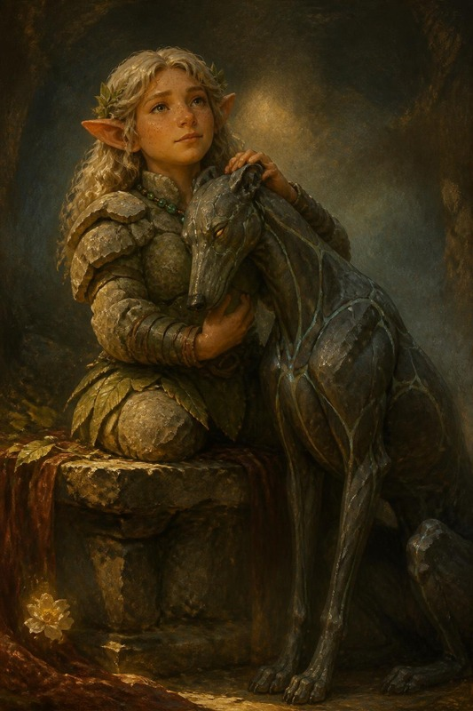

> *Era il tuo cane da galoppo, ed è morto prima di te. Nel tuo viaggio fra i morti il suo ricordo è caduto nella pietra,
> e la pietra se l'è tenuto.*
>
> *Quando la montagna ha ceduto lo Smeraldo, la polvere del guardiano sconfitto
> ha preso la sua forma. Mithral intrecciato a roccia scura, come muscolo a
> osso. Occhi di topazio. Non abbaia più: quando vuole dirti qualcosa fa un
> click, come una pietra che si assesta in un muro a secco.*
>
> *A Moradin avevi risposto che doveva proteggere te. Lo fa. Si mette sempre
> fra te e quello che ti vuole male, e non gliel'hai mai insegnato.*

---

## Le statistiche

**Durik Riforgiato** · Bestia magica (animale potenziato, sottotipo Terra) ·
Media · Neutrale Buono · compagno di Hella

| Voce | Valore |
|---|---|
| **Dadi Vita** | 12d10+36 · **102 pf** ¹ |
| **Iniziativa** | +2 |
| **Velocità** | 12 m · scavare 3 m in terra morbida |
| **CA** | **21** (+2 DES, +9 naturale) · contatto 12 · colto alla sprovvista 19 |
| **Attacco base / Lotta** | +9 / +15 |
| **Attacco** | morso **+15** mischia (**2d6+6**, 19-20/×2) |
| **Attacco completo** | morso **+15** (2d6+6) e 2 artigli **+13** (1d4+3) |
| **Spazio / portata** | 1,5 m / 1,5 m |
| **Tiri salvezza** | Tempra **+11** · Riflessi **+10** · Volontà **+6** |
| **Caratteristiche** | FOR 22 · DES 15 · COS 17 · INT 4 · SAG 14 · CAR 8 |

¹ *12 DV, 12d10+36 punti ferita.*

### Cosa sa fare

| Capacità | Effetto |
|---|---|
| **Riduzione del danno 5/adamantio** (Str) | la corteccia di granito e mithral regge a tutto tranne l'adamantio |
| **Colpi magici** (Sop) | i suoi attacchi superano la RD come armi magiche; il **morso conta come adamantio** |
| **Percezione tellurica 18 m** (Str) | sente chi si muove a terra entro 18 m, anche al buio, anche invisibile. Non chi vola |
| **Immunità** (Str) | charme, compulsione, paralisi, sonno, pietrificazione, veleno |
| **Resistenza al freddo 10** (Str) | |
| **Vulnerabilità all'acido** | l'acido gli fa **+50%**: la pietra si corrode |
| **Fedeltà assoluta** (Str) | nessuna magia lo mette contro di te. Chi prova a charmarlo o dominarlo deve superare **Volontà CD 18** o perde l'incantesimo |
| **Legame** (Sop) | gli dai ordini col pensiero entro **18 m**, senza parlare. Oltre, fa l'ultima cosa che gli hai chiesto, o ti protegge |
| **Empatia della pietra** (Sop) | sente il tuo umore a qualunque distanza, e ti manda il suo: pericolo, calma, fretta. Viaggia nel Sogno della Terra, finché uno dei due ha pietra sotto i piedi |

---

## Come si gioca

**Sta sempre con te.** Cammina al tuo fianco come un compagno normale. Non
serve evocarlo.

**Se non gli dai ordini, ti protegge.** Si mette fra te e il pericolo che
percepisce. Chi vuole arrivarti addosso deve passare da lui o girargli
intorno.

**Il click vuol dire: sotto.** Quando Durik fa il click, qualcosa si muove a
terra entro 18 m. Chiedi al DM dove.

**Non è fatto per combattere da solo.** È uno scudo che morde. Rende bene a
fianco di Thorik o di Tordek, per prendere un nemico ai fianchi, o quando
afferra e tiene fermo qualcuno mentre gli altri lavorano. Mandato da solo
contro un nemico grosso, non regge.

**Se viene distrutto** torna polvere, e la polvere torna nel terzo seme della
Collana. Con una carica dell'**Evocazione dei Guardiani** lo richiami subito,
per un'ora. All'alba è di nuovo intero, e resta. Se l'Evocazione è spenta,
perché hai chiamato i due Treant insieme, non puoi richiamarlo subito: torna
all'alba. I due Treant chiamati insieme all'alba della battaglia sono
l'eccezione: l'Evocazione non si spegne, e la carica che resta richiama Durik.

---

## Come cresce

Durik non cresce con i tuoi livelli. Cresce con le **Prove di Risonanza**:
momenti in cui il legame fra voi si mette alla prova. Il DM te lo dice quando
succede, di solito dopo.

| Prove | Cosa cambia |
|---|---|
| **1** ✅ | 12 DV, il morso passa a 2d6+6. *È già successa: è il motivo per cui è così* |
| 2 | RD **8**/adamantio · percezione tellurica **27 m** |
| 3 | diventa **Grande**: +4 FOR, −2 DES, +4 armatura naturale; nuovo attacco, schianto 2d6+9 |
| 4 | **immune all'acido**; il morso conta anche come ferro freddo |
| 5 | immune a tutti i danni da energia; +2 SAG, e capisce le tue parole senza ambiguità |

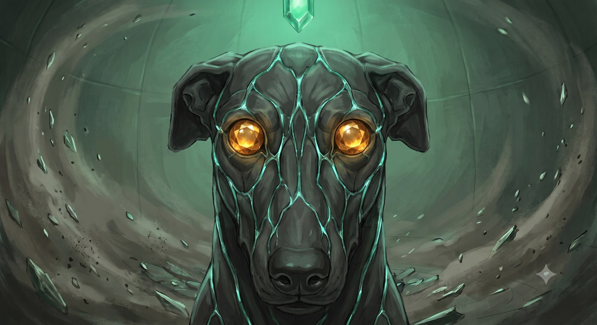

