<!-- GENERATO da scripts/build_booklet_html.py --format hb (ADR-0013).
     Manifest: ARC07-MILLE-ANNI-VOLUME.manifest.json — i capitoli CITANO i master (ADR-0003).
     Le immagini restano riferimenti relativi al repo: per la resa con
     immagini incorporate usa la via HTML (--format html). -->

{{frontCover}}

{{logo }}

# RUMBLING STONE
## Il Viaggio a Mille Anni fa
___

### Hammerfist ≈372 DR · la notte dell'orda · il duello con Skullcrusher · il Rituale della Forgia Eterna

{{banner VOLUME DEL DM}}

{{footnote
  Avventura D&D 3.5 per 4 personaggi di 13° livello · Faerûn, ≈372 DR (mille anni prima del 1372) · Campagna privata RumblingStone · il viaggio in ordine di gioco, con le appendici di statistiche e mappe, Balvar, la Forgia che ricorda le ferite
}}

\page

# Il viaggio a mille anni fa — il volume

> *Il portale non vi trasporta: vi rifà. Per un istante lunghissimo siete
> scomposti nei vostri mille anni, e quando vi ricomponete dall'altra parte le
> ferite che avevate non ci sono più.*
>
> *C'è odore di calcare appena tagliato. Le mura sono bianche. Su una targa di
> bronzo, alle porte, qualcuno ha inciso il vostro destino stamattina.*

**Cos'è questo volume.** Tutto il beat del viaggio a ≈372 DR in un solo libro,
da stampare o da tenere sul tablet: il master cap. I, lo statblocco di
Balvar, la tabella B4 che porta le ferite del duello fino a Fauci di Palude, e i
due handout, le Cronache e il piano di battaglia.

**Il master si legge in avanti.** Tre atti, tredici scene, dal
tramonto all'alba: ogni PNG entra con la sua **scheda d'entrata** nella scena in
cui i PG lo incontrano, e in fondo ci sono quattro appendici su pagine A4 a una
colonna: le **statistiche** (A), il **Sigillo di Ossidiana** (B), le **versioni
veloci** (C) e le **mappe** a pergamena, fra cui la M7-C della tenda del
comando (D).


**Come si gioca, in due sessioni**:

| Sessione | Da dove a dove | Nel master |
|---|---|---|
| **2026-09-25**, insieme alla resurrezione | l'arrivo, la targa, Durin, il consiglio di Re Thorek I, la notte con le sue otto tacche, Zeth, Balvar, Zog'tar, Vatore. **Ci si ferma al primo ariete sulle mura** | Atto I e Atto II, Scene 1-9 |
| **la successiva** | le mura all'alba, il duello con Skullcrusher, il Rituale della Forgia Eterna, il ritorno | Atto III, Scene 10-13, e §9 → «Il Ritorno a Hammerfist» |

La regia minuto per minuto della prima metà sta nel booklet della serata
(`homebrew/sessione-resurrezione-mille-anni/`, capitolo I, Atto IV). Qui c'è il
materiale completo, per entrambe le sessioni.

**Cosa annotare, per la sessione dopo.** Le tacche spese all'uscita dalla tenda,
come è morto Zog'tar (in silenzio, in modo spettacolare, umiliato), se
qualcuno ha letto la runa sulla scaglia del drago, cosa hanno promesso a
Balvar, e l'esito con Vatore. Decidono come comincia il duello.


\page

# I · Il Viaggio a Mille Anni fa

{{note
##### ⚠ SOLO DM
Questo capitolo è materiale del DM: non mostrarlo ai giocatori.
}}

# ARC-07 · DEFINITIVO #4 — IL VIAGGIO A 1.000 ANNI FA
## Il Portale della Forgia Eterna — Hammerfist ≈372 DR, il duello con Skullcrusher, il Rubino


> **Una sessione-leggenda a montaggio**, con **un solo scontro tattico** (il
> duello con Skullcrusher). Il viaggio è a **1.000 anni prima, ≈372 DR**.
>
> **Quando si gioca**: **dopo** la resurrezione di Hella («La Resurrezione di Hella»):
> il party è di **4 PG** (Hella tornata), **APL 13 pieno**. Alla vittoria il
> **Rubino** si accende e riporta i PG al 1372 → **«Il Ritorno a Hammerfist»** (raccordo al
> Cuore della Montagna).
>
> **Da dove riparte il gruppo di oggi**: dalla
> notte del 372, con **3 tacche segnate** (§4, «Dove si riprende»). Consiglio e
> giro della fortezza sono giocati; della Scena 5 restano solo le scelte della
> notte (sosta, sonno, veglia dei semi), poi il campo (Scena 6). Un gruppo nuovo parte dalla Scena 1. **Canone**: la Corona ha Topazio + Smeraldo (aprono il
> portale del Tempo); il **Rubino si accende SOLO alla vittoria antica**.
>

---

## INDICE DEL MODULO

| § | Sezione | Contenuto |
|---|---|---|
| §0 | **Quickstart DM** | dove siete, come si gioca, chi c'è nell'ordine in cui entra, cosa stampare |
| §0-bis | **Quick-Reference** | le CD delle prove, il giro di Skullcrusher, box PF1e |
| §0-ter | **Idee che non sono scritte qui** | assorbi e rilancia; il finisher al giocatore |
| §1 | **Highlight per PG** | il beat di ciascuno dei quattro |
| §2 | **Le zone di Hammerfist ≈372 DR** | atlante: fortezza giovane, mare di tende, mura all'alba |
| §3 | **Atto I · Il tramonto** | Scena 1 il portale e il bosco · 2 la pattuglia di Durin · 3 la porta e la targa · 4 il consiglio di guerra |
| §4 | **Atto II · La notte** | l'orologio della notte · Scena 5 la notte nella fortezza · 6 il mare di tende · 7 la tenda del comando · 8 Zog'tar · 9 Vatore |
| §5 | **Atto III · L'alba** | Scena 10 le mura · 11 il duello con Skullcrusher · 12 il Rituale della Forgia Eterna · 13 il Rubino e il ritorno |
| §6 | **Contingenze & sconfitta** | «se i PG fanno X»; il paradosso; una sconfitta nel passato |
| §7 | **Echo Ledger** | carry-over B4, Vatore→Sal, tono del Rubino |
| §8 | **Avanzamento** | budget PX per scena, tesoro pregenerato |
| §9 | **Ponte + Handout & Asset** | le Cronache, il piano di battaglia, immagini, musica |
| App. A | **Statistiche** | Skullcrusher, Zog'tar e le guardie, Durin, Balvar, le creature del campo |
| App. B | **Il Sigillo di Ossidiana** | l'artefatto che Vatore ha appena rubato |
| App. C | **Le versioni veloci** | le stesse scene a montaggio, per chi ha poco tempo |
| App. D | **Mappe** | M7-A Hammerfist · M7-B il cortile · M7-C la tenda del comando |

---

## §0 — QUICKSTART DM

> 🧭 **La serata in tre frasi.** Il portale posa i PG in un bosco a est delle
> mura di Hammerfist, al tramonto: la fortezza è giovane e un'orda la assedia
> sotto le ali di un drago nero, che combatte per l'orda solo perché un runaio
> gli ha inciso un contratto in una scaglia. Al consiglio di guerra **Re Thorek I chiede di
> uccidere nella notte il generale Zog'tar**, dentro il campo nemico, e di
> affrontare **all'alba il drago Skullcrusher**. Se falliscono, la fortezza
> regge lo stesso, perché la profezia è già incisa: la salvano gli avi, e il
> prezzo lo pagano loro.
> Il gruppo di oggi non parte dal tramonto: riprende dalla notte, con 3 tacche
> segnate sul foglio: si apre con Durin nel cortile, *«Quando uscite?»*, poi
> gli acquisti al banco e la scelta fra fermarsi, dormire o uscire; chi vola
> subito atterra alla tenda con Grask sveglio, tratta con Balvar o colpisce
> Zog'tar, e la serata si ferma sull'esito del duello all'alba. L'ordine
> della serata, chi parla per primo e la lista di lettura da un'ora stanno
> nella regia della serata, il primo capitolo del booklet: per questo gruppo
> vince su questo riquadro. La lista qui sotto è per chi prepara senza la
> regia.

> 🗓️ **La vostra serata** — per il gruppo che riparte dalla notte del 372.
> **Senza la regia della serata, leggi solo questo, in quest'ordine, in un'ora e dieci minuti**: §4 «L'orologio della
> notte», con la tabella d'uscita (5 min) · Scena 6, lo skill challenge, la
> variante dall'alto, le rune di Balvar alla tenda, Grask e «Come torna il
> drago» (15 min) · Scene 7 e 8, le schede d'entrata, «Da dove entrano», la
> Catena, le tattiche, il ritorno a piedi o in volo con Balvar o Zog'tar, la
> mappa M7-C, le Appendici A.2 e A.4 e, in §8 B, «Il bottino della tenda e il
> tempo» (25 min) · Scena 9, solo la tabella di Vatore (5 min) · Scena 10, solo la
> tabella «Dalla notte», le tre vie e la tabella dei successi (5 min) · Scena 11, la scheda d'entrata,
> il giro round per round, «Chi sceglie» e le corde, con l'Appendice A.1-bis,
> il Vecchio che si usa stasera, e le wyvern di A.6 (15 min). Il resto si apre quando serve. Gli scontri possibili per strada
> (pattuglia, lupi, sciamani) hanno le statistiche in Appendice A.6. Ci si ferma sull'esito del duello, prima
> della Scena 12. Al tavolo sono circa tre ore; la
> regia della serata, nel suo booklet, dice dove tagliare. Il resto del master
> (Atto I, la fortezza, il banco) è già giocato: lo apri solo se ti chiedono
> qualcosa.
> **La prima battuta.** Si riapre nel cortile, dopo il giro della fortezza e
> dopo gli echi che la regia fa leggere. Durin li raggiunge con la mappa del campo arrotolata sotto il braccio e
> chiede una cosa sola: *«Quando uscite?»*. Prima si chiudono gli acquisti
> rimasti aperti al banco (*silenzio*, la pietra di Brynja, *identificare*),
> senza tacche in più (Scena 5). Le scelte ancora aperte sono tre:
> fermarsi, dormire, o uscire subito; e Hella può vegliare i semi (Scena 5).
> Con 3 tacche segnate e il volo, quando atterrano alla tenda Grask è
> **sveglio** (la tacca del volo si segna alla partenza). Se prima Hella veglia
> i semi, il volo è la 5ª tacca e Grask dorme.
> **Dove eravate**: consiglio fatto, giro della fortezza fatto (fucina,
> alchimista, cappella, Zeth nelle gallerie), **3 tacche** sul foglio, nessuno
> ha dormito. La fiducia del consiglio, le pozioni in mano, cosa hanno venduto
> e comprato stanno nella Scena 5, «Il conto della fucina, come l'ha giocato
> il tavolo»: fiducia piena, dotazione dall'alto, 5 *volare* e 4 cure del re,
> più gli acquisti. Le cose comprate non sono ancora
> state date a nessuno, perché non sono ancora entrate in gioco: chi porta
> cosa si chiede al tavolo prima della Scena 6. La cura con la cera nera
> Kettra l'ha fermata, e finché nessuno la beve il segno non c'è. Il Nome
> della targa serviva al consiglio, che è giocato.
> **Due cose della Scena 5 servono stasera.** I Treant di Hella non hanno
> ancora un posto: la tabella «I Treant: … dove possono andare» dice cosa
> cambia fuori dalla tenda, dentro, sul fianco o al duello. E il **dado dei
> caduti** per le cure comprate alla cappella: quattro tiri alla Scena 10.
> Le due insieme sono altri 10 minuti di lettura, da fare prima della lista.

**Dove siete.** La Corona (Topazio + Smeraldo) ha aperto il portale del Tempo
(affresco A6). I **quattro** Custodi — Hella di nuovo tra loro — precipitano
attraverso mille anni e atterrano a **Hammerfist ≈372 DR**: la fortezza è
giovane, le mura nuove, e un'orda primitiva la assedia sotto le ali di un drago
nero. Su una targa di bronzo alle porte, una profezia già incisa parla di
**«quattro eroi dal fuoco e dalla pietra»**. Quei Quattro sono loro, e il tavolo deve capirlo da sé (il nodo della targa, Scena 3): la leggenda che hanno
sempre creduto passato è il loro presente. **Paradosso bootstrap.**

**Come si gioca**. Il corpo di questo master è
scritto **a scene complete**, nell'ordine in cui si giocano. Gli scontri si
fanno su griglia: la tenda del comando (Scena 8, mappa **M7-C**) e il cortile
del duello (Scena 11, mappa **M7-B**). Le scene senza scontro hanno una prova di
gruppo a CD fissa per un party di 4 all'APL 13: se **almeno due** PG la superano
la scena riesce, altrimenti riesce lo stesso ma con una **complicazione**. Ogni
scena registra un **esito** (► Esito), e gli esiti alimentano il carry-over B4
verso Fauci di Palude (§7).

> 🎚️ **Se hai poco tempo**, ogni scena lunga ha la sua **versione veloce in
> Appendice C**: è la stessa scena a montaggio, in 10-15 minuti. Si possono
> mescolare, scena per scena.

**Chi c'è, nell'ordine in cui entra.** Durin Rocciadura (Scena 2) · Re Thorek I
e Thorgrim Barbadiferro (Scena 4) · Mastro Costruttore Zeth (Scena 5) · Balvar
Fuocospento e Zog'tar Deatheye, nella stessa tenda (Scene 7 e 8) · Vatore
(Scena 9) · Skullcrusher il Nero (Scena 11). Ognuno ha una **scheda d'entrata**
nella sua scena; le statistiche sono in **Appendice A**.

**Cosa stampare.** La Quick-Reference (§0-bis); il **piano di battaglia** di Re
Thorek, da dare al consiglio (Scena 4, handout in §9); l'**Appendice A**; le
**mappe** dell'Appendice D, con la griglia di M7-C per la tenda; la scheda del
**Seme-Mercato** (Scena 5, «Le dieci pozioni del gruppo»); la tabella **B4** (§7; il testo intero è il capitolo «La Forgia ricorda» del volume del DM). Le **Cronache dei Quattro
Eroi** i giocatori le hanno già in mano: si consegnano alla soglia, prima di
partire («La Resurrezione di Hella» §8-ter).

**Come si chiude.** Vinta la battaglia antica, il **Rubino** si accende («la
Possanza Nanica»): la profezia è compiuta — era sempre stata vostra. La luce vi
strappa al passato. → **«Il Ritorno a Hammerfist»: il ritorno a Hammerfist** (riemersione al
Cuore della Montagna, Giorno 3 dell'assedio del 1372).

---

## §0-bis — QUICK-REFERENCE DM (una pagina)

### Le prove di gruppo delle scene a montaggio (party 4, ≥2 successi)
| Scena | Prova | CD |
|---|---|---|
| 3 — la targa | non è una prova di gruppo: è il nodo d'indizio della Scena 3. Il Fatto è gratis, la Lettura vuole una porta, il Nome due | 12-18, secondo la porta |
| 4 — il consiglio | Diplomazia/Intimidire | 20 (16 se hanno il Nome) |
| 6 — il campo | una prova di gruppo per blocco, cinque blocchi: Muoversi Silenziosamente, poi Nascondersi quando l'invisibilità finisce | 20 · 22; con gli aiuti dimezzati, −2 alle prove (la CD non cambia) |
| 9 — Vatore | Percepire Intenzioni o Diplomazia · Rapidità di Mano (a seconda dell'approccio) | 18 · 22 |
| 10 — le mura | Forza / Diplomazia-Guarire / Disattivare (scelta collettiva) | 18 / 18 / 20 |

### Le Benedizioni della Sala, a mille anni fa
Pelle di Pietra, Cuore Incrollabile e *Vigore della Forgia* durano 24 ore
vissute dalla preghiera all'Altare, e a −1000 non si rinnovano. Allo scadere
si spengono, e con loro le cariche di *Vigore* rimaste. Da lì le cure sono
quelle del re e del banco della fucina (Scena 5). Finché sono attive, ogni
sonno di otto ore ricarica il *Vigore*, anche a mille anni fa. Finché durano danno questo
 («Il Ritorno e gli Affreschi» §7): Pelle di Pietra, resistenza al fuoco 10 e al freddo 5; Cuore
Incrollabile, immunità al caldo e al freddo ambientali non letali e +2 ai TS su Tempra
contro gli effetti ambientali; *Vigore della Forgia*, 3 cariche per PG, che
con un'azione standard curano 3d8+5 a sé o 2d8+2 a un alleato toccato.
Quando il gruppo ha pregato l'ultima volta lo si chiede al tavolo prima
dell'Atto I. Se ha pregato all'ingresso nella Sala, di solito all'alba le
Benedizioni ci sono ancora.

### Il giro di Skullcrusher (boss, Scena 11) — 3.5, niente 5e
- **Quale drago.** Con il gruppo di stasera si usa il **Vecchio** (Appendice
  A.1-bis) con le 2 wyvern: EL 17, il tetto esatto di APL+4.
  L'**Adulto** (Appendice A.1) resta per un gruppo di 13° più debole, per tre
  PG, o se il DM non conferma il Vecchio. Qui sotto, fra parentesi, i suoi numeri.
- **Soffio acido** in **linea** di 30 m, 16d4 (14d4), Riflessi CD 31 (30) ½, **ricarica 1/1d4 round**;
  se lo vuole **aderente**, chi ne prende danno ne riprende metà al round dopo, e la ricarica sale di 1 round (Appendice A.1).
- **Full-attack** (se a terra/quota bassa): morso +34 (+30), 2 artigli +29
  (+25), 2 ali +29 (+25), coda +29 (+25).
- **La passata e il nome.** Non si ferma mai in aria, finché non ha paura.
  Con Attacco in Volo attraversa il cortile e a metà della passata soffia, o
  morde, o grida il nome di un PG (*colpo accurato*); con *Virata* torna
  indietro sulla stessa linea. Il PG nominato lo morde al round dopo, a +54
  (+50), e l'occultamento non lo salva. Il nome non lo chiede: lo ha sentito
  di notte attraverso il corno, o usa un epiteto.
  Fra un turno e l'altro sta a circa 15 m (Scena 11, «La passata, il nome,
  la prima paura»).
- ***Fluttuare*** **una volta sola**, a ⅓ dei pf: è la prima paura.
  ***Oscurità*** **una volta sola**, per coprire la fuga verso le paludi.
- **Dal round 2, due wyvern** (Appendice A.6) su chi tiene la corda e su chi
  vola. Fuggono quando il drago fugge o muore. Il duello è EL 17 col Vecchio,
  EL 14 con l'Adulto.
- **La Catena**: la runa sotto la scaglia si colpisce contro **CA 44** (41), e il
  primo colpo a segno la spezza: il drago se ne va (Scena 11).
- **Aegis Fang**: il Bane contro Fauci qui **non vale**; la *Dragondoom* sì.
- **Presenza Terrificante** CD 26 (25) all'ingresso (Volontà o scossi), raggio 72 m (63).
- **Le campane e le balestre**: chi le usa prende la coda in passata, e il
  soffio resta per i PG.
- **Danno massiccio** (regola SRD, attiva nelle regole della casa): un
  colpo o un soffio da 50 danni o più, Tempra CD 15 o si muore.
- **«La Forgia ricorda»**: CONTA i colpi a segno (ferite ancestrali, N≤3) e
  l'esito → tabella B4 (§7). La Cintura di Tordek **rifiuta** di attivarsi qui.

### 🐾 Supporto Pathfinder 1e (dove il 3.5 è vago) — opzionale, dichiarato
> - **Viaggio nel tempo & paradosso**: il 3.5 non ha regole. Usa il principio
>   **«timeline auto-consistente»** (Novikov): tutto ciò che i PG fanno è già
>   accaduto, e non possono cambiare che vincono, solo COME. Nessun
>   TS/meccanica: è una **cornice**, non un puzzle da rompere.
> - **Sincronizzazione di Vatore** (Scena 9): danno/marchio inflitto a Vatore a −1000
>   → si manifesta su **Sal nel 1372** (ARC-09). Trattalo come un **legame
>   simpatico** permanente (stile *sympathy/antipathy* narrativo): nessun TS,
>   è un eco garantito. Registra il tipo di segno.

---

## §0-ter — QUANDO UN GIOCATORE HA UN'IDEA CHE NON È SCRITTA QUI

> **Una pagina sola, e serve mentre giochi.** Questo master ha molte vie
> scritte. I giocatori ne troveranno una che non c'è — è quello che si spera —
> e quel momento decide se la serata resta in piedi o si affloscia in un
> «mmh, non credo si possa».

### La regola, dalla skill dello stile: **assorbi, poi rilancia**

Al tavolo la chiamano *«yes-and with teeth»*:
**l'invenzione del giocatore entra nel canone *e* genera una complicazione.**
Non «sì»; non «no». **Sì, e adesso c'è un problema nuovo.**

| Il giocatore dice | ❌ Come si spegne | ✅ Come si assorbe e si rilancia |
|---|---|---|
| *«Conosco un nano di qui — mio bisnonno me ne parlava»* | «Non c'è nessuno così» | «C'è. È il fratello di Durin, e ti riconosce dal naso. **Ma sta sul camminamento est, e stanotte non dovrebbe esserci nessuno lì.**» |
| *«Verso l'olio delle lanterne sulle scale e do fuoco»* | «Non è previsto» | «Funziona: due scale bruciano. **Il fumo sale dritto sul camminamento dove siete voi**, e adesso non vedete chi arriva» |
| *«Grido ai nani che la profezia parla di noi»* | tira Diplomazia | «La linea si rinsalda, +2 morale. **E l'orda sente il nome**: da adesso puntano voi» |
| *«Prendo la lastra di Balvar e la porto via»* | «È troppo pesante» | «Te la carichi. **Pesa, −1 alla DES finché non la posi**, e Balvar adesso sa esattamente dove sei» |

**Il metro, in una riga**: se l'idea è **specifica** e il giocatore accetta che
il mondo reagisca, **funziona**. Se è generica («cerco un modo»), chiedi
*«come, di preciso?»* — e poi funziona.

### Tre cose da non fare, che costano il tavolo

1. **Non chiedere un tiro per dire di no.** Un tiro è una domanda vera solo se
   entrambi gli esiti ti vanno bene. Se l'idea non deve riuscire, dillo e di'
   **perché**, in finzione.
2. **Non far pagare l'ingegno più della forza bruta.** Se spaccare la porta
   costa un round e aprirla con l'astuzia ne costa tre, hai insegnato al tavolo
   a spaccare le porte.
3. **Non salvare la scena scritta.** Se l'idea del giocatore salta un incontro
   che avevi preparato, **è saltato**. Il tempo che avanza lo spendi
   sull'orologio della notte — e i giocatori se ne accorgono, e ti ringraziano.

### 🎁 Il finisher va al giocatore — `[HDYWTDT]`

È una regola della campagna: al colpo che uccide un boss,
**la narrazione passa a chi l'ha tirato**. In questo master ci sono **tre**
punti, e li trovi marcati nel testo:

- `[HDYWTDT — il finisher a chi abbatte Balvar]` → Scena 7, se si arriva a combatterlo
- `[HDYWTDT — il finisher a chi abbatte Zog'tar]` → Scena 8
- `[HDYWTDT — il finisher a chi abbatte Skullcrusher]` → Scena 11


⚠️ **Come si fa senza che diventi imbarazzante**: non si dice «descrivi tu».
Si dice **«com'è che lo fai?»**, e si aspetta. Se il giocatore non vuole,
descrivi tu in una riga e vai avanti: è un regalo, non un compito.

---

## §1 — HIGHLIGHT ASIMMETRICI PER PG (i QUATTRO, Hella è tornata)

### 🛡️ THORIK — la profezia fatta carne (Casa di Davide lead)
- È la SUA leggenda: la Corona che porta è la stessa che il nonno di Thorgrim
  perse contro Skullcrusher. Aegis Fang, nelle sue mani e in quelle di Thorgrim,
  **canta la stessa nota** attraverso mille anni. Thorik non compie la profezia:
  **la profezia era sempre stata Thorik.**
- Al duello, **Aegis Fang scaglia la Cicatrice Ancestrale** (Scena 11): è il gesto che
  segna Skullcrusher e, mille anni dopo, Fauci (carry-over B4).

### 🌙 HELLA — la seconda vita alla prova (BG3 lead — il ritorno che conta)
- È il suo **primo scontro da risorta**: Ibrido Treant, Collana, Durik al
  fianco. Il DM lo faccia pesare — la morte l'ha cambiata, e ora combatte in un
  passato dove non è mai esistita.
- ⚠️ **Vulnerabilità al fuoco** (costo del viaggio): Skullcrusher è acido, non
  fuoco — ma l'orda ha incendiari. E se evoca l'**Avatar della Radice** (Enorme),
  diventa un bersaglio: gioca il dilemma.
- 🐾 **Durik c'è, sempre**: attraversa il portale con
  lei, perché è legato alla Collana. Contro Skullcrusher conta una riga della sua
  scheda: **vulnerabile all'acido, +50%**. Il soffio del drago è l'unica cosa in
  questo viaggio che lo corrode davvero, e la giocatrice lo sa. Se Durik ha
  la runa di Zeth, prima si aumenta il danno del 50% e poi si tolgono i 20
  della resistenza: l'SRD non dà l'ordine, e vale quello che gli fa più male.
  Il resto, per il duello: Media, **102 pf**, CA **21**, RD 5/adamantio, morso
  **+15** (2d6+6) e 2 artigli **+13** (1d4+3), Tempra +11, Riflessi +10, Volontà
  +6. La scheda intera è quella consegnata alla giocatrice.
- 🌱 **Il dono «a metà»** *(«La Resurrezione di Hella» §9, riga «2 su 3»)*: se al rito i successi
  dello Step 5 sono stati **due su tre**, il PG che ha fallito lo scopre **qui**,
  al primo uso: il seme che porta il suo dono **non risponde al primo
  tentativo**. Risponde al secondo. Dillo in una riga, nel momento peggiore, e
  non spiegarlo.

### ⚒️ TORDEK — il pugno che deve trattenersi (Andor support)
- La **Cintura della Devastazione rifiuta di attivarsi** contro Skullcrusher,
  nella Scena 11 (*«il vero scontro appartiene al futuro»*); contro Zog'tar, nella
  Scena 8, funziona: è coerenza, non nerf — Tordek deve vincere **senza**
  la sua arma migliore, che è riservata a Fauci nel 1372. Beat di disciplina.
- I **Bracieri** (coscienza) riconoscono la fucina antica di Hammerfist: *«Qui
  è dove tutto è cominciato, ragazzo. Batti bene.»*

### 🔮 ARTEMIS — il predone davanti al ladro (Andor lead)
- **Vatore** (Scena 9) è il suo specchio oscuro: un ladro che ruba attraverso il
  tempo. L'Anello lo **percepisce** (aura temporale) prima di chiunque. È il PG
  giusto per fiutare che quel ladro «non è di qui» — e per decidere cosa farne
  (grigio: robarlo? ucciderlo? lasciarlo?). La sua avidità incontra un pari.
- ⚠️ **Il Marchio di Varis non è attivo**: Artemis
  ha preso il Seme senza toccarlo e l'ha fatto mettere nello zaino di Tordek, e
  il Marchio si chiude col tocco. Quindi la risonanza qui sotto **non scatta**.
  Scatta solo se, prima del viaggio, qualcuno ha toccato il Seme: allora la
  sente chi lo ha toccato, anche se è Tordek. *Se scatta*: il marchio
  «riconosce» la firma temporale di Vatore, due fili della **stessa rete**
  (Varis ↔ Il Collezionista), mille anni prima che esista.

---

## §2 — LE ZONE DI HAMMERFIST ≈372 DR (Atlante)

> Mappa **M7-A**. Tre ambienti, una notte e un'alba: la fortezza giovane, il
> mare di tende dell'orda, le mura all'assalto.

### 🎚️ Scheda sensoriale delle tre zone — e cosa NON dire

> **Come si usa.** Le prime tre colonne sono quello che i PG colgono **in sei
> secondi** senza tirare. La quarta è **vincolante quanto le altre**
> ([ADR-0057](../../../plans/adr/ADR-0057-la-quarta-colonna-e-di-tutto-il-repo.md)):
> sono le cose che il tavolo deve **scoprire**, e che l'atmosfera, se ti scaldi,
> racconta al posto loro.

| Zona | Occhi | Orecchie | Pelle / naso | 🚫 Cosa NON dire |
|---|---|---|---|---|
| **1** Fortezza giovane | Pietra bianca, spigoli ancora vivi. **Una** statua di re, non venti | Scalpelli. Di giorno, a quest'ora, in tempo di guerra | Polvere di taglio fresco, che sa di calcare e non di fuliggine | **Che la targa è la profezia su di loro.** Lasciala leggere: è il nodo della Scena 3 |
| **2** Mare di tende | Mille fuochi fino all'orizzonte; una tenda più alta, nera | Un russare che non si interrompe mai del tutto | Grasso bruciato, ferro, bestia | **Quale tenda è quella del generale.** Si deduce da dove *non* passano le pattuglie (Osservare CD 18). Se Durin l'ha già indicata alla postierla (Scena 6, «La tenda nera al centro è del generale»), la prova non serve |
| **3** Mura all'alba | Scale contro la pietra; nani spalla a spalla che non indietreggiano | Il boato di diecimila gole che diventa **una** | Fumo, sangue di nano (ferro dolce), corda bagnata degli arieti | **Che la linea terrà.** Non lo sai nemmeno tu: dipende dalla prova di gruppo |

⚠️ **Le tre righe «non dire» non sono suggerimenti di stile.** Ognuna protegge
una prova che sta più avanti in questo stesso documento. Dirle in anticipo non
rovina l'atmosfera: rovina **la scena dopo**.

### ZONA 1 — La Fortezza Giovane (Hammerfist appena eretta)

Il read-aloud si legge alla porta, nella **Scena 3**.

**Terreno (callout):** cortili di pietra chiara (movimento normale); la Sala del
Trono di Re Thorek I; la fucina originale (i Bracieri di Tordek la
riconoscono). Zona **sicura** (dentro le mura). Il portale lascia i PG fuori, nel bosco a est (Scena 1): ci si entra dalla porta (Scena 3).
Porta e cortile stanno a **+100 m** sulla piana dell'orda, la torre nord a
+120; il profilo è sotto la mappa M7-A, in Appendice D.

**Dati per il DM (non da leggere).** Hammerfist ha **circa ottant'anni**. La
cinta di pietra bianca è nuova: è stata rifatta dopo la prima venuta del drago,
cinquant'anni fa, quando il nonno del re perse la corona. Per questo le mura
sono fresche e la fortezza ha già una storia.

### ZONA 2 — Il Mare di Tende (l'orda, di notte)

Il read-aloud si legge all'uscita dalla postierla, nella **Scena 6**.

**Terreno (callout):** tende fitte (copertura, difficile in mischia); 4 posti di
guardia (GP1-GP4 agli angoli); la **tenda del comando** (Zog'tar) al centro;
notte = furtività CD 20; ogni fuoco è luce fioca a 3 m. La mappa è la M7-A, in Appendice D.
Il campo sta sulla **piana**, 100 m sotto le mura: le tende stanno fra 500 m
e 1 km dalle mura, e dalla fortezza ci si scende per la strada a tornanti o,
come i PG, per il fianco est.

**Com'è fatto il campo.** Ha due facce. Fuori stanno i clan degli orchi, una
quindicina di bande: ripari di pelle bassi e storti, a gruppi attorno al fuoco
della banda, con un tratto vuoto fra un clan e l'altro. Al centro c'è il campo
del capo, senza recinto, come quello di un khan o di un khal: la tenda del
generale sola in mezzo a uno spiazzo di terra battuta, il fuoco del consiglio
e i pali dei trofei davanti alla soglia, e attorno, a venti o trenta metri,
le lance della Guardia della Mano, quattro tende da otto attorno a ogni
fuoco, a gruppi staccati. Gli squadroni «marciano al passo», ma dormono come
un'orda. La tenda del comando è un padiglione a tre pali,
13,5 × 7,5 m: le misure, e da dove vengono, sono in Appendice D (M7-C).

### ZONA 3 — Le Mura all'Alba (l'assalto)

Il read-aloud apre la **Scena 10**, ed è quello su cui si chiude la prima delle due
sessioni del viaggio.

**Terreno (callout):** camminamenti sopraelevati (+4,5 m); brecce dove gli
arieti mordono; scale d'assedio (Forza per rovesciarle); il cortile interno
dove, alla fine, Skullcrusher cala. Vedi M7-B (arena del duello).

**Dove sale l'assalto** `[INFERRED — needs DM confirmation]`. Gli arieti si
montano sulla spianata degli arieti, a +80, e salgono alla porta, a +100, per
una rampa addossata al gradone. Le scale salgono sul tratto est, dove il fianco
della montagna arriva al piede delle mura; sul fronte sud le mura stanno sul
ciglio, 24,5 m sopra la spianata, e le scale non ci arrivano.

---

## §3 — ATTO I · IL TRAMONTO

> **Il percorso dell'atto.** Dal portale al consiglio di guerra passa circa
> un'ora e mezza del mondo, e al tavolo 50-60 minuti. L'ordine è quello del
> viaggio: il bosco dove il portale li lascia, la pattuglia che li trova, la
> porta della fortezza, la sala del re.

| Scena | Dove | Chi entra | Prova | Se fanno l'inatteso | Al tavolo |
|---|---|---|---|---|---:|
| **1** · Il portale e il bosco | un bosco a est delle mura, al tramonto | — | TS Volontà **CD 20** | chi fallisce arriva confuso alla pattuglia | 10 min |
| **2** · La pattuglia di Durin | lo stesso bosco | **Durin Rocciadura** e sei veterani | nessuna, se sono sinceri | attaccano: Durin getta l'ascia alla prima ferita, e al consiglio la CD sale di 4 (§6) | 10 min |
| **3** · La porta e la targa | la porta principale | — | nodo d'indizio, sei porte | non leggono la targa: il consiglio resta a CD 20 invece di 16 | 15 min |
| **4** · Il consiglio di guerra | la sala del trono | **Re Thorek I**, **Thorgrim Barbadiferro** | Diplomazia o Intimidire **CD 20** | il consiglio fallisce: aiuti dimezzati e −2 alla Scena 6, ma si esce lo stesso | 25 min |

### SCENA 1 — Il portale e il bosco al tramonto

**In scena** — Dove: il passaggio · la fortezza — Chi: nessuno

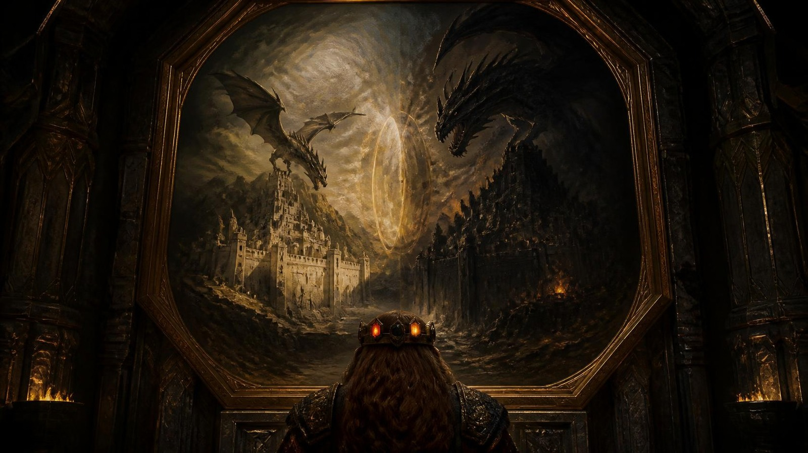

> **Read-aloud (LotR lead) — il passaggio.** *Per un istante lunghissimo i
> colori si rovesciano, e vi passano davanti vite intere di nani: nascono,
> battono il ferro, invecchiano, in un tempo più corto di un respiro. Poi torna
> il peso, e con il peso il freddo. Le ferite non ci sono più.*
>
> *Siete in piedi in un bosco. Gli alberi sono vecchi, le radici grosse come un
> uomo sdraiato, e l'aria sa di foglie marce e di fumo lontano. Il sole è già
> dietro il crinale. Uno di voi ha le ginocchia bagnate e non si ricorda di
> essere caduto.*

- ⚕️ **GUARIGIONE DEL PASSAGGIO (all'arrivo, automatica)**: attraversare mille anni **rimette in ordine il corpo**. I quattro
  arrivano a **pf pieni**, senza livelli di affaticamento, con danni da
  caratteristica temporanei azzerati e **tutti gli usi giornalieri ricaricati**
  (invocazioni, poteri dei Bracieri, sinergie 1/giorno, incantesimi di Hella).
  **Nessun tiro, nessun costo, non è una scelta.**
  - **Cosa NON guarisce**: i costi **permanenti** di Thorik — **−4 DES** fra Corona
    e rito dello Smeraldo, e il **−1 CA** se al rito di «La Resurrezione di Hella» §5 ha donato il +2 di
    deflessione (sono prezzi pagati, non ferite) — gli oggetti spesi (Cuore di Moradin, Diapason, Rubino
    quando si accenderà) e le condizioni narrative dell'Echo Ledger.
  - **Perché esiste**: senza questa regola il party arriva al duello con
    Skullcrusher con quello che è avanzato da Terros e dal rito — cioè, molto
    probabilmente, **con dei nani mezzi morti**. Il #4 è una sessione-leggenda,
    con due scontri su griglia prima dell'alba: deve partire pulita.
  - **Come si racconta** (mai come una ricarica): *«Il portale non vi trasporta:
    vi RIFÀ. Per un istante lunghissimo siete scomposti nei vostri mille anni —
    e quando vi ricomponete dall'altra parte, le ferite che avevate non ci sono
    più, perché in questo momento della storia non le avete ancora ricevute.»*
  - Il **costo sull'orologio di Hammerfist è zero**: il viaggio non consuma
    orologio, e il Rubino li riporta sempre nel Cuore della Montagna
 («Il Ritorno a Hammerfist» §3).
- **Shock temporale (all'arrivo)**: TS Volontà **CD 20** o, per 1d4 round,
  **−2 agli attacchi e alle prove**, poi chiarezza. *(È l'unico prezzo del
  passaggio: il corpo torna intero, la testa no.)*
- **Le Cronache dei Quattro Eroi** i giocatori le hanno in mano da prima di
  partire («La Resurrezione di Hella» §8-ter): non si consegnano qui.

Quando la testa torna a posto, guardano dove sono.

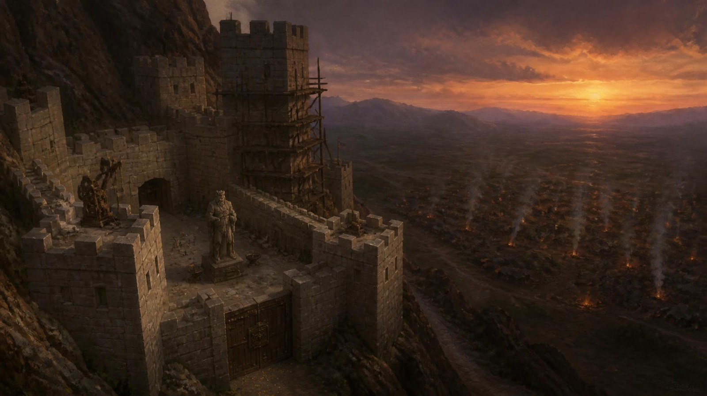

> **Read-aloud (LotR lead) — la fortezza, da lontano.** *A ovest, fra i
> tronchi, si vedono le torri di una fortezza che conoscete, più basse di come
> le ricordate. Più in là, verso sud, i fuochi dell'orda cominciano ad
> accendersi uno alla volta, e non finiscono. Sopra le mura gira un'ombra con le
> ali. Fa un cerchio lento, poi un altro, e non scende.*

**Dati per il DM (non da leggere).** Il portale li lascia **a circa 500 m a est
delle mura**, un quarto d'ora prima del buio. Il bosco copre la spalla della
montagna a est: dove il portale li lascia è poco sopra la quota delle mura, e
da lì scende fino al margine del campo, sulla piana, 100 m più in basso
`[INFERRED — needs DM confirmation]`. È autunno inoltrato: **5 °C**, il
fiato si vede, una nebbia bassa comincia a salire dal bosco. Dall'arrivo
all'alba mancano **circa dodici ore**; l'orologio della notte (§4) comincia a
contare con il consiglio, che è la prima delle sue otto tacche: le prime
quattro ore se ne vanno fra l'arrivo e la porta, poi il consiglio apre
l'orologio.
Se il tavolo chiede l'ora: circa un'ora a tacca, tranne la sosta e il sonno.
Una tacca non è un'ora esatta: è un pezzo di notte, e le cose lunghe ne costano meno
di quanto durano, perché intanto il resto del campo non si muove. Il drago è Skullcrusher e **non attacca**: aspetta
l'alba, e i nani lo sanno. Dentro le mura le forge battono giorno e notte, e il
rumore arriva fin qui.

- ► **Esito**: chi ha fallito il TS arriva alla pattuglia ancora confuso, e Durin
  lo nota.

### SCENA 2 — La pattuglia di Durin

**In scena** — Dove: il bosco — Chi: Durin · i sei veterani

> **Read-aloud (Andor lead) — il bosco.** *Fra gli abeti sale una nebbia bassa,
> e il sentiero scende verso le mura. Dal sottobosco si alzano sette elmi:
> sette nani in armatura completa, gli scudi accostati, le asce basse. Quello davanti è più
> vecchio degli altri e stringe l'ascia così forte che ha le nocche bianche, e
> da lontano arriva il tonfo sordo dei tamburi dell'orda. Poi il vecchio grida,
> e la voce gli scappa in alto: «Fermi, chi siete?» Che fate?*

**Scheda d'entrata — Durin Rocciadura, la pattuglia** *(statistiche: Appendice A)*

| | |
|---|---|
| **Aspetto** | veterano, armatura completa, scudo pesante e ascia da guerra nanica. Sta davanti ai suoi sei e ha paura. Si vede dal modo in cui tiene l'ascia troppo stretta |
| **Vuole** | riportare a casa i suoi sei. Ha paura e fa il suo lavoro lo stesso |
| **Suona** | la voce gli scappa in alto quando è teso. Ride un attimo prima di dire una cosa seria |
| **Sa** | il bosco a est delle mura, il campo dell'orda visto da lontano |
| **Non sa** | chi siano i PG, finché non vede la Corona o sente il tuono |
| **Eco** | è l'**antenato di Othrek**, a Hammerfist nel 1372 |
| **Ritratto** | qui sotto. Ai giocatori si mostra dopo l'incontro, non prima |

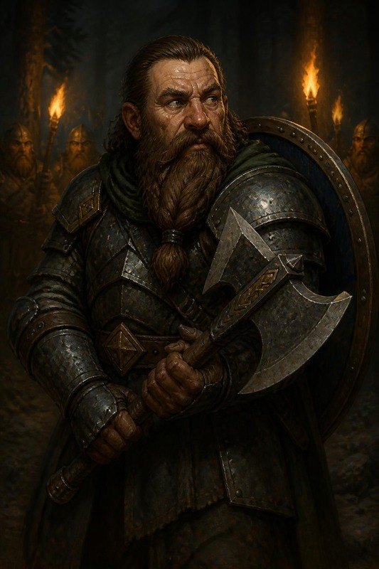

**La pattuglia di Durin (riconoscimento — 3 vie).** Nel bosco a est delle mura,
una pattuglia nanica (6 veterani) li ferma.

**Comparse**

| Chi | Com'è | Come parla |
|---|---|---|
| i sei veterani | nani sui cinquant'anni, armature ammaccate e rifatte, uno con la mano fasciata. Guardano Durin prima di guardare i PG | non parlano finché Durin non parla. Poi ripetono la sua ultima parola, sottovoce |

Il vecchio che grida è **Durin Rocciadura** (Guerriero 6, statistiche in
Appendice A), veterano spaventato e onesto. Fissa la Corona sulla fronte di
Thorik.

**DURIN (piano, quasi a sé stesso):** *«Quella cosa… brilla come il sole
forgiato. È… una leggenda?»* **Tre modi di farsi riconoscere** (tutti
funzionano, nessun tiro se sinceri):
- **A — Mostrare la Corona**: Durin cade in ginocchio.
  **DURIN (rotto):** *«La Corona dei Padri. Pensavo fosse un mito.»*
- **B — Invocare Moradin** (preghiera sincera): un **tuono** solo, dal cielo
  sereno. Durin e i suoi si inginocchiano.
  **DURIN (fermo, per la prima volta):** *«Il Padre ha parlato.»*
- **C — Mostrare potere divino** (Benedizione della Forgia, aura dorata su
  Aegis Fang):
  **DURIN (a bassa voce, ai suoi):** *«Dio ha parlato attraverso l'arma.»*
Esito identico: Durin passa da diffidente a **fedele fino alla morte**, li porta
a cavallo al castello. *(Se attaccano la pattuglia: è un tragico
malinteso — i nani che erano venuti a salvare li credono spie; §6 Contingenze.)*

**La cavalcata.** Dieci minuti al passo fino alle mura, girando largo dal campo, con i cavalli bassi e
robusti della pattuglia. Durin parla poco, e le cose che dice sono quelle che il
tavolo deve sapere prima del consiglio:

> **DURIN (a mezza voce, senza voltarsi):** *«Attaccano all'alba. Sono
> diecimila. E il drago è tornato da due settimane: qui ha un nome vecchio, e
> non lo diciamo volentieri.»*

- ► **Esito**: *Durin fedele* (qualunque delle tre vie) · *Durin ferito e la
  pattuglia ostile* (se attaccano: §6).

### SCENA 3 — La porta e la targa di bronzo

**In scena** — Dove: la porta — Chi: Durin · le guardie della porta

Durin li porta alla porta principale. Le guardie vedono la Corona e non
toccano nessuno. Prima di entrare c'è la targa.

**Comparse**

| Chi | Com'è | Come parla |
|---|---|---|
| le guardie della porta | due nani giovani, barbe corte, elmi troppo lucidi per aver visto una battaglia. Uno tiene la lancia al contrario e se ne accorge tardi | rispondono a chi chiede della targa con un orgoglio da cantiere: *«L'ha voluta il re»* |

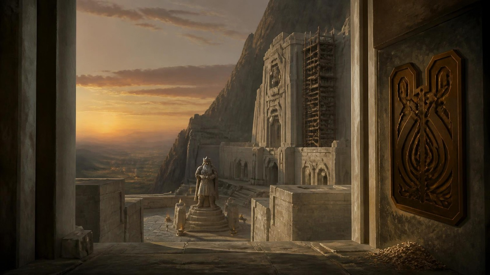

> **Read-aloud (LotR lead) — la porta, deep time al contrario.** *Conoscete Hammerfist:
> le sale annerite dai secoli, le statue consumate, i nomi dei re incisi e
> reincisi. Questa Hammerfist non ha ancora storia. Le mura sono bianche di
> pietra appena tagliata, gli spigoli ancora vivi, e nel cortile c'è la statua
> di un re, una sola. Dietro le mura le forge battono giorno e notte.
> Accanto al battente è appesa una targa di bronzo lucida
> come una pentola nuova, e sotto, sul selciato, qualcosa luccica.*


**Il testo intero della targa**, per chi la legge da vicino:

> **Read-aloud (Casa di Davide lead) — la targa.** *«Quando il nero verrà dal
> cielo e il ferro dal piano, quattro eroi dal fuoco e dalla pietra staranno
> sulle mura. Uno porta la pietra in fronte, uno il fuoco nei pugni. Uno tiene
> in mano la luce e l'ombra, e una ha passato la morte. Moradin li ha visti.»*

#### 🔍 Nodo d'indizio — la targa di bronzo *(Fatto · Lettura · Nome)*

> **Perché è un nodo e non una prova.** Questo master ha un'indagine dentro — i
> PG devono capire **che la profezia parla di loro** — e finora era una prova
> sola, **CD 18**, che si superava o si sbagliava. La skill `rumblingstone-indagine`
> chiede tre strati e **almeno tre porte**, perché un tavolo di picchiatori
> deve poterci entrare lo stesso.

| Strato | Cosa dà | Come si prende |
|---|---|---|
| **Fatto** | *«La targa dice: quattro eroi dal fuoco e dalla pietra.»* | **gratis**, chiunque sappia leggere il nanico. Non si tira |
| **Lettura** | *«I solchi del cesello sono ancora lucidi. È stata incisa oggi.»* | **una** porta qualsiasi, sotto |
| **Nome** | *«Quei quattro siamo noi, e lo eravamo già prima di partire.»* | **due** porte diverse, o una porta + la Lettura |

**Le sei porte** — tre bastano, e almeno una è fisica, così anche chi non ha
gradi entra:

| Porta | Prova | Cosa vede |
|---|---|---|
| 🧠 Sapere | Conoscenze (storia) **CD 18** | le Cronache che hanno in mano raccontano i Quattro Eroi, ma non dicono che qualcuno li avesse **annunciati**: la profezia della targa, nel 1372, non la ricorda nessuno |
| 👁️ Guardare | Osservare **CD 15** | i trucioli di bronzo sono ancora per terra sotto la targa |
| ✋ **Toccare** | **FOR o DES grezza CD 12** — passarci sopra il pollice | il taglio è **vivo**, taglia il polpastrello. Chiunque, nessun grado richiesto |
| 👃 Annusare | Sopravvivenza **CD 14** o un nano, gratis | odore di metallo caldo: il cesello ha lavorato **stamattina** |
| 🗣️ Chiedere | Diplomazia **CD 12** a un qualsiasi nano di guardia | *«L'ha incisa il Re stamattina, all'alba. Dice che gli è venuta in sogno stanotte»* |
| ⚒️ Mestiere | Artigianato (fabbro) **CD 15** — Tordek, gratis | riconosce la **mano**: è lo stesso cesello della fucina che userà tra mille anni |

🚫 **Cosa NON dire**: che la profezia parla di loro. Anche se nessuno prende il
**Nome** subito, non si regala: torna al consiglio (Scena 4) quando Thorgrim prende
l'ascia, e alla Scena 13 quando il Rubino si accende. **Un vicolo cieco non
esiste** — l'indizio ripassa, cambiato.

- **Se prendono il Nome alla porta** → arrivano al consiglio di guerra sapendo
  chi sono: Re Thorek I li riconosce **prima** di guardare la Corona, e la
  prova di gruppo della Scena 4 scende a **CD 16**.
- **Se non lo prendono** → non perdono niente. Lo prendono dopo, e la scena in
  cui lo prendono diventa la più forte della serata.
- ► **Esito**: accettano/subiscono il ruolo. Imposta il tono «nessuna pietà» vs
  «misericordia» del Rubino (eco §7).

### SCENA 4 — Il consiglio di guerra di Re Thorek I

**In scena** — Dove: la sala del consiglio — Chi: Re Thorek I · Thorgrim · Durin

Durin li porta dentro per il corridoio principale. La fortezza si prepara
all'assedio: i bambini e i vecchi scendono verso le miniere con un fagotto
ciascuno, le forge delle stanze laterali non si fermano, e dove passano i PG
la gente smette di parlare.

> **Read-aloud (Casa di Davide lead) — la sala del consiglio, il re.** *Lungo il corridoio
> i bambini e i vecchi scendono verso le miniere con un fagotto ciascuno, e al
> vostro passaggio la gente smette di parlare. La sala è lunga quanto una
> strada, e i pilastri sono ancora bianchi. In fondo, su un seggio di pietra
> fredda senza cuscino, c'è un nano vecchissimo in armatura. Tiene una grande
> ascia appoggiata al ginocchio, e sulla lama c'è un disegno di brina che non si
> scioglie. Il vecchio si alza piano, un pezzo alla volta, come si carica un
> carro, e guarda solo la fronte di chi porta la corona.
> Sulla panca accanto, un altro vecchio resta seduto.*

**Scheda d'entrata — Re Thorek I, il re di una fortezza giovane**

| | |
|---|---|
| **Aspetto** | 182 anni, e li porta come un muro porta la pioggia. Armatura di mithral, l'ascia **Frostcleaver** in pugno anche al tavolo di guerra. Una corona semplice, senza gemme |
| **Vuole** | reggere le mura fino all'alba. Ottocento nani contro diecimila |
| **Suona** | lento, al passato remoto quando cita la profezia. Parla al plurale anche di sé, *«la fortezza pensa»* |
| **Sa** | la profezia, perché l'ha incisa lui: gli è venuta in sogno. Che suo nonno perse la Corona contro Skullcrusher |
| **Non sa** | che la profezia parla di questi quattro, finché non vede la Corona |
| **Non combatte** | Guerriero 16, e nessuno statblocco completo: non serve |
| **Eco** | la prova di fiducia qui sotto, e il **Torque di Thorek I**, che dà con le sue mani alla Scena 12 (§8). Nel 1372 i nani si scoprono il capo davanti a chi lo porta |
| **Ritratto** | qui sotto. Ai giocatori si mostra dopo l'incontro, non prima |

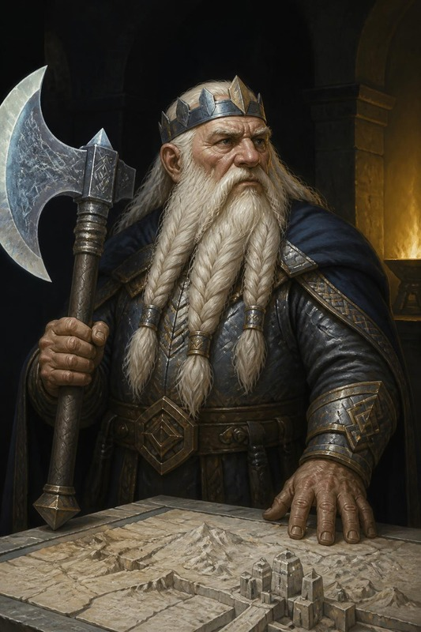

⚠️ A voce **Thorek** e **Thorik** si confondono: di' sempre **«Re Thorek»**.

**Scheda d'entrata — Thorgrim Barbadiferro, l'antenato**

| | |
|---|---|
| **Aspetto** | un vecchio seduto che non si alza. Le mani aperte verso la luce, i palmi in su, e il callo nello stesso punto in cui ce l'ha Thorik, perché hanno tenuto la stessa ascia |
| **Vuole** | che l'ascia torni in una mano che sa perché la tiene |
| **Suona** | la voce non trema, gli occhi sì. Nomina il sangue, mai la persona: *«il sangue riconosce il sangue»* |
| **Non combatte** | è un vecchio, vivo e fragile: nessuno statblocco, e non va inventato. Nella sconfitta del duello (§6) non impugna niente: chiama gli antenati, e sono loro a ricacciare il drago |
| **Eco** | l'affresco A3 (*«Portala bene, fratello. Ora è tua.»*) |
| **Ritratto** | qui sotto. Ai giocatori si mostra dopo l'incontro, non prima |

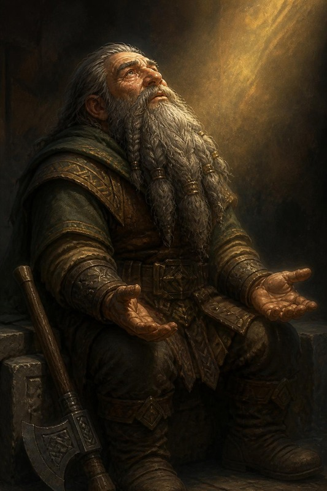

**Il re.** Re Thorek I (Guerriero 16, 182 anni, Frostcleaver in pugno) vuole
vedere da vicino la Corona che suo nonno perse contro Skullcrusher cinquant'anni
fa. La riconosce, e si inginocchia; con lui si inginocchiano le quindici guardie
della sala. Poi, ancora in ginocchio, recita la profezia.

⚠️ **Thorik non si toglie la Corona.** Se l'è già tolta una volta, sul petto di
Hella («La Resurrezione di Hella» §5). Il re scende i gradini e la guarda dov'è: due pietre accese
e un incasso vuoto.

**RE THOREK I (lento, passato remoto, come chi cita a memoria):** *«Quattro
eroi dal fuoco e dalla pietra… nella notte più oscura salveranno gli antenati
e i futuri.»*

**Thorgrim.** Mentre il re recita, il vecchio sulla panca guarda l'ascia di
Thorik, e quando il re tace parla lui.

> **Read-aloud (Mercer lead, Casa di Davide support) — il vecchio sulla panca.** *Il vecchio sulla panca
> non si è mosso. Tiene le mani aperte verso la luce, i palmi in su, e sono mani
> che hanno tenuto la stessa ascia di Thorik: si vede dal callo, nello stesso
> punto. Guarda la corona sulla fronte di Thorik per il tempo di tre respiri. Poi gli occhi gli si riempiono, e lui non se ne accorge,
> perché sta già parlando, e la voce non trema: «Mio nonno ha perso la
> corona. L'ascia no. Se dite il vero, fatemi tenere la vostra.»*

**Se Thorik gliela porge**, e solo allora:

> **Read-aloud (Mercer lead) — le due prese.** *L'ascia passa da una mano
> all'altra, e per un istante le due prese si toccano sul legno. E il legno
> suona.*

**Se Thorik non gliela dà**, il vecchio annuisce, ritira le mani e non chiede
più niente. Al consiglio resta fra quelli che non si fidano, come già dice la
prova qui sotto: non è offeso, ha paura.

⚠️ *L'ascia di Thorgrim è appoggiata alla panca: è **Aegis Fang**, mille anni
più giovane. Quando prende quella di Thorik tiene in mano la stessa arma due
volte, e il legno suona per questo (§1: «canta la stessa nota»).*


> 🩸 **Re Thorek I e Thorgrim sono cugini**: nipoti
> dello **stesso re**, quello caduto contro Skullcrusher cinquant'anni prima.
> Per questo dicono tutti e due *«mio nonno»*, e nessuno dei due mente. La
> Corona è il lutto del re; l'ascia, Aegis Fang, è rimasta a Thorgrim.

**La tavola di guerra.** Poi il re li porta alla mappa, e dice i numeri come li
direbbe a un suo capitano:

**RE THOREK I (in piedi, adesso, con le dita sulla mappa):** *«Ottocento
contro diecimila, e il drago. Le mura reggono due ore. Se all'alba Zog'tar guida
ancora l'orda, cadiamo. Se lui non c'è, l'orda è un gregge, e il drago resta
solo.»* L'unica possibilità è **uccidere Zog'tar di notte**, per fiaccare
l'orda, e **affrontare Skullcrusher** all'alba.
- **Handout — il piano di battaglia** (§9): forze, obiettivi, cosa dà il re. Si
  consegna qui, sul tavolo di guerra.
- **Su cosa si discute**. Il re crede alla Corona; Thorgrim e i
  capitani no. La domanda non è chi siano i PG, ma se affidare a quattro
  stranieri le **quattro pozioni** dell'antica fucina e la **mappa del campo**,
  che sono tutto quello che la fortezza ha per la notte. La prova dice quanto ne
  danno.
- **Prova di gruppo**: Diplomazia/Intimidire **CD 20** (**CD 16** se alla porta
  hanno preso il **Nome**) → **fiducia piena**: le quattro pozioni dell'antica
  fucina (*cura ferite gravi* all'11°, la *Benedizione degli Antenati* di §8 B),
  la benedizione dei chierici di Hammerfist, +2/+2 (morale, al colpire e ai danni, 12 ore; non è una delle Benedizioni della Sala, Scena 5), la mappa accurata del campo **e la dotazione
  per entrare nel campo, scelta dal tavolo** (qui sotto). Fallimento: aiuti
  dimezzati, −2 alle prove della Scena 6. **Dimezzati** vuol dire: 2 pozioni
  dell'antica fucina invece di 4, metà della dotazione (2 pozioni
  d'*invisibilità* o 2 di *volare*, per difetto), la benedizione dei chierici di Hammerfist a +1/+1, e
  niente mappa. Il −2 alle prove della Scena 6
  vale **in più**: le due cose insieme sono il prezzo del consiglio fallito.
- **Come pensate di entrare?**. Il re lo
  chiede, e dà quello che serve al piano che i PG gli dicono. È una scelta loro:

  | Dotazione | Cosa dà il re | Il piano che serve |
  |---|---|---|
  | **Dal basso** | 4 pozioni d'*invisibilità* all'incantatore di 12°, **12 minuti** l'una, dal forziere del re: un dono, che non tocca i 10.000 mo con cui il forziere compra dai PG | il mare di tende a piedi (Scena 6, lo skill challenge) |
  | **Dall'alto** | 5 pozioni di *volare* al 5°, **5 minuti** l'una, portate dal sergente | la variante dall'alto (Scena 6) |

  Al tavolo il gruppo ha avuto la seconda. Un gruppo di 13°

  che vola già da sé (incantesimi, oggetti, forme selvatiche) di solito
  sceglie la prima, e allora vola **e** è invisibile: segue la variante
  dall'alto, con l'invisibilità del re che copre tutta l'andata. Va bene così:
  il rischio, come dice la variante, si sposta alla tenda e sull'orologio del
  drago.
- **Il fianco est**. Mentre il re parla con
  chi porta la Corona, un capitano batte il dito sul fianco est della mappa e
  lo dice al tavolo, non al re: *«Di qua, se avessimo qualcosa che carica, li
  prenderemmo di traverso. Non abbiamo niente che carica.»* È l'indizio per i
  semi di Hella; il resto è in Scena 5, «I Treant».

**I numeri del re** *(per il DM; sono anche nel piano di battaglia, §9)*:

| Hammerfist | L'orda di Zog'tar Deatheye |
|---|---|
| 800 guerrieri nanici veterani | 7.000 orchi |
| 200 cittadini armati, vecchi e ragazzi | 2.000 goblin |
| 50 chierici di Moradin | 800 hobgoblin |
| Re Thorek I e 15 guardie reali | 200 ogre |
| — | Zog'tar Deatheye e il drago |

Le mura reggono **due ore** dall'inizio dell'assalto. Il piano del re è quello
della prova qui sopra: Zog'tar di notte, il drago all'alba.

- **Gancio**: Thorgrim riecheggia nell'affresco A3 della Sala della Forgia.
- **I doni del re** se la fiducia è piena: le pozioni di cura, portate dal
  sergente. Il **Torque di Thorek I** non è fra questi: un torque non si manda
  per mano d'altri, e il re lo dà di persona alla Scena 12, Momento 5 (§8 B).
- ► **Esito**: *aiuti pieni / dimezzati*.

🕯️ **Adesso metti l'orologio della notte sul tavolo** (§4): il consiglio ha già
preso la prima tacca.

---

## §4 — ATTO II · LA NOTTE

> **Il percorso dell'atto.** Dalla fine del consiglio all'alba. I PG scelgono
> cosa fare nella fortezza, poi escono da una postierla, attraversano il campo,
> entrano nella tenda del comando e tornano indietro. Tutto costa tacche.

| Scena | Dove | Chi entra | Se fanno l'inatteso | Tacche · al tavolo |
|---|---|---|---|---:|
| **5** · La notte nella fortezza | quartieri ospiti, fucina, gallerie | **Zeth**, **Gunnvor** | escono subito: zero tacche, e niente di quello che la fortezza vende | da 0 a 7, a scelta · 40-60 min |
| **6** · Il mare di tende | dalla postierla al centro del campo | — | tre fallimenti: la pattuglia, EL 10; vanno di notte sulle colline del drago: §6 | 2, più 1 per fallimento · 30-40 min |
| **7** · La tenda del comando | la tenda di Zog'tar | **Balvar** | colpiscono prima di parlare: Balvar combatte con Zog'tar | 1 se gli parlano prima di colpire · 20 min |
| **8** · Zog'tar | la stessa tenda | **Zog'tar** | lo catturano o lo umiliano vivo: Via A, ed eco in §7 | — · 30-45 min |
| **9** · Vatore | fra le tende, al ritorno | **Vatore** | provano a ucciderlo: il Cronolito lo salva a 1 pf | — · 10 min |

### ⏳ L'OROLOGIO DELLA NOTTE — otto ore, e ogni cosa ne costa

> **Perché esiste.** La scelta del riposo della Scena 5 era già un orologio, scritto
> a parole, in ore che non tornavano con queste tacche. Ma un tempo che non si segna non si sente,
> e il tavolo non può *scegliere di correre un rischio* se non sa quanto ha in
> mano.

**Dove si riprende**. Al tavolo del 25 settembre
il gruppo ha fatto il consiglio e poi il giro della fortezza: la fucina,
l'alchimista, la cappella, e sono scesi nelle gallerie a cercare Zeth. Sul
foglio ci sono quindi **3 tacche**. Ne restano 5: il campo e il ritorno ci
stanno, le otto ore di sonno no.

**Si segna su un foglio, in vista.** Dal tramonto all'alba ci sono **8 tacche**,
e quando il foglio arriva sul tavolo la prima è già segnata: il consiglio. Ogni
tacca è mezz'ora scarsa di gioco reale.

| Cosa | Tacche |
|---|---:|
| Il consiglio di guerra (Scena 4), già segnato | **1** |
| Fermarsi **tre ore** · dormire **otto ore** (Scena 5) | **2** · **6** |
| Banchetto e benedizioni (Scena 5, facoltativo, +1 morale 12 h) | **1** |
| Hella veglia i semi della Collana: i Treant dell'alba (Scena 5); un Treant chiamato alla tenda non costa tacche | **1** |
| Cercare il Mastro Costruttore Zeth (Scena 5) | **1** |
| Identificare il Seme-Mercato con la pergamena del re (Scena 5, un'ora; si può rimandare a dopo la missione) | **1** |
| Sorvolare il campo invece di attraversarlo (Scena 6, variante dall'alto) | **1** |
| La fucina di notte: comprare, vendere, barattare con Gunnvor, e nella stessa tacca la cappella, la bottega di Kettra e le rune di Zeth (Scena 5) | **1** |
| Attraversare il mare di tende (Scena 6, skill challenge) | **2** |
| Ogni **fallimento** nello skill challenge | **+1** |
| Parlare con Balvar prima dello scontro (Scena 7) · parlargli **durante** lo scontro nella tenda costa **0** | **1** · **0** |
| Spogliare la tenda delle armature (Scena 8, solo se nessuno ha dato l'allarme) | **1** |
| Curarsi nella tenda con più di 20 cariche di bacchetta, prima di ripartire (Scena 8) `[INFERRED — needs DM confirmation]` | **1** |
| Tornare a piedi dalla tenda alle mura (Scena 8) | **1** |
| … e ogni blocco **fallito** del ritorno | **+1** |
| Tornare in volo dalla tenda alle mura, al posto del ritorno a piedi (serve un secondo *volare*) | **1** |
| Uno scontro con la squadra dei lupi (Scena 6), come la pattuglia | **+1** |
| … e una banda chiamata da uno sciamano (Scena 6) | **+1** |
| Attaccare il drago di notte, sulle colline (§6) | **2** |

Se il gruppo si divide (metà vola, metà cammina), vale il conto del gruppo più
lento.

**Quando le tacche finiscono, sorge il sole.** Non è una punizione: è la Scena 10
che comincia, con i PG dove sono in quel momento.

| Tacche spese all'arrivo alle mura (il ritorno compreso) | Come si arriva alle mura |
|---|---|
| ≤ 6 | in tempo. Si rientra, si schiera, le mura e il duello vanno come scritto. Le tacche che restano prima dell'8 si spendono con la tabella qui sopra, come nella Scena 5: tre ore di sosta (2) ci stanno, otto ore di sonno (6) no. La fucina, la cappella e la bottega sono aperte come nella Scena 5 |
| 7 | 🟡 si rientra **correndo**: nessun riposo prima del drago, −1 a tutti i TS del primo round del duello (Scena 11) |
| 8 o più | 🔴 **l'alba vi coglie fuori dalle mura.** Non morite: attraversate un campo che si sta svegliando. Prova di gruppo Muoversi Silenziosamente **CD 20**, o Nascondersi **CD 22** per chi non è più invisibile, poi il duello (Scena 11) comincia con i PG **fuori**. La Scena 10 **non si gioca**: le mura valgono «a stento» (2-3 successi). Se la prova fallisce, il drago ha già scelto il suo bersaglio: il duello si apre con il suo round di sorpresa, e il soffio va sul PG che ha tirato peggio. Con 3 tacche già spese e il campo a piedi (3), una scelta lenta porta al giallo (7), e una scelta lenta più un fallimento portano qui; il margine viene da Balvar, a cui si parla durante lo scontro senza spendere tacche |

**Se l'alba arriva prima della tenda**. Zog'tar è vivo all'alba (riga
della tabella «Dalla notte», Scena 10), e siccome la Scena 10 non si gioca,
durante il duello sta sotto le mura a guardare, come nella sua tattica sulla
breccia. Balvar resta nella tenda: la Catena si può solo spezzare. Vatore, mai
incontrato, non si perde: il filo [VATORE/SAL] passa ad ARC-09.

⚠️ **L'orologio corre sulle SCELTE, non sul tempo reale.** Un tavolo che discute
mezz'ora su cosa fare non spende una tacca; un tavolo che decide di andare a
cercare Zeth sì. È la regola dell'Abbazia (`ADR-10` interno: *l'oppressione
avanza sulle scoperte*), e serve a non punire proprio il comportamento che
questo master vuole ottenere — **guardarsi intorno**.

🔎 **E qui l'orologio dice una cosa**: parlare con
Balvar prima di colpire, cercare Zeth e fare il banchetto costano **3 tacche** in tutto
(parlargli mentre si combatte non ne costa nessuna). Sono i
tre pezzi migliori della notte, e sommati sono anche il rischio più grosso. È
il bivio, ed è **vero** — non una finta scelta con una risposta giusta.

### SCENA 5 — La notte nella fortezza

**In scena** — Dove: i quartieri ospiti · la cappella · la bottega · le gallerie · la fucina — Chi: Durin · Sorella Brynja · Kettra · Zeth · Gunnvor · il pesatore

**Chi si trova qui** *(di notte, mentre la fortezza si prepara all'alba)*

| Ruolo | Chi, e dove |
|---|---|
| comando | Re Thorek è ancora col consiglio; per i PG chi decide è **Durin**, che li accompagna |
| culto | **Sorella Brynja**, nella cappella, la porta dopo i quartieri lungo il corridoio |
| rimedi | **Kettra**, la bottega dell'alchimista in fondo al corridoio della fucina |
| bottega | **Gunnvor** alla fucina, e il **pesatore** con la sua bilancia; prezzi e tetti nel banco qui sotto |
| messaggi | nessuno: stanotte gli ordini li porta Durin a voce |
| guardia | sulle mura, agli ordini di **Hrodgar**, il capitano (scheda nella Scena 10) |

> **Mappe M7-D, M7-E e M7-F** (Appendice D). Il livello −1 (quartieri,
> cappella, bottega, fucina di Gunnvor e armeria), le gallerie di Zeth sotto la
> fucina, e dall'affaccio delle gallerie la fucina grande. La sezione M7-S dice
> come si scende.

**I quartieri ospiti.** Durin li accompagna, e da qui all'uscita decidono
loro: ogni cosa costa tacche. Nei quartieri ci sono il banchetto (+1 morale ai TS per 12 h se
mangiano: il +2 morale della benedizione dei chierici di Hammerfist non vale sui TS, quindi i due non si
sommano sullo stesso tiro), fabbri che affilano le armi, chierici che benedicono.

> **Read-aloud (LotR lead) — i quartieri ospiti.** *Una sala bassa e fredda,
> scavata nella roccia: il soffitto porta ancora i colpi dello scalpello, dritti e
> fitti come le righe di un registro. Sei brande di legno nuovo lungo il muro,
> e su ognuna una coperta piegata in quattro da qualcuno che aveva fretta.
> In fondo un focolare che tira male. Nel soffitto c'è una crepa chiusa col
> piombo, e sotto non ci dorme nessuno.
> Dalla porta aperta entra il rumore della fortezza che non dorme: martelli,
> passi, un bambino che piange e poi smette.*

*Il luogo*: erano gli alloggi dei minatori,
prima che la miniera diventasse fortezza. Nel soffitto c'è una crepa chiusa col
piombo, del primo crollo, e nessuno ci dorme sotto.

**La cappella dei chierici.** È la porta dopo i quartieri, lungo lo stesso
corridoio. È qui che si comprano pozioni, bacchette e incantesimi (il banco
della fucina, più sotto, ha i prezzi).

> **Read-aloud (Casa di Davide lead) — la cappella.** *Al posto dell'altare
> c'è un'incudine vecchia, portata giù dalla prima forgia, e intorno ai piedi
> la pietra è consumata a conca da generazioni di ginocchia. Venti chierici
> dormono seduti, con la schiena al muro freddo, per essere già in piedi quando
> li chiameranno. Una sola è sveglia: conta fiale su un panno in un sussurro, e
> ricomincia da capo ogni volta che arriva a trenta.*


**Scheda d'entrata — Sorella Brynja, la chierica che conta**

| | |
|---|---|
| **Aspetto** | nana giovane per guidare una cappella, i capelli rasati ai lati come chi porta l'elmo, le mani screpolate dall'acqua santa fredda |
| **Vuole** | che all'alba ci siano incantesimi per le mura. Non per chi paga, per chi sale sulle scale |
| **Teme** | di dover scegliere chi curare, e di scegliere male davanti a tutti |
| **Suona** | conta ad alta voce, sempre. Fa ogni domanda due volte, la seconda più piano |
| **Sa** | quanti incantesimi restano ai cinquanta chierici, e che in tutta la fortezza c'è un diamante solo |
| **Vende** | le pozioni, le bacchette e gli incantesimi del banco della fucina. Chierica di Moradin di 9° livello, perché *rianimare morti* è di 5° |
| **Eco** | ogni incantesimo di 4° o 5° che vende stanotte manca sulle mura: lo dice lei, se glielo chiedono |

**La bottega dell'alchimista.** In fondo al corridoio della fucina, dove
l'odore di zolfo copre quello del carbone.

> **Read-aloud (Andor lead) — la bottega.** *Una porta bassa, foderata di
> piombo. Dentro l'aria sa di zolfo e punge gli occhi. Sul banco, in fila come
> soldati, fiasche di terracotta tappate con la cera, e sotto il banco una cassa di
> sabbia per quando qualcosa va storto. Una nana senza sopracciglia riempie
> una fiasca col cucchiaio, piano. A metà il cucchiaio le trema, e lei ride.*

**Scheda d'entrata — Kettra, l'alchimista del re**

| | |
|---|---|
| **Aspetto** | nana di mezza età senza sopracciglia, bruciate da anni. Un grembiule pieno di buchi rotondi, ognuno di una goccia diversa |
| **Vuole** | finire le fiasche per le mura prima dell'alba. Ogni fiasca che vende è una fiasca in meno sulle scale |
| **Suona** | ride quando qualcosa sta quasi per andare storto, e solo allora |
| **Vende** | il fuoco dell'alchimista è finito, è tutto alle mura. Ha **tre bombe di fuoco** sue, e poi più niente: una fiasca da lanciare che fa una *palla di fuoco* da 5d6, Riflessi CD 14, raggio 6 m, a 750 mo, prezzata come una pozione di 3° livello al 5° dell'incantatore. Si lancia come un'arma a spargimento dell'SRD, incremento 3 m, mirando a un'intersezione |
| **Eco** | le bombe sono una sua invenzione, e nel 1372 nessuno sa più farle così |

- **HELLA — i Treant dell'alba.** All'alba Hella usa l'**Evocazione dei Guardiani** sui semi
  I e II: **due Treant di Adamantio** (statblocco in «La Resurrezione di Hella» Appendice A.2: Grandi, 90 pf, RD
  10/adamantio, CA 24, Vel 9 m, 2 schianti +18 (2d8+9), danni doppi alle
  strutture, durano 1 ora; FOR 29, TS Temp +12, Rifl +3, Vol +8, vulnerabili al fuoco, come in «La Resurrezione di Hella» A.2) che caricano il
  fianco dell'orda. Costa **due** delle tre cariche del giorno, e la tacca della
  notte resta **una**: vegliare i semi che si aprono. È il beat di potere della
  druida risorta, e ha un prezzo: se Durik viene distrutto nel duello, resta
  **una carica sola** per richiamarlo, e torna per un'ora. Chiamarli insieme all'alba non spegne
  l'Evocazione per un mese: è l'unica eccezione che la scheda della Collana
  concede.
  Se al rito Hella ha trovato la **ghianda
  annerita** e non l'ha ancora piantata, «il primo suolo sacro che tocca» è
  questo: niente Treant in più, ma una quercia che fra mille anni sarà
  vecchia di mille anni.

#### I Treant: come lo viene a sapere Hella, e dove possono andare

Il re al consiglio parla con chi porta la Corona e non sente gli altri. Al
tavolo del 25 settembre nessuno ha detto a Hella che i suoi semi potevano
servire, e la giocatrice non l'ha deciso. Per i gruppi futuri l'indizio arriva
da due parti, perché uno solo si perde:

- **Al tavolo di guerra** (Scena 4, «Il fianco est»): un capitano, al tavolo
  e non al re, dice che di traverso sul fianco est servirebbe qualcosa che
  carica.
- **Di notte, alla Collana.** Se Hella resta ferma al buio anche solo un
  minuto, i semi I e II si scaldano e si girano verso est, come aghi.

Per **questo** gruppo, che non l'ha deciso, i Treant restano dove la
giocatrice li vuole, interi o uno per parte. Le regole della Collana sono
quelle del rito dello Smeraldo: tre evocazioni al giorno, un'ora l'una, e i semi tornano
all'alba. Le scelte, con quello che cambiano:

| Dove | Cosa cambia | Quanto costa |
|---|---|---|
| **Fuori dalla tenda, contro i rinforzi** (Scena 8, dopo un allarme) | la RD 10/adamantio rende un Treant quasi intoccabile per le ronde (orchi combattenti, falchion 2d4+4, Appendice A.6) e per gli squadroni (spada lunga 1d8+3). **Uno** tiene un lato: le ronde arrivano in **2d4+2** round invece di 1d4+2, gli squadroni in **3d4+2**. **Due** tengono la tenda: dentro non entra nessuno finché restano in piedi, e lo scontro resta contro il generale. Gli sciamani passano, perché la RD non ferma un incantesimo | un Treant nel campo si vede da tutto il pendio: è l'allarme, anche se il corno non ha ancora suonato. **Due** chiamati insieme di notte spengono l'Evocazione per un mese. Il drago arriva al corno come sempre, in 70 round, e sui Treant soffia per primo |
| **Dentro la tenda, contro Zog'tar** (Scena 8) | un Treant Grande sotto il colmo da 6 m ci sta. Fa da compagno per il fiancheggiamento e prende i colpi: l'ascia di Zog'tar (3d6+20) perde 10 sulla RD. Il **Colpo Devastante** su di lui non funziona, perché l'SRD lo vuole contro un avversario più piccolo e il Treant è Grande come Zog'tar: il generale lo colpisce con l'Attacco Poderoso e tiene il Colpo Devastante per i PG. La *barriera di lame* di Balvar sul palo centrale lo taglia come chiunque (13d6). Con due Treant dentro, chi si muove nella tenda ha poco spazio: i PG che volano restano sotto i 6 m del telo | lo scontro si accorcia, e Zog'tar cade prima. Il colpo finale resta al giocatore che lo dà, mai al Treant (`[HDYWTDT]`) |
| **Sul fianco dell'orda, all'alba** (come scritto qui sopra) | **un successo in più** sulle mura (Scena 10, Q49), solo con **tutti e due** sul fianco | i Treant non sono nel duello |
| **Nel duello con Skullcrusher** (Scena 11), uno o due | il drago vola, e un Treant non lo raggiunge finché resta in quota. Conta quando lo tirano giù: un Treant che tira la **corda** dell'ala (Scena 11, Forza CD 25) dà il suo aiuto +2 come chiunque, e quando il drago è a terra picchia con i colpi d'adamantio. Un albero non ha un nome da gridare (Scena 11, «Chi sceglie»): il drago li ignora finché non tengono la corda, e allora il soffio va sulla linea della corda | un Treant al duello è un Treant tolto al fianco: con uno solo sul fianco, niente successo in più. Il duello diventa più facile, ed è il prezzo pagato sulle mura |

Un Treant chiamato di notte, alla tenda, è un seme speso prima dell'alba: per
la Collana torna all'alba, ma se di notte se ne chiamano **due insieme**
l'Evocazione si spegne per un mese, e all'alba non c'è niente da chiamare.
La regola del mese ha una sola eccezione, scritta nella scheda della Collana:
i due Treant chiamati **insieme all'alba** di questa notte. Le tre cariche
sono una sola riserva per i Treant e per Durik fino all'alba: quello che si
spende alla tenda manca per il resto della notte, e all'alba i semi tornano
tutti e tre, come dice la scheda della Collana in «La Resurrezione di Hella» §7.
Un Treant solo, chiamato alla tenda, non
toglie quindi niente ai due dell'alba.

> **Read-aloud (Andor lead) — le gallerie.** *Sotto la fucina il caldo finisce
> di colpo. Le gallerie sono strette, puntellate con travi nuove che sanno
> ancora di resina, e ogni dieci passi una lampada a olio fa il suo cerchio di
> luce e poi niente. Sulle pareti ci sono segni a gesso, e metà sono stati
> cancellati col pollice. Da un punto più in fondo arriva il suono paziente di
> un martelletto su pietra.*

**Scheda d'entrata — Mastro Costruttore Zeth, il seme del Ghostlord** *(nelle
gallerie sotto la fucina; cercarlo costa una tacca)*

| | |
|---|---|
| **Aspetto** | mezz'elfo, occhi febbrili, polvere di roccia fino ai gomiti. Traccia rune sulle pareti dei tunnel. Col gesso, e ne cancella metà col pollice |
| **Vuole** | che le gallerie non cedano. È disposto a legarci l'anima |
| **Suona** | parla mentre lavora. Finisce le frasi degli altri |
| **Sa** | che un chierico incappucciato gli ha dato «i componenti perfetti» |
| **Non sa** | che quei componenti servono a una **lichificazione**, e che la mano è del **Collezionista** attraverso il tempo |
| **Eco** | il **dilemma di Hella su Zeth il Murato** in ARC-09. I PG assistono all'origine del Ghostlord **senza saperlo** |
| **Ritratto** | qui sotto. Ai giocatori si mostra dopo l'incontro, non prima |

- **⚫ SEME DEL GHOSTLORD (hook a lunghissimo termine — CANONE).**
  Il party incrocia il **Mastro Costruttore Zeth** nelle gallerie, un mezz'elfo dagli occhi
  febbrili, che traccia rune sui tunnel: *«Le mura di Thorek potrebbero cedere.
  Ma legherò la mia anima alla montagna in una Consacrazione. I miei leoni di
  pietra proteggeranno queste gallerie per sempre. Un chierico incappucciato mi
  ha appena dato i componenti perfetti.»* → **È il futuro Ghostlord / Zeth il
  Murato**: i «componenti» sono in realtà per una **Lichificazione**, inflittagli
  dalla fazione del **Collezionista** che viaggia tra i piani e le epoche. I PG
  seminano (senza saperlo) il dilemma etico di Hella su Zeth in ARC-09. Registra
  nell'Echo Ledger (§7) e nel registro di fine serata.
  **Il chierico incappucciato** non è più in fortezza, e nessuno l'ha visto
  entrare né uscire. Se i PG lo cercano: le guardie delle porte non hanno fatto
  passare nessun incappucciato, e nelle gallerie, dove Zeth dice di averlo
  incontrato, resta solo un odore di cera nera. **Era Vatore**, che lavora per
  il Collezionista attraverso il tempo: i PG
  lo incontrano più tardi, fra le tende (Scena 9), e possono riconoscerlo dal
  mantello o dalla stessa cera nera sulle dita (Osservare **CD 15** se l'hanno
  cercato qui). Zeth non sa chi sia.
  Le rune che traccia stanotte sui tunnel e sui camminamenti sono **colore**:
  nel 372 non hanno effetto (scrive in fretta, e quelle d'uso le vende ai
  PG, qui sotto). Nel 1372 sono le difese del Ghostlord.
- **Le rune di Zeth, se gliele chiedono**.
  Zeth sa incidere rune di tre famiglie: **d'abiurazione e di protezione**;
  **d'annullamento**, come quelle della miniera di Belkram, che spengono la
  magia dove sono scritte; e rune che **spengono un incantesimo solo**, quello
  che il PG gli nomina. Ma stanotte non ha il tempo di forgiarle come si deve:
  le scrive in fretta, col gesso e col pollice, e ognuna **vale una volta**.
  Per quelle d'annullamento e per quelle che spengono un incantesimo solo, il
  modello SRD è *dissolvi magie* (ad area o mirato) al livello dell'incantatore
  di Zeth, che nel 372 è un druido di **9°**, e per il druido *dissolvi magie* è
  di 4° livello: come una pergamena a quel livello, 4 × 9 × 25 = **900 mo**
  l'una.
  Il tavolo ne ha comprate **due**, rune di protezione da un colpo solo:
  ***resistere all'energia*, acido 20** (7° livello
  dell'incantatore), **70 minuti** dall'attivazione, come vuole l'SRD. Attivarla
  è un'azione standard. Contro il soffio di Skullcrusher (14d4) toglie 20 danni a
  ogni soffio. Se la attivano uscendo dalla postierla, all'alba è scaduta. Si
  attiva al corno dell'alba o dopo: il drago arriva 70 round dopo il corno,
  e la runa dura 70 minuti. Prezzo di pergamena SRD, 350 mo. Per
  **Durik** vale di più: la sua scheda gli dà +50% di danni dall'acido. La
  attiva chi la porta, toccando il bersaglio, perché *resistere all'energia*
  è a contatto (SRD): su Durik la mette Hella `[INFERRED — needs DM confirmation]`.
- **Fermarsi o dormire — scelta.** In 3.5 ci sono solo le otto ore di sonno
  e il tempo che passa. **Tre ore di sosta** (2
  tacche) non ridanno incantesimi, perché l'SRD li restituisce solo dopo otto
  ore di riposo (il chierico prega alla sua ora e non ha bisogno di dormire; la druida
  prega all'alba come lui, ma gli slot spesi stanotte restano spesi, perché
  sono dentro le otto ore);
  servono a curarsi con quello che resta, a smaltire i danni non letali e a
  far tornare *affaticato* chi era *esausto*. **Dormire otto ore** (6 tacche:
  con il consiglio già segnato, prima dell'alba non resta il tempo per il
  campo) ridà gli incantesimi e le capacità al
  giorno, toglie l'affaticamento e rende 1 pf per livello, la guarigione
  naturale dell'SRD: non i pf pieni. Il momentum spinge alla sosta. ⚠️ La guarigione del passaggio (Scena 1) li ha già rimessi in
  piedi: il riposo serve solo a chi ha speso qualcosa da allora.
- **Le Benedizioni della Sala, e le cure**. Le
  Benedizioni della Sala della Forgia (Pelle di Pietra, Cuore Incrollabile,
  *Vigore della Forgia*) durano **24 ore vissute** dalla preghiera all'Altare,
  e si rinnovano una volta ogni 24 ore vissute tornando alla Sala. A mille anni
  fa non si rinnovano: allo scadere si spengono, e con loro le cariche di
  *Vigore* rimaste. Finché sono attive, le cariche di *Vigore della Forgia*
  tornano a ogni sonno di otto ore. Il viaggio, dal tramonto al duello, sta di solito dentro le 24 ore; se
  sconfina in un secondo giorno, da lì il gruppo ha solo le cure del re (le
  pozioni dell'antica fucina) e quelle comprate al banco della fucina. La
  benedizione dei chierici di Hammerfist (+2/+2, 12 ore, Scena 4) è un'altra
  cosa, e dura le sue 12 ore.

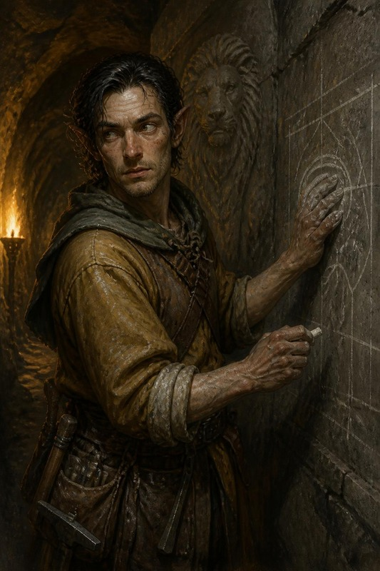

#### ⚒️ La fucina di notte — Gunnvor, e lo scambio *(1 tacca)*

Si arriva qui se i PG vogliono comprare, vendere o barattare. La fortezza
non ha un mercato: ha una fucina che lavora per l'alba, e una maestra armaiola
che decide cosa ne esce.

> **Read-aloud (Salvatore lead, Andor support) — la fucina e il banco.** *La
> fucina è l'unico posto della fortezza dove nessuno parla sottovoce, e l'aria
> sa di carbone e di scoria. Davanti a
> tre forge accese aspettano file di ragazzi con quello che hanno trovato: un piccone,
> una vanga, la spada del padre. Una nana con le braccia bruciate fino al gomito
> guarda ogni lama di taglio contro la brace e la mette in uno di due mucchi,
> senza dire quale sia il buono. Sul banco dietro di lei, poco: qualche fiasca
> chiusa con la cera, un mazzo di frecce, un'ascia avvolta in un panno grigio che nessuno
> tocca. La nana non smette di lavorare quando la porta si apre. Alza il mento verso
> quello che avete addosso, e aspetta.*

**GUNNVOR (asciutta, senza alzare gli occhi):** *«Stanotte non vendo. Scambio.
Quello che serve sulle mura lo pago bene, e lo pago in braccia.»*

*Solleva una fiasca contro la brace.*

**GUNNVOR:** *«Questa vale un ragazzo che non va su con la vanga. Il resto
tenetevelo: non ho tempo di pesarlo.»* **Che fate?**

**Scheda d'entrata — Gunnvor, maestra armaiola della fortezza giovane**

| | |
|---|---|
| **Aspetto** | nana di mezza età, braccia bruciate fino al gomito, un grembiule di cuoio che ha più toppe che cuoio. Porta il martello infilato nella cintura come un'arma |
| **Vuole** | che i duecento vecchi e ragazzi vadano sulle mura con un'arma vera. Non riguarda i PG: c'era prima di loro e ci sarà dopo |
| **Teme** | di aver sbagliato mucchio. Una lama incrinata data a un ragazzo è un ragazzo morto, e l'ha già fatto una volta |
| **Suona** | conta tutto in **braccia**: quanti difensori arma una cosa. Una pozione «vale un braccio», le monete «non armano nessuno» |
| **Sa** | cosa c'è in fortezza, cosa manca, e che le mura reggono due ore |
| **Non sa** | chi sono i PG, a meno che al consiglio non abbiano avuto la **fiducia piena**: allora lo sa da Durin, e comincia da *amichevole* |
| **Eco** | quello che le lasciano stanotte resta qui, e fra mille anni qualcuno lo trova (§7) |

**Dati per il DM (non da leggere)**

- **Convincerla.** Parte *indifferente*. Una prova di **Diplomazia** con
  risultato **15** la porta ad *amichevole* (tabella degli atteggiamenti dei PNG
  dell'SRD): allora apre il banco. Con la **fiducia piena** del consiglio parte
  già *amichevole* e la prova non serve. Se un PG porta **in vista** roba d'orchi (armi, insegne, pelli
  dipinte), parte *ostile*: sa delle tende là fuori. Una mano rossa dipinta,
  presa nel 1372, a lei non dice niente: nel 372 la Mano Rossa non esiste.
- **Chi aiuta a smistare.** Un PG che si mette al banco con lei, **Artigianato
  (fabbricare armi) o Valutare CD 15**, le fa guadagnare un'ora, e lei lo ricambia con lo sconto del mestiere: **−10%**
  sul prezzo SRD delle armi e armature che il gruppo compra da lei. Il premio di
  guerra qui sotto è un'altra cosa: è quello che la fortezza paga quando il
  gruppo **vende**. È un posto per chi, nel gruppo, ha le
  mani da fabbro: Gunnvor lo guarda lavorare per un minuto, poi gli passa il
  mucchio buono.
- **La tacca.** Tutta la trattativa costa **una** tacca, anche se il gruppo
  compra e vende dieci cose.

**Il profilo della fortezza come mercato** *(supporto Pathfinder 1e,
opzionale e dichiarato, come quello di §0-bis)*

Le regole degli insediamenti di Pathfinder 1e danno un numero a una cosa che il
3.5 lascia al DM. Hammerfist ≈372 DR, con i suoi mille difensori e le famiglie
nelle miniere, è una **cittadina** (*small town*: valore base 1.000 mo, limite
d'acquisto 5.000 mo, incantesimi fino al 4° livello). È **devota**: cinquanta
chierici di Moradin alzano gli incantesimi al **5° livello**. E l'assedio fa
quello che fa la qualità *impoverita*: dimezza valore base, limite d'acquisto e
oggetti magici in vendita.

| Voce | Stanotte |
|---|---|
| **Valore base** (un oggetto che costa fino a questa cifra c'è con il 75% di probabilità) | **500 mo** |
| **Limite d'acquisto** (il massimo che il mercato paga per un oggetto solo) | **2.500 mo** |
| **Incantesimi a pagamento** | fino al **5° livello**, dai chierici di Moradin |
| **Il forziere del re** | fino a **10.000 mo** in tutto, **solo** con la fiducia piena del consiglio, e **solo** per cose che servono all'alba |

Il forziere del re paga solo quello che arma o cura un difensore.

**Le monete del 1372 valgono a peso**. Cinquanta
monete fanno mezzo chilo, come sempre; il pesatore della fucina le mette sulla
bilancia e ne trattiene **una su dieci** per il disturbo. Sopra c'è la faccia di un re che nessuno conosce, e un nano la
morde. Un PG che vuole farle passare per buone senza discussioni: **Raggirare
contro Percepire Intenzioni** del pesatore, un esperto con **+8**.
Se fallisce, qualcuno comincia a
chiedersi da quale regno vengano quattro stranieri che pagano in oro mai visto.

**Comparse**

| Chi | Com'è | Come parla |
|---|---|---|
| il pesatore | nano magro con gli occhiali di quarzo legati dietro la testa, le dita nere di limatura. Non alza mai gli occhi dalla bilancia | dice il peso ad alta voce, sempre in once, e aspetta che qualcuno protesti |

##### Il banco di Gunnvor — cosa vende stanotte

Prezzi dell'SRD 3.5; i servizi col metodo SRD (livello dell'incantesimo ×
livello dell'incantatore × 10 mo, più le componenti costose), come nel
`KIT-ANTI-IMPROVVISAZIONE-VALLE` §2. Le quantità sono quelle del banco: finite
quelle, non ce ne sono altre.

| Cosa | Prezzo | Quante | Nota per il DM |
|---|---:|---:|---|
| Pozione di *cura ferite leggere* | 50 mo | 6 | le *gravi* ci sono, ma sono i doni del re (§8 B) |
| Pozione di *cura ferite moderate* | 300 mo | 2 | |
| Pozione di *volare* | 750 mo | 5 | 5° livello dell'incantatore, 5 minuti. Non si vendono: le **regala il re**, tramite il sergente, a chi sceglie la dotazione dall'alto (Scena 4) (il conto della fucina, più sotto) |
| Pozione di *invisibilità* | 300 mo | 5 | 3° livello, 3 minuti. Da Brynja: sono scorte della cappella |
| Bacchetta di *cura ferite leggere*, 50 cariche | 750 mo | 2 | da Brynja, come sopra |
| Acqua santa, la fiasca | 25 mo | 10 | temprata nella vasca della forgia |
| Antitossina | 50 mo | 4 | |
| Borsa del guaritore | 50 mo | 3 | |
| Ascia da guerra nanica perfetta | 330 mo | 3 | |
| Corazza di piastre completa perfetta | 1.650 mo | 1 | di una guardia reale caduta cinquant'anni fa, ripulita |
| Ascia da guerra nanica d'adamantio | 3.030 mo | 1 | sopra il valore base: c'è, ma Gunnvor la dà solo contro qualcosa che le serve |
| Frecce, quadrelli, fuoco dell'alchimista, olio | — | 0 | tutto sulle mura. Semmai li compra lei, qui sotto |
| Mithral lavorato | — | 0 | nella fortezza giovane non ce n'è |
| *Ristorare inferiore* · *rimuovi malattia* | 60 · 150 mo | a richiesta | |
| *Neutralizza veleno* · *ristorare* | 280 · 380 mo | a richiesta | *ristorare* con 100 mo di polvere di diamante inclusi. **Non** toglie il −4 alla DES di Thorik: è il prezzo del rito, non un risucchio |
| *Rianimare morti* | 5.450 mo | 1 | le 5.000 di diamante incluse, e c'è un diamante solo in tutta la fortezza |

⚠️ **Ogni cura comprata stanotte alla cappella è una cura che all'alba manca
sulle mura.** Alla Scena 10 si tira **1d4** per ogni **tipo**: i servizi e le
pergamene di 4° o 5° livello, un tiro ciascuno; le bacchette di cura, un tiro
per tutte. Se la Scena 10 non si gioca, si tira all'alba, prima del duello: sono
i difensori del 372 che muoiono sulle mura per quella cura mancata, e il DM li
annota fra i caduti del 372.
È il **dado dei caduti**, e riguarda solo la fortezza di mille anni prima: nel
1372 non toglie niente al *Registro delle Perdite* di ARC-08. Torna soltanto
come eco (§7), nei nomi che i PG troveranno fra i caduti dell'assedio antico:
sono scritti nel pannello in più della Sala degli affreschi, lo stesso di
Balvar (Scena 7).
Gunnvor non lo dice; il chierico che lancia sì, se glielo chiedono.

##### Cosa compra, e a quanto

| Cosa portano i PG | Chi la prende | A quanto | Perché |
|---|---|---|---|
| Pozioni di cura, pergamene di cura | i chierici | **×1,5** il prezzo SRD, dal forziere del re | braccia rimesse in piedi |
| Fuoco dell'alchimista, olio, borse dell'impedimento, pietre del tuono | Gunnvor | **×1,5** | sulle mura, contro le scale |
| Frecce e quadrelli, anche comuni | Gunnvor | **×1,5** | se ne consumano più di quante se ne facciano |
| Armi e armature magiche | il forziere del re | **metà** del prezzo SRD, come sempre | le dà alle guardie reali |
| Razioni, corda, bende | Gunnvor | prezzo pieno | le famiglie nelle miniere mangiano anche loro |
| Barre di mithral, piastre della Sentinella, cristalli d'adamantio | Gunnvor | prezzo pieno, **fuori** dal forziere del re, e non oltre il limite d'acquisto: il Geode Titanico (5.000 mo) lo paga 2.500 | è metallo: l'SRD lo scambia a valore pieno. Ma stanotte non si forgia niente |
| Gemme (i geodi d'ametista, il granato stellato) | il pesatore | **metà** | una pietra non ferma un ogre |
| Monete del 1372 | il pesatore | a peso, meno una su dieci | vedi sopra |

Il **Cuore di Terros** (20.000 mo) non lo compra nessuno: nella fortezza non ci sono
ventimila monete in un posto solo, e i chierici non lo toccano.

⚠️ **Il premio di guerra ha un tetto**: il ×1,5 si paga col forziere del re, e
il forziere ha 10.000 mo. Oltre, si torna al prezzo SRD. Un gruppo che prova a
fare cassa sull'assedio se ne accorge alla terza fiasca, quando Gunnvor smette
di contare in braccia.

**Cosa non compra, e cosa non vende**

- **Niente che venga da un drago.** Una squama, un dente, una pelle conciata:
  Gunnvor la getta sul pavimento. Il drago è sopra le loro teste.
- **Niente d'orchi**, come sopra.
- **Niente che odori di non morte.** I chierici la vedono prima di lei.
- **Non vende** l'ascia di Thorgrim, né il Torque del re, né le armi delle
  quindici guardie. Se i PG le chiedono, la risposta è una sola, e la dà senza
  guardarli.

##### La notte già giocata: cosa hanno chiesto, e quanto c'era

Al tavolo del 25 settembre i PG hanno chiesto pergamene di *silenzio*,
*identificare*, *rimuovi maledizione* e *rimuovi paralisi*, hanno fatto
identificare le pozioni e hanno venduto parecchio. I numeri non si sono tirati:
era il primo posto da mesi dove si poteva contrattare davvero. Questi sono
quelli che l'SRD permette, con la mano larga che il DM ha chiesto: quello che
esiste si trova, niente arriva in regalo.

**Le pergamene.** Prezzo SRD: livello dell'incantesimo × livello
dell'incantatore × 25 mo, più le componenti costose. Brynja non ne può
scrivere di nuove stanotte (una pergamena chiede un giorno di lavoro), quindi
sono quelle che la cappella ha già.

| Pergamena | Prezzo | Quante | Da chi, e perché |
|---|---:|---:|---|
| *Silenzio* (chierico 2°, incantatore di 3°) | 150 mo | 2 | Brynja. Dura 3 minuti (1 minuto per livello, SRD): copre l'ultimo tratto del volo e l'atterraggio, non il volo intero. Alla tenda vale la regola della pietra: a meno di 6 m la bolla è l'allarme, quindi chi l'ha letta la congeda prima, perché per l'SRD *silenzio* lo congeda chi l'ha lanciato, cioè chi ha letto la pergamena, e non chi porta la bolla (Scena 6, «La bolla alla tenda»). La legge un chierico o un bardo; Hella no (non è sulla lista del druido), Artemis con Usare Oggetti Magici CD 23 |
| *Rimuovi paralisi* (chierico 2°, incantatore di 3°) | 150 mo | 3 | Brynja. Sono quelle che tiene per le mura |
| *Rimuovi maledizione* (chierico 3°, incantatore di 5°) | 375 mo | 1 | Brynja, l'ultima. Se la compra un PG, all'alba sulle mura non ce n'è |
| *Identificare* (mago 1°, incantatore di 1°) | 125 mo | 1 | dal forziere del re, presa anni fa a un mercante. Nessuno in fortezza la sa lanciare: Moradin non dà il dominio della Magia, e Zeth è un druido. Si lancia in un'ora e brucia una perla da 100 mo, già nel prezzo. Artemis la legge con Usare Oggetti Magici CD 21 |

Come servizio, Brynja lancia lei gli stessi incantesimi al 9° livello (prezzo
SRD: livello × livello dell'incantatore × 10 mo). La pietra di *silenzio*: la
lancia su un sasso all'8° livello, 160 mo, e
dura **8 minuti** (la durata SRD, 1 minuto per livello): copre il volo di
andata, che con le pozioni di *volare* dura al massimo 5 minuti, e
l'atterraggio. Alla tenda si lascia fuori: a meno di 6 m le guardie si
accorgono che la loro voce è sparita (Scena 6). Conviene lanciarla alla postierla, non in cappella, perché ogni
minuto speso a camminare è un minuto tolto sopra il campo;
*rimuovi paralisi* 180 mo; *rimuovi maledizione* 270 mo. Ogni slot di 3°
che spende stanotte manca all'alba, come dice la sua scheda.

**Identificare le pozioni.** Kettra e Brynja ci hanno dedicato **35 minuti**,
poi sono tornate alle fiasche e alle armi per le mura. L'SRD identifica una
pozione con **Sapienza Magica CD 25**, un minuto, senza ritentare. Kettra ha
**+15** e prende 10: in 35 minuti
identifica **fino a 35 pozioni**, senza sbagliarne una. Brynja, nello stesso
tempo, lancia *individuazione del magico* sugli altri oggetti e dice di ognuno
la **scuola** (Sapienza Magica 15 + livello dell'incantesimo): la scuola, non
cosa fa. Per sapere cosa fa un'arma o un anello serve la pergamena qui sopra.

##### Le dieci pozioni del gruppo

Sono le pozioni che il gruppo si portava dietro senza sapere cosa fossero,
alcune dal 2022 del tavolo. Kettra le identifica tutte e dieci in dieci
minuti, con il 25 che le dà il prendere 10. Due la fermano. La n. 2 la
riconosce subito, ed è la brodaglia degli sciamani. Sulla n. 4 sa **cosa fa**,
e sa che **c'è dell'altro**, ma per dire cosa servirebbe un 30.
Brynja ci passa sopra *individuazione del magico* e dice la scuola di
quell'altro. Ai giocatori si dà l'handout «Le dieci boccette», che sta nel volume dei giocatori della serata.

| # | Dove l'hanno presa | Cosa è (SRD) | Cosa nota Kettra |
|---:|---|---|---|
| 1 | carro ribaltato, il goblin cavalcatore | *cura ferite leggere*, LI 1: 1d8+1 | etichetta in Comune e cera d'api, una bottega di Drellin's Ferry. Pulita |
| 2 | stesso carro | **brodaglia degli sciamani**, vedi sotto | la riconosce subito e smette di ridere |
| 3 | i quattro gnoll pompati | *forza del toro*, LI 3: +4 For per 3 minuti | pulita. È il motivo per cui gli gnoll erano pompati, con la *grazia del gatto* trovata insieme |
| 4 | i minotauri | *cura ferite gravi*, LI 5: 3d8+5 | funziona, **ma c'è dell'altro**. Tappo di **cera nera**. Brynja: Divinazione. Vedi sotto |
| 5 | stessi minotauri | *eroismo*, LI 5: +2 morale a attacchi, TS e prove di abilità per 50 minuti | pulita |
| 6 | i nani sulla piattaforma d'osso | *cura ferite moderate*, LI 3: 2d8+3 | pulita. Stessa partita di quelle di Adrick Garthun |
| 7 | il trono | *resistere all'energia* (fuoco), LI 3: resistenza 10 per 30 minuti | pulita. Vetro verde e spesso, tappo piombato, rune Dethek sul collo. Kettra ci passa il pollice sopra più del necessario: è il segno **della fucina del re**, la sua. Il vetro però non l'ha soffiato lei |
| 8-9 | la stanza sotto la tomba, la chierica drow | *cura ferite moderate* ×2, LI 3 | pulite. È il kit personale della chierica, dalla sua scheda |
| 10 | stessa stanza | *invisibilità*, LI 3: 3 minuti | pulita |

**La brodaglia degli sciamani** (n. 2). Una pozione di 2° livello che gli
adepti dell'orda fanno bere a chi sale per primo sulle scale. Su un orco, un
mezzorco o un goblinoide fa l'effetto di *eroismo* per 10 minuti. Su chiunque
altro non dà niente: Tempra **CD 15** o **nauseato per 1d4 round**. Kettra l'ha
già vista sui morti sotto le mura, e lo dice. È un'informazione, non un
tranello: chi l'ha presa da un goblin della Mano Rossa nel 1372 scopre che la
ricetta ha mille anni, e che gli sciamani di stanotte (Scena 6) la preparano
ancora.

**La cura con la cera nera** (n. 4). Viene dal covo del Collezionista, e la
cera è quella che **Vatore** ha sulle dita (Scena 9, Osservare CD 15). È un
oggetto maledetto con **difetto** (tabella SRD dei difetti, 26-29: un segno di
riconoscimento): cura come una *cura ferite gravi*, e chi la beve si porta
addosso **un riflesso violaceo sotto la pelle del polso**, che vedono soltanto
gli agenti della gilda del Collezionista. Vatore lo vede. Il segno se ne va con
*rimuovi maledizione*: Brynja ha l'ultima pergamena, e se la vendono, sulle
mura all'alba manca.

> **Perché la maledizione si vede.** Per l'SRD *identificare* rivela una
> maledizione solo con l'1% per livello dell'incantatore. Qui la prova di
> Kettra la segnala sempre: chi identifica deve essere premiato, non
> ingannato. Nessuna delle dieci è un'*illusione* (01-15 della tabella delle
> maledizioni), l'unico tipo che nessuna prova potrebbe scoprire.

Il **Seme-Mercato** di Varis non è fra queste: lo identifica Artemis, con la
pergamena del re, e la scena si gioca al tavolo. Le pozioni le riconoscono sia
Brynja sia Kettra; la pergamena di *identificare* nessuna delle due la sa
usare, e la legge Artemis con Usare Oggetti Magici. La sua scheda è nel
Piano della Terra, §6-bis, «Il contratto del Seme», e va stampata con questo
master. La pergamena è una sola, a 125 mo, dal forziere del re. La scena costa **1 tacca**: un'ora col guanto sulla gemma,
nella bottega di Kettra, perché Brynja non la vuole in cappella. In breve, il
DM dice a voce quello che *identificare* rivela: è un oggetto magico, non
maledetto; firma il primo che lo tocca a pelle nuda, e se porta un anello il
Seme ci si incastona; alla firma dà un anticipo, uno sconto o un +4 una volta
sola; poi un filo che dice al creditore dove sta il debitore, una voce di un
minuto al giorno con una *suggestione* a settimana (Volontà CD 16), e una
riscossione che il debitore può rifiutare diventando insolvente. Prima della
firma si estirpa con Sapienza Magica CD 20. Il nome del creditore non lo
rivela: si vede solo la firma della bottega, una bilancia con un filo
d'argento sul giogo. A ≈372 DR il creditore non c'è ancora, e filo, voce e
riscossione si accendono solo al ritorno nel 1372.

**Quanto hanno potuto vendere.** I nani sono ricchi di gemme e avari, ma
l'assedio li frena. Il conto della notte, qualunque cosa il gruppo abbia
venduto:

- ciò che serve all'alba (cure, fuoco dell'alchimista, frecce, armi e armature
  magiche per le guardie) lo paga il **forziere del re**, fino a **10.000 mo**
  in tutto, con le regole della tabella qui sopra;
- il resto (gioielli, oggetti d'arte, magia che non combatte) lo compra il
  pesatore **a metà prezzo, in gemme**, fino a **15.000 mo** in tutto:
  le gemme i nani le hanno, le monete no;
- nessun oggetto oltre il **limite d'acquisto di 2.500 mo**, da nessuno dei
  due, salvo le armi e le armature naniche d'adamantio, che il forziere del re
  compra anche oltre (tabella qui sotto).

**Cosa hanno venduto davvero**: armi e armature
**naniche**, anche d'adamantio, asce e balestre. Lame e picche degli orchi le
hanno lasciate, e hanno fatto bene. Con i prezzi dell'SRD viene così:

| Cosa | Chi paga | Quanto | Perché |
|---|---|---|---|
| Asce e balestre naniche comuni o perfette | Gunnvor | **prezzo pieno** SRD | ognuna arma un ragazzo che salirebbe con la vanga. È l'unica merce per cui alza gli occhi dalla lama |
| Armature naniche comuni o perfette | Gunnvor | **prezzo pieno** | come sopra |
| Armi e armature naniche **d'adamantio** | il forziere del re | **metà** del prezzo SRD, anche **oltre** il limite d'acquisto, finché il forziere ha monete | le vuole il re per la guardia reale. Sono l'unica eccezione al limite: una piastra completa d'adamantio vale 16.500 mo e ne frutta 8.250, cioè quasi tutto il forziere. Un'ascia d'adamantio (3.030: il costo dell'adamantio comprende già l'arma perfetta, SRD) ne frutta 1.515 |
| Armi e armature magiche | il forziere del re | **metà**, entro il limite | la tabella qui sopra |
| Lame, picche, scudi degli orchi | nessuno | — | hanno il segno dell'orda, o l'odore delle tende là fuori |

⚠️ Il forziere è **uno solo**, 10.000 mo: le armi d'adamantio e le cure pagate
a ×1,5 se lo dividono. Il gruppo che vende una piastra d'adamantio e poi
chiede il premio sulle pozioni trova il forziere quasi vuoto, e Brynja lo dice.

Oltre quei tetti la risposta è la stessa di Gunnvor: *«Tenetevelo. Non ho tempo
di pesarlo.»* Per chiudere il conto, il DM somma quello che ricorda di aver
venduto al tavolo, dimezza, e taglia ai tetti.

##### Il conto della fucina, come l'ha giocato il tavolo

Il resoconto l'ha mandato il giocatore di Artemis dopo la sessione. Il DM ha
tenuto la mano larga: era il primo banco da mesi, e i nani sono ricchi di gemme
e un po' avidi. Dove questo conto e le quantità del banco qui sopra non
coincidono, vale questo conto.

Per il tavolo ci sono altri due personaggi, inventati al momento:

- **il sergente**, che per ordine del re porta ai PG i doni per la missione nel
  campo degli orchi. Resta senza nome: è una comparsa;
- **il capo fabbro**, che vende loro i due pezzi rari della forgia. È Gunnvor.

**I doni del re**, portati dal sergente (la fiducia al consiglio era piena, e il
tavolo aveva scelto la dotazione **dall'alto**, Scena 4):

| Cosa | Quante | Nota |
|---|---:|---|
| Pozione di *volare* (5° livello, 5 minuti) | 5 | per sorvolare il campo (Scena 6) |
| Pozione di *cura ferite gravi* all'11° livello, 3d8+11 | 4 | la *Benedizione degli Antenati* di §8 B. Al tavolo si chiamano «di CFC»: in 3.5 una pozione arriva al 3° livello, e *cura ferite critiche* è di 4° |

**Cosa hanno venduto.** Gunnvor paga a prezzo pieno le armi e le armature
naniche comuni. Il forziere del re paga la magia a metà, al massimo 2.500 mo per
oggetto, fino a 10.000 mo in tutto. Quello che il forziere non copre lo paga il
pesatore, **in gemme**.

| Cosa | Quante | Prezzo SRD | Chi paga | Incasso |
|---|---:|---:|---|---:|
| Corazza di piastre completa | 6 | 1.500 | Gunnvor | 9.000 |
| Scudo pesante di metallo perfetto | 1 | 170 | Gunnvor | 170 |
| Ascia da guerra nanica perfetta | 3 | 330 | Gunnvor | 990 |
| Balestra leggera perfetta | 4 | 335 | Gunnvor | 1.340 |
| Balestra pesante | 3 | 50 | Gunnvor | 150 |
| Balestra pesante a ripetizione | 1 | 400 | Gunnvor | 400 |
| Corazza di piastre completa +1 | 2 | 2.650 | forziere | 2.650 |
| Corazza di piastre completa di mithral +1 | 1 | 11.500 | forziere | 2.500 (limite d'acquisto) |
| Battleplate nanica +1 (non è nell'SRD: il DM la valuta 4.500) | 1 | 4.500 | forziere | 2.250 |
| Scudo pesante di metallo +1 | 7 | 1.170 | forziere | 4.095 |
| Scudo pesante di metallo +3 | 1 | 9.170 | forziere | 2.500 (limite d'acquisto) |
| Ascia da guerra nanica +1 | 1 | 2.330 | forziere | 1.165 |
| Morning star +1 | 1 | 2.308 | forziere | 1.154 |
| **Totale** | | | Gunnvor 12.050 · forziere 10.000 · pesatore 6.314 **in gemme** | **28.364** |

La magia vale 16.314 mo a metà prezzo: il forziere si ferma a 10.000, e i
6.314 che restano li paga il pesatore in gemme. Le gemme valgono anche nel
1372, le monete del 372 no.

**Cosa hanno comprato.** Le pozioni e le pergamene sono **scorte** della
cappella e della bottega: nessuno le prepara in una notte, e in 3.5 un
alchimista senza incantesimi non fa pozioni magiche. Kettra le vende, non le ha
fatte lei.

| Cosa | Quante | Da chi | Prezzo | Totale |
|---|---:|---|---:|---:|
| Ascia da guerra nanica d'adamantio +2 | 1 | il capo fabbro | SRD 11.030, pagata col −15% fatto al tavolo | 9.350 |
| Scudo pesante di metallo +2, spuntoni +1 *gelidi* | 1 | il capo fabbro | SRD 12.480, pagato col −15% sul conto del tavolo (12.520) | 10.642 |
| Runa di *resistere all'energia*, acido 20 (Zeth) | 2 | Zeth | 350 | 700 |
| Bacchetta di *cura ferite leggere*, 50 cariche | 10 | Brynja | 750 | 7.500 |
| Pergamena di *ristorare* | 4 | Brynja | 800 (polvere di diamante compresa) | 3.200 |
| Pergamena di *cura ferite critiche* | 3 | Brynja | 700 | 2.100 |
| Pergamena di *cura ferite gravi* | 5 | Brynja | 375 | 1.875 |
| Pergamena di *neutralizza veleno* | 3 | Brynja | 700 | 2.100 |
| Pozione di *cura ferite gravi* (5° livello) | 3 | Brynja | 750 | 2.250 |
| Pozione «di CFC»: una quinta della scorta di §8 B, 3d8+11 | 1 | Brynja | 1.650 | 1.650 |
| Pozione di *neutralizza veleno*, un'eccezione: l'SRD non fa pozioni oltre il 3° livello, e queste sono le ultime della cappella | 5 | Brynja o Kettra | 750 | 3.750 |
| Pozione di *invisibilità* | 2 | Brynja | 300 | 600 |
| Pozione di *velocità* | 3 | Kettra | 750 | 2.250 |
| **Totale** | | | | **47.967** |

Il saldo a carico del gruppo è di **19.603 mo**, pagate in monete del 1372:
per questo conto il pesatore non ha trattenuto niente.

**Chi legge le pergamene.** Nel gruppo non c'è un chierico. *Ristorare* è
della lista del chierico e del paladino, non del druido: la legge Artemis con
Usare Oggetti Magici, CD 27 (20 più il 7° livello dell'incantatore, come il
*silenzio* a CD 23 qui sopra). Le *cure* e *neutralizza veleno* le legge Hella
se sono sulla lista del druido, che il mirror SRD del repo non riporta intera
(da verificare); altrimenti Artemis, a CD 25 le *gravi* e a CD 27 le altre.

L'ascia e lo scudo **non sono stati fatti stanotte**: erano già nella forgia,
pezzi rari che il capo fabbro teneva da parte. Tornano nel 1372 con i PG, che li
portano addosso, e là sono **reliquie** (§7).

**Le richieste rimaste aperte**, con la risposta del banco. Si chiudono
all'inizio della serata, dentro la tacca della fucina già segnata: chi le
compra le paga, e non spende una tacca in più.
L'ora per identificare il Seme-Mercato resta a parte, e costa la sua tacca.

| Richiesta | Risposta |
|---|---|
| Identificare le pozioni | sì: Kettra, fino a 35 pozioni in 35 minuti (vedi sopra). Brynja degli altri oggetti dice solo la scuola |
| Piccone d'adamantio | non è nel banco, ma la fortezza era una miniera: uno c'è, degli scavatori di **Zeth**. Piccone pesante, 3.008 mo. Non lo vendono: lo scambiano con qualcosa che faccia reggere le gallerie, per esempio i cristalli d'adamantio |
| Pergamene di *silenzio* | 2, a 150 mo. Oppure la pietra di Brynja, 160 mo, 8 minuti |
| Pergamene di *identificare* | 1, a 125 mo, dal forziere del re |
| *Rimuovi paralisi* | 3 pergamene a 150 mo. Pozioni no. Come servizio, 180 mo |
| *Rimuovi maledizione* | 1 pergamena, l'ultima, a 375 mo. Come servizio, 270 mo |
| Pozioni di *ingrandire persona* | nessuna: nella fortezza nessuno lancia incantesimi arcani, e il forziere del re non ne ha |

Il prossimo banco, per quello che qui non c'è, è l'armeria nanica del 1372,
dopo la battaglia (ARC-08 B4). «Il Ritorno a Hammerfist» comincia nel mezzo dell'assedio, e un
mercato non ce l'ha.

⚠️ **Quello che i PG hanno comprato manca sulle mura.** Dieci bacchette sono le
cure della cappella per l'alba, e le pergamene di 4° livello le ha scritte
Brynja per lo stesso motivo. Se la Scena 10 non è ancora stata giocata, si tira
il **dado dei caduti** (Scena 5) una volta per le bacchette e una per ogni tipo di
pergamena di 4° comprata (*ristorare*, *cura ferite critiche*, *neutralizza
veleno*): quattro tiri in tutto.

**L'ascia nel panno.** È un'**ascia da guerra nanica +1 del gelo** (SRD: +2 di
bonus equivalente, 8.330 mo), finita ieri per la guardia del re, e sulla lama
ha lo stesso disegno di brina dell'ascia di Re Thorek. È del re: la vende solo
lui, e solo con la fiducia piena. Se la prendono i PG, una
guardia reale fa l'alba con un'ascia comune, e alla Scena 10 è lei il nano con
un nome che muore sulle mura. Nel 1372 nessun fabbro sa fare quel disegno.

**Quello che nel 372 non esiste ancora.** Il DM non deve sapere quando è nato
un incantesimo o un oggetto. La timeline è **auto-consistente** (§6): quello che
i PG insegnano, vendono o lasciano qui **è già stato** insegnato, venduto,
lasciato. Una pergamena venduta ai chierici diventa l'origine di una preghiera
che i nani del 1372 recitano senza sapere da dove venga. Ai nani sembra strano,
e basta: nessun paradosso, solo un'eco da scrivere in §7.

**Cosa torna nel 1372**: quello che i PG **portano
addosso** quando il Rubino si accende. Quello che hanno **consumato** qui resta
qui. Quello che hanno **venduto** resta qui, e ritorna come **reliquia** (§7).

**Gli echi della fucina**, uno per ogni cosa lasciata:

- **le monete del 1372**: un pugno di monete con la faccia di re che nel 372 non
  erano nati, murate nella fucina o nelle fondamenta. Riemergono in ARC-08 la
  prima volta che a Hammerfist si scava o si ripara un muro. I nani non se le
  spiegano; i PG sì;
- **gli oggetti venduti**: un'arma dei PG appesa nella sala degli antenati con
  un nome che non è il loro, il loro mithral nei cardini di una porta, una
  pergamena diventata «la preghiera dei quattro». Una riga per oggetto, quando
  serve al DM;
- **l'ascia del gelo**, se la comprano: la guardia che l'ha ceduta è fra i
  caduti del 372, e in ARC-08, davanti a un'arma nanica antica, la
  brina sulla lama è quella che nessuno sa più fare.
- **i due pezzi del capo fabbro**: l'ascia
  d'adamantio +2 e lo scudo dagli spuntoni gelidi tornano nel 1372 addosso ai
  PG. La prima volta che un fabbro di Hammerfist li vede, riconosce il segno
  della forgia di Thorek I, e li tratta come tratta il Torque.

### SCENA 6 — Il mare di tende

**In scena** — Dove: la postierla · il campo — Chi: Durin · Grask · i cavalieri dei lupi · la pattuglia di quattro orchi · le vedette goblin · lo squadrone hobgoblin · il corridore

> **Read-aloud (Andor lead) — la postierla.** *A notte fonda si apre una
> feritoia bassa nella roccia viva, di quelle che gli esploratori usano da
> sempre e che nessun cronista mette per iscritto. Il fiato esce bianco nel
> freddo. Durin vi accompagna fino all'imboccatura, vi mette una mano guantata
> sul braccio, apre la bocca e la richiude.*

**DURIN (piano, alla fine):** *«Tornate. Il Padre non butta via un dono così.»*

**Prima di uscire**, se la fiducia al consiglio è stata piena: ognuno beve la
**Pozione di Invisibilità** del re, se il tavolo ha scelto la dotazione dal
basso (CL 12, 12 minuti: l'SRD dà 1 minuto per livello), e la **benedizione
dei chierici di Hammerfist** è già addosso (+2 morale al colpire e ai danni, 12 ore).

Con la dotazione **dall'alto**, come al tavolo, nessuno ha
l'invisibilità del re: chi ne ha una comprata alla cappella (3 minuti) copre
mezzo blocco, e quel blocco lo tira già a **Nascondersi CD 22** come gli altri
(«Quanto dura l'invisibilità», qui sotto); oppure si vola, con la
variante qui sotto.

**Cosa sanno gli esploratori nanici, e cosa non è esatto.** Hanno guardato il
campo dalle mura da quando è arrivato, senza mai entrarci. Durin lo dice alla
postierla, prima di aprire, anche se nessuno glielo chiede: manda fuori quattro
persone e vuole che sappiano quello che sa lui. Non sa quali cose sono esatte.
Se al tavolo i giocatori l'hanno già saputo prima (dal re, o da te), non lo
ripete: conferma soltanto la prima riga, *«il drago va sulle colline al
tramonto»*, perché è quella su cui si decide se uscire stanotte.

| Cosa dicono | Com'è davvero |
|---|---|
| «Il drago va sulle colline al tramonto e torna all'alba» | vero a metà: torna quando il corno lo chiama. Il sesto giorno il corno ha suonato tardi e il drago è arrivato tardi. L'hanno notato, e l'hanno preso per caccia |
| «Ogni mattina gli orchi suonano la sveglia» | è il corno che chiama il drago, e loro non l'hanno collegato |
| «Nel campo c'è un nano prigioniero, lo fanno lavorare a una forgia» | non esatto: il nano è Balvar, e nessuno lo sorveglia. All'alba gira fra le tende con uno scalpello: sono le sue rune |
| «La tenda nera al centro è del generale» | vero |

La terza riga è un **errore fecondo**: un tavolo che va a «salvare il nano
prigioniero» trova Balvar lo stesso, e la trattativa della Scena 7 comincia con
un equivoco che gli conviene.

> **Read-aloud (Salvatore lead) — il campo.** *Fuori dalle mura il buio è vivo.
> Diecimila fra orchetti, hobgoblin e cose peggiori dormono attorno a mille
> fuochi, e il campo si stende fino all'orizzonte: un mare in cui ogni onda è
> una gola che russa. L'aria sa di grasso bruciato, di ferro e di bestia, e da
> qualche parte, al centro, c'è la tenda del generale. Fra i fuochi passano le
> ronde, e lontano ulula un lupo. Un passo falso, e il mare si sveglia tutto
> insieme.
> Che fate?*


#### Lo skill challenge: attraversare il mare di nemici

Il campo è largo circa **2 km**, e la tenda del
generale sta al centro: dalla postierla sono circa **1 km**, cioè **cinque
blocchi** da 200 m.

**La discesa**. La postierla è a +100 m, il campo
sulla piana. Il primo blocco è il fianco est della montagna: 100 m di
dislivello su un pendio ripido, per il sentiero degli esploratori, e al piede
gira l'anello dei lupi.
- **Prima di scendere, la vista.** Dalla postierla il campo si guarda
  dall'alto: è qui che si tira l'Osservare **CD 18** della scheda sensoriale
  (§2) per capire quale tenda è del generale, se Durin non l'ha già detto.
- **Scalare non serve**: il fianco è un pendio ripido (DMG, Colline), non una
  parete. La prova del primo blocco resta Muoversi Silenziosamente **CD 20**,
  e la CD copre già i sassi del sentiero. Chi corre giù, inseguito, tira
  Equilibrio **CD 10** (DMG).
- **Il tempo.** In discesa il passo furtivo non cambia: i conti
  dell'invisibilità qui sotto valgono come scritti. La salita del ritorno no
  (Scena 8, «Il ritorno a piedi»).

- **Ogni blocco è una prova di gruppo** (SRD): tirano tutti, e il blocco
  riesce se riesce almeno la metà del gruppo. Durik non tira: è alla postierla
  o nel seme.
- **Cosa si tira.** Finché dura l'invisibilità, **Muoversi Silenziosamente
  CD 20**: Nascondersi non serve, perché il +20 dell'invisibilità lo supera da
  solo. Quando l'invisibilità finisce, **Nascondersi CD 22**. Chi non ha
  una pozione (con gli aiuti dimezzati sono due per quattro) tira Nascondersi
  CD 22 fin dal primo blocco: ognuno tira la sua prova, e il blocco riesce se
  riesce almeno la metà del gruppo.
- **Quanto dura l'invisibilità.** Le pozioni del re durano 12 minuti. Un nano in
  armatura, a passo furtivo, fa 3 m a round: 12 minuti coprono circa **360 m**,
  cioè il primo blocco intero e quasi tutto il secondo. Il secondo, quindi, si
  tira già a Nascondersi, come vuole la regola del blocco in cui finisce,
  a meno che qualcuno abbia altra invisibilità da
  spendere. I minuti corrono anche sui blocchi ritentati: un blocco fallito
  consuma la sua parte d'invisibilità come uno riuscito. Una pozione comprata alla cappella dura
  3 minuti, circa 90 m: mezzo blocco. Non ne toglie uno, e il blocco in cui
  finisce si tira a Nascondersi.
- **Cinque blocchi riusciti**: si arriva alla tenda. Un blocco fallito non fa
  avanzare: si ritenta lo stesso tratto. **Tre blocchi falliti** prima dei
  cinque: **la pattuglia**. Ogni blocco fallito costa anche una
  tacca, come dice l'orologio. Dopo la pattuglia il conto riparte da zero:
  altri tre blocchi falliti ne portano una seconda, con la sua tacca. Il
  ritorno a piedi ha un conto suo, che parte da zero all'uscita dalla tenda.
- **La pattuglia**: otto hobgoblin guerrieri
  di 4° livello, EL 10. Non serve vincerla, serve che nessuno scappi. A ogni
  round di scontro si tira 1d6: con 1 un hobgoblin corre verso la tenda, ed è
  il corridore della Via B, qui sotto. Se arriva, Zog'tar è pre-allertato.
  Dopo lo scontro si riparte dal blocco in cui si era, e lo scontro costa una
  tacca in più.
- **Come combatte la pattuglia**. Sono
  soldati, non predoni: marciano in due file da quattro e combattono in coppia,
  due su ogni PG che vedono, spalla a spalla per darsi il fiancheggiamento
  (+2, SRD). **Non gridano**, perché in un campo che dorme un grido sveglia il
  generale, e il generale frusta chi l'ha svegliato. Per questo mandano un
  corridore, ed è il tiro di 1d6 qui sopra.
  - *Contro chi è invisibile* colpiscono il quadretto da cui è venuto il colpo,
    con il 50% di mancare (occultamento totale, SRD). Non hanno modo di vederlo.
  - *Contro chi vola* non hanno armi da lancio: si stringono attorno a chi è a
    terra, e il corridore parte comunque.
  - *Quando metà è a terra*, i quattro rimasti fanno quadrato e arretrano verso
    la tenda più vicina, per prendere tempo. Da lì il corridore parte con
    **1-2** su 1d6.
  - Non inseguono oltre il blocco: tornare in fila conta più di vincere.
  - *Chi sente*: non gridano, ma il clangore sì. La ronda di orchi più vicina
    arriva in **1d4+2 round**, come per i lupi qui sotto. La ronda **grida**:
    se arriva e vede lo scontro, il campo è pre-allertato (un successo in meno
    sulle mura, Zog'tar sveglio), e il blocco dopo si tira a CD +2. Se la si
    abbatte in 2 round, prima che arrivi alle tende, non grida nessuno.

**Come si sorveglia un campo di diecimila**. I numeri sono una proposta costruita sulle
organizzazioni dell'SRD (una tribù goblin ha da 10 a 24 worg).

| Chi | Quanti | Dove | Cosa sente |
|---|---|---|---|
| **i cavalieri dei lupi**, goblin su worg | 6 squadre da 10 in giro alla volta: 60 worg sui circa 120 del campo | l'anello **fuori** dal campo, circa 6 km di giro. Ogni squadra tiene un chilometro e ripassa dallo stesso punto ogni quarto d'ora | il worg: Ascoltare e Osservare **+6**, olfatto a **9 m** (18 m col vento a favore, 4,5 m contro), scurovisione 18 m. Il goblin in sella: +2 |
| **le ronde degli orchi** | quattro orchi e un sergente di 3°, una ogni 200 m circa | dentro, fra i fuochi | Ascoltare e Osservare **+1** |
| **gli squadroni hobgoblin** | sei in fila, uno per quartiere | dentro, verso il centro | Ascoltare e Osservare **+2**. Sono i soli che marciano al passo |
| **le vedette goblin** | due per carro, sui carri dei viveri | dentro, ai margini dei fuochi | Ascoltare e Osservare **+2**, scurovisione 18 m. Strillano prima di pensare |

- **Il primo blocco è l'anello dei lupi**, e al ritorno lo è l'ultimo. Prima
  della prova si tira 1d6: con **1-2** una squadra passa entro fiuto. Contro il
  naso l'invisibilità non serve: il worg sente che qualcuno c'è, e la squadra
  si ferma a cercare. La CD del blocco sale di **+2**; se il blocco fallisce,
  il fallimento conta doppio verso la pattuglia, ma costa una tacca sola (più
  quella dello scontro, se c'è). Chi vola sopra i 20 m resta
  fuori dal fiuto.
  **Se la squadra dei lupi li trova**
  (il blocco fallito col fiuto addosso, o un PG che attacca per primo): dieci
  worg con dieci goblin in sella, EL 9, statistiche in A.6. Il worg **sbilancia**
  con il morso (SRD): due lupi su un bersaglio, uno lo butta a terra e l'altro
  morde chi è prono. I goblin non scendono di sella e tirano giavellotti. **Il
  rumore di uno scontro con i lupi si sente**: è fuori dal campo, ma la ronda di
  orchi più vicina arriva in **1d4+2 round**, come alla tenda (Scena 8), e lo
  scontro costa una tacca in più, come la pattuglia. Quando
  metà dei worg è a terra, la squadra scappa ululando verso le altre, e il
  primo blocco dentro il campo si tira a CD +2. Contro l'invisibile il worg
  segue il fiuto: l'olfatto dà la direzione, e da adiacente il quadretto
  (SRD). Morde con il 50% di mancare, ma non deve indovinare dove colpire.
  Contro chi vola i goblin tirano i giavellotti (incremento 9 m) e i worg
  girano sotto, ad aspettare l'atterraggio. **Thorik e Tordek sono nani**: la
  stabilità dà loro +4 contro lo sbilanciare (SRD), e sono i due che i lupi
  non buttano giù (anche Hella, se la sua scheda di nana del sogno ha la
  stabilità).
- **Gli sciamani.** Gli esploratori di Durin non li hanno visti, e non vuol dire
  che non ci siano: uno sciamano non esce dal campo, e di giorno dorme. Nel 3.5
  lo sciamano di una tribù è un **adepto** (classe da PNG dell'SRD). Settemila
  orchi fanno una quindicina di bande, e ognuna ha il suo: **circa quindici
  adepti orchi di 5° livello**, più qualche goblin (un adepto lancia incantesimi
  di 2° livello solo dal 5°). Dormono vicino al fuoco
  della loro banda; uno su tre veglia e canta. Nello skill challenge si
  sentono e basta, finché non suona il corno: **dopo il corno**, ogni sciamano
  sveglio lancia *vedere invisibilità* (2° livello, lista dell'adepto) e va
  verso il rumore. Al ritorno a piedi, allora, nei blocchi in cui esce il
  **5** (il falò) l'invisibilità non protegge: c'è uno sciamano che la vede.
  **Se uno sciamano li vede**: non
  combatte da solo. Grida il nome della sua banda, e dal blocco dopo la CD
  sale di +2, come per le vedette, e si somma al +4 del corno. Se lo
  colpiscono prima che gridi (vincendo l'iniziativa, o con un'azione
  preparata), cade in silenzio: è un adepto di 5° con
  una ventina di pf. Se grida, la sua banda arriva in **1d4+2 round**: venti
  orchi guerrieri di 1° livello, che contro PG di 13° non sono un pericolo ma
  un rumore, e il rumore costa una tacca (è la riga «una banda chiamata»
  dell'orologio, §4).

- **Complicazioni (tira 1d6 per blocco):**

| d6 | Complicazione |
|---|---|
| 1-2 | Nessun evento. |
| 3 | **Pattuglia di 4 orchi** (la ronda di Appendice A.6) passa a 6 m: restare immobili. Chi è invisibile non tira; chi è solo nascosto tira Nascondersi **CD 18**. Se fallisce più della metà del gruppo (la stessa soglia del blocco), gli orchi li vedono: il blocco conta come fallito e gli orchi gridano, quindi è un fallimento in più verso la pattuglia. |
| 4 | **Vedette goblin** su un carro dei viveri (Ascoltare e Osservare +2): se il blocco fallisce, strillano; la ronda più vicina si ferma a guardare, e il blocco dopo si tira a CD +2. |
| 5 | **Falò vicino**: luce intensa, Nascondersi **CD +4** per quel blocco. Chi è invisibile non se ne accorge nemmeno. |
| 6 | **Squadrone hobgoblin (6)** a 24 m: se il blocco fallisce, mandano un **corridore** alla tenda di comando (Zog'tar sarà pre-allertato). |

**Via B — il corridore che non parte** *(chiunque, e non serve nessun grado)*.
È una delle due vie che non passano dall'iniziativa; l'altra, l'Occhio, è nella
Scena 8.
Se la complicazione **6** dello skill challenge è uscita, c'è un corridore
hobgoblin che sta per andare alla tenda. Fermarlo **non richiede di ucciderlo**:
- **DES grezza CD 14** — sgambetto nel buio, e il ragazzo cade nel fuoco altrui;
- **Raggirare CD 16** in orchesco (chi lo parla) — *«Messaggio già passato, torna
  in fila»*;
- **FOR grezza CD 16** — una mano sulla bocca, e lo si tiene finché non sviene.
- **Riesce** → Zog'tar non è pre-allertato, e il round di sorpresa resta.
- **Fallisce** → il corridore arriva. **Non è la fine**: Zog'tar sveglio è più
  duro, e la Scena 8 ha già la riga per quel caso.

- ► **Esito**: *la tenda raggiunta senza farsi vedere* · *con una pattuglia alle
  calcagna* · *con il campo pre-allertato* (corridore, allarme: un successo in meno
  nella prova delle mura della Scena 10, e Zog'tar sveglio).

**Con un gruppo diverso: la riga di scala**. La
scena è stata giocata da quattro PG di 13° (APL 13), e per loro resta com'è.
La riga serve a un gruppo diverso: le statistiche sono quelle dell'Appendice
A.6, cambia quanti sono.

- **Con tre PG** (APL 12), o se in un gruppo di quattro manca un PG: la
  pattuglia dei tre fallimenti marcia in due file da tre, sei hobgoblin invece
  di otto, EL 9. Combatte in coppia come sempre, una coppia su ogni PG. Ogni
  blocco dello skill challenge riesce con due successi su tre.
- **Con cinque PG** (APL 13, come con quattro): la pattuglia marcia in due file
  da sei, dodici hobgoblin, EL 11, sotto il tetto di 17. Cinque coppie vanno
  una per PG, la sesta chiude la fila. Ogni blocco riesce con tre successi su
  cinque.
- **La squadra dei lupi resta di dieci** in tutti e tre i casi: è il giro del
  campo, e non dipende da quanti escono dalla postierla.

#### ✈️ Variante — dall'alto, invisibili e in silenzio

Un tavolo che ha la dotazione dall'alto del re (Scena 4) o che vola da sé,
qualche pozione d'*invisibilità* della cappella e una pietra che porta il
*silenzio*, può passare **sopra** il campo invece che
in mezzo. È un buon piano, e il modulo lo premia: **niente prova di gruppo**.
Il rischio non sparisce, si sposta alla tenda e sull'orologio del drago.

> **Read-aloud (Salvatore lead) — il volo.** *Da quassù il campo è una
> brace sparsa sulla piana. I fuochi mandano tutti lo stesso odore di
> grasso, e nessuno, laggiù, guarda in alto. Un russare sale fin qui, forte
> come se venisse dalla tenda accanto. Poi la pietra fa il suo lavoro, e il mondo si
> spegne: niente russare, niente vento, nemmeno il fiato.*

**I numeri dell'SRD, che decidono il piano**

| | Quanto dura | Cosa vuol dire stanotte |
|---|---|---|
| *Volare*, pozione (5° livello) | 5 minuti | 18 m di velocità, **12 m** in armatura media o pesante (SRD), cioè i nani: circa 1.800 m in tutto, 1.200 per chi è in armatura. Bastano per l'andata, **non** per il ritorno |
| *Invisibilità*, pozione comprata (3°) | 3 minuti | in volo a 18 m copre circa 1 km; in armatura (12 m) circa 720 m, e l'ultimo tratto si fa visibili. Quelle del re durano 12 minuti |
| *Silenzio* sulla pietra | 8 minuti: la lancia Brynja all'8° livello, 1 minuto per livello come nell'SRD. Copre l'andata e l'atterraggio; alla tenda resta fuori, a più di 6 m (qui sotto, «La bolla alla tenda»); il ritorno no | sopra i 6 m di quota nessuno a terra è nella bolla. Dentro: niente incantesimi con componente verbale, niente voce |

- **Si parte dall'alto**. La postierla è 100 m
  sopra la piana: chi esce in volo ha già il campo sotto di sé, e in discesa
  si vola al doppio della velocità (SRD), quindi l'andata costa meno della
  tabella. Il ritorno è in salita, a metà velocità, e costa di più.
- **Le tacche**. Il volo costa **1 tacca** invece
  delle 2 dello skill challenge.
- **Chi vola, e chi no**. Tre pozioni per Thorik,
  Tordek e Hella; **Artemis vola a volontà** con la sua invocazione
  `[Private source]`, quindi è coperta. **Durik** non vola: o resta alla
  postierla, o **Hella lo rimanda nel terzo seme** della Collana per la notte.
  La scheda della Collana dice già che all'alba è di nuovo intero: così torna
  per il duello senza spendere cariche. **Hella** è druida di 12° livello: può
  volare da aquila con la forma selvatica (SRD) e lasciare la sua pozione a chi
  torna in volo. Richiamarlo prima, alla tenda, costa
  una carica dell'Evocazione dei Guardiani; richiamato dal seme, e non distrutto,
  resta con Hella come sempre. È una carica della notte: all'alba
  i semi tornano tutti e tre (Scena 5), e dopo i due Treant dell'alba ne
  resta una: se Durik è distrutto nel duello, lo riporta subito, per un'ora
  (scheda della Collana, «La Resurrezione di Hella» §7).
- **Il ritorno**. Si torna in volo finché
  bastano le pozioni e le pergamene prese nelle avventure di prima. Quando
  finiscono, o si scende e si va a piedi, o **Artemis porta** chi resta a terra,
  uno alla volta. ⚠️ Un nano in armatura completa pesa più di cento chili: se
  Artemis riesce a sollevarlo lo dice la sua Forza, e con un carico pesante
  vola più piano. Chi torna a piedi incontra Vatore (Scena 9) come scritto; chi
  torna in volo lo vede dall'alto, e la scena comincia da dove atterra.
- **Chi li può scoprire in volo.** Nessuno, se restano sopra i 20 m: i lupi
  fiutano a 9 m, il drago è sulle colline. Con 3 tacche e il volo subito, il
  gruppo atterra alla 4ª e **Grask è sveglio**; con una tacca spesa prima
  nella Scena 5 atterra alla 5ª e Grask dorme (Grask, qui sotto). Il rischio è **l'atterraggio**:
  le pattuglie non passano dalla tenda del generale, quindi atterrare non si
  tira; ma se Grask è sveglio, chi scende visibile tira Nascondersi contro il
  suo Osservare, e può tirarlo solo se atterra dietro una tenda vicina, che
  gli toglie la linea di vista. Con la mappa del campo una tenda così c'è
  sempre, e il tiro si può fare: Grask è un hobgoblin e vede al buio, come le
  guardie (Scena 7). Chi scende invisibile Muoversi Silenziosamente contro il
  suo Ascoltare. Se Grask li scopre non
  grida, perché non parla: va al corno, ed è l'allarme della tenda, con il
  corno che suona entro **1d4 round** come al primo grido di Zog'tar. In quei
  round lo si può ancora fermare: ha 6 pf, e un colpo o una mano sulla bocca
  (FOR grezza CD 16, come per il corridore della Via B, più sopra) lo
  tengono muto.
- **Le piante.** Hella, druida di 12°, ha *trasporto vegetale*. Il campo
  non le dà un arrivo: gli orchi hanno tagliato tutto per i fuochi e per le
  palizzate, e nel raggio di 500 m dalla tenda non resta un albero vivo della
  sua taglia. Il bosco a est arriva fino al margine del campo, e da lì alla
  tenda resta più di mezzo chilometro, cioè tre blocchi.
- **La bolla alla tenda.** Se la pietra arriva a meno di 6 m dalla tenda, le
  guardie di dentro si accorgono che la loro voce è sparita. Una esce dalla
  bolla e grida: è l'allarme. La pietra si lascia **fuori**, o si entra senza.

**Le tattiche più probabili, per chi sta nel campo**

| Chi | Cosa fa |
|---|---|
| **Il campo** | niente. Dorme, e non guarda in alto |
| **Balvar** | li vede comunque, invisibili o no, e **non dà l'allarme**: tratta, come nella Scena 7. Le sue difese sono le rune alla tenda, qui sotto. Ha *epurare invisibilità*, ma lo usa solo se il combattimento lo tocca |
| **Zog'tar e le guardie** | come nella Scena 8. Se sopravvive al primo round, la prima cosa che grida è il nome dell'araldo |
| **L'araldo col corno** | sta fuori dalla tenda, dalla parte del campo, sveglio fino alla 4ª tacca e addormentato dalla 5ª (Grask, qui sotto). All'allarme suona il corno entro **1d4 round** |
| **Skullcrusher** | dalle colline al campo ci mette **circa 7 minuti** dal primo suono del corno. Vede al buio e sente chi è invisibile entro 18 m |

**Le rune di Balvar alla tenda**. Balvar
conosce i nani: sa che di notte mandano esploratori, invisibili quando possono.
Lancia gli incantesimi, rune comprese, da **chierico di 13° livello** (chierico 9 e Runecaster 4, che avanza il lancio:). Alla tenda
usa due cose diverse, e tutte e due si possono fare:

| Dove | Cosa fa | La regola |
|---|---|---|
| **La soglia** | *epurare invisibilità*: chiunque sia invisibile entro 19,5 m diventa visibile, per 13 minuti. **Non fa rumore** | una delle sue **quattro rune incise** (scheda nel Bestiario, `[Private source]`); la quarta è la Catena del drago |
| **Il telo sopra il seggio** | scoppio **sonoro**, 5d8, Riflessi CD 18 dimezza. Il boato sveglia la tenda ed è l'allarme | *glifo di interdizione*, SRD |
| **La custodia del corno** | il corno sta in una custodia di cuoio e ferro, chiusa da un glifo e **incatenata al polso di Grask**. Chi la apre senza la parola fa scattare lo stesso scoppio; chi la tira, sveglia Grask | *glifo di interdizione*, SRD |

- **Perché la soglia è una runa e non un glifo.** Il glifo dell'SRD accetta solo
  incantesimi che fanno danno, ed *epurare* non ne fa. Le rune incise di Balvar
  invece scattano con qualunque incantesimo che conosce, alla condizione
  scritta. I due glifi costano 200 mo di polvere di diamante l'uno: ogni sera
  Balvar rifà quelli scattati.
- **Sono legati ai nani.** L'SRD permette di legare un glifo a una razza, e la
  runa scatta alla condizione che Balvar scrive: «un nano varca la soglia». Lo
  fa perché è dai nani che si difende. Un invisibile li fa scattare
  come un visibile. Chi nel gruppo non è nano passa senza niente. Hella in
  forma selvatica resta una nana per la runa: la forma selvatica funziona
  come la forma alternativa dell'SRD, che conserva tipo e sottotipo. Da
  aquila la fa scattare come da nana `[INFERRED — needs DM confirmation]`.
- **Il silenzio spegne i glifi, non la soglia.** Dentro la bolla della pietra
  nessuno subisce danni sonori e il boato non esce. *Epurare* invece non fa
  rumore, e il silenzio non lo ferma: chi varca la soglia invisibile si ritrova
  visibile davanti a quattro guardie, in una tenda muta.
- **Trovarli e leggerli.** Cercare **CD 28**; toglierli con Disattivare
  Congegni CD 28 serve la capacità del ladro, oppure *dissolvi magie* contro
  il 13° livello (CD 24). Ma sono **scritti**, come tutte le sue rune: chi li vede e
  legge il nanico antico sa che sono legati ai nani.
- **Balvar non vuole che scattino.** Il boato sveglia Zog'tar e rovina la
  trattativa della Scena 7. Quando i PG arrivano, il Fuori-Posto è già
  attivo: Balvar ha speso un uso della sera
  aspettando gli esploratori, come nelle due incursioni che ha già fermato.
  Funziona come *individuazione del magico* (SRD): un cono di 18 m, con la
  concentrazione, per 13 minuti, e il telo non lo ferma. Chi entra nei 18 m è
  letto, invisibile o no, e allora Balvar dice in nanico antico, piano, attraverso la pelle
  della tenda: *«Non la soglia. Il telo a sinistra.»* È il telo del fianco
  sinistro per chi arriva da nord, cioè il fianco est, non quello sopra il
  seggio che porta il glifo. Il consiglio non gli
  costa niente, e d'ora in poi i PG gli devono qualcosa.

**Come torna il drago**. Il **corno da
guerra di ferro nero** (§8 B) non è una curiosità: Balvar ci ha inciso la runa
gemella di quella sulla scaglia sternale. Quando il corno suona, la Catena tira
e Skullcrusher deve tornare. Di notte il drago va sulle colline perché odia la
Catena, e si allontana quanto la runa glielo lascia fare. All'alba l'araldo suona
e il drago arriva sull'assalto.

**Quello che si dice qui lo sente il drago**.
Dalla gemella sul corno, Skullcrusher ascolta: quello che si dice vicino a
Grask gli arriva sulle colline come un sussurro, e all'alba sa i nomi che i
PG si sono detti alla tenda (Scena 7, «Che cosa muove Skullcrusher»). Fuori
dal telo sente anche chi parla sottovoce; da dentro la tenda, come Grask,
solo i gridi `[INFERRED — needs DM confirmation: la portata del sussurro]`.

**Comparse**

| Chi | Com'è | Come parla |
|---|---|---|
| **Grask, l'araldo** | hobgoblin di quindici anni, magro. Il corno sta nella custodia col glifo, e la custodia è **incatenata al suo polso** da quando una volta l'ha perso e l'hanno frustato. Dorme seduto, fuori dalla tenda, col braccio sopra la custodia, e si sveglia al primo grido. **Se qualcuno tocca la custodia o la catena si sveglia comunque**, anche se dorme: niente prova, è la catena che tira. Veglia nella prima metà della notte e dorme nella seconda: sveglio finché l'ultima tacca segnata è la **4ª**, addormentato da quando si segna la **5ª**: prima del cambio è sveglio, dopo è a −10. Il suo stato si fissa quando i PG atterrano alla tenda: se poi la trattativa con Balvar porta la 5ª tacca, Grask resta com'era all'arrivo. Vuole una cosa sola: non perderlo più. Statistiche: hobgoblin combattente 1 dell'SRD, 6 pf, CA 15, Ascoltare e Osservare +2 (sono i numeri dell'SRD), e −10 ad Ascoltare finché dorme (SRD). Avvicinarlo: Muoversi Silenziosamente contro il suo Ascoltare. Sveglio o no, da P16 è fuori dal telo: non vede dentro la tenda e non sente chi parla sottovoce, sente i gridi | non parla: soffia |
| la pattuglia di quattro orchi | quattro orchi con le lance in spalla e una torcia sola, che tengono bassa per non abbagliarsi | litigano in orchesco su chi ha rubato il rancio |
| i cavalieri dei lupi | goblin piccoli e magri, legati alla sella con una cinghia. I worg sono grigi, col collare di cuoio chiodato, e annusano il vento prima di camminare | il worg non ringhia finché non è sicuro. Poi non smette, e il goblin ride |
| le vedette goblin | due per carro, seduti sui sacchi di farina, avvolti nella stessa coperta | si danno di gomito a ogni rumore, e il secondo strilla sempre prima del primo |
| lo squadrone hobgoblin | sei, in fila, gli scudi tutti con lo stesso segno rosso. Marciano al passo anche di notte | ordini di una sillaba, e nessuno risponde |
| il corridore | un hobgoblin ragazzo, senza armatura per correre più forte | ripete il messaggio a mezza voce per non dimenticarlo |

- **Lo scontro nella tenda è l'allarme.** Al primo grido di Zog'tar, Grask si
  sveglia e suona **entro 1d4 round**. Se i PG se ne sono occupati prima, non
  suona: dorme seduto fuori, e lo si lega, lo si addormenta o gli si ruba il
  corno. Oppure se il *silenzio* copre lui o il corno: un corno che non fa
  suono non chiama nessuno. Ma Grask sta a tre metri dal seggio, e una bolla
  su di lui prende anche la tenda: le guardie si accorgono che la voce è
  sparita, una esce a gridare, ed è un **allarme** senza corno. Costa il
  successo in meno sulle mura, e il drago non arriva, perché nessuno l'ha
  chiamato. Vale anche per la bolla di
  Balvar: se combatte con Zog'tar e accende il suo *silenzio* (R14, raggio
  6 m), Grask a P16 ci sta dentro, e il corno suonato lì non chiama il drago.
- **Se il corno suona di notte**, per un allarme, il drago arriva mentre i PG
  sono ancora nel campo, a piedi e visibili, perché volo e invisibilità sono
  finiti. Chi riparte in volo subito è dentro le mura prima di lui: un
  chilometro in armatura, a 12 m col doppio movimento, sono circa 42 round, e
  il drago ne mette 70. I 42 sono in piano:
  la risalita dei 100 m sotto le mura ne aggiunge una decina, perché in salita
  si vola a metà velocità (SRD, *Volare*), e restano sotto i 70.
  Gira sul campo e li cerca: si gioca il ritorno a piedi della Scena 8 a
  Nascondersi **CD 26** (22, più 4 per il corno), e al primo blocco fallito li
  trova; chi gli passa entro 18 m lo sente anche invisibile. Se li trova, soffia
  una volta e se ne va **sulle colline**, come ogni notte, e torna solo al corno
  successivo. All'alba il duello si fa lo stesso, ma **senza sorpresa**: il drago
  parte già in quota e conosce il loro odore.
- **Se suonano loro il corno rubato**, la Catena
  tira il drago verso il corno, dovunque sia. Arriva dopo 70 round, sa chi lo
  ha chiamato, e va prima su chi tiene il corno, come su chi dice la Catena ad
  alta voce. Si può usare per portarlo lontano dal campo o dentro una
  trappola: il drago ci viene, e viene furioso.
- **Se rubano o rompono il corno**, all'alba nessuno chiama il drago. Arriva
  tardi, a metà mattina e da solo, furioso: le mura hanno un'ora di respiro, e
  il duello comincia con il drago già in collera. Il corno è **scritto**, quindi
  si legge: nanico antico o Sapienza Magica CD 22 rivelano a cosa serve.

### SCENA 7 — La tenda del comando

**In scena** — Dove: la tenda — Chi: Zog'tar · Balvar · le quattro guardie

> **Read-aloud (Andor lead) — la tenda.** *Al centro del campo, una tenda più
> alta delle altre, di pelle nera, con ossa ai tiranti che battono nel vento.
> Le pattuglie qui non passano. Dentro si ride.*

> **Read-aloud (Salvatore lead) — dentro.** *Fa caldo, e c'è puzza di sangue
> secco e di carne mezza cruda. Sulla tavola, una mappa di Hammerfist piena di
> croci rosse. In fondo, su un seggio di vertebre e di teschi inchiodati, c'è un
> mezzo-ogre grande quanto una porta di stalla. Ha una pietra nera al posto
> dell'occhio destro e l'ascia appoggiata alla spalla. Racconta alle guardie
> come impalerà il re sul bastione più alto, e ride da solo.
> Quattro hobgoblin in armatura nera ascoltano, le mani sulle armi.*

**Scheda d'entrata — Zog'tar Deatheye, il generale** *(statistiche: Appendice A)*

| | |
|---|---|
| **Aspetto** | mezzo-ogre, grande quanto una porta di stalla, armatura completa di mithral annerita, di fattura nanica, presa ai nani. L'ascia a due mani appoggiata alla spalla. Al posto dell'occhio destro, una pietra nera levigata: l'**Occhio di Ossidiana**, un occhio vero |
| **Vuole** | Hammerfist. Sa uccidere diecimila uomini, non sa dove colpire le mura: per quello c'è Balvar |
| **Suona** | conta, sempre: *«due file», «tre ore», «cento»*. In ira: *«A ME, CANI! ABBATTETE LE OMBRE!»* |
| **Sa** | niente dei PG, a meno che il corridore non sia arrivato |
| **Eco** | come muore decide come comincia il duello. Se viene **umiliato e non ucciso**, l'orda che mille anni dopo sarà la Mano Rossa ha un generale in più nei suoi canti |
| **Ritratto** | qui sotto. Ai giocatori si mostra dopo l'incontro, non prima |

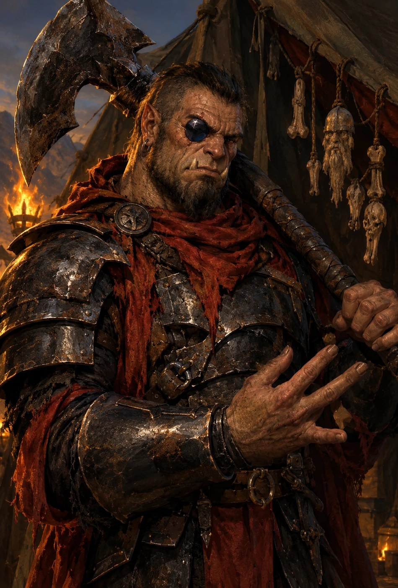

**Mappa M7-C** (Appendice D). I PG entrano da nord, dalla parte della fortezza.
La soglia è illuminata, il fondo no.

**Comparse** *(statistiche: Appendice A.2)*

| Chi | Com'è | Come parla |
|---|---|---|
| le quattro guardie | hobgoblin in armatura nera laccata, tutti uguali di proposito. Vogliono che Zog'tar non li veda mai esitare, perché l'ultimo che ha esitato è sul seggio, fra i teschi | non parlano: al generale rispondono battendo il piatto dello spadone per terra, una volta sì, due no |

**Se arrivano visibili.** A piedi l'invisibilità del re finisce dentro il
secondo blocco, quindi il caso più probabile è che arrivino **nascosti**, non
invisibili. Vale tutto quello che segue, con tre differenze:

- la runa della soglia non ha niente da rivelare: chi entra da lì con un nano
  la fa scattare, ma resta com'era;
- le guardie dentro la tenda si evitano con **Nascondersi** contro il loro
  **Osservare** (Appendice A.2): una prova entrando, un'altra se qualcuno si
  muove. Il buio del fondo non nasconde nessuno: le guardie, hobgoblin, e
  Balvar, nano, vedono al buio fino a 18 m, e la tenda sta tutta in quel
  raggio. Per l'SRD l'oscurità non dà occultamento contro la scurovisione, e
  Nascondersi senza copertura né occultamento non si tenta. La copertura c'è
  dietro i tre pali in fila sotto il colmo (K12, N12 e Q12), la tavola della
  mappa a J10 e lo schienale del seggio. Chi entra senza invisibilità e senza
  arrivare dietro uno di questi è visto;
- se una guardia li vede, si passa alla **Scena 8** senza round di sorpresa.

Balvar li legge comunque. Finché gli parlano sottovoce in nanico antico nessuno
tira niente: nella tenda si ride e si grida. Chi alza la voce, o risponde in
comune, si fa sentire, e si passa alla Scena 8.

**L'invisibilità finisce durante la trattativa.** Parlargli prima di colpire
costa una tacca, e nessuna pozione del gruppo dura tanto: le comprate durano 3
minuti, *volare* 5. Chi torna visibile dietro una delle coperture (un
palo, la tavola, lo schienale del seggio) tira Nascondersi contro l'Osservare
delle guardie, come chi arriva visibile; chi torna visibile allo scoperto, o
sospeso in volo sotto il telo, è visto, e si passa alla Scena 8 senza round di
sorpresa.

**Da dove entrano decide come comincia.** Le rune della soglia sono nella
Scena 6, e qui basta il riassunto. La soglia porta *epurare invisibilità*,
che scatta se la varca un nano e non fa rumore. Il telo sopra il seggio
porta un *glifo di interdizione* legato ai nani, 5d8 sonori con Riflessi
CD 18, e il boato è l'allarme. Il telo est, a sinistra per chi arriva da
nord, non ha niente. Grask è fuori, a due quadretti dal seggio: sveglio
finché l'ultima tacca segnata è la 4ª, addormentato dalla 5ª. Lo stato si
fissa all'atterraggio, e la tacca della trattativa non lo cambia.
Accanto a lui c'è il corno, e quello che si dice lì lo sente il drago (Scena 6,
«Quello che si dice qui lo sente il drago»).

| Come entrano | Cosa succede |
|---|---|
| **dalla soglia, con un nano fra loro** | la runa di *epurare invisibilità* li rende visibili tutti, senza un rumore. Le guardie li vedono: si passa alla **Scena 8**, senza round di sorpresa. Balvar resta seduto |
| **dal telo, dopo il consiglio di Balvar** (*«Non la soglia. Il telo a sinistra.»*) | restano invisibili. La scena va come scritta qui sotto |
| **tagliando la tenda altrove** | restano invisibili, ma il taglio fa rumore: le guardie tirano Ascoltare contro il Muoversi Silenziosamente di chi taglia |

**Come va la scena, in ordine.** Nella tenda ci sono due persone che contano, e
**parla prima quella che non dovrebbe**. Zog'tar è sul seggio con le sue
guardie; **Balvar** è nell'angolo in fondo, dove i bracieri non arrivano. I PG
sono invisibili, o nascosti dietro un palo o la tavola, ma Balvar li **legge**: il suo *Leggere il Fuori-Posto*
percepisce chi non appartiene a questo secolo. Parla in **nanico antico**, a
voce bassa, e nessuno nella tenda capisce: Zog'tar crede che borbotti sulle sue
rune, come fa sempre. Fra i PG, i nani lo capiscono **a fatica**: tutto il senso,
non le sfumature. Thorik lo **legge**. La
conversazione con Balvar si fa **a tre passi dal generale**, ed è questa la
tensione della scena. Quando finisce, o quando
qualcuno colpisce, comincia la Scena 8.

**Se sono ancora invisibili, Balvar non vede la Corona: la sente.** *Leggere il
Fuori-Posto* gli dice dov'è quello che non appartiene a questo secolo, e la
Corona lo è più di tutto il resto. Nel box 2 qui sotto, allora, non guarda
«voi»: guarda il punto in cui siete, uno per uno, e si ferma davanti al capo.


**Scheda d'entrata — Balvar Fuocospento, il runaio esiliato** *(statistiche:
Appendice A)*

| | |
|---|---|
| **Aspetto** | nano dello scudo vecchio, grembiule di cuoio, seduto su uno sgabello da bottega. Sulle ginocchia una lastra d'ardesia, in mano una punta di ferro |
| **Vuole** | che Hammerfist cada **in fretta**, perché un assedio lungo è fame, e lui l'ha già vista. E che qualcuno dica che c'era |
| **Suona** | non smette di incidere mentre parla. La punta sull'ardesia continua sotto le frasi |
| **Sa** | **che i PG non sono di questo secolo**, unico in tutta Hammerfist. Dove vanno colpite le mura. La runa-vincolo sulla scaglia del drago, perché l'ha incisa lui |
| **Non dice** | che ha un nipote di diciannove anni sul camminamento. Mai per primo |
| **Ritratto** | qui sotto. Ai giocatori si mostra dopo l'incontro, non prima |

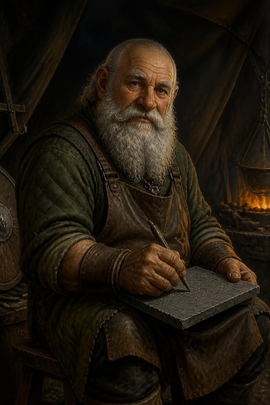

> **Perché esiste.** Due giocatori hanno chiesto la stessa cosa da due lati:
> Artemis non ha mai niente da individuare, Thorik non incontra mai
> incantatori (`DM-CAMPAIGN-PLAYBOOK` §1-bis). Balvar è la risposta — ma non è
> un boss in più appiccicato al modulo: è **il motivo per cui l'orda ha un
> drago**. Toglilo e il duello della Scena 11 cambia. Statblocco: Appendice A.4.

#### Chi è

Un **nano dello scudo**, vecchio, esiliato da Hammerfist prima che i PG
nascessero. Era già un mastro runaio, di altre fortezze, quando Hammerfist fu
eretta: ci arrivò per la sua abilità, e ne divenne il **runaio**, quello che
incideva le protezioni sulle porte. Adesso incide per Zog'tar, e Abbathor gli tiene la
mano ferma.

Non comanda l'orda. **Consiglia**, e per questo è più pericoloso del generale:
Zog'tar sa uccidere diecimila uomini, Balvar sa **dove** vanno colpite le mura.

#### ⚖️ Il grigio — perché **crede di aver ragione** *(pilastro GoT)*


| | |
|---|---|
| **Vuole** | che Hammerfist **cada in fretta**. Non per odio: perché un assedio lungo significa fame dentro le mura, e lui l'ha già vista una volta |
| **Crede** | che i re nanici mentano ai loro, e che le sue rune abbiano protetto per trent'anni una fortezza che l'ha esiliato **senza processo** |
| **La leva** | = suo nipote. È dentro le mura, ha diciannove anni, e Balvar sa esattamente su quale camminamento monta la guardia |
| **Ricattabile** | sì, e da nessuno che non gliene parli **per primo**. Se i PG lo minacciano, si chiude; se gli dicono che il ragazzo è vivo, no. Non l'hanno mai visto, quindi è una promessa o una bugia: Raggirare contro il suo Percepire Intenzioni **+13** (statblocco in Appendice A). Se ci crede, conta come recuperato |
| **Non è un mostro** | e questo è il punto: se il tavolo lo tratta da mostro, lo scontro funziona lo stesso. Se lo tratta da nano, il master cambia forma |

⚠️ **È una fazione recuperabile, non una fazione debole.** Balvar in combattimento
resta un GS 13, e le sue rune fanno male. Recuperarlo **non lo indebolisce**:
gli cambia bersaglio.

**Cosa fa quando comincia lo scontro**

| Com'è andata con lui | Nella Scena 8 |
|---|---|
| **Recuperato**: il nipote, o il patto *«dite che c'ero»* accettato | non combatte. Resta sullo sgabello e incide. Il suo bersaglio diventa il drago: al primo round dice ai PG dov'è la runa della Catena e come si spezza, e la riga «Individuano la runa» qui sotto è già fatta |
| **Trattativa aperta**, nessuno l'ha minacciato | il primo round guarda. Dal secondo sta con chi sta vincendo: vince chi ha tolto più di metà dei pf all'altra parte, e Zog'tar se nessuno ci è riuscito. Con i PG non combatte il generale in faccia: *dissolvi magie* sui suoi, e la *barriera di lame* fra le guardie e il gruppo |
| **Minacciato, o attaccato** | combatte con Zog'tar: vedi «Come si combatte» più sotto |

**Quanto pesa lo scontro.** Zog'tar (GS 15), Balvar (GS 13), le quattro
guardie (Guerriero 8) e il sacerdote dell'orda (GS 6) insieme fanno **EL
17**, cioè il tetto di APL + 4: più su non si va. Senza Balvar, **EL 16**. Il conto è fatto a mano con le
regole di combinazione della DMG, ed è un'approssimazione.

🚫 **Cosa NON dire.** Che il nipote esiste. Balvar non lo nomina mai per primo:
si arriva al ragazzo solo se qualcuno **guarda** cosa sta incidendo sull'ardesia
(Osservare **CD 20**: è un nome nanico, **Hald**, e sotto una data di nascita;
Hald è il figlio di sua sorella), oppure se
un PG nano gli chiede chi ha lasciato a Hammerfist — **Diplomazia CD 18**, e
funziona solo se non l'hanno ancora minacciato.

> **Read-aloud (Andor lead) — il primo incontro, 1 di 3, poi FERMATI.** *In fondo alla tenda, dove
> la luce dei bracieri non arriva, un vecchio è seduto su uno sgabello da
> bottega. Grembiule di cuoio. Sulle ginocchia una lastra di ardesia che sta
> incidendo con una punta di ferro, piano, come se fuori non ci fossero
> diecimila tende e un drago.*

> **Read-aloud (Andor lead) — 2 di 3, dopo che qualcuno ha reagito.** *Alza la
> testa e vi guarda lentamente, uno per uno. Sulla gemma del vostro capo si
> ferma un istante di troppo. Poi torna a incidere. Non chiama la guardia.*

> **Read-aloud (Andor lead) — 3 di 3, solo quando il silenzio diventa scomodo.** *Il vecchio parla piano, da artigiano, senza fretta: «Quella
> corona la finirono con tre gemme. Tu ne hai due.» Un colpo di punta
> sull'ardesia. «Quindi non è oggi.»*


#### Perché è con l'orda, e perché Zog'tar si fida

- **Perché è con l'orda.** Esiliato senza processo, come dice la sua scheda, ha
  trovato in Abbathor un dio che non gli chiede di perdonare. Il prezzo che ha
  chiesto a Zog'tar non è oro: è che la fortezza cada **in fretta**, e che chi si
  arrende non venga toccato. Sul camminamento c'è suo nipote.
- **Perché Zog'tar si fida.** Non ciecamente: per tre ragioni che vede. Balvar gli
  ha dato un drago, e nessun altro poteva. In dieci notti le sue rune hanno
  fermato due incursioni di esploratori nanici, ed è per questo che gli
  esploratori da allora guardano soltanto dalle mura. E Balvar non chiede il
  comando né il bottino: un uomo che non vuole niente di quello che vuoi tu non
  è un rivale.
- **Cosa Zog'tar non sa.** Il patto sulla resa, che Balvar non gli ha mai detto
  in quei termini.

#### La cosa che lo rende memorabile: sa che non siete di qui

**Leggere il Fuori-Posto** (3/giorno) è l'unica capacità che conta davvero. In
tutta Hammerfist del ≈372 DR, **Balvar è il solo che sa che i PG non
appartengono a questo secolo** — e non lo dice a nessuno, perché
un'informazione che nessuno ha vale più di un'informazione condivisa.

**Come lo sa, e cosa non sa.** *Leggere il Fuori-Posto* gli dice che i PG non
sono di questo secolo, non di quale. Il resto lo capisce dalla **Corona**. Da
giovane, quando era il runaio della fortezza, l'ha vista sulla testa del vecchio
re, quello che l'ha persa contro Skullcrusher cinquant'anni fa: per questo dice
*«la finirono con tre gemme»*. Adesso la vede sulla fronte di uno straniero,
con due gemme accese. Ne deduce che viene da **dopo**, e da molto dopo. L'anno,
i nomi e quello che è successo nel frattempo non li sa.

**Non li smaschera. Tratta.** È un mercante di segreti come Varis è un mercante
di merce, e la scena giusta è la stessa: un affare vero con un amo vero.

**BALVAR (piano, senza alzare gli occhi):** *«Non chiedo chi siete. Chiedo una
cosa sola, e ve la chiedo adesso, perché fra un'ora saremo tutti occupati.»*

*Un colpo di punta sull'ardesia.*

**BALVAR:** *«Quando avrete finito quello che siete venuti a fare, e lo
finirete, lo vedo da come camminate, dite che c'ero.»*

*Posa la punta, e adesso li guarda.*

**BALVAR:** *«Non che ho vinto. Che c'ero. La Cronaca scrive solo i nomi che
qualcuno pronuncia.»*


Questo è il suo prezzo, ed è per questo che ha lasciato passare i PG. Un uomo
cancellato dagli annali che chiede a dei viaggiatori del tempo di **essere
ricordato**. Se accettano, in ARC-08 e ARC-09 gli affreschi della Sala avranno
**un pannello in più**, e nessuno saprà spiegarlo — tranne loro.

#### La Catena: perché il drago combatte per l'orda

Balvar ha inciso una **runa-vincolo** nella scaglia sternale di Skullcrusher.
Non è dominazione: è un **contratto scritto nella carne**, e il drago lo sa,
e lo odia. Questo aggancia direttamente il duello (Scena 11):

| Cosa fanno i PG | Effetto sul duello con Skullcrusher (Scena 11) |
|---|---|
| **Non se ne accorgono** | il duello va come scritto |
| **Individuano la runa** (Sapienza Magica **CD 24**, o Conoscenze storia CD 22 per riconoscere il nanico antico — **è scritta, quindi si legge**) | sanno dove colpire. **Quando**: di notte il drago è sulle colline, quindi la runa si vede all'alba, nel duello, con un'azione di movimento entro 9 m. Nella tenda si legge la **gemella** sul corno (Scena 6), che dice dove sta l'altra; e Balvar, se è recuperato, lo dice lui |
| **Colpiscono la scaglia** | **regola della casa**: il 3.5 non ha colpi mirati. Si attacca la CA del drago **+4**, perché il bersaglio è piccolo, e il primo colpo che va a segno **spezza la Catena** |
| **Balvar la scioglie** (solo se è recuperato) | può farlo, e lo sa, ma **solo toccando la scaglia**: cioè nel cortile, durante il duello. Vale come spezzarla (riga sotto). Per arrivarci torna con i PG (se tornano in volo: Scena 8, «Se Balvar è recuperato»): nel ritorno a piedi tira con loro, e conta per la metà del gruppo (Nascondersi e Muoversi Silenziosamente **−1**: nessun grado, DES +2, armatura completa di mithral −3), alla postierla Durin lo fa entrare se un PG garantisce per lui (Scena 8, «Se Balvar è recuperato»), e nel cortile resta ai margini fino al duello |
| **Spezzano la Catena** | Skullcrusher **smette di combattere per l'orda**. Non diventa alleato — è un drago nero — ma se ne va, e l'assalto alle mura perde le ali. Vale **FERITO GRAVE** se il drago aveva già perso almeno un terzo dei pf, altrimenti **FUGGITO**. È una soglia diversa da quella della fuga della Scena 11, che arriva a un terzo dei pf **rimasti**: la Catena spezzata accorcia la strada |
| **Uccidono Balvar prima dell'alba** | la runa resta (è incisa, non sostenuta), **ma** senza chi la rinnova si indebolisce: Skullcrusher parte con **−2 a tutto** e fugge a **metà** pf invece che a ⅓ |

⚠️ **È qui che il gruppo diventa un gruppo.** Artemis vede l'aura, Thorik legge
il nanico antico, Tordek arriva alla scaglia. Nessuno dei tre ce la fa da solo:
**è esattamente la scena che mancava all'arco.**

#### Che cosa muove Skullcrusher

Il drago non ha mai perso. Cinquant'anni fa, in questa stessa valle, ha ucciso
il re di Hammerfist, e da allora i nani per lui sono una cosa da mangiare
quando ha fame. Per questo ha accettato il patto di Balvar: quando la fortezza
cade, il tesoro del re è suo. A un drago un contratto piace, perché è oro
promesso per iscritto, e la runa sulla scaglia gli è sembrata il sigillo.

Il guinzaglio l'ha scoperto dopo, la prima volta che il corno ha suonato e lui
è tornato senza volerlo. Balvar ci aveva inciso una riga che non gli aveva
letto. Da quella notte odia la Catena più dei nani.
Se non l'ha letta da sé è per arroganza: un drago che non ha mai perso non
cerca la riga piccola. Il resto del patto però regge, e il tesoro del re gli
è ancora dovuto.

**Il corno gli porta le voci**. Odiando la Catena,
l'ha studiata per liberarsene. Spezzarla non ci riesce, ma ha scoperto che la
runa sulla scaglia è gemella di quella incisa sul corno di Grask, e ha
imparato ad ascoltarci dentro: quello che si dice vicino al corno gli arriva
come un sussurro, anche sulle colline. Di notte il corno sta fuori dalla
tenda di Zog'tar, nella custodia incatenata al polso di Grask (Scena 6), e
così all'alba il drago sa i nomi che i PG si sono detti vicino alla tenda.
Chi non ha sentito nominare lo chiama per quello che vede: *la morta
tornata*, *il nano con la Corona*. A *colpo accurato* basta una parola, e la
passata col nome resta com'è (Scena 11, «La passata, il nome, la prima
paura»). I nomi non li chiede: un PG sano di mente non glieli darebbe.

| | |
|---|---|
| **Vuole** | il tesoro di Hammerfist, e uccidere un secondo re **davanti all'orda**, con diecimila bocche che poi lo raccontano |
| **Teme** | che si veda il guinzaglio: che l'orda capisca che il suo drago torna quando lo chiamano |
| **Ha in mano** | le ali. Senza di lui l'assalto è una scala appoggiata alla pietra, e Zog'tar lo sa |
| **Prossimo passo** | all'alba, al corno, cala sul cortile dove sta il re |

**Cosa ne fa il tavolo.** Quattro leve, e nessun numero nuovo:

- **Dire la Catena ad alta voce**, in comune o in goblin, dove l'orda sente. È
  la stessa azione di movimento che serve a leggerla (Scena 11). Danni non ne fa,
  ma dal suo turno successivo il drago va su chi l'ha detta, e ci resta. È il modo di tirarlo giù su un PG che lo regge, e chi
  lo fa se lo prende addosso.
- **Offrirgli di spezzarla.** Davanti all'orda rifiuta sempre, perché accettare
  vorrebbe dire ammettere il guinzaglio, e chi l'ha offerto diventa il bersaglio
  preferito come chi lo ha ferito di più. Lontano da quegli occhi ascolterebbe,
  ma il master non prepara quel caso: se il tavolo ci arriva, è del DM.
- **Parlare al corno apposta**. Balvar recuperato
  lo sa o lo intuisce, perché le due rune le ha incise lui, e lo dice se gli
  chiedono come fa il drago a sapere le cose; oppure il tavolo ci arriva da
  sé, dalla battuta d'apertura del duello. Allora vicino al corno si può
  mentire di proposito: un nome scambiato fra due PG, un piano detto ad alta
  voce per non farlo, una trappola. Il drago agisce su quello che ha sentito,
  e grida il nome che crede giusto. Quando la passata gli mostra l'inganno è
  un'altra cosa che l'orda ha visto.
- **Farlo fuggire.** Alla prima paura (⅓ dei pf, Scena 11) non passa sopra il
  campo: va basso, verso le paludi, sotto la sua *oscurità*, per non farsi
  vedere. È l'unica volta che la usa nel duello. L'orda lo vede lo
  stesso, ed è da lì che comincia a sfaldarsi (Scena 13).

#### Come si combatte, se si arriva a combatterlo

**Con tre o cinque PG** vale la riga di scala della Scena 8: la tenda è uno
scontro solo, e Balvar ne fa parte. Cambiano le guardie, non lui.

**Non ingaggiarlo in campo aperto**: non è un duellante, è un **preparatore**.

Le rune incise che regge sono **quattro**, e la quarta è la Catena del drago.
Le altre tre sono qui, incise sapendo che qualcuno sarebbe entrato:

1. sulla **soglia** — *epurare invisibilità* (Scena 6): chi entra da lì con un
   nano diventa visibile, senza un rumore;
2. sul **palo centrale** — *blade barrier*, che scatta e taglia la tenda in
   due, separando il gruppo: 13d6, Riflessi CD 21 per evitarla;
3. **su di sé** — *silenzio*, che attiva a comando: chi conta sulla componente
   verbale è fuori, lui no, perché le rune non ne hanno.

E poi c'è la **lastra d'ardesia**. Non è una runa attiva, perché la quinta non
la reggerebbe, ma lui **continua a incidere mentre combattete**. Falla vedere:
è l'immagine che li terrorizza. *Àncora dimensionale* è fra i suoi
incantesimi: se qualcuno prova a teletrasportarsi fuori, la lancia.

**Tattica**: *righteous might* al round 1 e *slay living* (Tempra CD 20) sul
più fragile al round 2, **prima** del silenzio, perché tutti e due hanno la
componente verbale. Chi fallisce il TS contro *slay living* muore davvero,
come nell'SRD: la cattura del Q29 vale per chi cade a 0 pf, non per chi muore.
Si torna con *rianimare morti* alla cappella, che ha l'unico diamante della
fortezza (5.450 mo, Scena 5), o con *reincarnazione*, se Hella l'ha preparata.
Dal round 3 attiva la runa del *silenzio* su di sé e usa
solo quello che non parla: la *blade barrier* del palo, che è una runa, e il
martello. Se nella tenda qualcuno vola, al round 1 lancia *comando superiore*
al posto di *righteous might*, e al round 2 *slay living* come sopra, oppure
*dissolvi magie* sul volo se il comando non è bastato; *àncora dimensionale* la lancia solo nei primi due
round. Dal round 3, dentro il suo *silenzio*, nessuno dei tre è possibile,
perché tutti hanno la componente verbale (SRD). Numeri in Appendice A.4. Se scende
sotto **30 pf** non fugge e non implora: **finisce di incidere la lastra** e la
lascia lì. Gli costa un'azione di round
pieno, l'ultima: in quel turno non attacca e non lancia.
`[HDYWTDT — il finisher a chi abbatte Balvar: «com'è che lo fai?», e il vecchio
non alza la testa dalla lastra]`. Se il tavolo la legge subito:


> **Read-aloud (Salvatore).** *Tre rune nane, tutte spezzate a metà dallo
> stesso colpo di punta. Sotto, inciso più a fondo, un nome: Hald. Poi una
> freccia, verso nord.*

Il senso si decide in ARC-09. Il nome è quello del nipote, la freccia no:
cosa c'è a nord non lo sa ancora nessuno, nemmeno il master.

#### Se lo divinano: la natura di Balvar

Al 13° il gruppo può lanciare *divinazione*, *comunione*, *individuazione dei
pensieri* e *zona di verità*. Nessuno di questi incantesimi rompe la scena:
ogni risposta porta dove la scena porta comunque, solo un passo prima, e chi ha
lanciato arriva alla trattativa sapendo una cosa in più. Una riga per ciò che
Balvar nasconde.

- **Che cos'è.** *Individuazione del male* lo mostra malvagio: è un chierico di
  Abbathor, neutrale malvagio. Non cambia niente, perché Balvar non finge di
  essere un'altra cosa. Lavora per l'orda e lo si vede.
- **Che sa chi sono.** *Divinazione* o *comunione* confermano che sa che i PG
  non sono di questo secolo, ma non di quale, e che l'ha capito dalla Corona.
  Saperlo prima toglie al tavolo la sorpresa del terzo box, non la trattativa.
- **Il nipote.** *Individuazione dei pensieri* deve vincere la sua Volontà
  (+17), e con un incantesimo di 2° livello ci riesce di rado. Se ci riesce,
  il pensiero in superficie è quello che sta incidendo sull'ardesia: un nome,
  Hald, e una data di nascita. Vale come l'Osservare CD 20 sulla lastra e apre
  la stessa porta: chi gli parla del ragazzo per primo non lo trova chiuso.
- **La Catena.** *Comunione* o *divinazione* sul drago rispondono che è legato
  da una runa, e che l'ha incisa Balvar. Vale come aver letto la gemella sul
  corno: i PG sanno che all'alba devono cercarla sulla scaglia sternale.
- **Il patto con Zog'tar.** In una *zona di verità*, se fallisce il TS sulla
  Volontà, Balvar non può mentire, e alla domanda giusta dice il suo prezzo:
  che la fortezza cada in fretta e che chi si arrende non venga toccato.
  Zog'tar non lo sa. Il nipote invece non lo nomina nemmeno lì, perché la zona
  impedisce di mentire, non obbliga a parlare.
- **Il suo nome.** *Leggende e tradizioni* non trova niente: la Cronaca non
  ha il suo nome, e non l'avrà finché qualcuno non lo pronuncia. È il prezzo
  che chiede ai PG, e chi ha lanciato l'incantesimo lo capisce prima degli
  altri.

#### L'eco a 1372 (il motivo per cui vale la pena)

Balvar è morto da mille anni comunque vada. Ma:

- se i PG hanno **pronunciato il suo nome**, in ARC-08 la Cronaca ha un
  pannello in più — e **Aegis Fang lo riconosce**;
- se hanno **spezzato la Catena**, il carry-over B4 verso **Fauci di Palude**
  cambia di tono: il figlio del drago incatenato ha una ragione in più per
  odiare i nani, o per **non** volere una catena addosso;
- se lo hanno **ucciso senza ascoltarlo**, resta una lastra d'ardesia incisa a
  metà tra le rovine del campo. Qualcuno, in ARC-09, l'ha trovata.

→ Registra l'esito nell'**Echo Ledger** (§7).

### SCENA 8 — Zog'tar

**In scena** — Dove: la tenda — Chi: Zog'tar · le quattro guardie · Balvar · il sacerdote dell'orda

*La scheda d'entrata di Zog'tar è nella Scena 7, dove i PG lo vedono per la prima volta.*

> **Read-aloud (Salvatore lead) — la tenda, il seggio.** *Il mezzo-ogre si alza
> dal seggio, e i teschi inchiodati sbattono fra loro come nacchere. Non grida
> subito. Prima gira la testa, e la pietra nera dove dovrebbe esserci l'occhio
> si ferma sul più vicino di voi. Poi l'ascia scende dalla spalla.*
>
> **Che fate?**

**Il round di sorpresa.** I PG che nessuno ha visto, invisibili o nascosti, hanno il **round di sorpresa**, cioè
per l'SRD un'azione standard o di movimento a testa, se
nessuno ha parlato ad alta voce o lanciato incantesimi che li rivelano. Parlare
con Balvar in nanico, a bassa voce, **non** conta come parlare ad alta voce: è il
motivo per cui la Scena 7 viene prima.

#### Tattiche di Zog'tar — round per round (stile RHoD)
> È un macellaio arrogante che si crede immortale: non conosce la paura finché
> non gli entra nelle ossa. Non sa che la Morte è già nella tenda.

- **Round di sorpresa** (se nessuno li ha visti né sentiti): un'azione
  standard o di movimento a testa. *È qui che si vince o si complica.* Un
  colpo coordinato gli fa male ma non lo abbatte: fuori dall'Ira ha 283 pf,
  e non perde la Destrezza alla CA nemmeno colto di sorpresa (Schivare
  Prodigioso Migliorato). È voluto: il DM lo vuole in piedi al secondo round.
- **Chi accorre al grido**. Le ronde di orchi più vicine arrivano
  alla tenda in **1d4+2 round**, gli squadroni hobgoblin in **2d4+2**: sono
  «i rinforzi» di cui parla la Scena 7. Statistiche in Appendice A.6. Chi
  resta oltre il loro arrivo combatte l'orda, non più un generale. Le ondate
  non finiscono: dalla prima ronda ne arriva
  un'altra ogni round, e dal primo squadrone un altro ogni due round, finché i
  PG restano nel campo. Un round prima che arrivino si vedono torce muoversi
  sul telo e si sente un ordine gridato in orchesco: è il segno per chi vuole
  uscire prima. Finché Zog'tar è in piedi non entrano nella tenda,
  perché il generale non vuole aiuto davanti alle sue guardie: fanno quadrato
  fuori, attorno al telo, e aspettano chi esce. Chi esce a piedi li trova
  tutti; contro chi vola tirano le lance, e contro chi è invisibile colpiscono
  il quadretto da cui viene il rumore, con il 50% di mancare. Quando Zog'tar
  cade, o scappa, entrano. Smettono solo quando i PG sono fuori dal campo.
  Lo scontro col generale resta a EL 17; i rinforzi sono sopra il tetto per
  scelta, come il drago sulla tenda.
- **La tenda è alta 6 m al palo centrale e 3 m ai lati**. I pali
  sono tre, in fila sotto il colmo e tutti alti 6 m (mappa M7-C): il centrale è
  il palo maestro, con la runa di Balvar. Sotto il
  telo chi vola **non** esce dalla portata dell'ascia: Zog'tar è alto 3 m e
  arriva a 3 m oltre, cioè fino al colmo. Ne esce solo chi sta fuori dal telo.
  Le risposte dell'orda, tutte SRD:
  - **Zog'tar** tiene **tre giavellotti Grandi** accanto al seggio: +19 a
    distanza, 1d8+13 in Ira, incremento 9 m. E se il volo dura, **abbatte il
    palo centrale** (Forza **CD 20**, azione standard): il colmo è fatto di due
    travi incastrate sul palo centrale, e senza quello cadono e si portano
    dietro i pali di testa `[INFERRED — needs DM confirmation]`. Il telo crolla, e chi è
    in volo sotto finisce a terra, intralciato, finché non supera Riflessi
    **CD 15** (un tentativo per round). Le guardie e lui escono dal telo in un
    round;
  - **Balvar**, se combatte: *dissolvi magie* sul volo, e **comando superiore**
    (5° livello, uno slot che aveva libero): una
    parola a un bersaglio per ogni livello, tutti entro 9 m l'uno dall'altro,
    Volontà **CD 20**, e dura fino a 13 round: all'inizio di ogni suo turno dopo il primo, il bersaglio ritenta il TS sulla Volontà, e se riesce l'effetto finisce (SRD). L'ordine è **«Cadi»**
    (*«A terra!»*), uno dei cinque dell'SRD: il bersaglio cade a terra e resta
    prono un round, obbedendo al meglio che può. Finché non riesce il TS
    obbedisce di nuovo a ogni suo turno: da prono agisce, attacca con le
    penalità del prono e lancia, ma non si rialza (SRD, *comando*). Chi vola **scende fino a
    terra** nel suo turno, senza danni da caduta, e si mette prono
    (l'SRD non parla di chi vola: è una scelta del DM): sotto un telo
    alto 6 m ci arriva sempre. Se fosse troppo in alto per toccare terra in un
    turno, l'incantesimo fallisce (SRD). Thorik è immune
    (Mente Vuota della Corona), e per la stessa ragione lo è alla Presenza
    Minacciosa di Zog'tar e alla Presenza Terrificante del drago: per l'SRD
    sono effetti di paura che influenzano la mente, e *mente vuota* protegge
    da tutti. Balvar lancia il comando nei primi due round, prima del suo
    *silenzio* (Scena 7). E *barriera di lame* sul palo. *Àncora dimensionale*
    non c'entra col volo: blocca il teletrasporto e la *porta dimensionale*, e
    chi è ancorato continua a volare (SRD). La tiene per chi prova a sparire;
  - **il sacerdote**: *comando* «Cadi!» (Volontà CD 13) su chi vola: scende a terra e resta prono un round;
  - **le guardie**: giavellotti, +9 a distanza (1d6+4).
- **Il corno e il drago sulla tenda**. Il corno è magico: Balvar ci ha
  inciso la runa gemella della Catena, e quando suona il drago **deve**
  tornare, anche se dorme. Dalle colline ci mette **circa 7 minuti, 70 round**
  dal primo suono. Quindi arriva sulla tenda solo se il corno ha suonato
  **prima** dello scontro (un allarme durante l'infiltrazione, Scena 6) o se i
  PG si attardano dopo. **Se quando arriva Zog'tar o almeno una guardia sono
  ancora in piedi**, Skullcrusher entra nello scontro, ed è uno scontro in cui
  si scappa o si muore: EL **18-19**, oltre il tetto di APL+4, voluto dal DM.
  Si vede arrivare: il corno, poi l'ombra che passa sul telo e il fuoco dei
  bracieri che si piega. L'uscita è il telo tagliato e il buio fuori.
  - **Come combatte, da drago nero che si chiama Skullcrusher**: non atterra fra
    le tende. Strappa il telo con un passaggio radente (Attacco in Volo, artigli
    sul telo: la tenda è scoperchiata) e **soffia sulla linea più lunga che
    prende più PG**, anche se ci sono dentro le sue guardie: se le prende, le
    guarda sciogliersi e ride. Poi resta sopra, a 12-15 m, e picchia su chi è
    isolato o ferito, mai su chi lo sfida. Usa *oscurità* sulla tenda per
    togliere la vista a chi non vede al buio, e *corrompere l'acqua* su chi
    beve. Non insegue fuori dal campo: la Catena lo tiene lì.
  - **Cosa si porta all'alba**: i pf che ha perso stanotte restano persi, e il
    duello della Scena 11 comincia **senza sorpresa**, perché li conosce.
- **Round 1** (se reagisce): **Ira Barbarica** (*«A ME, CANI! ABBATTETE LE
  OMBRE!»*) + **Occhio di Ossidiana** su Thorik (la minaccia). Delle quattro
  guardie, due restano al seggio e due vanno sul PG più esposto (qui sotto).
- **Come combattono le quattro guardie**.
  Due davanti al seggio, sempre, fra Zog'tar e chi lo minaccia: non lo
  lasciano fiancheggiare, e non attaccano. **Lo coprono**, con *Aiutare un
  altro* (SRD): un'azione standard, un attacco contro CA 10, e se riesce
  Zog'tar ha +2 alla CA contro il prossimo attacco di quell'avversario.
  Ognuna copre il generale da un PG diverso, di solito Thorik e Tordek, e
  deve stargli accanto. Le altre due vanno su chi lancia incantesimi o
  colpisce da lontano, in coppia. Contro chi vola tirano i giavellotti, poi
  tornano davanti al seggio. Contro chi è invisibile colpiscono il quadretto da
  cui viene il colpo, con il 50% di mancare. **Finché Zog'tar è in piedi non
  scappano**: lui le guarda. Se cade, le guardie rimaste gettano le armi e
  corrono fuori a gridare, ed è l'allarme anche se Grask dorme. Per questo un
  Zog'tar ucciso in silenzio vuole prima le guardie a terra, o una bolla di
  *silenzio* sulla tenda.
- **Round 2-3**: carica il bersaglio che fa più danni, **Attacco Poderoso**
  moderato (−5/+10) se ha colpito bene.
  Contro chi porta armatura leggera o niente (Artemis, Hella in forma
  normale) non alza l'Attacco Poderoso: usa il **Colpo Devastante** e lo
  scaglia lontano, contro un palo o fuori dal telo. Un nano scagliato contro
  il telo del seggio (N15–P15) fa scattare il glifo legato ai nani,
  e il boato è un allarme. Separa il gruppo e lascia
  vivo il bersaglio. Se Artemis lo martella, si gira su di lui.
- **Danno massiccio** (regola SRD, attiva nelle regole della casa). Con
  l'Attacco Poderoso pieno o un critico l'ascia supera spesso i 50 danni: il
  bersaglio tira Tempra CD 15 o muore. La cattura del Q29 vale per chi cade a
  0 pf, non per chi fallisce questo TS.
- **Soglia 30% pf**: combatte disperato, cerca di **portare un PG con sé** nella
  morte (un ultimo Attacco Poderoso pieno, −15/+30, Appendice A.2).
- **Se è pre-allertato** (il corridore è arrivato, o c'è stato un allarme):
  è in piedi con l'ascia in mano, le quattro guardie davanti al seggio, e Grask
  è sveglio fuori dalla tenda col corno pronto. Niente round di sorpresa, e
  l'Ira comincia al suo primo turno. Balvar parla lo stesso, se i PG ci
  arrivano: lui non ha fretta.
- **Il sacerdote dell'orda**. Dorme nella
  tenda, su una stuoia dietro il seggio, a N14.
  Si alza al primo grido e agisce dal **round 1**, con *vedere invisibilità*
  già addosso se ha sentito il corno. Lancia *comando* («Cadi!», Volontà CD 13) sul PG più vicino a Zog'tar,
  poi *benedizione* sulle guardie, poi *oscurità* per coprire la ritirata del
  generale. È un adepto: con Balvar, Zog'tar e le guardie la tenda arriva a EL
  17, il tetto. Statistiche in A.2.
- **Se Balvar sta con i PG, entrano le guardie del turno dopo**.
  Vale se è recuperato prima dello scontro, o se passa con i PG alla fine
  del round 1 («sta con chi sta vincendo», Scena 7). Sono due, con i numeri
  delle altre quattro (A.2), e dormono nella tenda accanto: al round 2
  entrano dal telo del seggio e vanno su chi lancia incantesimi. Sei
  guardie, Zog'tar e il sacerdote fanno **EL 16**, un punto sotto il tetto.
  Con cinque PG sono già nella tenda (la riga di scala, più sotto), e non
  se ne aggiungono altre.

**Comparse**

| Chi | Com'è | Come parla |
|---|---|---|
| il sacerdote dell'orda | hobgoblin secco, dagli occhi gialli, la mano sinistra nera di fuliggine fino al polso, un bastone ferrato con appese ossa di dita | canta invece di parlare, sempre la stessa cantilena, e la interrompe solo per dare ordini |
- **Il bottino e il tempo**: le armature della tenda, quanto pesano, quando
  si possono togliere e dove stanno nel buco portatile sono in §8 B, «Il
  bottino della tenda e il tempo».
- **Curarsi prima di ripartire** `[INFERRED — needs DM confirmation]`. Le
  bacchette di cura funzionano anche nella tenda, ma la tenda è circondata
  dalle ronde, e ogni carica è il round di chi la usa. Se il gruppo, in tutto,
  spende **più di 20 cariche** di bacchetta prima di ripartire dalla tenda,
  segna **una tacca** sull'orologio della notte. Il gruppo sceglie: rientrare
  ferito e curarsi alle mura, o perdere la tacca. In tutti e due i casi
  all'alba si vede che è stato nella tenda.
- **Sviluppi.** Zog'tar **esce dalla storia in questa scena**: morto, oppure
  umiliato e cacciato dal suo stesso campo (Via A, qui sotto). Il COME conta
  (► Esito, in fondo alla scena). `[HDYWTDT — il finisher a chi lo abbatte: «com'è che
  lo fai?», e aspetta. Se non vuole, una riga tua e si va avanti.]` Alla sua morte, l'Occhio di Ossidiana si spegne; il
  campo perde il direttore. *Se catturato/interrogato invece che ucciso*: Moradin
  approva la saggezza pragmatica (nessun tono «nessuna pietà» sul Rubino).

La seconda via che non passa dall'iniziativa (la prima, il corridore, è
nella Scena 6):

**Via A — l'Occhio contro il suo padrone** *(Artemis, Hella, chi ha visto la runa)*.
L'**Occhio di Ossidiana** è un artefatto **maledetto** e Zog'tar lo sa a metà:
il prezzo è che la luce divina lo brucia. Chi lo capisce — Sapienza Magica
**CD 20**, oppure **gratis** se hanno addosso la benedizione dei chierici di
Hammerfist (fiducia piena al consiglio, Scena 4) e le vedono reagire — può **mostrargliela invece di colpirlo**:
Intimidire **CD 22** con la Corona scoperta o la Luce di Lathander in mano `[regola della casa: nell'SRD Intimidire si tira contro il livello del bersaglio]`.
Non è un tiro salvezza, quindi la Volontà Indomita di Zog'tar non entra.
- **Riesce** → Zog'tar **arretra**, e arretrando esce dalla tenda davanti alle
  sue guardie. Perde la faccia, e con lei il campo: l'orda all'alba combatte a
  **−1 morale**, che annulla il successo in meno delle mura della Scena 10, se
  c'era. È un'azione standard. Le guardie lo seguono fuori senza combattere e
  Grask non suona; umiliato non vuol dire «vivo all'alba»: non sale sulla
  breccia.
- ► **Esito nuovo**: *umiliato, non ucciso*. 🔴 **Ed è un problema, non un
  premio**: Zog'tar **vive**, e in ARC-08 i discendenti della sua orda, nella Mano Rossa, hanno un generale in più
  nella sua storia. Registra nell'Echo Ledger (§7).

⚠️ **Perché due e non una.** Una via alternativa sola diventa «la soluzione
giusta» e il tavolo la cerca invece di giocare. Due che costano in modi diversi
— una la fama del nemico, l'altra il fiato — restano **scelte**.

#### Le scelte-costo dei PG contro Zog'tar (interazioni d'artefatto)
> ⚠️ **Niente tentazione Lathander/Mask per Artemis** (mai giocata, §1). Le sue
> scelte qui sono **tattiche e morali**, non divine.
- **THORIK — la preghiera a Moradin** (non è la *Benedizione della Forgia* dei Bracieri di Tordek): può chiedere a Moradin +2 sacro ai
  danni vs Zog'tar e guardie, al **costo di essere affaticato** (la condizione SRD) dopo la
  battaglia (peserà su Skullcrusher). *Scelta: potenza ora vs freschezza al drago.*
- **THORIK — finire o interrogare Zog'tar**: colpo finale spettacolare → il
  Rubino registra «nessuna pietà» (tono §7); interrogarlo → «saggezza pragmatica».
- **TORDEK — Cintura della Devastazione**: 4 cariche al giorno, +2d6 ciascuna,
  come dice la sua scheda. Se
  le brucia tutte per l'overkill, la Cintura lo «assaggia»: contro **Fauci nel
  1372** dovrà superare **Volontà CD 18** per non cedere all'aggressività. Se
  **modera** (1-2 cariche, colpi mirati) → Moradin gli concede **+1 sacro ai TS
  vs paura** in futuro. *(Nota: contro Skullcrusher la Cintura si rifiuta, Scena 11.)*
- **ARTEMIS — pulito o spettacolare**: uccidere Zog'tar in **silenzio** (blast
  mirato) tiene basso l'allarme: se nessuno esce dalla tenda a gridare (le
  guardie, qui sopra), Grask non suona e le ronde non arrivano a vedere lo
  scontro (1d4+2 round dal primo grido, o una bolla di *silenzio* sulla tenda), alle mura non c'è il successo in meno
  e il duello comincia senza picchiata; ucciderlo in modo **spettacolare** (esplosione
  davanti alle guardie) sparge terrore ma **fa infuriare Skullcrusher** (il
  duello della Scena 11 inizia in picchiata). È il suo bivio da predone: efficienza vs leggenda.
- **HELLA — controllo o distruzione**: *Intralciare* fuori dalla tenda blocca i
  rinforzi (controllo); fulmini/spine (distruzione). Nessun effetto meccanico
  immediato, ma orienta come gli spiriti/Moradin la giudicheranno alla battaglia
  di Rethmar (ARC-09): bonus a controllo-campo o a danni elementali.
- **PX Zog'tar**: sono dentro le ≈ 3.650/PG delle Scene 6-8 (§8,
  budget PX), con le guardie, il sacerdote e Balvar. Non si sommano. Catturato
  o umiliato vale come ucciso: la DMG dà i PX per l'avversario sconfitto, non
  per quello morto.

- ► **Esito**: *ucciso in silenzio / spettacolare / umiliato e vivo* (Via A). Se
  **spettacolare** (esplosione, decapitazione davanti alle guardie), il terrore
  dilaga MA **Skullcrusher interviene furioso**: non subito, perché di notte è
  sulle colline, ma all'alba il duello inizia col drago già in picchiata: ha un
  round di sorpresa (SRD), e i PG sono colti alla sprovvista fino al loro
  primo turno. Vale anche se di notte il drago li ha già visti, e un'altra riga
  direbbe «senza sorpresa»: vince la picchiata. Se l'orda è stata **pre-allertata** (corridore,
  allarme): un successo in meno sulle mura (Scena 10), e Zog'tar non è di
  sorpresa.
- **Come si decide**. Due domande,
  nell'ordine. **Qualcuno esce dalla tenda a gridare, o Grask suona?** Se no,
  è **in silenzio**: niente picchiata e nessun successo in meno. Se sì, è un
  **allarme**, e costa il successo in meno sulle mura come il campo
  pre-allertato; le guardie che scappano quando lui cade bastano. Conta come
  uscire a gridare anche la ronda che arriva al grido di Zog'tar (1d4+2 round,
  «Chi accorre al grido») e trova lo scontro ancora in corso: grida, come la
  ronda della Scena 6. **Chi è
  uscito ha visto un colpo che si fa vedere?** Un incantesimo ad area, una
  decapitazione, il finisher che il giocatore descrive esibito
  (`[HDYWTDT]`), un Treant che compare nella tenda: allora è anche **spettacolare**, e all'alba il drago arriva
  in picchiata. Un allarme senza spettacolo costa il successo e basta.

**Con un gruppo diverso: la riga di scala**. La
tenda è stata giocata da quattro PG di 13°, ed è a EL 17, il tetto esatto per
APL 13. La riga serve a un gruppo diverso: i numeri restano quelli delle
Appendici A.2 e A.4, cambia chi c'è nella tenda.

- **Con tre PG** (APL 12, tetto 16), o se in un gruppo di quattro manca un PG:
  davanti al seggio ci sono due guardie, non quattro. Le altre due sono fuori,
  al giro delle tende con la ronda, e tornano solo con i rinforzi. Il
  sacerdote dell'orda non si sveglia al primo grido: arriva al corno, insieme
  alle ronde. Zog'tar, Balvar e le due guardie fanno EL 16; senza Balvar,
  EL 15. Le due guardie restano davanti al seggio e non vanno su chi lancia.
- **Con cinque PG** (APL 13, tetto 17): le guardie sono sei. Le due in più sono
  quelle del turno dopo, sedute dietro il seggio, a L14 e Q14, e si alzano al primo grido.
  Due restano davanti a Zog'tar, le altre quattro vanno in coppia su chi lancia
  incantesimi e su chi colpisce da lontano. Con Balvar e il sacerdote la tenda
  resta a EL 17; senza Balvar, EL 16.
- **I rinforzi, il corno e il drago** non cambiano: sono sopra il tetto per
  scelta, con qualunque gruppo.

**Il ritorno a piedi**. Dalla tenda alle
mura si rigiocano i **cinque blocchi** della Scena 6, con le stesse regole.
L'invisibilità del re a questo punto è finita, quindi si tira **Nascondersi
CD 22**. Il ritorno costa **una tacca** di suo, e ogni
blocco fallito ne aggiunge un'altra. Se il corno ha
suonato, la CD sale di **+4** e il drago è in aria (Scena 6). Chi torna in volo
segue «Il ritorno» della variante dall'alto. Vatore (Scena 9) si incontra a
metà strada.

**L'ultimo blocco è la salita**. Il fianco est
si risale all'alba: 100 m di dislivello, e su un pendio ripido ogni quadretto
in salita ne costa due (DMG, Colline). Il blocco dura il doppio, una ventina di
minuti a passo furtivo, ma la tacca resta quella del ritorno. Scalare non
serve. Si tira Nascondersi come negli altri blocchi; sul pendio non ci sono
tende, e ci si nasconde fra le rocce del sentiero. Dall'alto la postierla
vede chi sale: Durin la tiene aperta e li riconosce prima che arrivino.

**Se Balvar è recuperato e il gruppo torna in volo**.
Balvar non vola. Esce dal campo da solo nella confusione dell'alba, con le sue
rune: nessuno lo sorveglia (Scena 6), quindi non tira. Alle mura entra dalla
postierla, che all'alba Durin tiene aperta per gli esploratori. Arriva nel cortile al
round **1d4+2** del duello, e da lì vale la riga «Balvar la scioglie» della
Scena 7.

Se invece i PG se lo **portano in volo**, cambia questo.
La postierla e la notte in catene valgono
anche se rientra **a piedi** con loro:

- **Il peso.** Un nano in armatura completa di mithral fa circa 85 kg. Lo
  regge chi ha Forza 18 o più come carico medio, e col carico medio *volare*
  va a 12 m (SRD), come in armatura. Con lui addosso il volo costa la stessa
  tacca, ma l'andatura è quella dei nani.
- **La postierla, di notte.** Durin riconosce un esiliato. Lo fa entrare solo
  se un PG garantisce per lui, Diplomazia **CD 20**. Fallita, Balvar resta fuori dalle mura fino all'alba e
  si torna alla riga sopra: entra al round 1d4+2.
- **Una notte dentro le mura.** Re Thorek lo vuole in catene nel cortile fino
  al duello, e lui ci sta. Se i PG gli hanno promesso il nipote, è questa la
  notte in cui Hald lo vede, dal camminamento est: la scena è del tavolo.
- **Il duello.** Balvar è nel cortile dal primo round, quindi può sciogliere
  la Catena appena il drago tocca terra o viene inchiodato con le corde, e
  non dal round 1d4+2.
- **Il campo all'alba.** Senza il runaio nessuno rinnova le rune della tenda,
  ma la Catena è incisa e regge lo stesso (Scena 7). Se Zog'tar è vivo, scopre
  all'alba che Balvar non c'è più, e lo sa anche l'orda.

**Se Zog'tar è catturato**. Sa dove
colpiranno all'alba: il punto che Balvar ha segnato sulla mappa, lo stesso che
Hrodgar conosce (Scena 10). Portarlo alle mura vale **un successo in più** nella
prova della Scena 10. Del corno sa che chiama il drago, non come. Dei PG non sa
niente.

**Come si porta via**. Solo legato e privo di
sensi. In volo non si porta: è Grande, in mithral, oltre il carico di
chiunque nel gruppo: con l'armatura sono circa 300 kg. Una
bestia Grande della forma selvatica di Hella lo porta da sola, e il −4 è solo
suo. Nel **buco portatile** di Artemis ci sta: Grande, in armatura, circa
0,5 m³ più il corpo, contro i 7,5 m³ del buco (§8 B). Quanto ci resta vivo,
senz'aria: l'SRD del buco portatile dà aria per 10 minuti a una creatura
Media o a due Piccole. Zog'tar è Grande e respira per due Medie, quindi ci
resta **5 minuti**, poi soffoca. A piedi lo reggono due PG, e il ritorno a piedi (qui
sopra) si tira a **−4** per tutti e due. Se si sveglia e grida, è l'allarme:
il corno suona e la CD sale di +4. **Quando si sveglia** (SRD): steso con
danni letali e stabilizzato, ha il 10% l'ora, quindi sul ritorno si tira una
volta sola, 1 su 1d10; steso con danni non letali si sveglia quando quei danni
scendono sotto i suoi pf, e ne smaltisce 15 l'ora. Imbavagliato non grida, ma
si dibatte: il blocco in cui si sveglia si tira a −8 invece di −4.

**Dopo, se arriva alle mura vivo**. Il re lo fa incatenare
nella cella sotto la torre nord e non lo guarda nemmeno: lo giudicherà dopo
la battaglia, se ci sarà un dopo. Durante il duello resta lì, e non conta.
Se il duello va bene, Re Thorek lo fa giustiziare all'alba del giorno dopo,
davanti all'orda che si ritira, ed è la sua risposta alla promessa di
Zog'tar; i PG a quel punto sono già nel 1372. Che cosa resta di lui nel 1372
è in §7.

**Se va male nella tenda**. Zog'tar non
uccide i PG che cadono: li vuole vivi, e li tiene incatenati nel campo fino
all'alba, per giustiziarli davanti alle mura come ha promesso di fare col re. È
la stessa regola di §6, la profezia è incisa. All'alba, sul palco
dell'esecuzione, **i PG scompaiono nel nulla**, sotto gli occhi dell'orda e
delle mura. Nessuno dei due eserciti sa spiegarlo. Ricompaiono nel cortile
della fortezza nel momento in cui il drago cala, feriti come sono, e il duello
si gioca su M7-B.

### SCENA 9 — Vatore, fra le tende

**In scena** — Dove: fra le tende — Chi: Vatore

**Scheda d'entrata — Vatore, il ladro che diventerà Sal**

| | |
|---|---|
| **Aspetto** | lo stesso volto di Sal, irriconoscibile nel portamento. Vesti di seta grigia di taglio drow, cappuccio, niente ornamenti. Stringe al petto un fagotto |
| **Vuole** | la stessa cosa che vorrà Sal: potere, e il conto lo pagano altri |
| **Suona** | il tono del collega, non del nemico. Monosillabi. Terrore reverenziale mal nascosto |
| **Sa** | di aver visto quattro persone che non dovrebbero esistere. Che il **Sigillo di Ossidiana** divora anime |
| **Non sa** | niente di Sal. Nessuno al tavolo lo sa |
| **Si riconosce** | è l'incappucciato che ha dato i componenti a Zeth (Scena 5): stessa cera nera sulle dita, Osservare **CD 15** se l'hanno cercato in fortezza |
| **Eco** | la sincronizzazione su Sal nel 1372: sanguina nello stesso punto, gli manca un asso, li teme, li odia. Qualunque cosa facciano, **sopravvive** |
| **Ritratto** | qui sotto. Ai giocatori si mostra dopo l'incontro, non prima |

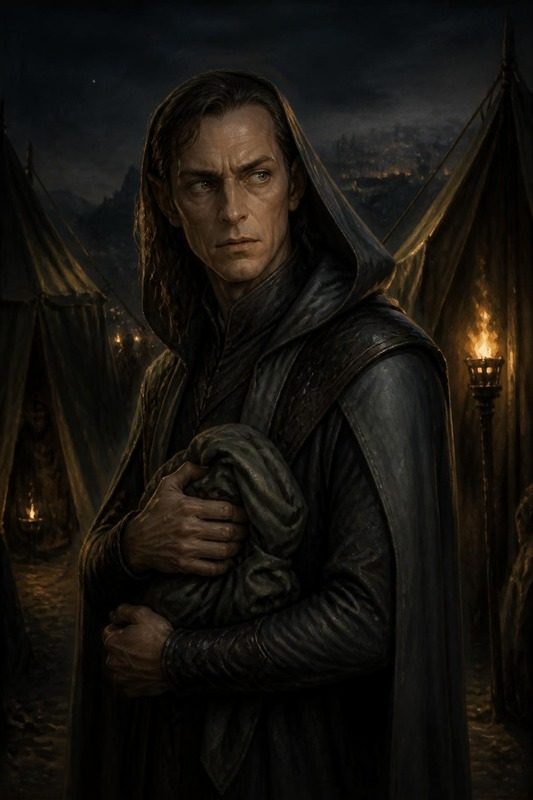

> **La scena «molto bella».**
> **Quando**: al ritorno dalla tenda, fra le tende del campo. Se il tavolo ha
> fretta si sposta nel caos delle mura (Scena 10), e il box funziona uguale. I
> PG **incrociano un ladro** che non c'entra con l'orda — un
> uomo incappucciato che si muove tra le tende con troppa grazia, un fagotto
> stretto al petto. È **Vatore**: mille anni prima di diventare **Salvatore
> «Sal» della Luna d'Argento**, il mercante-spia che li tradirà in ARC-09. Loro
> **non possono saperlo**. Questo è il cuore grigio della scena.

**Chi è, adesso.** Vatore, il «Ladro d'Ombra» di Hammerfist. Ha **appena rubato
il Sigillo di Ossidiana** (Appendice B) e pianifica la fuga nel futuro (userà un
Cronolito). Ha appena visto **quattro ombre uscire vive dalla tenda del generale**, e nelle
cronache che non dovrebbe aver letto i Quattro sono quattro: ne è **ossessionato**. Personalità: freddo, parla il meno possibile, li osserva
con un **terrore reverenziale mal mascherato**.
> **Cosa lo corrompe**. Vatore è **già marcio di
> avidità e sete di potere**: non gli importano le conseguenze. Ha rubato il
> Sigillo *sapendo* che divora anime — e ha deciso che le pagherà con quelle
> degli altri, e poi con la propria. È questa scelta, non un incidente, a
> renderlo **Sal**. Nella scena non è un innocente ingenuo: è un uomo che ha
> già scelto l'ombra, e che ora vede in VOI un potere che vorrebbe rubare.

> **Read-aloud (Andor lead) — fra le tende, l'incontro che non capiscono.** *Tra due tende c'è un uomo che non è dell'orda.
> Veste ombre cucite bene, e stringe al petto qualcosa avvolto in un panno.
> Non attacca. E non scappa, non subito. Vi fissa come si fissa una cosa che
> non dovrebbe esistere, e sussurra, più a sé stesso che a voi: «…quattro.
> Eravate davvero in quattro.» Poi gli torna la maschera: un sorriso freddo, e
> un passo indietro verso l'ombra. Che fate?*


**A parte, al giocatore di Artemis**, subito dopo:

> **Read-aloud (Andor lead) — l'anello.** *Artemis, l'anello che porti al dito
> è diventato gelido.*

**Le risposte del party (grigie — non sanno cosa diventerà):**

| Approccio | Prova | Cosa succede | Eco su Sal nel 1372 (ARC-09) |
|---|---|---|---|
| **Lo ignorano / lo lasciano andare** | — | Vatore svanisce nell'ombra col Sigillo. | Sal esiste «intatto» in ARC-09 — nessun vantaggio, ma nessun sospetto reciproco. |
| **Gli parlano** (Percepire Intenzioni o Diplomazia CD 18; se fallisce, vale la riga di sopra: se ne va) | 18 | Vatore, terrorizzato, lascia sfuggire un frammento: *«Voi non morite. L'ho letto. Nelle cronache che non sono ancora scritte.»* Poi fugge. | In ARC-09 Sal **esita** un istante di fronte a loro (li ha già temuti mille anni fa): +2 dei PG a Percepire Intenzioni e Diplomazia contro Sal la prima volta. |
| **Lo derubano** (Rapidità di Mano CD 22, solo con i gradi: «Chi può derubarlo», qui sotto) | 22 | Gli sfilano il **Sigillo di Ossidiana** (o parte del bottino). Se la prova fallisce, se ne accorge: niente ferita, ma il **Cronolito** lo porta via come nella riga «Lo feriscono», e il Sigillo va con lui | In ARC-09 Sal si presenta **senza** un asso che avrebbe avuto (il DM toglie a Sal un oggetto/piano — es. l'Olio di Sabotaggio parte scarico). |
| **Lo feriscono** (attacco riuscito) | — | Vatore urla, sanguina, attiva il **Cronolito** e sparisce nel tempo. | **Sincronizzazione**: nel 1372 **Sal sanguina nello stesso punto**, all'improvviso, davanti a chi lo osserva (la maschera vacilla) — i PG lo **riconoscono** come «l'uomo del passato» se collegano i punti. |
| **Cercano di ucciderlo** | scontro breve | Non muore qui (il Cronolito lo salva a 1 pf: *deve* sopravvivere per esistere nel 1372 — paradosso auto-consistente). | Sal in ARC-09 porta una **cicatrice antica** e un odio personale: sa che loro ci hanno provato. Nemico più cattivo, ma più fragile emotivamente. |

> **Perché è grigia (nota di tono).** I PG hanno davanti un ladro spaventato che
> **non ha ancora fatto nulla** — ma che (loro non lo sanno) diventerà un
> traditore. Ucciderlo «preventivamente» è un atto oscuro contro un innocente-per-
> ora; lasciarlo andare significa (senza saperlo) crescere il proprio nemico. Non
> c'è scelta pulita. **Registra tutto**: paga in ARC-09. *(Il paradosso regge
> sempre: Vatore DEVE sopravvivere per diventare Sal — il Cronolito lo garantisce.
> I PG possono segnarlo, derubarlo, terrorizzarlo, non cancellarlo.)*

> **Registrazione**: annota l'esito nel registro di fine serata (il filo
> «[VATORE/SAL]») e nell'Echo Ledger (§7).

**Vatore non ha statistiche, ed è voluto**.
Non combatte. Se lo attaccano, il primo colpo che va a segno lo ferisce (riga
«Lo feriscono») e alla fine del suo turno il **Cronolito** lo porta via. Il suo
urlo è un allarme: il campo è pre-allertato, e alle mura c'è un successo in
meno (Scena 10). La ronda arriva in **1d4+2
round**, come le ronde del campo (Scene 6 e 8). Quel colpo si
tira contro la CA di Sal nel Bestiario: **CA 22, contatto 16**. Il
Cronolito sposta nel tempo, non nello spazio: *àncora dimensionale* non lo
ferma, e nemmeno una lotta. Chi lo teneva si ritrova con il suo mantello in
mano. Un incantesimo ostile senza danno (*charme*, *blocca persone*) vale come
un colpo: nessun tiro salvezza, e alla fine del suo turno il Cronolito lo porta
via.

**Chi può derubarlo.** Rapidità di Mano si usa solo con i gradi: senza, la
prova è una prova di Destrezza e non supera CD 10 (SRD, *Sleight of Hand*).
Nessuna classe del gruppo la ha come abilità di classe, e la scheda di Tordek
al 12° non ha gradi: chiedi al tavolo, prima della scena, se qualcuno li ha
comprati. Per chi non li ha, il fagotto si strappa di mano: lo afferra chi
gli mette le mani addosso, Vatore attiva il Cronolito come quando lo tengono,
e chi stringeva il fagotto se lo ritrova in mano. Vale la riga «Lo derubano»
riuscita, e Vatore sa chi è stato `[INFERRED — needs DM confirmation]`.

**Se uno di loro porta il segno** (la cura con la cera nera, Scena 5). Vatore
guarda quel polso prima di quel volto. Per lui quel PG è della gilda, e il
terrore diventa complicità: parla a lui per primo, a voce bassa, e con lui la
riga «Gli parlano» riesce con **CD 14**. Il segno resta il suo ricordo di loro:
in ARC-09 Sal lo cerca su quel polso.

**Se tornano in volo.** Sopra i 20 m nessuno ha motivo di scendere fra le
tende. Lo vedono dall'alto, un incappucciato che si ferma fra due tende e
stringe un fagotto, e l'Anello di Artemis diventa gelido. Se scendono, la
scena comincia da dove atterrano; se no, Vatore è sulle mura all'alba, nel
caos della Scena 10: compare dopo il primo box, e lì il suo urlo non costa
successi, perché l'assalto è già cominciato.

**Se passano invisibili.** Vatore non li vede: nessuno dei suoi sensi li
coglie, e il Sigillo non glieli mostra. Li **sente**, se fanno rumore
(se qualcuno fallisce una prova di Muoversi Silenziosamente **CD 20**, la
stessa del campo). Se non li sente e non si fanno vedere, la scena la aprono loro: vedono un uomo incappucciato che si
ferma fra due tende, si guarda alle spalle e stringe un fagotto. L'Anello di
Artemis diventa gelido lo stesso. Se lo lasciano passare, vale la riga «Lo
ignorano» della tabella; se si mostrano, il box comincia da *«Tra due tende, un
uomo»* e Vatore dice la sua frase dopo averli visti.

#### Se lo divinano: Vatore, il Sigillo, Zeth

Una riga per segreto. Ognuna dà una mezza verità, e nessuna rompe il segreto
lungo: Vatore non sa che diventerà Sal, e nessun incantesimo lo legge in lui.

- **Che cosa pensa Vatore.** *Individuazione dei pensieri* legge «il Cronolito»,
  «la gilda», «non devono vedermi». Mai «Sal».
- **Che cos'è il Sigillo.** *Leggende e tradizioni* dà Shar e il prezzo delle
  anime (Appendice B).
- **I componenti di Zeth.** *Individuazione del magico* mostra necromanzia
  sotto la consacrazione (Scena 5).
- **Chi c'è dietro Zeth.** Se gli chiedono di Zeth e del suo padrone, Vatore
  risponde con la sua gilda, e non nomina il Collezionista.

L'artefatto che stringe al petto è in **Appendice B**.

---

## §5 — ATTO III · L'ALBA

> **Il percorso dell'atto.** Dal primo ariete al ritorno. Le mura, il drago che
> cala sul cortile, il rito all'incudine, la luce del Rubino.
>
> 🛑 **Dove si ferma una serata**: per chi gioca l'arco da capo, la prima serata si ferma al primo box della Scena 10,
> e il resto dell'atto è della sessione dopo. Il gruppo di oggi si è fermato
> prima, alla Scena 5 (§4, «Dove si riprende»), e la sua serata dopo si ferma
> sull'esito del duello, prima della Scena 12.

| Scena | Dove | Chi entra | Prova | Se fanno l'inatteso | Al tavolo |
|---|---|---|---|---|---:|
| **10** · Le mura all'alba | il camminamento est | il capitano delle mura | prova collettiva, una via su tre | sabotano gli arieti: il duello comincia fuori dalle mura (Scena 11) | 15 min |
| **11** · Il duello | il cortile interno | **Skullcrusher il Nero** | combattimento su **M7-B** | due PG a terra nello stesso round, o il gruppo si ritira: intervengono gli avi, «vinto sporco» (§6) | 60-75 min |
| **12** · Il Rituale della Forgia Eterna | l'incudine, nel cortile | Thorgrim · Re Thorek I | nessuna | la scena salta: il re fa murare il torque nell'incudine | 15 min |
| **13** · Il Rubino e il ritorno | il cortile | — | nessuna | nessuno: la luce li prende comunque | 5 min |


### SCENA 10 — Le mura all'alba

**In scena** — Dove: le mura — Chi: Hrodgar · Re Thorek I

Si arriva qui **dove le tacche hanno lasciato i PG** (tabella di uscita
dell'orologio, §4). Se Hella ha vegliato i semi, i **due Treant di Adamantio**
caricano il fianco dell'orda mentre il primo ariete arriva (Scena 5).

> **Read-aloud (Salvatore lead, LotR support) — le mura.** *Il primo ariete
> arriva alle mura che il sole non è ancora sopra il crinale, e il legno prende
> la pietra con un rimbombo che arriva allo sterno prima che alle orecchie. Il
> camminamento vi si muove sotto i piedi di un dito. Un nano accanto a voi si sputa
> nelle mani e riprende l'ascia senza dire niente; quello dopo di lui ha la
> barba incastrata nella cinghia dell'elmo, e non ha il tempo di liberarla. In
> basso, le scale salgono.*
>
> **Che fate?**

**Dove sale l'assalto**. Dal camminamento la
piana si vede tutta, 100 m sotto. Il primo ariete sale dalla spianata alla
porta per la rampa del fronte sud; le scale arrivano sul tratto est, dove il
fianco della montagna tocca il piede delle mura, ed è lì che sta Hrodgar
`[INFERRED — needs DM confirmation]` (M7-A, «La rampa della porta»).

Poi, quando le prime scale arrivano in cima, arriva il capitano delle mura.

**Comparse**

| Chi | Com'è | Come parla |
|---|---|---|
| **Hrodgar, il capitano delle mura** | nano con la barba bruciata da un lato, di un'altra battaglia, e un elmo senza cresta perché la cresta si vede da lontano. Vuole tenere il tratto est fino a che il re non gli dice di lasciarlo, e sa dove la pietra è più giovane: lo stesso punto che Balvar ha segnato sulla mappa di Zog'tar | dà gli ordini con una parola sola |
| **Hald, il nipote di Balvar** | nano di diciannove anni, di guardia sul camminamento est col gruppo di Hrodgar; la barba ancora corta, l'ascia troppo nuova. Non sa che lo zio esiliato è vivo, né che è nel campo di Zog'tar | poco e a bassa voce, da recluta; si drizza quando passa il capitano |

> **Read-aloud (Salvatore lead) — il camminamento.** *Il camminamento è largo
> quanto un tavolo da pranzo e lungo quanto la fortezza. Sotto, l'orda non
> urla più: ha smesso quando ha cominciato a salire, e il silenzio che ha
> lasciato è peggio. Un uncino morde la pietra a tre passi da voi, poi un
> altro, poi sei insieme. Il capitano delle mura guarda voi, non i suoi.*
>
> **Che fate?**

**Le tre vie, e nessuna è quella giusta.** La prova è **collettiva**: il party
sceglie **una** via, tutti tirano quella. Non c'è una scelta migliore — c'è
quella che costa meno a *questo* gruppo.

| Via | Prova | Se riesce | Il costo, anche riuscendo |
|---|---|---|---|
| **Tenere la breccia** | Forza **CD 18**, o un attacco contro **CA 28** | la falla regge; i nani vi vedono farlo | ci si arriva al duello **stanchi**: −2 al primo tiro d'iniziativa del duello (Scena 11) |
| **Rincuorare i difensori** | Diplomazia o Guarire, **CD 18** | +2 morale a tutta la linea per l'assalto | la breccia la tiene qualcun altro, e **qualcuno muore**: un nano con un nome, che il DM annota fra i caduti del 372 |
| **Sabotare gli arieti** | Disattivare o Artigianato, **CD 20** | due arieti fuori uso, l'assalto rallenta di mezz'ora | siete **fuori** dalle mura quando il drago arriva: il duello comincia con i PG separati di 18 m |

**🚫 Modi di fallimento — il fallimento è un costo, mai uno stop.** Nessuna
combinazione di tiri ferma l'avventura: il duello con Skullcrusher si gioca
comunque, perché è già accaduto.

**Prima di contare i successi, raccogli quello che arriva dalla notte.** Vale
un successo in più o in meno, e si applica dopo i tiri:

| Dalla notte | Effetto sulla prova delle mura |
|---|---|
| campo pre-allertato: il corridore è arrivato, o è suonato l'allarme (Scene 6 e 8) | **un successo in meno** |
| Zog'tar umiliato davanti alle guardie (Scena 8) | annulla il successo in meno, se c'era |
| Zog'tar catturato e portato alle mura (Scena 8) | **un successo in più** |
| cure comprate alla cappella (Scena 5) | nessuno sulla prova. Si tira il **dado dei caduti**: 1d4 per ogni tipo di cura comprata (per il gruppo del 25 settembre, quattro tiri). Il numero è quanti difensori con un nome muoiono sulle mura per quella cura mancata; il DM li annota fra i caduti del 372. Non tocca ARC-08 |
| i due Treant dell'alba caricano il fianco dell'orda (Scena 5) | **un successo in più** |
| **Zog'tar è vivo all'alba** (il gruppo ha dormito, o non è arrivato alla tenda) | **un successo in meno**, e Zog'tar guida l'assalto: vedi sotto |

**Se Zog'tar è vivo all'alba**. Guida l'orda sotto le mura. Con
**0-1 successi** sale sulla breccia del camminamento est con le sue quattro
guardie, ed è uno scontro sulle mura prima del drago (Appendice A.2; EL 16, senza
Balvar e senza il sacerdote, rimasti al campo). Con **2 o più** resta sotto, a
spronare, e il drago arriva come sempre. In tutti e due i casi Zog'tar vivo è un
eco in §7: la Mano Rossa del 1372 discende anche da lui.
Sulla breccia i PG sono i difensori, non chi entra: **se volano** possono
scendergli addosso e prenderlo alle spalle, ma restano a tiro delle
balestre dell'orda, e chi resta a terra lo affronta sul camminamento; **se sono invisibili**, Zog'tar non li vede arrivare, ma la DES alla CA la
tiene: Schivare Prodigioso Migliorato (Appendice A.2) non lo lascia colto alla
sprovvista nemmeno contro un invisibile.

**Come combatte sulla breccia**. Il
camminamento è largo quanto un tavolo da pranzo: ci si sta in uno, al massimo
in due. Zog'tar è Grande e arriva a 3 m, quindi colpisce oltre il primo nano. Lassù
**si stringe** (SRD): −4 al colpire e −4 alla CA finché resta sul camminamento,
ed è per questo che vuole buttare giù chi ha davanti.
- **Round 1**: Ira, e l'Occhio di Ossidiana su chi porta la Corona. Le quattro
  guardie tengono la testa delle scale alle sue spalle: chi vuole arrivargli
  dietro deve passare da loro.
- **Round 2 e dopo**: il **Colpo Devastante** (Appendice A.2) su chi gli sta
  davanti, perché non deve entrare nel suo spazio; **Spingere Migliorato** solo
  se il bersaglio è già al bordo. Thorik e Tordek hanno la stabilità dei nani,
  +4 contro la spinta (SRD). Sul camminamento non c'è dove arretrare, e un PG
  scagliato oltre il bordo cade nel cortile o fuori, fra l'orda: le mura sono
  alte **4,5 m** (mappa M7-B), cioè 1d6 di caduta (SRD). Fa poco male; il
  guaio è dove si atterra. Chi cade fuori ha un round per rialzarsi, e intorno
  ci sono scale e uncini. Vale per il tratto est, dove fuori c'è il pendio. Dal
  muro sud, che sta sul ciglio del gradone, si cade sulla spianata, 24,5 m più
  in basso: 8d6 `[INFERRED — needs DM confirmation]`.
- **Contro chi vola**: i giavellotti, come nella tenda. Non lascia la breccia
  per inseguire nessuno: la breccia è sua.
- **Sotto il 30% dei pf** fa come nella tenda: cerca di portarsi via qualcuno.
- **Se il drago cala mentre lui è vivo**, Zog'tar scende dalla scala e resta
  sotto le mura a guardare: vuole vedere il drago finirli. Il duello della
  Scena 11 si gioca con lui là sotto, e chi lo cerca lo trova.
- **I PE** sono quelli della Scena 8, e non si sommano. Se Zog'tar si combatte
  solo qui, con le quattro guardie, vale circa **2.600 a testa**: Zog'tar circa 7.800
  e le guardie 2.600 in tutto, diviso quattro (§8 A).
- **Se cade qui**, il colpo finale va al giocatore (`[HDYWTDT]`, §0-ter).


| Successi (su 4) | Cosa cambia davvero |
|---|---|
| 4 | le mura reggono pulite; il duello parte con i PG schierati e **Re Thorek in piedi dietro di loro** |
| 2-3 | reggono a stento. Il duello parte normale |
| 1 | i nani perdono il camminamento est: il duello si combatte **con Re Thorek a 8 pf alle spalle**, e il drago lo punta quando nessun PG lo chiama (Scena 11, «Il re»), e a 8 pf basta un colpo a metterlo a terra |
| 0 | 🔴 **la breccia cede.** Re Thorek è a 8 pf, come con 1 (M7-B). Il duello si combatte **in mezzo ai feriti** portati giù dalle mura: M7-B con 6 quadretti di terreno difficile e **due nani a terra** che Hella può scegliere di raggiungere invece di combattere. Nessun malus: una **scelta in più**, e più dura |

⚠️ **La riga a zero successi è il punto di questa tabella.** Il modo più veloce
di insegnare a un tavolo che indagare e rischiare non conviene è punire il
fallimento con meno gioco. Qui a zero successi **si gioca di più**, non di meno.

- ► **Esito**: *mura tenute saldamente / a stento / breccia ceduta*.

**Con un gruppo diverso: la riga di scala**. Le mura
sono state giocate da quattro PG di 13°, e la tabella conta i successi su
quattro. La riga serve a un gruppo diverso. Quello che arriva dalla notte, un
successo in più o in meno, si applica allo stesso modo.

- **Con tre PG** (APL 12, tetto 16), o se in un gruppo di quattro manca un PG:
  i successi si contano su tre. Tre valgono la riga del 4, due quella del 2-3,
  uno e zero restano le loro righe. Se Zog'tar sale sulla breccia (con 0-1
  successi), porta due guardie e non quattro: le altre due restano in fondo
  alla scala a tenerla. Zog'tar e due guardie fanno EL 15.
- **Con cinque PG** (APL 13, tetto 17): i successi si contano su cinque.
  Cinque valgono la riga del 4, tre o quattro quella del 2-3, uno o due la riga
  dell'1, zero la breccia che cede. Zog'tar sale sulla breccia con 0-2
  successi, e porta le guardie della tenda, che con cinque PG sono diventate
  sei, tutte alla testa delle scale alle sue spalle.
  È la versione più forte, a EL 16, sotto il tetto.

### SCENA 11 — Il duello con Skullcrusher

**In scena** — Dove: il cortile — Chi: Skullcrusher · Re Thorek I · Aegis Fang

**Comparse**

| Chi | Com'è | Come parla |
|---|---|---|
| Aegis Fang | l'ascia di Thorik, che qui riconosce il sangue degli avi | non canta: urla dentro il cranio di chi lo impugna, a frasi brevi in maiuscolo; la sua voce è nella sua pagina fra gli artefatti dei PG |

**Scheda d'entrata — Skullcrusher il Nero, il capostipite** *(statistiche:
Appendice A)*

| | |
|---|---|
| **Aspetto** | drago nero vecchio (adulto maturo, se si usa l'Appendice A.1), snello e arrogante: collo lungo, cranio stretto e cornuto, scaglie nere opache con un riflesso verde d'olio. L'acido gli cola dalle fauci chiuse |
| **Vuole** | vincere **davanti all'orda**, perché per lui il potere è quello che gli altri hanno visto |
| **Teme** | che l'orda veda il guinzaglio. Chi dice la Catena ad alta voce se lo tira addosso (Scena 7, «Che cosa muove Skullcrusher») |
| **Suona** | dice **il nome** dell'avversario prima di colpire, ogni volta. Il nome è l'incantesimo, *colpo accurato*: il morso arriva al round dopo. Non lo chiede: lo sa dal corno, o mette un epiteto al suo posto (Scena 7, «Che cosa muove Skullcrusher»). Per il resto provoca e commenta, e se il tavolo ci sta ci si parla |
| **Eco** | la tabella B4 (§7): ogni ferita che gli fate, la Forgia la ricorderà contro **Fauci di Palude** nel 1372 |
| **Ritratto** | la tavola qui sotto. Solo per il DM fino al duello |

**SKULLCRUSHER (lento, divertito, forte perché lo sentano le mura):** *«Un re
l'ho già mangiato, qui. Thorik. I tuoi amici lo dicono troppo forte, il tuo
nome, quando credono che il campo dorma.»*

Thorik è un esempio: il drago dice il primo nome che ha sentito alla tenda.
Se non ne ha sentito nessuno, la battuta cambia:

**SKULLCRUSHER (lento, divertito):** *«Un re l'ho già mangiato, qui. Voi, i
nomi ve li siete tenuti. Non importa: comincio dal nano con la Corona.»*

**SKULLCRUSHER (basso, quando sente dire la Catena):** *«Chi te l'ha
insegnata, quella? No. Non importa. Tocca a te.»*

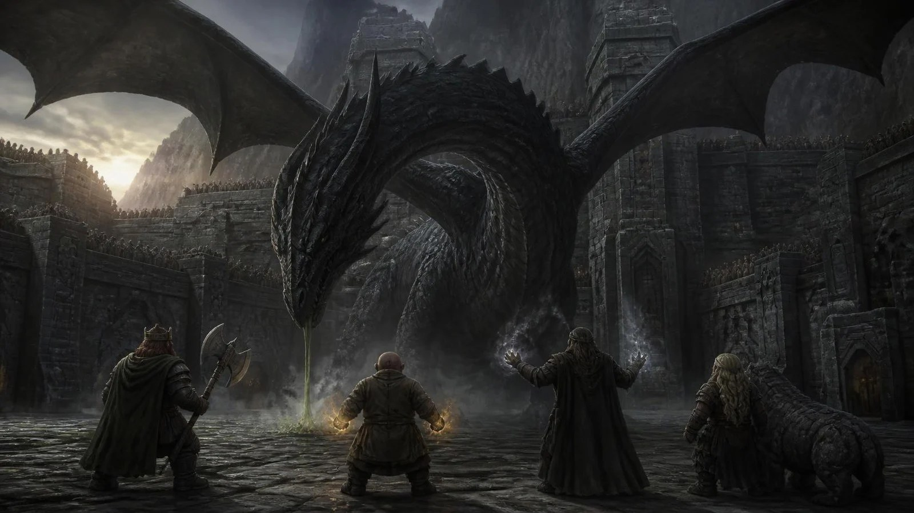

> **Mappa M7-B.** Il drago entra dall'alto (quota ~45 m) e picchia sul cortile
> interno. È il capostipite della stirpe di **Fauci di Palude**: ogni ferita che
> gli infliggete qui, la Forgia la ricorderà mille anni dopo (§7, carry-over B4).

**Quale drago si usa, e quando**.
Stasera il **Vecchio** dell'Appendice A.1-bis, con le 2 wyvern dell'Appendice
A.6 dal round 2: EL 17, il tetto esatto di APL+4 per un gruppo di 13°, e lo
stesso per un gruppo di 14° o per cinque PG. L'**Adulto** dell'Appendice A.1,
con le stesse wyvern, è l'alternativa: per un gruppo di 13° logorato o senza
tutti gli artefatti, per tre PG, e per il DM che non conferma il Vecchio. Le
tattiche qui sotto valgono per tutti e due; dove i numeri cambiano, il primo
è del Vecchio e il secondo dell'Adulto.

**Se il duello comincia fuori dalle mura** (arieti sabotati, alba colta fuori
dal campo).
M7-B non serve: si gioca sulla spianata davanti alla porta, aperta e senza
copertura, con le carcasse degli arieti come unico riparo. I nani sono sulle
mura, a 18 m e 24,5 m più in alto (i 20 m del gradone e i 4,5 delle mura), e
le balestre tirano da lì. La fucina, la cisterna e le campane
della tabella del cortile qui sotto non ci sono; le corde sì, quelle degli arieti
rovesciati, con la stessa prova.

> **Read-aloud (Salvatore lead) — il cortile.** *Prima arriva il freddo: passa
> un'ombra, e l'aria del cortile perde dieci gradi in un respiro, e la pelle
> lo sa prima di voi. Poi il rumore, un risucchio come quello del mare che si
> tira indietro, e le braci della forgia si piegano tutte nella stessa
> direzione. Un nano vicino a voi lascia
> cadere lo scudo e non si china a raccoglierlo.*
>
> *Dove il drago passa basso, la pietra fuma. L'acido gli cola dalle fauci chiuse e si mangia il selciato come acqua
> nella neve.*
>
> **Che fate?**

🎚️ **Se e solo se Thorik tiene Aegis Fang in mano**, un secondo box, corto, e
a lui soltanto.

**AEGIS FANG (non canta: urla, dentro il cranio):** *«SANGUE ANTICO. ARTEFICE
DI LACRIME.»*

> **Read-aloud (Mercer lead) — la visione, solo per Thorik.** *Per un istante
> la Corona ti mostra due immagini sovrapposte: questo drago adesso, e un altro
> drago sopra mura che bruciano, mura che non hai mai visto.*


#### 🎬 La regia dei primi due round — una battuta per attore

>
> **Non sono numeri nuovi.** CD e danni restano quelli dell'Appendice A. Qui c'è solo
> **cosa leggere, quando**, e sono sei secondi a testa.

**Apertura di round — cosa è cambiato nel mondo.** Prima di ogni giro, una riga
sola: *dove* è il drago (in cielo, in picchiata, a terra) e *cosa* ha lasciato
il round prima (una crepa, un nano che non si rialza, il fumo dell'acido).

**Il giro, in quattro battute** *(ordine di gioco dichiarato: chi ha vinto
l'iniziativa parla per primo, ma la descrizione segue sempre questo ordine)*:

| | Attore | Riuscita — **una riga** | Fallimento — **una riga, e non è «manchi»** |
|---|---|---|---|
| 1 | **THORIK** — regge | l'ascia entra fra due scaglie e ci resta un istante di troppo: il drago **si gira verso di lui**, ed è quello che serviva | il colpo scivola sulla scaglia bagnata d'acido. Thorik resta in piedi, ma adesso ha le mani che bruciano |
| 2 | **TORDEK** — colpisce | il pugno prende l'ala dove l'osso è sottile: un suono secco, e la picchiata si sbilancia | il drago si alza di un metro e il colpo passa sotto. Tordek finisce in avanti e per un momento **non vede dov'è** |
| 3 | **ARTEMIS** — sceglie il bersaglio | il blast arriva **all'occhio**, e per un round il drago tiene la testa girata di tre quarti | l'ombra si apre troppo presto. Il drago la vede arrivare e **ricorda da dove è partita** |
| 4 | **HELLA** — cambia il campo | le radici salgono dal cortile e chiudono una via di fuga: il drago **deve** restare | la pietra non risponde — qui la terra è giovane e non la conosce. Hella sente l'assenza, e le costa |
| 4-bis | **DURIK** — si mette in mezzo | il drago deve scavalcarlo per arrivare a Hella, e scavalcarlo gli costa il turno di picchiata | il soffio lo prende in pieno: la pietra **fuma**, e l'acido gli fa il 50% in più. Durik non arretra. Senza runa il soffio gli fa in media più di 50 danni: danno massiccio, Tempra CD 15 (lui +11) o torna polvere, e la carica rimasta dopo i Treant dell'alba lo riporta per un'ora (Scena 5) |

**Chiusura di round — l'avanzamento visibile.** Una riga che dica cosa è
**cambiato**, non quanti pf restano: la prima scaglia che manca, il fiato che si
accorcia, il primo passo indietro che il drago fa senza volerlo.

> **Round 1 — apertura da leggere.** *L'ombra passa sul cortile prima del
> rumore. Quando il rumore arriva, è il vostro stesso nome gridato da ottocento
> nani che hanno smesso di combattere per guardare in alto.*
>
> **Che fate?**

⚠️ **Dal round 3 si smette.** La regia serve a far **atterrare** l'inizio; se la
tieni per otto round diventa una lettura e il combattimento si ferma. Dal terzo
round si torna alle tattiche del drago, più sopra, e si descrive solo quello che
cambia davvero.

#### Tattiche di Skullcrusher — regia round per round (stile RHoD, aggancio M7-B)
> Scritte dal punto di vista del drago. Skullcrusher è **giovane nella sua
> arroganza**: non ha mai perso, non sa ancora aver paura. È questo che i PG gli
> insegnano — ed è questo che il suo sangue ricorderà.

- **Round 1 — la Presenza.** Cala dall'alto (Presenza Terrificante CD 26 o 25:
  chi fallisce è scosso; Thorik non tira, perché la *mente vuota* della
  Corona lo rende immune agli effetti di paura, Scena 8). Se Zog'tar è morto in modo «spettacolare» (Scena 8), arriva **già
  in picchiata**: ha un round di sorpresa (SRD), e i PG sono colti alla
  sprovvista fino al loro primo turno. La picchiata vince anche sul «senza
  sorpresa» del drago che li ha già visti di notte; agisce nel round di
  sorpresa chi supera Ascoltare CD 20, e con le campane suonate vale la loro
  riga nella tabella delle difese. Apre col **Soffio acido** sul
  gruppo più fitto (Riflessi CD 31 o 30), **aderente**: l'acido resta addosso e al round dopo morde ancora (Appendice A.1). *Non atterra, perché vuole restare in cielo, dove
  si sente un dio.* Chi ha la runa di Zeth (*resistere all'energia*, acido 20)
  e non l'ha attivata al corno dell'alba (Scena 5) la attiva adesso, con
  un'azione standard: prima del soffio, se ha l'iniziativa.
- **Round 2-3 — la passata.** Non si ferma. Ogni turno attraversa il
  cortile con Attacco in Volo, e a metà del movimento fa una cosa sola: il
  soffio, se è tornato, lungo la linea più lunga che trova; il morso su chi
  ha nominato il turno prima; oppure il nome di un altro. Poi va oltre e
  risale. Punisce chi non ha gittata o volo. Bersaglio: «Chi sceglie», qui
  sotto. Fra un turno e l'altro resta a circa 15 m sopra il cortile: Aegis Fang
  scagliata, cinque incrementi da 3 m, ci arriva al limite, e il blast di
  Artemis sempre. *Corrompere l'acqua* sulle
  pozioni: un uso prende le pozioni
  di un solo PG, perché l'SRD guasta 10 piedi cubi, poco più di un quarto di
  metro cubo, entro il raggio della Presenza. Ognuna tira a parte Volontà
  CD 25, e quelle nel buco portatile non le tocca.
- **La passata, il nome, la prima paura**.
  Il drago giovane combatte in movimento e davanti a un pubblico: non si
  ferma mai finché non ha paura, e prima di colpire dice chi colpirà.
  - ***Attacco in Volo*** (SRD, *Flyby Attack*). In volo fa un'azione di
    movimento e un'azione standard in un punto qualsiasi del movimento. Il
    soffio è un'azione standard: lo usa a metà della passata e continua a
    volare. Il morso in passata è un attacco solo.
  - ***Virata*** (SRD, *Wingover*). Una volta per round, con un'azione
    gratuita, gira fino a 180° nonostante la manovrabilità scarsa. La virata
    costa 3 m di volo, e nel round in cui vira non sale: resta in quota o
    scende. È il talento che gli fa girare un drago Enorme dentro un cortile
    di 36 m: entra, soffia, e torna indietro sulla stessa linea quando il
    gruppo pensava di averlo alle spalle. 🔎 Il testo è quello dell'SRD letto
    su una trascrizione: va riscontrato su d20srd.org.
  - ***Colpo accurato*** (SRD, *true strike*, stregone di 1°). Azione
    standard: +20 di intuizione al prossimo tiro per colpire, entro la fine
    del round dopo, e niente probabilità di mancare per occultamento. La
    componente verbale è il nome: lo grida a metà della passata, forte perché
    lo sentano le mura, e al round dopo morde quel PG a +54 (+50). Il nome
    non lo chiede: è quello sentito di notte attraverso il corno, oppure un
    epiteto preso da quello che vede, *la morta tornata*, e basta una parola
    (Scena 7, «Che cosa muove Skullcrusher»). Il tavolo
    sente il nome un round prima: chi è nominato sa che sarà colpito, e gli
    altri sanno su chi preparare la corda. Oltre all'*armatura magica* ha sei
    slot di 1°. ⚠ Non SRD: l'incantesimo vuole anche un fuoco, un piccolo
    bersaglio di legno, e il drago non lo porta `[INFERRED — needs DM confirmation: il nome gridato vale da fuoco]`.
  - ***Fluttuare*** (SRD, *Hover*), **una volta sola**: alla prima paura, a
    ⅓ dei pf (la soglia qui sotto). Con un'azione di movimento si ferma in
    aria, e da fermo si sposta in ogni direzione, anche in verticale, a metà
    velocità, nonostante la manovrabilità scarsa. Se comincia il turno fermo
    in aria può fare un'azione di round completo: niente attacchi d'ala, ma
    morso, artigli e coda come in un attacco completo, oppure il soffio o un
    incantesimo. Sotto i 6 m dal suolo, sopra le macerie e la cenere del
    cortile, alza una nube di 18 m di raggio: dentro si vede a 3 m, chi è a
    4,5-6 m ha occultamento (20%), chi è a 7,5 m o più occultamento totale
    (50%), e per lanciare un incantesimo nella nube serve Concentrazione
    **CD 21**. La nube spegne le fiamme piccole non magiche.
  - ***Oscurità*** **una volta sola**, alla fuga. Finché l'orda guarda vuole
    essere visto, e non la usa. Quando scappa verso le paludi se la porta
    dietro: è la vergogna, e non deve vederla nessuno.
  - **La sequenza.** Al round 1 il soffio d'apertura. Poi una passata a
    round: il nome di un PG, il morso su chi ha nominato, o il soffio quando
    torna. Scende sotto i 6 m solo per l'attacco completo contro chi lo ha
    inchiodato con le corde: in quel round è a terra e non fluttua, quindi la
    nube non c'è. Si ferma in aria una volta sola, alla prima paura, e lì la
    nube c'è.
  *Momento Artemis*: in volo (Ali d'Ombra) è l'unico che lo raggiunge alla pari.
  *Momento Aegis Fang*: Thorik la **scaglia** — se colpisce in volo, incide la
  **Cicatrice a forma di martello** su un'ala (§7: −2 alla Volare di Fauci nel 1372).
  È un'ascia da guerra nanica +2 *da ritorno*: scagliata, è
  un'arma da mischia lanciata, −4 al tiro e incremento 3 m, e torna in mano a
  Thorik prima del suo turno successivo (SRD, *da ritorno*). «Colpisce in
  volo» vuol dire un tiro a distanza a segno mentre il drago è in quota.
- **La Catena, in ogni round.** Se i PG sanno della runa (Scena 7), leggerla
  sulla scaglia è un'azione di movimento entro 9 m, e colpirla è un attacco
  contro **CA 44** col Vecchio e **41** con l'Adulto: la CA con l'armatura magica, 40 o 37, più 4 perché il bersaglio è piccolo; la runa è sotto la scaglia, e un attacco di contatto non la raggiunge: il primo colpo a segno la spezza, e il drago se ne va. Se
  Balvar è morto prima dell'alba, il drago combatte a **−2** e fugge a metà pf.

**Quando qualcuno la legge**, la prima volta:


> **Read-aloud (Salvatore lead) — la runa sotto la scaglia.** *Sotto la scaglia
> calda del petto, più pallida delle altre, corrono righe di rune naniche
> incise a punta, fitte come i conti di un mercante. L'ultima riga è più piccola e
> più fonda delle altre, ed è quella che il drago non ha mai letto.*

- **La Catena detta ad alta voce**. Chi
  la legge forte, dove l'orda sente, diventa il suo bersaglio dal turno dopo,
  anche se deve scendere. Il perché è in Scena 7, «Che cosa muove Skullcrusher».
- **Chi sceglie, se più cose lo chiamano**. Colpisce
  solo chi prima ha nominato, forte, ogni volta. Il nome non lo
  chiede: o l'ha sentito al corno, o mette al suo posto un epiteto preso da
  quello che vede, che vale lo stesso. Fra
  quelli che lo chiamano, nell'ordine: chi ha detto la Catena ad alta voce;
  chi tiene la corda dell'ala; chi lo ha ferito di più. A parità decide
  l'arroganza: sceglie quello la cui caduta fa più orrore agli altri, la
  druida appena tornata dalla morte o chi porta la Corona, e lo nomina in modo
  che lo sentano tutti.
  **Quando valgono le altre righe.** Questo ordine viene prima di tutte, con
  tre eccezioni. Il soffio d'apertura del round 1 va sul gruppo più fitto,
  perché non ha ancora nominato nessuno. I nani chiamati dal tavolo prendono
  l'attacco pieno nel round in cui arrivano, come dice la tabella del
  cortile, e dal round dopo l'ordine torna questo. Chi tira con le balestre o
  suona le campane lo chiama solo nei round in cui nessun PG lo chiama: in
  quei round le fa tacere con la coda, in passata (2d6+16 o 2d6+15), e viene
  prima del re. Il soffio lo tiene per i PG.
- **Il re**. Re Thorek sta nel cortile alle spalle
  dei PG. Se in un round nessun PG ha chiamato il drago (la Catena detta, la
  corda, le ferite) e nessuno ha tirato con le balestre o
  suonato le campane, Skullcrusher va su di lui: è il secondo re
  che vuole mangiare davanti all'orda. Chi sta sulla linea del soffio o
  accanto al re prende il colpo al posto suo. ⚠ Non SRD: in 3.5 non c'è
  un'azione per prendere un colpo al posto di un altro; qui basta essere lì.
  Hella invece ce l'ha: lo *Scudo del Custode* della Collana (1 al giorno,
  azione immediata) prende su di lei, dimezzato, il danno di un alleato entro
  9 m, e Thorik è accelerato per 3 round verso chi è stato protetto (stato
  della campagna, §7, «I tre Doni»).
  Il re non muore, perché alla Scena 12 è vivo. Per colpirlo non si tira: due
  colpi del drago lo mettono a terra, stabile, e uno solo se è già a 8 pf
  (Scena 10). Il Rubino lo ricorda come il
  giorno in cui il re è caduto.
- **Soglia: quando gli resta un terzo dei pf, ~112 col Vecchio e ~100 con l'Adulto — la prima paura.** Per la prima volta nella sua vita,
  Skullcrusher **esita**, e **si ferma in aria** (*Fluttuare*): è l'unica
  volta nel duello. È il momento dei tre esiti (sotto). Al suo turno
  fugge nelle paludi sotto la sua *oscurità*, a meno che nel round prima abbia preso **almeno due
  colpi**: allora resta fermo lì un round ancora, e lì si può uccidere (le soglie,
  più sotto). *«Qualcosa in lui — nel
  sangue — capisce che questi quattro non sarebbero dovuti esistere.»*
- **«La Forgia ricorda» (meccanica cardine).** **CONTA i colpi a segno** su
  Skullcrusher (ferite ancestrali, N≤3) — è il dato per il carry-over B4 (§7).
  Moradin, nella mente di Thorik: *«Ogni ferita che infliggi ora all'antenato,
  la mia Forgia la ricorderà quando affronterai il discendente.»*
- ***Dragondoom* di Aegis Fang funziona**:
  3 volte al giorno, come contro ogni drago Grande o più (+1d6 per
  la taglia sopra la Media). La Catena non la blocca, e la Cintura qui sotto
  non c'entra.
- **Il Bane contro Fauci qui non vale**.
  Aegis Fang lo ha imparato all'affresco A7 contro Fauci di Palude, e contro
  il suo capostipite tace. Contro Skullcrusher l'ascia ha la *Dragondoom* e
  basta: il +2, i 3d6, il critico ×4 e lo *Scosso* tornano contro Fauci, nel
  1372.
- **La Cintura di Tordek RIFIUTA di attivarsi** qui (*«il vero scontro appartiene
  al futuro»*): coerenza col 1372, non nerf. È voluto — Tordek vince senza.
- **Sviluppi.** Comunque finisca (ucciso/ferito/fuggito), il sangue di
  Skullcrusher **sopravvive**: se ferito o fuggito, si ritira nelle paludi a
  leccarsi le ferite e a generare la stirpe che, mille anni dopo, culminerà in
  **Fauci di Palude**. Se **ucciso**, la stirpe nasce comunque (aveva già figli):
  la profezia non spezza il sangue, lo **segna** (carry-over B4). In ogni caso,
  con il drago via, l'orda perde lo sprone e si sfalda entro poche ore (→ Scena
  13). Se Skullcrusher ha **visto** Aegis Fang scagliata, il terrore di
  quell'arma entra nel sangue: Fauci, mille anni dopo, la riconoscerà (gancio
  inverso B4).

#### 🏟️ IL CORTILE — cosa c'è, e cosa ci si può fare che qui non è scritto

> **Perché questa tabella esiste.** Il duello aveva la regia, le tattiche del
> drago e la scalatura, ma **niente sull'arena**: un tavolo che volesse essere
> furbo non trovava appigli, e restava l'iniziativa. Qui non ci sono soluzioni
> pronte — ci sono **cose**, e una riga su cosa succede se qualcuno le usa.
> Per tutto il resto vale il §0-ter: **assorbi, poi rilancia**.

| Nel cortile c'è | Se qualcuno lo usa |
|---|---|
| **Le corde delle gru sulle mura**, tese e bagnate | tirarle mentre è basso: prova di **Forza CD 25**, e chi aiuta dà **+2** a testa (aiutare, SRD: Forza CD 10), al massimo tre per corda; i nani possono essere fra loro, e il soffio li prende come nella riga dei nani. Non lo atterra: gli **inchioda un'ala a terra per un round**, ed è tutto quello che serve |
| **La fucina originale**, accesa da stanotte | ci si può spingere dentro qualcosa. Il drago è **immune all'acido, non al calore della forgia**: 4d6 e — più utile — il fumo gli toglie l'olfatto per 1d4 round |
| **La cisterna sotto il pozzo** | l'acido colpisce l'acqua e **ribolle**: nuvola che oscura, −4 agli attacchi di tutti. Danneggia i PG quanto lui. È una **scelta**, non un trucco |
| **Le campane della torre nord** | il suono nell'aria fredda copre il battito d'ali: con le campane suonate il drago **perde il round di sorpresa** della picchiata: Ascoltare CD 20 per sentirlo arrivare (e chi le suona si fa **bersagliare**) |
| **Ottocento nani che guardano** | chiamarli è gratis. Arrivano, **e muoiono**: il DM ne annota i nomi fra i caduti del 372. Il drago fa un attacco pieno su di loro invece che sui PG. Nessuno lo dice al tavolo prima |

#### 🪂 Chi non vola — cosa fa nei round in quota

Il drago resta in cielo dai round 2-3, e la domanda del tavolo arriverà: *«e io
che non volo?»*. La risposta non è «aspetti». Per Tordek, prima di tutto:

- **Tordek e i Bracieri.** Contro il drago rifiuta la Cintura, non i
  Bracieri, che sono un altro oggetto: Castigo del Drago (+2 al potenziamento
  e +2d6 contro i draghi), Salto Fiammeggiante 3 volte al giorno, e la
  Collina, che la prima volta scatta da sola quando uno scontro con una
  creatura Enorme lo porta sotto metà pf (scheda dei Bracieri in
  `PG/Artefatti/Artefatti-Pg/Tordek/`). Skullcrusher è Enorme.
  L'Ancoraggio della Montagna non c'è più: al rito è diventato il Dono di
  Hella (log del 25).

Per tutti, tre cose SRD:

- **Preparare un'azione, sul momento giusto.** Il morso ha portata 4,5 m: in
  volo Skullcrusher morde da lì e risale, e non entra mai nel metro e mezzo di
  un nano. Un'azione preparata su *«quando scende»* non scatta. Scatta su
  *«quando le corde lo inchiodano»*: nel round a terra chi l'ha preparata
  colpisce per primo, poi è attacco completo. È il round di Thorik e di Tordek,
  e il colpo preparato di Tordek può essere il suo Pugno Stordente.
- **Le corde delle gru** (la tabella qui sopra). Si fa **tutto
  nello stesso momento**, con azioni preparate sullo stesso innesco: *«quando
  il drago picchia sotto i 9 m»*, cioè ogni volta che scende a mordere qualcuno
  nel cortile. I ruoli:
  - **chi lancia il gancio** (sul camminamento, accanto alla gru): attacco di
    contatto a distanza, incremento 3 m, contro la CA di contatto del drago (**10**).
    È un'arma da lancio, quindi arriva a cinque incrementi, 15 m, con −2 al
    tiro per ogni incremento intero di distanza (SRD, gittata): dalle gru in
    B10 e W10 il gancio prende il drago quando picchia entro 15 m da una
    delle due, contando anche la quota;
  - **chi tira** (a terra, alla corda): se il gancio prende, **Forza CD 25**
    subito, nella stessa azione preparata; chi tira insieme aiuta, +2 a testa
    (aiutare, Forza CD 10);
  - **chi colpisce**: con l'ala inchiodata il drago resta a terra **un round**,
    e chi aveva preparato un attacco lo porta adesso.
  Così Thorik e Tordek hanno sempre un'azione mentre il drago è in quota:
  preparano la corda. Se il gancio manca, l'azione preparata va persa, come
  dice l'SRD. È il momento in cui il drago smette di essere in cielo per tutti.
- **Le balestre delle mura.** Sul camminamento ci sono le balestre pesanti dei
  difensori: 1d10, incremento 36 m, un
  round intero per ricaricarle. Contro la sua RD 10/magia un dardo normale non
  fa danni. Serve ad altro: un colpo a segno, per il suo orgoglio, è un insulto,
  e il drago si gira su chi l'ha fatto.
  Chi tira, attira, e lascia respirare chi sta sotto.

Il DM non deve inventare niente di più. Se il giocatore trova una quarta via, è
§0-ter.

🚫 **Cosa NON dire.** Che la fucina funziona contro di lui. Se lo dici, la
tabella diventa un elenco di mosse; se aspetti, resta un cortile. Il DM **non
legge questa tabella ai giocatori**: la tiene sotto gli occhi e risponde.

⚠️ **E se hanno un'idea che non è in tabella**, la risposta è già scritta in
§0-ter: sì, e adesso c'è un problema nuovo. **Questa tabella è un esempio di
tono, non l'elenco delle cose permesse.**

#### ► ESITO DEL DUELLO (aperto — MAI fisso) → carry-over B4 (§7)

`[HDYWTDT — il finisher a chi mette a terra il drago. «Com'è che lo fai?», e
aspetta. È il momento più grosso della campagna finora: non riempirlo tu.]`

1. **UCCISO** (0 pf): impresa immensa, la profezia in pieno. → Fauci nel 1372
   parte con **−10% PF** e Presenza ridotta contro i portatori (B4).
2. **FERITO GRAVE** (fugge quando gli resta un terzo dei pf, ~112 su 337 o ~100 su 297): esito «medio», il più probabile. →
   Fauci perde **un uso del soffio** (B4).
3. **FUGGITO** (i PG scelgono la sopravvivenza / non lo intaccano): quasi illeso,
   ma **vi ha visti e riconosciuti**. → Fauci **+2 iniziativa** ma morale
   fragile (fugge sotto 75 pf invece di 50) (B4).
**Le soglie**: a ⅓ dei pf fugge al suo turno, a meno che nel round
prima abbia subito almeno due colpi (allora resta un round ancora). Se Balvar è
morto e il drago fugge a **metà** pf, l'esito è **FERITO GRAVE**.
*Registra esito + N ferite + se Aegis Fang colpì in volo.*

#### Sidebar — Scalare lo scontro (stile RHoD)
| Situazione | Aggiustamento |
|---|---|
| Il gruppo di stasera, e ogni party **straripante** (4 PG di 13° con la fiducia piena del consiglio, tutti gli artefatti e il banco della fucina speso, o 4 PG di 14°) | Skullcrusher **Vecchio e Avanzato** (GS 17): **337 pf**, CA 36 (40 con *armatura magica*), soffio 16d4 CD 31, Presenza CD 26, morso +34; statistiche in Appendice A.1-bis. Con lui, dal round 2, le 2 **wyvern** (SRD, *Wyvern*: GS 6, 59 pf, CA 18, volare 18 m, pungiglione +10 con veleno Tempra CD 17, 2d6 COS, morso +8 2d8+4; Appendice A.6). Per un gruppo di 13° fanno EL 17, il tetto esatto di APL+4; per uno di 14°, APL+3. Le wyvern vanno su chi tiene la corda dell'ala e su chi vola; quando il drago fugge o muore, fuggono anche loro. Il gruppo di 13° straripante ha le wyvern |
| Un gruppo di 13° che non è straripante, o il DM non conferma il Vecchio | l'**Adulto** dell'Appendice A.1, con le 2 wyvern: EL 14 sulla carta, 15 al tavolo |
| Party **logorato** (il campo e le mura andati male, risorse spese, Hella ancora fragile) | Skullcrusher NON usa il soffio 2 volte di fila; quando gli restano ~100 pf **fugge subito**, senza il round in più (esito FERITO GRAVE garantito) |
| **Hella appena risorta** — vuoi proteggerla | Riga da scegliere, non di base: il drago la ignora finché non lo ferisce (predatore: va per la minaccia, non per la novità). Senza questa scelta vale «Chi sceglie», che la mette fra i preferiti — dà alla giocatrice spazio per il suo primo scontro |
| **Tre PG** (APL 12, tetto 16), o un gruppo di quattro a cui manca qualcuno | lo stesso drago di A.1, che resta sotto il tetto. Nella regia si salta la riga di chi manca; se manca Hella, manca anche Durik. Alle corde la terza mano la dà un nano, che il soffio prende come nella riga dei nani del cortile |
| **Cinque PG** (APL 13, tetto 17) | il Vecchio della prima riga con le 2 **wyvern** dal round 2, con la stessa tattica: EL 17, il tetto |
| **Con le wyvern**, quanto vale | due GS 6 fanno EL 8, molti punti sotto il drago, e aggiungono meno di mezzo punto. Col Vecchio il duello è **EL 17**; PX per un gruppo di 13°: 16.250 in tutto, cioè **≈ 4.060 a testa** con quattro PG e **3.250** con cinque. Con l'Adulto resta **EL 14** sulla carta, 15 al tavolo: 6.500 in tutto, **1.625 a testa** con quattro PG e **1.300** con cinque (§8 A) |
| Un PG **abbattuto** | Skullcrusher lo ignora (caccia chi è in piedi e lo minaccia): finestra per stabilizzarlo |

### SCENA 12 — Il Rituale della Forgia Eterna

> **Cos'è.** Questo viaggio **è** il
> **Rituale Legacy 4**, che la matrice degli artefatti chiama *«Siege of the
> Eternal Forge»*: **qui si sblocca il Rubino**; la **Corona +3** e la **Senzienza** arrivano **dopo che il Rubino è stato speso**, cioè all'arrivo nel 1372 («Il Ritorno a Hammerfist» §3). Fino a oggi il master consegnava il duello e basta: il DM
> tornava dal tavolo a segnare un avanzamento che nel modulo non era successo.
>
> ⏱️ **Quando**: **dopo il combattimento**, sull'esito
> dell'incontro. Non è una prova sotto pressione ed è **senza ulteriori costi** —
> il prezzo di questo arco Thorik lo ha già versato altrove.

#### Il rito si fa comunque. Cambia il tono, non l'esito

Il canone di §6 è esplicito: la fortezza regge perché **la profezia è incisa**.
Anche un duello andato malissimo finisce con gli antenati che ricacciano il
drago. Quindi il Rituale **non si fallisce**: si gioca in una delle quattro voci
che l'incontro ha appena scelto.

| Esito del duello | La voce del rito | La riga che il DM dice |
|---|---|---|
| **UCCISO** | trionfo, e un imbarazzo | i nani antichi non sanno se inginocchiarsi o abbracciarli, e provano tutti e due |
| **FERITO GRAVE** *(il più probabile)* | mestiere | nessuno canta. Si conta chi manca, poi si accende la pietra |
| **FUGGITO** | sollievo con un'ombra | il drago vi ha visti. Il rito si fa lo stesso, e qualcuno guarda il cielo mentre si fa |
| **VINTO SPORCO** *(§6, gli avi intervengono)* | misericordia e dovere | siete venuti a salvarli, e vi hanno salvati loro. La pietra si accende uguale, e pesa di più |

**In scena** — Dove: l'incudine — Chi: Thorgrim · Re Thorek I

#### La scena, i primi tre momenti

> ✏️ *Da dove viene il Rubino: **nessuno lo porta**. Appare
> sull'incudine nel momento della vittoria, come se la Forgia l'avesse battuto da
> sola. Nessun nano del 372 sa spiegarlo, e nessuno ci prova: Thorgrim e Re
> Thorek guardano come tutti gli altri. Se il tavolo chiede «chi l'ha messo lì?»,
> la risposta vera è «nessuno», e il silenzio del cortile la conferma.*

> **Read-aloud (LotR lead) — l'incudine, e l'incasso che si chiude.** *L'altare
> è un'incudine, e si vede: il piano è segnato da mille anni di martelli.
> Intorno, il cortile è pieno di feriti. Nessuno l'ha toccata, eppure sul ferro,
> dove un attimo fa non c'era niente, adesso c'è una pietra rossa grande come
> una noce, calda come se uscisse in quel momento dal fuoco. I nani più vicini
> fanno un passo indietro, e nessuno spiega niente.
> Tutti guardano la corona, e l'incasso vuoto si riempie. La pietra nuova non
> si mescola alla luce delle altre due: batte da sola, come un secondo cuore, e
> tira verso un punto che nessuno nel cortile vede. Il metallo si scalda
> contro la fronte, e non si raffredda.*

**Momento 1 — la pietra entra.** Il Rubino trova il suo incasso, quello che per
tutto l'arco non rifletteva la luce. Il tiro non serve: **la Corona lo prende da
sé**, come una serratura che riconosce la chiave. Ma **la Corona non cambia
ancora**: il Rubino si usa **una volta sola**, e quella volta
è il viaggio di casa. Finché non è speso resta un motore acceso nell'incasso, e
la Corona resta a **+2**, muta come prima. Si completa **dopo l'uso**: il +3 e la
Senzienza sono in «Il Ritorno a Hammerfist» §3, all'arrivo.

**Momento 2 — la Corona tace.** Se Thorik le parla, non risponde, e non è
freddezza: non è ancora intera. Se il tavolo insiste, basta una riga del DM:
*«la pietra nuova ha un lavoro da fare, prima»*. La promessa di «La Resurrezione di Hella» §5
(la Senzienza calda o fredda) si incassa in «Il Ritorno a Hammerfist» §3, quando il Rubino ha
finito di bruciare.

**Momento 3 — Aegis Fang si sveglia**. È una scena, non una riga di scheda: l'ascia resta com'è finché l'Assedio non
è vinto, e poi si risveglia del tutto. L'Assedio è questo, ed è appena stato vinto.

> **Read-aloud (Mercer lead) — l'ascia prende la parola.** *L'ascia si scalda
> nella mano di Thorik, e non è il calore della forgia. Per la prima volta in tre
> anni si fa sentire senza che nessuno l'abbia interrogata. Nel cortile nessuno
> guarda le armi.*

- **AEGIS FANG (Ego 14, servo del popolo nanico prima che del portatore):**
  *«Ho visto. Non chiedo più.»* — se al rito di «La Resurrezione di Hella» Thorik **ha donato**.
- **AEGIS FANG:** *«Ho visto anche cosa non hai dato.»* — se **ha rifiutato**.
  L'ascia non lo abbandona: lo **guarda**, e il giudizio finisce la prima volta
  che lui rischia qualcosa di suo per Hella.

> **`[HDYWTDT]`** Il primo uso dello Stage 1 non lo descrive il DM. Si chiede al
> giocatore di Thorik: *«L'ascia parla, e per la prima volta non risponde a una
> domanda. Cosa ti dice, e tu cosa fai con quella frase davanti a ottocento nani
> che ti stanno guardando?»*

> **Chiusura.** Due pietre accese e una che aspetta, un'ascia che ha appena parlato, e un cortile
> che non sa ancora di essere una leggenda. **«Che fate?»**

#### ⚠️ Due cose per il DM

- **Il Rubino si usa una volta sola, e la Corona si completa dopo l'uso**
 («Il Ritorno a Hammerfist» §3). Come **motore del viaggio** riporta i PG al
  1372, e quel fuoco non torna. Speso, resta nell'incasso come **terza pietra**:
  da lì la Corona è intera, a **+3** e con la **Senzienza**. Non è un potere
  nuovo in tasca, e non è un buco che si riapre.
- **Non ci sono altri costi qui** — né TS, né pegni, né punti caratteristica.

#### Momento 4 — l'Aura della Forgia Eterna

**Il quarto potere, quello che la Corona non aveva mai avuto.** La matrice
degli artefatti lo chiama *Aura of the Eternal Forge* e lo dà al **Rituale 4,
alla vittoria nella battaglia antica**. È adesso.

| Chi | Cosa riceve |
|---|---|
| **I quattro** | *Possenza Divina* e *Protezione dal Male* |
| **Ogni nano entro 30 metri** | *Possenza Divina*, *Protezione dal Male*, *Benedizione*, e un uso di *Scolpire Pietra* |
| **Thorik** | irradia **+4 di morale** ad attacchi e tiri salvezza per ogni nano che lo veda |
| **I nemici dei nani** | **Volontà CD 20** o **scossi** per 1 minuto |

⏱️ **Durata e cadenza**: dura **fino all'alba del giorno dopo** la prima volta, quindi i PG arrivano a «Il Ritorno a Hammerfist» con *Possenza Divina* e *Protezione dal Male* ancora addosso; e da allora
resta alla Corona come potere **1/settimana**. È la cosa che la Corona sa fare
da quando ha preso la terza pietra, e non una ricarica. L'Aura viene dal rito,
non dal ritorno, e non aspetta che la Corona sia completa.

> **Read-aloud (LotR lead) — l'aura.** *Il vecchio accanto all'incudine alza la
> testa e guarda la luce dietro Thorik. In tutto il cortile i feriti smettono di essere feriti:
> un fabbro con una gamba sola si tira su contro il muro, il muro gli si apre
> sotto la mano come argilla, e lui ci infila la gamba e resta in piedi.
> Nessuno grida. Ottocento nani guardano un nano con una corona, e per un
> lungo momento, nel cortile, c'è solo il respiro della forgia.*

⚠️ **Tre cose per il DM, e la prima è di bilancio.**

- **L'Aura arriva DOPO il duello, non prima.** L'innesco è *«vittoria nella
  battaglia antica»*, non l'arrivo: il duello (Scena 11) resta tarato come è scritto, e nessun
  numero di Skullcrusher va toccato. 🔎 Una fonte d'artefatto più vecchia la
  dava *«automatica all'arrivo»*, ed è una mappatura superata — quella
  descriveva un Rituale 4 di una scena sola.
- **Metà dell'Aura la giocate già**, sotto un altro nome. La **Guarigione del
  passaggio** della Scena 1 — pf pieni, usi ricaricati, niente tiri — è la
  metà curativa di questo stesso potere, attribuita al portale. Resta lì e non
  si somma: qui arriva **solo la metà che potenzia**.
- **Il Manto di Pietra e Spirito NON è di questo rituale**, e il giocatore lo
  sa: è sulla sua scheda dal **Rituale 3**, riga «Rit. 3», *Mente Vuota*
  permanente e RD 5/epico. La riga della matrice che lo dava qui era una
  mappatura vecchia, ed è stata corretta.

#### Momento 5 — il torque del re

Al consiglio i doni li ha portati il sergente. Il torque no: è l'oro che il re
porta al collo, e un re nanico se lo toglie solo con le sue mani, davanti a
tutti. Quella sera i PG erano forestieri con la corona di suo nonno; adesso il
re ha visto la pietra entrare. È l'ultima cosa prima della Scena 13.

> **Read-aloud (Casa di Davide lead) — il torque.** *Il re si fa avanti, e per
> la prima volta da ieri sera non ha l'ascia in pugno. Porta le mani al collo e
> apre il fermaglio: oro vecchio, ritorto come una corda, consumato liscio dove
> la barba lo sfrega da cent'anni. Non chiama il sergente. Lo chiude lui attorno
> al collo di Thorik, e il metallo è ancora caldo del re.*

Thorik con la *mente vuota* è già immune alla paura, e il +1 sacro su di lui
non conta. Il torque è suo, e può passarlo a chi vuole: per lui resta una
reliquia.

**RE THOREK I:** *«Ieri sera eravate forestieri con la corona di mio nonno. Un
torque non si dà a chi arriva. Si dà a chi resta in piedi.»*

✏️ *Se il duello è finito «vinto sporco» (§6), cambia solo l'ultima frase: «Si
dà a chi è rimasto, anche quando non bastava.» Poi subito la Scena 13: il nano
che si toglie l'elmo nella prima battuta è l'eco di questo gesto.*

- **Meccanica**: §8 B, invariata.
- **Se la Scena 12 salta** e la luce li prende prima, il re fa murare il torque
  nell'incudine con una riga incisa, *«a chi resta in piedi»*, e i nani del 1372
  lo tirano fuori quando riconoscono la Corona. Funziona, ma è un'eco più
  debole del gesto.

### SCENA 13 — Il Rubino e il ritorno

**In scena** — Dove: l'incudine — Chi: nessuno

L'accensione si legge in tre battute, di fila, senza fermarsi per i tiri.

> **Read-aloud (Casa di Davide lead) — l'incudine, 1 di 3: la profezia compiuta.** *L'orda,
> senza generale e senza drago a spronarla, si sfalda come sabbia, e
> Hammerfist regge. All'incudine il Rubino ha preso la luce; adesso, sulla
> fronte di Thorik, la dà: calda come sangue, e non si abbassa. Un nano
> vicino alla forgia si toglie l'elmo e non sa perché.*

> **Read-aloud (Salvatore) — l'incudine, 2 di 3: il canto.** *Poi la pietra
> prende fuoco. È un fuoco rosso e oro che non brucia: canta, una nota sola,
> lunga, che vi risuona nel cranio. Thorik sente nelle ossa una forza che non
> è sua, e davanti agli occhi gli passano dei lampi: il generale che cade
> nella tenda, due alberi in marcia che travolgono una fila di nemici, il
> momento in cui ognuno di voi ha scelto. La pietra li tiene tutti, uno per
> uno, come si tiene una cosa che servirà.*

> **Read-aloud (LotR lead) — l'incudine, 3 di 3: la voce.** *Poi una voce, come
> una campana che batte una volta sola: «Ben fatto, figli miei. Avete salvato
> la fortezza come doveva accadere. Avete chiuso il cerchio.» Nessuno ha visto muoversi una bocca:
> la voce è nei denti, e ci resta. La luce comincia a tirare e vi porta via, verso
> casa, verso una fortezza che brucia mille anni più in là.*

✏️ *I lampi della battuta 2 si adattano a quello che il tavolo ha fatto davvero:
gli alberi in marcia sono i Treant di Hella, e se non hanno caricato il lampo è
un'altra scelta sua. Se Zog'tar è uscito vivo dalla tenda, il generale non cade:
si inginocchia. Il resto non si tocca.*


- **Attivazione gemme**: portale aperto da Topazio+Smeraldo; il **Rubino
  si accende SOLO ORA** e diventa il motore del ritorno al 1372.
- **Raccordo**: → riemersione al **Cuore della Montagna**, Giorno 3
  dell'assedio del 1372. La **cucitura** è il **«Il Ritorno a Hammerfist»**.
- ► **Esito**: il **tono del Rubino** dipende da come è finito il duello (§7).
  Corona ora a **3 gemme accese**.

---

## §6 — CONTINGENZE & SCONFITTA

| Mossa | Risposta del modulo |
|---|---|
| **Vogliono cambiare il passato** (salvare qualcuno destinato a morire, avvisare i nani di eventi futuri) | Timeline auto-consistente: ci **provano**, ma «va sempre come doveva». Il nano che vogliono salvare muore comunque, in un altro modo. Non è fato crudele: è che **è già successo**. Ottimo pathos, zero paradossi. |
| **Cercano tesori/conoscenze da riportare nel futuro** | Possono. Torna ciò che **portano addosso** quando il Rubino si accende, anche se l'hanno comprato alla fucina (Scena 5); le conoscenze tornano con chi le sa. Vale per tutto, pozioni, pergamene, bacchette e rune comprese, per la stessa ragione dell'ascia e dello scudo. Resta qui ciò che consumano, vendono o lasciano, e ritorna come reliquia (§7). Il **Sigillo di Ossidiana** rubato a Vatore (Appendice B) torna come il resto, e con lui il Cronolito che lo lega a Vatore: è il gancio ARC-09. |
| **Attaccano la pattuglia di Durin** (Scena 2) | Durin è un Guerriero 6 con sei veterani: contro PG di 13° livello non regge un round, e lo sa. Alla prima ferita grave getta l'ascia e grida *«Se siete dei nostri, dimostratelo!»*. I PG arrivano alla porta lo stesso, con Durin ferito, e al consiglio (Scena 4) la CD della prova sale di **+4**. Se Durin muore, un veterano senza nome prende il suo posto, e il DM annota Durin fra i caduti del 372 |
| **Vogliono reclutare Thorgrim / portarlo nel futuro** | Impossibile (non è «loro»): Thorgrim resta, e la sua eco è l'affresco A3 della Sala della Forgia. Commovente: si separano da un fratello che è già polvere da mille anni. |
| **Vogliono attaccare il drago di notte, sulle colline** | Si può. Le colline sono a qualche chilometro, e il drago vede al buio e sente chi è invisibile entro 18 m. Di notte non combatte per l'orda: combatte due round per orgoglio, poi vola via, perché la Catena lo lega al campo e non alle colline. Il danno che ha preso **resta** all'alba, ma il duello comincia **senza sorpresa**: li conosce. Costa **2 tacche**, e la Scena 7 resta da fare |
| **Evitano del tutto il duello con Skullcrusher** | Difficile ma possibile (montaggio): allora il Rubino si accende comunque (la fortezza regge), ma **senza ferite ancestrali** → nessun carry-over B4 (Fauci al 1372 a piena forza). La scelta ha un prezzo futuro. |
| **FALLIMENTO — il duello va malissimo / un PG cade / fuggono sconfitti** | Non c'è TPK: la timeline **esige** che vincano (la profezia È incisa). Se il combattimento crolla (**due PG a terra nello stesso round**, o il gruppo che **si ritira dal cortile**), gli antenati, chiamati da Thorgrim che dà l'ordine, **intervengono** e ricacciano il drago (a caro prezzo: molti nani antichi muoiono — pathos, e il DM ne annota i nomi fra i caduti del 372). I PG vincono «sporco»: **nessuna ferita ancestrale** registrata, il Rubino si accende col tono «misericordia/dovere», e portano il peso di essere stati salvati dagli avi che erano venuti a salvare. |

---

<!-- pagina: una-colonna -->

## §7 — ECHO LEDGER (le conseguenze che attraversano gli archi)

| Evento (qui) | Eco | Quando riemerge | Dove si gestisce |
|---|---|---|---|
| **Esito del duello con Skullcrusher** (Scena 11) | UCCISO/FERITO/FUGGITO → effetto quantificato su Fauci di Palude | ARC-08 (boss di Hammerfist) | **«La Forgia ricorda le ferite»** + statblock Fauci ARC-08 |
| **Ferite ancestrali segnate** (N≤3) | +N TxC **o** +Nd6 ai portatori vs Fauci; Aegis Fang in volo → cicatrice d'ala (−2 Volare Fauci) | ARC-08 | B4 §3 |
| **Aegis Fang «sente» Fauci** (gancio inverso) | +2 circostanza a Thorik vs Fauci + preavviso del soffio | ARC-08 | B4 §4 |
| **Vatore segnato/derubato/ferito** (Scena 9) | sincronizzazione su Sal nel 1372 (sanguina / manca un asso / vi teme) | ARC-09 (Sal mercante-spia) | registro di fine serata + scheda di Sal |
| **Seme del Ghostlord** (Scena 5, incontro con Zeth) | i PG assistono all'inizio della Lichificazione di Zeth (i componenti li porta Vatore, per il Collezionista: Q4-bis) | ARC-09 (dilemma etico di Hella su Zeth il Murato) | registro di fine serata + scheda del Ghostlord |
| **Zog'tar catturato, o umiliato e vivo** (Scena 8) | un generale mezzo-ogre che sopravvive alla notte del 372: giustiziato dal re se catturato, ramingo se umiliato. Nel 1372 è un nome nelle cronache dell'assedio antico | ARC-08 | registro di fine serata |
| **Scelte-costo vs Zog'tar** (Scena 8) | Thorik affaticato / Cintura di Tordek «assaggiata» o disciplinata / tono del Rubino | ARC-08 (vs Fauci) | Scena 8 + B4 |
| **Tono del Rubino** (esito duello) | «nessuna pietà» (UCCISO) / «dovere» (FERITO) / «vigile» (FUGGITO) → colore della Corona in ARC-08 (vedi sotto) | ARC-08 ingresso | registro delle conseguenze dell'arco |
| **La Senzienza arriva calda o fredda** («Il Ritorno a Hammerfist» §3, dopo il Rubino) | il ramo lo ha deciso «La Resurrezione di Hella» §5: se Thorik ha donato il +2 di deflessione la Corona **commenta**, se ha rifiutato **informa e basta**. ⚠️ Il freddo è **reversibile** | ARC-08 e ARC-09, ogni volta che la Corona parla | stato degli artefatti · registro delle conseguenze |
| **Aegis Fang allo Stage 1** (Scena 12) | l'ascia ha smesso di interrogare Thorik — **oppure** lo giudica, e il giudizio finisce la prima volta che lui rischia qualcosa di suo per Hella | ARC-08, alla prima scena che riguarda Hella o nani da proteggere | scheda di Aegis Fang + stato degli artefatti |
| **La prima frase dell'ascia, detta dal giocatore** (`[HDYWTDT]`, Scena 12) | quella frase è canone: ottocento nani l'hanno sentita, e a Hammerfist qualcuno la **ripeterà storta** | ARC-08, arrivo al Cuore della Montagna | registro delle conseguenze |
| **La fucina** (Scena 5): monete, oggetti venduti, l'ascia del gelo, i due pezzi del capo fabbro | monete di re non ancora nati murate nella fortezza; le cose vendute tornano come reliquie | ARC-08, a Hammerfist | registro delle conseguenze |
| **Il dado dei caduti** (Scena 5): i difensori del 372 morti per le cure comprate dai PG | nessuna perdita nel 1372: solo i nomi, nel pannello in più della Sala degli affreschi | ARC-08 | registro di fine serata |
| **Cronache dei Quattro Eroi compiute** | fama crescente presso i nani → Custodi Eterni | ARC-08 E5 / Cerimonia 100 Asce | ARC-08 |
| **Sigillo di Ossidiana** (se rubato a Vatore) | artefatto di Shar (anti-luce / furto d'ombra, divora anime) — vedi Appendice B; contrasta l'Anello di Artemis | ARC-09 | filo «[SIGILLO DI OSSIDIANA]» + scheda di Sal |

**Il tono del Rubino, se i segni non concordano**: vince l'esito del duello. La
targa, la morte di Zog'tar e il «vinto sporco» colorano solo la prima frase
della Corona.

<!-- /pagina -->

---

## §8 — AVANZAMENTO (budget PX per scena + tesoro pregenerato)

### A. Budget PX del beat (party 4 PG, APL 13)
| Scena | Tipo | PX/PG |
|---|---|---|
| Scene 1-4: l'arrivo, Durin, la targa, il consiglio | storia/social | 600 |
| Scene 6-8: la tenda intera, Zog'tar (GS 15), Balvar (GS 13), le quattro guardie (GS 8) e il sacerdote (GS 6) | combattimento | **≈ 3.650** (≈ 14.600 in tutto); **≈ 3.000** se Balvar è recuperato, con le due guardie del turno dopo |
| Scena 6: la pattuglia dei tre fallimenti (EL 10), se si combatte | combattimento | ≈ 350 (≈ 1.400 in tutto) |
| Scena 6: la squadra dei lupi (EL 9), se si combatte | combattimento | ≈ 250 (≈ 975 in tutto) |
| Scena 10: le mura | montaggio/eroico | 600 |
| Scena 9: Vatore (scena grigia, qualunque esito) | roleplay grigio | 500 |
| **Scena 11: Skullcrusher Vecchio (GS 17), stasera** | boss | **3.900** (tabella DMG: 15.600 per un gruppo di 13°, diviso per 4) |
| Scena 11: Skullcrusher Adulto (GS 14), se si usa A.1 | boss | **1.460** (tabella DMG: 5.850 per un gruppo di 13°, diviso per 4) |
| Scena 11: le 2 wyvern (GS 6) | combattimento | **≈ 160** (tabella DMG: 325 l'una per un gruppo di 13°, 650 in tutto, diviso per 4). Il duello vale **≈ 4.060** a testa col Vecchio, EL 17; **1.625** con l'Adulto, EL 14 |
| Scene 12-13: il Rituale e il Rubino | premio di storia maggiore | 800 |
| **TOTALE beat** (la tenda intera, senza pattuglia né lupi) | | **~10.210/PG** col Vecchio e le wyvern, stasera (duello a ≈ 4.060); **~7.775/PG** con l'Adulto e le wyvern (duello a 1.625); **~7.610/PG** con l'Adulto da solo |

> Sommato a Terra (~11.600) + Affreschi (~1.900) + Resurrezione (~1.900), il
> party **non** arrivava al 14° in questo master: ci arrivava **dopo «Il Ritorno a Hammerfist»**.
> Con le Scene 6-8 alla tabella il beat
> sale di circa 1.250 a testa: se basti per il 14° prima del ritorno al 1372 dipende dai
> PX con cui il gruppo è partito, che il master non fissa. Le parti giocate non
> si ritoccano. Col Vecchio il duello vale circa 2.435 a testa più dell'Adulto
> con le wyvern: il 14° può arrivare qui e non dopo «Il Ritorno a Hammerfist», e allora la riga
> qui sopra non vale più `[INFERRED — needs DM confirmation: dipende dai PX di partenza]`.

⚠️ **Il conto SRD è più basso.** La tabella dei PX della DMG dà il totale
dell'incontro, da dividere fra i PG: Skullcrusher (GS 14) contro un gruppo di
13° vale 5.850 in tutto, cioè circa **1.460 a testa**; il Vecchio (GS 17)
15.600, circa **3.900 a testa**; e Zog'tar (GS 15) circa
1.950: sconfitto, cioè ucciso, umiliato o catturato, sono gli stessi PX. Il
duello e la tenda sono al conto della tabella; i GS
molto sotto l'APL, come le guardie e il sacerdote, sono stimati, quindi i
numeri portano «≈». Le scene senza scontro restano
premi di storia, come sempre.

### B. Tesoro PREGENERATO (i doni di Re Thorek I + il bottino del passato)
| Dove | Oggetto (pregenerato) | Valore |
|---|---|---|
| Scena 4 (il consiglio, se fiducia piena) | **Benedizione degli Antenati**: 4 **pozioni di *cura ferite gravi*** dell'antica fucina, all'11° livello dell'incantatore (curano 3d8+11). Al tavolo le ha consegnate **il sergente** per ordine del re, e i giocatori le chiamano «di CFC»: curano quanto una CFC al minimo livello | 6.600 mo (3 × 11 × 50 l'una) |
| Scena 4 (il consiglio, se fiducia piena) | **La dotazione per il campo**, scelta dal tavolo: 4 pozioni d'*invisibilità* all'incantatore di 12° (dal basso) **oppure** 5 pozioni di *volare* al 5° (dall'alto). Dimezzata se il consiglio fallisce | 4.800 mo (4 × 2 × 12 × 50) · 3.750 mo (5 × 750) |
| Scena 12, Momento 5 (dono del re, di persona) | **Torque di Thorek I**, sempre, anche senza fiducia piena: è il dono del re a chi porta la Corona — monile nanico antico (+1 sacro ai TS vs paura; e nel 1372 è una **reliquia storica**: i nani si scoprono il capo davanti a chi lo porta) | ~2.000 mo + valore storico |
| Scena 9 (se derubano Vatore) | **Sigillo di Ossidiana** — artefatto minore di Shar (Manto di Notte + Furto della Notte, divora anime; contrasta l'Anello di Artemis — Appendice B) | speciale (gancio ARC-09) |
| Scena 10 (bottino dell'orda antica, se sabotano gli arieti) | armi orchesche primitive (poco valore). Il **corno da guerra di ferro nero** che chiama il drago è incatenato al polso di Grask, alla tenda: si prende solo lì (Scena 6, variante dall'alto; 300 mo, e nel 1372 una reliquia) | ~300 mo |
| Scena 8 (la tenda, con Zog'tar e i suoi a terra) | **Zog'tar**: armatura completa di mithral +2 Grande (16.000: 1.500 × 2 per la taglia, 9.000 di mithral, 4.000 di +2; si vende, non si indossa) · ascia a due mani +1 Grande (2.340). **Balvar**, se è morto: armatura completa di mithral +2 Media, che a un nano va bene (14.500) · anello di protezione +2 (8.000) · martello da guerra runico +1 (2.312) · la polvere di diamante dei glifi di una sera (400). **Le quattro guardie**: armatura completa, spadone e giavellotti (≈ 1.550 l'una). L'Occhio di Ossidiana resta nell'orbita: è maledetto e non si vende | ≈ 49.750 mo di listino, ≈ 24.500 senza Balvar; alla vendita la metà (SRD). Quanto se ne porta via dipende dal campo: qui sotto |
| Scena 11 (resti di Skullcrusher, se UCCISO) | **scaglia del Primo Nero** — trofeo: materiale per **1 oggetto ad acido** (arma/armatura +1d6 acido, o focus per incantesimi acidi; a discrezione del fabbro), e prova che la profezia è compiuta | ~1.500 mo |

**Il bottino della tenda e il tempo**. Il
campo nemico non dà tempo infinito, e il conto lo fa l'allarme. Stanotte non
lo compra nessuno: Gunnvor non prende niente d'orchi, e il forziere del re ha
già speso quello che aveva. Si vende nel 1372, a metà, al banco di ARC-08.
L'armatura di Zog'tar è preda presa ai nani: Re Thorek la riconosce, e se i PG
gliela portano la riprende in cambio della sua parola, non di monete.

- **Se qualcuno ha gridato o il corno ha suonato**, le ronde arrivano in
  **1d4+2 round**, gli squadroni in **2d4+2** e il drago in 70 (Scena 8). In
  quei round si prende solo quello che si stacca con un'azione: le armi,
  l'anello, la borsa della polvere. Le armature restano addosso ai morti,
  perché una completa si toglie in **1d4+1 minuti** (SRD), la metà con
  qualcuno che aiuta, e in un minuto il campo è già nella tenda.
- **Se nessuno ha dato l'allarme** (Zog'tar ucciso in silenzio, D51), c'è il
  tempo di spogliare la tenda, e costa **una tacca** (§4). Il peso viaggia con
  chi lo porta: l'armatura di Zog'tar sono 25 kg di mithral, quella di Balvar
  12,5, ogni completa delle guardie 25. Chi esce carico di ferro torna con le
  regole del carico dell'SRD **e** con la penalità del ferro che sbatte:
  **−2** a Muoversi Silenziosamente e a
  Nascondersi per ogni armatura portata e non indossata, sul blocco del
  ritorno.
- **Il buco portatile**, se il gruppo ne ha uno. Limite di peso non ne ha, ma ha
  un fondo: 1,8 m di diametro e 3 m di profondità (SRD), circa **7,5 m³**.
  Quello che ci sta dentro non sbatte e non pesa. A occhio, impacchettati: una
  completa Media circa 0,15 m³, una Grande circa 0,5, uno scudo o un'arma a
  due mani circa 0,05. La tenda intera fa circa 1,5 m³. Se il
  buco è già pieno di quello che il gruppo ha raccolto nelle avventure di
  prima, il DM fa il conto prima di dire sì, e se sfora **lo dice ai PG**:
  quello che non entra si porta a mano, con la penalità qui sopra. E un telo nero steso sul pavimento della
  tenda di un generale si vede.

> ⚠️ **Cosa torna nel 1372**: ciò che i PG **portano
> addosso** quando il Rubino si accende, doni del re compresi, più il Sigillo
> rubato (§6). Quello che hanno **consumato** qui resta qui. Quello che hanno
> **venduto** alla fucina (Scena 5) resta qui, e ritorna come reliquia (§7).

---

## §9 — PONTE verso il ritorno a Hammerfist + HANDOUT & ASSET

**Ponte.** Il Rubino acceso, la profezia compiuta, la Corona a **tre gemme**: la
luce strappa i quattro al passato. Ma non tornano nella Sala della Forgia da cui
erano partiti — il Rubino, «la Possanza Nanica», li deposita **dove serve**:
al **Cuore della Montagna**, sotto Hammerfist, il **Giorno 3 dell'assedio del
1372**, mentre la fortezza brucia sopra di loro. → **il Ritorno a
Hammerfist** («Il Ritorno a Hammerfist», il raccordo all'ARC-08).

### Handout giocatore
1. **Le Cronache dei Quattro Eroi** — la pagina di profezia, consegnata alla
   soglia prima di partire («La Resurrezione di Hella» §8-ter): *«Quattro Eroi salveranno la fortezza dall'orda
   e dal drago Skullcrusher il Nero»*, senza «dal futuro»: quello lo
   capisce il tavolo. I giocatori scoprono di
   **essere** la profezia (il momento più forte dell'arco).
2. **La tabella di carry-over B4** (per il DM): esito del duello → effetto su
   Fauci nel 1372.
3. **Statblock di Skullcrusher** (Appendice A.1) per il duello.
4. **Il piano di battaglia di Re Thorek I**, nel volume dei giocatori,
   da mettere sul tavolo di guerra (Scena 4).
5. **Il banco della fucina**, nel volume dei giocatori: la lavagna di
   Gunnvor, con i prezzi di stanotte. Si consegna quando la convincono ad aprire
   il banco (Scena 5), non prima.

### Immagini (atlante C1 — momenti d'uso)
| Momento | Immagine |
|---|---|
| Il portale del Tempo / l'arrivo | `Immagini/tavola-portale-del-tempo.jpg`, in apertura della Scena 1. Sostituisce `Immagini/PortaleDellaForgiaEterna.webp`, che è la fotografia di un blocco di testo |
| La fortezza giovane, all'arrivo | `Immagini/tavola-hammerfist-giovane.jpg`, Scena 1; e `Immagini/tavola-hammerfist-giovane-porta.jpg` per la porta e la targa, Scena 3 |
| Skullcrusher nel cortile | `Immagini/web/tavola-skullcrusher-nel-cortile.jpg`, sotto la scheda del drago (Scena 11) |
| I ritratti del cast | sotto le schede d'entrata, da `Immagini/ritratti/` (Zog'tar da `Immagini/web/`) |
| L'affresco del Tempo (partenza) | `Immagini/Sala Forgia Eterna - Camera Ottagono con 8 Affreschi Divini (Parte 2).webp` |

### Musica
- **`Musica/LaCanzoneDellePietre.mp3`** — all'accensione del **Rubino** (Scena
  13): la leggenda che si compie merita il tema della pietra al suo apice.

---


---

<!-- pagina: una-colonna -->

## APPENDICE A — STATISTICHE

> Una pagina A4 a una colonna, da tenere aperta durante gli scontri. I numeri
> stanno **solo qui**: le schede d'entrata nelle scene dicono chi è
> il PNG, questa appendice dice quanto fa male.

### A.1 · Skullcrusher il Nero (Scena 11)

Skullcrusher è un **drago nero adulto maturo** dell'SRD, con la
resistenza agli incantesimi e la lista degli incantesimi. I numeri sono quelli
della tabella del drago nero (d20srd.org, *Dragon, True*); talenti, abilità e
incantesimi conosciuti sono quelli dell'SRD. Sopra c'è il template **Avanzato**
di PF1e, nella versione completa (+4 a tutte le caratteristiche, +2 di armatura
naturale), **senza alzare il GS**: vale come un GS 15 e si conta come 14.

{{note
##### Skullcrusher il Nero, il Primo Nero · GS 14
**CA** 33, contatto 10, impreparato 31 (−2 taglia, +2 DES, +23 naturale); 37 con armatura magica · **pf** 297 (22d12+154) · *scheda in appendice*

**TATTICHE**
Il duello della Scena 11: combatte in passata, dice il nome prima di colpire e fugge a ⅓ dei pf. Qui sotto, «Cosa cambia al tavolo», i numeri che contano nel duello.  
}}

**Perché GS 14** (scelta del DM): la nota D8 lo voleva GS 12, un Adulto «potenziato» senza numeri. Adesso è un drago dell'SRD intero, Avanzato senza alzare il GS. EL 14 sulla carta, 15 al tavolo: sotto il tetto di APL+4. Il vero climax resta Fauci nel 1372: qui si semina.
- Boost log: due talenti cambiati, scelti fra le versioni più forti (regola del DM: prima il 3.5 completo, poi PF1e, poi SRD) — GS 14 → 14 (vale 15), EL invariato — il DM vuole la versione più terrificante. *Virata* → **Capacità Focalizzata (soffio)** (SRD, *Ability Focus*: +2 alla CD, soffio CD 28 → 30). *Attacco Poderoso* → **Soffio Aderente** (*Clinging Breath*) `[Private source — Draconomicon (WotC 2003), p. 67]`: talento di metasoffio, **fuori dall'SRD**; si sceglie a ogni soffio, e quando lo usa la ricarica sale di 1 round. Diverge dall'SRD solo qui: il resto del blocco è il drago nero adulto maturo dell'SRD con il template Avanzato. Restano *Ghermire*, *Fluttuare* e *Attacco in Volo*, che la Scena 11 usa, e *Riflessi Fulminei* e *Volontà di Ferro*, che reggono i TS. Il telaio è stato riverificato sulla tabella SRD (*Black Dragon*, adulto maturo: 22 DV, FOR 27, COS 21, CA 29, soffio 14d4 CD 26, Presenza CD 23, RI 21, LI 5) e il template rifatto: i numeri del blocco tornano tutti. Il grado d'età sopra (Vecchio, GS 16) resta al gruppo di 14° per D60. 🔎 Il testo del talento viene da una trascrizione secondaria del Draconomicon `[INFERRED — needs DM confirmation sulla CD per toglierselo]`.
- Boost log: un talento cambiato: *Ghermire* → **Virata** (SRD, *Wingover*) — GS 14 → 14 (vale 15), EL invariato — la presa in bocca è la firma di Fauci di Palude contro Thorik, e il duello del 372 non deve ripetere quello del 1372. Skullcrusher combatte in passata e dice il nome prima di colpire, con *colpo accurato*, che aveva già. Il drago è meno letale sul singolo PG: niente picco della presa, il soffio in bocca e la caduta. Vale anche per il Vecchio, che ha i talenti di questo blocco.


**Cosa cambia al tavolo, rispetto ai numeri di prima**

- **I PG invisibili non gli sfuggono da vicino.** La percezione cieca
  localizza tutto entro 18 m: sa in che quadretto è un PG invisibile, che
  però conserva l'occultamento totale, 50% di mancare (SRD, *percezione
  cieca*). *Vedere invisibilità* dura 50 minuti: se lo lancia al
  primo allarme, i PG invisibili sono visibili per tutto il duello. Di notte
  sulle colline non l'ha lanciato, perché non si aspetta nessuno.
- **Il soffio fa più male**: 14d4 (in media 35) invece di 12d4, e Riflessi
  CD 30. La runa di Zeth (*resistere all'energia* 20) ne toglie ancora più
  della metà.
- **L'acido resta addosso** (*Soffio Aderente*). Quando lo sceglie,
  chi ha preso danno dal soffio ne riprende metà all'inizio del round dopo:
  17 in media a chi ha fallito il TS, 8-9 a chi l'ha superato. La runa di Zeth
  toglie 20 anche a questo, che è un danno a sé, e di solito lo spegne tutto.
  Il prezzo per il drago: la ricarica è 1d4+1 round. Lo usa al primo soffio,
  quando il gruppo è fitto, e non quando ha fretta di soffiare di nuovo.
- **La RI 21**: un incantatore di 12°-13° livello la supera con 8 o 9 sul d20
  (d20 + livello contro 21), quindi un incantesimo su tre circa si spegne. Le
  invocazioni di Artemis la subiscono come gli incantesimi.
- **RD 10/magia**: le armi dei PG sono magiche; le balestre delle mura, no.
- ***Corrompere l'acqua*** può rovinare le pozioni in tasca a un PG (TS
  dell'oggetto sulla Volontà del portatore). Lo usa al primo turno libero dal
  soffio, se vede qualcuno bere (Scena 11, round 2-3).
- **Il nome** (*colpo accurato*): +20 al prossimo attacco entro il round
  dopo, e l'occultamento non conta. Il morso sul PG nominato è a +50, e
  l'invisibilità di Artemis non lo salva. Lo lancia a metà della passata, con
  Attacco in Volo, e il morso arriva alla passata dopo (Scena 11). Il nome
  non lo chiede: è quello sentito di notte attraverso il corno, o un epiteto
  (Scena 7).

### A.1-bis · Skullcrusher Vecchio, il drago di stasera

La riga di prima usava il drago **Vecchio** dell'SRD senza template, e ne veniva
fuori un drago **più debole** di quello di base (287 pf e CD 27/24 contro 297 e
28/25). Questo è il Vecchio dell'SRD (d20srd.org, *Dragon, True*) con lo stesso
template Avanzato di A.1. Si usa con il gruppo di stasera, insieme alle 2
wyvern di A.6: per un gruppo di 13° fanno EL 17, il tetto esatto di APL+4
. Con un
gruppo di 14° è APL+3. L'Adulto di A.1 resta per i gruppi più deboli (Scena
11, «Quale drago si usa, e quando»).

{{note
##### Skullcrusher Vecchio · GS 17 (Vecchio GS 16, +1 Avanzato)
**CA** 36, contatto 10, impreparato 34 (−2 taglia, +2 DES, +26 nat); 40 con armatura magica · **pf** 337 (25d12+175) · *scheda in appendice*

**TATTICHE**
Come A.1: fugge a ⅓ dei pf, circa **112 pf**.  
}}

I tiri salvezza, i bonus d'attacco e le CD sono quelli dell'SRD rifatti con il
template: +2 di COS ai DV per i pf, la FOR per l'attacco, ½ DV + COS per il
soffio e lo schiacciare (+2 al soffio per Capacità Focalizzata), ½ DV + CAR per la Presenza. I talenti sono quelli di
A.1, Riflessi Fulminei e Volontà di Ferro compresi; il nono, che il Vecchio ha
in più, è Allerta, che non cambia i numeri del combattimento. Fugge a ⅓ dei pf come in A.1:
circa **112 pf**. Gli incantesimi conosciuti
in più rispetto all'adulto maturo (due di 3° livello) li sceglie il DM dalla
lista dello stregone: *dissolvi magie* e *lentezza*.
PX alla tabella DMG: circa 15.600 per un gruppo di 13°, cioè **≈ 3.900 a
testa**, e 12.600 per un gruppo di 14°, cioè **≈ 3.150 a testa**. Le wyvern
si sommano a parte (§8 A).

- Boost log: drago nero **Vecchio** dell'SRD invece dell'adulto maturo, con il template Avanzato PF1e completo — GS 16 → 17 — solo per il party straripante di 14°, dove EL 17 = APL+3; il DM vuole che la riga renda il duello più duro, non più facile.
- Boost log: usato anche con il gruppo di 13°, con le 2 wyvern, e *Ghermire* → **Virata** come in A.1 — GS 17 → 17; EL 17 = APL+4, il tetto esatto — la simulazione del duello lo dà come l'unica versione che regge contro tutti e tre i modi di giocarlo senza una morte probabile, purché senza la presa in bocca.

### A.2 · Zog'tar Deatheye e le sue quattro guardie (Scena 8)

{{note
##### Zog'tar Deatheye, generale dell'orda antica · GS 15 (Avanzato)
**CA** 26, contatto 12, impreparato 26 (−1 taglia, +10 arm. completa di mithral +2, +3 DES, +4 nat); 24 in Ira · **pf** 283 (15 DV, massimi per dado; 328 in Ira Superiore) · *scheda in appendice*

**TATTICHE**
La tenda della Scena 8: le quattro guardie gli tengono la CA, il sacerdote sta nella tenda.  
}}

{{note
##### Guardia di Zog'tar (4) · GS 8
**CA** 19, +8 arm. completa, +1 DES, il massimo che l'armatura lascia; spadone, niente scudo · **pf** 60 · *scheda in appendice*
}}


**Il sacerdote dell'orda** (Scena 8)

{{note
##### Sacerdote dell'orda · GS 6
**CA** 12, +2 DES · **pf** 38 (7d6+14) · *scheda in appendice*

**TATTICHE**
Sta nella tenda di Zog'tar (Scena 8).  
}}

### A.3 · Durin Rocciadura (Scena 2)

{{note
##### Durin Rocciadura · GS 6
**CA** 22, arm. completa +1, scudo pesante +1 · **pf** 52 · *scheda in appendice*
}}

**Onesto e leale fino alla morte** una volta convinto; antenato di Othrek (Hammerfist 1372).

### A.4 · Balvar Fuocospento (Scena 7)

<!-- include: Bestiario/villain/balvar-fuocospento-cr13.md#scheda -->
{{note
##### Balvar Fuocospento, il Consigliere dell'Orda · GS 13
**CA** 24, contatto 14, colto 22 (armatura completa di mithral +2, anello di protezione +2, DES +2) · **pf** 101 (13d8+39) · *scheda in appendice*

**TATTICHE**
Dipendono da come è andata con lui prima dello scontro: il viaggio a mille anni fa, Scena 7, «Cosa fa quando comincia lo scontro» (canone, decisione Q21 del DM) (recuperato non combatte e indica la runa della Catena; trattativa aperta guarda un round e poi sta con chi vince; minacciato combatte con Zog'tar, come dice «Come si combatte, se si arriva a combatterlo» nella stessa scena). **Morale**: sotto 30 pf non fugge e non implora, finisce di incidere la lastra con un'azione di round completo, l'ultima, e in quel turno non attacca e non lancia (decisioni D52 e D71 del DM, nella stessa scena).  
}}
<!-- /include -->

Le CD degli incantesimi che contano in questa scena (chierico di 13° livello,
**CD 15 + livello**): *blade barrier* (13d6, Riflessi CD 21), *slay living*
(Tempra CD 20), *greater command* (Volontà CD 20). Le quattro rune incise, qui:
la soglia, il palo centrale, sé stesso, e la Catena (Scena 7).


### A.5 · Re Thorek I e Thorgrim Barbadiferro (Scena 4)

Non combattono. Re Thorek I è un Guerriero 16 senza statblocco completo; come
bersaglio del drago vale la soglia a colpi della Scena 11, «Il re»;
Thorgrim è un vecchio, vivo e fragile, che non combatte. Se il tavolo li porta in combattimento, è una
scelta del DM, e va segnata nel registro della serata.

### A.6 · Le creature del campo (Scena 6)

Sono le complicazioni dello skill challenge, e si usano con le statistiche
standard dell'SRD. Le schede di worg, goblin, orchi e hobgoblin del
Bestiario sono della Mano Rossa del 1372: qui valgono quelle SRD di
questa tabella.

| Creatura | Da dove viene | Cosa conta |
|---|---|---|
| **Pattuglia di 4 orchi** | complicazione 3 | è una ronda, con i numeri dell'orco della ronda qui sotto; passano a 6 m |
| **Cavalieri dei lupi** | il primo e l'ultimo blocco | il worg qui sotto. Goblin in sella: combattente 1, Ascoltare e Osservare +2 |
| **Vedette goblin** | complicazione 4 | goblin SRD (GS 1/3): Ascoltare e Osservare +2, scurovisione 18 m |
| **Squadrone di 6 hobgoblin** | complicazione 6 | a 24 m; manda il corridore. Nello skill challenge sente con Ascoltare e Osservare +2 (Scena 6); se combatte, ha i numeri della pattuglia dei tre fallimenti, qui sotto |
| **Ronda di orchi** | accorre alla tenda e agli scontri (Scene 6 e 8) | quattro orchi della ronda, qui sotto (gli stessi di «Il Ritorno a Hammerfist» A.1), col loro sergente |
| **La pattuglia dei tre fallimenti** | skill challenge | otto hobgoblin guerrieri di 4° livello, EL 10, qui sotto; ogni round 1d6, con 1 uno corre alla tenda |
| **Treant di Adamantio** | la Collana di Hella (Scene 5, 8, 10, 11) | qui sotto in breve; la scheda intera è in «La Resurrezione di Hella» A.2 |
| **Wyvern** (2, scalatura per un gruppo di 13°) | scortano il drago dal round 2 (Scena 11) | qui sotto |
| **Gli sciamani del campo** | dopo il corno | adepti orchi di 5° livello (GS 4), circa quindici: incantesimi 3/2/1, con *vedere invisibilità* fra quelli di 2° |

{{note
##### Worg dei cavalieri dei lupi · GS 2
**CA** 14 · **pf** 30 · *scheda in appendice*
}}

{{note
##### Orco della ronda · GS ½
**CA** 13, contatto 10 · **pf** 5 · *scheda in appendice*

**TATTICHE**
Il sergente, guerriero 3 nel testo, ha i numeri dell'orco guerriero 4 del Bestiario, GS 3: 30 pf, CA 16, falchion +7 (2d4+3).  
}}

{{note
##### Hobgoblin della pattuglia (8) · GS 4
**CA** 15 · **pf** 30 · *scheda in appendice*
}}

{{note
##### Treant di Adamantio · GS ~10
**CA** 24, RD 10/adamantio, vulnerabile al fuoco · **pf** 90 · *scheda in appendice*

**TATTICHE**
Dura 1 ora.  
}}

{{note
##### Wyvern (2) · GS 6
**CA** 18 · **pf** 59 · *scheda in appendice*

**TATTICHE**
Vanno su chi tiene la corda dell'ala e su chi vola.  
}}

<!-- nuova-pagina -->

## APPENDICE B — IL SIGILLO DI OSSIDIANA

> **Cos'è.** Un sigillo/anello-sigillo di **ossidiana nera**, gelido al tatto,
> che «beve» la luce intorno; inciso con la runa-vuoto di **Shar** (Signora della
> Notte, dea di perdita, oscurità e segreti). È ciò che Vatore ha appena rubato,
> e ciò con cui diventerà **Sal**. Shar è più pertinente di Mask perché il
> **prezzo è la perdita di anime**, non solo il furto.

| Potere | Effetto |
|---|---|
| **1 · Manto di Notte Assoluta** (passivo, gratis) | Entro **9 m** dal portatore gli incantesimi di **luce** di livello ≤2 sono **soppressi**; *daylight* e superiori richiedono **prova di livello incantatore CD 20** o falliscono. La luce non-magica è solo attenuata (penombra). |
| **2 · Furto della Notte** (1/giorno, azione) | Il portatore compie **un'azione furtiva** (furto, colpo, passaggio) come se fosse **invisibile e silenzioso** per **1 round**. NON attivabile in piena luce naturale. |

> **⚖️ IL PREZZO — «consuma anime» (il cuore oscuro dell'oggetto).** Ogni uso del
> **Potere 2** — e ogni giorno in cui il **Potere 1** resta attivo oltre la prima
> ora — **divora un'anima**: infliggi **1 livello negativo** a una creatura
> senziente **toccata nelle ultime 24 h** (il Sigillo «raccoglie» il pegno), o
> consuma un'**anima intrappolata** (gemma-spirito, non-morto legato). **Se
> nessuna anima è disponibile, consuma il PORTATORE**: 1 livello negativo a sé,
> che diventa **permanente** dopo 24 h se non redento (*restoration*). È il
> meccanismo che trasforma **Vatore in Sal**: lo usa sugli altri, poi su sé
> stesso, e la **sete di potere lo acceca** al conto che sta accumulando.

**Se lo rubano stanotte, è sempre acceso**.
Un'ora dopo che è in mano a un PG, il DM sceglie chi paga: la creatura toccata
per ultima, compagni e Durik compresi. Il Sigillo non si spegne: anche nel buco
portatile conta come portatore chi ce l'ha messo. Resta soppresso solo in mano
ad Artemis, come dice l'aggancio qui sotto.

> **⚔️ AGGANCIO — l'Anello di Artemis (Lathander vs Shar).** L'Anello Riforgiato
> di Artemis porta una **scintilla di Lathander** (dio dell'**Alba**, nemesi
> cosmica di Shar). Se **Artemis** impugna il Sigillo, i due artefatti si
> **annullano a vicenda**: (a) il Manto di Notte **non può sopprimere** la luce
> d'Alba dell'Anello; (b) i **poteri di luce/alba dell'Anello diventano
> instabili o non disponibili** finché porta il Sigillo — e viceversa il Sigillo
> è **soppresso** in sua mano. Artemis deve **scegliere quale servire**: Notte o
> Alba. È il suo **bivio d'artefatto per l'ARC-09** (se lo prende lui, il DM lo
> gioca come una lotta interna tra i due patroni; se lo prende un altro PG, il
> prezzo delle anime è pieno).

> **Gancio ARC-09.** Se i PG lo **rubano a Vatore** e lo riportano nel presente
> (paradosso auto-consistente del Cronolito), Sal si presenta **senza il suo
> asso** e la **sincronizzazione** con lui si complica (vedi la tabella della Scena 9). Il
> filo è «[SIGILLO DI OSSIDIANA]», nel registro di fine serata.

<!-- nuova-pagina -->

## APPENDICE C — LE VERSIONI VELOCI

> Le stesse scene del corpo, a montaggio: una prova di gruppo e un esito. Si
> usano quando la serata è corta, e si possono mescolare con le scene complete.

### C.1 · Atto I in quindici minuti (Scene 2-4)

La pattuglia si riassume in tre righe: Durin vede la Corona e cade in ginocchio
(via A). Il consiglio e Thorgrim diventano una prova sola:

- **Prova di gruppo**: Diplomazia/Intimidire **CD 20** → fiducia piena
  (le pozioni dell'antica fucina, benedizioni, mappa del campo, e la
  dotazione che il tavolo sceglie: invisibilità dal basso o *volare*
  dall'alto). Fallimento: aiuti dimezzati (−2 alla Scena 6).

### C.2 · La tenda in dieci minuti (Scene 6-8)

- **Infiltrazione (3 tiri di gruppo invece di cinque blocchi)**: le prove e le
  CD della Scena 6, cioè Muoversi Silenziosamente **CD 20** finché dura
  l'invisibilità, poi Nascondersi **CD 22** (−2 se aiuti dimezzati); un tiro
  riesce se riesce la metà del gruppo. Costa **2 tacche**, più 1 per ogni tiro
  fallito. Tre tiri riusciti = raggiungete la tenda non visti; **due falliti** =
  la pattuglia (Scena 6), come i tre blocchi falliti del corpo. Il ritorno è un tiro solo,
  Nascondersi **CD 22**, e costa 1 tacca.
- **Zog'tar (risoluzione veloce, GS 15)**: un **assalto coordinato** (sorpresa +
  il colpo più forte del party) lo abbatte se dichiarano tattica sensata e
  fanno **un** tiro: il colpo più forte del gruppo contro la sua CA (**26**, 24 in Ira). Se l'infiltrazione è fallita, è sveglio: −4
  alla sorpresa, un solo scambio.

### C.3 · Il duello in tre scambi (Scena 11)

> **🎚️ [FAST-PLAY] del duello** (se vuoi chiudere veloce): 3 scambi narrati a
> prova di gruppo (un attacco contro **CA 40**, 37 con l'Adulto, o Saltare/Equilibrio **CD 22** per chi lo affronta dalle mura), poi si sceglie l'esito tra i tre
> della Scena 11 in base a quanti scambi i PG hanno «vinto» (0-1 = fuggito, 2 = ferito
> grave, 3 = ucciso). Uno scambio è vinto se metà del gruppo supera la prova.
> Registra comunque le ferite per B4: N = scambi vinti. **[COMBATTIMENTO
> COMPLETO]** = la regia round-per-round della Scena 11, su M7-B.

<!-- nuova-pagina -->

## APPENDICE D — MAPPE

> Le tre mappe a pergamena stanno su pagine intere. Sotto ci sono le griglie da
> cui sono generate: si modifica la griglia e si rigenera l'immagine, mai il
> contrario.

### Le mappe a pergamena

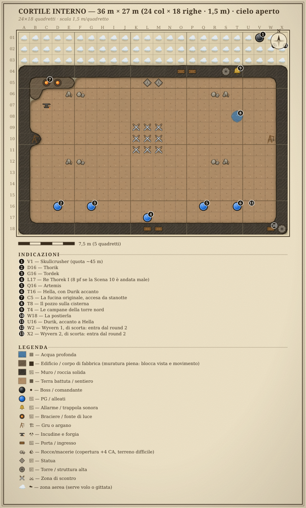

<!-- nuova-pagina -->

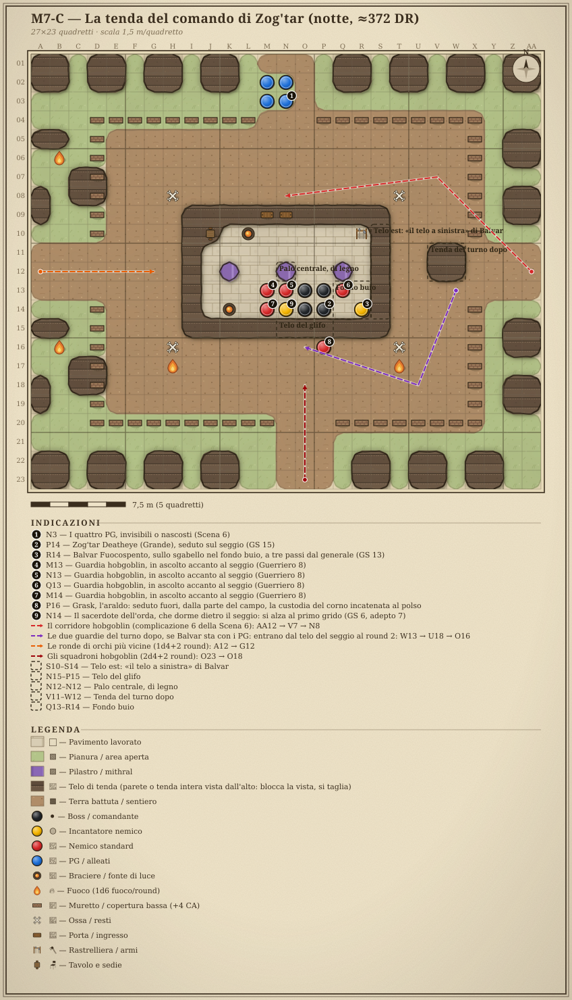

<!-- nuova-pagina -->

### Le griglie ASCII ultra-clear (scala 1,5 m/quadretto)

> 📗 **Versione a piena scheda tattica** (posizioni PG/PNG/villain, terreno &
> altitudini, tattiche di villain/mostri, evoluzione) nell'**Atlante Mappe
> Definitivo**. Le griglie qui sotto sono
> identiche; là hanno gli add-on DM. Le versioni a pergamena di M7-B e M7-C
> sono all'inizio di questa appendice.

#### MAPPA M7-A — HAMMERFIST ≈372 DR: fortezza, campo dell'orda, mura (strategica)

```
════════════════════════════════════════════════════════════════════════
 HAMMERFIST ≈372 DR — vista strategica (non in scala; il duello è su M7-B)
════════════════════════════════════════════════════════════════════════
                       NORD ▲  la montagna: dentro, le sale scendono (M7-S)
   ⛰️⛰️⛰️⛰️⛰️⛰️⛰️⛰️⛰️⛰️⛰️⛰️⛰️⛰️⛰️⛰️⛰️⛰️⛰️⛰️⛰️⛰️⛰️⛰️⛰️⛰️
        ╔════════════ 🔔 torre nord, +120 ═══════╗
        ║  fucina originale · la statua del re    ║  ← Zona 1: HAMMERFIST GIOVANE
        ║  CORTILE INTERNO, +100 → M7-B (duello)  ║     mura bianche, sicura
        ╚═══ porta e targa ════════ postierla ▫ 🗼╝  ← Zona 3: mura all'alba
              ╲ rampa finale ┊          scale ▲▲▲ ┊⇣    🌲🌲🌲🌲 BOSCO A EST
        ░░░░░░ SPIANATA DEGLI ARIETI, +80 ░░░░░░   ┊⇣    🌲 ✦ portale, ~500 m
                ╲╱╲╱ strada a tornanti ╲╱╲╱        ┊⇣    🌲🌲🌲🌲 (Scene 1-2)
   · · · · · · · · · piana dell'orda, quota 0 · · ┊ · · ·  ← le tende da 500 m
   ⛺🔥⛺   ⛺⛺🔥    ⛺🔥⛺    🔥⛺⛺   ⛺🔥⛺   ┊
   GP1▪   i clan degli orchi, a gruppi   ▪GP2 ┊  ← Zona 2: MARE DI TENDE
   ⛺🔥⛺ ┏━━━━━━━━━━━┳━━━━━━━━━━━┓ ⛺🔥⛺ ◄┘  via dei PG: fianco est, poi da nord
   🔥⛺⛺ ┃ ▪▪ ▪▪ ▪▪  ┃  ▪▪ ▪▪ ▪▪ ┃ ⛺⛺🔥      ⚔️ ZOG'TAR + 4 guardie (Sc. 8, M7-C)
   ⛺⛺🔥 ┣━━━━ ╔═══╩═══╗ ━━━━━┫ 🔥⛺⛺      ~1 km di cammino: cinque blocchi
   ⛺🔥⛺ ┃ ▪▪ ▪▪ ║COMANDO║ ▪▪ ▪▪ ┃ ⛺🔥⛺      👤 VATORE fra le tende (Sc. 9)
   🔥⛺⛺ ┗━━━━━━━━━━━┻━━━━━━━━━━━┛ ⛺⛺🔥
   GP3▪   ⛺🔥⛺   (10.000 dormono)   ⛺🔥⛺ ▪GP4
                       SUD ▼  oltre il campo: le colline, dove dorme il drago
────────────────────────────────────────────────────────────────────────
 IL PROFILO, NORD → SUD (le quote del DM, sulla piana dell'orda)
  +120 m ┌──┐ torre nord, la porta che entra nella montagna
         │  │
  +100 m ┘  └─────────────┐ porta e targa
           cortile, M7-B  │
                           ╲ rampa finale, 20 m
   +80 m                    ╲────────────────┐ spianata degli arieti
                                              ╲ strada a tornanti
                                               ╲___
                                                   ╲___
     0 m                                               ╲__ piana · ⛺🔥⛺ · COMANDO
         ├── dal ciglio, giù per i tornanti: circa 500 m ──┤ le tende, fino a 1 km ──┤
 La via dei PG non è questa sezione: dalla postierla (+100) giù per il
 fianco est, 100 m di dislivello, lungo il lato est del campo fino alla
 tenda, a circa 1 km di cammino; all'alba si risale lo stesso fianco.
────────────────────────────────────────────────────────────────────────
LEGENDA · ⛰️ montagna · 🏰╔╗ mura bianche, nuove · 🔔 campane · 🗼 torre est ·
▫ postierla · ░ la spianata, nuda · ╲ la rampa finale [INFERRED — needs DM
confirmation] e i tornanti · ▲ scale d'assedio sul tratto est · ⇣ la discesa
del fianco est · ⛺🔥 i clan degli orchi, tende a gruppi attorno al fuoco
della banda (copertura) · ▪▪ le lance hobgoblin, quattro tende attorno al
fuoco, ad anello attorno al capo · ━ le vie battute · ▪GP posti di guardia · ╔╗
la tenda del comando, sola nel suo spiazzo · ┊◄ la via dei PG · 👤 Vatore ·
⚔️ scontro · ✦ arrivo del portale.
Skullcrusher entra dall'alto sul cortile interno → M7-B.
════════════════════════════════════════════════════════════════════════
```

Le quote sono del DM: piana 0, spianata degli arieti
+80, porta e cortile +100, torre nord +120, le tende fra 500 m e 1 km dalle
mura. La rampa fra la spianata e la porta, le scale sul tratto est e la torre
nord sul suo gradone sono inferenze da confermare: sono scritte, con le loro
ragioni, nelle note di M7-A dell'Atlante.

#### MAPPA M7-B — L'ARENA DEL DUELLO (cortile interno · Skullcrusher)

```
════════════════════════════════════════════════════════════════════════
 CORTILE INTERNO — 36 m × 27 m (24 col × 18 righe · 1,5 m) · cielo aperto
 Nord in alto, la montagna. Skullcrusher entra da V1 (~45 m) e picchia. PG dalla riga 16.
════════════════════════════════════════════════════════════════════════
COL →  A B C D E F G H I J K L M N O P Q R S T U V W X
01    ☁️☁️☁️☁️☁️☁️☁️☁️☁️☁️☁️☁️☁️☁️☁️☁️☁️☁️☁️☁️☁️⚫☁️☁️   Skullcrusher in quota, circa 45 m (V1)
02    ☁️☁️☁️☁️☁️☁️☁️☁️☁️☁️☁️☁️☁️☁️☁️☁️☁️☁️☁️☁️☁️☁️☁️☁️   zona aerea: serve volo o gittata
03    ☁️☁️☁️☁️☁️☁️☁️☁️☁️☁️☁️☁️☁️☁️☁️☁️☁️☁️☁️☁️☁️☁️☁️☁️
04    🏰🏰🏰🏰🏰🏰🏰🏰🏰🏰🏰🏰🏰🏰🚪🚪🏰🏰🗼🔔🏰🏰🏰🏰   mura +4,5 m · O-P porta alla montagna · S torre nord, T campane
05    🏰⬛🏮🏮⬛🟫🟫🟫🟫🟫🟫🗿🗿⬜⬜⬜🟫🟫🟫🟫🟫🟫🟫🏰   B-E fucina originale (C-D forgia) · L-M la statua del re
06    🏰⬛🟫🟫🪨🪨🟫🟫🟫🟫⬜⬜⬜⬜🟫🟫🟫🪨🪨🟫🟫🟫🟫🏰   macerie: copertura +4 CA
07    🏰🟫⚒🟫🟫🟫🟫🟫🟫🟫🟫⬜⬜🟫🟫🟫🟫🟫🟫🟫🟫🟫🟫🏰   C l'incudine del rito (Scena 12)
08    🏰🟫🟫🟫🟫🟫🟫🟫🟫🟫🟫⬜⬜🟫🟫🟫🟫🟫🟫🟦🟫🟫🟫🏰   T il pozzo: sotto c'è la cisterna
09    🏰🟫🟫🟫🟫🟫🟫🟫🟫🟫⚔⚔⚔🟫🟫🟫🟫🟫🟫🟫🟫🟫🟫🏰   impronta del drago, 4,5 m
10    🏰🏗🟫🟫🟫🟫🟫🟫🟫🟫⚔⚔⚔🟫🟫🟫🟫🟫🟫🟫🟫🟫🏗🏰   B e W le gru: dal camminamento la corda scende qui
11    🏰🟫🟫🟫🟫🟫🟫🟫🟫🟫⚔⚔⚔🟫🟫🟫🟫🟫🟫🟫🟫🟫🟫🏰
12    🏰🟫🟫🟫🪨🪨🟫🟫🟫🟫🟫⬜⬜🟫🟫🟫🟫🪨🪨🟫🟫🟫🟫🏰   macerie: copertura +4 CA
13    🏰🟫🟫🟫🟫🟫🟫🟫🟫🟫🟫⬜⬜🟫🟫🟫🟫🟫🟫🟫🟫🟫🟫🏰
14    🏰🟫🟫🟫🟫🟫🟫🟫🟫🟫🟫⬜⬜🟫🟫🟫🟫🟫🟫🟫🟫🟫🟫🏰
15    🏰🟫🟫🟫🟫🟫🟫🟫🟫🟫🟫⬜⬜🟫🟫🟫🟫🟫🟫🟫🟫🟫🟫🏰
16    🏰🟫🟫🔵🟫🟫🔵🟫🟫🟫🟫⬜⬜🟫🟫🟫🔵🟫🟫🔵🟫🟫🟫🏰   i 4 PG
17    🏰🟫🟫🟫🟫🟫🟫🟫🟫🟫🟫🔵⬜🟫🟫🟫🟫🟫🟫🟫🟫🟫⬜🏰   Re Thorek I, alle spalle dei PG
18    🏰🏰🏰🏰🏰🏰🏰🏰🏰🏰🏰🚪🚪🏰🏰🏰🏰🏰🏰🏰🏰🏰🚪🗼   L-M porta principale (la targa) · W postierla · X torre est
════════════════════════════════════════════════════════════════════════
LEGENDA · ☁️ zona aerea (serve volo o gittata) · ⚫ Skullcrusher · ⚔ impronta
d'atterraggio del drago (Enorme) · 🟫 cortile · ⬜ il selciato dalla porta
principale alla statua, alla porta della montagna e alla postierla ·
🪨 macerie (copertura +4) ·
🏰 mura e camminamenti (+4,5 m, arcieri nani) · 🔵 PG e Re Thorek I ·
⬛🏮 la fucina originale e la sua forgia · ⚒ l'incudine del rito · 🗿 la statua
del re · 🟦 il pozzo sulla cisterna · 🏗 gru con le corde · 🗼 torri · 🔔 campane.
@north N
@mark 1 ; V1 ; Skullcrusher (quota ~45 m)
@mark 2 ; D16 ; Thorik
@mark 3 ; G16 ; Tordek
@mark 4 ; L17 ; Re Thorek I (8 pf se la Scena 10 è andata male)
@mark 5 ; Q16 ; Artemis
@mark 6 ; T16 ; Hella, con Durik accanto
@mark 7 ; C5 ; La fucina originale, accesa da stanotte
@mark 8 ; T8 ; Il pozzo sulla cisterna
@mark 9 ; T4 ; Le campane della torre nord
@mark 10 ; W18 ; La postierla
@mark 11 ; U16 ; Durik, accanto a Hella
@mark 12 ; W2 ; Wyvern 1, di scorta: entra dal round 2
@mark 13 ; X2 ; Wyvern 2, di scorta: entra dal round 2
@tipo tattica esterno
@luogo Hammerfist ≈372 DR, il cortile interno e la porta principale
@quota 970 m ; s.l.m. [INFERRED — needs DM confirmation: il DM dà la piana a 0; qui è a 870 m, come nel 1372 di ARC-08]
@dislivello +100 m ; sulla piana dell'orda, a sud
```

Le posizioni dei PG sono di riferimento: le sceglie il tavolo, e se non le
sceglie sfalsale su due righe, perché una linea di 30 m lungo la riga 16 li
prende tutti. Il re è alle loro spalle, a L17.

Il cortile sta a +100 m sulla piana dell'orda. Dal camminamento sud si guarda
giù: la spianata degli arieti 20 m più in basso, nuda, e oltre il ciglio la
piana, 100 m sotto, con le tende fino all'orizzonte.

### Sotto la montagna: la Scena 5

La sezione M7-S e gli stati del 1372 delle stesse sale stanno nell'atlante di
Hammerfist dall'alto in basso.

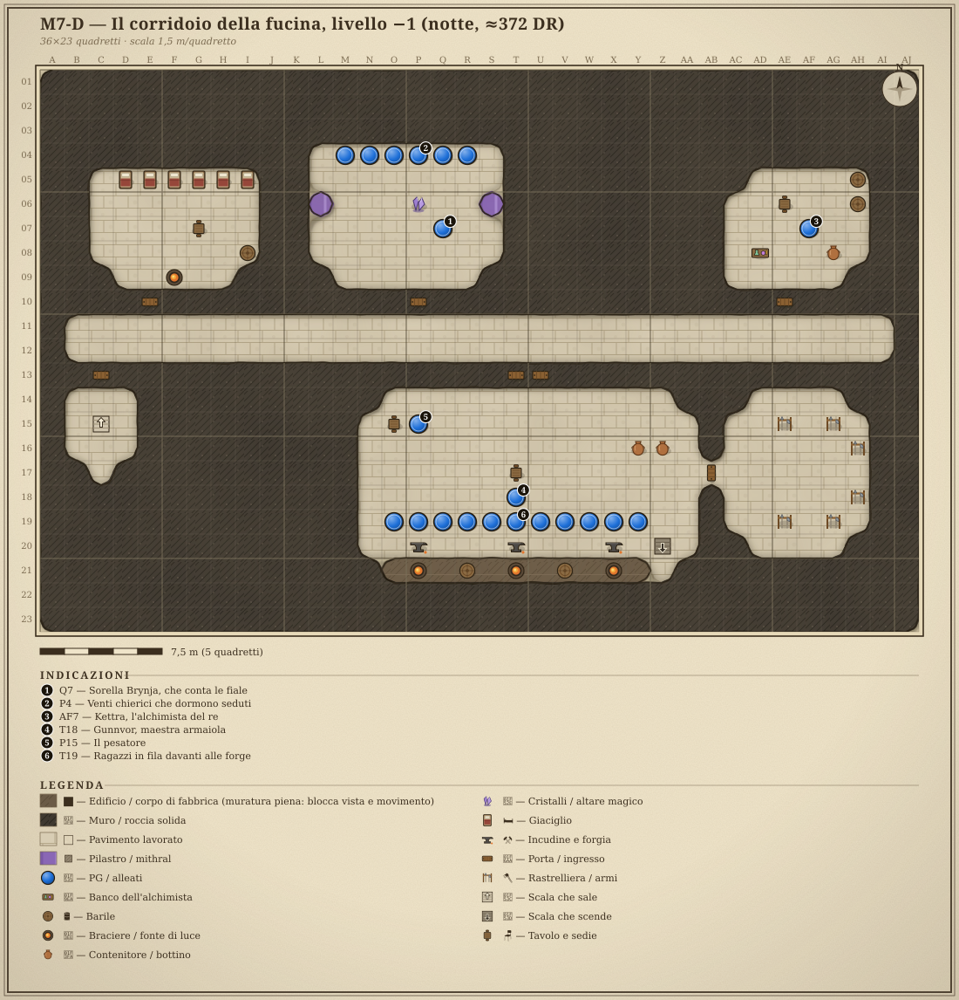

<!-- nuova-pagina -->

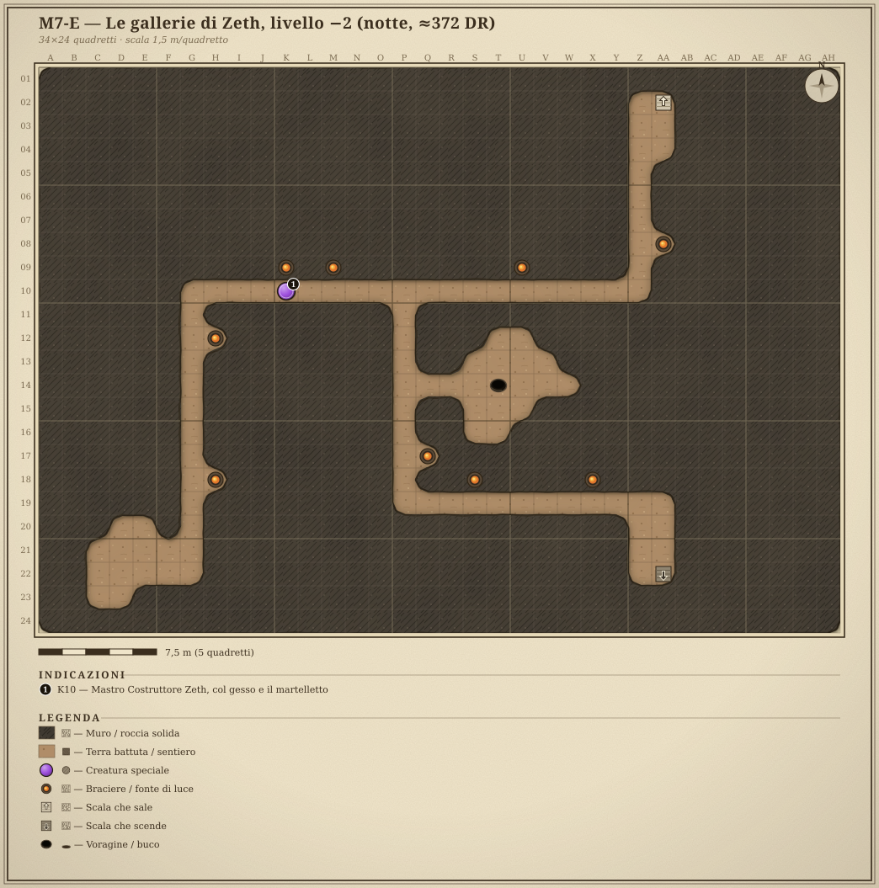

<!-- nuova-pagina -->

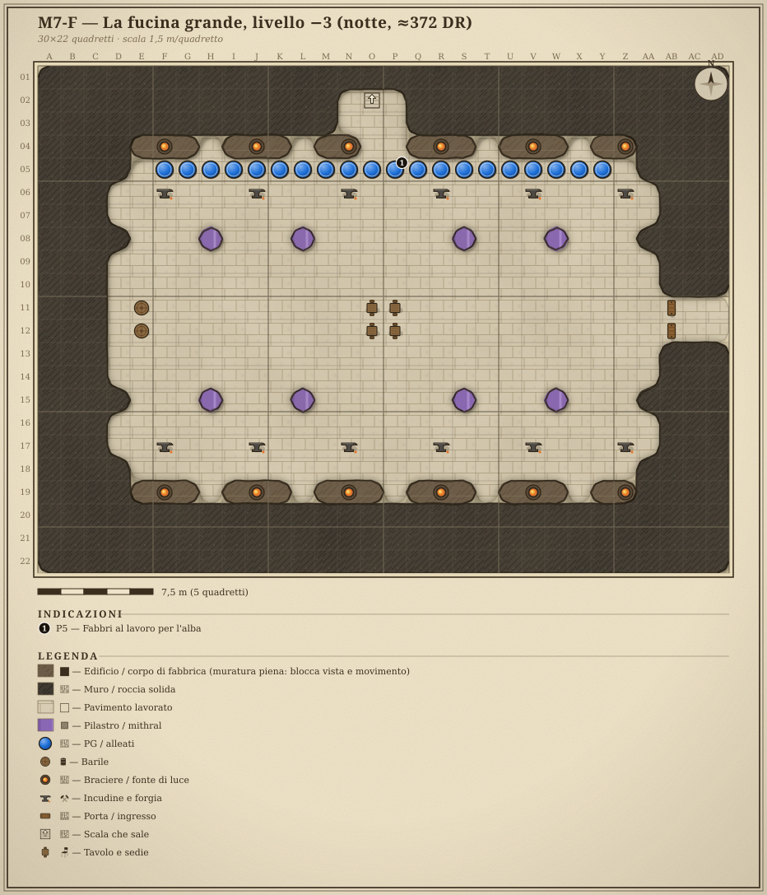

<!-- nuova-pagina -->

#### MAPPA M7-C — LA TENDA DEL COMANDO (Scene 7 e 8)

 La tenda misura 13,5 m × 7,5 m di pavimento, 16,5 m ×
10,5 m col telo: un padiglione di pelle nera a tre pali in fila sotto il colmo,
alto 6 m al colmo e 3 m alle pareti. Sta sola in mezzo allo spiazzo del
capo, terra battuta senza recinto, come il campo di un capo nomade: davanti
alla soglia il fuoco del consiglio, ridotto a brace, e i pali dei trofei; sul
bordo, staccate, le tende dei servi e del bottino. Su M7-H, a venti o trenta
metri, ci sono le lance della Guardia della Mano attorno ai loro fuochi e, a
ovest, i ripari dei clan degli orchi. Se il tavolo bombarda la tenda
dall'alto, le regole sono nel supplemento «Il barile sulla tenda» (ARC-07).

**Dove sta chi, se la griglia non è stampata.** I PG arrivano da nord, per la
via, a M2–N3. La soglia è a nord, M9–N9, in piena luce del braciere a L10. I
tre pali sono a K12, N12 e Q12; quello centrale, N12, porta la runa della
barriera di lame. Zog'tar siede sul seggio a O13–P14, con il braciere del
seggio a K14; le quattro guardie gli stanno attorno, a M13, N13, Q14 e M14.
Balvar è sullo sgabello a R14, nel fondo buio Q13–R14. Il telo est, «il telo a
sinistra», va da S10 a S14; il telo del glifo è quello sopra il seggio,
N15–P15. Grask è seduto fuori, a P16, due quadretti dietro il seggio, e il
sacerdote dorme sulla sua stuoia, a N14. Nella loro tenda, X4–Y5, a 9 m dal
telo, sul bordo nord-est dello spiazzo, dormono le due guardie del turno dopo.

<!-- /pagina -->


\page

# II · Balvar Fuocospento

{{note
##### ⚠ SOLO DM
Questo capitolo è materiale del DM: non mostrarlo ai giocatori.
}}

# Balvar Fuocospento, il Consigliere dell'Orda (CR 13)


{{note
##### Balvar Fuocospento, il Consigliere dell'Orda (CR 13) · GS 13
**CA** 24, contatto 14, colto 22 (armatura completa di mithral +2, anello di protezione +2, DES +2) · **pf** 101 (13d8+39) · *scheda in appendice*

**TATTICHE**
Dipendono da come è andata con lui prima dello scontro: il viaggio a mille anni fa, Scena 7, «Cosa fa quando comincia lo scontro» (canone, decisione Q21 del DM) (recuperato non combatte e indica la runa della Catena; trattativa aperta guarda un round e poi sta con chi vince; minacciato combatte con Zog'tar, come dice «Come si combatte, se si arriva a combatterlo» nella stessa scena). **Morale**: sotto 30 pf non fugge e non implora, finisce di incidere la lastra con un'azione di round completo, l'ultima, e in quel turno non attacca e non lancia (decisioni D52 e D71 del DM, nella stessa scena).  
}}


> **Abilità**: il DM ha approvato i gradi di Percepire Intenzioni che la Scena 7 usa. Sono 80 punti: chierico 9 a (2 + INT 3) per livello, quadruplo al 1°, più il Runecaster 4 allo stesso ritmo (il ritmo del Runecaster è del FRCS, `[Private source]`). Percepire Intenzioni non è di classe per un chierico d'Inganno: 8 gradi fuori classe (16 punti) + SAG 5 = **+13**. Gli altri 64 punti: 16 gradi ciascuno in Concentrazione (+COS 3), Sapienza Magica, Conoscenze (storia) e Artigianato (incidere rune), tutti a +INT 3. Ascoltare e Osservare senza gradi: la sola SAG.

> **Conti rifatti, senza far scendere nessun numero**:
> - **pf 101** (13d8+39): il primo dado al massimo e gli altri alla media, come per gli altri PNG con le classi. I 96 di prima stavano nella fascia, ma sotto la media. Il dado vita del Runecaster è un d8 (FRCS).
> - **CA di contatto 14**: l'anello di protezione è una deviazione, e la deviazione vale anche al contatto (10 + DES 2 + anello 2). La CA piena resta 24 con l'armatura completa di mithral +2.
> - **BAB +9**: chierico 9 (+6) e Runecaster 4 (+3, la progressione media del FRCS). Il martello sale a +11/+6 e la Lotta a +10.
> - **Talenti**: la scheda non li elencava. A 13 DV ne spettano cinque. *Incidere Rune* `[Private source — FRCS]` è il requisito del Runecaster; *Volontà di Ferro* e *Riflessi Fulminei* sono quelli che danno la Vol +17 e i Rifl +8 già scritti (senza, sarebbero +15 e +6); *Incantare in Combattimento* e *Scrivere Pergamene* vanno con un chierico che incide e combatte in una tenda piena di nemici.

> ⚠ Classe non SRD: il **Runecaster** è del *Forgotten Realms Campaign Setting* `[Private source — FRCS]`, e così il dominio della Runa. Prerequisito: *Incidere Rune*, mai scritto nella scheda, ora fra i talenti; gli altri (8 gradi in Artigianato e in Sapienza Magica, incantesimi divini di 3° livello) sono soddisfatti. PF1e: il chierico col **dominio della Runa** (OGL) e il talento *Scrivere Pergamene* si avvicinano in parte: ha i glifi e le rune-trappola, ma non le rune persistenti che non consumano slot, che sono il cuore del personaggio. Si tiene il Runecaster.


Medium humanoid (dwarf), **Chierico 9 di Abbathor / Runecaster 4**, NE.


Notes: consigliere del generale **Zog'tar Deatheye** (CR 15) all'assedio di ≈372 DR. Nano dello scudo **esiliato**, ex-runaio della fortezza, passato ad Abbathor. Non è il capo: è **il motivo per cui il capo ha un drago**. Dossier narrativo, tattiche e ganci → il viaggio a mille anni fa, Scena 7.

**Benchmark** PF T1-1 riga 13 (CA 28, pf 180, att. +22, danno medio 60, CD 21): CA 24 ✗ · pf 101 ✗ · att. +11 ✗ (è un incantatore) · CD 21 al 6° ✓. Vale il GS 13 per le rune che non consumano slot e per la Catena, non per la mischia.

Boost log: conti rifatti sulla scheda — GS 13 → 13 — pf alla media col primo dado al massimo, CA di contatto con la deviazione, BAB del Runecaster, cinque talenti che spiegano i TS già scritti.


\page

# III · La Forgia ricorda le ferite

{{note
##### ⚠ SOLO DM
Questo capitolo è materiale del DM: non mostrarlo ai giocatori.
}}

# B4 — "LA FORGIA RICORDA LE FERITE" (tabella di carry-over)
## Ponte meccanico P5 (duello con Skullcrusher, ≈372 DR) → ARC-08 (Fauci di Palude, 1372 DR)

> **Stato (B4)**: ⭐ deliverable cross-arc più importante dell'arco. Traduce
> l'**esito del duello con Skullcrusher** (oggi cap. I, Scena 11; nel vecchio P5 fast-play era la Scena 5) in un
> **effetto quantificato** sullo statblock di **Fauci di Palude** nell'ARC-08
> (GS 15, 337 PF).
>
> **Fonte narrativa**: Moradin, P5-DEFINITIVO-PARTE2 r.290 — *«Ogni ferita che
> infliggi ora all'antenato, la mia Forgia la ricorderà quando affronterai il
> discendente.»* + Aegis Fang, P6 r.746 (*"sangue Skullcrusher chiama"*).
>
> ✅ **Canone di carry-over.** Sistema
> **D&D 3.5** — solo bonus tipizzati (competenza/circostanza/morale), **niente
> vantaggio/svantaggio 5e**. (Il DM può sempre ritoccare in corsa, ma questi
> sono i valori di riferimento su cui l'ARC-08 può contare.)

---

## 1. INPUT DAL P5 (cosa registra il fast-play)

Dalla **Scena 11 di cap. I**, il duello, si registrano due dati (nel vecchio P5 era la Scena 5; stasera la Scena 5 è la notte nella fortezza):

1. **Esito del duello**: `UCCISO` / `FERITO GRAVE` / `FUGGITO`.
2. **Ferite ancestrali segnate** (`N`): numero di colpi andati a segno su
   Skullcrusher durante il duello (la "Cicatrice della Forgia"). Cap
   consigliato **N ≤ 3** ai fini del bonus. Con un gruppo di 13° tre colpi a
   segno arrivano già al secondo round: **N arriva a 3 quasi sempre**, e il
   bonus pieno è l'esito normale, non il premio raro.

---

## 2. TABELLA ESITO → EFFETTO SU FAUCI DI PALUDE (1372)

| Esito del duello | Effetto sullo statblock di Fauci (GS 15, 337 PF) | Razionale |
|---|---|---|
| **UCCISO** (Skullcrusher a 0 pf) | **Cicatrice ancestrale attiva**: Fauci entra in campo con **−10% PF** (337 → **303 PF**) e **Presenza Terrificante CD 25 → 23** contro i **portatori degli artefatti** (Thorik/Corona, Tordek/Bracieri+Cintura, Hella/Collana, Artemis/Ring). | La stirpe porta la ferita mortale del capostipite: il sangue "ricorda" di poter cadere. |
| **FERITO GRAVE** (fugge sotto ⅓ pf) | **−1 uso del soffio**: il primo **Soffio a Cono** (1/giorno) è **indisponibile**; il soffio in linea parte comunque ma la **prima** volta a −2 alla CD (27 invece di 29). Nessuna riduzione di PF. | La ferita non è letale ma "storpia" l'arma migliore del sangue. |
| **FUGGITO** (Skullcrusher si allontana quasi illeso) | Fauci **vi ha visti e riconosciuti**: **+2 iniziativa** e nessuna sorpresa contro di voi (sa chi siete) **MA morale fragile** — **fugge sotto i 75 PF** invece di 50 (soglia di ritirata alzata di 25). | Il drago è forte ma il sangue teme già i "quattro del futuro": più cauto, meno disposto a morire. |

---

## 3. BONUS PER "FERITE ANCESTRALI SEGNATE" (N)

Indipendente dall'esito (si somma), riflette P5-DEF-P2 r.294:

- **Ogni ferita ancestrale segnata** dà ai **portatori d'artefatto**, **solo
  contro Fauci nel 1372**, a **scelta unica del gruppo** all'inizio della
  battaglia:
  - **+1 di competenza ai tiri per colpire** contro Fauci, **oppure**
  - **+1d6 danni** ai colpi che vanno a segno su Fauci.
- Cap: **N ≤ 3** (max **+3 TxC** o **+3d6**).
- **Cicatrice fisica** (se Aegis Fang colpì Skullcrusher in volo, cap. I Scena 11):
  Fauci ha una **cicatrice a forma di martello** su un'ala → **−2 metri alla
  Volare** (45 → 43) e i PG che lo sanno hanno **+2 di circostanza** a
  colpirlo mentre è in volo.

---

## 4. IL GANCIO INVERSO — AEGIS FANG "SENTE" FAUCI

- Quando Fauci di Palude entra in scena nel 1372, **Aegis Fang canta**
  (*"sangue Skullcrusher chiama"*, P6 r.746). Meccanicamente: **Thorik ottiene
  +2 di circostanza ai tiri per colpire contro Fauci** (bonus di circostanza
  3.5, definito e non 5e) e **avverte in anticipo** il primo soffio di Fauci
  (può dichiarare *pronto a ripararsi* → TS Riflessi del soffio **+2**).
- È l'eco meccanica del legame ancestrale: l'arma che uccise il capostipite
  riconosce il discendente.


\page

# Appendice: le creature

{{monster,frame
## Balvar Fuocospento, il Consigliere dell'Orda
*Medium humanoid (dwarf), Chierico 9 di Abbathor / Runecaster 4, NE* · GS 13
___
**Iniziativa** +2 · **Sensi** scurovisione 18 m; Ascoltare +5, Osservare +5

**DIFESA**
___
**CA 24**, contatto 14, colto 22 (armatura completa di mithral +2, anello di protezione +2, DES +2) · **pf 101** (13 DV) · TS Temp +13, Rifl +8, **Vol +17** (+2 razziale vs magia) · immune a paura (patto con Abbathor) · **Debolezza** le sue rune sono **scritte** — chi legge il nanico antico e le vede può contrastarle (vedi il modulo).  

**ATTACCO**
___
Vel 6 m · **Mischia** martello da guerra runico +1 +11/+6 (1d8+2) · Domini **Inganno** e **Runa** (dominio Runa = FRCS). Incantesimi da **chierico di 13° livello**: è chierico 9 **e** Runecaster 4, e il Runecaster avanza il lancio (per questo ha *blade barrier*, che è di 6°). CD 15+liv: tipici *dispel magic, magic circle against good, greater magic weapon, divination, righteous might, blade barrier, slay living, silence, invisibility purge, glyph of warding, dimensional anchor*, *greater command* (uno slot di 5° libero).  

**STATISTICHE**
___
For 12, Des 14, Cos 16, Int 16, **Sag 20**, Car 14 · BAB +9; Lotta +10 · **Abilità** Percepire Intenzioni +13, Concentrazione +19, Sapienza Magica +19, Conoscenze (storia) +19, Artigianato (incidere rune) +19 (il conto dei gradi è nella nota in testa) · **Talenti** Incidere Rune `[Private source — FRCS]`, Volontà di Ferro, Riflessi Fulminei, Incantare in Combattimento, Scrivere Pergamene · **Equipaggiamento** armatura completa di mithral +2, anello di protezione +2, martello da guerra runico +1, polvere di diamante per i glifi  

**CAPACITÀ SPECIALI**
___
- **Rune incise (Runecaster 4)**: incide fino a **4 rune persistenti** su superfici o creature consenzienti/legate; una runa incisa **non consuma slot al momento dell'uso** e scatta alla condizione scritta. Alla tenda di Zog'tar (ARC-07 questo capitolo, Scene 6 e 7): *invisibility purge* sulla soglia, *blade barrier* sul palo centrale, *silence* su sé stesso, **la Catena** (sotto). *Dimensional anchor* lo lancia, non lo incide.  
- **La Catena di Skullcrusher (Su, unica)**: la runa-vincolo incisa nella scaglia sternale del drago. Finché regge, **Skullcrusher combatte per l'orda**. Non è dominazione — è un **contratto scritto nella carne**, e il drago lo sa.  
- **Leggere il Fuori-Posto (Su, 3/giorno)**: come *detect magic* ma sulle **anomalie temporali**: percepisce chi non appartiene a questo secolo. **È il solo, in tutta Hammerfist ≈372 DR, che sa cosa sono i PG.**  
}}
{{monster,frame
## Balvar Fuocospento, il Consigliere dell'Orda (CR 13)
*Medium humanoid (dwarf), Chierico 9 di Abbathor / Runecaster 4, NE* · GS 13
___
**Iniziativa** +2 · **Sensi** scurovisione 18 m; Ascoltare +5, Osservare +5

**DIFESA**
___
**CA 24**, contatto 14, colto 22 (armatura completa di mithral +2, anello di protezione +2, DES +2) · **pf 101** (13 DV) · TS Temp +13, Rifl +8, **Vol +17** (+2 razziale vs magia) · immune a paura (patto con Abbathor) · **Debolezza** le sue rune sono **scritte** — chi legge il nanico antico e le vede può contrastarle (vedi il modulo).  

**ATTACCO**
___
Vel 6 m · **Mischia** martello da guerra runico +1 +11/+6 (1d8+2) · Domini **Inganno** e **Runa** (dominio Runa = FRCS). Incantesimi da **chierico di 13° livello**: è chierico 9 **e** Runecaster 4, e il Runecaster avanza il lancio (per questo ha *blade barrier*, che è di 6°). CD 15+liv: tipici *dispel magic, magic circle against good, greater magic weapon, divination, righteous might, blade barrier, slay living, silence, invisibility purge, glyph of warding, dimensional anchor*, *greater command* (uno slot di 5° libero).  

**STATISTICHE**
___
For 12, Des 14, Cos 16, Int 16, **Sag 20**, Car 14 · BAB +9; Lotta +10 · **Abilità** Percepire Intenzioni +13, Concentrazione +19, Sapienza Magica +19, Conoscenze (storia) +19, Artigianato (incidere rune) +19 (il conto dei gradi è nella nota in testa) · **Talenti** Incidere Rune `[Private source — FRCS]`, Volontà di Ferro, Riflessi Fulminei, Incantare in Combattimento, Scrivere Pergamene · **Equipaggiamento** armatura completa di mithral +2, anello di protezione +2, martello da guerra runico +1, polvere di diamante per i glifi  

**CAPACITÀ SPECIALI**
___
- **Rune incise (Runecaster 4)**: incide fino a **4 rune persistenti** su superfici o creature consenzienti/legate; una runa incisa **non consuma slot al momento dell'uso** e scatta alla condizione scritta. Alla tenda di Zog'tar (ARC-07 cap. I, Scene 6 e 7): *invisibility purge* sulla soglia, *blade barrier* sul palo centrale, *silence* su sé stesso, **la Catena** (sotto). *Dimensional anchor* lo lancia, non lo incide.  
- **La Catena di Skullcrusher (Su, unica)**: la runa-vincolo incisa nella scaglia sternale del drago. Finché regge, **Skullcrusher combatte per l'orda**. Non è dominazione — è un **contratto scritto nella carne**, e il drago lo sa.  
- **Leggere il Fuori-Posto (Su, 3/giorno)**: come *detect magic* ma sulle **anomalie temporali**: percepisce chi non appartiene a questo secolo. **È il solo, in tutta Hammerfist ≈372 DR, che sa cosa sono i PG.**  
}}
{{monster,frame
## Durin Rocciadura
*Nano Medio · Guerriero 6* · GS 6
___

**DIFESA**
___
**CA 22** (arm. completa +1, scudo pesante +1) · **pf 52** · TS Temp +8, Rifl +2, Vol +4  

**ATTACCO**
___
**Mischia** ascia da guerra nanica +1 +11 (1d10+5, ×3), a una mano  

**STATISTICHE**
___
For 18, Cos 16, Sag 14 · BAB +6; Lotta +10  
}}
{{monster,frame
## Guardia di Zog'tar (4)
*Hobgoblin Medio · Guerriero 8 SRD sulle caratteristiche dell'hobgoblin* · GS 8
___
**Iniziativa** +1 · **Sensi** Ascoltare +1, Osservare +1 (senza gradi nelle due abilità)

**DIFESA**
___
**CA** 19, +8 arm. completa, +1 DES, il massimo che l'armatura lascia; spadone, niente scudo  
**pf** 60  
**TS** Temp +8, Rifl +3, Vol +1  

**ATTACCO**
___
**Velocità** 6 m (armatura pesante)  
**Mischia** spadone +14 (2d6+6)  
**Distanza** giavellotti +9 (1d6+4), incremento 9 m  
}}
{{monster,frame
## Hobgoblin della pattuglia (8)
*Hobgoblin Medio · guerriero 4 SRD, con Arma Focalizzata e Specializzata* · GS 4
___
**Iniziativa** +1 · **Sensi** Ascoltare −1, Osservare −1

**DIFESA**
___
**CA** 15  
**pf** 30  
**TS** Temp +6, Rifl +2, Vol +0  

**ATTACCO**
___
**Velocità** 9 m  
**Mischia** spada lunga +6 (1d8+3/19-20)  

*in otto fanno EL 10; i numeri sono calcolati sull'SRD*
}}
{{monster,frame
## Orco della ronda
*Orco Medio · guerriero 1 SRD* · GS ½
___
**Sensi** scurovisione 18 m

**DIFESA**
___
**CA** 13, contatto 10  
**pf** 5  
**TS** Temp +3, Rifl +0, Vol −2  

**ATTACCO**
___
**Mischia** falchion +4 (2d4+4/18-20)  
**Distanza** giavellotto +1 (1d6+3)  
}}
{{monster,frame
## Sacerdote dell'orda
*Hobgoblin Medio · Adepto 7* · GS 6
___
**Iniziativa** +2 · **Sensi** Ascoltare +2, Osservare +2

**DIFESA**
___
**CA 12** (+2 DES) · **pf 38** (7d6+14) · TS Temp +4, Rifl +4, Vol +7  

**ATTACCO**
___
Vel 9 m · **Mischia** bastone ferrato +3 (1d6) · **Incantesimi** (3/4/3; CD 12 + livello): 0 *guida, individuazione del magico, luce*; 1° *benedizione, causare paura, comando, protezione dal bene*; 2° *vedere invisibilità, oscurità, forza del toro*  

**STATISTICHE**
___
For 10, Des 14, Cos 15, Int 14, Sag 15, Car 8 · **Abilità** Ascoltare +2, Osservare +2, Concentrazione +12  
}}
{{monster,frame
## Skullcrusher il Nero, il Primo Nero
*Drago Enorme (acqua), caotico malvagio · drago nero adulto maturo, Avanzato · capostipite di Fauci di Palude* · GS 14
___
**Iniziativa** +6 · **Sensi** percezione cieca 18 m, scurovisione 36 m, visione crepuscolare ×4; Ascoltare +29, Osservare +29

**DIFESA**
___
**CA 33** (−2 taglia, +2 DES, +23 naturale), contatto 10, impreparato 31; **37 con *armatura magica***, che si lancia prima del duello e dura 5 ore: al duello della Scena 11 è **già addosso**, quindi CA 37 · **pf 297** (22d12+154) · TS Temp +20, Rifl +17, Vol +19 · RD 10/magia · RI 21 · immune acido, sonno, paralisi  

**ATTACCO**
___
Vel 18 m, volare 45 m (scarsa), nuotare 18 m · **Mischia** morso +30 (2d8+10), 2 artigli +25 (2d6+5), 2 ali +25 (1d8+5), colpo di coda +25 (2d6+15) · Spazio 4,5 m, portata 3 m (morso 4,5 m) · **Schiacciare** (in volo o saltando, azione standard) 2d8+15, Riflessi CD 28 o immobilizzati; solo contro creature Piccole o minori: i nani e i PG Medi non li schiaccia · **Soffio acido** (Sop) linea di 30 m, 14d4, Riflessi CD 30 dimezza (28 + Capacità Focalizzata), di nuovo dopo 1d4 round · **Capacità magiche** 3/giorno *oscurità* (raggio 21 m); 1/giorno *corrompere l'acqua* (CD 25: rovina anche le pozioni che un PG ha addosso, se falliscono il TS) · **Incantesimi da stregone** (incantatore di 5°, CD 14 + livello): 0 (6/giorno) *individuazione del magico, lettura del magico, mano magica, resistenza, suono fantasma, frastornare*; 1° (7/giorno) *armatura magica, scudo, colpo accurato, dardo incantato*; 2° (5/giorno) *vedere invisibilità, immagine speculare*  

**STATISTICHE**
___
For 31, Des 14, Cos 25, Int 18, Sag 19, Car 18 · BAB +22; Lotta +40 · **Talenti** Attacco in Volo, Capacità Focalizzata (soffio), Fluttuare, Iniziativa Migliorata, Riflessi Fulminei, Soffio Aderente, Virata, Volontà di Ferro · **Abilità** Ascoltare +29, Cercare +29, Concentrazione +32, Intimidire +29, Muoversi Silenziosamente +27, Nascondersi +19, Osservare +29, Sapienza Magica +29, Nuotare +18  

**CAPACITÀ SPECIALI**
___
- **Soffio aderente**, quando lo sceglie: chi ne prende danno ne riprende metà al round dopo; toglierselo è un'azione di round completo con Riflessi CD 30 (+2 rotolando a terra, e si resta proni); la ricarica sale di 1 round.  
- **Presenza Terrificante** (Str): raggio 63 m, Volontà CD 25; chi ha meno di 22 DV è scosso per 4d6 round (4 DV o meno: in preda al panico); chi supera il TS è immune per 24 ore.  
- **Respirare sott'acqua** (Str).  
}}
{{monster,frame
## Skullcrusher Vecchio
*Drago Enorme (acqua), caotico malvagio · drago nero Vecchio dell'SRD, Avanzato* · GS 17 (Vecchio GS 16, +1 Avanzato)
___
**Iniziativa** +6 · **Sensi** come A.1

**DIFESA**
___
**CA 36** (−2 taglia, +2 DES, +26 nat), contatto 10, impreparato 34; **40 con *armatura magica*** · **pf 337** (25d12+175) · TS Temp +21, Rifl +18, Vol +20 · RD 10/magia · RI 22 · immune acido, sonno, paralisi  

**ATTACCO**
___
come A.1 · **Mischia** morso +34 (2d8+11), 2 artigli +29 (2d6+5), 2 ali +29 (1d8+5), colpo di coda +29 (2d6+16) · **Schiacciare** 2d8+16, Riflessi CD 29 (solo creature Piccole o minori) · **Soffio acido** linea di 30 m, 16d4, Riflessi CD 31 dimezza (aderente come A.1) · **Capacità magiche** come A.1, ma *oscurità* con raggio 24 m, più *crescita vegetale* 1/giorno · **Incantesimi da stregone** incantatore di 7°: 6/7/7/5 al giorno (*lentezza* CD 17)  

**STATISTICHE**
___
For 33, Des 14, Cos 25, Int 18, Sag 19, Car 18 · BAB +25; Lotta +44 · **Talenti** quelli di A.1 (Virata, non Ghermire), più Allerta · **Abilità** e il resto: come A.1  

**CAPACITÀ SPECIALI**
___
- **Presenza Terrificante**: raggio 72 m, Volontà CD 26 (meno di 25 DV).  
- **Soffio aderente**, come A.1.  
}}
{{monster,frame
## Treant di Adamantio
*Vegetale Grande, evocato dalla Collana di Hella* · GS ~10
___

**DIFESA**
___
**CA** 24, RD 10/adamantio, vulnerabile al fuoco  
**pf** 90  
**TS** Temp +12, Rifl +3, Vol +8  

**ATTACCO**
___
**Velocità** 9 m  
**Mischia** 2 schianti +18 (2d8+9), danni doppi alle strutture  
**Speciale** Travolgere 2d8+13 (Riflessi CD 24)  

**STATISTICHE**
___
For 29  

*la scheda intera è nell'appendice delle statistiche della Resurrezione di Hella*
}}
{{monster,frame
## Worg dei cavalieri dei lupi
*Bestia magica Media · worg SRD* · GS 2
___
**Sensi** olfatto 9 m; Ascoltare +6, Osservare +6

**DIFESA**
___
**CA** 14  
**pf** 30  
**TS** Temp +5, Rifl +6, Vol +3  

**ATTACCO**
___
**Mischia** morso +7 (1d6+4) e sbilanciare  

*worg dell'SRD; i tiri salvezza sono quelli della sua scheda SRD*
}}
{{monster,frame
## Wyvern (2)
*Drago Grande · wyvern SRD* · GS 6
___

**DIFESA**
___
**CA** 18  
**pf** 59  
**TS** Temp +7, Rifl +6, Vol +6  

**ATTACCO**
___
**Velocità** volare 18 m  
**Mischia** pungiglione +10 (1d6+4 e veleno, Tempra CD 17, 2d6 COS), morso +8 (2d8+4)  

*wyvern dell'SRD; i tiri salvezza sono quelli della sua scheda SRD*
}}
{{monster,frame
## Zog'tar Deatheye, generale dell'orda antica
*Mezzo-Ogre/Orco Grande, caotico malvagio · Barbaro 14 / Guerriero 1* · GS 15 (Avanzato)
___
**Iniziativa** +9 · **Sensi** Ascoltare +11, Osservare +3

**DIFESA**
___
**CA 26** (−1 taglia, +10 arm. completa di mithral +2, +3 DES, +4 nat), contatto 12, impreparato 26 (Schivare Prodigioso Migliorato); 24 in Ira. Il mithral alza la DES massima a +3 (SRD); è preda presa ai nani, e i nani la riconoscono · **pf 283** (15 DV, massimi per dado), 328 in Ira Superiore · TS Tempra +18 (+21 in Ira), Riflessi +9, Volontà +9 (+12 in Ira; +16 contro gli ammaliamenti, Volontà Indomita) · RD 3/— (barbaro 13) · Schivare Prodigioso Migliorato · Percepire Trappole +4 · Volontà Indomita (14°)  

**ATTACCO**
___
Vel 12 m · **Mischia** in Ira, ascia a due mani +1 +29/+24/+19 (3d6+20, 20/×3); fuori dall'Ira (round di sorpresa) +26/+21/+16 (3d6+16) · **Distanza** 3 giavellotti Grandi +19 (BAB 15, DES +5, −1 taglia) (1d8+13), incremento 9 m · **Colpo Devastante** (azione standard) +25 in Ira, 3d6+20; Riflessi con CD pari al danno, o vola via di 3 m e cade prono (+1d6 a lui e all'ostacolo se ne incontra uno) · **Attacco Poderoso** a due mani: fino a −15 al colpire per +30 ai danni  

**STATISTICHE**
___
For 30 (36 in Ira), Des 20, Cos 24 (30 in Ira), Int 16, Sag 16, Car 18 · BAB +15; Lotta +29 (+32 in Ira) · **Talenti** (7) Attacco Poderoso, Spingere Migliorato, Colpo Devastante (talento da mostro, SRD), Ira Extra, Iniziativa Migliorata, Volontà di Ferro, Arma Focalizzata (ascia) · **Abilità** Ascoltare +11, Osservare +3, Intimidire +14 (8 gradi in Ascoltare, 10 in Intimidire, nessuno in Osservare)  

**CAPACITÀ SPECIALI**
___
- **Ira Barbarica Superiore** (6/giorno, con Ira Extra): +6 FOR, +6 COS, +3 Volontà, −2 CA, 13 round. Dopo l'Ira è affaticato (l'Ira Instancabile arriva al 17°).  
- **Presenza Minacciosa**: entro 9 m, Volontà CD 21 o scosso 1d4 round (10 + ½ DV + CAR, come la presenza terrificante dei draghi; D57).  
- **Occhio di Ossidiana** (artefatto minore maledetto, incastonato al posto dell'occhio destro, canone del DM): 3/giorno, azione di movimento, marca un bersaglio: −2 CA contro Zog'tar e +2 danni subiti da lui, 5 round. Prezzo: Zog'tar è **vulnerabile alla luce divina** (Luce di Lathander, Corona).  
}}
