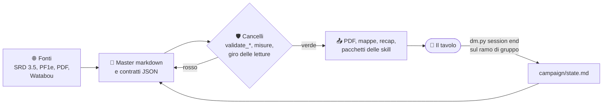

<div align="center">

# ⚒️ RumblingStone

**Una campagna di D&D 3.5 nei Forgotten Realms, con gli strumenti che la
preparano, la controllano e la stampano.**

*Red Hand of Doom* portata nella Valle di Cannath (l'Elsir Vale adattata,
Faerûn, 1372 DR), per un tavolo adulto di PG al 13° livello.

[](https://github.com/gsamuele78/RumblingStone/actions/workflows/ci.yml)
[](https://github.com/gsamuele78/RumblingStone/actions/workflows/release.yml)
[](https://github.com/gsamuele78/RumblingStone/releases)
[](CHANGELOG.md)
[](https://semver.org/lang/it/)

[](plans/adr/ADR-0099-la-piattaforma-ha-tre-canali-come-debian.md)
[](LICENSE)
[](LICENSES.md)
[](OGL.txt)
[](skills/dnd-35-srd/SKILL.md)
[](.github/dependabot.yml)
[](docs/RILASCIO.md)

[Architettura](docs/ARCHITETTURA.md) ·
[Indice dei documenti](docs/INDEX.md) ·
[Playbook del DM](campaign/DM-CAMPAIGN-PLAYBOOK.md) ·
[Strumenti](docs/tools/README.md) ·
[Piani](plans/INDEX.md) ·
[Changelog](CHANGELOG.md)

</div>

---

## Indice

- [Che cos'è](#che-cosè)
- [Cosa c'è dentro](#cosa-cè-dentro)
- [Come funziona](#come-funziona)
- [Per iniziare](#per-iniziare)
- [La campagna](#la-campagna)
- [Il modulo autonomo](#il-modulo-autonomo)
- [Documentazione](#documentazione)
- [Versioni e rilasci](#versioni-e-rilasci)
- [Contribuire](#contribuire)
- [Licenze e proprietà intellettuale](#licenze-e-proprietà-intellettuale)

## Che cos'è

RumblingStone è due cose nello stesso repo:

1. **Una campagna giocata.** Dieci archi (00-09) che portano *Red Hand of
   Doom* nella Valle di Cannath, con un Bestiario proprio, quattro PG, lo stato
   della campagna aggiornato dopo ogni serata e moduli autonomi.
2. **Un'officina per scriverla e giocarla.** Una CLI unica (`dm.py`), oltre 100
   script che controllano i master, disegnano le mappe e impaginano i volumi da
   stampa, 18 skill che istruiscono gli agenti AI, e una CI che boccia ciò che
   non è all'altezza prima che arrivi al tavolo.

Il principio di fondo è che **il markdown è la verità**: si scrive e si
corregge solo il master, e PDF, mappe, recap e pacchetti si rigenerano.

## Cosa c'è dentro

| | Cosa | Dove |
|---|---|---|
| 📜 | Archi della campagna, master **DEF** al livello di un Adventure Path | `00_…` → `09_…` |
| 👹 | Bestiario: mostri, PNG, villain con statblocco e dossier a sezioni fisse | [`Bestiario/`](Bestiario/) |
| 🧝 | Schede dei quattro PG | [`PG/`](PG/) |
| 🗺️ | Mappe a scala reale: griglia, JSON, SVG pergamena, PNG, UVTT per Foundry e Roll20 | [GUIDA-MAPPE](docs/guides/GUIDA-MAPPE.md) |
| 📕 | Booklet e volumi di stampa: HTML, Homebrewery, PDF con typst | [GUIDA-BOOKLET-E-PDF](docs/guides/GUIDA-BOOKLET-E-PDF.md) |
| 🎲 | Stato della campagna, sessioni, recap per PG, ledger dei PE | [`campaign/`](campaign/) |
| 🧠 | 18 skill per agenti: regole 3.5 e PF1e, lore 1372 DR, stile, mappe, editoria | [`skills/`](skills/) |
| 🛠️ | `dm.py` e gli script, ognuno con il suo contratto nel manifest | [`scripts/`](scripts/), [registro](docs/tools/README.md) |
| 🧭 | Piani, 97 ADR, decisioni del DM tracciate | [`plans/`](plans/) |
| ✍️ | Misure della prosa e voto al cieco del DM | ADR-0093 |

## Come funziona

Il disegno completo, con ventiquattro diagrammi (infrastruttura, integrazione fra
strumenti e fonti, casi d'uso, la catena della prosa, la serata, il giro
delle letture, i rilasci),
sta in **[docs/ARCHITETTURA.md](docs/ARCHITETTURA.md)**. In breve:



## Per iniziare

Serve **Python 3.13** (quella di Debian 13) e git. Tutto il resto è
facoltativo e `dm.py doctor` dice cosa manca e cosa succede senza.

```bash
git clone https://github.com/gsamuele78/RumblingStone.git
cd RumblingStone
pip install -r requirements.txt          # pyyaml, Pillow, tiktoken
python3 scripts/dm.py --version          # la versione del repo
python3 scripts/dm.py doctor             # cosa c'è sulla macchina
python3 scripts/dm.py --help             # tutti i comandi
```

Per chi usa un agente AI (Claude Code, Cursor, Windsurf e altri):

```bash
./scripts/build-skills.sh                # pacchetti delle skill per ogni agente
```

oppure si scarica l'archivio delle skill già costruito e firmato dalla
[pagina dei rilasci](https://github.com/gsamuele78/RumblingStone/releases).

Per sviluppare e far girare le prove come in CI:

```bash
pip install -r requirements-dev.txt
python3 -m pytest scripts/tests -q
```

La guida passo passo per una macchina nuova (hook git, ramo di gruppo,
container facoltativi) è
[GUIDA-SETUP-MACCHINA](docs/guides/GUIDA-SETUP-MACCHINA.md).

## La campagna

Chi dirige la campagna parte dal
**[Playbook del DM](campaign/DM-CAMPAIGN-PLAYBOOK.md)**: il modello di stato a
tre livelli, il prima, durante e dopo della serata, gli orologi, e come
ripartire con un gruppo nuovo (`python3 scripts/dm.py gruppo nuovo`, un
questionario, nessun YAML a mano). Ogni gruppo gioca sul suo ramo
`campaign-group-<nome>` ([ADR-0007](plans/adr/ADR-0007-scritture-canone-triplo-vincolo.md)).

<details>
<summary><b>Gli archi</b></summary>

| Arco | Cartella |
|---|---|
| 00 · L'adattamento di *Red Hand of Doom* | `00_Red Hand Of Doom` |
| 01 · La miniera | `01_LaMiniera` |
| 02 · La Scala d'Ossa e l'Abbattor dei funghi | `02_scaladossa-abbattor-funghi` |
| 03 · La Cittadella | `03_la Cittadella` |
| 04 · La tomba di Belkram | `04_tomba_di_Belkram` |
| 05 · La stanza runica | `05_aa-stanza-runica` |
| 06 · La stanza della Corona di Adamantio | `06_Stanza-corona-di-adamantio` |
| 07 · Il Portale della Forgia Eterna | `07_il Portale Della Forgia Eterna` |
| 08 · La battaglia di Hammerfist | `08_La Battaglia Di Hammerfist` |
| 09 · Dopo Hammerfist: Rethmar, Dauth, Channathgate | `09_Continuazione Arco Narrativo dopo Battaglia di Hammerfist` |

</details>

<details>
<summary><b>I personaggi giocanti</b></summary>

| PG | Classe | Al tavolo |
|---|---|---|
| **Thorik** | Guerriero 13 | lo stratega, l'erede della Corona di Adamantio |
| **Tordek** | Guerriero 4 / Monaco 9 | l'ingegnere del campo di battaglia, i Bracieri Gemelli |
| **Hella** | Ranger / Druido | la bussola morale, con il compagno rinoceronte di pietra |
| **Artemis** | Warlock 13 | l'analista: furtività, commercio planare |

</details>

<details>
<summary><b>PNG e villain principali</b></summary>

- **Azarr Kul**, Gran Signore dei Wyrm di Tiamat, il comandante dell'orda della Mano Rossa.
- **Il Collezionista**, rakshasa collezionista di artefatti e segreti, la mente nell'ombra.
- **Sonjak**, matrona drow che muove le forze del Sottosuolo nella Valle.
- **Conte Valerius**, che finanzia l'orda con prestiti «patriottici»: non si batte con la spada.
- **Salvatore «Sal» della Luna d'Argento**, spia temporale e mercante del deserto.
- **Maestro Varis «Seta-Argento»**, mediatore di Rethmar che vende statue che erano vive.
- **Zeth il Murato**, il lich druido del Thornwaste, alleato o nemico secondo le scelte del gruppo.
- **Xal'thor**, comandante githyanki illithid sulle tracce dei Bracieri.
- **Therysol**, **Capitana Lorana**, il **Consiglio di Rethmar**.

Schede e dossier in [`Bestiario/villain/`](Bestiario/villain/) e
[`Bestiario/png/`](Bestiario/png/), costruiti con lo standard di ADR-0091.

</details>

Lo stile del tavolo: conseguenze che durano archi interi, intrigo politico,
ambienti distruttibili e un momento di gloria scritto per ogni PG, senza
binari.

## Il modulo autonomo

[*Il Drappo di Tarsilia*](STANDALONE-Il-Drappo-di-Tarsilia/00-HUB-E-QUICKSTART-DM.md)
non condivide nulla con la campagna: **Pathfinder 1e** (solo il Manuale di
gioco), Golarion, tre serate da 3-4 ore per sei giocatori con sei PG
pregenerati di 3° livello, in una città fluviale originale dei Regni Fluviali.
La situazione della proprietà intellettuale è in
[IP-E-LICENZE](STANDALONE-Il-Drappo-di-Tarsilia/IP-E-LICENZE.md).

## Documentazione

| Vuoi… | Documento |
|---|---|
| capire come è fatto il progetto | [ARCHITETTURA](docs/ARCHITETTURA.md) |
| trovare un documento qualsiasi | [docs/INDEX.md](docs/INDEX.md) |
| sapere cosa fa uno script, i parametri, cosa produce | [registro dei tool](docs/tools/README.md), [README-automation](scripts/README-automation.md) |
| la roadmap e cosa manca | [plans/INDEX.md](plans/INDEX.md), [plans/CHANGELOG.md](plans/CHANGELOG.md) |
| il perché delle scelte | [plans/adr/](plans/adr/) |
| preparare una macchina | [GUIDA-SETUP-MACCHINA](docs/guides/GUIDA-SETUP-MACCHINA.md) |
| stampare booklet e PDF | [GUIDA-BOOKLET-E-PDF](docs/guides/GUIDA-BOOKLET-E-PDF.md) |
| fare una mappa | [GUIDA-MAPPE](docs/guides/GUIDA-MAPPE.md) |
| aggiungere un mostro, un PNG, un villain | [GUIDA-BESTIARIO](docs/guides/GUIDA-BESTIARIO.md) |
| generare le immagini | [GUIDA-IMMAGINI](docs/guides/GUIDA-IMMAGINI.md) |
| i container locali (Homebrewery, PDF, ComfyUI) | [homebrew-local](scripts/homebrew-local/README.md), [booklet-container](scripts/booklet-container/README.md), [comfyui-local](scripts/comfyui-local/README.md) |
| condividere il materiale | [GUIDA-CONDIVISIONE-IP](docs/guides/GUIDA-CONDIVISIONE-IP.md) |
| le regole per gli agenti | [AGENTS.md](AGENTS.md), [skills/ORCHESTRAZIONE.md](skills/ORCHESTRAZIONE.md) |

## Versioni e rilasci

Le versioni seguono il [versionamento semantico](https://semver.org/lang/it/)
e i cambiamenti sono in [CHANGELOG.md](CHANGELOG.md). **Rilasciare è unire una
PR** ([ADR-0100](plans/adr/ADR-0100-il-rilascio-e-una-pr.md)): il workflow
Release crea il tag, pubblica l'archivio riproducibile delle skill con le
impronte SHA-256 e un'attestazione di provenienza Sigstore. Come verificare un
archivio scaricato è in [docs/RILASCIO.md](docs/RILASCIO.md).

La piattaforma è una sola: **Python 3.13 ovunque**, e ogni componente di terzi
sta in uno dei tre canali unstable, testing e stable, come i pacchetti in
Debian ([ADR-0099](plans/adr/ADR-0099-la-piattaforma-ha-tre-canali-come-debian.md)).

## Contribuire

Il lavoro passa da un ramo e da una PR, con il modello in
[`.github/pull_request_template.md`](.github/pull_request_template.md). Prima di
aprirla:

- la CI deve essere verde: `python3 -m pytest scripts/tests -q` e i cancelli
  `validate_*` in locale danno lo stesso esito;
- un lotto chiuso aggiorna nello stesso commit il piano, `plans/INDEX.md` e
  `plans/CHANGELOG.md` (skill [rumblingstone-plans](skills/rumblingstone-plans/SKILL.md));
- un cambiamento per chi usa gli strumenti va sotto «Non rilasciato» in
  [CHANGELOG.md](CHANGELOG.md);
- una scelta strutturale diventa un ADR, con il numero prenotato in
  `plans/adr-prenotati.json`;
- i documenti seguono [rumblingstone-prosa-documenti](skills/rumblingstone-prosa-documenti/SKILL.md),
  la prosa di gioco [rumblingstone-narrative-style](skills/rumblingstone-narrative-style/SKILL.md).

## Licenze e proprietà intellettuale

Due licenze, con il taglio dichiarato in [LICENSES.md](LICENSES.md)
([ADR-0029](plans/adr/ADR-0029-licenza-doppia-testo-e-script.md)): se lo legge
un essere umano al tavolo è testo, se lo esegue una macchina è strumento.

| Parte | Licenza |
|---|---|
| Testo: avventure, canone, guide, skill | [CC BY-NC-SA 4.0](LICENSE) |
| Strumenti in `scripts/` | MIT |
| Contenuto derivato da SRD 3.5 e Pathfinder 1e | Open Game Content, [OGL 1.0a](OGL.txt) con la Sezione 15 |
| Componenti di terzi inclusi (`droplet`, `in-dexter`, `systematic-debugging`) | la loro |

> [!WARNING]
> Il repo è a **uso privato e non commerciale**. Contiene IP di terzi (Wizards
> of the Coast, Forgotten Realms fuori dall'SRD) che nessuna licenza
> dell'autore può sanare, e l'arco del Palio di Channathgate evoca segni
> tutelati del Palio di Siena. Cosa si può fare caso per caso è in
> [GUIDA-CONDIVISIONE-IP](docs/guides/GUIDA-CONDIVISIONE-IP.md) e
> [ADR-0005](plans/adr/ADR-0005-confini-ip-uso-non-commerciale.md).
