# Architettura di RumblingStone

Come è fatto il repo e come girano le sue catene, con un diagramma per
ognuna. I diagrammi sono in Mermaid: GitHub li disegna da solo, e in locale
li mostra qualunque editor con l'anteprima Markdown.

Chi cerca **perché** una cosa è fatta così trova la decisione negli ADR
([`plans/adr/`](../plans/adr/)), citati sotto ogni diagramma. Chi cerca
**come si usa** uno strumento parte dal
[registro dei tool](tools/README.md), che è generato dal manifest.

## Indice

1. [Il sistema e chi lo usa](#1-il-sistema-e-chi-lo-usa)
2. [Le parti del repo](#2-le-parti-del-repo)
3. [L'infrastruttura software](#3-linfrastruttura-software)
4. [Come si integrano strumenti e fonti](#4-come-si-integrano-strumenti-e-fonti)
5. [La regola che tiene insieme tutto](#5-la-regola-che-tiene-insieme-tutto)
6. [I casi d'uso](#6-i-casi-duso)
7. [I rami](#7-i-rami)
8. [La serata: prima, al tavolo, dopo](#8-la-serata-prima-al-tavolo-dopo)
9. [Il ciclo del master e il giro delle letture](#9-il-ciclo-del-master-e-il-giro-delle-letture)
10. [La prosa si misura, poi decide il DM](#10-la-prosa-si-misura-poi-decide-il-dm)
11. [La catena delle mappe](#11-la-catena-delle-mappe)
12. [La catena dei booklet](#12-la-catena-dei-booklet)
13. [La catena delle skill](#13-la-catena-delle-skill)
14. [Il giro di una modifica: dal thread al merge](#14-il-giro-di-una-modifica-dal-thread-al-merge)
15. [Le decisioni del DM](#15-le-decisioni-del-dm)
16. [La piattaforma e i suoi tre canali](#16-la-piattaforma-e-i-suoi-tre-canali)
17. [Il rilascio](#17-il-rilascio)
18. [Dove sta cosa](#18-dove-sta-cosa)

---

## 1. Il sistema e chi lo usa

Il repo è una campagna di D&D 3.5 (Red Hand of Doom portata nella Valle di
Cannath, Forgotten Realms 1372 DR) più gli strumenti che la preparano, la
controllano e la stampano. Ci lavorano il DM, gli agenti AI e la CI di GitHub.
I giocatori ne vedono solo ciò che il DM stampa o manda.

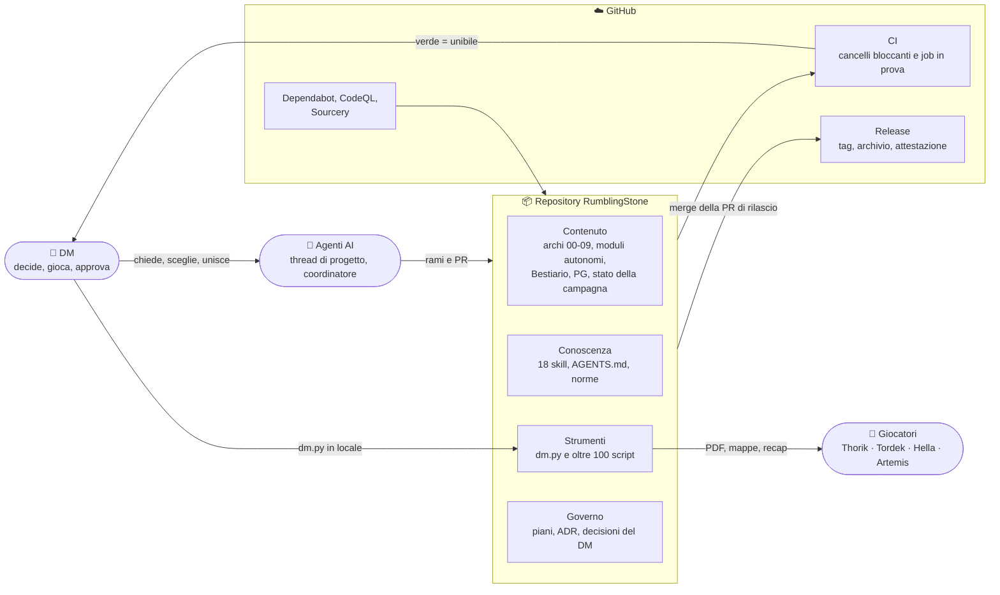

Riferimenti: [ADR-0002](../plans/adr/ADR-0002-cli-unica-dm-orchestratore.md) (un solo punto d'ingresso, `dm.py`),
[ADR-0081](../plans/adr/ADR-0081-il-contratto-d-ambiente.md) (la CI è lo
standard), [ADR-0099](../plans/adr/ADR-0099-la-piattaforma-ha-tre-canali-come-debian.md).

## 2. Le parti del repo

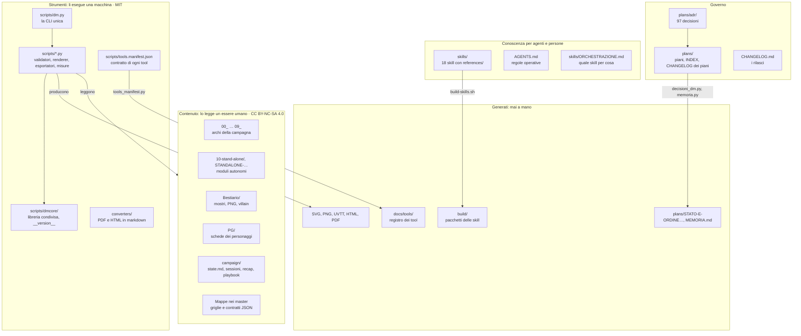

Il taglio delle licenze è in [`LICENSES.md`](../LICENSES.md): se lo legge un
essere umano al tavolo è testo, se lo esegue una macchina è strumento
([ADR-0029](../plans/adr/ADR-0029-licenza-doppia-testo-e-script.md)).

## 3. L'infrastruttura software

Dove gira cosa. Gli strumenti devono partire sul portatile del DM la sera
della sessione, spesso senza rete: per questo il nucleo è Python 3.13 con la
sola libreria standard più tre eccezioni dichiarate
([ADR-0037](../plans/adr/ADR-0037-stdlib-only-e-le-sue-eccezioni.md)), e ogni
binario esterno è facoltativo con un ripiego scritto in `scripts/binari.py`.

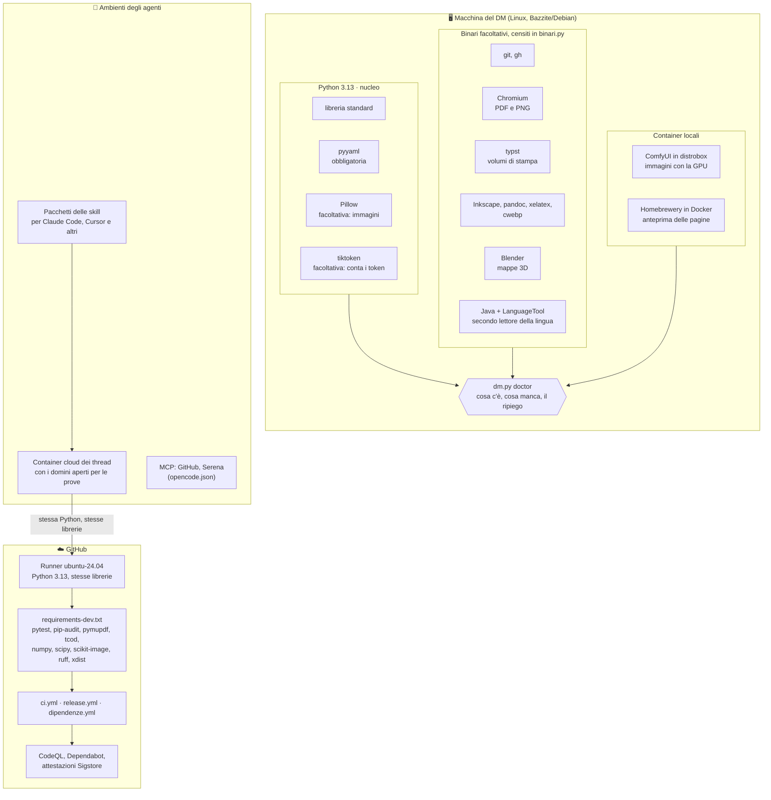

| Strato | Cosa contiene | Chi decide la versione |
|---|---|---|
| Nucleo | Python 3.13, pyyaml, Pillow, tiktoken | ADR-0037, ADR-0099 (Python sale con Debian) |
| Sviluppo e prove | `requirements-dev.txt` | Dependabot propone, la CI misura |
| Binari | git, gh, Chromium, typst, Blender, Inkscape, pandoc, LanguageTool | `scripts/binari.py`, `dm.py doctor` |
| Container | ComfyUI (`scripts/comfyui-local/`), Homebrewery (`scripts/homebrew-local/`) | i loro README |
| Convertitori | `converters/`: motori PDF, OCR, HTML | dipendenze proprie, job `convertitori` in testing |
| CI | GitHub Actions, azioni fissate a una versione | Dependabot, ADR-0099 |

## 4. Come si integrano strumenti e fonti

Il repo prende materiale da fuori (regole, moduli in PDF, generatori di
città, corpus di prosa, modelli) e lo fa passare sempre dalla stessa porta:
diventa markdown o JSON nel repo, passa i cancelli, e solo allora produce
qualcosa. Le fonti di regole entrano nelle skill con la loro licenza (OGL
1.0a) e la loro provenienza
([ADR-0005](../plans/adr/ADR-0005-confini-ip-uso-non-commerciale.md)).

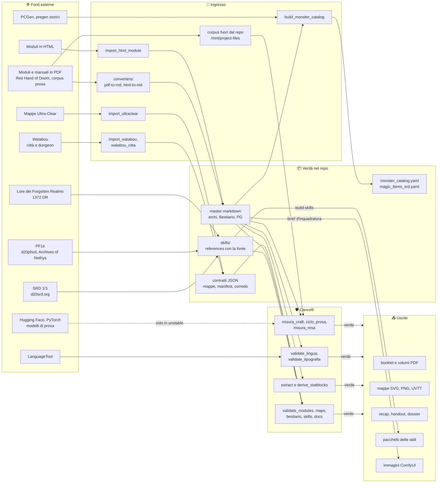

Tre regole tengono in ordine questo traffico:

- **Il materiale con diritti resta fuori dal repo.** I PDF dei moduli, i
  corpus di prosa e i pesi dei modelli vivono in cartelle esterne; nel repo
  entrano solo le misure e il markdown che il progetto ha scritto
  ([GUIDA-CONDIVISIONE-IP](guides/GUIDA-CONDIVISIONE-IP.md)).
- **Ogni dato di regole porta la sua fonte.** Uno statblocco dice da dove
  viene il numero (SRD, PF1e, `[GENERATO]` da uno script, `[INFERRED]` in
  attesa del DM); il gioco preferisce la versione più forte e segna dove
  diverge dall'SRD.
- **Un componente nuovo passa dai canali.** Un modello di Hugging Face, una
  libreria di sintassi o un generatore nuovo entrano in unstable e salgono
  solo con una misura (§16).

## 5. La regola che tiene insieme tutto

**Il markdown è la verità, tutto il resto si rigenera**
([ADR-0003](../plans/adr/ADR-0003-markdown-master-layout-generati.md)). Non si corregge un PDF, un SVG o un `.typ`: si
corregge il master e si rifà.

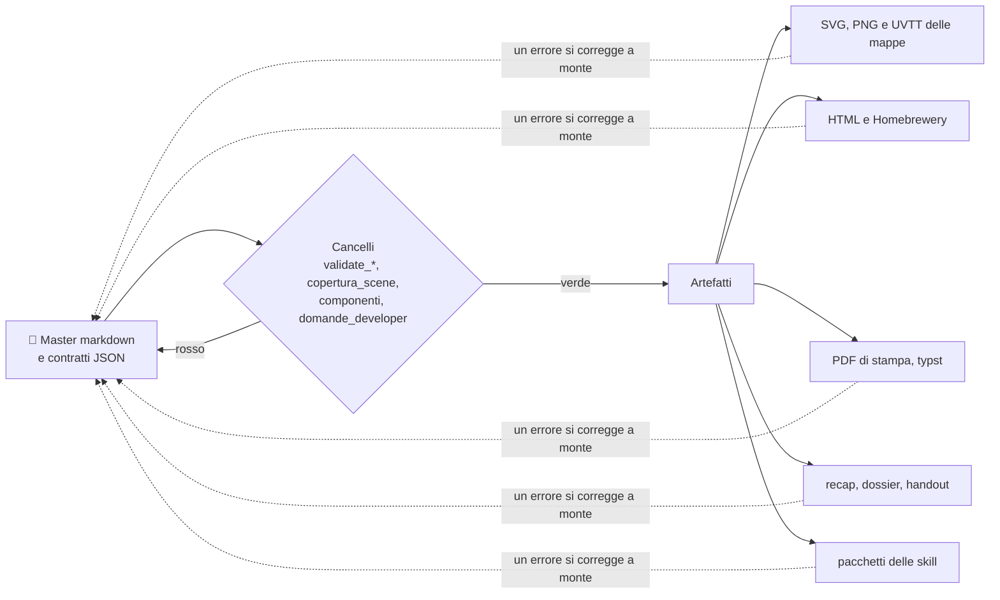

## 6. I casi d'uso

Chi fa cosa con il repo, un diagramma per attore. Gli ovali sono i casi
d'uso, le frecce piene chi li avvia, le tratteggiate le inclusioni (un caso
d'uso che ne usa un altro) e i rimandi.

**Il DM e i giocatori**

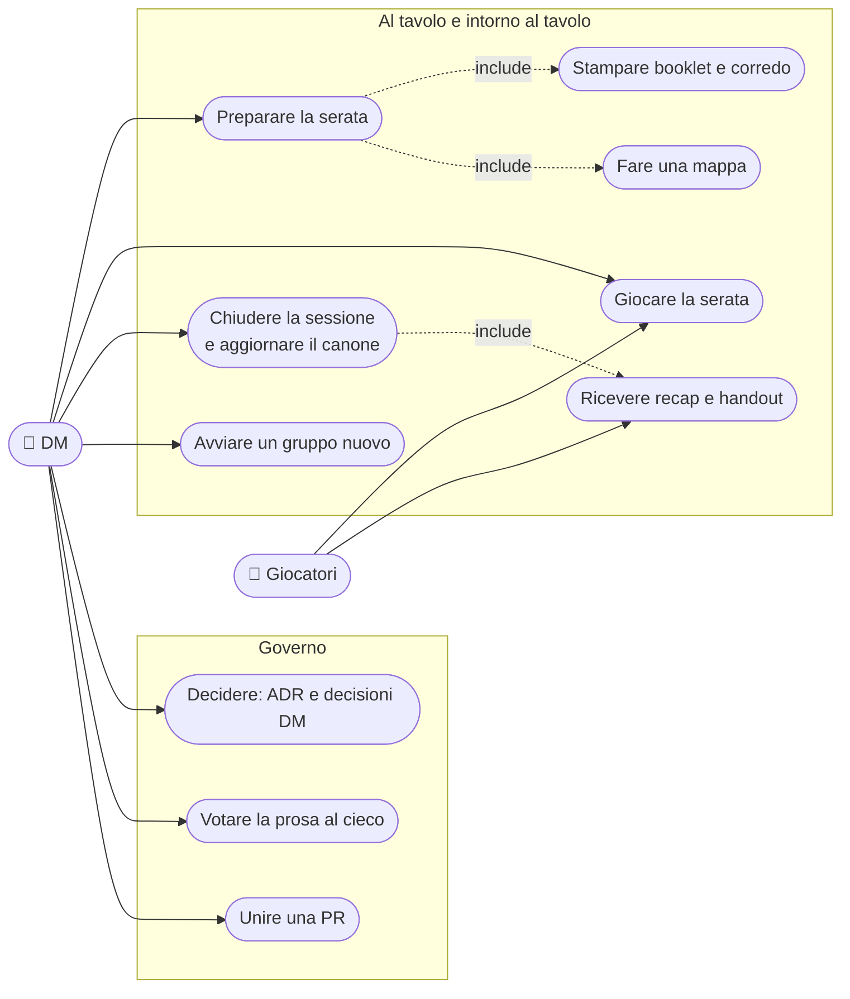

**L'agente AI**

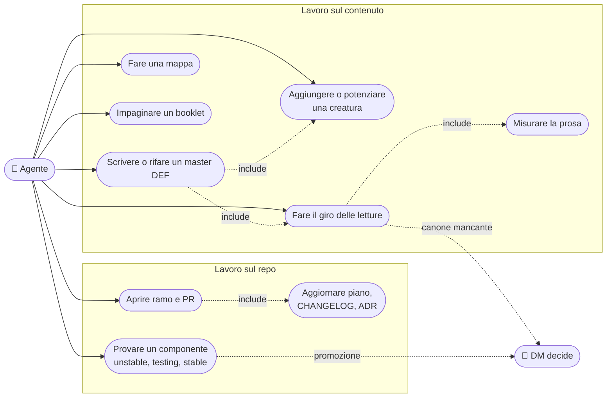

**La CI e il rilascio**

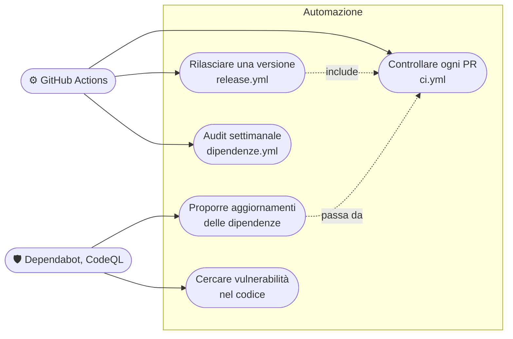

| Caso d'uso | Chi | Come | Dove si legge |
|---|---|---|---|
| Preparare la serata | DM | `dm.py prep`, `dm.py corredo` | [Playbook](../campaign/DM-CAMPAIGN-PLAYBOOK.md) §2 |
| Chiudere la sessione | DM | `dm.py session end` sul ramo di gruppo | [ADR-0007](../plans/adr/ADR-0007-scritture-canone-triplo-vincolo.md) |
| Scrivere un master DEF | agente | ciclo in sette passi, §9 | skill `rumblingstone-module-standard` |
| Il giro delle letture | agente, DM | otto passi, §9 | [ADR-0095](../plans/adr/ADR-0095-il-giro-ha-correzione-verifica-e-seconda-passata.md) |
| Misurare la prosa | agente, DM | `misura_craft`, `ciclo_prosa`, voto al cieco | [ADR-0093](../plans/adr/ADR-0093-la-prosa-migliora-se-la-sceglie-il-dm-alla-cieca.md) |
| Fare una mappa | agente | `compile_map_json` → `render_map_svg` | [GUIDA-MAPPE](guides/GUIDA-MAPPE.md) |
| Stampare | agente, DM | `dm.py volume`, `dm.py corredo` | [GUIDA-BOOKLET-E-PDF](guides/GUIDA-BOOKLET-E-PDF.md) |
| Una creatura | agente | `dm.py bestiario`, skill `npc-villain-boosting` | [GUIDA-BESTIARIO](guides/GUIDA-BESTIARIO.md) |
| Decidere | DM | tabelle `decisioni-dm` nei piani, ADR | §15 |
| Controllare una PR | CI | `ci.yml` | §14 |
| Rilasciare | CI | `release.yml` al merge | §17, [RILASCIO](RILASCIO.md) |
| La piattaforma | agente, DM | canali di ADR-0099 | §16 |
| Un gruppo nuovo | DM | `dm.py gruppo nuovo` | Playbook §7 |

## 7. I rami

`main` ha il modulo come va giocato da un gruppo qualsiasi. Ogni gruppo ha il
suo ramo `campaign-group-<nome>`, dove vive il canone giocato: `state.md`, i
diari, le scelte del tavolo. Il lavoro sul repo passa da rami brevi e da una
PR.

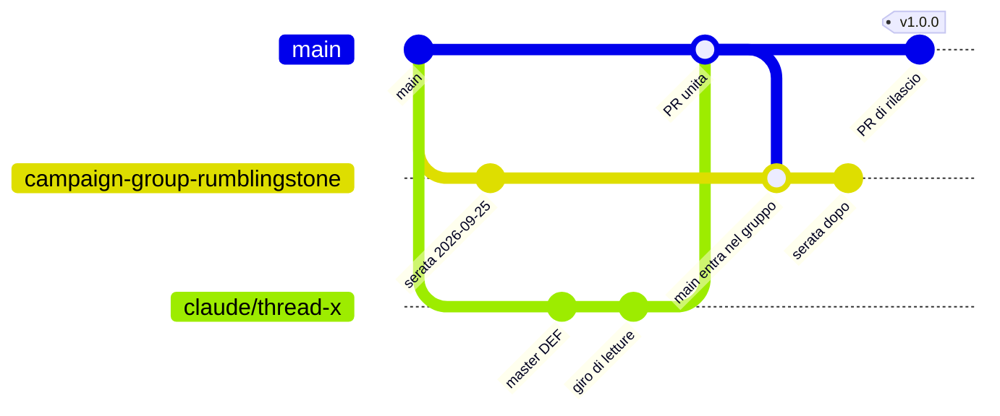

Il canone giocato non torna mai su `main` da solo: le patch del ramo di gruppo
le applica il DM. Riferimenti:
[ADR-0007](../plans/adr/ADR-0007-scritture-canone-triplo-vincolo.md),
[ADR-0090](../plans/adr/ADR-0090-la-partita-riparte-su-un-ramo-di-gruppo-nuovo.md) (il ramo di gruppo del primo tavolo).

## 8. La serata: prima, al tavolo, dopo

Nessuno script gira durante la partita: è una scelta. Le scritture di canone
passano dal **triplo vincolo** di ADR-0007: ramo di gruppo, diff confermato dal
DM, solo dentro le regioni `<!-- auto:begin … -->`.

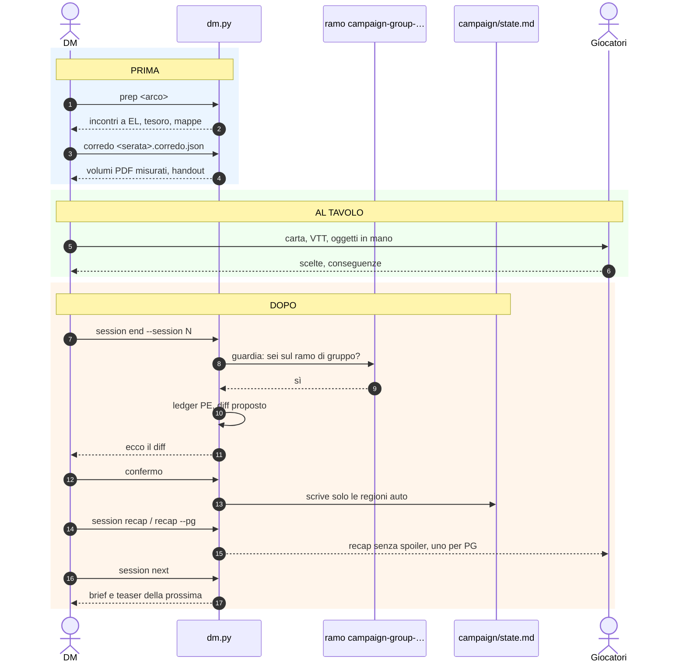

## 9. Il ciclo del master e il giro delle letture

Un master diventa **DEF** quando ha fatto sette passi
([ADR-0075](../plans/adr/ADR-0075-il-ciclo-del-master-vale-per-ogni-piano.md), skill `rumblingstone-module-standard`). I passi 1-5
sono cancelli che la CI misura; il 6 e il 7 li fanno agenti. Il passo 6 è **il
giro**, che dal 2026-10-18 ha otto passi
([ADR-0095](../plans/adr/ADR-0095-il-giro-ha-correzione-verifica-e-seconda-passata.md)).

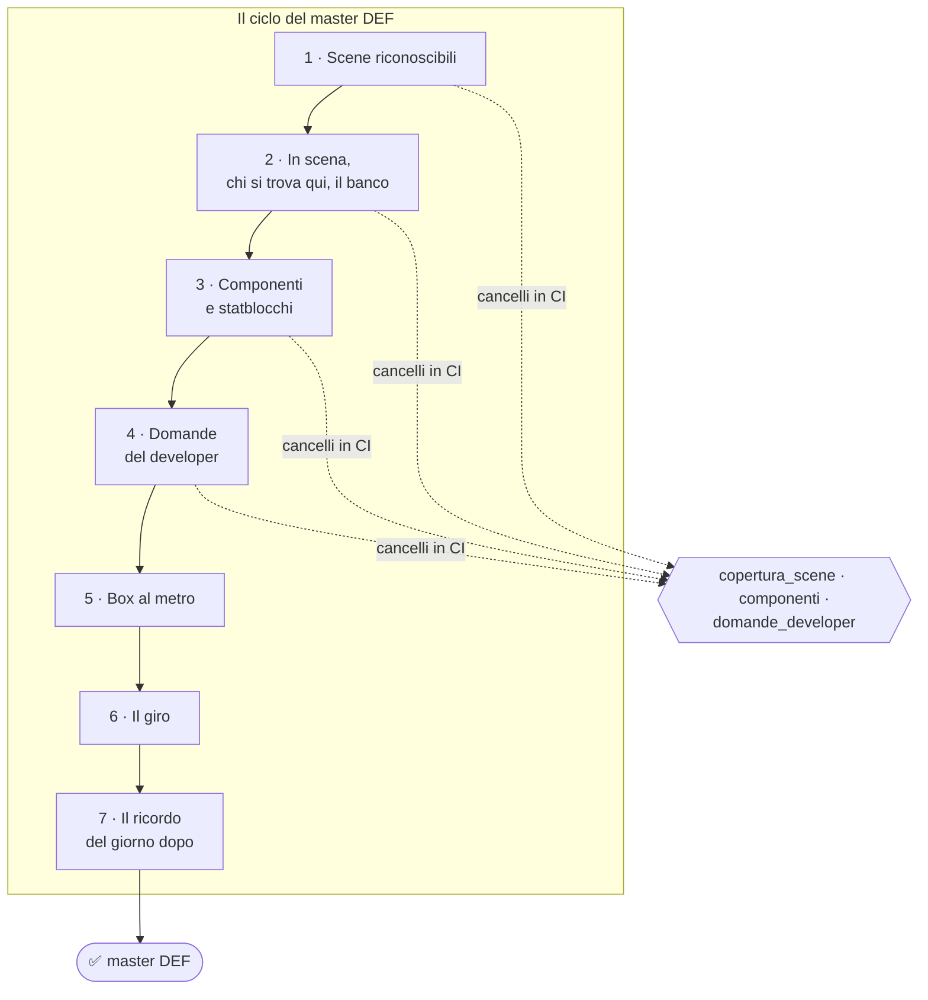

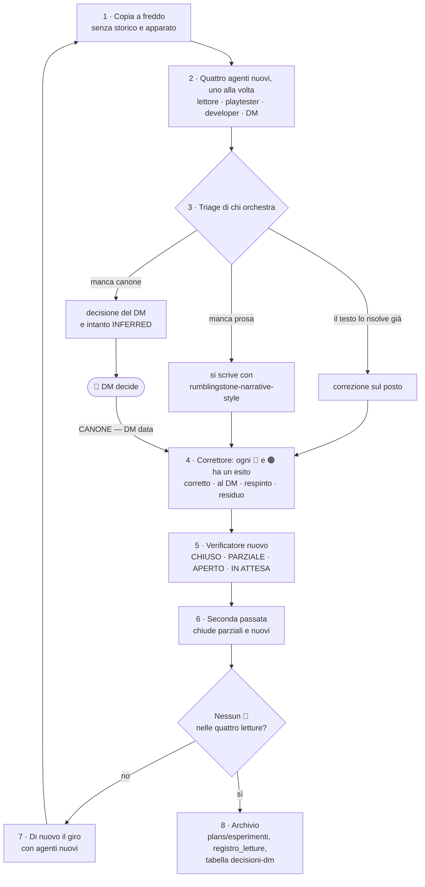

Un tipo di rilievo che ricompare in due master diversi diventa una regola di
`copertura_scene.py` o di `domande_developer.py`: le letture trovano, i
cancelli impediscono che torni.

## 10. La prosa si misura, poi decide il DM

La prosa nuova entra solo se non peggiora la misura e, nei casi indecisi, se il
DM la sceglie al cieco ([ADR-0093](../plans/adr/ADR-0093-la-prosa-migliora-se-la-sceglie-il-dm-alla-cieca.md), [ADR-0097](../plans/adr/ADR-0097-scrittura-italiana-entra-come-eccezione.md) per l'eccezione
della scrittura italiana).

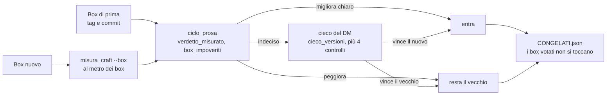

## 11. La catena delle mappe

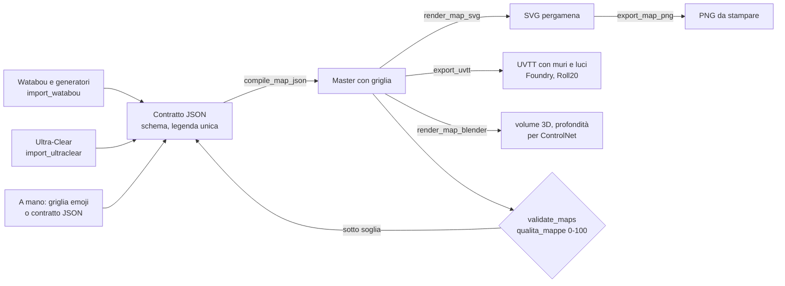

Riferimenti: [ADR-0048](../plans/adr/ADR-0048-legenda-funzionale-fonte-unica.md) (legenda funzionale, fonte unica), [ADR-0098](../plans/adr/ADR-0098-la-qualita-delle-mappe-si-misura-con-uno-standard.md) (standard di
qualità delle mappe), [GUIDA-MAPPE](guides/GUIDA-MAPPE.md).

## 12. La catena dei booklet

Due binari che leggono lo stesso manifest
([ADR-0020](../plans/adr/ADR-0020-edizione-da-stampa-su-un-secondo-binario.md)).

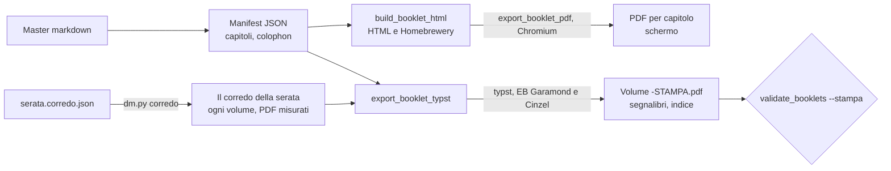

## 13. La catena delle skill

Le skill sono la conoscenza che gli agenti caricano: regole 3.5, canone,
stile, mestieri. Si scrivono una volta in `skills/` e si impacchettano per
ogni agente.

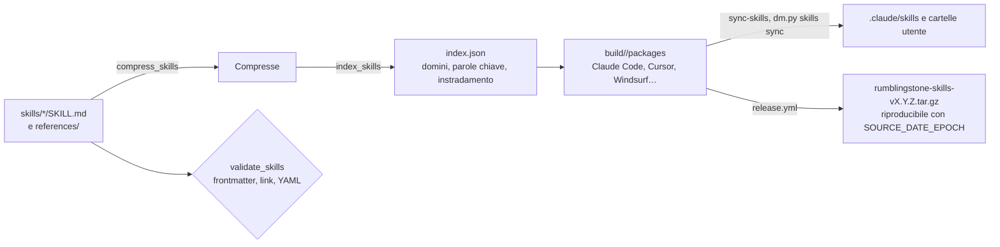

## 14. Il giro di una modifica: dal thread al merge

Ogni lavoro sul repo è un thread di progetto, un ramo e una PR. La CI decide se
si può unire, il DM decide se si unisce.

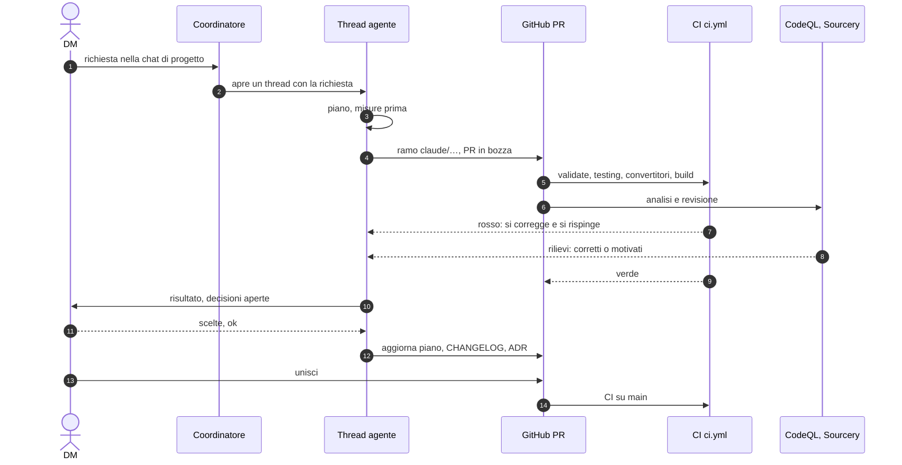

Il job principale della CI (`validate`) ha oltre 50 passi bloccanti: Python
compilato, cancelli dei documenti e dei piani, prosa, mappe, bestiario, skill,
statblocchi, test. Nella stessa PR il piano, la riga in `plans/INDEX.md` e
quella in `plans/CHANGELOG.md` vanno insieme (regola d'oro,
`check_plans_discipline.py`).

## 15. Le decisioni del DM

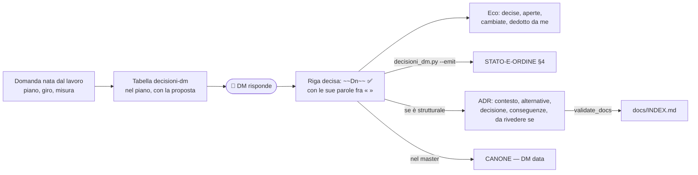

Le decisioni stanno nei piani perché `decisioni_dm.py` legge solo quelle; un
ADR si scrive quando la decisione cambia la struttura. I numeri degli ADR si
prenotano in `plans/adr-prenotati.json`.

## 16. La piattaforma e i suoi tre canali

Ogni componente di terzi (Python, librerie, binari, strumenti, azioni CI) sta
in un canale, come i pacchetti in Debian
([ADR-0099](../plans/adr/ADR-0099-la-piattaforma-ha-tre-canali-come-debian.md)).

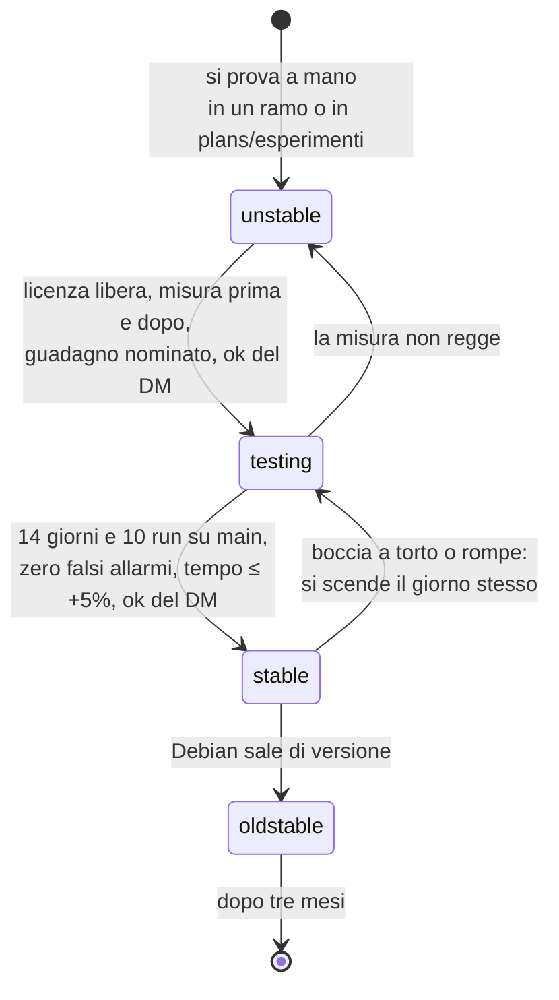

| Componente | Canale al 2026-10-23 |
|---|---|
| Python 3.13 (Debian 13), pytest, pip-audit, typst, Dependabot | stable |
| ruff (regole-bug), uv, pytest-xdist, job dei convertitori, workflow Release | testing |
| spaCy, Stanza, LLM locale, mypy | unstable |

## 17. Il rilascio

Rilasciare è unire una PR
([ADR-0100](../plans/adr/ADR-0100-il-rilascio-e-una-pr.md), guida in
[RILASCIO](RILASCIO.md)).

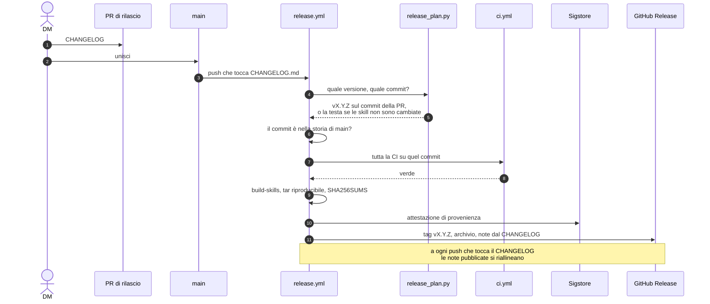

## 18. Dove sta cosa

| Cerco… | Dove |
|---|---|
| lo stato della campagna giocata | `campaign/state.md` sul ramo di gruppo |
| un master di un arco | `0N_…/ARC0N-DEF-*.md` |
| una creatura | `Bestiario/`, catalogo `scripts/monster_catalog.yaml` |
| come si usa uno script | [`docs/tools/README.md`](tools/README.md), `python3 scripts/<script>.py --help` |
| perché una cosa è fatta così | [`plans/adr/`](../plans/adr/), indice in [`docs/INDEX.md`](INDEX.md) §4 |
| cosa resta da fare | [`plans/INDEX.md`](../plans/INDEX.md), [`plans/STATO-E-ORDINE-DEI-PIANI.md`](../plans/STATO-E-ORDINE-DEI-PIANI.md) |
| cosa è cambiato fra due versioni | [`CHANGELOG.md`](../CHANGELOG.md) |
| come si prepara una macchina | [`guides/GUIDA-SETUP-MACCHINA.md`](guides/GUIDA-SETUP-MACCHINA.md) |
| le regole per gli agenti | [`AGENTS.md`](../AGENTS.md), [`skills/ORCHESTRAZIONE.md`](../skills/ORCHESTRAZIONE.md) |
